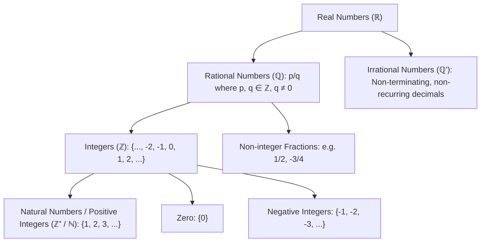
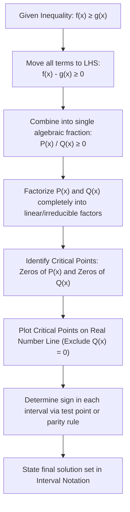
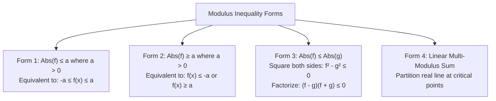

# :LiHash: Lesson 01: Real Numbers, Inequalities & Absolute Values

> [!ABSTRACT] Syllabus Scope (NIE Teacher's Guide — Grade 12, Unit 01)
> - **1.1 Real Number System**: Classification of numbers ($\mathbb{N} \subset \mathbb{Z} \subset \mathbb{Q} \subset \mathbb{R}$), rational vs irrational numbers, surds, algebraic operations on surds, rationalization of denominators.
> - **1.2 Indices & Logarithms**: Laws of indices, principal $n$-th roots, definition of logarithm ($x = b^y \iff y = \log_b x$), laws of logarithms, change of base formula, natural logarithms.
> - **1.3 Properties of Inequalities**: Trichotomy law, order axioms (addition, transitivity, multiplication by positive/negative quantities, inversion of signs, reciprocals), interval notations (bounded and unbounded).
> - **1.4 Rational Inequalities**: Sign diagram (number line / wavy curve) method for $\frac{P(x)}{Q(x)} \ge 0$, critical points, non-cross-multiplication principle.
> - **1.5 Modulus Function & Inequalities**: Formal piecewise definition ($|x|$), algebraic properties, triangle inequality, graphical sketches of $y = |ax + b|$ and $y = c|x - d| + e$, solving modulus inequalities algebraically and graphically.

> [!NOTE] Subtopic Companion Guide
> For complete step-by-step mathematical proofs, sign-table algorithms, worked A/L exam-style problems, and case-splitting techniques, see: [[Subtopics/Inequalities & Absolute Values|Inequalities & Absolute Values Guide]]

---

## 1. The Real Number System

### 1.1 Classification of Numbers
The real numbers $\mathbb{R}$ encompass all numbers that can be represented on a continuous geometric line.

$$\mathbb{N} \subset \mathbb{Z} \subset \mathbb{Q} \subset \mathbb{R}$$

* **Rational Numbers ($\mathbb{Q}$)**: Any real number expressible in the form $\frac{p}{q}$, where $p, q \in \mathbb{Z}$ and $q \ne 0$. In decimal form, they are either terminating (e.g. $0.75 = \frac{3}{4}$) or non-terminating but recurring (e.g. $0.\dot{3} = \frac{1}{3}$).
* **Irrational Numbers ($\mathbb{Q}'$)**: Numbers that cannot be expressed as a ratio of two integers. Their decimal expansions are non-terminating and non-recurring (e.g. $\sqrt{2}, \sqrt{3}, \pi, e$).
* **Surd**: An irrational root of a rational number whose value cannot be accurately expressed as a rational number (e.g. $\sqrt{5}, \sqrt[3]{7}$).

### 1.2 Surds and Rationalization
Let $a, b \in \mathbb{Q}^+$ such that $\sqrt{a}$ and $\sqrt{b}$ are surds:
1. **Multiplication and Division**:
   $$\sqrt{a} \times \sqrt{b} = \sqrt{ab}, \quad \frac{\sqrt{a}}{\sqrt{b}} = \sqrt{\frac{a}{b}}$$
2. **Conjugate Surd & Rationalization**:
   The conjugate of $(a + \sqrt{b})$ is $(a - \sqrt{b})$, and their product is rational:
   $$(a + \sqrt{b})(a - \sqrt{b}) = a^2 - b \in \mathbb{Q}$$
   To rationalize a denominator containing a binomial surd:
   $$\frac{1}{a + \sqrt{b}} = \frac{1}{a + \sqrt{b}} \times \frac{a - \sqrt{b}}{a - \sqrt{b}} = \frac{a - \sqrt{b}}{a^2 - b}$$

---

## 2. Laws of Indices & Logarithms

### 2.1 Laws of Indices
For $a, b \in \mathbb{R}$ and $m, n \in \mathbb{Z}$ (and for real exponents when base $> 0$):

| Law | Formula | Condition |
|---|---|---|
| Product of powers | $a^m \times a^n = a^{m+n}$ | — |
| Quotient of powers | $\frac{a^m}{a^n} = a^{m-n}$ | $a \ne 0$ |
| Power of a power | $(a^m)^n = a^{mn}$ | — |
| Power of a product | $(ab)^m = a^m b^m$ | — |
| Power of a quotient | $\left(\frac{a}{b}\right)^m = \frac{a^m}{b^m}$ | $b \ne 0$ |
| Zero index | $a^0 = 1$ | $a \ne 0$ |
| Negative index | $a^{-n} = \frac{1}{a^n} = \left(\frac{1}{a}\right)^n$ | $a \ne 0$ |
| Fractional index | $a^{m/n} = \sqrt[n]{a^m} = (\sqrt[n]{a})^m$ | $n \in \mathbb{Z}^+, n \ge 2$ |

### 2.2 Definition and Laws of Logarithms
Let $b > 0$ and $b \ne 1$. For any positive real number $x > 0$:
$$y = \log_b x \iff b^y = x$$

**Fundamental Properties**:
* $\log_b 1 = 0$ (since $b^0 = 1$)
* $\log_b b = 1$ (since $b^1 = b$)
* $b^{\log_b x} = x$
* $\log_b (b^x) = x$

**Core Laws of Logarithms** ($M, N > 0$, $b > 0, b \ne 1$):
1. **Product Rule**: $\log_b (MN) = \log_b M + \log_b N$
2. **Quotient Rule**: $\log_b \left(\frac{M}{N}\right) = \log_b M - \log_b N$
3. **Power Rule**: $\log_b (M^p) = p \log_b M \quad (p \in \mathbb{R})$
4. **Change of Base Formula**:
   $$\log_b x = \frac{\log_a x}{\log_a b} \quad (a > 0, a \ne 1)$$
5. **Reciprocal Base Identity**:
   $$\log_b a = \frac{1}{\log_a b}$$

---

## 3. Real Inequalities & Order Axioms

### 3.1 Trichotomy Law
For any two real numbers $a, b \in \mathbb{R}$, **exactly one** of the following three statements is true:
$$a > b, \quad a = b, \quad \text{or} \quad a < b$$

* $a > b \iff (a - b) \in \mathbb{R}^+ \iff a - b > 0$
* $a < b \iff (a - b) \in \mathbb{R}^- \iff a - b < 0$

### 3.2 Fundamental Order Axioms and Properties
Let $a, b, c, d \in \mathbb{R}$:

1. **Transitivity**:
   $$a > b \text{ and } b > c \implies a > c$$
2. **Addition / Subtraction**:
   $$a > b \implies a + c > b + c \quad \text{and} \quad a - c > b - c$$
3. **Multiplication by a Positive Quantity**:
   $$a > b \text{ and } c > 0 \implies ac > bc$$
4. **Multiplication by a Negative Quantity (Reversal of Inequality)**:
   $$a > b \text{ and } c < 0 \implies ac < bc$$
5. **Addition of Inequalities of the Same Sense**:
   $$a > b \text{ and } c > d \implies a + c > b + d$$
6. **Multiplication of Positive Inequalities**:
   $$a > b > 0 \text{ and } c > d > 0 \implies ac > bd$$
7. **Reciprocals**:
   $$a > b > 0 \implies \frac{1}{a} < \frac{1}{b}$$
   $$a < b < 0 \implies \frac{1}{a} < \frac{1}{b}$$
8. **Powers**:
   For $a > b > 0$ and $n \in \mathbb{Q}^+$:
   $$a^n > b^n \quad \text{and} \quad a^{-n} < b^{-n}$$

### 3.3 Interval Notations

| Set Notation | Interval Notation | Description |
|---|---|---|
| $\{x \in \mathbb{R} : a \le x \le b\}$ | $[a, b]$ | Closed interval (both endpoints included) |
| $\{x \in \mathbb{R} : a < x < b\}$ | $(a, b)$ | Open interval (neither endpoint included) |
| $\{x \in \mathbb{R} : a \le x < b\}$ | $[a, b)$ | Half-open / Half-closed interval |
| $\{x \in \mathbb{R} : a < x \le b\}$ | $(a, b]$ | Half-open / Half-closed interval |
| $\{x \in \mathbb{R} : x \ge a\}$ | $[a, \infty)$ | Infinite interval bounded below |
| $\{x \in \mathbb{R} : x < b\}$ | $(-\infty, b)$ | Infinite interval bounded above |
| $\mathbb{R}$ | $(-\infty, \infty)$ | Entire real line |

---

## 4. Rational Inequalities & The Sign Diagram Method

### 4.1 The Non-Cross-Multiplication Principle

> [!WARNING] Golden Rule of Inequalities
> **NEVER cross-multiply by an expression containing the variable $x$** unless the expression is proven to be strictly positive (or strictly negative) for all permissible values of $x$.
>
> If you multiply by $Q(x)$ and $Q(x) < 0$, the inequality sign must flip. Since the sign of $Q(x)$ depends on $x$, cross-multiplying directly invalidates the solution.

### 4.2 Standard Algorithm
To solve an inequality of the form $\frac{P(x)}{Q(x)} \ge 0$ (or $\le 0$):
1. **Bring all terms to one side**: $\frac{P(x)}{Q(x)} \ge 0$.
2. **Factorize numerator and denominator** into linear factors $(x - c_i)$ and irreducible quadratic factors $(ax^2 + bx + c)$ with $\Delta = b^2 - 4ac < 0$.
   *(Note: An irreducible quadratic with $a > 0$ and $\Delta < 0$ is strictly positive for all $x \in \mathbb{R}$ and can be divided out without changing the sign).*
3. **Locate critical points**: Values of $x$ where numerator $= 0$ (zeros) and denominator $= 0$ (poles / undefined points).
4. **Construct the sign chart**:
   * Denominator critical points MUST always have open brackets (strictly excluded).
   * Alternate signs across each linear factor with odd multiplicity.
5. **Write the solution** as a union of intervals.

---

## 5. Absolute Value (Modulus) Function & Inequalities

### 5.1 Formal Definition of Modulus
The absolute value (modulus) of a real number $x$, denoted by $|x|$, represents the geometric distance of $x$ from the origin on the real number line:

$$|x| = \begin{cases} x, & \text{if } x \ge 0 \\ -x, & \text{if } x < 0 \end{cases}$$

For any real function $f(x)$:
$$|f(x)| = \begin{cases} f(x), & \text{if } f(x) \ge 0 \\ -f(x), & \text{if } f(x) < 0 \end{cases}$$

### 5.2 Core Properties of Modulus
Let $a, b \in \mathbb{R}$:
1. **Non-negativity**: $|a| \ge 0$, and $|a| = 0 \iff a = 0$.
2. **Symmetry**: $|-a| = |a|$.
3. **Squared Modulus**: $|a|^2 = a^2$.
4. **Square Root Relation**: $\sqrt{a^2} = |a|$.
5. **Multiplicative Property**: $|ab| = |a| \cdot |b|$ and $\left|\frac{a}{b}\right| = \frac{|a|}{|b|}$ ($b \ne 0$).
6. **Bounds Relation**: $-|a| \le a \le |a|$.
7. **Triangle Inequality**:
   $$\boxed{|a + b| \le |a| + |b|}$$
   *Equality holds if and only if $a$ and $b$ have the same sign (i.e. $ab \ge 0$).*
8. **Reverse Triangle Inequality**:
   $$\big||a| - |b|\big| \le |a - b|$$

### 5.3 Standard Modulus Inequality Forms

#### Form 1: $|f(x)| \le a$ (where $a > 0$)
Geometrically, the distance of $f(x)$ from 0 is at most $a$:
$$-a \le f(x) \le a$$

#### Form 2: $|f(x)| \ge a$ (where $a > 0$)
Geometrically, the distance of $f(x)$ from 0 is at least $a$:
$$f(x) \le -a \quad \text{or} \quad f(x) \ge a$$

#### Form 3: $|f(x)| \le |g(x)|$ (Modulus on Both Sides)
Since both sides are non-negative, squaring preserves the inequality:
$$[f(x)]^2 \le [g(x)]^2 \iff [f(x)]^2 - [g(x)]^2 \le 0$$
Using the difference of two squares:
$$\boxed{(f(x) - g(x))(f(x) + g(x)) \le 0}$$
This transforms the modulus problem into a standard polynomial inequality without needing separate cases!

#### Form 4: Equations/Inequalities with Multiple Moduli (Case Splitting)
For expressions such as $|x - a| + |x - b| \le k$:
1. Mark the critical points $x = a$ and $x = b$ on the number line.
2. Partition the real line into distinct intervals: $(-\infty, a)$, $[a, b)$, and $[b, \infty)$.
3. In each interval, replace each $|x - c|$ with its algebraic definition based on its sign.
4. Solve the linear inequality within each interval, taking the intersection with the interval domain.
5. Take the union of valid solutions from all intervals.

### 5.4 Graphical Method for Modulus Functions
The graph of $y = |ax + b|$ is a V-shaped curve with vertex at $(-b/a, 0)$:
* For $x \ge -b/a$: line $y = ax + b$ with slope $a$.
* For $x < -b/a$: line $y = -(ax + b)$ with slope $-a$.

To solve $|ax + b| \le cx + d$ graphically:
1. Plot $y_1 = |ax + b|$ (V-shape).
2. Plot $y_2 = cx + d$ (straight line).
3. Find the points of intersection by solving the algebraic equations.
4. Identify the $x$-range where the V-curve lies below or on the line $y_2$.

---

## 6. Summary Comparison Table

| Problem Type | Standard Form | Solution Technique |
|---|---|---|
| **Simple Modulus Bound** | $|f(x)| \le a$ | Double inequality: $-a \le f(x) \le a$ |
| **Simple Modulus Bound** | $|f(x)| \ge a$ | Two disjoint rays: $f(x) \le -a$ or $f(x) \ge a$ |
| **Two Moduli Comparison** | $|f(x)| \le |g(x)|$ | Difference of squares: $(f - g)(f + g) \le 0$ |
| **Rational Inequality** | $\frac{P(x)}{Q(x)} \ge 0$ | Factorize into $(x - c_i)$; use sign diagram; $Q(x) \ne 0$ |
| **Multi-Modulus Expression** | $\sum |a_i x + b_i| \le k$ | Critical point partitioning into intervals |
| **Modulus vs Linear** | $|ax + b| \le cx + d$ | Graphical intersection or piecewise definition |

---

## :LiRocket: Flashcards (Spaced Repetition)

#flashcards

State the change of base formula for logarithms. :: $\log_b x = \frac{\log_a x}{\log_a b}$.
<!--SR:!2026-09-28,3,250-->

What is the golden rule when solving algebraic inequalities involving fractions? :: Never cross-multiply by an expression containing the variable unless its sign is known to be strictly positive; bring all terms to one side and use a sign diagram.

What is the equivalent algebraic condition for $|f(x)| \le a$ (where $a > 0$)? :: $-a \le f(x) \le a$.
<!--SR:!2026-09-29,4,270-->

What is the equivalent algebraic condition for $|f(x)| \ge a$ (where $a > 0$)? :: $f(x) \le -a$ or $f(x) \ge a$.

How can an inequality of the form $|f(x)| \le |g(x)|$ be solved efficiently without case splitting? :: By squaring both sides: $[f(x)]^2 \le [g(x)]^2 \iff [f(x)]^2 - [g(x)]^2 \le 0 \iff (f(x)-g(x))(f(x)+g(x)) \le 0$.
<!--SR:!2026-09-28,3,250-->

State the Triangle Inequality for real numbers. :: $|a + b| \le |a| + |b|$.
<!--SR:!2026-09-26,1,230-->

Under what condition does equality hold in the Triangle Inequality $|a + b| = |a| + |b|$? :: When $a$ and $b$ have the same sign or at least one is zero, i.e., $ab \ge 0$.

What is the Trichotomy Law for real numbers? :: For any two real numbers $a, b \in \mathbb{R}$, exactly one of the following is true: $a > b$, $a = b$, or $a < b$.

State the effect of multiplying both sides of an inequality by a negative number $c < 0$. :: The direction of the inequality sign is reversed: $a > b \text{ and } c < 0 \implies ac < bc$.

If $a > b > 0$, what is the relationship between their reciprocals $\frac{1}{a}$ and $\frac{1}{b}$? :: $\frac{1}{a} < \frac{1}{b}$ (the inequality reverses for positive numbers).

State the formal piecewise definition of the absolute value function $|x|$. :: $|x| = x$ if $x \ge 0$, and $|x| = -x$ if $x < 0$.

Why must the zeros of the denominator $Q(x)$ always be excluded with open brackets when solving $\frac{P(x)}{Q(x)} \ge 0$? :: Because division by zero is undefined in mathematics; $Q(x) = 0$ has no real value.

How is the denominator of $\frac{1}{a + \sqrt{b}}$ rationalized when $a, b \in \mathbb{Q}^+$ and $\sqrt{b}$ is a surd? :: By multiplying both numerator and denominator by the conjugate $(a - \sqrt{b})$: $\frac{1}{a + \sqrt{b}} \times \frac{a - \sqrt{b}}{a - \sqrt{b}} = \frac{a - \sqrt{b}}{a^2 - b}$.

What is the relationship between $\sqrt{x^2}$ and $x$ for any real number $x$? :: $\sqrt{x^2} = |x|$ (not simply $x$, because the principal square root is always non-negative).

State the Reverse Triangle Inequality for real numbers. :: $\big||a| - |b|\big| \le |a - b|$.

What are the coordinates of the vertex of the V-shaped graph $y = |ax + b|$? :: The vertex is at $\left(-\frac{b}{a}, 0\right)$.

What is the reciprocal base identity for logarithms? :: $\log_b a = \frac{1}{\log_a b}$.

How is an inequality with multiple moduli like $|x - 1| + |x - 4| \le 5$ solved algebraically? :: By partitioning the real line at the critical points ($x = 1, 4$) into intervals $(-\infty, 1)$, $[1, 4)$, and $[4, \infty)$, solving in each case, and taking the union of the solutions.
