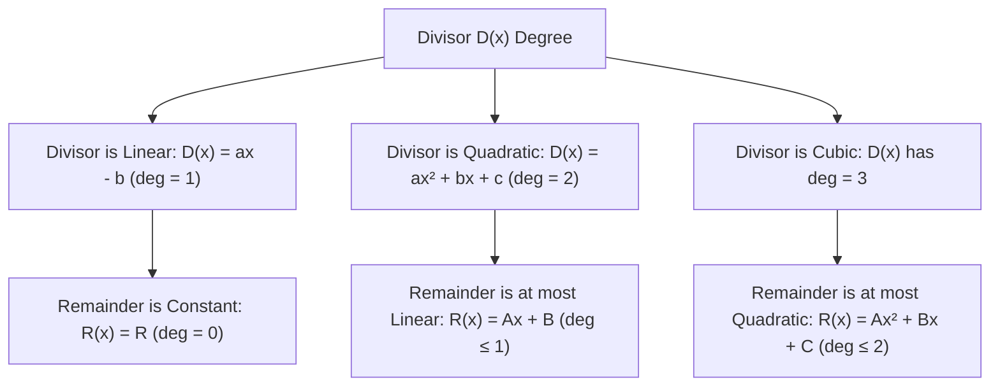
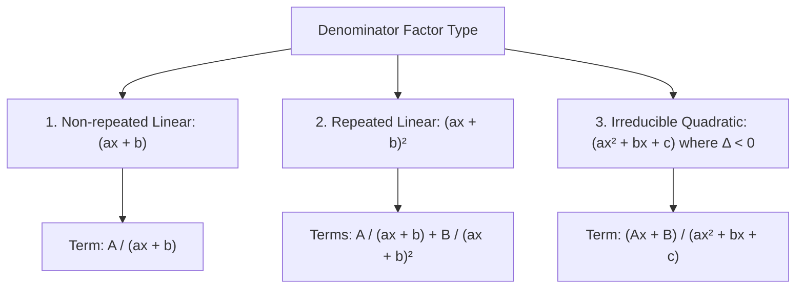

# :LiPuzzle: Lesson 02: Polynomials, Remainder Theorem & Partial Fractions

> [!ABSTRACT] Syllabus Scope (NIE Teacher's Guide — Grade 12, Unit 02)
> - **2.1 Polynomial Functions**: General definition $P(x) = a_n x^n + a_{n-1} x^{n-1} + \dots + a_1 x + a_0$, degree, leading coefficient, identity of two polynomials ($P(x) \equiv Q(x)$).
> - **2.2 Division Algorithm**: $P(x) \equiv D(x) Q(x) + R(x)$ where $\deg(R) < \deg(D)$, degree relations, polynomial long division.
> - **2.3 Remainder Theorem**: Statement and formal proof for divisor $(x - a)$ and $(ax - b)$, extended remainder theorem for quadratic and cubic divisors.
> - **2.4 Factor Theorem & Roots**: Factor theorem and its converse, identifying zeros/roots, factorizing polynomials of degree up to 4.
> - **2.5 Rational Functions & Partial Fractions**: Proper vs improper rational functions, long division reduction for improper fractions, resolution into partial fractions (distinct linear, repeated linear, and irreducible quadratic factors), Heaviside cover-up and coefficient-equating methods.

> [!NOTE] Subtopic Companion Guide
> For complete algebraic proofs, extended remainder theorem derivations, advanced 4-unknown systems, and worked partial fraction examples, see: [[Subtopics/Polynomials & Partial Fractions|Polynomials & Partial Fractions Guide]]

---

## 1. Polynomial Functions & Identity

### 1.1 Definition & Terminology
A **polynomial in a single real variable $x$** is an algebraic expression of the form:

$$P(x) = a_n x^n + a_{n-1} x^{n-1} + a_{n-2} x^{n-2} + \dots + a_1 x + a_0$$

where:
* $n \in \mathbb{Z}^+ \cup \{0\}$ is a non-negative integer representing the **degree** of the polynomial (denoted $\deg(P) = n$), provided $a_n \ne 0$.
* $a_n, a_{n-1}, \dots, a_1, a_0 \in \mathbb{R}$ are real constants called **coefficients**.
* $a_n$ is the **leading coefficient**, and $a_n x^n$ is the **leading term**.
* $a_0$ is the **constant term**.

**Classification by Degree**:

| Degree $n$ | Name | General Form |
|---|---|---|
| $0$ | Constant | $P(x) = c \quad (c \ne 0)$ |
| $1$ | Linear | $P(x) = ax + b \quad (a \ne 0)$ |
| $2$ | Quadratic | $P(x) = ax^2 + bx + c \quad (a \ne 0)$ |
| $3$ | Cubic | $P(x) = ax^3 + bx^2 + cx + d \quad (a \ne 0)$ |
| $4$ | Quartic | $P(x) = ax^4 + bx^3 + cx^2 + dx + e \quad (a \ne 0)$ |

*(Note: The zero polynomial $P(x) \equiv 0$ has no leading coefficient, and its degree is formally undefined or taken as $-\infty$).*

### 1.2 Identity of Polynomials
Two polynomials $P(x)$ and $Q(x)$ are **identically equal** (written $P(x) \equiv Q(x)$) if and only if:
1. They have the same degree: $\deg(P) = \deg(Q) = n$.
2. The coefficients of corresponding powers of $x$ are strictly equal:
   $$a_k = b_k \quad \text{for all } k \in \{0, 1, 2, \dots, n\}$$

> [!IMPORTANT] Equating Coefficients vs Value Substitution
> If $P(x) \equiv Q(x)$, the equality holds for **all possible real values of $x$**. Thus, you can either:
> - **Equate coefficients** of identical powers of $x$ on both sides.
> - **Substitute arbitrary convenient values** of $x$ (such as zeros of factors) to create linear equations in unknown constants.

---

## 2. The Polynomial Division Algorithm

For any polynomial dividend $P(x)$ and non-zero polynomial divisor $D(x)$, there exist unique polynomials $Q(x)$ (**quotient**) and $R(x)$ (**remainder**) such that:

$$\boxed{P(x) \equiv D(x) Q(x) + R(x)}$$

where either:
$$R(x) \equiv 0 \quad \text{or} \quad \deg(R) < \deg(D)$$

**Degree Relationships**:
* $\deg(P) = \deg(D) + \deg(Q)$
* $\deg(R) \le \deg(D) - 1$

---

## 3. Remainder Theorem & Factor Theorem

### 3.1 Statement and Proof of the Remainder Theorem

> [!KEY-CONCEPT] The Remainder Theorem
> When a polynomial $P(x)$ is divided by a linear expression $(x - a)$, the remainder is the numerical value $P(a)$.
> More generally, when $P(x)$ is divided by $(ax - b)$ where $a \ne 0$, the remainder is $P\left(\frac{b}{a}\right)$.

**Formal Proof**:
By the division algorithm, dividing $P(x)$ by the linear divisor $(x - a)$ gives a quotient $Q(x)$ and a remainder $R$ of degree $< 1$ (hence $R$ is a constant):
$$P(x) \equiv (x - a) Q(x) + R$$

Since this identity holds for **all** $x \in \mathbb{R}$, substitute $x = a$:
$$P(a) = (a - a) Q(a) + R$$
$$P(a) = 0 \cdot Q(a) + R$$
$$\boxed{R = P(a)} \quad \blacksquare$$

Similarly, for divisor $(ax - b)$:
$$P(x) \equiv (ax - b) Q(x) + R$$
Substituting $x = \frac{b}{a}$:
$$P\left(\frac{b}{a}\right) = \left(a \cdot \frac{b}{a} - b\right) Q\left(\frac{b}{a}\right) + R = 0 + R \implies \boxed{R = P\left(\frac{b}{a}\right)} \quad \blacksquare$$

---

### 3.2 The Factor Theorem & Its Converse

> [!KEY-CONCEPT] The Factor Theorem
> A linear expression $(x - a)$ is a factor of a polynomial $P(x)$ **if and only if** $P(a) = 0$.
> Similarly, $(ax - b)$ is a factor of $P(x)$ **if and only if** $P\left(\frac{b}{a}\right) = 0$.

* **Direct Part**: If $(x - a)$ is a factor of $P(x)$, then $P(x) \equiv (x - a) Q(x)$ with remainder $R = 0$. Hence $P(a) = (a - a)Q(a) = 0$.
* **Converse Part**: If $P(a) = 0$, by the remainder theorem the remainder upon division by $(x - a)$ is $R = P(a) = 0$. Hence $P(x) \equiv (x - a)Q(x)$, which means $(x - a)$ is a factor of $P(x)$.

**Zeros (Roots) of a Polynomial**:
A real number $\alpha$ is a **zero** of the polynomial $P(x)$ if $P(\alpha) = 0$.
By the factor theorem:
$$\alpha \text{ is a zero of } P(x) \iff (x - \alpha) \text{ is a factor of } P(x)$$

---

### 3.3 Extended Remainder Theorem (Quadratic Divisors)
When $P(x)$ is divided by a quadratic divisor $D(x) = (x - a)(x - b)$ with $a \ne b$:
$$P(x) \equiv (x - a)(x - b) Q(x) + (Ax + B)$$
where the remainder $R(x) = Ax + B$ is linear.

To determine the unknown constants $A$ and $B$:
* Substitute $x = a$: $P(a) = Aa + B$
* Substitute $x = b$: $P(b) = Ab + B$
Solving this simultaneous system yields $A$ and $B$ directly.

---

## 4. Rational Functions & Partial Fractions

### 4.1 Proper vs Improper Rational Functions
A **rational function** is the ratio of two polynomials:
$$f(x) = \frac{P(x)}{Q(x)} \quad (Q(x) \not\equiv 0)$$

* **Proper Rational Function**: $\deg(P) < \deg(Q)$.
* **Improper Rational Function**: $\deg(P) \ge \deg(Q)$.

> [!WARNING] Mandatory Long Division Step for Improper Fractions
> If $\deg(P) \ge \deg(Q)$, you **MUST** perform polynomial long division before decomposing into partial fractions:
> $$\frac{P(x)}{Q(x)} = K(x) + \frac{R(x)}{Q(x)}$$
> where $K(x)$ is the polynomial quotient and $\frac{R(x)}{Q(x)}$ is a proper rational function ($\deg(R) < \deg(Q)$).
> * If $\deg(P) = \deg(Q)$, $K(x)$ is a non-zero constant $K$.
> * If $\deg(P) = \deg(Q) + 1$, $K(x)$ is a linear expression $(Ax + B)$.

---

### 4.2 Standard Partial Fraction Decomposition Templates

| Factor in Denominator $Q(x)$ | Corresponding Partial Fraction Term(s) |
|---|---|
| **Distinct Linear** $(ax + b)$ | $\dfrac{A}{ax + b}$ |
| **Repeated Linear** $(ax + b)^2$ | $\dfrac{A}{ax + b} + \dfrac{B}{(ax + b)^2}$ |
| **Repeated Linear** $(ax + b)^3$ | $\dfrac{A}{ax + b} + \dfrac{B}{(ax + b)^2} + \dfrac{C}{(ax + b)^3}$ |
| **Irreducible Quadratic** $(ax^2 + bx + c)$ with $b^2 - 4ac < 0$ | $\dfrac{Ax + B}{ax^2 + bx + c}$ |

---

### 4.3 Methods to Determine Unknown Coefficients

1. **Heaviside's Cover-Up Method (Fastest for Distinct Linear Factors)**:
   For $\frac{P(x)}{(x - a)(x - b)} = \frac{A}{x - a} + \frac{B}{x - b}$:
   $$A = \left. \frac{P(x)}{x - b} \right|_{x = a}, \quad B = \left. \frac{P(x)}{x - a} \right|_{x = b}$$
2. **Method of Strategic Substitution**:
   Multiply through by $Q(x)$ to obtain an identity in $x$. Substitute values of $x$ that make individual linear factors equal to zero.
3. **Method of Equating Coefficients**:
   Expand both sides and equate coefficients of identical powers ($x^3, x^2, x^1, x^0$).
4. **Hybrid Method (Recommended for Exams)**:
   Use substitution to find the linear coefficients immediately, then equate the highest power of $x$ or set $x = 0$ (constant term) to find the remaining coefficients.

---

## 5. Summary Formula Reference Table

| Concept | Equation / Formula | Note |
|---|---|---|
| **Division Algorithm** | $P(x) \equiv D(x) Q(x) + R(x)$ | $\deg(R) < \deg(D)$ |
| **Remainder Theorem** | $R = P(a)$ when divided by $(x - a)$ | $R = P(b/a)$ for $(ax - b)$ |
| **Factor Theorem** | $(x - a) \text{ is a factor} \iff P(a) = 0$ | Direct & converse |
| **Extended Remainder** | $R(x) = Ax + B$ | Quadratic divisor $(x-a)(x-b)$ |
| **Improper Reduction** | $\frac{P(x)}{Q(x)} = K(x) + \frac{R(x)}{Q(x)}$ | Required when $\deg(P) \ge \deg(Q)$ |
| **Distinct Linear Term** | $\frac{A}{x - a}$ | $A = P(a) / Q'(a)$ |
| **Repeated Linear Terms** | $\frac{A}{x - a} + \frac{B}{(x - a)^2}$ | Highest power handles singularity |
| **Quadratic Term** | $\frac{Ax + B}{x^2 + px + q}$ | Numerator is linear |

---

## :LiRocket: Flashcards (Spaced Repetition)

#flashcards

State the Remainder Theorem for a polynomial $P(x)$ divided by $(ax - b)$. :: The remainder is $R = P\left(\frac{b}{a}\right)$.
<!--SR:!2026-09-29,4,270-->

State the Factor Theorem. :: $(ax - b)$ is a factor of polynomial $P(x)$ if and only if $P\left(\frac{b}{a}\right) = 0$.
<!--SR:!2026-09-29,4,270-->

What is the general form of the remainder when a polynomial $P(x)$ is divided by a quadratic expression $(x - a)(x - b)$? :: A linear expression $R(x) = A x + B$.

What must be done before resolving a rational fraction $\frac{P(x)}{Q(x)}$ into partial fractions if $\deg(P) \ge \deg(Q)$? :: Perform polynomial long division to express it as a polynomial plus a proper rational fraction $\frac{R(x)}{Q(x)}$.

What is the partial fraction template for a repeated linear factor $(x - a)^2$ in the denominator? :: $\frac{A}{x - a} + \frac{B}{(x - a)^2}$.

What is the partial fraction template for an irreducible quadratic factor $(x^2 + px + q)$ in the denominator? :: $\frac{A x + B}{x^2 + px + q}$.
<!--SR:!2026-09-29,4,270-->

Prove the Remainder Theorem for a polynomial $P(x)$ divided by $(x - a)$. :: Division algorithm gives $P(x) \equiv (x - a)Q(x) + R$ where $R$ is constant. Substituting $x = a$ yields $P(a) = (0)Q(a) + R \implies R = P(a)$.

What is the condition for two polynomials $P(x)$ and $Q(x)$ to be identically equal ($P(x) \equiv Q(x)$)? :: They must have the same degree, and the coefficients of corresponding powers of $x$ must be strictly equal.

What is the degree relationship between the dividend $P(x)$, divisor $D(x)$, quotient $Q(x)$, and remainder $R(x)$? :: $\deg(P) = \deg(D) + \deg(Q)$, and either $R(x) \equiv 0$ or $\deg(R) \le \deg(D) - 1$.

What is the maximum degree of the remainder when a polynomial is divided by a cubic divisor? :: Degree $2$ (quadratic: $R(x) = Ax^2 + Bx + C$).

What is the partial fraction template for $\frac{1}{(x - 1)(x + 2)^2(x^2 + 1)}$? :: $\frac{A}{x - 1} + \frac{B}{x + 2} + \frac{C}{(x + 2)^2} + \frac{Dx + E}{x^2 + 1}$.

State Heaviside's cover-up rule for finding coefficient $A$ in $\frac{P(x)}{(x - a)(x - b)} = \frac{A}{x - a} + \frac{B}{x - b}$. :: Cover up $(x - a)$ in the original fraction and evaluate the rest at $x = a$: $A = \frac{P(a)}{a - b}$.

If a polynomial $P(x)$ leaves remainder $r_1$ when divided by $(x - a)$ and remainder $r_2$ when divided by $(x - b)$, how is the remainder when divided by $(x - a)(x - b)$ found? :: Set $P(x) \equiv (x - a)(x - b)Q(x) + (Ax + B)$. Solve $Aa + B = r_1$ and $Ab + B = r_2$ simultaneously for $A$ and $B$.

Why does an irreducible quadratic factor in the denominator require a linear numerator $(Ax + B)$ in partial fractions? :: Because the degree of the numerator in each partial fraction must be strictly less than the degree of the denominator factor ($2 - 1 = 1$).

What does it mean if the remainder $R(x) \equiv 0$ in the division algorithm $P(x) \equiv D(x)Q(x) + R(x)$? :: It means $D(x)$ divides $P(x)$ exactly, and both $D(x)$ and $Q(x)$ are factors of $P(x)$.
