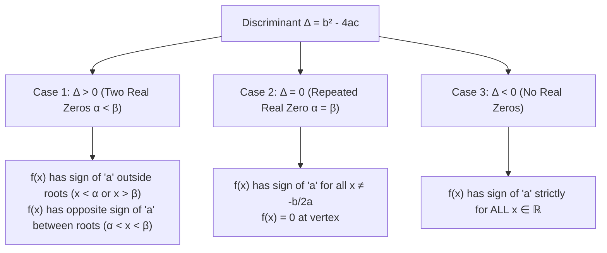
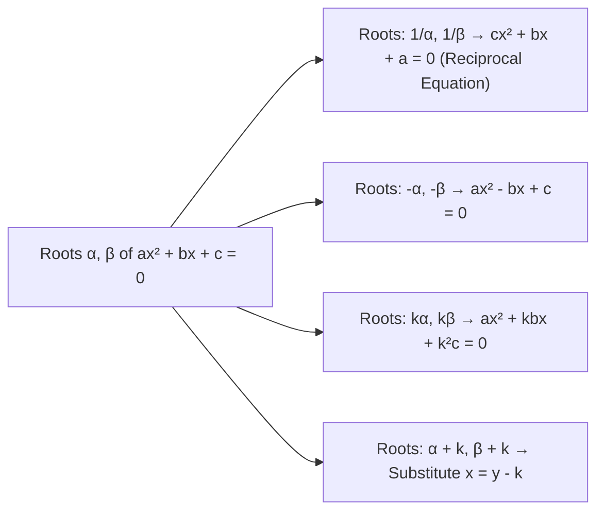

# :LiSquareDot: Lesson 03: Quadratic Functions & Equations

> [!ABSTRACT] Syllabus Scope (NIE Teacher's Guide — Grade 12, Unit 03)
> - **3.1 Quadratic Functions & Graphs**: General form $f(x) = ax^2 + bx + c$ ($a \neq 0$), vertex form $f(x) = a\left(x + \frac{b}{2a}\right)^2 - \frac{\Delta}{4a}$, axis of symmetry $x = -\frac{b}{2a}$, turning points (minimum when $a > 0$, maximum when $a < 0$).
> - **3.2 Sign of Quadratic Expression**: Behavior based on $a$ and $\Delta = b^2 - 4ac$; positive definite ($a > 0, \Delta < 0$), negative definite ($a < 0, \Delta < 0$), and sign variation between/outside roots.
> - **3.3 Quadratic Equation & Nature of Roots**: Derivation of quadratic formula via completing the square, discriminant analysis ($\Delta > 0, \Delta = 0, \Delta < 0$), proof that a quadratic equation cannot have more than two distinct roots.
> - **3.4 Relations Between Roots & Coefficients**: Vieta's formulas $\alpha + \beta = -\frac{b}{a}$ and $\alpha \beta = \frac{c}{a}$, symmetric functions of roots, signs of roots based on coefficients.
> - **3.5 Formation of New Quadratic Equations**: Constructing equations with roots transformed by symmetric expressions ($x^2 - Sx + P = 0$).
> - **3.6 Common Roots & Range of Rational Quadratic Functions**: Condition for two quadratic equations to have a common root, finding the real range of $y = \frac{ax^2+bx+c}{px^2+qx+r}$ using $\Delta \ge 0$.

> [!NOTE] Subtopic Companion Guide
> For detailed algebraic derivations, condition proofs for positive/negative roots, common root conditions, and worked exam problems, see: [[Subtopics/Quadratic Functions & Equations Guide|Quadratic Functions & Equations Guide]]

---

## 1. Quadratic Functions & Graph Analysis

### 1.1 Completing the Square & Canonical Form
For the real quadratic function $f(x) = ax^2 + bx + c$ with $a \ne 0$:

$$f(x) = a \left[ x^2 + \frac{b}{a} x + \frac{c}{a} \right] = a \left[ \left(x + \frac{b}{2a}\right)^2 - \frac{b^2}{4a^2} + \frac{c}{a} \right]$$

$$\boxed{f(x) = a\left(x + \frac{b}{2a}\right)^2 - \frac{\Delta}{4a}}$$

where $\Delta = b^2 - 4ac$ is the **discriminant**.

* **Axis of Symmetry**: The vertical line $x = -\frac{b}{2a}$.
* **Vertex / Turning Point Coordinates**:
  $$\left(-\frac{b}{2a}, \, -\frac{\Delta}{4a}\right) = \left(-\frac{b}{2a}, \, \frac{4ac - b^2}{4a}\right)$$
* **Extremum Nature**:
  * If $a > 0$: The parabola opens **upwards** ($\cup$ shape). It has an absolute minimum value $f_{\text{min}} = -\frac{\Delta}{4a}$ at $x = -\frac{b}{2a}$.
  * If $a < 0$: The parabola opens **downwards** ($\cap$ shape). It has an absolute maximum value $f_{\text{max}} = -\frac{\Delta}{4a}$ at $x = -\frac{b}{2a}$.

---

### 1.2 Sign of the Quadratic Expression $f(x) = ax^2 + bx + c$

**Definite Conditions**:
* **Positive Definite**: $ax^2 + bx + c > 0$ for all $x \in \mathbb{R} \iff \boxed{a > 0 \quad \text{and} \quad \Delta = b^2 - 4ac < 0}$
* **Negative Definite**: $ax^2 + bx + c < 0$ for all $x \in \mathbb{R} \iff \boxed{a < 0 \quad \text{and} \quad \Delta = b^2 - 4ac < 0}$
* **Non-negative**: $ax^2 + bx + c \ge 0$ for all $x \in \mathbb{R} \iff a > 0 \quad \text{and} \quad \Delta \le 0$
* **Non-positive**: $ax^2 + bx + c \le 0$ for all $x \in \mathbb{R} \iff a < 0 \quad \text{and} \quad \Delta \le 0$

---

## 2. Quadratic Equations & The Discriminant

### 2.1 The Quadratic Formula
Setting $f(x) = 0$ for $ax^2 + bx + c = 0$ ($a \ne 0$):
$$a\left(x + \frac{b}{2a}\right)^2 = \frac{b^2 - 4ac}{4a} \implies \left(x + \frac{b}{2a}\right)^2 = \frac{b^2 - 4ac}{4a^2}$$

$$\boxed{x = \frac{-b \pm \sqrt{b^2 - 4ac}}{2a} = \frac{-b \pm \sqrt{\Delta}}{2a}}$$

### 2.2 Proof: A Quadratic Equation Has at Most Two Distinct Roots
Suppose $ax^2 + bx + c = 0$ ($a \ne 0$) has three distinct roots $x_1, x_2, x_3$.
Then:
$$ax_1^2 + bx_1 + c = 0, \quad ax_2^2 + bx_2 + c = 0, \quad ax_3^2 + bx_3 + c = 0$$
Subtracting the first from the second:
$$a(x_2^2 - x_1^2) + b(x_2 - x_1) = 0 \implies (x_2 - x_1)[a(x_1 + x_2) + b] = 0$$
Since $x_1 \ne x_2$, $a(x_1 + x_2) + b = 0 \quad \text{--- (1)}$
Similarly, from the second and third roots:
$$(x_3 - x_2)[a(x_2 + x_3) + b] = 0 \implies a(x_2 + x_3) + b = 0 \quad \text{--- (2)}$$
Subtracting (1) from (2):
$$a(x_3 - x_1) = 0$$
Since $x_1 \ne x_3$, this forces $a = 0$.
Substituting $a = 0$ back gives $b = 0$, and then $c = 0$.
Thus, if $ax^2 + bx + c = 0$ has more than two roots, it must be the identity equation $0x^2 + 0x + 0 = 0$, which is identically zero for all $x$. Therefore, a proper quadratic equation ($a \ne 0$) cannot have more than two distinct roots. $\blacksquare$

---

### 2.3 Nature of Roots Based on the Discriminant ($\Delta = b^2 - 4ac$)

| Value of $\Delta$ | Nature of Roots | Geometric Meaning (Graph $y = f(x)$) |
|---|---|---|
| $\Delta > 0$ | Two distinct real roots | Intersects $x$-axis at two distinct points |
| $\Delta = 0$ | Two coincident / repeated real roots | Touches $x$-axis at its vertex ($x = -b/2a$) |
| $\Delta < 0$ | Two complex conjugate non-real roots | Does not intersect or touch the $x$-axis |
| $\Delta \ge 0$ | Real roots (distinct or coincident) | Meets the $x$-axis in at least one point |

*(If $a, b, c \in \mathbb{Q}$ and $\Delta$ is a perfect square of a rational number, the roots are rational; if $\Delta$ is not a square, the roots are irrational conjugate surds).*

---

## 3. Relations Between Roots & Coefficients (Vieta's Formulas)

Let $\alpha$ and $\beta$ be the roots of $ax^2 + bx + c = 0$ ($a \ne 0$):

$$\boxed{\alpha + \beta = -\frac{b}{a}, \quad \alpha \beta = \frac{c}{a}}$$

### 3.1 Signs of Roots
Using $S = \alpha + \beta = -\frac{b}{a}$ and $P = \alpha \beta = \frac{c}{a}$ with $\Delta \ge 0$:

| Desired Nature of Roots | Mathematical Condition |
|---|---|
| Both roots positive ($\alpha > 0, \beta > 0$) | $\Delta \ge 0, \quad \alpha + \beta > 0, \quad \alpha \beta > 0$ |
| Both roots negative ($\alpha < 0, \beta < 0$) | $\Delta \ge 0, \quad \alpha + \beta < 0, \quad \alpha \beta > 0$ |
| Opposite signs ($\alpha > 0, \beta < 0$) | $\alpha \beta < 0$ (Note: $\alpha\beta < 0 \implies ac < 0 \implies \Delta > 0$ automatically) |
| Roots equal in magnitude, opposite in sign | $\alpha + \beta = 0 \iff b = 0$ (with $ac < 0$) |
| Roots reciprocal of each other ($\beta = 1/\alpha$) | $\alpha \beta = 1 \iff c = a$ (with $\Delta \ge 0$) |
| One root is zero | $c = 0$ |

---

### 3.2 Symmetric Functions of Roots
An expression involving $\alpha$ and $\beta$ is **symmetric** if swapping $\alpha$ and $\beta$ leaves the expression unchanged. Every symmetric polynomial in $\alpha, \beta$ can be uniquely expressed in terms of the elementary symmetric polynomials $S = (\alpha + \beta)$ and $P = \alpha\beta$.

1. **Sum of Squares**:
   $$\alpha^2 + \beta^2 = (\alpha + \beta)^2 - 2\alpha\beta = S^2 - 2P$$
2. **Difference of Roots**:
   $$(\alpha - \beta)^2 = (\alpha + \beta)^2 - 4\alpha\beta = S^2 - 4P = \frac{\Delta}{a^2} \implies |\alpha - \beta| = \frac{\sqrt{\Delta}}{|a|}$$
3. **Sum of Cubes**:
   $$\alpha^3 + \beta^3 = (\alpha + \beta)^3 - 3\alpha\beta(\alpha + \beta) = S^3 - 3PS$$
4. **Sum of Fourth Powers**:
   $$\alpha^4 + \beta^4 = (\alpha^2 + \beta^2)^2 - 2(\alpha\beta)^2 = (S^2 - 2P)^2 - 2P^2$$
5. **Sum of Reciprocals**:
   $$\frac{1}{\alpha} + \frac{1}{\beta} = \frac{\alpha + \beta}{\alpha\beta} = \frac{S}{P}$$
6. **Sum of Reciprocal Squares**:
   $$\frac{1}{\alpha^2} + \frac{1}{\beta^2} = \frac{\alpha^2 + \beta^2}{(\alpha\beta)^2} = \frac{S^2 - 2P}{P^2}$$

---

## 4. Formation of Quadratic Equations with Transformed Roots

To construct a quadratic equation whose roots are given by expressions $u$ and $v$:

$$x^2 - (u + v)x + uv = 0$$

$$\boxed{x^2 - (\text{Sum of new roots}) x + (\text{Product of new roots}) = 0}$$

### 4.1 Common Transformations

* **Transformation Method**: If the new roots are given by $y = g(\alpha)$ where $g$ is an invertible function, solve for $\alpha = g^{-1}(y)$ and substitute into $a\alpha^2 + b\alpha + c = 0$.

---

## 5. Condition for a Common Root

Consider two quadratic equations:
$$a_1 x^2 + b_1 x + c_1 = 0 \quad \text{--- (1)}$$
$$a_2 x^2 + b_2 x + c_2 = 0 \quad \text{--- (2)}$$

Let $\alpha$ be their common root:
$$a_1 \alpha^2 + b_1 \alpha + c_1 = 0$$
$$a_2 \alpha^2 + b_2 \alpha + c_2 = 0$$

Using cross-multiplication:
$$\frac{\alpha^2}{b_1 c_2 - b_2 c_1} = \frac{\alpha}{c_1 a_2 - c_2 a_1} = \frac{1}{a_1 b_2 - a_2 b_1}$$

$$\alpha = \frac{c_1 a_2 - c_2 a_1}{a_1 b_2 - a_2 b_1}, \quad \alpha^2 = \frac{b_1 c_2 - b_2 c_1}{a_1 b_2 - a_2 b_1}$$

Eliminating $\alpha$ yields the condition for a common root:
$$\boxed{(c_1 a_2 - c_2 a_1)^2 = (a_1 b_2 - a_2 b_1)(b_1 c_2 - b_2 c_1)}$$

---

## 6. Summary Comparison Table

| Property / Feature | Mathematical Expression | Key Condition / Notes |
|---|---|---|
| **Roots of Equation** | $x = \frac{-b \pm \sqrt{\Delta}}{2a}$ | $\Delta = b^2 - 4ac$ |
| **Sum of Roots** | $\alpha + \beta = -\frac{b}{a}$ | Vieta's formula |
| **Product of Roots** | $\alpha\beta = \frac{c}{a}$ | Vieta's formula |
| **Vertex of Parabola** | $\left(-\frac{b}{2a}, \, -\frac{\Delta}{4a}\right)$ | Minimum if $a > 0$, Maximum if $a < 0$ |
| **Positive Definite** | $ax^2 + bx + c > 0$ for all $x \in \mathbb{R}$ | $a > 0$ and $\Delta < 0$ |
| **Negative Definite** | $ax^2 + bx + c < 0$ for all $x \in \mathbb{R}$ | $a < 0$ and $\Delta < 0$ |
| **Difference of Roots** | $|\alpha - \beta| = \frac{\sqrt{\Delta}}{|a|}$ | Valid when $\Delta \ge 0$ |
| **Forming Equation** | $x^2 - Sx + P = 0$ | $S = \text{Sum}, P = \text{Product}$ |

---

## :LiRocket: Flashcards (Spaced Repetition)

#flashcards

State the relations between roots $\alpha, \beta$ and coefficients of $ax^2 + bx + c = 0$. :: $\alpha + \beta = -\frac{b}{a}$ and $\alpha \beta = \frac{c}{a}$.
<!--SR:!2026-09-29,4,270-->

What is the expression for $\alpha^2 + \beta^2$ in terms of $(\alpha + \beta)$ and $\alpha \beta$? :: $\alpha^2 + \beta^2 = (\alpha + \beta)^2 - 2\alpha\beta$.

What is the condition for $a x^2 + b x + c > 0$ to hold for all real values of $x$? :: $a > 0$ and Discriminant $\Delta = b^2 - 4ac < 0$ (Positive Definite).
<!--SR:!2026-09-28,3,250-->

What is the condition for $a x^2 + b x + c < 0$ to hold for all real values of $x$? :: $a < 0$ and Discriminant $\Delta = b^2 - 4ac < 0$ (Negative Definite).

How do you form a quadratic equation whose roots are $x_1$ and $x_2$? :: $x^2 - (x_1 + x_2) x + (x_1 x_2) = 0$.

What are the coordinates of the turning point of the parabola $y = ax^2 + bx + c$? :: Vertex is at $\left(-\frac{b}{2a}, -\frac{\Delta}{4a}\right) = \left(-\frac{b}{2a}, \frac{4ac - b^2}{4a}\right)$.

What is the geometric difference between $\Delta > 0$, $\Delta = 0$, and $\Delta < 0$ for $y = ax^2 + bx + c$? :: $\Delta > 0$: crosses the $x$-axis at two distinct points; $\Delta = 0$: touches the $x$-axis at its vertex; $\Delta < 0$: does not meet the $x$-axis.

Express $|\alpha - \beta|$ in terms of the coefficients $a, b, c$ for $ax^2 + bx + c = 0$. :: $|\alpha - \beta| = \sqrt{(\alpha + \beta)^2 - 4\alpha\beta} = \frac{\sqrt{b^2 - 4ac}}{|a|} = \frac{\sqrt{\Delta}}{|a|}$.

Express $\alpha^3 + \beta^3$ in terms of $S = \alpha + \beta$ and $P = \alpha\beta$. :: $\alpha^3 + \beta^3 = (\alpha + \beta)^3 - 3\alpha\beta(\alpha + \beta) = S^3 - 3PS$.

What are the necessary and sufficient conditions for both roots of $ax^2 + bx + c = 0$ to be strictly positive? :: $\Delta = b^2 - 4ac \ge 0$, $\alpha + \beta = -\frac{b}{a} > 0$, and $\alpha\beta = \frac{c}{a} > 0$.

What is the condition for the roots of $ax^2 + bx + c = 0$ to have opposite signs? :: $\alpha\beta = \frac{c}{a} < 0$ (which guarantees $\Delta = b^2 - 4ac > 0$ automatically).

What is the condition for the roots of $ax^2 + bx + c = 0$ to be reciprocal to each other? :: $\alpha\beta = 1 \iff \frac{c}{a} = 1 \iff c = a$ (with $\Delta \ge 0$).

What is the condition for the roots of $ax^2 + bx + c = 0$ to be equal in magnitude but opposite in sign? :: $\alpha + \beta = 0 \iff -\frac{b}{a} = 0 \iff b = 0$ (with $ac < 0$ for real roots).

If $ax^2 + bx + c = 0$ has roots $\alpha, \beta$, what equation has roots $\frac{1}{\alpha}, \frac{1}{\beta}$? :: $cx^2 + bx + a = 0$ (obtained by replacing $x$ with $\frac{1}{x}$).

State the condition for $a_1 x^2 + b_1 x + c_1 = 0$ and $a_2 x^2 + b_2 x + c_2 = 0$ to have a common root. :: $(c_1 a_2 - c_2 a_1)^2 = (a_1 b_2 - a_2 b_1)(b_1 c_2 - b_2 c_1)$.

Prove that a proper quadratic equation $ax^2 + bx + c = 0$ ($a \ne 0$) cannot have more than two distinct roots. :: If it had 3 distinct roots $x_1, x_2, x_3$, then $a(x_2 - x_1)(x_1 + x_2) + b(x_2 - x_1) = 0 \implies a(x_1+x_2)+b=0$ and similarly $a(x_2+x_3)+b=0$. Subtracting forces $a(x_3-x_1)=0 \implies a=0$, contradicting $a \ne 0$.

If $\alpha, \beta$ are the roots of $ax^2+bx+c=0$, what is the quadratic equation whose roots are $-\alpha, -\beta$? :: $ax^2 - bx + c = 0$ (replace $x$ with $-x$). <!--SR:!2026-11-20,1,230-->

What is the condition for a quadratic polynomial $ax^2+bx+c$ to be a perfect square? :: $a > 0$ and Discriminant $\Delta = b^2 - 4ac = 0$. <!--SR:!2026-11-20,1,230-->

