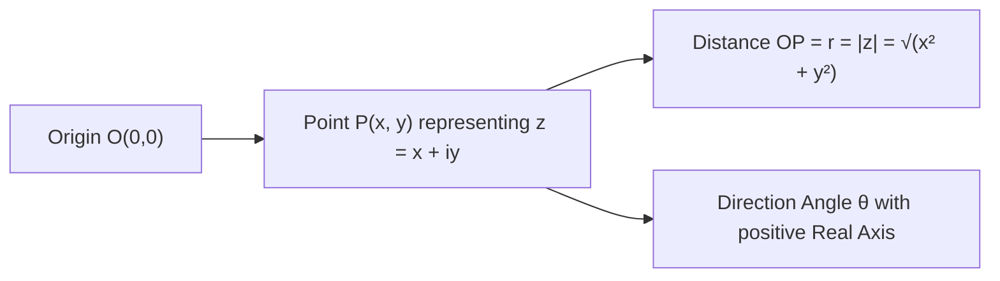
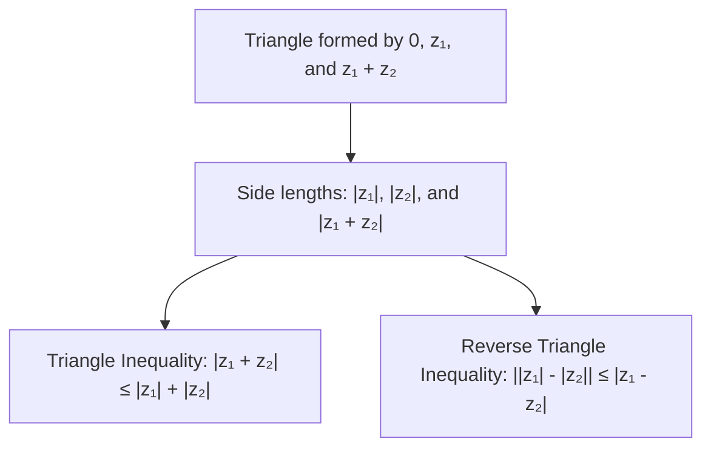
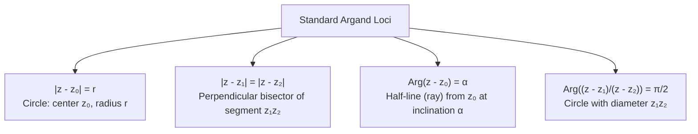

# :LiAtom: Lesson 04: Complex Numbers

> [!ABSTRACT] Syllabus Scope (NIE Teacher's Guide — Grade 13, Competency 23)
> - **23.1 Real & Imaginary Parts**: The imaginary unit $i = \sqrt{-1}$ ($i^2 = -1$), definition of complex numbers $z = x + iy$ ($x, y \in \mathbb{R}$), purely real and purely imaginary numbers, equality of two complex numbers ($z_1 = z_2 \iff x_1 = x_2 \text{ and } y_1 = y_2$).
> - **23.2 Algebraic Operations**: Addition, subtraction, scalar multiplication, multiplication, division via complex conjugate.
> - **23.3 Complex Conjugate**: $\bar{z} = x - iy$, properties: $\overline{z_1 \pm z_2} = \bar{z}_1 \pm \bar{z}_2$, $\overline{z_1 z_2} = \bar{z}_1 \bar{z}_2$, $\overline{(z_1/z_2)} = \bar{z}_1/\bar{z}_2$, $z + \bar{z} = 2\text{Re}(z)$, $z - \bar{z} = 2i\text{Im}(z)$, and $z \bar{z} = |z|^2$.
> - **23.4 Modulus of a Complex Number**: $|z| = \sqrt{x^2 + y^2}$, properties $|z_1 z_2| = |z_1||z_2|$, $|z_1/z_2| = |z_1|/|z_2|$, $|z_1 + z_2|^2 = |z_1|^2 + 2\text{Re}(z_1 \bar{z}_2) + |z_2|^2$.
> - **23.5 Argand Diagram & Polar Form**: Geometric representation of $z$, vector addition and subtraction, section formula point $\frac{\lambda z_1 + \mu z_2}{\lambda + \mu}$, polar form $z = r(\cos\theta + i\sin\theta)$, argument $\arg(z)$ and principal argument $\text{Arg}(z) \in (-\pi, \pi]$, products and quotients in polar form, the Triangle Inequality ($|z_1 + z_2| \le |z_1| + |z_2|$) and Reverse Triangle Inequality ($||z_1| - |z_2|| \le |z_1 - z_2|$).
> - **23.6 De Moivre's Theorem**: Statement and induction proof for $n \in \mathbb{Z}^+$: $[r(\cos\theta + i\sin\theta)]^n = r^n(\cos n\theta + i\sin n\theta)$, extension to negative integers, roots of unity ($z^n = 1$).
> - **23.7 Loci in the Argand Plane**: Equations and geometric interpretations for circles $|z - z_0| = r$, perpendicular bisectors $|z - z_1| = |z - z_2|$, rays $\text{Arg}(z - z_0) = \alpha$, and Cartesian conversion.

> [!NOTE] Subtopic Companion Guide
> For complete algebraic proofs, induction proof of De Moivre's theorem, $n$-th roots of unity, and worked exam-style locus problems, see: [[Subtopics/Complex Numbers & Argand Diagrams|Complex Numbers & Argand Diagrams Guide]]

---

## 1. Complex Numbers & Algebraic Foundations

### 1.1 The Imaginary Unit & Definition
The imaginary unit $i$ is defined such that:
$$i^2 = -1 \implies i = \sqrt{-1}$$

**Cyclic Powers of $i$**:
* $i^1 = i$
* $i^2 = -1$
* $i^3 = i^2 \cdot i = -i$
* $i^4 = (i^2)^2 = 1$
In general, for any integer $k \in \mathbb{Z}$:
$$i^{4k} = 1, \quad i^{4k+1} = i, \quad i^{4k+2} = -1, \quad i^{4k+3} = -i$$

A **complex number** $z$ is an expression of the form:
$$z = x + iy \quad (x, y \in \mathbb{R})$$
* $x = \text{Re}(z)$ is the **real part** of $z$.
* $y = \text{Im}(z)$ is the **imaginary part** of $z$ *(note: $y$ is a real number)*.
* If $y = 0$, $z = x$ is **purely real**.
* If $x = 0$ and $y \ne 0$, $z = iy$ is **purely imaginary**.

### 1.2 Equality of Complex Numbers
Two complex numbers $z_1 = x_1 + i y_1$ and $z_2 = x_2 + i y_2$ are equal if and only if their real parts and imaginary parts are simultaneously equal:
$$\boxed{z_1 = z_2 \iff x_1 = x_2 \quad \text{and} \quad y_1 = y_2}$$

> [!TIP] Problem-Solving Strategy
> To solve an equation involving complex numbers, simplify both sides into Cartesian form $(X + iY)$ and equate the real and imaginary parts to form two independent real equations.

---

### 1.3 Elementary Algebraic Operations
Let $z_1 = x_1 + i y_1$ and $z_2 = x_2 + i y_2$:

1. **Addition & Subtraction**:
   $$z_1 \pm z_2 = (x_1 \pm x_2) + i(y_1 \pm y_2)$$
2. **Scalar Multiplication** ($\lambda \in \mathbb{R}$):
   $$\lambda z_1 = \lambda x_1 + i(\lambda y_1)$$
3. **Multiplication**:
   $$z_1 z_2 = (x_1 + i y_1)(x_2 + i y_2) = (x_1 x_2 - y_1 y_2) + i(x_1 y_2 + x_2 y_1)$$
4. **Division** ($z_2 \ne 0$):
   Multiply numerator and denominator by the conjugate $\bar{z}_2 = x_2 - i y_2$:
   $$\frac{z_1}{z_2} = \frac{x_1 + i y_1}{x_2 + i y_2} \cdot \frac{x_2 - i y_2}{x_2 - i y_2} = \frac{(x_1 x_2 + y_1 y_2) + i(x_2 y_1 - x_1 y_2)}{x_2^2 + y_2^2}$$
   $$\boxed{\frac{z_1}{z_2} = \left(\frac{x_1 x_2 + y_1 y_2}{x_2^2 + y_2^2}\right) + i\left(\frac{x_2 y_1 - x_1 y_2}{x_2^2 + y_2^2}\right)}$$

---

## 2. Complex Conjugate & Modulus

### 2.1 The Complex Conjugate
For $z = x + iy$, its **complex conjugate** is denoted by $\bar{z}$:
$$\bar{z} = x - iy$$

**Fundamental Conjugate Identities**:
* $\overline{\bar{z}} = z$
* $z + \bar{z} = 2x = 2\text{Re}(z) \implies \text{Re}(z) = \frac{z + \bar{z}}{2}$
* $z - \bar{z} = 2iy = 2i\text{Im}(z) \implies \text{Im}(z) = \frac{z - \bar{z}}{2i}$
* $z$ is purely real $\iff z = \bar{z}$
* $z$ is purely imaginary $\iff z = -\bar{z}$
* $\overline{z_1 \pm z_2} = \bar{z}_1 \pm \bar{z}_2$
* $\overline{z_1 z_2} = \bar{z}_1 \cdot \bar{z}_2$
* $\overline{\left(\frac{z_1}{z_2}\right)} = \frac{\bar{z}_1}{\bar{z}_2} \quad (z_2 \ne 0)$
* $\overline{z^n} = (\bar{z})^n \quad (n \in \mathbb{Z}^+)$

---

### 2.2 Modulus of a Complex Number
The **modulus** (or absolute value) of $z = x + iy$, denoted by $|z|$, represents the geometric distance from the origin $(0, 0)$ to the point $(x, y)$:
$$\boxed{|z| = \sqrt{x^2 + y^2}}$$

**Core Modulus Properties**:
1. $|z| \ge 0$, and $|z| = 0 \iff z = 0$.
2. $|z| = |\bar{z}| = |-z| = |-\bar{z}|$.
3. $\boxed{z \bar{z} = |z|^2 = x^2 + y^2}$
4. $|z_1 z_2| = |z_1| \cdot |z_2|$
5. $\left|\frac{z_1}{z_2}\right| = \frac{|z_1|}{|z_2|} \quad (z_2 \ne 0)$
6. $|z^n| = |z|^n \quad (n \in \mathbb{Z})$
7. Expansion of the modulus of a sum:
   $$|z_1 + z_2|^2 = (z_1 + z_2)(\bar{z}_1 + \bar{z}_2) = |z_1|^2 + z_1 \bar{z}_2 + \bar{z}_1 z_2 + |z_2|^2$$
   $$\boxed{|z_1 + z_2|^2 = |z_1|^2 + 2\text{Re}(z_1 \bar{z}_2) + |z_2|^2}$$
   Similarly:
   $$\boxed{|z_1 - z_2|^2 = |z_1|^2 - 2\text{Re}(z_1 \bar{z}_2) + |z_2|^2}$$
   Adding these two identities yields the **Parallelogram Law**:
   $$\boxed{|z_1 + z_2|^2 + |z_1 - z_2|^2 = 2(|z_1|^2 + |z_2|^2)}$$

---

## 3. The Argand Diagram & Polar Form

### 3.1 Geometric Representation
The **Argand diagram** represents the complex number $z = x + iy$ as the point $P(x, y)$ or position vector $\vec{OP}$ in a Cartesian coordinate plane:
* **Horizontal Axis**: Real Axis ($\text{Re}$)
* **Vertical Axis**: Imaginary Axis ($\text{Im}$)

**Geometric Interpretations**:
* $\bar{z} = x - iy$ is the **reflection** of $z$ across the real axis.
* $-z = -x - iy$ is the **reflection** of $z$ through the origin.
* $z_1 + z_2$ is represented by the fourth vertex of the parallelogram formed by $O, z_1, z_2$ (vector addition).
* $z_1 - z_2$ is represented by the vector from $z_2$ to $z_1$.
* The internal division point of line segment joining $z_1$ and $z_2$ in the ratio $\mu : \lambda$ is:
  $$\boxed{z = \frac{\lambda z_1 + \mu z_2}{\lambda + \mu}}$$

---

### 3.2 Polar (Modulus-Argument) Form
Let $r = |z| = \sqrt{x^2 + y^2}$. Then:
$$x = r \cos\theta, \quad y = r \sin\theta$$
$$\boxed{z = r(\cos\theta + i\sin\theta)}$$

**Argument $\arg(z)$ and Principal Argument $\text{Arg}(z)$**:
* Any angle $\theta$ satisfying $\cos\theta = \frac{x}{r}$ and $\sin\theta = \frac{y}{r}$ is called an **argument** of $z$.
* The **Principal Argument** $\text{Arg}(z)$ is restricted to the interval:
  $$\boxed{-\pi < \text{Arg}(z) \le \pi}$$

**Determination of $\text{Arg}(z)$ by Quadrant**:
Let $\alpha = \tan^{-1}\left|\frac{y}{x}\right|$ be the acute reference angle ($0 < \alpha < \frac{\pi}{2}$):

| Quadrant | Sign of $(x, y)$ | Principal Argument $\text{Arg}(z)$ |
|---|---|---|
| **Quadrant 1** | $x > 0, y > 0$ | $\theta = \alpha$ |
| **Quadrant 2** | $x < 0, y > 0$ | $\theta = \pi - \alpha$ |
| **Quadrant 3** | $x < 0, y < 0$ | $\theta = -(\pi - \alpha) = -\pi + \alpha$ |
| **Quadrant 4** | $x > 0, y < 0$ | $\theta = -\alpha$ |

---

### 3.3 Multiplication & Division in Polar Form
Let $z_1 = r_1(\cos\theta_1 + i\sin\theta_1)$ and $z_2 = r_2(\cos\theta_2 + i\sin\theta_2)$:

1. **Multiplication**:
   $$z_1 z_2 = r_1 r_2 [\cos(\theta_1 + \theta_2) + i\sin(\theta_1 + \theta_2)]$$
   * $|z_1 z_2| = |z_1| \cdot |z_2|$
   * $\arg(z_1 z_2) = \arg(z_1) + \arg(z_2)$
   *(Geometrically: Multiplying by $z_2$ stretches $z_1$ by factor $r_2$ and rotates it counterclockwise by angle $\theta_2$).*

2. **Division**:
   $$\frac{z_1}{z_2} = \frac{r_1}{r_2} [\cos(\theta_1 - \theta_2) + i\sin(\theta_1 - \theta_2)]$$
   * $\left|\frac{z_1}{z_2}\right| = \frac{|z_1|}{|z_2|}$
   * $\arg\left(\frac{z_1}{z_2}\right) = \arg(z_1) - \arg(z_2)$

---

### 3.4 Triangle Inequalities in the Complex Plane

1. **Triangle Inequality**:
   $$\boxed{|z_1 + z_2| \le |z_1| + |z_2|}$$
   *Equality holds if and only if $z_1$ and $z_2$ have the same direction, i.e., $\text{Arg}(z_1) = \text{Arg}(z_2)$ (or one is zero).*
2. **Reverse Triangle Inequality**:
   $$\boxed{||z_1| - |z_2|| \le |z_1 \pm z_2| \le |z_1| + |z_2|}$$

---

## 4. De Moivre's Theorem

### 4.1 Statement of De Moivre's Theorem
For any real angle $\theta$ and any integer $n \in \mathbb{Z}$:

$$\boxed{(\cos\theta + i\sin\theta)^n = \cos(n\theta) + i\sin(n\theta)}$$

In general, for $z = r(\cos\theta + i\sin\theta)$:
$$z^n = r^n(\cos n\theta + i\sin n\theta)$$

### 4.2 Induction Proof for Positive Integer $n \in \mathbb{Z}^+$
* **Base Step ($n = 1$)**:
  $(\cos\theta + i\sin\theta)^1 = \cos(1\theta) + i\sin(1\theta)$ is trivially true.
* **Inductive Hypothesis**: Assume true for $n = k$:
  $$(\cos\theta + i\sin\theta)^k = \cos(k\theta) + i\sin(k\theta)$$
* **Inductive Step ($n = k + 1$)**:
  $$(\cos\theta + i\sin\theta)^{k+1} = (\cos\theta + i\sin\theta)^k \cdot (\cos\theta + i\sin\theta)$$
  $$= [\cos(k\theta) + i\sin(k\theta)][\cos\theta + i\sin\theta]$$
  $$= [\cos(k\theta)\cos\theta - \sin(k\theta)\sin\theta] + i[\sin(k\theta)\cos\theta + \cos(k\theta)\sin\theta]$$
  Using compound angle identities $\cos(A+B)$ and $\sin(A+B)$:
  $$= \cos((k+1)\theta) + i\sin((k+1)\theta)$$
  Thus, by the principle of mathematical induction, the theorem holds for all $n \in \mathbb{Z}^+$. $\blacksquare$

---

## 5. Loci in the Argand Plane

A **locus** is the path or region traced out by a variable complex point $z = x + iy$ satisfying a given condition.

### 5.1 Standard Locus Types

| Complex Equation | Geometric Description | Cartesian Equation |
|---|---|---|
| **$|z - z_0| = r$** | Circle with center $z_0 = x_0 + iy_0$ and radius $r$ | $(x - x_0)^2 + (y - y_0)^2 = r^2$ |
| **$|z - z_0| \le r$** | Circular disk (boundary and interior) | $(x - x_0)^2 + (y - y_0)^2 \le r^2$ |
| **$|z - z_1| = |z - z_2|$** | Perpendicular bisector of line segment joining $z_1$ and $z_2$ | Straight line perpendicular to segment $z_1 z_2$ through its midpoint |
| **$\text{Arg}(z - z_0) = \alpha$** | Ray (half-line) starting from $z_0$ at angle $\alpha$ to positive real axis *(excluding $z_0$)* | $\frac{y - y_0}{x - x_0} = \tan\alpha$ with direction constraints |
| **$\text{Arg}\left(\frac{z - z_1}{z - z_2}\right) = \pm \frac{\pi}{2}$** | Circle having line segment $z_1 z_2$ as diameter *(excluding endpoints)* | Thales' theorem: subtends right angle at $z$ |

---

## 6. Summary Formula Reference Table

| Concept | Mathematical Formula | Key Property |
|---|---|---|
| **Cartesian Form** | $z = x + iy$ | $x = \text{Re}(z), y = \text{Im}(z)$ |
| **Conjugate** | $\bar{z} = x - iy$ | $z\bar{z} = |z|^2$ |
| **Modulus** | $|z| = \sqrt{x^2 + y^2}$ | $|z_1 z_2| = |z_1||z_2|$ |
| **Principal Argument** | $\text{Arg}(z) = \theta$ | $-\pi < \text{Arg}(z) \le \pi$ |
| **Polar Form** | $z = r(\cos\theta + i\sin\theta)$ | $r = |z|, \theta = \text{Arg}(z)$ |
| **De Moivre's Theorem** | $(\cos\theta + i\sin\theta)^n = \cos n\theta + i\sin n\theta$ | Holds for all $n \in \mathbb{Z}$ |
| **Triangle Inequality** | $|z_1 + z_2| \le |z_1| + |z_2|$ | Equality when $\text{Arg}(z_1) = \text{Arg}(z_2)$ |
| **Parallelogram Law** | $|z_1 + z_2|^2 + |z_1 - z_2|^2 = 2(|z_1|^2 + |z_2|^2)$ | Vector sum of diagonals |
| **Circle Locus** | $|z - z_0| = r$ | Center $z_0$, radius $r$ |
| **Perpendicular Bisector** | $|z - z_1| = |z - z_2|$ | Equidistant from $z_1$ and $z_2$ |

---

## :LiRocket: Flashcards (Spaced Repetition)

#flashcards

What is the relationship between a complex number $z$ and its conjugate $\bar{z}$ regarding modulus? :: $z \cdot \bar{z} = |z|^2$.

State De Moivre's Theorem for an integer $n$. :: $(\cos\theta + i\sin\theta)^n = \cos(n\theta) + i\sin(n\theta)$.
<!--SR:!2026-09-26,1,230-->

What is the range of the Principal Argument $\text{Arg}(z)$ of a complex number? :: $-\pi < \text{Arg}(z) \le \pi$.
<!--SR:!2026-09-26,1,230-->

Geometrically describe the locus given by $|z - z_0| = r$. :: A circle with center at complex point $z_0$ and radius $r$.

Geometrically describe the locus given by $|z - z_1| = |z - z_2|$. :: The perpendicular bisector of the line segment joining complex points $z_1$ and $z_2$.
<!--SR:!2026-09-26,1,230-->

What is the algebraic expression for the real part $\text{Re}(z)$ and imaginary part $\text{Im}(z)$ in terms of $z$ and $\bar{z}$? :: $\text{Re}(z) = \frac{z + \bar{z}}{2}$ and $\text{Im}(z) = \frac{z - \bar{z}}{2i}$.

What is the condition for a complex number $z$ to be purely imaginary? :: $z = -\bar{z}$ (or $\text{Re}(z) = 0$ with $\text{Im}(z) \ne 0$).

State the Parallelogram Law for two complex numbers $z_1$ and $z_2$. :: $|z_1 + z_2|^2 + |z_1 - z_2|^2 = 2(|z_1|^2 + |z_2|^2)$.

What are the modulus and argument of the product $z_1 z_2$ in terms of $|z_1|, |z_2|$ and $\arg(z_1), \arg(z_2)$? :: $|z_1 z_2| = |z_1||z_2|$ and $\arg(z_1 z_2) = \arg(z_1) + \arg(z_2)$.

What are the modulus and argument of the quotient $\frac{z_1}{z_2}$ in terms of $|z_1|, |z_2|$ and $\arg(z_1), \arg(z_2)$? :: $\left|\frac{z_1}{z_2}\right| = \frac{|z_1|}{|z_2|}$ and $\arg\left(\frac{z_1}{z_2}\right) = \arg(z_1) - \arg(z_2)$.

State the Triangle Inequality and Reverse Triangle Inequality for complex numbers. :: $|z_1 + z_2| \le |z_1| + |z_2|$ and $||z_1| - |z_2|| \le |z_1 - z_2|$.

Under what geometric condition does equality $|z_1 + z_2| = |z_1| + |z_2|$ hold? :: When $z_1$ and $z_2$ lie on the same ray from the origin, meaning $\text{Arg}(z_1) = \text{Arg}(z_2)$ (or one is zero).

Describe the geometric locus given by $\text{Arg}(z - z_0) = \alpha$. :: A ray (half-line) emanating from the point $z_0$ inclined at an angle $\alpha$ to the positive real axis, excluding the initial point $z_0$.

Describe the geometric locus given by $\text{Arg}\left(\frac{z - z_1}{z - z_2}\right) = \frac{\pi}{2}$. :: A circle having the line segment joining $z_1$ and $z_2$ as diameter (excluding the endpoints $z_1$ and $z_2$).

What complex coordinate represents the point dividing the segment joining $z_1$ and $z_2$ in the ratio $\mu : \lambda$? :: $z = \frac{\lambda z_1 + \mu z_2}{\lambda + \mu}$.

What are the solutions to $z^n = 1$ ($n$-th roots of unity)? :: $z_k = \cos\left(\frac{2k\pi}{n}\right) + i\sin\left(\frac{2k\pi}{n}\right)$ for $k = 0, 1, 2, \dots, n-1$.
