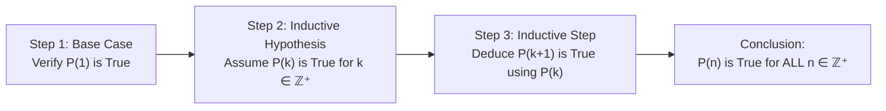
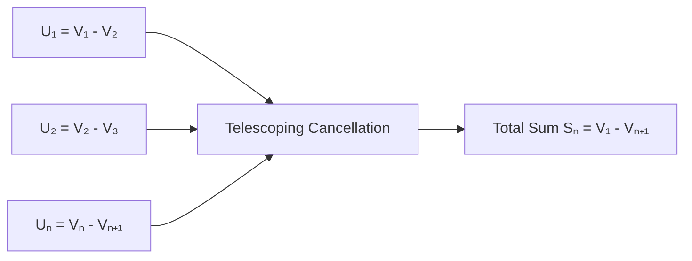

# :LiListOrdered: Lesson 05: Sequences, Series & Mathematical Induction

> [!ABSTRACT] Syllabus Scope (NIE Teacher's Guide — Grade 13, Competencies 19, 20 & 21)
> - **19.1 Principle of Mathematical Induction**: Statement of the principle, 3-step proof methodology (Base case $n=1$, Inductive hypothesis for $n=k$, Inductive step for $n=k+1$), applications to summation identities, divisibility statements, and inequality proofs for all $n \in \mathbb{Z}^+$.
> - **20.1 Properties of Sigma ($\sum$) Notation**: Linearity properties $\sum (u_r \pm v_r) = \sum u_r \pm \sum v_r$, $\sum c u_r = c \sum u_r$, non-multiplicativity $\sum u_r v_r \neq (\sum u_r)(\sum v_r)$, index shift rules.
> - **20.2 Arithmetic & Geometric Progressions**:
>   - AP: $n$-th term $T_n = a + (n-1)d$, sum of $n$ terms $S_n = \frac{n}{2}[2a + (n-1)d] = \frac{n}{2}(a + l)$, arithmetic mean.
>   - GP: $n$-th term $T_n = a r^{n-1}$, sum of $n$ terms $S_n = \frac{a(1 - r^n)}{1 - r}$ ($r \neq 1$), geometric mean.
>   - Standard power sum formulas: $\sum_{r=1}^n r = \frac{n(n+1)}{2}$, $\sum_{r=1}^n r^2 = \frac{n(n+1)(2n+1)}{6}$, $\sum_{r=1}^n r^3 = \left[\frac{n(n+1)}{2}\right]^2$.
> - **21.1 Method of Differences (Telescoping Series)**: Expressing $U_r = V_r - V_{r+1}$ or $V_{r+1} - V_r$, telescoping cancellation $\sum_{r=1}^n U_r = V_1 - V_{n+1}$, algebraic and partial fraction splitting techniques.
> - **21.2 Infinite Series & Convergence**: Sequence of partial sums $\{S_n\}$, convergence condition $S = \lim_{n \to \infty} S_n$, sum to infinity of GP $S_\infty = \frac{a}{1 - r}$ ($|r| < 1$), convergence of telescoping series when $\lim_{n \to \infty} V_{n+1}$ exists.

> [!NOTE] Subtopic Companion Guide
> For complete algebraic proofs of summation formulas, induction proof templates for divisibility and inequalities, advanced partial fraction telescoping, and worked A/L exam problems, see: [[Subtopics/Sequences, Series & Mathematical Induction Guide|Sequences, Series & Mathematical Induction Guide]]

---

## 1. The Principle of Mathematical Induction

### 1.1 Formal Statement
Let $P(n)$ be a proposition (mathematical statement) indexed by the positive integers $n \in \mathbb{Z}^+$.

The **Principle of Mathematical Induction** states that if:
1. **Base Step**: $P(1)$ is true (the statement holds for the initial integer $n = 1$).
2. **Inductive Step**: Whenever $P(k)$ is assumed to be true for an arbitrary positive integer $k \in \mathbb{Z}^+$ (**Inductive Hypothesis**), it necessarily follows that $P(k+1)$ is also true.

Then $P(n)$ is true for **all positive integers $n \in \mathbb{Z}^+$**.

### 1.2 The Three Standard A/L Induction Problem Types
1. **Summation Identities**: Proving closed-form formulas for series, e.g., $\sum_{r=1}^n f(r) = F(n)$.
   - Add the $(k+1)$-th term $f(k+1)$ to the assumed formula $F(k)$ and simplify algebraically to show it equals $F(k+1)$.
2. **Divisibility Proofs**: Proving an expression $E(n)$ is divisible by a fixed integer $M$ for all $n \in \mathbb{Z}^+$.
   - Express $E(k+1) - E(k)$ or $E(k+1) - c E(k)$ as an explicit multiple of $M$.
3. **Inequality Proofs**: Proving an inequality $f(n) > g(n)$ holds for all $n \ge n_0$.
   - Use $f(k) > g(k)$ to show that $f(k+1) > g(k+1)$.

---

## 2. Arithmetic and Geometric Progressions

### 2.1 Arithmetic Progression (AP)
A sequence in which each term after the first is formed by adding a constant real number $d$ (**common difference**) to the preceding term:

$$a, \; a + d, \; a + 2d, \; \dots, \; a + (n-1)d$$

* **General $n$-th Term**:
  $$\boxed{T_n = a + (n-1)d}$$
* **Sum of the First $n$ Terms ($S_n$)**:
  $$S_n = a + (a+d) + (a+2d) + \dots + [a + (n-1)d]$$
  Writing in reverse order and adding corresponding terms:
  $$2S_n = n [2a + (n-1)d] = n(a + l)$$
  $$\boxed{S_n = \frac{n}{2}[2a + (n-1)d] = \frac{n}{2}(a + l)}$$
  where $l = T_n$ is the last term.
* **Arithmetic Mean (AM)**: The arithmetic mean of two numbers $a$ and $b$ is $A = \frac{a + b}{2}$.

---

### 2.2 Geometric Progression (GP)
A sequence in which each term after the first is formed by multiplying the preceding term by a non-zero constant $r$ (**common ratio**):

$$a, \; ar, \; ar^2, \; \dots, \; ar^{n-1}$$

* **General $n$-th Term**:
  $$\boxed{T_n = a r^{n-1}}$$
* **Sum of the First $n$ Terms ($S_n$)**:
  $$S_n = a + ar + ar^2 + \dots + ar^{n-1}$$
  $$r S_n = ar + ar^2 + \dots + ar^{n-1} + ar^n$$
  Subtracting: $(1 - r)S_n = a(1 - r^n)$ for $r \ne 1$:
  $$\boxed{S_n = \frac{a(1 - r^n)}{1 - r} = \frac{a(r^n - 1)}{r - 1} \quad (r \ne 1)}$$
* **Sum to Infinity ($S_\infty$)**:
  If and only if $|r| < 1$, then $\lim_{n \to \infty} r^n = 0$:
  $$\boxed{S_\infty = \lim_{n \to \infty} S_n = \frac{a}{1 - r} \quad (|r| < 1)}$$
  *(If $|r| \ge 1$ and $a \ne 0$, the geometric series diverges).*
* **Geometric Mean (GM)**: The geometric mean of two positive real numbers $a$ and $b$ is $G = \sqrt{ab}$. Note that $\text{AM} \ge \text{GM}$:
  $$\frac{a + b}{2} \ge \sqrt{ab} \iff (\sqrt{a} - \sqrt{b})^2 \ge 0$$

---

## 3. Properties of Sigma ($\sum$) Notation & Power Sums

### 3.1 Linearity of Summation
Let $u_r, v_r$ be sequences and $c$ be a constant independent of $r$:
1. $\sum_{r=1}^n c = n c$
2. $\sum_{r=1}^n c u_r = c \sum_{r=1}^n u_r$
3. $\sum_{r=1}^n (u_r \pm v_r) = \sum_{r=1}^n u_r \pm \sum_{r=1}^n v_r$
4. **Non-multiplicativity**: In general, $\sum_{r=1}^n (u_r v_r) \ne \left(\sum_{r=1}^n u_r\right)\left(\sum_{r=1}^n v_r\right)$
5. **Split Sum**: $\sum_{r=1}^n u_r = \sum_{r=1}^m u_r + \sum_{r=m+1}^n u_r \quad (1 \le m < n)$

---

### 3.2 Standard Power Sum Formulas

| Power Sum | Formula | Factorized Form |
|---|---|---|
| **$\sum_{r=1}^n 1$** | $n$ | $n$ |
| **$\sum_{r=1}^n r$** | $\frac{n(n+1)}{2}$ | $\frac{1}{2} n (n + 1)$ |
| **$\sum_{r=1}^n r^2$** | $\frac{n(n+1)(2n+1)}{6}$ | $\frac{1}{6} n (n + 1)(2n + 1)$ |
| **$\sum_{r=1}^n r^3$** | $\frac{n^2(n+1)^2}{4}$ | $\left[\frac{n(n+1)}{2}\right]^2 = \left(\sum_{r=1}^n r\right)^2$ |

> [!IMPORTANT] Fundamental Identity
> Notice the remarkable algebraic relation:
> $$\sum_{r=1}^n r^3 = \left(\sum_{r=1}^n r\right)^2$$

---

## 4. The Method of Differences (Telescoping Series)

### 4.1 General Principle
If the general term $U_r$ of a series can be expressed as the difference of two successive values of another sequence $V_r$:

$$U_r = V_r - V_{r+1} \quad \text{or} \quad U_r = V_{r+1} - V_r$$

Summing from $r = 1$ to $n$:
$$\sum_{r=1}^n U_r = (V_1 - V_2) + (V_2 - V_3) + (V_3 - V_4) + \dots + (V_n - V_{n+1})$$

All intermediate terms cancel pairwise, leaving only the first and last terms:
$$\boxed{\sum_{r=1}^n U_r = V_1 - V_{n+1}}$$

Similarly, if $U_r = V_{r+1} - V_r$:
$$\boxed{\sum_{r=1}^n U_r = V_{n+1} - V_1}$$

---

### 4.2 Standard Telescoping Forms in A/L Combined Maths

#### Type 1: Partial Fractions with Consecutive Linear Factors
$$U_r = \frac{1}{(a r + b)(a r + a + b)} = \frac{1}{a} \left[ \frac{1}{a r + b} - \frac{1}{a(r+1) + b} \right]$$
Here, $V_r = \frac{1}{a(ar + b)}$ and $V_{r+1} = \frac{1}{a(a(r+1) + b)}$.
$$S_n = V_1 - V_{n+1} = \frac{1}{a} \left[ \frac{1}{a + b} - \frac{1}{a(n+1) + b} \right]$$

#### Type 2: Product of Consecutive Linear Factors
$$U_r = r(r+1)(r+2)$$
Let $V_r = r(r+1)(r+2)(r+3)$.
Then:
$$V_{r} - V_{r-1} = r(r+1)(r+2)(r+3) - (r-1)r(r+1)(r+2) = 4 r(r+1)(r+2) = 4 U_r$$
$$\implies U_r = \frac{1}{4}(V_r - V_{r-1})$$
Summing yields:
$$S_n = \frac{1}{4}(V_n - V_0) = \frac{1}{4} n(n+1)(n+2)(n+3)$$

---

## 5. Infinite Series & Convergence

### 5.1 Convergence Definition
Let $S_n = \sum_{r=1}^n U_r$ be the **$n$-th partial sum** of an infinite series $\sum_{r=1}^\infty U_r$.
* If the limit $\lim_{n \to \infty} S_n$ exists as a finite real number $S$:
  The series **converges**, and its **sum to infinity** is:
  $$\boxed{S_\infty = \sum_{r=1}^\infty U_r = \lim_{n \to \infty} S_n = S}$$
* If $\lim_{n \to \infty} S_n$ does not exist (or equals $\pm \infty$), the series **diverges**.

### 5.2 Sum to Infinity of Telescoping Series
For a series solved by the method of differences:
$$S_n = V_1 - V_{n+1}$$
The infinite sum exists if and only if $\lim_{n \to \infty} V_{n+1}$ is finite:
$$\boxed{S_\infty = V_1 - \lim_{n \to \infty} V_{n+1}}$$

For rational fractional telescoping series where $V_n \to 0$ as $n \to \infty$:
$$\boxed{S_\infty = V_1}$$

---

## 6. Summary Comparison Table

| Progression / Series Type | $n$-th Term ($T_n$) | Sum of $n$ Terms ($S_n$) | Sum to Infinity ($S_\infty$) |
|---|---|---|---|
| **Arithmetic Progression (AP)** | $a + (n-1)d$ | $\frac{n}{2}[2a + (n-1)d]$ | Diverges (unless $a=d=0$) |
| **Geometric Progression (GP)** | $a r^{n-1}$ | $\frac{a(1 - r^n)}{1 - r}$ | $\frac{a}{1 - r}$ (converges $\iff |r| < 1$) |
| **Sum of Integers $\sum r$** | $r$ | $\frac{n(n+1)}{2}$ | Diverges |
| **Sum of Squares $\sum r^2$** | $r^2$ | $\frac{n(n+1)(2n+1)}{6}$ | Diverges |
| **Sum of Cubes $\sum r^3$** | $r^3$ | $\left[\frac{n(n+1)}{2}\right]^2$ | Diverges |
| **Telescoping ($V_r - V_{r+1}$)** | $V_r - V_{r+1}$ | $V_1 - V_{n+1}$ | $V_1 - \lim_{n \to \infty} V_{n+1}$ |

---

## :LiRocket: Flashcards (Spaced Repetition)

#flashcards

State the formula for the sum of an infinite Geometric Series ($S_\infty$). :: $S_\infty = \frac{a}{1 - r}$ (valid only when $|r| < 1$).
<!--SR:!2026-09-26,1,230-->

State the standard formula for $\sum_{r=1}^n r^2$. :: $\sum_{r=1}^n r^2 = \frac{n(n+1)(2n+1)}{6}$.
<!--SR:!2026-09-29,4,270-->

State the standard formula for $\sum_{r=1}^n r^3$. :: $\sum_{r=1}^n r^3 = \left[\frac{n(n+1)}{2}\right]^2$.

What is the telescoping sum result for $\sum_{r=1}^n (V_r - V_{r+1})$? :: $V_1 - V_{n+1}$.
<!--SR:!2026-09-26,1,230-->

What are the 3 steps of a Proof by Mathematical Induction? :: 1. Base Step (verify $P(1)$ is true), 2. Inductive Hypothesis (assume $P(k)$ is true for integer $k \ge 1$), 3. Inductive Step (prove $P(k+1)$ is true).
<!--SR:!2026-09-26,1,230-->

State the formula for the $n$-th term and sum of $n$ terms of an Arithmetic Progression. :: $T_n = a + (n-1)d$ and $S_n = \frac{n}{2}[2a + (n-1)d] = \frac{n}{2}(a + l)$.

State the formula for the $n$-th term and sum of $n$ terms of a Geometric Progression ($r \ne 1$). :: $T_n = a r^{n-1}$ and $S_n = \frac{a(1 - r^n)}{1 - r}$.

What is the relationship between the sum of cubes $\sum_{r=1}^n r^3$ and the sum of integers $\sum_{r=1}^n r$? :: $\sum_{r=1}^n r^3 = \left(\sum_{r=1}^n r\right)^2 = \frac{n^2(n+1)^2}{4}$.

Under what condition does an infinite Geometric Series converge? :: When the common ratio satisfies $|r| < 1$ ($-1 < r < 1$).

What is the Arithmetic Mean (AM) and Geometric Mean (GM) of two positive numbers $a$ and $b$, and what is their inequality? :: $\text{AM} = \frac{a + b}{2}$, $\text{GM} = \sqrt{ab}$, and $\text{AM} \ge \text{GM}$ with equality $\iff a = b$.

What is the sum to infinity of $\sum_{r=1}^n \frac{1}{r(r+1)}$? :: Partial fraction gives $U_r = \frac{1}{r} - \frac{1}{r+1}$, so $S_n = 1 - \frac{1}{n+1}$. As $n \to \infty$, $S_\infty = 1$.

What is the linearity property of the summation operator $\sum_{r=1}^n (c_1 u_r + c_2 v_r)$? :: $\sum_{r=1}^n (c_1 u_r + c_2 v_r) = c_1 \sum_{r=1}^n u_r + c_2 \sum_{r=1}^n v_r$.

How do you evaluate $\sum_{r=m}^n u_r$ where $m > 1$ using standard summation formulas? :: $\sum_{r=m}^n u_r = \sum_{r=1}^n u_r - \sum_{r=1}^{m-1} u_r$.

How is divisibility by an integer $M$ proved by mathematical induction for an expression $E(n)$? :: Verify $E(1)$ is a multiple of $M$, assume $E(k) = M \cdot m$, then show $E(k+1) - E(k)$ or $E(k+1) - c E(k)$ is a multiple of $M$, ensuring $E(k+1)$ is also a multiple of $M$.

What does it mean if the sequence of partial sums $\{S_n\}$ of an infinite series approaches a finite limit $S$? :: The infinite series converges and its sum is $S$ ($S = \sum_{r=1}^\infty U_r = \lim_{n \to \infty} S_n$).
