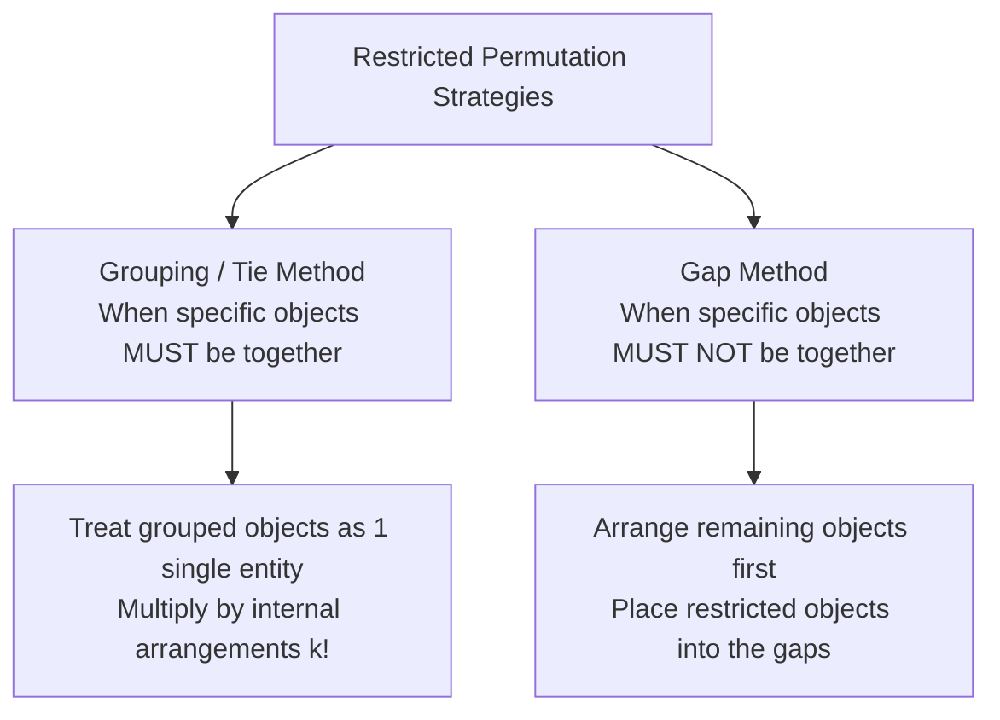
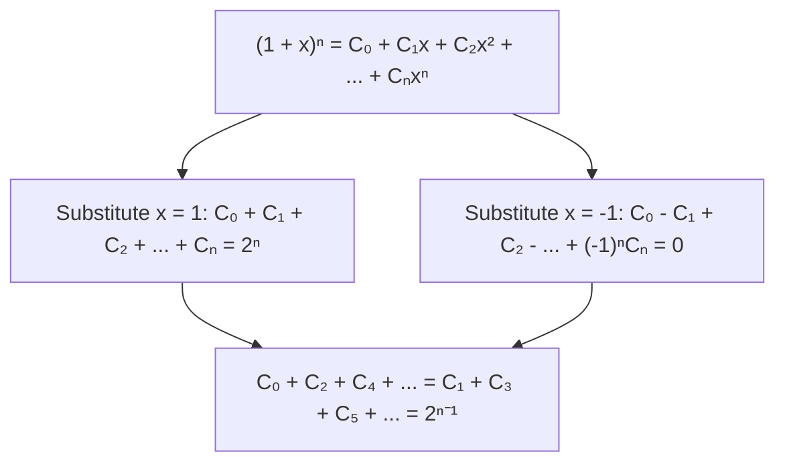

# :LiBinary: Lesson 06: Permutations, Combinations & Binomial Expansion

> [!ABSTRACT] Syllabus Scope (NIE Teacher's Guide — Grade 13, Competencies 22 & 24)
> - **24.1 Factorials**: Definition $n! = 1 \cdot 2 \cdot 3 \dots n$ ($n \in \mathbb{Z}^+$), $0! = 1$, recursive relation $n! = n(n-1)!$.
> - **24.2 Fundamental Principles of Counting**:
>   - Multiplication Rule: If operation 1 can be done in $m$ ways and operation 2 in $n$ ways, the sequential operation can be done in $m \times n$ ways.
>   - Addition Rule: If operation 1 can be done in $m$ ways and operation 2 in $n$ ways (mutually exclusive), either can be done in $m + n$ ways.
> - **24.3 Permutations ($^nP_r$)**:
>   - Arrangements of $r$ objects from $n$ distinct objects: $^nP_r = \frac{n!}{(n-r)!}$, total arrangements $^nP_n = n!$.
>   - Permutations with repetition/identical objects: $\frac{n!}{p! \, q! \, r!}$.
>   - Circular permutations: $(n-1)!$ for distinguishable orientations; $\frac{(n-1)!}{2}$ when reflections are indistinguishable (e.g. key rings, necklaces).
>   - Restricted arrangements: grouping/tie method (objects together) and gap method (objects separated).
> - **24.4 Combinations ($^nC_r$ or $\binom{n}{r}$)**:
>   - Selections of $r$ objects from $n$ distinct objects: $^nC_r = \frac{n!}{r!(n-r)!}$, relation $^nP_r = r! \cdot ^nC_r$.
>   - Core identities: $^nC_r = ^nC_{n-r}$, $^nC_0 = ^nC_n = 1$, Pascal's Identity $^nC_r + ^nC_{r-1} = ^{n+1}C_r$.
>   - Selections from groups with restrictions (at least, at most, specific items included/excluded).
> - **22.1 Binomial Theorem for Positive Integral Index ($n \in \mathbb{Z}^+$)**:
>   - Statement: $(a + b)^n = \sum_{r=0}^n \binom{n}{r} a^{n-r} b^r$, proof via Mathematical Induction.
>   - Number of terms: $n + 1$.
>   - General term: $T_{r+1} = \binom{n}{r} a^{n-r} b^r$ ($0 \le r \le n$).
> - **22.2 Properties of Binomial Coefficients**:
>   - Expansion of $(1 + x)^n = \sum_{r=0}^n \binom{n}{r} x^r$.
>   - Sum of coefficients: $C_0 + C_1 + C_2 + \dots + C_n = 2^n$.
>   - Alternating sum: $C_0 - C_1 + C_2 - \dots + (-1)^n C_n = 0$.
>   - Sum of odd/even coefficients: $C_0 + C_2 + C_4 + \dots = C_1 + C_3 + C_5 + \dots = 2^{n-1}$.
>   - Middle terms and greatest term / coefficient determination.

> [!NOTE] Subtopic Companion Guide
> For complete algebraic proofs of Pascal's identity, induction proof of the Binomial Theorem, advanced grouping and gap methods, and worked exam problems, see: [[Subtopics/Permutations, Combinations & Binomial Expansion Guide|Permutations, Combinations & Binomial Expansion Guide]]

---

## 1. Fundamental Principles of Counting

### 1.1 The Multiplication Principle
If a procedure can be broken down into two successive stages such that:
* Stage 1 can be completed in $m$ different ways, and
* Following stage 1, stage 2 can be completed in $n$ different ways regardless of the choice in stage 1,

then the entire procedure can be carried out in $\boxed{m \times n}$ different ways.

Extended to $k$ successive operations: $n_1 \times n_2 \times n_3 \times \dots \times n_k$ ways.

### 1.2 The Addition Principle
If an action can be performed by either executing choice A (which has $m$ possible ways) OR executing choice B (which has $n$ possible ways), and choices A and B are **mutually exclusive** (cannot be performed simultaneously), then the action can be performed in $\boxed{m + n}$ different ways.

---

## 2. Permutations (Arrangements)

A **permutation** is an ordered arrangement of a set of objects. **Order matters**.

### 2.1 Permutations of Distinct Objects ($^nP_r$)
The number of permutations of $r$ objects chosen from $n$ distinct objects ($0 \le r \le n$):

$$^nP_r = n(n-1)(n-2)\dots(n-r+1)$$

Multiplying numerator and denominator by $(n-r)!$:

$$\boxed{^nP_r = \frac{n!}{(n-r)!}}$$

* **Arranging all $n$ objects**: $^nP_n = \frac{n!}{0!} = \frac{n!}{1} = \boxed{n!}$.
* **Arranging 0 objects**: $^nP_0 = \frac{n!}{n!} = 1$.

---

### 2.2 Permutations with Identical Objects
The number of distinct linear permutations of $n$ objects, where $p$ objects are of one kind, $q$ objects are of a second kind, $r$ objects are of a third kind, and so on ($p + q + r + \dots = n$):

$$\boxed{N = \frac{n!}{p! \, q! \, r! \dots}}$$

---

### 2.3 Circular Permutations
Arranging $n$ distinct objects in a circle:
* In a line, shifting every object by one position gives a new permutation ($n$ shifted arrangements).
* In a circle, rotating the entire arrangement preserves relative positions.
* Thus, each circular arrangement corresponds to $n$ linear arrangements:
  $$\boxed{N_{\text{circular}} = \frac{n!}{n} = (n-1)!}$$

* **When clockwise and counterclockwise orientations are indistinguishable** (e.g. beads on a necklace, keys on a ring, flipping over is allowed):
  $$\boxed{N_{\text{ring}} = \frac{(n-1)!}{2}}$$

---

### 2.4 Problem-Solving Techniques for Permutations

1. **Grouping / Block Method (Objects together)**:
   If $k$ specific objects must always be together, tie them into a single block. Arrange $(n - k + 1)$ items in $(n - k + 1)!$ ways, then arrange the $k$ objects inside the block in $k!$ ways:
   $$N = (n - k + 1)! \times k!$$
2. **Gap Method (Objects not together / separated)**:
   If certain objects cannot be adjacent, arrange the unrestricted objects first (leaving gaps between and at the ends). Then place the restricted objects into the available gaps.

---

## 3. Combinations (Selections)

A **combination** is a selection of objects where **order does NOT matter**.

### 3.1 Formula for $^nC_r$
The number of combinations of $r$ objects chosen from $n$ distinct objects ($0 \le r \le n$):
Since each selection of $r$ objects can be arranged in $r!$ ways:
$$^nP_r = r! \times ^nC_r \implies \boxed{^nC_r = \binom{n}{r} = \frac{^nP_r}{r!} = \frac{n!}{r!(n-r)!}}$$

### 3.2 Fundamental Combination Identities
1. **Symmetry Property**:
   $$\boxed{\binom{n}{r} = \binom{n}{n-r}}$$
   *(Selecting $r$ objects to keep is identical to selecting $(n-r)$ objects to leave behind).*
2. **Boundary Values**:
   $$\binom{n}{0} = \binom{n}{n} = 1, \quad \binom{n}{1} = \binom{n}{n-1} = n$$
3. **Pascal's Identity**:
   $$\boxed{\binom{n}{r} + \binom{n}{r-1} = \binom{n+1}{r}}$$
   *(Algebraic foundation of Pascal's Triangle).*

---

## 4. The Binomial Theorem for Positive Integral Index

### 4.1 Theorem Statement
For any real numbers $a, b$ and any positive integer $n \in \mathbb{Z}^+$:

$$\boxed{(a + b)^n = \sum_{r=0}^n \binom{n}{r} a^{n-r} b^r = \binom{n}{0} a^n + \binom{n}{1} a^{n-1}b + \binom{n}{2} a^{n-2}b^2 + \dots + \binom{n}{n} b^n}$$

**Key Structural Features**:
* The expansion contains exactly $\boxed{n + 1}$ terms.
* The powers of $a$ decrease from $n$ to $0$, while the powers of $b$ increase from $0$ to $n$.
* The sum of the exponents of $a$ and $b$ in every single term is constant and equals $n$: $(n - r) + r = n$.
* The coefficients equidistant from the beginning and end are equal: $\binom{n}{r} = \binom{n}{n-r}$.

---

### 4.2 The General Term ($T_{r+1}$)
The $(r+1)$-th term in the expansion of $(a + b)^n$:

$$\boxed{T_{r+1} = \binom{n}{r} a^{n-r} b^r \quad (r = 0, 1, 2, \dots, n)}$$

* To find the $k$-th term, substitute $r = k - 1$.
* **Term Independent of $x$**: In an expansion involving powers of $x$, express $T_{r+1}$ in terms of $x^p$, set the exponent $p = 0$, and solve for integer $r$.

---

### 4.3 Middle Term(s) of the Expansion
* **If $n$ is even**:
  The total number of terms $(n + 1)$ is odd. There is **one single middle term**:
  $$T_{\frac{n}{2} + 1} = \binom{n}{n/2} a^{n/2} b^{n/2}$$
* **If $n$ is odd**:
  The total number of terms $(n + 1)$ is even. There are **two middle terms**:
  $$T_{\frac{n+1}{2}} = \binom{n}{\frac{n-1}{2}} a^{\frac{n+1}{2}} b^{\frac{n-1}{2}} \quad \text{and} \quad T_{\frac{n+3}{2}} = \binom{n}{\frac{n+1}{2}} a^{\frac{n-1}{2}} b^{\frac{n+1}{2}}$$

---

### 4.4 Properties of Binomial Coefficients in $(1 + x)^n$
Let $(1 + x)^n = C_0 + C_1 x + C_2 x^2 + \dots + C_n x^n$, where $C_r = \binom{n}{r}$:

1. **Sum of All Coefficients** (substitute $x = 1$):
   $$\boxed{\sum_{r=0}^n \binom{n}{r} = C_0 + C_1 + C_2 + \dots + C_n = 2^n}$$
2. **Alternating Sum** (substitute $x = -1$):
   $$\boxed{\sum_{r=0}^n (-1)^r \binom{n}{r} = C_0 - C_1 + C_2 - C_3 + \dots + (-1)^n C_n = 0}$$
3. **Sum of Even / Odd Indexed Coefficients**:
   $$\boxed{C_0 + C_2 + C_4 + \dots = C_1 + C_3 + C_5 + \dots = 2^{n-1}}$$

---

## 5. Summary Comparison Table

| Concept | Formula | Key Notes |
|---|---|---|
| **Linear Permutation** | $^nP_r = \frac{n!}{(n-r)!}$ | Order matters; $r$ objects from $n$ distinct |
| **Full Permutation** | $^nP_n = n!$ | All $n$ objects arranged in a line |
| **Identical Items Permutation** | $\frac{n!}{p! q! r!}$ | $p, q, r$ identical elements |
| **Circular Permutation** | $(n-1)!$ | Rotational symmetry; no fixed start |
| **Ring / Necklace Permutation** | $\frac{(n-1)!}{2}$ | Reflection / flip symmetry |
| **Combinations** | $^nC_r = \frac{n!}{r!(n-r)!}$ | Order does not matter; selections |
| **Pascal's Identity** | $^nC_r + ^nC_{r-1} = ^{n+1}C_r$ | Combination recurrence relation |
| **Binomial Expansion** | $(a+b)^n = \sum_{r=0}^n \binom{n}{r} a^{n-r}b^r$ | Exactly $n+1$ terms |
| **General Term** | $T_{r+1} = \binom{n}{r} a^{n-r}b^r$ | $r = 0, 1, \dots, n$ |
| **Sum of Coefficients** | $\sum_{r=0}^n \binom{n}{r} = 2^n$ | Derived setting $a=b=1$ |

---

## :LiRocket: Flashcards (Spaced Repetition)

#flashcards

State the formula for $^nP_r$ and $^nC_r$. :: $^nP_r = \frac{n!}{(n-r)!}$ and $^nC_r = \frac{n!}{r!(n-r)!}$.

State Pascal's Identity for combinations. :: $^nC_r + ^nC_{r-1} = ^{n+1}C_r$.
<!--SR:!2026-09-26,1,230-->

What is the number of distinct circular permutations of $n$ distinct objects? :: $(n-1)!$.
<!--SR:!2026-09-26,1,230-->

What is the general term $T_{r+1}$ in the binomial expansion of $(a + b)^n$? :: $T_{r+1} = \binom{n}{r} a^{n-r} b^r$.

What is the sum of all binomial coefficients $\sum_{r=0}^n \binom{n}{r}$? :: $2^n$.
<!--SR:!2026-09-26,1,230-->

Why does the circular permutation of $n$ distinct objects equal $(n-1)!$ and not $n!$? :: Because in a circle there is no fixed beginning; rotating all $n$ objects leaves their relative circular order unchanged, so each circular arrangement corresponds to $n$ linear arrangements ($n!/n = (n-1)!$).

What is the formula for the number of permutations of $n$ beads of different colors on a necklace? :: $\frac{(n-1)!}{2}$ (since flipping the necklace over makes clockwise and counterclockwise arrangements identical).

What is the formula for the number of permutations of $n$ objects where $p$ are of one kind and $q$ of another kind? :: $\frac{n!}{p! \, q!}$.

State the relationship between $^nP_r$ and $^nC_r$. :: $^nP_r = r! \times ^nC_r$.

Prove that $\binom{n}{r} = \binom{n}{n-r}$. :: $\binom{n}{n-r} = \frac{n!}{(n-r)![n-(n-r)]!} = \frac{n!}{(n-r)!r!} = \binom{n}{r}$.

How many terms are in the expansion of $(a + b)^n$ for a positive integer $n$? :: $n + 1$ terms.

What is the alternating sum of binomial coefficients $C_0 - C_1 + C_2 - \dots + (-1)^n C_n$? :: $0$ (obtained by substituting $x = -1$ into $(1 + x)^n$).

What is the sum of the even-indexed binomial coefficients $C_0 + C_2 + C_4 + \dots$? :: $2^{n-1}$.

How do you find the term independent of $x$ in a binomial expansion? :: Express the general term $T_{r+1}$ in terms of $x^k$, set the exponent $k = 0$, solve for $r$, and compute $T_{r+1}$.

What is the middle term in the expansion of $(a + b)^n$ when $n$ is even? :: $T_{\frac{n}{2} + 1} = \binom{n}{n/2} a^{n/2} b^{n/2}$.
