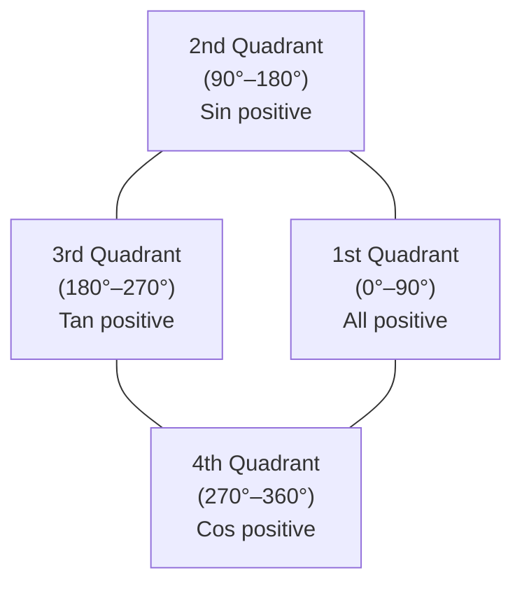
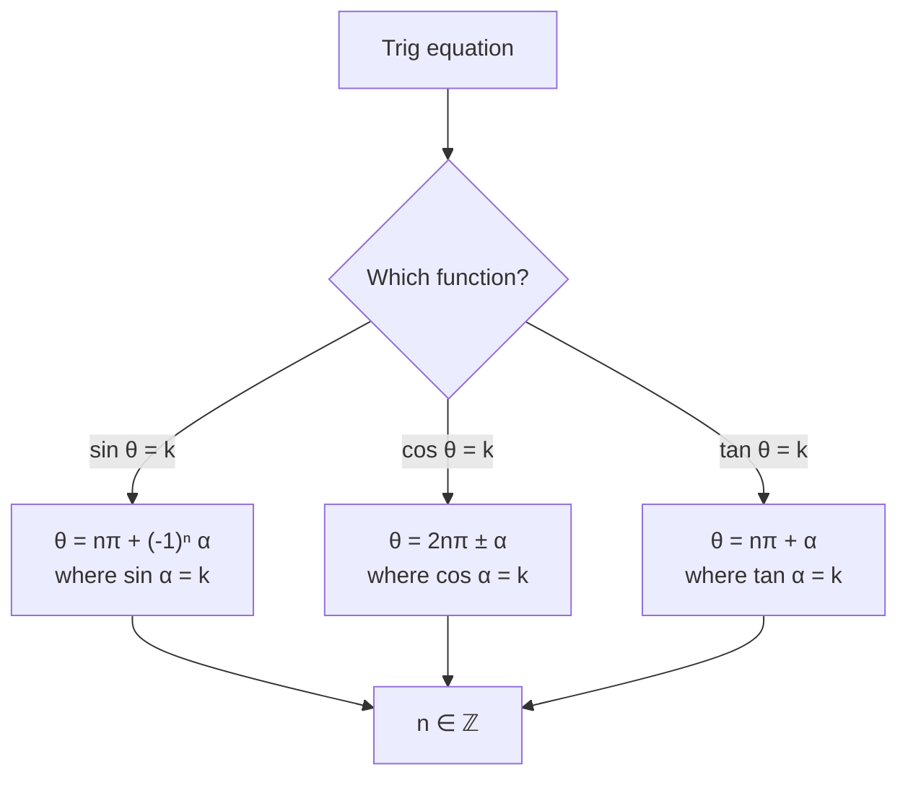
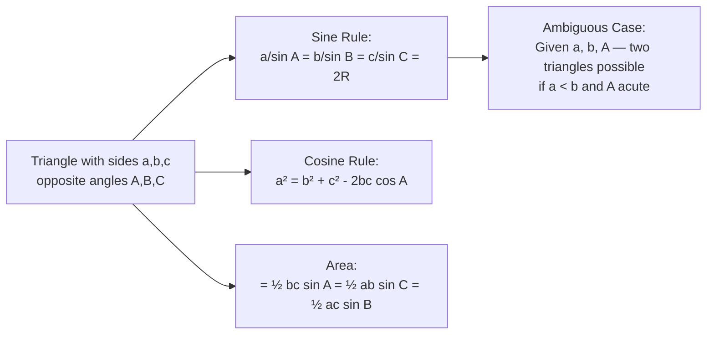

# :LiCompass: Lesson 07: Trigonometric Functions, Identities & Equations

> [!ABSTRACT] Syllabus Scope (NIE Teacher's Guide — Grade 12, Competencies 10–12)
> - **Radian Measure**: $180^\circ = \pi \text{ rad}$; Arc length $s = r\theta$; Sector area $A = \tfrac{1}{2}r^2\theta$
> - **Six Circular Functions**: $\sin$, $\cos$, $\tan$, $\csc$, $\sec$, $\cot$ — definitions on unit circle, signs by quadrant (ASTC)
> - **Pythagorean Identities**: $\sin^2\theta + \cos^2\theta = 1$; $1 + \tan^2\theta = \sec^2\theta$; $1 + \cot^2\theta = \csc^2\theta$
> - **Compound Angle Formulas**: $\sin(A \pm B)$, $\cos(A \pm B)$, $\tan(A \pm B)$
> - **Double & Half Angle Formulas**: $\sin 2A$, three forms of $\cos 2A$, $\tan 2A$; $t = \tan(\theta/2)$ substitution
> - **Product-to-Sum & Sum-to-Product** identities; **$R$-form**: $a\sin\theta + b\cos\theta = R\sin(\theta + \alpha)$
> - **General Solutions**: $\sin\theta = k$, $\cos\theta = k$, $\tan\theta = k$
> - **Inverse Trig Functions**: $\sin^{-1}$, $\cos^{-1}$, $\tan^{-1}$ — principal values, domains, ranges
> - **Triangle Rules**: Sine Rule, Cosine Rule, Area formula; ambiguous case of Sine Rule

> [!NOTE] Subtopic Companion Guide
> For full identity proofs, $t$-substitution worked examples, and equation-solving algorithms → [[Subtopics/Trigonometric Identities & Equations|Trigonometric Identities & Equations Guide]]

---

## 1. Radian Measure & the Unit Circle

| Quantity | Formula |
|---|---|
| Degrees → Radians | multiply by $\pi/180$ |
| Radians → Degrees | multiply by $180/\pi$ |
| Arc length | $s = r\theta$ ($\theta$ in radians) |
| Sector area | $A = \tfrac{1}{2}r^2\theta$ |
| Segment area | $A = \tfrac{1}{2}r^2(\theta - \sin\theta)$ |

**Key angle values** (memorise):

| Degrees | $0°$ | $30°$ | $45°$ | $60°$ | $90°$ | $180°$ | $270°$ | $360°$ |
|---|---|---|---|---|---|---|---|---|
| Radians | $0$ | $\pi/6$ | $\pi/4$ | $\pi/3$ | $\pi/2$ | $\pi$ | $3\pi/2$ | $2\pi$ |
| $\sin$ | $0$ | $1/2$ | $1/\sqrt{2}$ | $\sqrt{3}/2$ | $1$ | $0$ | $-1$ | $0$ |
| $\cos$ | $1$ | $\sqrt{3}/2$ | $1/\sqrt{2}$ | $1/2$ | $0$ | $-1$ | $0$ | $1$ |
| $\tan$ | $0$ | $1/\sqrt{3}$ | $1$ | $\sqrt{3}$ | undef | $0$ | undef | $0$ |

**ASTC Rule** (which functions are positive):

---

## 2. The Three Pythagorean Identities

$$\sin^2\theta + \cos^2\theta = 1$$

$$1 + \tan^2\theta = \sec^2\theta \quad \Longleftrightarrow \quad \sec^2\theta - \tan^2\theta = 1$$

$$1 + \cot^2\theta = \csc^2\theta \quad \Longleftrightarrow \quad \csc^2\theta - \cot^2\theta = 1$$

> **Derivation tip**: Divide $\sin^2\theta + \cos^2\theta = 1$ by $\cos^2\theta$ to get the second; divide by $\sin^2\theta$ for the third.

**Reciprocal & Quotient Identities**:

$$\tan\theta = \frac{\sin\theta}{\cos\theta}, \quad \cot\theta = \frac{\cos\theta}{\sin\theta}$$

$$\sec\theta = \frac{1}{\cos\theta}, \quad \csc\theta = \frac{1}{\sin\theta}$$

---

## 3. Compound Angle Formulas

$$\sin(A + B) = \sin A \cos B + \cos A \sin B$$
$$\sin(A - B) = \sin A \cos B - \cos A \sin B$$

$$\cos(A + B) = \cos A \cos B - \sin A \sin B$$
$$\cos(A - B) = \cos A \cos B + \sin A \sin B$$

$$\tan(A + B) = \frac{\tan A + \tan B}{1 - \tan A \tan B}, \quad \tan(A - B) = \frac{\tan A - \tan B}{1 + \tan A \tan B}$$

> **Mnemonic for $\sin$**: "Some Angels Have Curly Brown Hairs" → $\sin(A+B) = \sin A \cos B + \cos A \sin B$ (alternating trig pairs, same sign)
> **Mnemonic for $\cos$**: opposite sign in front of the $\sin\sin$ term.

**Worked Example** — Find $\sin 75°$:
$$\sin 75° = \sin(45° + 30°) = \sin 45°\cos 30° + \cos 45°\sin 30° = \frac{1}{\sqrt{2}}\cdot\frac{\sqrt{3}}{2} + \frac{1}{\sqrt{2}}\cdot\frac{1}{2} = \frac{\sqrt{3}+1}{2\sqrt{2}}$$

---

## 4. Double Angle & Half Angle Formulas

**Double Angle (derived by setting $B = A$ in compound formulas)**:

$$\sin 2A = 2\sin A \cos A$$

$$\cos 2A = \cos^2 A - \sin^2 A = 2\cos^2 A - 1 = 1 - 2\sin^2 A$$

$$\tan 2A = \frac{2\tan A}{1 - \tan^2 A}$$

**Three forms of $\cos 2A$** are critical — rearranging:
$$\cos^2 A = \frac{1 + \cos 2A}{2}, \quad \sin^2 A = \frac{1 - \cos 2A}{2}$$

**Triple Angle Formulas** (derived from double + single):
$$\sin 3A = 3\sin A - 4\sin^3 A$$
$$\cos 3A = 4\cos^3 A - 3\cos A$$

**Half-Angle $t$-substitution** ($t = \tan(\theta/2)$):
$$\sin\theta = \frac{2t}{1+t^2}, \quad \cos\theta = \frac{1-t^2}{1+t^2}, \quad \tan\theta = \frac{2t}{1-t^2}$$

> **Use when**: equation has $a\sin\theta + b\cos\theta = c$ — substitute to get a polynomial in $t$.
> **Caution**: $t$-sub misses $\theta = \pi$ (where $\cos\theta = -1$ and $t \to \infty$). Always check separately.

---

## 5. Product-to-Sum & Sum-to-Product Identities

**Product → Sum** (add/subtract compound angle formulas):

$$\sin A \cos B = \frac{1}{2}[\sin(A+B) + \sin(A-B)]$$
$$\cos A \sin B = \frac{1}{2}[\sin(A+B) - \sin(A-B)]$$
$$\cos A \cos B = \frac{1}{2}[\cos(A+B) + \cos(A-B)]$$
$$\sin A \sin B = \frac{1}{2}[\cos(A-B) - \cos(A+B)]$$

**Sum → Product** (let $P = A+B$, $Q = A-B$, so $A = \frac{P+Q}{2}$, $B = \frac{P-Q}{2}$):

$$\sin P + \sin Q = 2\sin\!\left(\frac{P+Q}{2}\right)\cos\!\left(\frac{P-Q}{2}\right)$$
$$\sin P - \sin Q = 2\cos\!\left(\frac{P+Q}{2}\right)\sin\!\left(\frac{P-Q}{2}\right)$$
$$\cos P + \cos Q = 2\cos\!\left(\frac{P+Q}{2}\right)\cos\!\left(\frac{P-Q}{2}\right)$$
$$\cos P - \cos Q = -2\sin\!\left(\frac{P+Q}{2}\right)\sin\!\left(\frac{P-Q}{2}\right)$$

---

## 6. The $R$-Form: $a\sin\theta + b\cos\theta$

$$a\sin\theta + b\cos\theta = R\sin(\theta + \alpha)$$

where $R = \sqrt{a^2 + b^2}$ and $\tan\alpha = b/a$ (with $\alpha$ in correct quadrant).

Similarly: $a\sin\theta + b\cos\theta = R\cos(\theta - \beta)$ where $\tan\beta = a/b$.

**Procedure**:
1. Expand $R\sin(\theta + \alpha) = R(\sin\theta\cos\alpha + \cos\theta\sin\alpha)$
2. Compare coefficients: $R\cos\alpha = a$ and $R\sin\alpha = b$
3. So $R = \sqrt{a^2+b^2}$, $\tan\alpha = b/a$

**Applications**:
- **Maximum value** of $a\sin\theta + b\cos\theta$ is $R$ (when $\sin(\theta+\alpha)=1$)
- **Minimum value** is $-R$
- **Solving** $a\sin\theta + b\cos\theta = c$: becomes $R\sin(\theta+\alpha) = c$, so $\sin(\theta+\alpha) = c/R$. Only solvable if $|c| \leq R$.

**Worked Example** — Solve $3\sin\theta + 4\cos\theta = 2$ for $0 \leq \theta \leq 2\pi$:

$R = \sqrt{9+16} = 5$; $\tan\alpha = 4/3$, so $\alpha = \arctan(4/3) \approx 0.927$ rad.

$5\sin(\theta + 0.927) = 2 \Rightarrow \sin(\theta+0.927) = 0.4$

$\theta + 0.927 = \arcsin(0.4) \approx 0.412$ or $\pi - 0.412 \approx 2.730$

$\theta \approx -0.515$ (add $2\pi$: $\approx 5.768$) or $\theta \approx 1.803$

---

## 7. General Solutions of Trigonometric Equations

**Formal general solutions**:

$$\sin\theta = \sin\alpha \implies \theta = n\pi + (-1)^n\alpha, \quad n \in \mathbb{Z}$$
$$\cos\theta = \cos\alpha \implies \theta = 2n\pi \pm \alpha, \quad n \in \mathbb{Z}$$
$$\tan\theta = \tan\alpha \implies \theta = n\pi + \alpha, \quad n \in \mathbb{Z}$$

**Strategy for solving equations**:
1. Reduce to a **single trig function** (use identities, factoring)
2. Find the **principal value** $\alpha$ (using inverse trig)
3. Write the **general solution** using the appropriate formula above
4. If a **range** is specified, substitute integer values of $n$ to find solutions in that range

**Worked Example** — Solve $2\cos^2\theta - \cos\theta - 1 = 0$:

Factor: $(2\cos\theta + 1)(\cos\theta - 1) = 0$

$\cos\theta = -1/2 \implies \theta = 2n\pi \pm 2\pi/3$

$\cos\theta = 1 \implies \theta = 2n\pi$

---

## 8. Inverse Trigonometric Functions

| Function | Domain | Range (Principal Values) |
|---|---|---|
| $y = \sin^{-1}x$ | $[-1, 1]$ | $[-\pi/2, \pi/2]$ |
| $y = \cos^{-1}x$ | $[-1, 1]$ | $[0, \pi]$ |
| $y = \tan^{-1}x$ | $\mathbb{R}$ | $(-\pi/2, \pi/2)$ |

**Key values**:
$$\sin^{-1}(0) = 0, \quad \sin^{-1}(1) = \pi/2, \quad \sin^{-1}(-1) = -\pi/2$$
$$\cos^{-1}(0) = \pi/2, \quad \cos^{-1}(1) = 0, \quad \cos^{-1}(-1) = \pi$$
$$\tan^{-1}(0) = 0, \quad \tan^{-1}(1) = \pi/4, \quad \tan^{-1}(-1) = -\pi/4$$

**Important identities**:
$$\sin^{-1}x + \cos^{-1}x = \frac{\pi}{2} \quad \text{for } x \in [-1,1]$$
$$\tan^{-1}x + \tan^{-1}\!\left(\frac{1}{x}\right) = \frac{\pi}{2} \quad \text{for } x > 0$$

---

## 9. Triangle Rules

**Sine Rule**:
$$\frac{a}{\sin A} = \frac{b}{\sin B} = \frac{c}{\sin C} = 2R$$

where $R$ is the circumradius. Use when: **two angles + any side**, or **two sides + non-included angle** (ambiguous case).

**Cosine Rule**:
$$a^2 = b^2 + c^2 - 2bc\cos A$$
$$\cos A = \frac{b^2 + c^2 - a^2}{2bc}$$

Use when: **three sides known** (find angles), or **two sides + included angle** (find third side).

**Area formulas**:
$$\text{Area} = \frac{1}{2}bc\sin A = \frac{1}{2}ab\sin C = \frac{abc}{4R} = rs$$

where $r$ is the inradius and $s = (a+b+c)/2$ is the semi-perimeter.

**Heron's Formula**:
$$\text{Area} = \sqrt{s(s-a)(s-b)(s-c)}, \quad s = \frac{a+b+c}{2}$$

---

## :LiRocket: Flashcards (Spaced Repetition)

#flashcards

What is the general solution for $\sin\theta = \sin\alpha$? :: $\theta = n\pi + (-1)^n\alpha$, $n \in \mathbb{Z}$ <!--SR:!2026-11-20,1,230-->

What is the general solution for $\cos\theta = \cos\alpha$? :: $\theta = 2n\pi \pm \alpha$, $n \in \mathbb{Z}$ <!--SR:!2026-11-20,1,230-->

What is the general solution for $\tan\theta = \tan\alpha$? :: $\theta = n\pi + \alpha$, $n \in \mathbb{Z}$ <!--SR:!2026-11-20,1,230-->

State all three Pythagorean identities. :: $\sin^2\theta+\cos^2\theta=1$; $1+\tan^2\theta=\sec^2\theta$; $1+\cot^2\theta=\csc^2\theta$ <!--SR:!2026-11-21,2,250-->

Write $\sin(A+B)$ in expanded form. :: $\sin A\cos B + \cos A\sin B$ <!--SR:!2026-11-21,2,250-->

Write $\cos(A+B)$ in expanded form. :: $\cos A\cos B - \sin A\sin B$ <!--SR:!2026-11-21,2,250-->

State all three forms of $\cos 2A$. :: $\cos^2 A - \sin^2 A = 2\cos^2 A - 1 = 1 - 2\sin^2 A$ <!--SR:!2026-11-22,3,250-->

What is $\sin 2A$? :: $2\sin A\cos A$ <!--SR:!2026-11-22,3,250-->

Write the $R$-form for $a\sin\theta + b\cos\theta$ and state $R$ and $\alpha$. :: $R\sin(\theta+\alpha)$ where $R=\sqrt{a^2+b^2}$ and $\tan\alpha = b/a$ <!--SR:!2026-11-23,4,250-->

What is the maximum value of $a\sin\theta + b\cos\theta$? :: $\sqrt{a^2+b^2}$ <!--SR:!2026-11-23,4,250-->

State the half-angle substitution formulas for $\sin\theta$ and $\cos\theta$ using $t = \tan(\theta/2)$. :: $\sin\theta = \frac{2t}{1+t^2}$, $\cos\theta = \frac{1-t^2}{1+t^2}$ <!--SR:!2026-11-24,5,250-->

State the Sine Rule. :: $\frac{a}{\sin A} = \frac{b}{\sin B} = \frac{c}{\sin C} = 2R$ <!--SR:!2026-11-24,5,250-->

State the Cosine Rule (finding side $a$). :: $a^2 = b^2 + c^2 - 2bc\cos A$ <!--SR:!2026-11-25,6,250-->

What is the range of $\sin^{-1}x$? :: $\left[-\frac{\pi}{2}, \frac{\pi}{2}\right]$ <!--SR:!2026-11-25,6,250-->

What is the range of $\cos^{-1}x$? :: $[0, \pi]$ <!--SR:!2026-11-26,7,250-->

State the identity: $\sin^{-1}x + \cos^{-1}x = \,?$ :: $\dfrac{\pi}{2}$ for $x \in [-1,1]$ <!--SR:!2026-11-26,7,250-->

State $\sin P + \sin Q$ as a product. :: $2\sin\!\left(\frac{P+Q}{2}\right)\cos\!\left(\frac{P-Q}{2}\right)$ <!--SR:!2026-11-27,8,250-->

State $\cos P - \cos Q$ as a product. :: $-2\sin\!\left(\frac{P+Q}{2}\right)\sin\!\left(\frac{P-Q}{2}\right)$ <!--SR:!2026-11-27,8,250-->

State Heron's formula for triangle area. :: $\text{Area} = \sqrt{s(s-a)(s-b)(s-c)}$ where $s = (a+b+c)/2$ <!--SR:!2026-11-28,9,250-->
