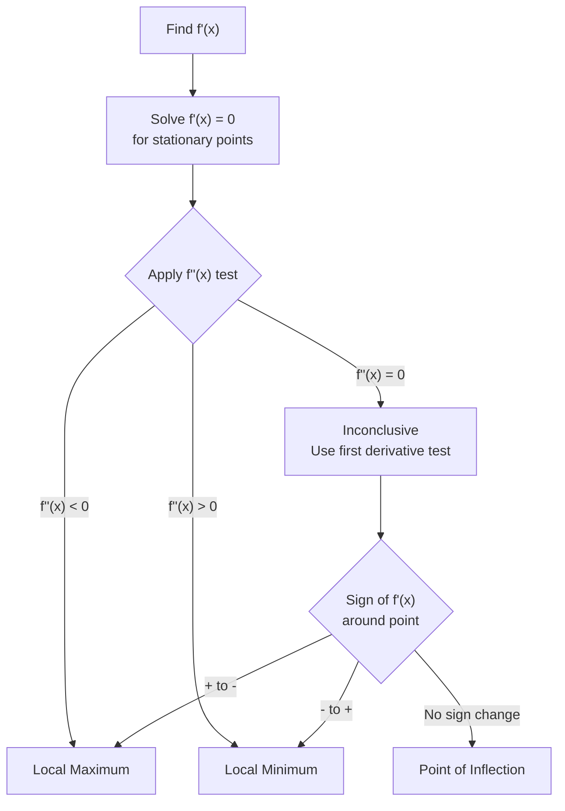

# :LiTrendingUp: Lesson 08: Differential Calculus & Applications

> [!ABSTRACT] Syllabus Scope (NIE Teacher's Guide — Grade 12 & 13, Competency 2)
> - **Limits & Continuity**: Standard limits $\lim_{x \to 0}\frac{\sin x}{x}=1$, $\lim_{x \to a}\frac{x^n-a^n}{x-a}=na^{n-1}$; L'Hôpital's Rule
> - **First Principles**: $f'(x) = \lim_{h \to 0}\frac{f(x+h)-f(x)}{h}$
> - **Differentiation Rules**: Product, Quotient, Chain; standard derivatives of $x^n$, $e^x$, $a^x$, $\ln x$, $\sin x$, $\cos x$, $\tan x$, $\sec x$, $\csc x$, $\cot x$
> - **Implicit & Parametric Differentiation**: $\frac{dy}{dx}=\frac{dy/dt}{dx/dt}$; second derivative for parametric
> - **Inverse Trig Derivatives** via substitution: $\sin^{-1}$, $\cos^{-1}$, $\tan^{-1}$ with standard algebraic forms
> - **Applications**: Tangents & Normals; Stationary points, first & second derivative tests; Concavity & Points of Inflection; Optimization; Curve sketching algorithm; L'Hôpital's Rule for $0/0$ and $\infty/\infty$ forms

> [!NOTE] Subtopic Companion Guide
> For the full 7-step curve sketching algorithm, asymptote analysis, and optimization worked problems → [[Subtopics/Differentiation & Curve Sketching|Differentiation & Curve Sketching Guide]]

---

## 1. Limits & Continuity

**Definition of a limit**: $\lim_{x \to a} f(x) = L$ means $f(x)$ can be made arbitrarily close to $L$ by taking $x$ sufficiently close to $a$ (but $x \neq a$).

**Standard limits** (must memorise):
$$\lim_{x \to 0}\frac{\sin x}{x} = 1 \qquad \lim_{x \to 0}\frac{\tan x}{x} = 1 \qquad \lim_{x \to 0}\frac{1-\cos x}{x} = 0$$

$$\lim_{x \to 0}\frac{1-\cos x}{x^2} = \frac{1}{2} \qquad \lim_{x \to a}\frac{x^n - a^n}{x - a} = na^{n-1}$$

$$\lim_{x \to \infty}\left(1 + \frac{1}{x}\right)^x = e \qquad \lim_{x \to 0}(1+x)^{1/x} = e$$

**Continuity at $x = a$**: $f$ is continuous iff:
1. $f(a)$ is defined
2. $\lim_{x \to a}f(x)$ exists
3. $\lim_{x \to a}f(x) = f(a)$

**L'Hôpital's Rule**: For $\frac{0}{0}$ or $\frac{\infty}{\infty}$ indeterminate forms:
$$\lim_{x \to a}\frac{f(x)}{g(x)} = \lim_{x \to a}\frac{f'(x)}{g'(x)}$$
(provided the limit on the right exists). Can be applied repeatedly.

---

## 2. Derivative from First Principles

$$f'(x) = \lim_{h \to 0}\frac{f(x+h) - f(x)}{h}$$

**Worked Example** — Differentiate $f(x) = x^2$ from first principles:
$$f'(x) = \lim_{h \to 0}\frac{(x+h)^2 - x^2}{h} = \lim_{h \to 0}\frac{x^2+2xh+h^2-x^2}{h} = \lim_{h \to 0}(2x+h) = 2x$$

**Worked Example** — Differentiate $f(x) = \sin x$ from first principles:
$$f'(x) = \lim_{h \to 0}\frac{\sin(x+h)-\sin x}{h} = \lim_{h \to 0}\frac{2\cos\!\left(x+\frac{h}{2}\right)\sin\!\left(\frac{h}{2}\right)}{h}$$
$$= \lim_{h \to 0}\cos\!\left(x+\frac{h}{2}\right)\cdot\frac{\sin(h/2)}{h/2} = \cos x \cdot 1 = \cos x$$

---

## 3. Differentiation Rules & Standard Derivatives

**The Three Main Rules**:

| Rule | Formula |
|---|---|
| **Product Rule** | $\frac{d}{dx}[uv] = u\frac{dv}{dx} + v\frac{du}{dx}$ |
| **Quotient Rule** | $\frac{d}{dx}\!\left[\frac{u}{v}\right] = \frac{v\,u' - u\,v'}{v^2}$ |
| **Chain Rule** | $\frac{dy}{dx} = \frac{dy}{du}\cdot\frac{du}{dx}$ |

**Standard Derivatives Table**:

| $f(x)$ | $f'(x)$ | | $f(x)$ | $f'(x)$ |
|---|---|---|---|---|
| $x^n$ | $nx^{n-1}$ | | $e^{kx}$ | $ke^{kx}$ |
| $a^x$ | $a^x\ln a$ | | $\ln x$ | $\frac{1}{x}$ |
| $\log_a x$ | $\frac{1}{x\ln a}$ | | $\sin(kx)$ | $k\cos(kx)$ |
| $\cos(kx)$ | $-k\sin(kx)$ | | $\tan(kx)$ | $k\sec^2(kx)$ |
| $\sec x$ | $\sec x\tan x$ | | $\csc x$ | $-\csc x\cot x$ |
| $\cot x$ | $-\csc^2 x$ | | $\sin^{-1}x$ | $\frac{1}{\sqrt{1-x^2}}$ |
| $\cos^{-1}x$ | $\frac{-1}{\sqrt{1-x^2}}$ | | $\tan^{-1}x$ | $\frac{1}{1+x^2}$ |

---

## 4. Implicit & Parametric Differentiation

**Implicit Differentiation** — Differentiate both sides with respect to $x$, treating $y$ as a function of $x$:

$$\frac{d}{dx}[y^n] = ny^{n-1}\frac{dy}{dx} \qquad \frac{d}{dx}[f(y)] = f'(y)\frac{dy}{dx}$$

**Worked Example** — Find $\frac{dy}{dx}$ for $x^2 + y^2 = r^2$ (circle):
$$2x + 2y\frac{dy}{dx} = 0 \implies \frac{dy}{dx} = -\frac{x}{y}$$

**Worked Example** — Find $\frac{dy}{dx}$ for $x^3 + y^3 = 3xy$ (folium of Descartes):
$$3x^2 + 3y^2\frac{dy}{dx} = 3y + 3x\frac{dy}{dx} \implies \frac{dy}{dx}(3y^2 - 3x) = 3y - 3x^2 \implies \frac{dy}{dx} = \frac{y-x^2}{y^2-x}$$

**Parametric Differentiation** — When $x = f(t)$, $y = g(t)$:

$$\frac{dy}{dx} = \frac{dy/dt}{dx/dt} = \frac{g'(t)}{f'(t)}$$

$$\frac{d^2y}{dx^2} = \frac{\frac{d}{dt}\!\left(\frac{dy}{dx}\right)}{\frac{dx}{dt}}$$

**Worked Example** — Parabola $x = at^2$, $y = 2at$:
$$\frac{dy}{dx} = \frac{2a}{2at} = \frac{1}{t}, \quad \frac{d^2y}{dx^2} = \frac{-1/t^2}{2at} = \frac{-1}{2at^3}$$

---

## 5. Inverse Trig Derivatives by Substitution

> **Core Idea**: Simplify the argument of $\sin^{-1}$, $\cos^{-1}$, $\tan^{-1}$ using trig substitution so the inverse cancels.

### Standard Substitution Patterns

| Argument Form | Substitution | Simplified Form |
|---|---|---|
| $\sqrt{a^2 - x^2}$ | $x = a\sin\theta$ | $a\cos\theta$ |
| $\sqrt{a^2 + x^2}$ | $x = a\tan\theta$ | $a\sec\theta$ |
| $\sqrt{x^2 - a^2}$ | $x = a\sec\theta$ | $a\tan\theta$ |
| $\frac{a-x}{a+x}$, $\sqrt{\frac{a-x}{a+x}}$ | $x = a\cos 2\theta$ | $\tan\theta$ or $\cot\theta$ |
| $\frac{2x}{1+x^2}$ | $x = \tan\theta$ | $\sin 2\theta$ |
| $\frac{1-x^2}{1+x^2}$ | $x = \tan\theta$ | $\cos 2\theta$ |
| $\frac{2x}{1-x^2}$ | $x = \tan\theta$ | $\tan 2\theta$ |

**Key Half-Angle Identities**:
$$\frac{1-\cos\theta}{\sin\theta} = \tan\frac{\theta}{2}, \quad \frac{\sin\theta}{1+\cos\theta} = \tan\frac{\theta}{2}, \quad \sqrt{\frac{1-\cos\theta}{1+\cos\theta}} = \tan\frac{\theta}{2}$$

### Worked Examples

**Example 1**: $y = \tan^{-1}\!\left(\dfrac{\sqrt{1+x^2}-1}{x}\right)$

Let $x = \tan\theta$: $\dfrac{\sec\theta - 1}{\tan\theta} = \tan\dfrac{\theta}{2}$, so $y = \dfrac{\theta}{2} = \dfrac{1}{2}\tan^{-1}x$, giving $\dfrac{dy}{dx} = \dfrac{1}{2(1+x^2)}$

**Example 2**: $y = \sin^{-1}\!\left(\dfrac{2x}{1+x^2}\right)$

Let $x = \tan\theta$: argument becomes $\sin 2\theta$. After range check ($|x|\leq 1 \Rightarrow |x|<1$):
$$\frac{dy}{dx} = \begin{cases} \dfrac{2}{1+x^2}, & |x| < 1 \\[6pt] -\dfrac{2}{1+x^2}, & |x| > 1 \end{cases}$$

**Example 3**: $y = \cos^{-1}\!\left(\dfrac{1-x^2}{1+x^2}\right)$

Let $x = \tan\theta$: argument becomes $\cos 2\theta$. After range check:
$$\frac{dy}{dx} = \begin{cases} \dfrac{2}{1+x^2}, & x > 0 \\[6pt] -\dfrac{2}{1+x^2}, & x < 0 \end{cases}$$

**Example 4**: $y = \tan^{-1}\!\left(\sqrt{\dfrac{a-x}{a+x}}\right)$

Let $x = a\cos 2\theta$: argument becomes $\tan\theta$, so $y = \theta = \dfrac{1}{2}\cos^{-1}\!\left(\dfrac{x}{a}\right)$, giving $\dfrac{dy}{dx} = -\dfrac{1}{2\sqrt{a^2-x^2}}$

---

## 6. Stationary Points & Curve Sketching

**Points of Inflection**: where $f''(x) = 0$ **and** $f''(x)$ changes sign (concavity changes).

**Concavity**:
- $f''(x) > 0$: concave upward (curve lies above tangent)
- $f''(x) < 0$: concave downward (curve lies below tangent)

**Tangent & Normal at $(x_0, y_0)$**:
$$\text{Tangent: } y - y_0 = f'(x_0)(x-x_0)$$
$$\text{Normal: } y - y_0 = -\frac{1}{f'(x_0)}(x-x_0)$$

---

## 7. Optimization

**Method**:
1. Define the quantity to maximize/minimize as a function of **one variable**
2. Use a constraint equation to eliminate extra variables
3. Differentiate and set $f'(x) = 0$
4. Verify it is a max/min using $f''(x)$ test
5. State the answer clearly with units

**Worked Example** — A rectangle has perimeter 20 cm. Find dimensions for maximum area.

Let width $= x$, length $= 10-x$. Area $A = x(10-x) = 10x - x^2$.

$A' = 10 - 2x = 0 \Rightarrow x = 5$. $A'' = -2 < 0$ (maximum).

Maximum area $= 5 \times 5 = 25$ cm² (a square).

---

## :LiRocket: Flashcards (Spaced Repetition)

#flashcards

State the standard limit $\lim_{x \to 0}\frac{\sin x}{x}$. :: $1$ <!--SR:!2026-11-20,1,230-->

State the Quotient Rule for differentiation $\frac{d}{dx}\left[\frac{u}{v}\right]$. :: $\frac{v\,u' - u\,v'}{v^2}$
<!--SR:!2026-09-29,4,270-->

What is the second derivative formula for parametric equations $x=f(t)$, $y=g(t)$? :: $\frac{d^2y}{dx^2} = \frac{\frac{d}{dt}\!\left(\frac{dy}{dx}\right)}{\frac{dx}{dt}}$
<!--SR:!2026-09-29,4,270-->

How do you identify a local minimum or maximum using the second derivative test? :: If $f''(x_0)>0$, local minimum; if $f''(x_0)<0$, local maximum.
<!--SR:!2026-09-29,4,270-->

What is the slope of the normal at $(x_0,y_0)$ where $f'(x_0)\neq 0$? :: $m_\text{normal} = -\dfrac{1}{f'(x_0)}$
<!--SR:!2026-09-26,1,230-->

What substitution simplifies $\sqrt{a^2-x^2}$? :: $x = a\sin\theta$ (or $a\cos\theta$)
<!--SR:!2026-09-26,1,230-->

What substitution simplifies $\sqrt{a^2+x^2}$? :: $x = a\tan\theta$

What substitution simplifies $\sqrt{x^2-a^2}$? :: $x = a\sec\theta$
<!--SR:!2026-09-29,4,270-->

What substitution simplifies $\frac{2x}{1+x^2}$? :: $x = \tan\theta$ (gives $\sin 2\theta$)
<!--SR:!2026-09-29,4,270-->

What substitution simplifies $\frac{1-x^2}{1+x^2}$? :: $x = \tan\theta$ (gives $\cos 2\theta$)
<!--SR:!2026-09-29,4,270-->

What substitution simplifies $\frac{2x}{1-x^2}$? :: $x = \tan\theta$ (gives $\tan 2\theta$)
<!--SR:!2026-09-29,4,270-->

What substitution simplifies $\sqrt{\frac{a-x}{a+x}}$? :: $x = a\cos 2\theta$ (gives $\tan\theta$)
<!--SR:!2026-09-28,3,250-->

State the half-angle identity for $\frac{1-\cos\theta}{\sin\theta}$. :: $\tan\dfrac{\theta}{2}$
<!--SR:!2026-09-29,4,270-->

State the half-angle identity for $\frac{\sin\theta}{1+\cos\theta}$. :: $\tan\dfrac{\theta}{2}$
<!--SR:!2026-09-29,4,270-->

State the half-angle identity for $\sqrt{\frac{1-\cos\theta}{1+\cos\theta}}$. :: $\tan\dfrac{\theta}{2}$
<!--SR:!2026-09-29,4,270-->

What is the derivative of $y = \tan^{-1}\!\left(\frac{\sqrt{1+x^2}-1}{x}\right)$? :: $\dfrac{1}{2(1+x^2)}$
<!--SR:!2026-09-29,4,270-->

What is the derivative of $y = \sin^{-1}\!\left(\frac{2x}{1+x^2}\right)$ for $|x|<1$? :: $\dfrac{2}{1+x^2}$

What is the derivative of $y = \cos^{-1}\!\left(\frac{1-x^2}{1+x^2}\right)$ for $x>0$? :: $\dfrac{2}{1+x^2}$
<!--SR:!2026-09-29,4,270-->

Why must you check the principal range after a trig substitution? :: The inverse cancels only if the angle lies in its principal range; otherwise piecewise definitions with $\pi$ adjustments are needed. <!--SR:!2026-11-20,1,230-->

State the first principles definition of $f'(x)$. :: $f'(x) = \lim_{h\to 0}\dfrac{f(x+h)-f(x)}{h}$ <!--SR:!2026-11-21,2,250-->
