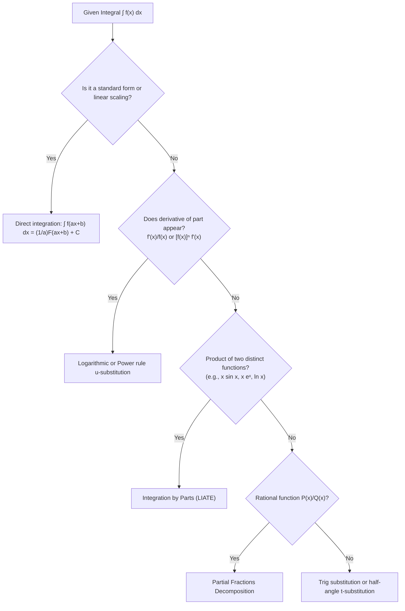
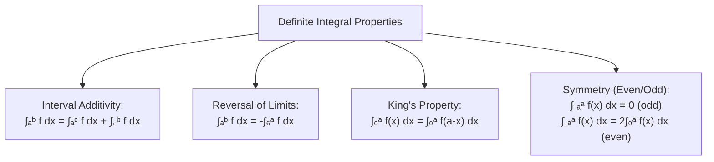

# :LiSigma: Lesson 09: Integral Calculus & Applications

> [!ABSTRACT] Syllabus Scope (NIE Teacher's Guide — Grade 13, Competencies 15 & 16)
> - **Indefinite Integral as Anti-derivative**: $\int f(x)\,dx = F(x) + C$ where $F'(x) = f(x)$
> - **Standard Integrals**: Algebraic ($x^n$, $\frac{1}{x}$), Exponential ($e^{kx}$, $a^x$), Trigonometric ($\sin x$, $\cos x$, $\sec^2 x$, $\csc^2 x$, $\sec x\tan x$, $\csc x\cot x$), Inverse Trigonometric ($\frac{1}{a^2+x^2}$, $\frac{1}{\sqrt{a^2-x^2}}$)
> - **Integration Techniques**:
>   - **Direct & Linear Scaling**: $\int f(ax+b)\,dx = \frac{1}{a}F(ax+b) + C$
>   - **Derivative Forms**: $\int \frac{f'(x)}{f(x)}\,dx = \ln|f(x)| + C$, $\int [f(x)]^n f'(x)\,dx = \frac{[f(x)]^{n+1}}{n+1} + C$
>   - **Substitution Method ($u$-sub)**: Algebraic, trigonometric ($x = a\sin\theta, a\tan\theta, a\sec\theta$), half-angle substitutions ($t = \tan(x/2)$, $t = \tan x$)
>   - **Partial Fractions**: Integration of rational expressions $\frac{P(x)}{Q(x)}$ ($\deg P \le 4$, linear, repeated, and irreducible quadratic factors)
>   - **Integration by Parts (IBP)**: $\int u\,dv = uv - \int v\,du$, LIATE rule, circular/recursive integration
> - **Definite Integrals & Fundamental Theorem**: $\int_a^b f(x)\,dx = F(b) - F(a)$, interval additivity, King's property $\int_0^a f(x)\,dx = \int_0^a f(a-x)\,dx$, odd/even symmetry
> - **Applications**:
>   - Area under a curve and area between two curves: $A = \int_a^b |f(x) - g(x)|\,dx$
>   - Volume of revolution about the $x$-axis: $V_x = \pi \int_a^b y^2\,dx$
>   - Volume of revolution about the $y$-axis: $V_y = \pi \int_c^d x^2\,dy$

> [!NOTE] Subtopic Companion Guide
> For detailed derivation of rational quadratic cases, half-angle substitution proofs, and A/L integration problem sets → [[Subtopics/Integration Techniques & Area and Volume|Integration Techniques & Area and Volume Guide]]

---

## 1. Anti-Derivatives & Standard Integrals Table

Integration is the reverse process of differentiation. If $\frac{d}{dx}[F(x)] = f(x)$, then $\int f(x)\,dx = F(x) + C$, where $C$ is the arbitrary constant of integration.

### Comprehensive Standard Integrals

| Function $f(x)$ | Indefinite Integral $\int f(x)\,dx$ | Notes / Conditions |
|:---|:---|:---|
| $x^n$ | $\frac{x^{n+1}}{n+1} + C$ | $n \neq -1$ |
| $\frac{1}{x}$ | $\ln\lvert x\rvert + C$ | $x \neq 0$ |
| $e^{kx}$ | $\frac{1}{k}e^{kx} + C$ | $k \neq 0$ |
| $a^x$ | $\frac{a^x}{\ln a} + C$ | $a > 0, a \neq 1$ |
| $\sin(kx)$ | $-\frac{1}{k}\cos(kx) + C$ | $k \neq 0$ |
| $\cos(kx)$ | $\frac{1}{k}\sin(kx) + C$ | $k \neq 0$ |
| $\sec^2(kx)$ | $\frac{1}{k}\tan(kx) + C$ | $k \neq 0$ |
| $\csc^2(kx)$ | $-\frac{1}{k}\cot(kx) + C$ | $k \neq 0$ |
| $\sec x \tan x$ | $\sec x + C$ | |
| $\csc x \cot x$ | $-\csc x + C$ | |
| $\tan x$ | $\ln\lvert \sec x\rvert + C = -\ln\lvert \cos x\rvert + C$ | $\cos x \neq 0$ |
| $\cot x$ | $\ln\lvert \sin x\rvert + C$ | $\sin x \neq 0$ |
| $\sec x$ | $\ln\lvert \sec x + \tan x\rvert + C$ | $\sec x + \tan x \neq 0$ |
| $\csc x$ | $-\ln\lvert \csc x + \cot x\rvert + C = \ln\lvert \tan(x/2)\rvert + C$ | $\sin x \neq 0$ |
| $\frac{1}{a^2 + x^2}$ | $\frac{1}{a}\tan^{-1}\!\left(\frac{x}{a}\right) + C$ | $a > 0$ |
| $\frac{1}{\sqrt{a^2 - x^2}}$ | $\sin^{-1}\!\left(\frac{x}{a}\right) + C$ | $a > 0, \lvert x\rvert < a$ |
| $\frac{1}{x^2 - a^2}$ | $\frac{1}{2a}\ln\left\lvert\frac{x-a}{x+a}\right\rvert + C$ | $\lvert x\rvert > a$ |
| $\frac{1}{a^2 - x^2}$ | $\frac{1}{2a}\ln\left\lvert\frac{a+x}{a-x}\right\rvert + C$ | $\lvert x\rvert < a$ |

---

## 2. Integration Techniques & Decision Framework

When faced with an integral, choosing the right method is critical:

---

## 3. The Substitution Method (U-Substitution)

The substitution method transforms an unfamiliar integral into a standard one using the chain rule in reverse:
$$\int f(g(x)) g'(x)\,dx = \int f(u)\,du \quad \text{where } u = g(x), \, du = g'(x)\,dx$$

### 3.1 Two Essential Recognition Forms
1. **The Logarithmic Derivative**:
   $$\int \frac{f'(x)}{f(x)}\,dx = \ln|f(x)| + C$$
   *Example*: $\int \frac{2x+3}{x^2+3x+5}\,dx = \ln|x^2+3x+5| + C$

2. **The Power Form of Composite Functions**:
   $$\int [f(x)]^n f'(x)\,dx = \frac{[f(x)]^{n+1}}{n+1} + C \quad (n \neq -1)$$
   *Example*: $\int \sin^3 x \cos x\,dx = \frac{\sin^4 x}{4} + C$

### 3.2 Standard Trigonometric Substitutions

| Expression in Integrand | Substitution | Identity Used | Differential |
|:---|:---|:---|:---|
| $\sqrt{a^2 - x^2}$ | $x = a\sin\theta$ | $1 - \sin^2\theta = \cos^2\theta$ | $dx = a\cos\theta\,d\theta$ |
| $a^2 + x^2$ or $\sqrt{a^2+x^2}$ | $x = a\tan\theta$ | $1 + \tan^2\theta = \sec^2\theta$ | $dx = a\sec^2\theta\,d\theta$ |
| $\sqrt{x^2 - a^2}$ | $x = a\sec\theta$ | $\sec^2\theta - 1 = \tan^2\theta$ | $dx = a\sec\theta\tan\theta\,d\theta$ |

### 3.3 Half-Angle Tangent Substitution: $t = \tan(x/2)$
Converts any rational function of $\sin x$ and $\cos x$ into a rational algebraic function of $t$:
$$\sin x = \frac{2t}{1+t^2}, \qquad \cos x = \frac{1-t^2}{1+t^2}, \qquad dx = \frac{2\,dt}{1+t^2}$$

*When to use $t = \tan x$ instead*: For expressions containing only even powers of $\sin x$ and $\cos x$ (e.g., $\int \frac{dx}{a\cos^2 x + b\sin^2 x}$), use $t = \tan x$, where $dx = \frac{dt}{1+t^2}$.

---

## 4. Integration by Parts (IBP)

Derived from the product rule of differentiation $\frac{d}{dx}[uv] = u\frac{dv}{dx} + v\frac{du}{dx}$:
$$\int u\,dv = uv - \int v\,du \qquad \text{or} \qquad \int u(x)v'(x)\,dx = u(x)v(x) - \int u'(x)v(x)\,dx$$

### 4.1 Priority for Selecting $u$ (LIATE Rule)
Select $u$ in decreasing order of priority:
1. **L** — **Logarithmic** functions ($\ln x$, $\log_a x$)
2. **I** — **Inverse trigonometric** functions ($\sin^{-1}x$, $\tan^{-1}x$)
3. **A** — **Algebraic** polynomials ($x^n$, $ax+b$)
4. **T** — **Trigonometric** functions ($\sin x$, $\cos x$)
5. **E** — **Exponential** functions ($e^x$, $a^x$)

*Key Insight*: Single inverse or logarithmic functions integrate by setting $dv = dx$ (e.g., $\int \ln x\,dx = x\ln x - \int x\cdot\frac{1}{x}\,dx = x\ln x - x + C$).

### 4.2 Circular (Recursive) Integration by Parts
When both functions reproduce themselves indefinitely under differentiation (such as $e^{ax}\cos bx$):
Let $I = \int e^{ax}\cos bx\,dx$:
1. Apply IBP once: $u = \cos bx$, $dv = e^{ax}\,dx \implies I = \frac{e^{ax}\cos bx}{a} + \frac{b}{a}\int e^{ax}\sin bx\,dx$
2. Apply IBP second time to the remaining integral: $u = \sin bx$, $dv = e^{ax}\,dx$
3. The original integral $I$ reappears on the RHS with a negative coefficient:
   $$I = \frac{e^{ax}\cos bx}{a} + \frac{b}{a}\left(\frac{e^{ax}\sin bx}{a} - \frac{b}{a}I\right) \implies I\left(1 + \frac{b^2}{a^2}\right) = \frac{e^{ax}(a\cos bx + b\sin bx)}{a^2}$$
4. Solve algebraically for $I$:
   $$I = \frac{e^{ax}(a\cos bx + b\sin bx)}{a^2 + b^2} + C$$

---

## 5. Integration of Rational Functions & Partial Fractions

To integrate a rational fraction $\frac{P(x)}{Q(x)}$:
1. **Check Degree**: If $\deg P(x) \ge \deg Q(x)$ (improper), perform polynomial long division first:
   $$\frac{P(x)}{Q(x)} = S(x) + \frac{R(x)}{Q(x)} \quad \text{where } \deg R < \deg Q$$
2. **Decompose Remainder** into partial fractions:
   - **Distinct Linear Factors**: $\frac{1}{(x-a)(x-b)} = \frac{A}{x-a} + \frac{B}{x-b}$
   - **Repeated Linear Factors**: $\frac{1}{(x-a)^2(x-b)} = \frac{A}{x-a} + \frac{B}{(x-a)^2} + \frac{C}{x-b}$
   - **Irreducible Quadratic Factor**: $\frac{1}{(x^2+a^2)(x-b)} = \frac{Ax+B}{x^2+a^2} + \frac{C}{x-b}$
3. **Integrate Each Partial Fraction Term**:
   - $\int \frac{A}{x-a}\,dx = A\ln|x-a| + C$
   - $\int \frac{B}{(x-a)^2}\,dx = -\frac{B}{x-a} + C$
   - $\int \frac{Ax+B}{x^2+a^2}\,dx = \frac{A}{2}\ln(x^2+a^2) + \frac{B}{a}\tan^{-1}\!\left(\frac{x}{a}\right) + C$

---

## 6. Definite Integrals & Properties

### 6.1 Fundamental Theorem of Calculus (FTC)
If $f(x)$ is continuous on $[a, b]$ and $F'(x) = f(x)$, then:
$$\int_a^b f(x)\,dx = \Big[ F(x) \Big]_a^b = F(b) - F(a)$$

### 6.2 Key Definite Integral Theorems & Properties

1. **Reversal of Limits**: $\int_a^b f(x)\,dx = -\int_b^a f(x)\,dx$
2. **Zero Width**: $\int_a^a f(x)\,dx = 0$
3. **Interval Splitting**: $\int_a^b f(x)\,dx = \int_a^c f(x)\,dx + \int_c^b f(x)\,dx$
4. **King's Property**:
   $$\int_0^a f(x)\,dx = \int_0^a f(a-x)\,dx$$
   More generally: $\int_a^b f(x)\,dx = \int_a^b f(a+b-x)\,dx$
   *Classic Application*: Evaluate $I = \int_0^{\pi/2} \frac{\sin x}{\sin x + \cos x}\,dx$. Applying King's property gives $I = \int_0^{\pi/2} \frac{\cos x}{\cos x + \sin x}\,dx$. Adding both equations: $2I = \int_0^{\pi/2} 1\,dx = \frac{\pi}{2} \implies I = \frac{\pi}{4}$.
5. **Even & Odd Symmetries on Symmetric Intervals $[-a, a]$**:
   $$\int_{-a}^a f(x)\,dx = \begin{cases} 2\int_0^a f(x)\,dx, & \text{if } f(-x) = f(x) \text{ (even)} \\[6pt] 0, & \text{if } f(-x) = -f(x) \text{ (odd)} \end{cases}$$

---

## 7. Geometric Applications: Area & Volume

### 7.1 Area Under & Between Curves

1. **Area bounded by $y = f(x)$, the $x$-axis, and lines $x = a, x = b$**:
   $$A = \int_a^b |f(x)|\,dx$$
   *Crucial Exam Step*: If the curve crosses the $x$-axis at $c \in (a, b)$, split the integral:
   $$A = \int_a^c f(x)\,dx + \left| \int_c^b f(x)\,dx \right|$$

2. **Area between two curves $y = f(x)$ and $y = g(x)$ from $x = a$ to $x = b$**:
   $$A = \int_a^b [f(x) - g(x)]\,dx \quad \text{where } f(x) \ge g(x) \text{ on } [a, b]$$
   *(Upper curve minus lower curve)*.

3. **Area integrated along $y$-axis**:
   $$A = \int_c^d [x_{\text{right}} - x_{\text{left}}]\,dy$$

### 7.2 Volume of Revolution

When a plane region is rotated through $2\pi$ radians ($360^\circ$) about an axis:

1. **Rotation about the $x$-axis**:
   $$V_x = \pi \int_a^b y^2\,dx = \pi \int_a^b [f(x)]^2\,dx$$

2. **Rotation about the $y$-axis**:
   $$V_y = \pi \int_c^d x^2\,dy = \pi \int_c^d [g(y)]^2\,dy$$

3. **Volume between two rotating curves about the $x$-axis**:
   $$V = \pi \int_a^b \Big( [f(x)]^2 - [g(x)]^2 \Big)\,dx \quad \text{where } f(x) \ge g(x) \ge 0$$

---

## :LiRocket: Flashcards (Spaced Repetition)

#flashcards

State the Integration by Parts formula. :: $\int u \, dv = u v - \int v \, du$.

What is the result of $\int \frac{f'(x)}{f(x)} dx$? :: $\ln|f(x)| + C$.
<!--SR:!2026-09-28,3,250-->

What is the integral $\int \frac{1}{a^2 + x^2} dx$? :: $\frac{1}{a} \tan^{-1}\left(\frac{x}{a}\right) + C$.
<!--SR:!2026-09-26,1,230-->

What is the formula for the Area bounded by curve $y = f(x)$, $x$-axis, and vertical lines $x = a, x = b$? :: $A = \int_a^b |y| \, dx$.
<!--SR:!2026-09-28,3,250-->

What is the formula for the Volume of Revolution generated by rotating curve $y = f(x)$ about the $x$-axis from $x = a$ to $x = b$? :: $V = \pi \int_a^b y^2 \, dx$.
<!--SR:!2026-09-26,1,230-->

What is the standard integral of $\int \frac{1}{\sqrt{a^2-x^2}}\,dx$? :: $\sin^{-1}\!\left(\frac{x}{a}\right) + C$. <!--SR:!2026-11-20,1,230-->

What does the acronym LIATE stand for when selecting $u$ in Integration by Parts? :: Logarithmic, Inverse trig, Algebraic, Trigonometric, Exponential. <!--SR:!2026-11-21,2,250-->

What is the substitution used for expressions involving $\sqrt{a^2-x^2}$? :: $x = a\sin\theta$ (giving $dx = a\cos\theta\,d\theta$). <!--SR:!2026-11-21,2,250-->

What is the substitution used for expressions involving $a^2+x^2$? :: $x = a\tan\theta$ (giving $dx = a\sec^2\theta\,d\theta$). <!--SR:!2026-11-22,3,250-->

What are the half-angle substitution formulas for $\sin x$, $\cos x$, and $dx$ using $t = \tan(x/2)$? :: $\sin x = \frac{2t}{1+t^2}$, $\cos x = \frac{1-t^2}{1+t^2}$, $dx = \frac{2\,dt}{1+t^2}$. <!--SR:!2026-11-22,3,250-->

State King's Property for definite integrals on $[0, a]$. :: $\int_0^a f(x)\,dx = \int_0^a f(a-x)\,dx$. <!--SR:!2026-11-23,4,250-->

What is the value of $\int_{-a}^a f(x)\,dx$ if $f(x)$ is an odd function? :: $0$. <!--SR:!2026-11-23,4,250-->

What is the value of $\int_{-a}^a f(x)\,dx$ if $f(x)$ is an even function? :: $2\int_0^a f(x)\,dx$. <!--SR:!2026-11-24,5,250-->

What is the formula for the Volume of Revolution generated by rotating curve $x = g(y)$ about the $y$-axis from $y = c$ to $y = d$? :: $V_y = \pi \int_c^d x^2\,dy$. <!--SR:!2026-11-24,5,250-->

How do you evaluate $\int \ln x\,dx$ using Integration by Parts? :: Set $u = \ln x$ and $dv = dx$; then $\int \ln x\,dx = x\ln x - \int x\cdot\frac{1}{x}\,dx = x\ln x - x + C$. <!--SR:!2026-11-25,6,250-->

What is the general result of $\int [f(x)]^n f'(x)\,dx$ for $n \neq -1$? :: $\frac{[f(x)]^{n+1}}{n+1} + C$. <!--SR:!2026-11-25,6,250-->

What is the integral $\int \sec x\,dx$? :: $\ln|\sec x + \tan x| + C$. <!--SR:!2026-11-26,7,250-->

What is the integral $\int \tan x\,dx$? :: $\ln|\sec x| + C = -\ln|\cos x| + C$. <!--SR:!2026-11-26,7,250-->
