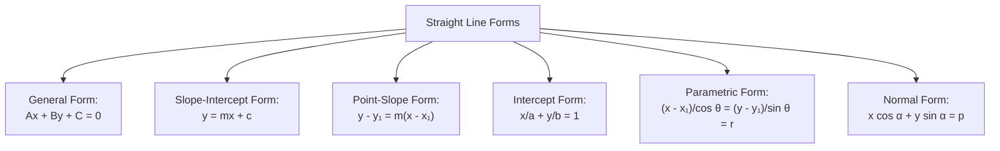
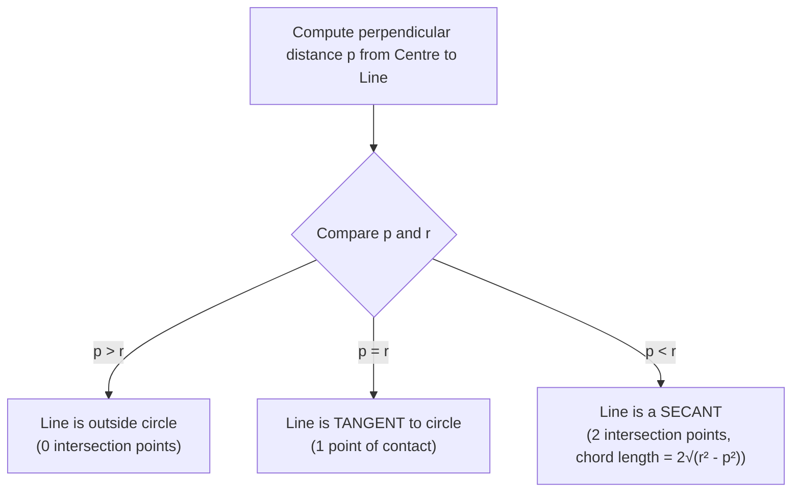

# :LiCompass: Lesson 10: Coordinate Geometry (Lines & Circles)

> [!ABSTRACT] Syllabus Scope (NIE Teacher's Guide — Grade 12, Competency 13 & 14)
> - **Straight Lines in the Cartesian Plane**:
>   - Distance between two points: $d = \sqrt{(x_2 - x_1)^2 + (y_2 - y_1)^2}$
>   - Section formula: Internal division $\left(\frac{mx_2+nx_1}{m+n}, \frac{my_2+ny_1}{m+n}\right)$, external division, midpoint
>   - Area of a triangle with given vertices using coordinates
>   - Line forms: General $Ax+By+C=0$, Slope-intercept $y=mx+c$, Point-slope $y-y_1=m(x-x_1)$, Intercept $\frac{x}{a}+\frac{y}{b}=1$, Parametric $x = x_1 + r\cos\theta, y = y_1 + r\sin\theta$
>   - Angle between two lines: $\tan\theta = \left|\frac{m_1-m_2}{1+m_1m_2}\right|$; parallelism ($m_1 = m_2$) and perpendicularity ($m_1m_2 = -1 \iff A_1A_2+B_1B_2=0$)
>   - Perpendicular distance from a point to a line: $p = \frac{|Ax_1+By_1+C|}{\sqrt{A^2+B^2}}$
>   - Distance between parallel lines: $d = \frac{|C_1-C_2|}{\sqrt{A^2+B^2}}$
>   - Concurrency and Family of lines through intersection: $L_1 + \lambda L_2 = 0$
> - **Circles in Coordinate Geometry**:
>   - Centre-radius form $(x-h)^2+(y-k)^2 = r^2$ and general equation $x^2+y^2+2gx+2fy+c=0$
>   - Centre $(-g,-f)$ and radius $r = \sqrt{g^2+f^2-c}$ (real circle condition $g^2+f^2-c > 0$)
>   - Diameter form: $(x-x_1)(x-x_2)+(y-y_1)(y-y_2)=0$
>   - Intersection of a line and a circle; tangency condition ($p = r$)
>   - Equation of tangent at a point on the circle: $xx_1+yy_1+g(x+x_1)+f(y+y_1)+c=0$
>   - Length of tangent from external point: $T = \sqrt{x_1^2+y_1^2+2gx_1+2fy_1+c} = \sqrt{S_{11}}$
>   - Chord of contact and chord with given midpoint ($T = S_{11}$)
>   - Radical axis ($S_1 - S_2 = 0$) and family of circles ($S_1 + \lambda S_2 = 0$, $S + \lambda L = 0$)
>   - Orthogonal circles: geometric condition $d^2 = r_1^2+r_2^2$ and algebraic condition $2g_1g_2+2f_1f_2 = c_1+c_2$

> [!NOTE] Subtopic Companion Guide
> For complete derivations, relative positions of circles, director circles, and worked A/L coordinate geometry problems → [[Subtopics/Straight Lines & Circles|Straight Lines & Circles Guide]]

---

## 1. Fundamentals of the Cartesian Plane

### 1.1 Distance & Section Formula
For two points $A(x_1, y_1)$ and $B(x_2, y_2)$:

- **Distance**:
  $$d = \sqrt{(x_2 - x_1)^2 + (y_2 - y_1)^2}$$

- **Internal Division ($m : n$)**:
  $$P\left(\frac{mx_2 + nx_1}{m+n}, \, \frac{my_2 + ny_1}{m+n}\right)$$

- **External Division ($m : n$)**:
  $$P\left(\frac{mx_2 - nx_1}{m-n}, \, \frac{my_2 - ny_1}{m-n}\right) \quad (m \neq n)$$

- **Midpoint ($1 : 1$)**:
  $$M\left(\frac{x_1 + x_2}{2}, \, \frac{y_1 + y_2}{2}\right)$$

- **Centroid of $\triangle ABC$**:
  $$G\left(\frac{x_1+x_2+x_3}{3}, \, \frac{y_1+y_2+y_3}{3}\right)$$

### 1.2 Area of a Triangle
The area of a triangle with vertices $(x_1, y_1)$, $(x_2, y_2)$, $(x_3, y_3)$ is:
$$\text{Area} = \frac{1}{2}\big| x_1(y_2 - y_3) + x_2(y_3 - y_1) + x_3(y_1 - y_2) \big|$$
*Collinearity Condition*: Points $A, B, C$ are collinear if and only if $\text{Area} = 0$.

---

## 2. Forms of Straight Lines

| Form | Equation | Parameters & Meaning |
|:---|:---|:---|
| **General** | $Ax + By + C = 0$ | Slope $m = -\frac{A}{B}$, $y$-intercept $= -\frac{C}{B}$ |
| **Slope-Intercept** | $y = mx + c$ | Gradient $m = \tan\theta$, $y$-intercept $c$ |
| **Point-Slope** | $y - y_1 = m(x - x_1)$ | Line through $(x_1, y_1)$ with gradient $m$ |
| **Two-Point** | $\frac{y - y_1}{y_2 - y_1} = \frac{x - x_1}{x_2 - x_1}$ | Line through distinct $(x_1, y_1)$ and $(x_2, y_2)$ |
| **Intercept** | $\frac{x}{a} + \frac{y}{b} = 1$ | $x$-intercept $a$, $y$-intercept $b$ ($a, b \neq 0$) |
| **Parametric** | $x = x_1 + r\cos\theta, \; y = y_1 + r\sin\theta$ | $r$ is directed distance from $(x_1, y_1)$ along angle $\theta$ |
| **Normal** | $x\cos\alpha + y\sin\alpha = p$ | $p \ge 0$ is perpendicular distance from origin, $\alpha$ is normal inclination |

---

## 3. Angles, Distances & Concurrent Lines

### 3.1 Angle Between Two Lines
Let two lines have slopes $m_1$ and $m_2$. The acute angle $\theta$ between them is given by:
$$\tan\theta = \left| \frac{m_1 - m_2}{1 + m_1 m_2} \right|$$

- **Parallel Lines**: $m_1 = m_2 \iff A_1 B_2 - A_2 B_1 = 0$
- **Perpendicular Lines**: $m_1 m_2 = -1 \iff A_1 A_2 + B_1 B_2 = 0$

### 3.2 Perpendicular Distances
1. **Perpendicular distance from point $(x_1, y_1)$ to line $Ax + By + C = 0$**:
   $$p = \frac{|Ax_1 + By_1 + C|}{\sqrt{A^2 + B^2}}$$

2. **Distance between parallel lines $Ax + By + C_1 = 0$ and $Ax + By + C_2 = 0$**:
   $$d = \frac{|C_1 - C_2|}{\sqrt{A^2 + B^2}}$$

### 3.3 Family of Lines Through Intersection
If lines $L_1 \equiv A_1x + B_1y + C_1 = 0$ and $L_2 \equiv A_2x + B_2y + C_2 = 0$ intersect at point $P$, any line passing through $P$ can be expressed as:
$$L_1 + \lambda L_2 = 0 \quad (\lambda \in \mathbb{R})$$
This allows finding equations of lines through $P$ satisfying an additional geometric condition without calculating $P$'s coordinates directly.

---

## 4. Circle Equations & Representation

### 4.1 Standard and General Forms
A circle is the locus of a point maintaining a constant distance $r$ from a fixed centre.

- **Centre-Radius Form**:
  $$(x - h)^2 + (y - k)^2 = r^2$$
  Centre $C(h, k)$, Radius $r$.

- **General Form**:
  $$x^2 + y^2 + 2gx + 2fy + c = 0$$
  - Centre $C = (-g, -f)$
  - Radius $r = \sqrt{g^2 + f^2 - c}$
  - *Nature of Circle*:
    - $g^2 + f^2 - c > 0$: Real circle with positive radius
    - $g^2 + f^2 - c = 0$: Point circle (radius = 0)
    - $g^2 + f^2 - c < 0$: Imaginary circle (no real points)

- **Diameter Form**:
  The circle having endpoints of a diameter at $(x_1, y_1)$ and $(x_2, y_2)$:
  $$(x - x_1)(x - x_2) + (y - y_1)(y - y_2) = 0$$

- **Parametric Coordinates**:
  $$x = -g + r\cos\theta, \qquad y = -f + r\sin\theta \quad (\theta \in [0, 2\pi))$$

---

## 5. Line and Circle: Tangents & Normals

### 5.1 Tangency Condition
A line $Ax + By + C = 0$ is tangent to a circle with centre $(h, k)$ and radius $r$ if and only if the perpendicular distance equals the radius:
$$p = \frac{|Ah + Bk + C|}{\sqrt{A^2 + B^2}} = r$$

For circle $x^2 + y^2 = r^2$ and line $y = mx + c$:
$$c^2 = r^2(1 + m^2) \implies y = mx \pm r\sqrt{1 + m^2}$$

### 5.2 Equations of Tangent and Normal
1. **Tangent at a point $(x_1, y_1)$ on the general circle $S = 0$ ($T = 0$)**:
   $$xx_1 + yy_1 + g(x + x_1) + f(y + y_1) + c = 0$$
   *(For $x^2 + y^2 = r^2$: $xx_1 + yy_1 = r^2$)*.

2. **Normal at $(x_1, y_1)$**:
   The normal is perpendicular to the tangent at $(x_1, y_1)$ and always passes through the centre $(-g, -f)$:
   $$\frac{y - y_1}{x - x_1} = \frac{y_1 + f}{x_1 + g}$$

3. **Length of Tangent from External Point $(x_1, y_1)$**:
   $$T = \sqrt{S_{11}} = \sqrt{x_1^2 + y_1^2 + 2gx_1 + 2fy_1 + c}$$

4. **Chord of Contact**:
   The line joining the two points of tangency from an external point $(x_1, y_1)$ has equation:
   $$T = 0 \iff xx_1 + yy_1 + g(x + x_1) + f(y + y_1) + c = 0$$

5. **Chord with Given Midpoint $(x_1, y_1)$**:
   $$T = S_{11}$$

---

## 6. Two Circles & Orthogonality

### 6.1 Radical Axis & Intersection
For two circles $S_1 \equiv x^2+y^2+2g_1x+2f_1y+c_1 = 0$ and $S_2 \equiv x^2+y^2+2g_2x+2f_2y+c_2 = 0$:

- **Radical Axis**:
  $$S_1 - S_2 = 0 \iff 2(g_1 - g_2)x + 2(f_1 - f_2)y + (c_1 - c_2) = 0$$
  - The radical axis is always a straight line perpendicular to the line of centres.
  - If the circles intersect, it is the equation of the **common chord**.
  - Tangents drawn from any point on the radical axis to both circles are equal in length.

- **Family of Circles**:
  Through the intersection of two circles: $S_1 + \lambda S_2 = 0$ ($\lambda \neq -1$).
  Through the intersection of circle $S = 0$ and line $L = 0$: $S + \lambda L = 0$.

### 6.2 Orthogonal Circles
Two circles intersect orthogonally if the tangents at their points of intersection are perpendicular to each other.

- **Geometric Condition**: In $\triangle C_1 P C_2$, the radii $r_1$ and $r_2$ are perpendicular:
  $$d^2 = r_1^2 + r_2^2 \quad \text{where } d = C_1C_2$$

- **Algebraic Condition**:
  $$d^2 = (g_1 - g_2)^2 + (f_1 - f_2)^2$$
  $$r_1^2 + r_2^2 = (g_1^2 + f_1^2 - c_1) + (g_2^2 + f_2^2 - c_2)$$
  Equating both sides and expanding:
  $$-2g_1g_2 - 2f_1f_2 = -c_1 - c_2$$
  $$\boxed{2g_1g_2 + 2f_1f_2 = c_1 + c_2}$$

---

## :LiRocket: Flashcards (Spaced Repetition)

#flashcards

State the perpendicular distance formula from point $(x_1, y_1)$ to line $Ax + By + C = 0$. :: $p = \frac{|A x_1 + B y_1 + C|}{\sqrt{A^2 + B^2}}$.
<!--SR:!2026-09-29,4,270-->

What is the center and radius of the general circle $x^2 + y^2 + 2gx + 2fy + c = 0$? :: Center is $(-g, -f)$ and Radius is $r = \sqrt{g^2 + f^2 - c}$.
<!--SR:!2026-09-26,1,230-->

State the tangent equation to circle $x^2 + y^2 + 2gx + 2fy + c = 0$ at point $(x_1, y_1)$ on the circle. :: $x x_1 + y y_1 + g(x + x_1) + f(y + y_1) + c = 0$.

What is the length of the tangent drawn from external point $(x_1, y_1)$ to circle $x^2 + y^2 + 2gx + 2fy + c = 0$? :: $T = \sqrt{x_1^2 + y_1^2 + 2gx_1 + 2fy_1 + c}$.
<!--SR:!2026-09-26,1,230-->

State the condition for two circles $x^2 + y^2 + 2g_1 x + 2f_1 y + c_1 = 0$ and $x^2 + y^2 + 2g_2 x + 2f_2 y + c_2 = 0$ to cut orthogonally. :: $2 g_1 g_2 + 2 f_1 f_2 = c_1 + c_2$.

What is the condition for two straight lines with slopes $m_1$ and $m_2$ to be perpendicular? :: $m_1 m_2 = -1$ (or $A_1A_2 + B_1B_2 = 0$). <!--SR:!2026-11-20,1,230-->

What is the formula for the distance between two parallel lines $Ax + By + C_1 = 0$ and $Ax + By + C_2 = 0$? :: $d = \frac{|C_1 - C_2|}{\sqrt{A^2 + B^2}}$. <!--SR:!2026-11-21,2,250-->

What is the condition for a line to be tangent to a circle of radius $r$ and centre $(h, k)$? :: The perpendicular distance from centre to line equals the radius: $p = r$. <!--SR:!2026-11-21,2,250-->

What is the equation of a circle having diameter endpoints $(x_1, y_1)$ and $(x_2, y_2)$? :: $(x - x_1)(x - x_2) + (y - y_1)(y - y_2) = 0$. <!--SR:!2026-11-22,3,250-->

What is the equation of the chord of contact drawn from an external point $(x_1, y_1)$ to circle $S = 0$? :: $T = 0$ ($xx_1 + yy_1 + g(x+x_1) + f(y+y_1) + c = 0$). <!--SR:!2026-11-22,3,250-->

What is the equation of a chord with given midpoint $(x_1, y_1)$ on circle $S = 0$? :: $T = S_{11}$. <!--SR:!2026-11-23,4,250-->

What is the equation of the radical axis of two circles $S_1 = 0$ and $S_2 = 0$? :: $S_1 - S_2 = 0$. <!--SR:!2026-11-23,4,250-->

What is the geometric relation between distance between centres $d$ and radii $r_1, r_2$ for orthogonal circles? :: $d^2 = r_1^2 + r_2^2$. <!--SR:!2026-11-24,5,250-->

What is the equation of the family of lines passing through the intersection of $L_1 = 0$ and $L_2 = 0$? :: $L_1 + \lambda L_2 = 0$ ($\lambda \in \mathbb{R}$). <!--SR:!2026-11-24,5,250-->

What is the director circle of $(x-h)^2 + (y-k)^2 = r^2$? :: $(x-h)^2 + (y-k)^2 = 2r^2$ (locus of points from which perpendicular tangents can be drawn). <!--SR:!2026-11-25,6,250-->

What is the intercept form of a straight line with $x$-intercept $a$ and $y$-intercept $b$? :: $\frac{x}{a} + \frac{y}{b} = 1$. <!--SR:!2026-11-25,6,250-->

What are the coordinates of point $P$ dividing the segment between $(x_1, y_1)$ and $(x_2, y_2)$ internally in ratio $m : n$? :: $\left(\frac{mx_2 + nx_1}{m+n}, \, \frac{my_2 + ny_1}{m+n}\right)$. <!--SR:!2026-11-26,7,250-->
