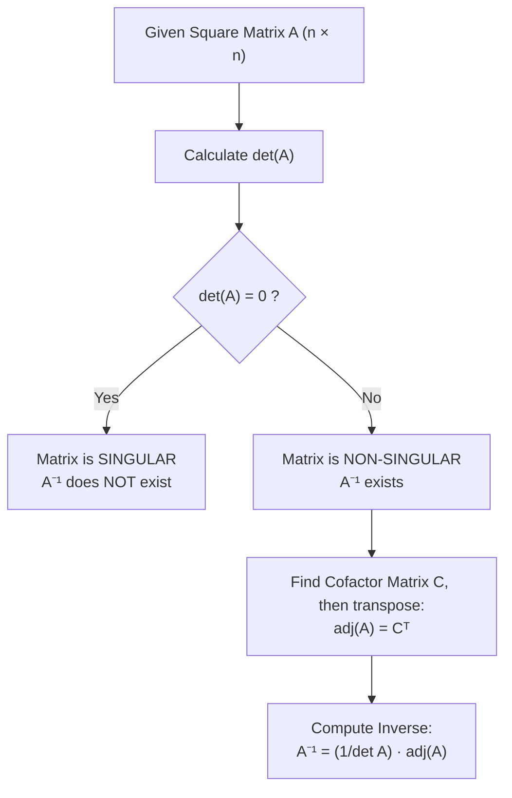
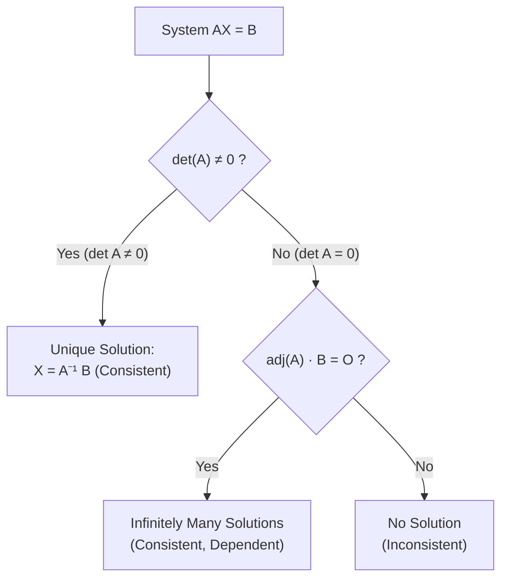

# :LiGrid3x3: Lesson 11: Matrices & Determinants

> [!ABSTRACT] Syllabus Scope (NIE Teacher's Guide — Grade 13, Competency 25)
> - **Matrix Algebra**:
>   - Definition, order $m \times n$, elements $a_{ij}$, row/column matrices, zero matrix $O$, identity matrix $I$
>   - Addition, subtraction, scalar multiplication and their properties
>   - Matrix multiplication: Conformability condition, row-by-column rule, non-commutativity ($AB \neq BA$), associativity $A(BC) = (AB)C$, distributivity $A(B+C) = AB + AC$
>   - Powers of square matrices ($A^2, A^3, \dots$) and matrix polynomials
> - **Transpose of a Matrix**:
>   - Definition of $A^T$; properties: $(A^T)^T = A$, $(A+B)^T = A^T+B^T$, $(kA)^T = kA^T$
>   - Reversal rule for products: $(AB)^T = B^T A^T$
>   - Symmetric matrices ($A^T = A$) and skew-symmetric matrices ($A^T = -A$)
>   - Decomposition: $A = \frac{1}{2}(A+A^T) + \frac{1}{2}(A-A^T)$
> - **Determinants**:
>   - Evaluation of $2 \times 2$ and $3 \times 3$ determinants
>   - Minors $M_{ij}$ and cofactors $C_{ij} = (-1)^{i+j}M_{ij}$
>   - Properties of determinants (row/column operations, interchange, scalar multiple, $\det(AB) = \det A \det B$)
> - **Inverse Matrix ($A^{-1}$)**:
>   - Singular ($\det A = 0$) vs. non-singular ($\det A \neq 0$) matrices
>   - Adjoint matrix $\text{adj}(A) = (C_{ij})^T$ and fundamental identity $A \cdot \text{adj}(A) = \det(A) I$
>   - Inverse formula: $A^{-1} = \frac{1}{\det A}\text{adj}(A)$
>   - Explicit formula for $2 \times 2$ inverse
>   - Properties of inverse: $(A^{-1})^{-1} = A$, $(AB)^{-1} = B^{-1}A^{-1}$, $(A^T)^{-1} = (A^{-1})^T$, $\det(A^{-1}) = \frac{1}{\det A}$
> - **Systems of Linear Equations**:
>   - Matrix representation $AX = B$
>   - Matrix inversion method: $X = A^{-1}B$ (for non-singular $A$)
>   - Cramer's Rule for $2 \times 2$ and $3 \times 3$ systems
>   - Consistency criteria: Unique solution, infinitely many solutions, no solution

> [!NOTE] Subtopic Companion Guide
> For complete step-by-step $3 \times 3$ cofactor derivations, Cramer's rule proofs, and worked exam systems → [[Subtopics/Matrices & System of Linear Equations|Matrices & Systems of Equations Guide]]

---

## 1. Fundamentals of Matrix Algebra

A matrix of order $m \times n$ is a rectangular array of numbers arranged in $m$ rows and $n$ columns:
$$A = [a_{ij}] = \begin{pmatrix} a_{11} & a_{12} & \cdots & a_{1n} \\ a_{21} & a_{22} & \cdots & a_{2n} \\ \vdots & \vdots & \ddots & \vdots \\ a_{m1} & a_{m2} & \cdots & a_{mn} \end{pmatrix}$$

### 1.1 Special Types of Matrices
- **Square Matrix**: Number of rows equals number of columns ($m = n$).
- **Zero (Null) Matrix $O$**: All entries are zero.
- **Identity Matrix $I$**: A square matrix with ones on the leading diagonal and zeros elsewhere:
  $$I_2 = \begin{pmatrix} 1 & 0 \\ 0 & 1 \end{pmatrix}, \qquad I_3 = \begin{pmatrix} 1 & 0 & 0 \\ 0 & 1 & 0 \\ 0 & 0 & 1 \end{pmatrix}$$
  For any conformable matrix $A$: $AI = IA = A$.
- **Diagonal Matrix**: Non-diagonal elements are all zero ($a_{ij} = 0$ for $i \neq j$).

### 1.2 Matrix Operations & Conformability

| Operation | Condition | Definition | Properties |
|:---|:---|:---|:---|
| **Addition / Subtraction** | Same order $m \times n$ | $[a_{ij}] \pm [b_{ij}] = [a_{ij} \pm b_{ij}]$ | Commutative: $A+B = B+A$ Associative: $(A+B)+C = A+(B+C)$ |
| **Scalar Multiplication** | Any matrix | $k[a_{ij}] = [k a_{ij}]$ | $k(A+B) = kA + kB$ $(k_1+k_2)A = k_1A + k_2A$ |
| **Matrix Multiplication** | Columns of $A$ = Rows of $B$ $(m \times k)(k \times n) \to m \times n$ | $c_{ij} = \sum_{r=1}^k a_{ir}b_{rj}$ | **Not commutative**: $AB \neq BA$ in general Associative: $A(BC) = (AB)C$ Distributive: $A(B+C) = AB + AC$ |

> [!WARNING] Common Traps in Matrix Algebra
> 1. $AB = O$ does **not** imply $A = O$ or $B = O$ (zero divisors exist).
> 2. $AB = AC$ does **not** imply $B = C$ (cancellation law does not hold unless $A^{-1}$ exists).
> 3. $(A+B)^2 = A^2 + AB + BA + B^2 \neq A^2 + 2AB + B^2$ unless $AB = BA$.

---

## 2. Transpose of a Matrix & Symmetry

The transpose $A^T$ (or $A'$) of an $m \times n$ matrix $A$ is the $n \times m$ matrix formed by interchanging rows and columns:
$$\big( [a_{ij}] \big)^T = [a_{ji}]$$

### 2.1 Properties of Transposition
1. $(A^T)^T = A$
2. $(A + B)^T = A^T + B^T$
3. $(kA)^T = kA^T$ for any scalar $k$
4. **The Reversal Rule**:
   $$(AB)^T = B^T A^T$$
   *(Extended: $(ABC)^T = C^T B^T A^T$)*

### 2.2 Symmetric & Skew-Symmetric Matrices
- **Symmetric Matrix**: $A^T = A \iff a_{ij} = a_{ji}$ for all $i, j$.
- **Skew-Symmetric Matrix**: $A^T = -A \iff a_{ij} = -a_{ji}$ for all $i, j$.
  *(All leading diagonal entries of a skew-symmetric matrix must be zero, since $a_{ii} = -a_{ii} \implies a_{ii} = 0$)*.

**Decomposition Theorem**: Any square matrix $A$ can be uniquely expressed as the sum of a symmetric matrix $P$ and a skew-symmetric matrix $Q$:
$$A = \underbrace{\frac{1}{2}(A + A^T)}_{\text{Symmetric } P} + \underbrace{\frac{1}{2}(A - A^T)}_{\text{Skew-symmetric } Q}$$

---

## 3. Determinants

The determinant is a scalar value associated only with **square matrices**.

### 3.1 Evaluation of $2 \times 2$ and $3 \times 3$ Determinants
For a $2 \times 2$ matrix:
$$\det \begin{pmatrix} a & b \\ c & d \end{pmatrix} = \begin{vmatrix} a & b \\ c & d \end{vmatrix} = ad - bc$$

For a $3 \times 3$ matrix, expanding along the first row:
$$\begin{vmatrix} a_1 & b_1 & c_1 \\ a_2 & b_2 & c_2 \\ a_3 & b_3 & c_3 \end{vmatrix} = a_1 \begin{vmatrix} b_2 & c_2 \\ b_3 & c_3 \end{vmatrix} - b_1 \begin{vmatrix} a_2 & c_2 \\ a_3 & c_3 \end{vmatrix} + c_1 \begin{vmatrix} a_2 & b_2 \\ a_3 & b_3 \end{vmatrix}$$
$$= a_1(b_2c_3 - b_3c_2) - b_1(a_2c_3 - a_3c_2) + c_1(a_2b_3 - a_3b_2)$$

### 3.2 Minors and Cofactors
- **Minor $M_{ij}$**: The determinant of the $(n-1) \times (n-1)$ submatrix obtained by deleting row $i$ and column $j$.
- **Cofactor $C_{ij}$**: The signed minor:
  $$C_{ij} = (-1)^{i+j}M_{ij}$$

The determinant is the sum of products of the elements of any row (or column) and their corresponding cofactors:
$$\det(A) = a_{i1}C_{i1} + a_{i2}C_{i2} + a_{i3}C_{i3} \quad (\text{along row } i)$$

> [!NOTE] Orthogonal Expansion Property
> The sum of products of elements of one row with cofactors of **another** row is always zero:
> $$a_{11}C_{21} + a_{12}C_{22} + a_{13}C_{23} = 0$$

### 3.3 Core Properties of Determinants
1. $\det(A^T) = \det(A)$
2. Interchanging any two rows (or two columns) multiplies the determinant by $-1$.
3. If two rows (or columns) are identical or proportional, $\det(A) = 0$.
4. Multiplying any single row or column by scalar $k$ multiplies the determinant by $k$.
   Consequently, for an $n \times n$ matrix:
   $$\det(kA) = k^n \det(A)$$
5. Adding a scalar multiple of one row (column) to another row (column) leaves the determinant **unchanged**:
   $$R_i \to R_i + k R_j \implies \det(A) \text{ is unchanged}$$
6. **Multiplicative Property**:
   $$\det(AB) = \det(A)\det(B)$$

---

## 4. The Inverse Matrix ($A^{-1}$)

A square matrix $A$ is **invertible (non-singular)** if there exists a matrix $A^{-1}$ such that:
$$A A^{-1} = A^{-1} A = I$$

### 4.1 Adjoint Matrix & Fundamental Identity
The **Adjoint** (or Adjugate) matrix $\text{adj}(A)$ is the **transpose of the cofactor matrix**:
$$\text{adj}(A) = [C_{ij}]^T = \begin{pmatrix} C_{11} & C_{21} & C_{31} \\ C_{12} & C_{22} & C_{32} \\ C_{13} & C_{23} & C_{33} \end{pmatrix}$$

**The Fundamental Identity**:
$$A \cdot \text{adj}(A) = \text{adj}(A) \cdot A = \det(A) I$$

Dividing by $\det(A)$ (when $\det A \neq 0$) yields the inverse formula:
$$\boxed{A^{-1} = \frac{1}{\det(A)}\text{adj}(A)}$$

### 4.2 Explicit Inverse for $2 \times 2$ Matrix
For $A = \begin{pmatrix} a & b \\ c & d \end{pmatrix}$:
$$\det(A) = ad - bc, \qquad \text{adj}(A) = \begin{pmatrix} d & -b \\ -c & a \end{pmatrix}$$
$$A^{-1} = \frac{1}{ad - bc}\begin{pmatrix} d & -b \\ -c & a \end{pmatrix} \quad (ad - bc \neq 0)$$
*(Swap main diagonal elements, negate off-diagonal elements, divide by determinant)*.

### 4.3 Key Properties of the Inverse Matrix
1. $(A^{-1})^{-1} = A$
2. **Reversal Rule for Inverses**:
   $$(AB)^{-1} = B^{-1}A^{-1}$$
3. $(A^T)^{-1} = (A^{-1})^T$
4. $\det(A^{-1}) = \frac{1}{\det(A)} = [\det(A)]^{-1}$
5. $(kA)^{-1} = \frac{1}{k}A^{-1}$ for non-zero scalar $k$

---

## 5. Solving Systems of Linear Equations

Consider a system of $n$ linear equations in $n$ unknowns:
$$\begin{aligned}
a_{11}x_1 + a_{12}x_2 + \cdots + a_{1n}x_n &= b_1 \\
a_{21}x_1 + a_{22}x_2 + \cdots + a_{2n}x_n &= b_2 \\
&\;\vdots \\
a_{n1}x_1 + a_{n2}x_2 + \cdots + a_{nn}x_n &= b_n
\end{aligned}$$

In matrix form:
$$A X = B \quad \text{where } A = \begin{pmatrix} a_{11} & \cdots & a_{1n} \\ \vdots & \ddots & \vdots \\ a_{n1} & \cdots & a_{nn} \end{pmatrix}, \; X = \begin{pmatrix} x_1 \\ \vdots \\ x_n \end{pmatrix}, \; B = \begin{pmatrix} b_1 \\ \vdots \\ b_n \end{pmatrix}$$

### 5.1 Matrix Inversion Method
If matrix $A$ is non-singular ($\det A \neq 0$):
$$AX = B \implies A^{-1}(AX) = A^{-1}B \implies (A^{-1}A)X = A^{-1}B \implies IX = A^{-1}B$$
$$\boxed{X = A^{-1}B}$$

**Worked Example ($2 \times 2$ system)**:
$$\begin{cases} 2x + 3y = 8 \\ 5x - y = 3 \end{cases}$$
Matrix form: $\begin{pmatrix} 2 & 3 \\ 5 & -1 \end{pmatrix}\begin{pmatrix} x \\ y \end{pmatrix} = \begin{pmatrix} 8 \\ 3 \end{pmatrix}$.
$\det A = 2(-1) - 3(5) = -2 - 15 = -17 \neq 0$.
$$A^{-1} = \frac{1}{-17}\begin{pmatrix} -1 & -3 \\ -5 & 2 \end{pmatrix} = \frac{1}{17}\begin{pmatrix} 1 & 3 \\ 5 & -2 \end{pmatrix}$$
$$\begin{pmatrix} x \\ y \end{pmatrix} = \frac{1}{17}\begin{pmatrix} 1 & 3 \\ 5 & -2 \end{pmatrix}\begin{pmatrix} 8 \\ 3 \end{pmatrix} = \frac{1}{17}\begin{pmatrix} 8 + 9 \\ 40 - 6 \end{pmatrix} = \frac{1}{17}\begin{pmatrix} 17 \\ 34 \end{pmatrix} = \begin{pmatrix} 1 \\ 2 \end{pmatrix}$$
So $x = 1$ and $y = 2$.

### 5.2 Cramer's Rule
For a system where coefficient determinant $\Delta = \det(A) \neq 0$:
$$x = \frac{\Delta_x}{\Delta}, \qquad y = \frac{\Delta_y}{\Delta}, \qquad z = \frac{\Delta_z}{\Delta}$$
where $\Delta_x, \Delta_y, \Delta_z$ are formed by replacing the respective variable's column in $A$ with the constants column $B$.

### 5.3 Nature of Solutions

---

## :LiRocket: Flashcards (Spaced Repetition)

#flashcards

State the inverse formula for a 2x2 matrix $A = \begin{pmatrix} a & b \\ c & d \end{pmatrix}$. :: $A^{-1} = \frac{1}{ad - bc} \begin{pmatrix} d & -b \\ -c & a \end{pmatrix}$ (provided $\det A = ad - bc \ne 0$).
<!--SR:!2026-09-26,1,230-->

What is a non-singular matrix? :: A square matrix whose determinant is non-zero ($\det A \ne 0$), meaning its inverse exists.
<!--SR:!2026-09-26,1,230-->

State the transpose reversal rule for matrix multiplication $(A B)^T$. :: $(A B)^T = B^T A^T$.
<!--SR:!2026-09-26,1,230-->

State the inverse reversal rule for matrix multiplication $(A B)^{-1}$. :: $(A B)^{-1} = B^{-1} A^{-1}$.

How is a system of linear equations $A X = B$ solved using matrix inversion? :: $X = A^{-1} B$ (provided $\det A \ne 0$).

State the condition on matrix dimensions for matrix multiplication $A \cdot B$ to be conformable. :: The number of columns of $A$ must equal the number of rows of $B$ (i.e. $(m \times k) \times (k \times n) \to m \times n$). <!--SR:!2026-11-20,1,230-->

What is the relationship between the determinant of an $n \times n$ matrix $A$ and $\det(kA)$? :: $\det(kA) = k^n \det(A)$. <!--SR:!2026-11-21,2,250-->

What is the definition of a symmetric matrix and a skew-symmetric matrix? :: Symmetric: $A^T = A$; Skew-symmetric: $A^T = -A$ (with all leading diagonal entries equal to 0). <!--SR:!2026-11-21,2,250-->

State the formula to decompose any square matrix $A$ into symmetric and skew-symmetric components. :: $A = \frac{1}{2}(A + A^T) + \frac{1}{2}(A - A^T)$. <!--SR:!2026-11-22,3,250-->

State the fundamental identity relating matrix $A$, its adjoint $\text{adj}(A)$, and its determinant. :: $A \cdot \text{adj}(A) = \text{adj}(A) \cdot A = \det(A) I$. <!--SR:!2026-11-22,3,250-->

How is the adjoint matrix $\text{adj}(A)$ defined in terms of cofactors? :: It is the transpose of the cofactor matrix: $\text{adj}(A) = [C_{ij}]^T$. <!--SR:!2026-11-23,4,250-->

What is the determinant of the product of two square matrices $\det(AB)$? :: $\det(AB) = \det(A)\det(B)$. <!--SR:!2026-11-23,4,250-->

What is the value of $\det(A^{-1})$ in terms of $\det(A)$? :: $\det(A^{-1}) = \frac{1}{\det(A)}$. <!--SR:!2026-11-24,5,250-->

Under what condition does a system of linear equations $AX = B$ have a unique solution? :: When the coefficient matrix $A$ is non-singular, i.e. $\det(A) \neq 0$. <!--SR:!2026-11-24,5,250-->

State Cramer's Rule for solving for variable $x_i$ in a system $AX = B$. :: $x_i = \frac{\Delta_i}{\Delta}$, where $\Delta = \det(A) \neq 0$ and $\Delta_i$ is formed by replacing the $i$-th column of $A$ with constants vector $B$. <!--SR:!2026-11-25,6,250-->

Does $AB = O$ imply that either $A = O$ or $B = O$ in matrix algebra? :: No, non-zero matrices can multiply to give the zero matrix (zero divisors exist). <!--SR:!2026-11-25,6,250-->

What is the effect on the determinant if two rows or two columns of matrix $A$ are interchanged? :: The determinant changes its sign: $\det(A') = -\det(A)$. <!--SR:!2026-11-26,7,250-->
