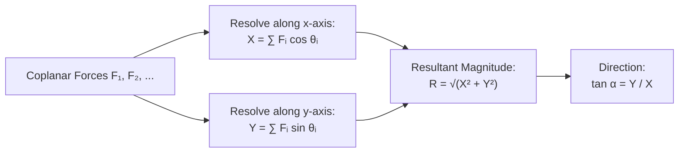
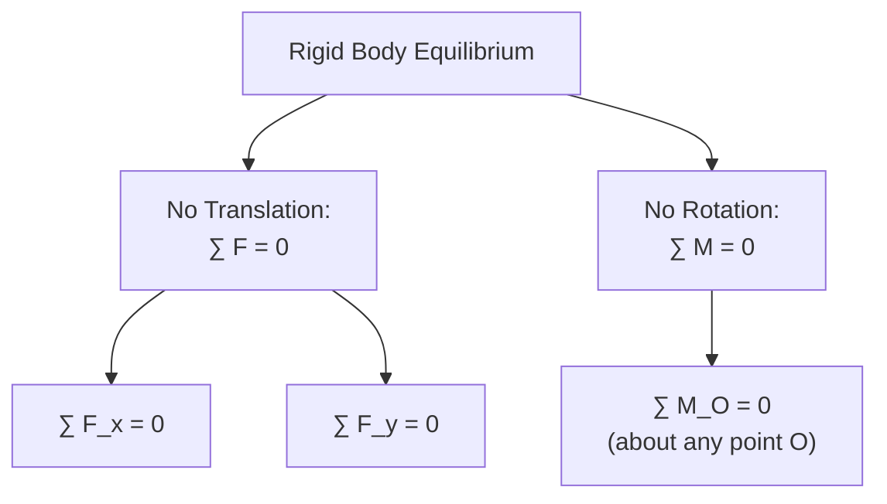

# :LiScale: Lesson 12: Statics, Friction & Rigid Body Equilibrium

> [!ABSTRACT] Syllabus Scope (NIE Teacher's Guide — Grade 12 Applied Mathematics)
> - **Coplanar Force Systems & Resolution**:
>   - Resultant of concurrent coplanar forces: $X = \sum F\cos\theta$, $Y = \sum F\sin\theta$, $R = \sqrt{X^2+Y^2}$, $\tan\alpha = Y/X$
>   - Triangle of Forces and Polygon of Forces (closed vector loop for equilibrium)
>   - **Lami's Theorem**: For 3 concurrent coplanar forces in equilibrium:
>     $$\frac{P}{\sin\alpha} = \frac{Q}{\sin\beta} = \frac{R}{\sin\gamma}$$
> - **Moments & Couples**:
>   - Moment of a force about a point: $M = F \cdot d$ (signed algebraic value)
>   - **Varignon's Theorem**: The sum of moments of concurrent forces about any point equals the moment of their resultant
>   - Couple: Two equal, opposite, non-collinear forces; torque $C = F \cdot d$ (independent of point of rotation)
>   - Reduction of a general coplanar force system to a single force $R$ and a couple $G$
> - **Equilibrium of a Rigid Body**:
>   - Three scalar equilibrium conditions: $\sum F_x = 0$, $\sum F_y = 0$, $\sum M_O = 0$
>   - **Three-Force Concurrency Theorem**: If three non-parallel coplanar forces keep a rigid body in equilibrium, their lines of action must be **concurrent**
>   - The $m:n$ cotangent theorem for a transversed triangle
> - **Friction & Limiting Equilibrium**:
>   - Laws of dry friction (Coulomb): $F \le \mu R$, limiting friction $F_L = \mu R$
>   - Angle of friction $\lambda$: $\mu = \tan\lambda$; cone of friction
>   - Total contact reaction: $S = \sqrt{R^2 + F^2} \le R\sec\lambda$
>   - Equilibrium on rough inclined planes; ladder and rod problems; tipping vs. slipping
> - **Frameworks & Trusses**:
>   - Light pin-jointed frameworks; determination of tensile and compressive forces at joints

> [!NOTE] Subtopic Companion Guides
> - For vector statics, Lami's proofs, and framework analysis → [[Subtopics/Statics & Coplanar Force Equilibrium|Statics & Coplanar Force Equilibrium Guide]]
> - For friction laws, cone of friction, ladder problems, and tipping vs. slipping → [[Subtopics/Friction & Rigid Body Dynamics|Friction & Rigid Body Dynamics Guide]]

---

## 1. Coplanar Force Systems & Resultant

When multiple coplanar forces $F_1, F_2, \dots, F_n$ act on a body:

### 1.1 Resolution Along Orthogonal Axes
- Total horizontal component: $X = \sum_{i=1}^n F_i \cos\theta_i$
- Total vertical component: $Y = \sum_{i=1}^n F_i \sin\theta_i$
- **Magnitude of Resultant**: $R = \sqrt{X^2 + Y^2}$
- **Direction**: $\tan\alpha = \frac{Y}{X}$ (where $\alpha$ is angle with the positive $x$-axis)

### 1.2 Triangle & Polygon of Forces
- **Triangle of Forces**: If three forces acting at a point are in equilibrium, they can be represented in magnitude and direction by the sides of a triangle taken in order.
- **Polygon of Forces**: If any number of coplanar forces acting at a point are in equilibrium, their vector sum forms a closed polygon ($\sum \vec{F} = \vec{0}$).

---

## 2. Lami's Theorem

If three coplanar forces $\vec{P}, \vec{Q}, \vec{R}$ acting at a single point keep it in equilibrium, then each force is proportional to the sine of the angle between the other two forces:

$$\frac{P}{\sin\alpha} = \frac{Q}{\sin\beta} = \frac{R}{\sin\gamma}$$

where:
- $\alpha$ is the angle between $\vec{Q}$ and $\vec{R}$
- $\beta$ is the angle between $\vec{P}$ and $\vec{R}$
- $\gamma$ is the angle between $\vec{P}$ and $\vec{Q}$
- $\alpha + \beta + \gamma = 360^\circ$

> [!TIP] Derivation via Sine Rule
> Since $\vec{P} + \vec{Q} + \vec{R} = \vec{0}$, the forces form a closed vector triangle. The interior angles of the triangle are $180^\circ - \alpha$, $180^\circ - \beta$, and $180^\circ - \gamma$.
> By the Sine Rule:
> $$\frac{P}{\sin(180^\circ - \alpha)} = \frac{Q}{\sin(180^\circ - \beta)} = \frac{R}{\sin(180^\circ - \gamma)}$$
> Since $\sin(180^\circ - \theta) = \sin\theta$, Lami's theorem follows directly.

---

## 3. Moments, Varignon's Theorem & Couples

### 3.1 Moment of a Force
The moment of a force $\vec{F}$ about a point $O$ measures its turning effect:
$$M_O = F \cdot d$$
where $d$ is the **perpendicular distance** from $O$ to the line of action of $\vec{F}$.
- Counter-clockwise (anticlockwise): positive $(+)$ by convention
- Clockwise: negative $(-)$

### 3.2 Varignon's Theorem (Principle of Moments)
The algebraic sum of the moments of a system of coplanar forces about any point $O$ in their plane equals the moment of their resultant about that same point:
$$\sum M_O = M_O(\vec{R})$$

### 3.3 Couples
A **couple** consists of two equal and opposite parallel forces whose lines of action do not coincide.
- Resultant force of a couple: $R = F - F = 0$ (no translational acceleration)
- **Torque / Moment of a Couple**:
  $$C = F \cdot d$$
  where $d$ is the perpendicular distance (arm) between the lines of action of the two forces.
- **Key Property**: The moment of a couple is the **same about every point** in the plane.

---

## 4. Equilibrium Conditions of a Rigid Body

For a rigid body acted upon by coplanar forces to remain in static equilibrium:

### 4.1 The Three Fundamental Equations
$$\sum F_x = 0, \qquad \sum F_y = 0, \qquad \sum M_O = 0$$

Alternative valid sets of equilibrium conditions:
1. $\sum F_x = 0, \; \sum M_A = 0, \; \sum M_B = 0$ (provided line $AB$ is not perpendicular to $x$-axis).
2. $\sum M_A = 0, \; \sum M_B = 0, \; \sum M_C = 0$ (provided $A, B, C$ are non-collinear).

### 4.2 Three-Force Concurrency Theorem
If a rigid body is in equilibrium under the action of **three coplanar forces**:
1. If the forces are non-parallel, their lines of action **must intersect at a single common point** (concurrency).
2. If two forces are parallel, the third force must also be parallel to them.

*Proof*: Take moments about the intersection point $P$ of the first two forces. Since their moments about $P$ are zero, and $\sum M_P = 0$, the moment of the third force about $P$ must be zero. This requires the line of action of the third force to pass through $P$.

---

## 5. The Cotangent ($m : n$) Theorem

In $\triangle ABC$, let $D$ divide base $BC$ in the ratio $m : n$ (i.e. $BD : DC = m : n$), and let $AD = d$:

1. **In terms of base angles $B$ and $C$**:
   $$(m + n)\cot\theta = m\cot B - n\cot C$$
   where $\theta = \angle ADB$.

2. **In terms of vertex angles $\alpha$ and $\beta$**:
   $$(m + n)\cot\theta = n\cot\alpha - m\cot\beta$$
   where $\alpha = \angle BAD$ and $\beta = \angle CAD$.

This theorem provides an immediate shortcut for A/L problems involving a uniform rod resting in equilibrium inside a bowl, against a peg, or on inclined planes.

---

## 6. Friction & Limiting Equilibrium

Friction is the self-adjusting tangential resistance opposing relative motion between two rough surfaces in contact.

### 6.1 Laws of Friction (Coulomb)
- When at rest (static equilibrium): $F \le \mu R$
- At the verge of slipping (**Limiting Equilibrium**):
  $$F_L = \mu R$$
- $\mu$ is the coefficient of static friction, dependent solely on the materials and roughness of the contacting surfaces.

### 6.2 Angle of Friction $\lambda$ & Total Reaction $S$
The total contact reaction $\vec{S}$ is the vector sum of normal reaction $\vec{R}$ and frictional force $\vec{F}$:
$$S = \sqrt{R^2 + F^2}$$

Let $\phi$ be the angle that $\vec{S}$ makes with the normal $\vec{R}$:
$$\tan\phi = \frac{F}{R}$$
In limiting equilibrium ($F = \mu R$), this angle reaches its maximum value, the **angle of friction** $\lambda$:
$$\tan\lambda = \mu$$
$$S_{\max} = \sqrt{R^2 + (\mu R)^2} = R\sqrt{1 + \mu^2} = R\sec\lambda$$

- **Cone of Friction**: A cone of semi-vertical angle $\lambda$ around the normal. For equilibrium, the resultant reaction $\vec{S}$ must lie inside or on the surface of this cone ($\phi \le \lambda$).

### 6.3 Tipping vs. Slipping
When a horizontal force $P$ is applied to a block of width $b$ and height $h$ on a rough plane:
- **Condition for Slipping**: $P \ge \mu W$
- **Condition for Tipping (Toppling)**: Taking moments about the pivot edge, tipping occurs when normal reaction shifts to the corner:
  $$P \cdot h \ge W \cdot \frac{b}{2} \implies P \ge W\frac{b}{2h}$$
- **Slipping occurs first if**: $\mu < \frac{b}{2h}$
- **Tipping occurs first if**: $\mu > \frac{b}{2h}$

---

## 7. Jointed Frameworks (Trusses)

A framework consists of light rods smoothly pin-jointed at their ends.
- **Light Rod**: Weight is neglected; forces act only at the joints.
- **Two-Force Member**: Each rod is subject to only two equal and opposite axial forces along its length:
  - **Tension ($T > 0$)**: Pulls away from the joint (member is in tension).
  - **Thrust / Compression ($C > 0$)**: Pushes towards the joint (member is in compression).
- **Method of Joints**: Isolate each pin joint as a concurrent force system in equilibrium ($\sum F_x = 0, \sum F_y = 0$).

---

## 8. Centre of Gravity & Standard Centroids

The centre of gravity ($G$) of a system of particles of weights $w_1, w_2, \dots$ at coordinates $(x_1, y_1), (x_2, y_2), \dots$ is:
$$\bar{x} = \frac{\sum w_i x_i}{\sum w_i}, \qquad \bar{y} = \frac{\sum w_i y_i}{\sum w_i}$$

For composite bodies formed by adding or subtracting standard geometric laminas or solids:
$$\bar{x} = \frac{W_1 x_1 \pm W_2 x_2}{W_1 \pm W_2}$$

### Standard Centroids Reference Table

| Shape / Body | Nature | Distance of Centroid $G$ from Base / Centre |
|:---|:---|:---|
| **Uniform Rod** (length $L$) | Line | Midpoint: $\frac{L}{2}$ from either end |
| **Triangular Lamina** (height $h$) | Area | $\frac{h}{3}$ from base along the median |
| **Semicircular Arc (Wire)** (radius $r$) | Line | $\frac{2r}{\pi}$ from bounding diameter |
| **Semicircular Lamina** (radius $r$) | Area | $\frac{4r}{3\pi}$ from bounding diameter |
| **Circular Sector** (radius $r$, angle $2\alpha$) | Area | $\frac{2r\sin\alpha}{3\alpha}$ from centre along line of symmetry |
| **Circular Arc** (radius $r$, angle $2\alpha$) | Line | $\frac{r\sin\alpha}{\alpha}$ from centre along line of symmetry |
| **Solid Hemisphere** (radius $r$) | Volume | $\frac{3r}{8}$ from flat circular base |
| **Hemispherical Shell** (radius $r$) | Surface | $\frac{r}{2}$ from flat rim |
| **Solid Right Cone** (height $h$) | Volume | $\frac{h}{4}$ from circular base |
| **Hollow Right Cone** (height $h$) | Surface | $\frac{h}{3}$ from circular base |

---

## :LiRocket: Flashcards (Spaced Repetition)

#flashcards

State Lami's Theorem for three coplanar forces in equilibrium. :: $\frac{P}{\sin\alpha} = \frac{Q}{\sin\beta} = \frac{R}{\sin\gamma}$ (where $\alpha, \beta, \gamma$ are angles opposite forces $P, Q, R$).
<!--SR:!2026-09-29,4,270-->

What is the concurrency property of three non-parallel coplanar forces in equilibrium acting on a rigid body? :: Their lines of action must meet at a single common point.

State the relationship between coefficient of static friction $\mu$ and angle of friction $\lambda$. :: $\mu = \tan\lambda$.

State the 3 scalar conditions for equilibrium of a system of coplanar forces acting on a rigid body. :: $\sum F_x = 0$, $\sum F_y = 0$, and $\sum M_O = 0$ (sum of moments about any point $O$ is zero).
<!--SR:!2026-09-28,3,250-->

State Varignon's Theorem (Principle of Moments). :: The sum of moments of a coplanar force system about any point in the plane equals the moment of their resultant about that point. <!--SR:!2026-11-20,1,230-->

What is a couple in mechanics, and how is its moment calculated? :: Two equal, opposite, and non-collinear parallel forces; its moment is $C = F \cdot d$, independent of the reference origin. <!--SR:!2026-11-20,1,230-->

What is the maximum (limiting) value of static friction between surfaces with normal reaction $R$? :: $F_{\max} = \mu R$. <!--SR:!2026-11-21,2,250-->

State the magnitude of the total contact reaction $S$ in terms of normal reaction $R$ and angle of friction $\lambda$ at limiting equilibrium. :: $S = R\sec\lambda$. <!--SR:!2026-11-21,2,250-->

What is the Cone of Friction? :: A cone of semi-vertical angle $\lambda$ centered on the normal; the total reaction $S$ must lie within or on this cone for equilibrium. <!--SR:!2026-11-22,3,250-->

State the $m : n$ cotangent theorem in terms of base angles $B$ and $C$ for line $AD$ where $BD:DC = m:n$. :: $(m + n)\cot\theta = m\cot B - n\cot C$. <!--SR:!2026-11-22,3,250-->

State the $m : n$ cotangent theorem in terms of vertex angles $\alpha$ and $\beta$ where $BD:DC = m:n$. :: $(m + n)\cot\theta = n\cot\alpha - m\cot\beta$. <!--SR:!2026-11-23,4,250-->

For a rectangular block of width $b$ and height $h$ on a rough plane, under what condition does slipping occur before toppling? :: Slipping occurs before toppling if $\mu < \frac{b}{2h}$. <!--SR:!2026-11-23,4,250-->

What is the nature of internal force in a rod pushing into a pin joint? :: Thrust (compression). <!--SR:!2026-11-24,5,250-->

What is the nature of internal force in a rod pulling away from a pin joint? :: Tension. <!--SR:!2026-11-24,5,250-->

What is the minimum horizontal force required to pull a body of weight $W$ on a rough horizontal plane ($\mu = \tan\lambda$)? :: $P = \mu W = W\tan\lambda$. <!--SR:!2026-11-25,6,250-->

What is the minimum force in ANY direction required to move a body of weight $W$ on a rough horizontal plane? :: $P_{\min} = W\sin\lambda$ (applied at angle $\lambda$ above the horizontal). <!--SR:!2026-11-25,6,250-->

What is the Triangle of Forces theorem? :: If three coplanar forces acting at a point are in equilibrium, they can be represented in magnitude and direction by the sides of a closed triangle taken in order. <!--SR:!2026-11-26,7,250-->
