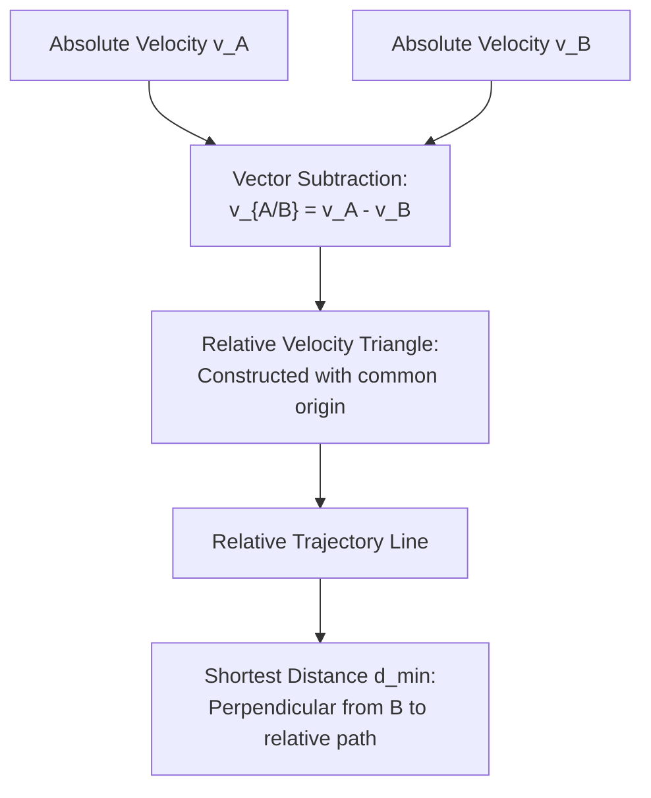

# :LiRocket: Lesson 13: Dynamics, Kinematics & Projectiles

> [!ABSTRACT] Syllabus Scope (NIE Teacher's Guide — Grade 12 & 13 Applied Mathematics)
> - **Rectilinear Kinematics**:
>   - Constant acceleration formulas: $v = u + at$, $s = ut + \frac{1}{2}at^2$, $v^2 = u^2 + 2as$, $s = \frac{u+v}{2}t$
>   - Calculus kinematics: $v = \frac{ds}{dt} = \dot{s}$, $a = \frac{dv}{dt} = v\frac{dv}{ds} = \frac{d^2s}{dt^2} = \ddot{s}$
>   - Graphical kinematics: Displacement-time ($s-t$) and velocity-time ($v-t$) graphs; gradient = acceleration, area under $v-t$ curve = displacement
> - **Relative Motion**:
>   - Relative position: $\vec{r}_{A/B} = \vec{r}_A - \vec{r}_B$
>   - Relative velocity: $\vec{v}_{A/B} = \vec{v}_A - \vec{v}_B$; relative acceleration: $\vec{a}_{A/B} = \vec{a}_A - \vec{a}_B$
>   - Relative path, condition for collision/interception, and shortest distance of approach ($d_{\min}$)
> - **Newton's Laws of Motion & Connected Particles**:
>   - Newton's second law: $\vec{F} = m\vec{a}$ (in inertial frames)
>   - Motion on smooth and rough horizontal and inclined planes
>   - Light inextensible strings, smooth pulleys, and Atwood's machine
>   - Movable wedges: relative acceleration constraints ($\vec{a}_{\text{abs}} = \vec{a}_{\text{wedge}} + \vec{a}_{\text{rel}}$)
> - **Projectile Motion under Gravity**:
>   - Independence of horizontal and vertical motions ($a_x = 0$, $a_y = -g$)
>   - Flight characteristics: Time of flight $T = \frac{2u\sin\theta}{g}$, Maximum height $H = \frac{u^2\sin^2\theta}{2g}$, Horizontal range $R = \frac{u^2\sin 2\theta}{g}$
>   - Maximum horizontal range $R_{\max} = \frac{u^2}{g}$ (at $\theta = 45^\circ$)
>   - Cartesian trajectory equation: $y = x\tan\theta - \frac{gx^2(1+\tan^2\theta)}{2u^2}$
>   - Quadratic in $\tan\theta$, two firing angles for a target $(x, y)$, and Parabola of Safety
>   - Projectile motion on inclined planes: Range up and down, maximum range formulas

> [!NOTE] Subtopic Companion Guides
> - For full trajectory proofs, quadratic in $\tan\theta$, inclined plane ranges, and shortest approach problems → [[Subtopics/Projectiles & Kinematics|Projectiles & Kinematics Guide]]
> - For dot notation, connected particles constraint calculus, pulleys, and movable wedges → [[Subtopics/Relative Acceleration|Relative Acceleration Guide]]

---

## 1. Rectilinear Kinematics

Rectilinear motion is motion along a single straight line.

### 1.1 Motion with Constant Acceleration
When acceleration $a$ is constant:
$$v = u + at$$
$$s = ut + \frac{1}{2}at^2$$
$$v^2 = u^2 + 2as$$
$$s = \left(\frac{u + v}{2}\right)t$$
$$s_n = u + \frac{1}{2}a(2n - 1) \quad (\text{displacement during the } n\text{-th second})$$

### 1.2 Variable Acceleration & Calculus Kinematics
When acceleration varies with time $t$, displacement $s$, or velocity $v$:

$$\text{Velocity: } v = \frac{ds}{dt} = \dot{s}$$
$$\text{Acceleration: } a = \frac{dv}{dt} = \ddot{s} = \frac{dv}{ds}\frac{ds}{dt} = v\frac{dv}{ds}$$

- **Given $a = f(t)$**: Integrate directly: $v = \int f(t)\,dt$, then $s = \int v\,dt$.
- **Given $a = f(v)$**: Separate variables: $\frac{dv}{f(v)} = dt$ to find $v(t)$, or $\frac{v\,dv}{f(v)} = ds$ to find $v(s)$.
- **Given $a = f(s)$**: Use $v\frac{dv}{ds} = f(s) \implies \int v\,dv = \int f(s)\,ds \implies \frac{1}{2}v^2 = \int f(s)\,ds + C$.

### 1.3 Velocity-Time ($v-t$) Graphs
In A/L Combined Mathematics, $v-t$ graphs are the standard method for solving multi-stage journey problems:
- **Gradient of $v-t$ graph**: $\frac{dv}{dt} =$ Acceleration $a$
- **Area under $v-t$ curve**: $\int v\,dt =$ Displacement $s$
- For a body accelerating uniformly from rest at $\alpha$ to maximum velocity $V$ and then decelerating at $\beta$ to rest in total time $T$:
  $$T = \frac{V}{\alpha} + \frac{V}{\beta} = V\left(\frac{1}{\alpha} + \frac{1}{\beta}\right) \implies V = \frac{\alpha\beta}{\alpha+\beta}T$$
  $$\text{Total distance } s = \frac{1}{2} V T = \frac{1}{2}\left(\frac{\alpha\beta}{\alpha+\beta}\right)T^2$$

---

## 2. Relative Velocity & 2D Motion

### 2.1 Vector Definition
The velocity of particle $A$ relative to particle $B$ is the velocity with which $A$ appears to move when observed from $B$:
$$\vec{v}_{A/B} = \vec{v}_A - \vec{v}_B \iff \vec{v}_A = \vec{v}_B + \vec{v}_{A/B}$$

In component form ($\vec{v} = \dot{x}\hat{\mathbf{i}} + \dot{y}\hat{\mathbf{j}}$):
$$\vec{v}_{A/B} = (u_{Ax} - u_{Bx})\hat{\mathbf{i}} + (u_{Ay} - u_{By})\hat{\mathbf{j}}$$

### 2.2 Shortest Distance of Approach
Let particle $A$ have initial position $\vec{r}_{0A}$ and velocity $\vec{v}_A$, and $B$ have initial position $\vec{r}_{0B}$ and velocity $\vec{v}_B$.
1. Fix $B$ at the origin of a relative coordinate frame.
2. Initial relative position: $\vec{r}_0 = \vec{r}_{0A} - \vec{r}_{0B}$.
3. Relative velocity: $\vec{u} = \vec{v}_{A/B} = \vec{v}_A - \vec{v}_B$.
4. The path of $A$ relative to $B$ is a straight line through $\vec{r}_0$ in the direction of $\vec{u}$.
5. The **shortest distance of approach** $d_{\min}$ is the length of the perpendicular dropped from $B$ onto this line:
   $$d_{\min} = \frac{|\vec{r}_0 \times \vec{u}|}{|\vec{u}|} = r_0 \sin\theta$$
   where $\theta$ is the angle between $\vec{r}_0$ and $\vec{u}$.
6. **Time to reach shortest distance**:
   $$t_{\min} = \frac{r_0 \cos\theta}{|\vec{u}|} = -\frac{\vec{r}_0 \cdot \vec{u}}{|\vec{u}|^2}$$

- **Condition for Interception / Collision**: Two bodies collide if and only if $d_{\min} = 0$, meaning $\vec{v}_{A/B}$ is directed exactly along the line of sight joining $A$ to $B$.

---

## 3. Newton's Laws & Connected Particles

### 3.1 Equations of Motion
For a particle of constant mass $m$:
$$\vec{F}_{\text{net}} = m\vec{a}$$

### 3.2 Connected Particles over a Smooth Light Pulley
Consider Atwood's machine (masses $m_1 > m_2$ connected by a light inextensible string passing over a smooth fixed pulley):
- Downward equation for $m_1$: $m_1 g - T = m_1 a$
- Upward equation for $m_2$: $T - m_2 g = m_2 a$
- Adding both equations:
  $$a = \left(\frac{m_1 - m_2}{m_1 + m_2}\right)g$$
- Tension in string:
  $$T = \left(\frac{2m_1 m_2}{m_1 + m_2}\right)g$$
- Thrust on the pulley axle: $R = 2T = \frac{4m_1 m_2}{m_1 + m_2}g$.

### 3.3 Movable Wedge & Relative Acceleration
A smooth wedge of mass $M$ and inclination $\alpha$ rests on a smooth horizontal table. A smooth particle of mass $m$ slides down its inclined face.
- Let horizontal acceleration of the wedge to the left be $F$ ($\ddot{X} = -F$).
- Let acceleration of the particle **relative to the wedge** down the inclined face be $f'$ ($\ddot{s} = f'$).
- **Absolute Acceleration of the Particle**:
  $$\vec{a}_m = (-F\hat{\mathbf{i}}) + (f'\cos\alpha\hat{\mathbf{i}} - f'\sin\alpha\hat{\mathbf{j}}) = (f'\cos\alpha - F)\hat{\mathbf{i}} - f'\sin\alpha\hat{\mathbf{j}}$$
- Equations of motion:
  - For the wedge ($\to$ left): $R\sin\alpha = M F$
  - For the particle ($\perp$ to wedge face $\nwarrow$): $m g \cos\alpha - R = m F \sin\alpha$
  - For the particle (down the wedge face $\swarrow$): $m g \sin\alpha = m(f' - F\cos\alpha)$
- Solving yields:
  $$F = \frac{m g \sin\alpha\cos\alpha}{M + m\sin^2\alpha}, \qquad f' = g\sin\alpha + F\cos\alpha$$

---

## 4. Projectile Motion under Gravity

A particle is projected from the origin $(0, 0)$ with initial speed $u$ at an angle $\theta$ above the horizontal.

### 4.1 Equations of Motion
Assuming no air resistance and constant downward gravity $g$:
$$\text{Horizontal: } a_x = 0 \implies v_x = u\cos\theta, \qquad x = (u\cos\theta)t$$
$$\text{Vertical: } a_y = -g \implies v_y = u\sin\theta - gt, \qquad y = (u\sin\theta)t - \frac{1}{2}gt^2$$

### 4.2 Standard Flight Quantities
1. **Time to Maximum Height**: Set $v_y = 0 \implies t_H = \frac{u\sin\theta}{g}$.
2. **Maximum Height**:
   $$H = \frac{u^2\sin^2\theta}{2g}$$
3. **Total Time of Flight**: Set $y = 0 \implies t(u\sin\theta - \frac{1}{2}gt) = 0$:
   $$T = \frac{2u\sin\theta}{g} = 2 t_H$$
4. **Horizontal Range on Level Ground**:
   $$R = (u\cos\theta)T = (u\cos\theta)\left(\frac{2u\sin\theta}{g}\right) = \frac{u^2(2\sin\theta\cos\theta)}{g} = \frac{u^2\sin 2\theta}{g}$$
5. **Maximum Horizontal Range**:
   $$\sin 2\theta = 1 \implies 2\theta = 90^\circ \implies \theta = 45^\circ$$
   $$R_{\max} = \frac{u^2}{g}$$

> [!NOTE] Complementary Angles Property
> For a given launch speed $u$, two complementary launch angles $\theta$ and $90^\circ - \theta$ produce the **identical horizontal range**, since $\sin(2(90^\circ - \theta)) = \sin(180^\circ - 2\theta) = \sin 2\theta$.

---

## 5. Cartesian Trajectory Equation & Parabola of Safety

### 5.1 Derivation of Trajectory Equation
From $x = (u\cos\theta)t$, express time as $t = \frac{x}{u\cos\theta}$.
Substitute into the vertical equation $y = (u\sin\theta)t - \frac{1}{2}gt^2$:
$$y = (u\sin\theta)\left(\frac{x}{u\cos\theta}\right) - \frac{1}{2}g\left(\frac{x}{u\cos\theta}\right)^2$$
$$y = x\tan\theta - \frac{gx^2}{2u^2\cos^2\theta}$$

Using $\sec^2\theta = 1 + \tan^2\theta$:
$$\boxed{y = x\tan\theta - \frac{gx^2}{2u^2}(1 + \tan^2\theta)}$$

### 5.2 Quadratic in $\tan\theta$
Rearranging as a quadratic equation in $T = \tan\theta$:
$$\left(\frac{gx^2}{2u^2}\right)\tan^2\theta - x\tan\theta + \left(y + \frac{gx^2}{2u^2}\right) = 0$$

For a given launch speed $u$, this equation determines the required launch angle(s) $\theta$ to hit a target $(x, y)$:
- **Discriminant $\Delta > 0$**: Two distinct firing angles $\theta_1, \theta_2$ hit the target (high trajectory and low trajectory).
  $$\tan\theta_1\tan\theta_2 = \frac{y + \frac{gx^2}{2u^2}}{\frac{gx^2}{2u^2}} = 1 + \frac{2u^2 y}{gx^2}$$
- **Discriminant $\Delta = 0$**: Exactly one firing angle hits the target (target lies on bounding parabola).
- **Discriminant $\Delta < 0$**: Target cannot be reached with speed $u$.

### 5.3 Parabola of Safety (Bounding Envelope)
The condition for the target $(x, y)$ to be reachable is $\Delta \ge 0$:
$$(-x)^2 - 4\left(\frac{gx^2}{2u^2}\right)\left(y + \frac{gx^2}{2u^2}\right) \ge 0$$
$$x^2 - \frac{2gx^2}{u^2}y - \frac{g^2 x^4}{u^4} \ge 0$$
Divide by $x^2 \neq 0$:
$$1 - \frac{2gy}{u^2} - \frac{g^2 x^2}{u^4} \ge 0 \implies y \le \frac{u^2}{2g} - \frac{gx^2}{2u^2}$$

The boundary is the **Parabola of Safety**:
$$\boxed{y = \frac{u^2}{2g} - \frac{gx^2}{2u^2}}$$
- Vertex: $\left(0, \frac{u^2}{2g}\right)$ (maximum vertical reach)
- Semi-latus rectum: $\frac{u^2}{g}$
- Focus: at the origin of projection $(0, 0)$

---

## 6. Projectiles on an Inclined Plane

Consider a plane inclined at angle $\beta$ to the horizontal. A particle is projected from the plane at angle $\alpha$ to the horizontal ($\alpha > \beta$), so the launch angle relative to the inclined plane is $\theta = \alpha - \beta$.

### 6.1 Range Up the Inclined Plane
Using coordinate axes along ($\hat{\mathbf{i}}$) and perpendicular ($\hat{\mathbf{j}}$) to the inclined plane:
- Acceleration components: $a_x = -g\sin\beta, \; a_y = -g\cos\beta$
- Initial velocity components: $u_x = u\cos(\alpha - \beta), \; u_y = u\sin(\alpha - \beta)$

Time of flight $T$ (when $y = 0$):
$$u_y T - \frac{1}{2}(g\cos\beta)T^2 = 0 \implies T = \frac{2u\sin(\alpha - \beta)}{g\cos\beta}$$

The range $R$ along the plane is:
$$R = u_x T - \frac{1}{2}(g\sin\beta)T^2 = \frac{2u^2\cos\alpha\sin(\alpha - \beta)}{g\cos^2\beta}$$
Using product-to-sum identity $2\cos\alpha\sin(\alpha-\beta) = \sin(2\alpha - \beta) - \sin\beta$:
$$\boxed{R = \frac{u^2}{g\cos^2\beta}\big[\sin(2\alpha - \beta) - \sin\beta\big]}$$

### 6.2 Maximum Range Up the Plane
The range is maximized when $\sin(2\alpha - \beta) = 1 \implies 2\alpha - \beta = \frac{\pi}{2}$:
$$\boxed{\alpha = \frac{\pi}{4} + \frac{\beta}{2}}$$
*(The maximum range angle bisects the angle between the inclined plane and the vertical)*.

The **maximum range up the plane** is:
$$R_{\max} = \frac{u^2(1 - \sin\beta)}{g\cos^2\beta} = \frac{u^2(1 - \sin\beta)}{g(1 - \sin^2\beta)} = \boxed{\frac{u^2}{g(1 + \sin\beta)}}$$

---

## :LiRocket: Flashcards (Spaced Repetition)

#flashcards

State the relative velocity vector equation of body $A$ relative to body $B$. :: $\mathbf{v}_{A/B} = \mathbf{v}_A - \mathbf{v}_B$.
<!--SR:!2026-09-29,4,270-->

What are the calculus expressions for acceleration $a$ in terms of displacement $s$ and velocity $v$? :: $a = \frac{dv}{dt} = v \frac{dv}{ds} = \frac{d^2 s}{dt^2}$.
<!--SR:!2026-09-29,4,270-->

State the Cartesian trajectory equation of a projectile launched at speed $u$ and angle $\theta$. :: $y = x \tan\theta - \frac{g x^2}{2u^2 \cos^2\theta} = x\tan\theta - \frac{gx^2(1+\tan^2\theta)}{2u^2}$.
<!--SR:!2026-09-26,1,230-->

State the formula for maximum horizontal range $R_{\max}$ of a projectile on level ground. :: $R_{\max} = \frac{u^2}{g}$ (achieved at launch angle $\theta = 45^\circ$).
<!--SR:!2026-09-28,3,250-->

State the formula for the Time of Flight $T$ of a projectile on level ground. :: $T = \frac{2u\sin\theta}{g}$. <!--SR:!2026-11-20,1,230-->

State the formula for the Maximum Height $H$ of a projectile. :: $H = \frac{u^2\sin^2\theta}{2g}$. <!--SR:!2026-11-20,1,230-->

What is the relationship between the horizontal ranges for complementary projection angles $\theta$ and $90^\circ - \theta$? :: They are equal (same horizontal range $R$). <!--SR:!2026-11-21,2,250-->

Write the quadratic equation in $\tan\theta$ for a projectile hitting a target point $(x, y)$. :: $\left(\frac{gx^2}{2u^2}\right)\tan^2\theta - x\tan\theta + \left(y + \frac{gx^2}{2u^2}\right) = 0$. <!--SR:!2026-11-21,2,250-->

State the equation of the Parabola of Safety (bounding envelope of all trajectories). :: $y = \frac{u^2}{2g} - \frac{gx^2}{2u^2}$. <!--SR:!2026-11-22,3,250-->

What is the condition for two bodies $A$ and $B$ to collide in terms of their relative velocity $\vec{v}_{A/B}$? :: The relative velocity vector $\vec{v}_{A/B}$ must point directly along the initial line of sight from $B$ to $A$ (so $d_{\min} = 0$). <!--SR:!2026-11-22,3,250-->

State the formula for the acceleration $a$ of two masses $m_1 > m_2$ in Atwood's machine over a smooth light pulley. :: $a = \left(\frac{m_1 - m_2}{m_1 + m_2}\right)g$. <!--SR:!2026-11-23,4,250-->

State the formula for the tension $T$ in the string of Atwood's machine. :: $T = \left(\frac{2m_1 m_2}{m_1 + m_2}\right)g$. <!--SR:!2026-11-23,4,250-->

In a movable wedge problem, how is the absolute acceleration of the sliding mass expressed? :: $\vec{a}_{\text{abs}} = \vec{a}_{\text{wedge}} + \vec{a}_{\text{rel}}$ (vector sum of wedge acceleration and particle's relative acceleration along the face). <!--SR:!2026-11-24,5,250-->

What launch angle $\alpha$ gives the maximum range up an inclined plane of inclination $\beta$? :: $\alpha = \frac{\pi}{4} + \frac{\beta}{2}$ (bisects the angle between the inclined plane and the vertical). <!--SR:!2026-11-24,5,250-->

State the formula for the maximum range up a plane inclined at $\beta$. :: $R_{\max} = \frac{u^2}{g(1 + \sin\beta)}$. <!--SR:!2026-11-25,6,250-->

What physical quantities do the gradient and area under a velocity-time ($v-t$) curve represent? :: Gradient represents acceleration; area under the curve represents displacement. <!--SR:!2026-11-25,6,250-->

State the shortest distance of approach $d_{\min}$ formula between two moving bodies with relative position $\vec{r}_0$ and relative velocity $\vec{u}$. :: $d_{\min} = \frac{|\vec{r}_0 \times \vec{u}|}{|\vec{u}|} = r_0\sin\theta$. <!--SR:!2026-11-26,7,250-->
