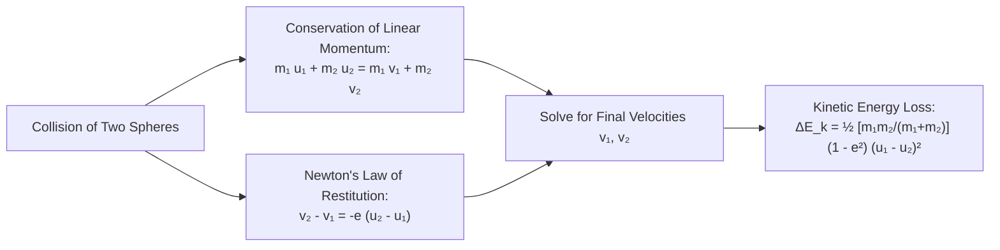
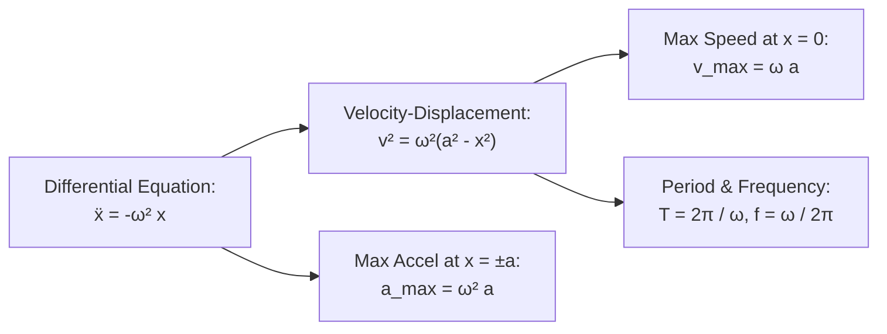

# :LiActivity: Lesson 14: Work, Power, SHM, Collisions & Probability

> [!ABSTRACT] Syllabus Scope (NIE Teacher's Guide — Grade 12 & 13 Applied Mathematics)
> - **Work, Power & Energy**:
>   - Work done: $W = \vec{F} \cdot \vec{s} = \int F\,ds$; Work-Energy Principle: $\Delta E_k = W_{\text{net}}$
>   - Power: $P = \frac{dW}{dt} = \vec{F} \cdot \vec{v}$; tractive force, maximum velocity on level and inclined roads
>   - Kinetic Energy ($E_k = \frac{1}{2}mv^2$), Gravitational Potential Energy ($E_p = mgh$), Elastic Potential Energy ($E_e = \frac{\lambda x^2}{2l_0}$)
>   - Conservation of Mechanical Energy: $E_k + E_p + E_e = \text{constant}$
> - **Impulse & Collisions**:
>   - Impulse of a force: $\vec{J} = \int \vec{F}\,dt = \Delta \vec{p} = m\vec{v} - m\vec{u}$
>   - Principle of Conservation of Linear Momentum: $m_1 u_1 + m_2 u_2 = m_1 v_1 + m_2 v_2$
>   - **Newton's Law of Restitution**: $v_2 - v_1 = -e(u_2 - u_1)$ ($0 \le e \le 1$)
>   - Loss of kinetic energy in direct collision: $\Delta E_k = \frac{1}{2}\frac{m_1 m_2}{m_1+m_2}(1 - e^2)(u_1 - u_2)^2$
>   - Oblique collision of smooth spheres: conservation along common tangent, restitution along line of centres
> - **Simple Harmonic Motion (SHM)**:
>   - Fundamental differential equation: $\ddot{x} = -\omega^2 x$
>   - Kinematic relations: $v^2 = \omega^2(a^2 - x^2)$, period $T = \frac{2\pi}{\omega}$, frequency $f = \frac{\omega}{2\pi}$
>   - Hooke's Law for elastic strings/springs: $T = \frac{\lambda x}{l_0}$
>   - Horizontal and vertical oscillations; equilibrium extension $e = \frac{mgl_0}{\lambda}$, condition for slack string
> - **Probability & Descriptive Statistics**:
>   - Addition rule: $P(A \cup B) = P(A) + P(B) - P(A \cap B)$; mutually exclusive and independent events
>   - Conditional probability: $P(A|B) = \frac{P(A \cap B)}{P(B)}$; Total Probability & Bayes' Theorem
>   - Discrete random variables: PMF, Expectation $E(X)$, Variance $\text{Var}(X) = E(X^2) - [E(X)]^2$
>   - Summary statistics: Mean $\bar{x}$, Median, Mode, Variance $\sigma^2$, Standard Deviation $\sigma$

> [!NOTE] Subtopic Companion Guides
> - For direct/oblique collisions and energy loss derivations → [[Subtopics/Impulse & Elastic Collisions|Impulse & Elastic Collisions Guide]]
> - For elastic string oscillations, amplitude, period, and slack string dynamics → [[Subtopics/Simple Harmonic Motion in Mechanics|Simple Harmonic Motion in Mechanics Guide]]
> - For probability theorems, random variables, Bayes' rule, and statistics → [[Subtopics/Probability & Descriptive Statistics|Probability & Descriptive Statistics Guide]]

---

## 1. Work, Power & Energy

### 1.1 Work Done
- By a **constant force** $\vec{F}$ over displacement $\vec{s}$:
  $$W = \vec{F} \cdot \vec{s} = F s \cos\theta$$
- By a **variable force**:
  $$W = \int_{s_1}^{s_2} F(s)\,ds$$

### 1.2 Power & Vehicles in Motion
Power is the rate of doing work:
$$P = \frac{dW}{dt} = \vec{F} \cdot \frac{d\vec{s}}{dt} = \vec{F} \cdot \vec{v}$$

For a vehicle of mass $M$ driven by engine tractive force $F$ against resistance $R$:
- **Equation of Motion**:
  $$F - R = M a \implies \frac{P}{v} - R = M a$$
- **Maximum Speed $v_{\max}$ on Level Ground** (when acceleration $a = 0$):
  $$F = R \implies \frac{P}{v_{\max}} = R \implies v_{\max} = \frac{P}{R}$$
- **Moving Up an Incline of Angle $\alpha$**:
  $$F - (R + M g\sin\alpha) = M a \implies v_{\max} = \frac{P}{R + M g\sin\alpha}$$

### 1.3 Acceleration Time & Distance Under Constant Power
When an engine operates at constant power $P$ against constant resistance $R$:
$$P = F \cdot v = (M a + R)v \implies M a = \frac{P}{v} - R = \frac{P - R v}{v} \implies a = \frac{P - R v}{M v}$$

- **Time to Accelerate from speed $u$ to $v$**:
  $$\frac{dv}{dt} = \frac{P - R v}{M v} \implies dt = \frac{M v\,dv}{P - R v} \implies t = \int_u^v \frac{M v\,dv}{P - R v}$$
  Using substitution or splitting: $\frac{v}{P - Rv} = -\frac{1}{R} + \frac{P}{R(P - Rv)}$:
  $$t = \frac{M}{R}\int_u^v \left(\frac{P}{P - Rv} - 1\right)dv = \frac{M}{R}\left[ -\frac{P}{R}\ln|P - Rv| - v \right]_u^v$$

- **Distance Traveled During Acceleration**:
  $$v \frac{dv}{ds} = \frac{P - R v}{M v} \implies ds = \frac{M v^2\,dv}{P - R v} \implies s = \int_u^v \frac{M v^2\,dv}{P - R v}$$

### 1.3 Energy Forms & Conservation
1. **Kinetic Energy**: $E_k = \frac{1}{2}m v^2$
2. **Gravitational Potential Energy**: $E_p = mgh$ (taking reference datum $h = 0$)
3. **Elastic Potential Energy (EPE)**:
   By Hooke's Law, tension $T = \frac{\lambda x}{l_0}$. The work done stretching an elastic string from extension $0$ to $x$:
   $$E_e = \int_0^x \frac{\lambda s}{l_0}\,ds = \frac{\lambda x^2}{2l_0} = \frac{1}{2}(\text{Tension} \times \text{Extension})$$
4. **Principle of Conservation of Mechanical Energy**:
   In the absence of dissipative non-conservative forces (friction, drag):
   $$E_k + E_p + E_e = \text{constant}$$

---

## 2. Impulse & Collisions

### 2.1 Impulse & Momentum
The impulse $\vec{J}$ of a force $\vec{F}$ acting over time interval $[t_1, t_2]$:
$$\vec{J} = \int_{t_1}^{t_2} \vec{F}\,dt = \Delta\vec{p} = m\vec{v} - m\vec{u}$$

### 2.2 Direct Collision of Two Smooth Spheres
Two smooth spheres of masses $m_1, m_2$ moving along their line of centres with initial velocities $u_1, u_2$ collide directly, emerging with velocities $v_1, v_2$:
1. **Conservation of Linear Momentum (along line of impact)**:
   $$m_1 u_1 + m_2 u_2 = m_1 v_1 + m_2 v_2$$
2. **Newton's Experimental Law of Restitution**:
   $$\text{Velocity of Separation} = e \times (\text{Velocity of Approach})$$
   $$v_2 - v_1 = -e(u_2 - u_1) \iff v_2 - v_1 = e(u_1 - u_2)$$
   where $e$ is the coefficient of restitution ($0 \le e \le 1$):
   - $e = 1$: Perfectly elastic collision ($\Delta E_k = 0$)
   - $0 < e < 1$: Inelastic collision ($\Delta E_k > 0$)
   - $e = 0$: Completely inelastic / plastic collision (bodies coalesce, $v_1 = v_2$)

### 2.3 Loss of Kinetic Energy in Direct Collision
$$\Delta E_k = \frac{1}{2}m_1 u_1^2 + \frac{1}{2}m_2 u_2^2 - \left(\frac{1}{2}m_1 v_1^2 + \frac{1}{2}m_2 v_2^2\right) = \frac{1}{2}\left(\frac{m_1 m_2}{m_1 + m_2}\right)(1 - e^2)(u_1 - u_2)^2$$

### 2.4 Oblique Collision of Smooth Spheres
When spheres collide at an angle:
- Along common tangent ($\perp$ to line of centres): **Velocities remain unchanged** (no impulse, surfaces are smooth).
- Along line of centres ($\parallel$ to normal): Apply **Conservation of Momentum** and **Newton's Law of Restitution**.

---

## 3. Simple Harmonic Motion (SHM)

A particle executes Simple Harmonic Motion if its acceleration is directed toward a fixed point $O$ on its path and is directly proportional to its displacement $x$ from $O$.

### 3.1 Kinematics of SHM
- **Differential Equation**:
  $$\ddot{x} = -\omega^2 x$$
- **Velocity-Displacement Relation**:
  $$v \frac{dv}{dx} = -\omega^2 x \implies \int v\,dv = -\omega^2 \int x\,dx \implies \frac{1}{2}v^2 = -\frac{1}{2}\omega^2 x^2 + C$$
  At maximum displacement (amplitude $x = a$), $v = 0 \implies C = \frac{1}{2}\omega^2 a^2$:
  $$\boxed{v^2 = \omega^2(a^2 - x^2)}$$
- **Displacement as a Function of Time**:
  $$x = a\cos(\omega t) \quad \text{(measured from extreme position)}$$
  $$x = a\sin(\omega t) \quad \text{(measured from centre } O\text{)}$$
- **Period & Frequency**:
  $$T = \frac{2\pi}{\omega}, \qquad f = \frac{1}{T} = \frac{\omega}{2\pi}$$
- **Extreme Values**:
  $$v_{\max} = \omega a \quad (\text{at centre } x = 0)$$
  $$\text{accel}_{\max} = \omega^2 a \quad (\text{at endpoints } x = \pm a)$$

### 3.2 Hooke's Law & Elastic Oscillations
- **Hooke's Law**:
  $$T = \frac{\lambda x}{l_0}$$
  where $\lambda$ is modulus of elasticity, $l_0$ is natural length, and $x$ is extension.

#### Horizontal Elastic String Oscillation
Mass $m$ attached to an elastic string of natural length $l_0$ on a smooth table:
$$m\ddot{x} = -T = -\frac{\lambda x}{l_0} \implies \ddot{x} = -\left(\frac{\lambda}{m l_0}\right)x$$
This is SHM with:
$$\omega^2 = \frac{\lambda}{m l_0}, \qquad T = 2\pi\sqrt{\frac{m l_0}{\lambda}}$$

#### Vertical Elastic String Oscillation
Mass $m$ hangs vertically from a fixed support:
1. **Equilibrium Position $O$**:
   $$m g = T_0 = \frac{\lambda e}{l_0} \implies e = \frac{m g l_0}{\lambda}$$
2. **Displaced by $x$ below $O$**:
   $$m\ddot{x} = m g - T = m g - \frac{\lambda(e + x)}{l_0} = m g - \frac{\lambda e}{l_0} - \frac{\lambda x}{l_0} = -\left(\frac{\lambda}{l_0}\right)x$$
   $$\ddot{x} = -\left(\frac{\lambda}{m l_0}\right)x$$
   Motion is SHM about the equilibrium position $O$ with $\omega^2 = \frac{\lambda}{m l_0}$.
3. **Condition for String to Become Slack**:
   If amplitude $a > e$, the particle rises above the natural length level ($x < -e$). The string becomes slack ($T = 0$), and the particle moves under gravity alone with deceleration $g$ until the string tautens again.

---

## 4. Probability & Statistics

### 4.1 Probability Foundations
- For sample space $S$ and event $A$: $P(A) = \frac{n(A)}{n(S)}$, with $0 \le P(A) \le 1$.
- **Addition Theorem**:
  $$P(A \cup B) = P(A) + P(B) - P(A \cap B)$$
  If $A$ and $B$ are **mutually exclusive** ($A \cap B = \emptyset$):
  $$P(A \cup B) = P(A) + P(B)$$
- **Conditional Probability**:
  $$P(A|B) = \frac{P(A \cap B)}{P(B)} \quad (P(B) > 0)$$
- **Independent Events**:
  Events $A$ and $B$ are independent if and only if:
  $$P(A \cap B) = P(A) P(B) \iff P(A|B) = P(A)$$

### 4.2 Total Probability & Bayes' Theorem
If events $B_1, B_2, \dots, B_n$ form a partition of sample space $S$:
1. **Total Probability Theorem**:
   $$P(A) = \sum_{i=1}^n P(B_i) P(A|B_i)$$
2. **Bayes' Theorem**:
   $$P(B_k|A) = \frac{P(B_k) P(A|B_k)}{\sum_{i=1}^n P(B_i) P(A|B_i)}$$

### 4.3 Discrete Random Variables
- **Expectation (Mean)**:
  $$E(X) = \mu = \sum x_i P(X = x_i)$$
- **Variance & Standard Deviation**:
  $$\text{Var}(X) = \sigma^2 = E(X^2) - [E(X)]^2 = \sum x_i^2 P(X = x_i) - \mu^2$$
  $$\sigma = \sqrt{\text{Var}(X)}$$
- **Properties of Expectation & Variance**:
  $$E(aX + b) = a E(X) + b$$
  $$\text{Var}(aX + b) = a^2 \text{Var}(X)$$

### 4.4 Descriptive Statistics
- **Mean**: $\bar{x} = \frac{\sum f_i x_i}{\sum f_i}$
- **Variance**: $\sigma^2 = \frac{\sum f_i x_i^2}{N} - \bar{x}^2$
- **Median ($Q_2$)**: Middle value separating data into equal halves.
- **Interquartile Range (IQR)**: $\text{IQR} = Q_3 - Q_1$.

---

## :LiRocket: Flashcards (Spaced Repetition)

#flashcards

State Newton's Law of Restitution for direct impact of two bodies. :: $v_2 - v_1 = -e (u_2 - u_1)$ (where $e$ is coefficient of restitution $0 \le e \le 1$).
<!--SR:!2026-09-26,1,230-->

State Hooke's Law for tension $T$ in an elastic string of natural length $l_0$, modulus of elasticity $\lambda$, and extension $x$. :: $T = \frac{\lambda x}{l_0}$.
<!--SR:!2026-09-26,1,230-->

State the addition rule of probability for two events $A$ and $B$. :: $P(A \cup B) = P(A) + P(B) - P(A \cap B)$.

State the formula for conditional probability $P(A|B)$. :: $P(A|B) = \frac{P(A \cap B)}{P(B)}$ (provided $P(B) > 0$).
<!--SR:!2026-09-26,1,230-->

State the formula for Elastic Potential Energy (EPE) stored in an elastic string of extension $x$. :: $E_e = \frac{\lambda x^2}{2l_0} = \frac{1}{2}(\text{Tension} \times \text{Extension})$. <!--SR:!2026-11-20,1,230-->

State the relationship between power $P$, tractive force $F$, and velocity $v$. :: $P = F \cdot v$. <!--SR:!2026-11-20,1,230-->

What is the loss of kinetic energy $\Delta E_k$ in the direct collision of two masses $m_1$ and $m_2$? :: $\Delta E_k = \frac{1}{2}\left(\frac{m_1 m_2}{m_1 + m_2}\right)(1 - e^2)(u_1 - u_2)^2$. <!--SR:!2026-11-21,2,250-->

What happens to velocity components perpendicular to the line of impact in an oblique collision of smooth spheres? :: They remain unchanged because no tangential impulse acts between smooth surfaces. <!--SR:!2026-11-21,2,250-->

State the fundamental differential equation of Simple Harmonic Motion (SHM). :: $\ddot{x} = -\omega^2 x$. <!--SR:!2026-11-22,3,250-->

State the velocity-displacement relation in SHM with amplitude $a$. :: $v^2 = \omega^2(a^2 - x^2)$. <!--SR:!2026-11-22,3,250-->

What are the period $T$ and maximum speed $v_{\max}$ for a particle in SHM ($\ddot{x} = -\omega^2 x$)? :: Period $T = \frac{2\pi}{\omega}$; Maximum speed $v_{\max} = \omega a$ (at centre $x = 0$). <!--SR:!2026-11-23,4,250-->

What is the equilibrium extension $e$ for a mass $m$ hanging vertically from an elastic string of natural length $l_0$ and modulus $\lambda$? :: $e = \frac{mgl_0}{\lambda}$. <!--SR:!2026-11-23,4,250-->

Under what condition does a vertically oscillating mass on an elastic string become slack? :: When amplitude $a > e$ (the particle ascends above the level where extension is zero). <!--SR:!2026-11-24,5,250-->

State the condition for two events $A$ and $B$ to be independent in probability. :: $P(A \cap B) = P(A)P(B)$. <!--SR:!2026-11-24,5,250-->

State Bayes' Theorem for finding posterior probability $P(B_k|A)$. :: $P(B_k|A) = \frac{P(B_k)P(A|B_k)}{\sum_{i=1}^n P(B_i)P(A|B_i)}$. <!--SR:!2026-11-25,6,250-->

State the relationship between $\text{Var}(X)$, $E(X^2)$, and $E(X)$ for a random variable $X$. :: $\text{Var}(X) = E(X^2) - [E(X)]^2$. <!--SR:!2026-11-25,6,250-->

How do expectation and variance transform under linear scaling $Y = aX + b$? :: $E(aX + b) = aE(X) + b$; $\text{Var}(aX + b) = a^2\text{Var}(X)$. <!--SR:!2026-11-26,7,250-->

What is the impulse of a force $\vec{F}$ in terms of linear momentum? :: $\vec{J} = \int \vec{F}\,dt = \Delta\vec{p} = m\vec{v} - m\vec{u}$. <!--SR:!2026-11-26,7,250-->
