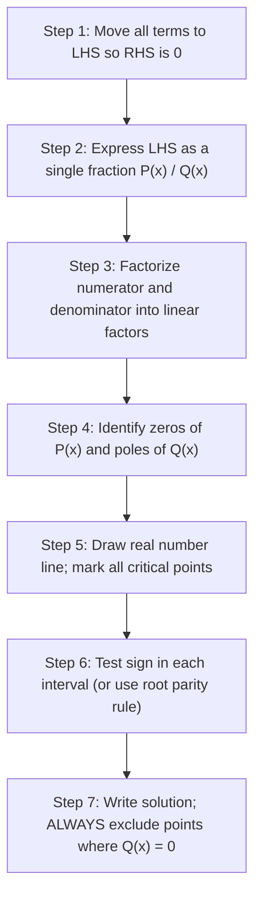

# :LiEqualNot: Subtopic: Inequalities & Absolute Values Guide

> [!ABSTRACT] Core Focus (NIE Teacher's Guide — Grade 12, Unit 01)
> Rigorous mathematical derivations of order axioms, complete algorithm for rational sign diagrams, step-by-step worked examples of fractional inequalities, algebraic squaring and case-partitioning methods for modulus inequalities, and graphical curve-sketching methods.

> [!NOTE] Parent Lesson
> [[../Lesson 01 - Real Numbers, Inequalities & Absolute Values|Lesson 01 — Real Numbers, Inequalities & Absolute Values]]

---

## 1. Rigorous Proofs of Fundamental Inequality Axioms

### 1.1 Inversion of Reciprocals
**Theorem**: If $a > b > 0$, then $\frac{1}{a} < \frac{1}{b}$.

**Proof**:
Since $a > 0$ and $b > 0$, their product $ab > 0$. Therefore, $\frac{1}{ab} > 0$.
Given $a > b$:
Multiply both sides of $a > b$ by the positive real number $\frac{1}{ab}$:
$$a \cdot \left(\frac{1}{ab}\right) > b \cdot \left(\frac{1}{ab}\right)$$
$$\frac{1}{b} > \frac{1}{a} \iff \frac{1}{a} < \frac{1}{b} \quad \blacksquare$$

---

### 1.2 The Triangle Inequality
**Theorem**: For any real numbers $a, b \in \mathbb{R}$, $|a + b| \le |a| + |b|$.

**Proof**:
Recall the basic identity for any real number $x$:
$$-|x| \le x \le |x|$$
Applying this to $a$ and $b$:
$$-|a| \le a \le |a| \quad \text{--- (1)}$$
$$-|b| \le b \le |b| \quad \text{--- (2)}$$
Adding inequalities (1) and (2):
$$-(|a| + |b|) \le a + b \le (|a| + |b|)$$
Notice this has the form $-M \le X \le M$ where $M = |a| + |b| \ge 0$ and $X = a + b$.
By the fundamental modulus property:
$$-M \le X \le M \iff |X| \le M$$
Substituting back:
$$\boxed{|a + b| \le |a| + |b|} \quad \blacksquare$$

*Condition for equality*: Equality $|a + b| = |a| + |b|$ holds if and only if $a$ and $b$ do not have opposite signs, which is algebraically expressed as $ab \ge 0$.

---

## 2. Rational Inequalities: Step-by-Step Algorithm & Worked Examples

### 2.1 The Sign Table / Number Line Algorithm

---

### 2.2 Worked Example 1: Rational Fraction with Constant
**Problem**: Solve the inequality $\frac{2x - 1}{x + 2} \le 1$ for $x \in \mathbb{R}$.

**Solution**:
1. **Move all terms to LHS**:
   $$\frac{2x - 1}{x + 2} - 1 \le 0$$
2. **Combine over common denominator**:
   $$\frac{(2x - 1) - (x + 2)}{x + 2} \le 0 \implies \frac{x - 3}{x + 2} \le 0$$
3. **Critical Points**:
   * Numerator zero: $x - 3 = 0 \implies x = 3$
   * Denominator zero (pole): $x + 2 = 0 \implies x = -2$ (must be excluded: $x \ne -2$)
4. **Sign Table**:

| Interval | $(-\infty, -2)$ | $(-2, 3)$ | $(3, \infty)$ |
|---|---|---|---|
| $(x - 3)$ | $-$ | $-$ | $+$ |
| $(x + 2)$ | $-$ | $+$ | $+$ |
| **Sign of $\frac{x - 3}{x + 2}$** | **$+$** | **$-$** | **$+$** |

5. **Select Required Region** (where $\le 0$):
   The expression is negative in $(-2, 3)$ and zero at $x = 3$. At $x = -2$, it is undefined.
   $$\boxed{x \in (-2, 3]} \quad \text{or} \quad -2 < x \le 3$$

---

### 2.3 Worked Example 2: Quadratic Rational Inequality
**Problem**: Solve $\frac{x^2 - 4x + 3}{x - 2} \ge 0$.

**Solution**:
1. Factorize numerator:
   $$x^2 - 4x + 3 = (x - 1)(x - 3)$$
   $$\frac{(x - 1)(x - 3)}{x - 2} \ge 0$$
2. Critical points in ascending order: $x = 1, 2, 3$.
   * Zeros: $x = 1, 3$ (included, as $\ge 0$)
   * Pole: $x = 2$ (strictly excluded, $x \ne 2$)
3. Sign analysis:
   * For $x > 3$: $(+)(+)/(+) = +$
   * For $2 < x < 3$: $(+)(-)/(+) = -$
   * For $1 < x < 2$: $(+)(-)/(-) = +$
   * For $x < 1$: $(-)(-)/(-) = -$
4. Desired region ($\ge 0$):
   $$\boxed{x \in [1, 2) \cup [3, \infty)}$$

---

## 3. Modulus Inequalities: Advanced Solution Techniques

### 3.1 Method 1: The Difference of Squares (Squaring Method)
Applicable whenever an inequality has the form $|f(x)| \le |g(x)|$.

**Problem**: Solve $|2x - 3| \le |x + 1|$.

**Solution**:
Since both sides are non-negative, squaring preserves the inequality order:
$$(2x - 3)^2 \le (x + 1)^2$$
$$(2x - 3)^2 - (x + 1)^2 \le 0$$
Apply $A^2 - B^2 = (A - B)(A + B)$:
$$[(2x - 3) - (x + 1)][(2x - 3) + (x + 1)] \le 0$$
$$(x - 4)(3x - 2) \le 0$$
Critical points: $x = \frac{2}{3}$ and $x = 4$.
Since the leading coefficient is positive, the product is $\le 0$ between the roots:
$$\boxed{\frac{2}{3} \le x \le 4} \quad \text{or} \quad x \in \left[\frac{2}{3}, 4\right]$$

---

### 3.2 Method 2: Case Partitioning (Linear Multi-Modulus)
Applicable when terms with different moduli are summed, e.g. $|x - a| + |x - b| < c$.

**Problem**: Solve $|x - 1| + 2|x + 2| \le 8$.

**Solution**:
1. **Critical points**:
   * $x - 1 = 0 \implies x = 1$
   * $x + 2 = 0 \implies x = -2$
   Partition the real line into three intervals:
   * Case 1: $x < -2$
   * Case 2: $-2 \le x < 1$
   * Case 3: $x \ge 1$

2. **Case 1: $x < -2$**
   * $x - 1 < 0 \implies |x - 1| = -(x - 1) = 1 - x$
   * $x + 2 < 0 \implies |x + 2| = -(x + 2) = -x - 2$
   $$\implies (1 - x) + 2(-x - 2) \le 8$$
   $$1 - x - 2x - 4 \le 8 \implies -3x - 3 \le 8 \implies -3x \le 11 \implies x \ge -\frac{11}{3}$$
   Intersect with Case 1 condition ($x < -2$):
   $$-\frac{11}{3} \le x < -2$$

3. **Case 2: $-2 \le x < 1$**
   * $x - 1 < 0 \implies |x - 1| = 1 - x$
   * $x + 2 \ge 0 \implies |x + 2| = x + 2$
   $$\implies (1 - x) + 2(x + 2) \le 8$$
   $$1 - x + 2x + 4 \le 8 \implies x + 5 \le 8 \implies x \le 3$$
   Intersect with Case 2 condition ($-2 \le x < 1$):
   Since all $x \in [-2, 1)$ satisfy $x \le 3$:
   $$-2 \le x < 1$$

4. **Case 3: $x \ge 1$**
   * $x - 1 \ge 0 \implies |x - 1| = x - 1$
   * $x + 2 > 0 \implies |x + 2| = x + 2$
   $$\implies (x - 1) + 2(x + 2) \le 8$$
   $$x - 1 + 2x + 4 \le 8 \implies 3x + 3 \le 8 \implies 3x \le 5 \implies x \le \frac{5}{3}$$
   Intersect with Case 3 condition ($x \ge 1$):
   $$1 \le x \le \frac{5}{3}$$

5. **Combine All Cases (Union)**:
   $$\left[-\frac{11}{3}, -2\right) \cup [-2, 1) \cup \left[1, \frac{5}{3}\right] = \boxed{\left[-\frac{11}{3}, \frac{5}{3}\right]}$$

---

### 3.3 Method 3: Graphical Sketch Technique
**Problem**: Solve $|2x - 1| \le x + 2$ graphically.

1. **Plot $y_1 = |2x - 1|$**:
   * Vertex at $\left(\frac{1}{2}, 0\right)$.
   * For $x \ge \frac{1}{2}$: line $y = 2x - 1$.
   * For $x < \frac{1}{2}$: line $y = -(2x - 1) = 1 - 2x$.
2. **Plot $y_2 = x + 2$**:
   * Straight line with $y$-intercept $(0, 2)$ and $x$-intercept $(-2, 0)$.
3. **Find intersection points**:
   * Intersection with right arm ($x \ge 1/2$):
     $$2x - 1 = x + 2 \implies x = 3, \quad y = 5$$
   * Intersection with left arm ($x < 1/2$):
     $$1 - 2x = x + 2 \implies 3x = -1 \implies x = -\frac{1}{3}, \quad y = \frac{5}{3}$$
4. **Identify region where $y_1 \le y_2$** (V-curve is on or below the line):
   $$\boxed{-\frac{1}{3} \le x \le 3}$$

---

## 4. Quick Problem-Solving Reference

| Inequality Structure | Immediate Strategy | Pitfalls to Avoid |
|---|---|---|
| $\frac{A(x)}{B(x)} \le C$ | Move $C$ to LHS: $\frac{A - CB}{B} \le 0$ | Cross-multiplying by $B(x)$ directly |
| $|f(x)| \le a$ ($a > 0$) | $-a \le f(x) \le a$ | Forgetting the left-hand bound $-a$ |
| $|f(x)| \ge a$ ($a > 0$) | $f(x) \le -a$ or $f(x) \ge a$ | Writing $-a \ge f(x) \ge a$ (invalid syntax) |
| $|f(x)| \le |g(x)|$ | Factorize $[f(x) - g(x)][f(x) + g(x)] \le 0$ | Squaring when one side is negative |
| $\sum |a_i x + b_i| \le k$ | Case splitting at roots of each modulus | Forgetting to intersect each case with its domain |

---

## :LiRocket: Flashcards (Spaced Repetition)

#flashcards

Prove that $a > b > 0 \implies \frac{1}{a} < \frac{1}{b}$. :: Multiply both sides of $a > b$ by $\frac{1}{ab} > 0$: $a \cdot \frac{1}{ab} > b \cdot \frac{1}{ab} \implies \frac{1}{b} > \frac{1}{a} \iff \frac{1}{a} < \frac{1}{b}$.

Prove the Triangle Inequality $|a + b| \le |a| + |b|$. :: From $-|a| \le a \le |a|$ and $-|b| \le b \le |b|$, adding gives $-(|a| + |b|) \le a + b \le (|a| + |b|) \implies |a + b| \le |a| + |b|$.

What is the algebraic condition for $|a + b| = |a| + |b|$? :: $ab \ge 0$ (both numbers have the same sign, or at least one is zero).

How do you solve $\frac{2x - 1}{x + 2} \le 1$ without cross-multiplying? :: Move $1$ to LHS: $\frac{2x - 1 - (x + 2)}{x + 2} \le 0 \implies \frac{x - 3}{x + 2} \le 0$. Critical points are $-2$ and $3$, giving solution $-2 < x \le 3$.

Why is $x = -2$ excluded from the solution of $\frac{x - 3}{x + 2} \le 0$? :: Because $x = -2$ makes the denominator zero, which is undefined in real numbers.

Solve $|2x - 3| \le |x + 1|$ using the difference of two squares. :: Square both sides: $(2x - 3)^2 - (x + 1)^2 \le 0 \implies [(2x-3)-(x+1)][(2x-3)+(x+1)] \le 0 \implies (x - 4)(3x - 2) \le 0 \implies \frac{2}{3} \le x \le 4$.

How are critical points chosen when solving $|x - 1| + 2|x + 2| \le 8$ by case partitioning? :: By finding where each modulus term equals zero: $x - 1 = 0 \implies x = 1$, and $x + 2 = 0 \implies x = -2$. Partition into $(-\infty, -2)$, $[-2, 1)$, and $[1, \infty)$.

What is the V-shaped graph representation of $y = |ax + b|$? :: Two rays meeting at vertex $(-b/a, 0)$: line $y = ax + b$ with slope $a$ for $x \ge -b/a$, and line $y = -(ax + b)$ with slope $-a$ for $x < -b/a$.

How is $|ax + b| \le cx + d$ solved using graphical intersection? :: Plot $y_1 = |ax + b|$ and $y_2 = cx + d$, find intersection points, and identify the $x$-interval where the V-curve lies below or on the line $y_2$.

What happens to an irreducible quadratic factor with positive leading coefficient in a sign diagram? :: If $a > 0$ and discriminant $\Delta = b^2 - 4ac < 0$, the quadratic $ax^2 + bx + c$ is strictly positive for all $x \in \mathbb{R}$ and does not change the sign of the expression.

State the Reverse Triangle Inequality. :: $\big||a| - |b|\big| \le |a - b|$.

Solve the inequality $\frac{1}{x} < 1$. :: Move 1 to LHS: $\frac{1 - x}{x} < 0$. Critical points are $0$ and $1$. Sign table gives $x < 0$ or $x > 1$ (i.e. $x \in (-\infty, 0) \cup (1, \infty)$).
