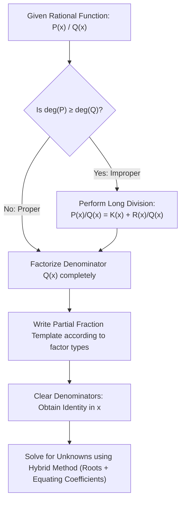

# :LiPuzzle: Subtopic: Polynomials & Partial Fractions Guide

> [!ABSTRACT] Core Focus (NIE Teacher's Guide — Grade 12, Unit 02)
> Comprehensive mathematical derivations, extended remainder theorem with quadratic divisors, factorization of degree 3 and 4 polynomials using the factor theorem, algebraic equating of coefficients, and complete worked examples of proper and improper partial fractions.

> [!NOTE] Parent Lesson
> [[../Lesson 02 - Polynomials, Remainder Theorem & Partial Fractions|Lesson 02 — Polynomials, Remainder Theorem & Partial Fractions]]

---

## 1. Extended Remainder Theorem & Proofs

### 1.1 Theorem for Quadratic Divisors
**Theorem**: When a polynomial $P(x)$ is divided by $(x - a)(x - b)$ where $a \ne b$, the remainder is:
$$R(x) = \left(\frac{P(a) - P(b)}{a - b}\right) x + \left(\frac{a P(b) - b P(a)}{a - b}\right)$$

**Proof**:
Since the divisor $D(x) = (x - a)(x - b)$ is of degree 2, the remainder $R(x)$ has degree $\le 1$:
$$R(x) = Ax + B$$
By the division algorithm:
$$P(x) \equiv (x - a)(x - b) Q(x) + (Ax + B)$$

Substituting $x = a$:
$$P(a) = (0) Q(a) + (Aa + B) \implies Aa + B = P(a) \quad \text{--- (1)}$$

Substituting $x = b$:
$$P(b) = (0) Q(b) + (Ab + B) \implies Ab + B = P(b) \quad \text{--- (2)}$$

Subtracting equation (2) from equation (1):
$$A(a - b) = P(a) - P(b) \implies A = \frac{P(a) - P(b)}{a - b}$$

Substituting $A$ into equation (1):
$$B = P(a) - a A = P(a) - a \left(\frac{P(a) - P(b)}{a - b}\right) = \frac{a P(b) - b P(a)}{a - b}$$
Thus:
$$\boxed{R(x) = \left(\frac{P(a) - P(b)}{a - b}\right) x + \left(\frac{a P(b) - b P(a)}{a - b}\right)} \quad \blacksquare$$

---

### 1.2 Worked Problem: Extended Remainder Theorem
**Problem**: A polynomial $P(x)$ leaves a remainder of $3$ when divided by $(x - 1)$, and a remainder of $7$ when divided by $(x - 3)$. Find the remainder when $P(x)$ is divided by $(x - 1)(x - 3)$.

**Solution**:
1. By the Remainder Theorem:
   $$P(1) = 3 \quad \text{and} \quad P(3) = 7$$
2. Let the remainder upon division by $(x - 1)(x - 3)$ be $R(x) = Ax + B$:
   $$P(x) \equiv (x - 1)(x - 3) Q(x) + (Ax + B)$$
3. Substitute $x = 1$:
   $$P(1) = A(1) + B \implies A + B = 3 \quad \text{--- (1)}$$
4. Substitute $x = 3$:
   $$P(3) = A(3) + B \implies 3A + B = 7 \quad \text{--- (2)}$$
5. Subtract (1) from (2):
   $$2A = 4 \implies A = 2$$
6. Substitute $A = 2$ into (1):
   $$2 + B = 3 \implies B = 1$$
7. Therefore, the remainder is:
   $$\boxed{R(x) = 2x + 1}$$

---

## 2. Factorizing Higher-Degree Polynomials

To solve cubic and quartic polynomial equations $P(x) = 0$:
1. **Rational Root Theorem**: Potential rational roots $\frac{p}{q}$ must have $p$ dividing the constant term $a_0$ and $q$ dividing the leading coefficient $a_n$.
2. Test potential roots $x = \pm 1, \pm 2, \pm 3, \dots$ using the factor theorem until $P(\alpha) = 0$.
3. Divide $P(x)$ by $(x - \alpha)$ to find the reduced quotient polynomial.
4. Factorize the quotient (quadratic formula or repeated factor theorem).

### 2.1 Worked Example: Cubic Factorization
**Problem**: Factorize $P(x) = 2x^3 - 3x^2 - 11x + 6$ completely.

**Solution**:
1. Factors of constant term $6$: $\pm 1, \pm 2, \pm 3, \pm 6$.
   * Test $x = 1$: $P(1) = 2(1) - 3(1) - 11(1) + 6 = -6 \ne 0$.
   * Test $x = -1$: $P(-1) = 2(-1) - 3(1) + 11 + 6 = 12 \ne 0$.
   * Test $x = -2$: $P(-2) = 2(-8) - 3(4) - 11(-2) + 6 = -16 - 12 + 22 + 6 = 0$!
2. By the Factor Theorem, $(x + 2)$ is a factor of $P(x)$.
3. Perform polynomial division of $P(x)$ by $(x + 2)$:
   $$2x^3 - 3x^2 - 11x + 6 = (x + 2)(2x^2 - 7x + 3)$$
4. Factorize the quadratic quotient $2x^2 - 7x + 3$:
   $$2x^2 - 6x - x + 3 = 2x(x - 3) - 1(x - 3) = (2x - 1)(x - 3)$$
5. Final complete factorization:
   $$\boxed{P(x) = (x + 2)(2x - 1)(x - 3)}$$

---

## 3. Advanced Partial Fraction Decompositions

### 3.1 Case 1: Repeated Linear Factor
**Problem**: Resolve $f(x) = \frac{3x + 1}{(x - 1)^2(x + 2)}$ into partial fractions.

**Solution**:
1. Form of decomposition:
   $$\frac{3x + 1}{(x - 1)^2(x + 2)} \equiv \frac{A}{x - 1} + \frac{B}{(x - 1)^2} + \frac{C}{x + 2}$$
2. Clear denominators by multiplying by $(x - 1)^2(x + 2)$:
   $$3x + 1 \equiv A(x - 1)(x + 2) + B(x + 2) + C(x - 1)^2$$
3. **Strategic substitution**:
   * Set $x = 1$:
     $$3(1) + 1 = A(0) + B(1 + 2) + C(0) \implies 4 = 3B \implies B = \frac{4}{3}$$
   * Set $x = -2$:
     $$3(-2) + 1 = A(0) + B(0) + C(-2 - 1)^2 \implies -5 = 9C \implies C = -\frac{5}{9}$$
4. **Equating coefficients of $x^2$**:
   * LHS has $0 \cdot x^2$.
   * RHS: $A x^2 + C x^2 = (A + C) x^2$.
   $$A + C = 0 \implies A = -C = \frac{5}{9}$$
5. Final partial fraction form:
   $$\boxed{\frac{3x + 1}{(x - 1)^2(x + 2)} = \frac{5}{9(x - 1)} + \frac{4}{3(x - 1)^2} - \frac{5}{9(x + 2)}}$$

---

### 3.2 Case 2: Irreducible Quadratic Factor
**Problem**: Resolve $\frac{x^2 + 2}{(x - 1)(x^2 + 1)}$ into partial fractions.

**Solution**:
1. Decomposition form:
   $$\frac{x^2 + 2}{(x - 1)(x^2 + 1)} \equiv \frac{A}{x - 1} + \frac{Bx + C}{x^2 + 1}$$
2. Multiply through by $(x - 1)(x^2 + 1)$:
   $$x^2 + 2 \equiv A(x^2 + 1) + (Bx + C)(x - 1)$$
3. **Substitute $x = 1$**:
   $$(1)^2 + 2 = A(1 + 1) + 0 \implies 3 = 2A \implies A = \frac{3}{2}$$
4. **Equate coefficients of $x^2$**:
   $$1 = A + B \implies B = 1 - A = 1 - \frac{3}{2} = -\frac{1}{2}$$
5. **Substitute $x = 0$ (constant term)**:
   $$2 = A(1) + C(-1) \implies 2 = A - C \implies C = A - 2 = \frac{3}{2} - 2 = -\frac{1}{2}$$
6. Final result:
   $$\boxed{\frac{x^2 + 2}{(x - 1)(x^2 + 1)} = \frac{3}{2(x - 1)} - \frac{x + 1}{2(x^2 + 1)}}$$

---

### 3.3 Case 3: Improper Rational Function
**Problem**: Resolve $\frac{x^3 + 2x^2 - 1}{x^2 - 1}$ into partial fractions.

**Solution**:
1. Check degrees: $\deg(\text{Numerator}) = 3 \ge \deg(\text{Denominator}) = 2$. This is **improper**!
2. Perform polynomial division of $(x^3 + 2x^2 - 1)$ by $(x^2 - 1)$:
   $$x^3 + 2x^2 - 1 = (x + 2)(x^2 - 1) + (x + 1)$$
   Check: $(x+2)(x^2-1) + x + 1 = x^3 - x + 2x^2 - 2 + x + 1 = x^3 + 2x^2 - 1$ ✓.
3. Therefore:
   $$\frac{x^3 + 2x^2 - 1}{x^2 - 1} = (x + 2) + \frac{x + 1}{x^2 - 1}$$
4. Simplify the remaining fraction:
   $$\frac{x + 1}{x^2 - 1} = \frac{x + 1}{(x - 1)(x + 1)} = \frac{1}{x - 1} \quad (x \ne -1)$$
5. Final form:
   $$\boxed{\frac{x^3 + 2x^2 - 1}{x^2 - 1} = x + 2 + \frac{1}{x - 1}}$$

---

## 4. Problem-Solving Strategy Guide

---

## :LiRocket: Flashcards (Spaced Repetition)

#flashcards

State the Extended Remainder Theorem for a polynomial $P(x)$ divided by $(x - a)(x - b)$ ($a \ne b$). :: The remainder is linear $R(x) = Ax + B$, where $Aa + B = P(a)$ and $Ab + B = P(b)$.

How do you find the remainder when $P(x)$ is divided by $(x - 1)(x - 2)$ if $P(1) = 4$ and $P(2) = 7$? :: Set $R(x) = Ax + B$. Then $A(1) + B = 4$ and $A(2) + B = 7$. Subtracting gives $A = 3$, then $B = 1$. The remainder is $R(x) = 3x + 1$.

What is the first step when decomposing an improper rational function $\frac{P(x)}{Q(x)}$ where $\deg(P) \ge \deg(Q)$? :: Perform polynomial long division to write $\frac{P(x)}{Q(x)} = K(x) + \frac{R(x)}{Q(x)}$ where $\deg(R) < \deg(Q)$.

What is the template for resolving $\frac{P(x)}{(x - a)^2(x - b)}$ into partial fractions? :: $\frac{A}{x - a} + \frac{B}{(x - a)^2} + \frac{C}{x - b}$.

What is the template for resolving $\frac{P(x)}{(x - a)(x^2 + c)}$ (where $c > 0$) into partial fractions? :: $\frac{A}{x - a} + \frac{Bx + C}{x^2 + c}$.

How does Heaviside's cover-up rule find $A$ in $\frac{2x + 1}{(x - 2)(x + 3)} = \frac{A}{x - 2} + \frac{B}{x + 3}$? :: Cover $(x - 2)$ and substitute $x = 2$: $A = \frac{2(2) + 1}{2 + 3} = \frac{5}{5} = 1$.

How does Heaviside's cover-up rule find $B$ in $\frac{2x + 1}{(x - 2)(x + 3)} = \frac{A}{x - 2} + \frac{B}{x + 3}$? :: Cover $(x + 3)$ and substitute $x = -3$: $B = \frac{2(-3) + 1}{-3 - 2} = \frac{-5}{-5} = 1$.

Explain why a factor $(x - a)^2$ cannot simply be decomposed as $\frac{A}{(x - a)^2}$ alone. :: Because a general proper fraction with denominator $(x - a)^2$ has a linear numerator $Ax + B$, which decomposes into $\frac{A'}{x - a} + \frac{B'}{(x - a)^2}$.

How can the Factor Theorem be used to factorize a cubic polynomial $P(x) = ax^3 + bx^2 + cx + d$? :: Test integer factors of $d$ to find a root $x = \alpha$ such that $P(\alpha) = 0$. Then $(x - \alpha)$ is a factor; divide $P(x)$ by $(x - \alpha)$ to find the remaining quadratic quotient.

What is the remainder when $x^{100} - 1$ is divided by $(x - 1)$? :: $R = P(1) = 1^{100} - 1 = 0$ (so $(x - 1)$ divides $x^{100} - 1$ exactly).

What is the remainder when $x^{101} + 1$ is divided by $(x + 1)$? :: $R = P(-1) = (-1)^{101} + 1 = -1 + 1 = 0$ (so $(x + 1)$ divides $x^{101} + 1$ exactly).

What are the degrees of the quotient $Q(x)$ and remainder $R(x)$ when a degree 4 polynomial is divided by a degree 2 polynomial? :: Quotient has degree $4 - 2 = 2$ (quadratic); remainder has degree at most $2 - 1 = 1$ (linear).
