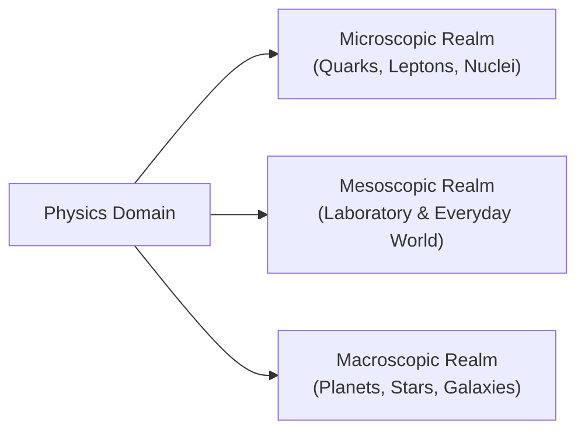
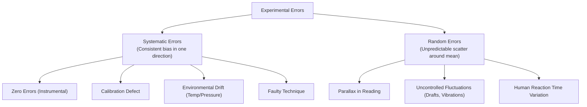
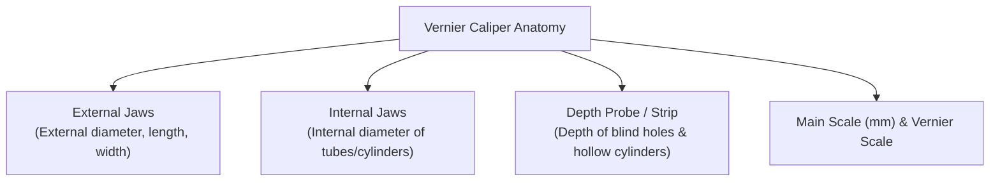
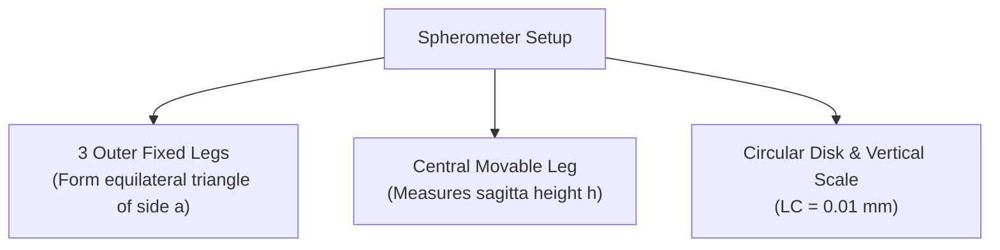
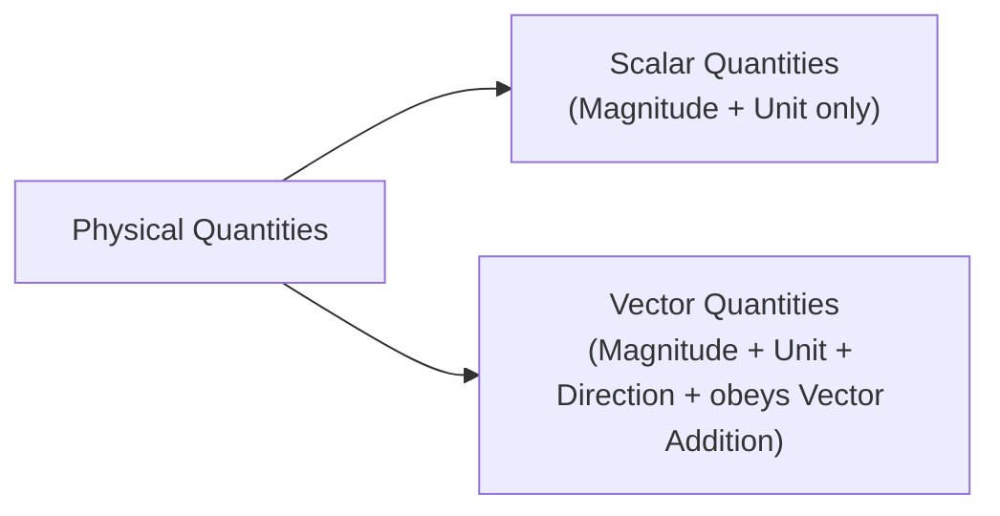
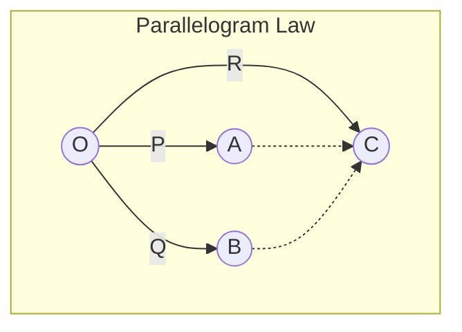

# :LiBook: Lesson 01: Measurements & Units

> [!ABSTRACT] Syllabus Scope (NIE Teacher's Guide)
> - **1.1 Scope of Physics & Scientific Methodology**: Definition, realm of physics, scientific method, and modern applications.
> - **1.2 Physical Quantities & SI Units**: Base, derived, and supplementary units, SI prefixes, writing conventions, and ranges of magnitude.
> - **1.3 Dimensions & Dimensional Analysis**: Base dimensions, checking dimensional homogeneity, deriving equations, and limitations.
> - **1.4 Errors & Uncertainty Analysis**: Systematic vs. random errors, least count, absolute/fractional/percentage errors, and error propagation rules.
> - **1.5 Core Laboratory Measuring Instruments**: Metre ruler, Vernier caliper, Micrometer screw gauge, Spherometer, Travelling microscope, and balances (least count, zero errors, zero corrections, and practical procedures).
> - **1.6 Vector & Scalar Quantities**: Geometrical representation, triangle and parallelogram laws of vector addition, and perpendicular resolution.

---
## 1. Scope of Physics & Scientific Methodology

### What is Physics?
**Physics** is the fundamental branch of natural science that studies **matter**, **energy**, their mutual interactions, and the laws governing the physical universe. It investigates phenomena spanning extreme physical scales:
- **Spatial scale**: From fundamental subatomic particles ($10^{-18}\text{ m}$) to the observable universe ($10^{26}\text{ m}$).
- **Temporal scale**: From the lifespan of unstable particles ($10^{-24}\text{ s}$) to the age of the universe ($\approx 1.38 \times 10^{10}\text{ years} \approx 4.3 \times 10^{17}\text{ s}$).
- **Mass scale**: From an electron ($9.11 \times 10^{-31}\text{ kg}$) to the observable universe ($\approx 10^{53}\text{ kg}$).

### The Scientific Method
Physics progresses through systematic, repeatable investigation known as the **Scientific Method**:
1. **Observation**: Identifying a physical phenomenon accurately using human senses or sensory instruments.
2. **Formulating a Hypothesis**: Constructing a testable, logical, and falsifiable tentative explanation.
3. **Experimentation & Controlled Testing**: Designing controlled laboratory setups to test predictions where independent variables are changed while control variables remain constant.
4. **Data Collection & Quantitative Measurement**: Obtaining numerical data with known measurement uncertainties.
5. **Analysis & Mathematical Modeling**: Applying mathematical relations, graphing, and dimensional verification.
6. **Inference & Law / Theory Formulation**: Formulating empirical laws (describing *what* happens) and theories (explaining *why* it happens).

### Real-World Applications of Physics:
- **Transportation**: Aerodynamics, high-speed rail levitation (maglev), internal combustion and electric powertrains.
- **Telecommunication**: Electromagnetic wave propagation, optical fiber transmission, satellite communications.
- **Energy Technologies**: Photovoltaics, nuclear fission/fusion, hydroelectric turbines, battery storage.
- **Biomedical Sciences**: X-ray radiography, Computed Tomography (CT), Magnetic Resonance Imaging (MRI), ultrasound imaging, radiation therapy.
- **Earth & Space Exploration**: Seismology, satellite remote sensing, space propulsion, astrophysics.

---
## 2. Physical Quantities, SI Units & Prefixes

A **Physical Quantity** is any property of a phenomenon, body, or substance that can be quantified by measurement:
$$\text{Physical Quantity } (Q) = \text{Numerical Value } (n) \times \text{Unit } (u)$$

### Classification of Physical Quantities:
1. **Fundamental (Base) Quantities**: Quantities that cannot be defined in terms of other physical quantities.
2. **Derived Quantities**: Quantities expressed algebraically in terms of fundamental quantities through physical relationships.
3. **Supplementary Quantities**: Pure geometric angles (plane angle and solid angle).

### The 7 Base SI Units & 2 Supplementary Units:
The International System of Units (*Système International d'Unités* - SI) defines 7 fundamental quantities:

| Quantity | Base Unit | Symbol | Base Dimension | Formal Definition / Standard Reference |
| :--- | :--- | :---: | :---: | :--- |
| **Length** | metre | $\text{m}$ | $\mathsf{L}$ | Distance traveled by light in vacuum in $1 / 299,792,458\text{ s}$. |
| **Mass** | kilogram | $\text{kg}$ | $\mathsf{M}$ | Defined by fixing the numerical value of Planck's constant $h = 6.62607015 \times 10^{-34}\text{ J}\cdot\text{s}$. |
| **Time** | second | $\text{s}$ | $\mathsf{T}$ | Duration of $9,192,631,770$ periods of radiation of Caesium-133 ground state hyperfine transition. |
| **Electric Current** | ampere | $\text{A}$ | $\mathsf{I}$ | Defined by fixing the elementary charge $e = 1.602176634 \times 10^{-19}\text{ C}$. |
| **Thermodynamic Temperature** | kelvin | $\text{K}$ | $\Theta$ | Defined by fixing the Boltzmann constant $k = 1.380649 \times 10^{-23}\text{ J}\cdot\text{K}^{-1}$. |
| **Amount of Substance** | mole | $\text{mol}$ | $\mathsf{N}$ | Exactly $6.02214076 \times 10^{23}$ elementary entities (Avogadro constant $N_A$). |
| **Luminous Intensity** | candela | $\text{cd}$ | $\mathsf{J}$ | Luminous intensity in a given direction of a monochromatic source of $540 \times 10^{12}\text{ Hz}$ with radiant intensity $1/683\text{ W}\cdot\text{sr}^{-1}$. |
| **Plane Angle** *(Supplementary)* | radian | $\text{rad}$ | Dimensionless | Ratio of subtended arc length to radius: $\theta = \frac{s}{r}$. ($2\pi\text{ rad} = 360^\circ$). |
| **Solid Angle** *(Supplementary)* | steradian | $\text{sr}$ | Dimensionless | Ratio of subtended spherical surface area to $r^2$: $\Omega = \frac{A}{r^2}$. (Full sphere $= 4\pi\text{ sr}$). |

---

### Core Derived Quantities with Special SI Names:
Derived quantities are built from base units. The table below lists all derived units required by the NIE syllabus:

| Derived Quantity | Special Name | Symbol | Equivalent Base SI Units | Defining Relationship |
| :--- | :--- | :---: | :---: | :--- |
| **Frequency** | hertz | $\text{Hz}$ | $\text{s}^{-1}$ | $f = 1/T$ |
| **Force** | newton | $\text{N}$ | $\text{kg}\cdot\text{m}\cdot\text{s}^{-2}$ | $F = ma$ |
| **Pressure / Stress** | pascal | $\text{Pa}$ | $\text{kg}\cdot\text{m}^{-1}\cdot\text{s}^{-2}$ | $P = F/A = \text{N}\cdot\text{m}^{-2}$ |
| **Work / Energy / Heat** | joule | $\text{J}$ | $\text{kg}\cdot\text{m}^2\cdot\text{s}^{-2}$ | $W = F \cdot s = \text{N}\cdot\text{m}$ |
| **Power** | watt | $\text{W}$ | $\text{kg}\cdot\text{m}^2\cdot\text{s}^{-3}$ | $P = W/t = \text{J}\cdot\text{s}^{-1}$ |
| **Electric Charge** | coulomb | $\text{C}$ | $\text{A}\cdot\text{s}$ | $Q = I \cdot t$ |
| **Electric Potential / EMF** | volt | $\text{V}$ | $\text{kg}\cdot\text{m}^2\cdot\text{s}^{-3}\cdot\text{A}^{-1}$ | $V = W/Q = \text{J}\cdot\text{C}^{-1}$ |
| **Capacitance** | farad | $\text{F}$ | $\text{kg}^{-1}\cdot\text{m}^{-2}\cdot\text{s}^4\cdot\text{A}^2$ | $C = Q/V = \text{C}\cdot\text{V}^{-1}$ |
| **Electrical Resistance** | ohm | $\Omega$ | $\text{kg}\cdot\text{m}^2\cdot\text{s}^{-3}\cdot\text{A}^{-2}$ | $R = V/I = \text{V}\cdot\text{A}^{-1}$ |
| **Electrical Conductance** | siemens | $\text{S}$ | $\text{kg}^{-1}\cdot\text{m}^{-2}\cdot\text{s}^3\cdot\text{A}^2$ | $G = 1/R = \Omega^{-1}$ |
| **Magnetic Flux** | weber | $\text{Wb}$ | $\text{kg}\cdot\text{m}^2\cdot\text{s}^{-2}\cdot\text{A}^{-1}$ | $\Phi = B \cdot A = \text{V}\cdot\text{s}$ |
| **Magnetic Flux Density** | tesla | $\text{T}$ | $\text{kg}\cdot\text{s}^{-2}\cdot\text{A}^{-1}$ | $B = F / (I \cdot L) = \text{Wb}\cdot\text{m}^{-2}$ |
| **Inductance** | henry | $\text{H}$ | $\text{kg}\cdot\text{m}^2\cdot\text{s}^{-2}\cdot\text{A}^{-2}$ | $L = \Phi / I = \text{V}\cdot\text{s}\cdot\text{A}^{-1}$ |

---

### Special Categories of Physical Quantities:
1. **Quantities with Units but NO Dimensions**:
   - Plane Angle ($\text{rad}$)
   - Solid Angle ($\text{sr}$)
2. **Quantities with NEITHER Units NOR Dimensions (Dimensionless Ratios)**:
   - Relative Density ($\rho_{\text{substance}} / \rho_{\text{water}}$)
   - Refractive Index ($n = c / v$)
   - Strain ($\Delta L / L$)
   - Coefficient of Friction ($\mu = F / R$)
   - Poisson's Ratio ($\nu = \text{lateral strain} / \text{longitudinal strain}$)

---

### Multiples, Submultiples & SI Prefixes:

| Prefix | Symbol | Factor | Prefix | Symbol | Factor |
| :--- | :---: | :---: | :--- | :---: | :---: |
| **deca-** | $\text{da}$ | $10^{1}$ | **deci-** | $\text{d}$ | $10^{-1}$ |
| **hecto-** | $\text{h}$ | $10^{2}$ | **centi-** | $\text{c}$ | $10^{-2}$ |
| **kilo-** | $\text{k}$ | $10^{3}$ | **milli-** | $\text{m}$ | $10^{-3}$ |
| **mega-** | $\text{M}$ | $10^{6}$ | **micro-** | $\mu$ | $10^{-6}$ |
| **giga-** | $\text{G}$ | $10^{9}$ | **nano-** | $\text{n}$ | $10^{-9}$ |
| **tera-** | $\text{T}$ | $10^{12}$ | **pico-** | $\text{p}$ | $10^{-12}$ |
| **peta-** | $\text{P}$ | $10^{15}$ | **femto-** | $\text{f}$ | $10^{-15}$ |
| **exa-** | $\text{E}$ | $10^{18}$ | **atto-** | $\text{a}$ | $10^{-18}$ |

> [!WARNING] Mandatory Rules for Writing SI Units (NIE Examination Standards)
> 1. **No space between prefix and unit**: Write $\text{mm}$ or $\mu\text{m}$, never $\text{m m}$ or $\mu\ \text{m}$.
> 2. **Single space between multiplied units**: Write $\text{N}\;\text{m}$ (newton-metre), not $\text{Nm}$ (which could be confused with nanometre).
> 3. **Index notation for division**: Always write $\text{m}\;\text{s}^{-1}$ or $\text{kg}\;\text{m}^{-3}$. Never write compound slashes like $\text{m/s/s}$ or $\text{J/kg/K}$.
> 4. **No plural forms on symbols**: Write $50\text{ kg}$, $10\text{ s}$, $5\text{ m}$. Writing $50\text{ kgs}$ or $10\text{ sec}$ is penalised in GCE A/L.
> 5. **Capitalization**:
>    - Unit names written in full always start with a lowercase letter (e.g., newton, joule, kelvin, watt), even when named after a scientist. (Exception: Celsius).
>    - Unit symbols derived from proper names are capitalized (e.g., $\text{N}, \text{J}, \text{K}, \text{W}, \text{Pa}, \text{A}, \text{Hz}$). Symbols not derived from proper names are lowercase (e.g., $\text{m}, \text{s}, \text{kg}, \text{cd}, \text{mol}$).
> 6. **No combined prefixes**: Never use double prefixes like $\mu\mu\text{F}$ (write $\text{pF}$) or $\text{mkg}$ (write $\text{g}$).

---
## 3. Dimensional Analysis & Homogeneity

### Base Dimensions:
Every physical quantity can be expressed as a product of powers of the fundamental dimensions:
$$[Q] = \mathsf{M}^a \mathsf{L}^b \mathsf{T}^c \mathsf{I}^d \Theta^e \mathsf{N}^f$$

### Dimensions of Common Physical Quantities:
- Velocity: $[v] = \frac{[s]}{[t]} = \mathsf{L}\mathsf{T}^{-1}$
- Acceleration: $[a] = \frac{[v]}{[t]} = \mathsf{L}\mathsf{T}^{-2}$
- Force: $[F] = [m][a] = \mathsf{M}\mathsf{L}\mathsf{T}^{-2}$
- Momentum & Impulse: $[p] = [J] = [F][t] = \mathsf{M}\mathsf{L}\mathsf{T}^{-1}$
- Work & Energy: $[W] = [F][s] = \mathsf{M}\mathsf{L}^2\mathsf{T}^{-2}$
- Power: $[P] = \frac{[W]}{[t]} = \mathsf{M}\mathsf{L}^2\mathsf{T}^{-3}$
- Pressure & Stress: $[P] = \frac{[F]}{[A]} = \frac{\mathsf{M}\mathsf{L}\mathsf{T}^{-2}}{\mathsf{L}^2} = \mathsf{M}\mathsf{L}^{-1}\mathsf{T}^{-2}$
- Surface Tension: $[\gamma] = \frac{[F]}{[L]} = \frac{\mathsf{M}\mathsf{L}\mathsf{T}^{-2}}{\mathsf{L}} = \mathsf{M}\mathsf{T}^{-2}$
- Dynamic Viscosity ($\eta$): From Stokes' Law $F = 6\pi\eta r v \implies [\eta] = \frac{[F]}{[r][v]} = \frac{\mathsf{M}\mathsf{L}\mathsf{T}^{-2}}{\mathsf{L} \cdot \mathsf{L}\mathsf{T}^{-1}} = \mathsf{M}\mathsf{L}^{-1}\mathsf{T}^{-1}$
- Universal Gravitational Constant ($G$): From $F = G \frac{m_1 m_2}{r^2} \implies [G] = \frac{[F][r^2]}{[m]^2} = \frac{\mathsf{M}\mathsf{L}\mathsf{T}^{-2} \cdot \mathsf{L}^2}{\mathsf{M}^2} = \mathsf{M}^{-1}\mathsf{L}^3\mathsf{T}^{-2}$
- Planck's Constant ($h$): From $E = hf \implies [h] = \frac{[E]}{[f]} = \frac{\mathsf{M}\mathsf{L}^2\mathsf{T}^{-2}}{\mathsf{T}^{-1}} = \mathsf{M}\mathsf{L}^2\mathsf{T}^{-1}$

---

### The Principle of Dimensional Homogeneity:
> [!KEY-CONCEPT] Principle of Dimensional Homogeneity
> In any physically valid equation:
> $$Y = A + B - C$$
> All additive or subtractive terms and both sides of the equation must have **identical dimensions**:
> $$[Y] = [A] = [B] = [C]$$
> Furthermore, arguments of transcendental functions (trigonometric $\sin(\theta)$, exponential $e^x$, logarithmic $\ln(x)$) must be completely **dimensionless**.

---

### Three Core Applications of Dimensional Analysis:

#### 1. Checking the Correctness of Physical Equations:
Test whether $s = ut + \frac{1}{2}at^2$ is dimensionally homogeneous:
- $[s] = \mathsf{L}$
- $[ut] = (\mathsf{L}\mathsf{T}^{-1})(\mathsf{T}) = \mathsf{L}$
- $[\frac{1}{2}at^2] = (1)(\mathsf{L}\mathsf{T}^{-2})(\mathsf{T}^2) = \mathsf{L}$
Since $[s] = [ut] = [\frac{1}{2}at^2] = \mathsf{L}$, the equation is dimensionally consistent.

> [!NOTE] Dimensional Validity vs. Physical Correctness
> A dimensionally correct equation is **not necessarily physically correct** because dimensional analysis cannot verify dimensionless coefficients (e.g., $s = ut + 5at^2$ is dimensionally homogeneous but physically wrong). However, any equation that is dimensionally invalid is **guaranteed to be physically wrong**.

#### 2. Deriving Physical Relationships (Method of Dimensions):
**Example: Periodic time $T$ of a simple pendulum.**
Assume $T$ depends on bob mass $m$, string length $l$, and acceleration due to gravity $g$:
$$T = k \cdot m^x l^y g^z \quad (k \text{ is a dimensionless constant})$$
Equating dimensions on both sides:
$$[\mathsf{T}] = [\mathsf{M}]^x [\mathsf{L}]^y [\mathsf{L}\mathsf{T}^{-2}]^z = \mathsf{M}^x \mathsf{L}^{y+z} \mathsf{T}^{-2z}$$
Comparing indices of fundamental dimensions:
- For $\mathsf{M}$: $x = 0$ (Time period does not depend on bob mass!)
- For $\mathsf{T}$: $-2z = 1 \implies z = -\frac{1}{2}$
- For $\mathsf{L}$: $y + z = 0 \implies y = -z = \frac{1}{2}$

Substituting powers back into the expression:
$$T = k \cdot m^0 l^{1/2} g^{-1/2} = k \sqrt{\frac{l}{g}}$$
*(Experimental calibration determines $k = 2\pi$, giving $T = 2\pi\sqrt{\frac{l}{g}}$).*

**Example: Speed of transverse waves along a stretched string ($v$):**
Assume $v$ depends on tension $T$ (force, $[\mathsf{MLT}^{-2}]$) and linear mass density $\mu$ (mass per unit length, $[\mathsf{ML}^{-1}]$):
$$v = k \cdot T^x \mu^y$$
$$[\mathsf{LT}^{-1}] = (\mathsf{MLT}^{-2})^x (\mathsf{ML}^{-1})^y = \mathsf{M}^{x+y} \mathsf{L}^{x-y} \mathsf{T}^{-2x}$$
- For $\mathsf{M}$: $x + y = 0 \implies y = -x$
- For $\mathsf{T}$: $-2x = -1 \implies x = \frac{1}{2}$
- Therefore $y = -\frac{1}{2}$
$$v = k \sqrt{\frac{T}{\mu}} \quad (\text{where } k = 1 \implies v = \sqrt{\frac{T}{\mu}})$$

#### 3. Determining the Units and Dimensions of Unknown Constants:
In Van der Waals equation of state for real gases:
$$\left(P + \frac{a}{V^2}\right)(V - b) = RT$$
- By homogeneity, $\left[\frac{a}{V^2}\right] = [P] = \mathsf{M}\mathsf{L}^{-1}\mathsf{T}^{-2}$.
  Since $[V^2] = (\mathsf{L}^3)^2 = \mathsf{L}^6$:
  $$[a] = [P][V^2] = (\mathsf{M}\mathsf{L}^{-1}\mathsf{T}^{-2})(\mathsf{L}^6) = \mathsf{M}\mathsf{L}^5\mathsf{T}^{-2} \implies \text{SI Unit: } \text{kg}\;\text{m}^5\;\text{s}^{-2} \text{ or } \text{N}\;\text{m}^4$$
- Likewise, $[b] = [V] = \mathsf{L}^3 \implies \text{SI Unit: } \text{m}^3$.

---

### Limitations of Dimensional Analysis:
1. **Dimensionless constants**: Cannot evaluate numerical constants (e.g., $1/2, 2\pi, \sqrt{2}$).
2. **Transcendental functions**: Cannot handle relations containing $\sin(\omega t)$, $e^{-\lambda t}$, or $\ln(V_2/V_1)$.
3. **Number of variables**: In mechanics with 3 base dimensions ($\mathsf{M}, \mathsf{L}, \mathsf{T}$), if a physical quantity depends on more than 3 independent quantities, unique indices cannot be determined algebraically.
4. **Scalar vs. Vector nature**: Cannot distinguish between scalar and vector quantities sharing identical dimensions (e.g., Work and Torque both have $[\mathsf{M}\mathsf{L}^2\mathsf{T}^{-2}]$, but work is scalar while torque is vector).

---
## 4. Errors & Uncertainty Analysis

Every experimental measurement contains an element of uncertainty. Understanding and quantifying errors is fundamental to experimental physics.

### Systematic Errors vs. Random Errors:

| Parameter | Systematic Error | Random Error |
| :--- | :--- | :--- |
| **Nature** | Biases results consistently in one direction (always too high or always too low). | Causes unpredictable, Gaussian scatter above and below the true value. |
| **Sources** | Zero errors, poorly calibrated scale, faulty technique, ambient expansion. | Air currents, human visual parallax, reaction time fluctuations, mechanical vibrations. |
| **Effect of Repetition** | **Cannot** be eliminated by repeated readings or averaging. | **Reduced significantly** by taking repeated independent readings and calculating the mean. |
| **Remedy** | Calibrate instruments, apply zero error mathematical correction, refine experimental technique. | Repeat measurements multiple times under identical conditions; use $\bar{x} = \frac{1}{N}\sum x_i$. |

---

### Mathematical Quantification of Uncertainties:
For a measured value $x$ with absolute uncertainty $\Delta x$ (recorded as $x \pm \Delta x$):
1. **Absolute Uncertainty**: $\Delta x$ (has the same units as the quantity $x$).
2. **Fractional Uncertainty (Relative Uncertainty)**:
   $$\text{Fractional Uncertainty} = \frac{\Delta x}{x}$$
3. **Percentage Uncertainty**:
   $$\text{Percentage Uncertainty} = \left(\frac{\Delta x}{x}\right) \times 100\%$$

---

### Error Propagation Rules (Maximum Uncertainty in A/L Physics):

> [!IMPORTANT] Maximum Uncertainty Propagation Formulas
> In Sri Lankan GCE A/L practicals, uncertainties are always combined to find the **maximum possible uncertainty**:
>
> 1. **Addition & Subtraction** ($Z = A + B$ or $Z = A - B$):
>    $$\Delta Z = \Delta A + \Delta B$$
>    *Absolute uncertainties are always added.*
>
> 2. **Multiplication & Division** ($Z = A \cdot B$ or $Z = \frac{A}{B}$):
>    $$\frac{\Delta Z}{Z} = \frac{\Delta A}{A} + \frac{\Delta B}{B}$$
>    *Fractional uncertainties are added.*
>
> 3. **Powers & General Exponent Formula** ($Z = \frac{A^p B^q}{C^r}$):
>    $$\frac{\Delta Z}{Z} = p\left(\frac{\Delta A}{A}\right) + q\left(\frac{\Delta B}{B}\right) + r\left(\frac{\Delta C}{C}\right)$$
>    $$\text{Percentage Error in } Z = p \left(\% \Delta A\right) + q \left(\% \Delta B\right) + r \left(\% \Delta C\right)$$

---

### Strategies to Minimize Experimental Percentage Uncertainty:
To minimize $\frac{\Delta x}{x} \times 100\%$:
1. **Increase measured magnitude ($x$)**:
   - Instead of measuring the thickness of a single sheet of paper, measure a stack of 100 sheets using a micrometer screw gauge and divide by 100.
   - Instead of timing 1 oscillation of a pendulum, time 20 or 50 complete oscillations using a digital stopwatch and divide by $N$.
2. **Choose instruments with smaller least count ($\Delta x$)**:
   - Use a micrometer screw gauge ($\text{LC} = 0.01\text{ mm}$) instead of a Vernier caliper ($\text{LC} = 0.1\text{ mm}$) for measuring wire diameter.
3. **Avoid parallax**:
   - Position line of sight strictly perpendicular to the scale and use mirror-backed scales.
4. **Measure across different orientations**:
   - Measure diameter of a cylinder/wire at multiple points along its length and in mutually perpendicular directions to account for non-uniform circular cross-section.

---
## 5. Core Laboratory Measuring Instruments

> [!INFO] Deep Dive Note
> Detailed laboratory practical steps, zero-error proofs, and worked exam calculations are indexed in [[Subtopics/Errors & Measuring Instruments|Errors & Measuring Instruments Guide]].

### Instrument Comparison Summary:

| Instrument | Least Count (LC) | Standard Measuring Range | Typical Usage in A/L Laboratory |
| :--- | :---: | :---: | :--- |
| **Metre Ruler** | $1\text{ mm}$ ($0.1\text{ cm}$) | $1\text{ mm} - 1\text{ m}$ | Lengths $> 10\text{ cm}$ (pendulum string, sonometer wire) |
| **Vernier Caliper** | $0.1\text{ mm}$ or $0.05\text{ mm}$ | $0.1\text{ mm} - 15\text{ cm}$ | External/internal diameter & depth of hollow cylinders |
| **Micrometer Screw Gauge** | $0.01\text{ mm}$ ($10\ \mu\text{m}$) | $0.01\text{ mm} - 25\text{ mm}$ | Wire diameter, glass plate thickness, small sphere diameter |
| **Spherometer** | $0.01\text{ mm}$ | $0.01\text{ mm} - 10\text{ mm}$ | Radius of curvature of spherical surfaces, microscope cover-slip thickness |
| **Travelling Microscope** | $0.01\text{ mm}$ | $0.01\text{ mm} - 15\text{ cm}$ | Capillary tube bore, rubber tubing diameter, Newton's rings |
| **Triple / Four Beam Balance** | $0.1\text{ g} / 0.01\text{ g}$ | $0.01\text{ g} - 500\text{ g}$ | Accurate mass of solid and liquid specimens |
| **Digital Stopwatch** | $0.01\text{ s}$ | Seconds to hours | Oscillations of pendulum, resonance tube timing |

---

### 1. Vernier Caliper

#### Principle:
The Vernier system achieves high precision by comparing two slightly different scales: a **Main Scale** (divided in mm) and a sliding **Vernier Scale** containing $n$ divisions spanning the length of $(n-1)$ main scale divisions.

$$\text{Least Count (LC)} = 1\text{ MSD} - 1\text{ VSD}$$
Since $n\text{ VSD} = (n - 1)\text{ MSD} \implies 1\text{ VSD} = \frac{n-1}{n}\text{ MSD}$:
$$\text{LC} = 1\text{ MSD} - \frac{n-1}{n}\text{ MSD} = \frac{1\text{ MSD}}{n} = \frac{\text{Value of 1 Main Scale Division}}{\text{Total Number of Vernier Divisions}}$$

- If $1\text{ MSD} = 1\text{ mm}$ and $n = 10 \implies \text{LC} = \frac{1\text{ mm}}{10} = 0.1\text{ mm}$.
- If $1\text{ MSD} = 1\text{ mm}$ and $n = 20 \implies \text{LC} = \frac{1\text{ mm}}{20} = 0.05\text{ mm}$.
- If $1\text{ MSD} = 1\text{ mm}$ and $n = 50 \implies \text{LC} = \frac{1\text{ mm}}{50} = 0.02\text{ mm}$.

#### Reading Formula:
$$\text{Observed Reading} = \text{Main Scale Reading (MSR)} + (\text{Coinciding Vernier Division } k \times \text{LC})$$

#### Zero Error & Zero Correction:
When jaws are brought into contact without any specimen:
- **No Zero Error**: Zero mark of Vernier scale coincides exactly with zero mark of main scale.
- **Positive Zero Error ($+e$)**: Vernier zero lies to the **right** of the main scale zero mark.
  $$e = + (k \times \text{LC})$$
  *(The instrument reads a value greater than true value; therefore, $+e$ must be subtracted).*
- **Negative Zero Error ($-e$)**: Vernier zero lies to the **left** of the main scale zero mark.
  $$e = - (n - k) \times \text{LC} \quad (k = \text{coinciding division from 0 to } n)$$
  *(The instrument reads a value smaller than true value; therefore, the negative error is subtracted, effectively adding the magnitude).*

$$\text{Corrected Reading} = \text{Observed Reading} - (\pm \text{Zero Error})$$

---

### 2. Micrometer Screw Gauge

#### Principle:
Operates on the **Screw and Nut principle**: one complete rotation of the circular head advances or retracts the spindle axially by a fixed linear distance called the **Pitch**.

$$\text{Pitch} = \frac{\text{Distance moved on linear main scale}}{\text{Number of complete rotations of circular head}}$$
$$\text{Least Count (LC)} = \frac{\text{Pitch}}{\text{Total Number of Circular (Head) Scale Divisions (CSD)}}$$

For standard laboratory screw gauges:
- $\text{Pitch} = 0.5\text{ mm}$, $\text{CSD} = 50 \implies \text{LC} = \frac{0.5\text{ mm}}{50} = 0.01\text{ mm}$.
- Or $\text{Pitch} = 1.0\text{ mm}$, $\text{CSD} = 100 \implies \text{LC} = \frac{1.0\text{ mm}}{100} = 0.01\text{ mm}$.

#### Reading Formula:
$$\text{Observed Reading} = \text{Main (Linear) Scale Reading} + (\text{Coinciding Circular Division } p \times \text{LC})$$

#### Zero Errors in Screw Gauge:
When anvil and spindle are closed in contact using the ratchet:
- **Positive Zero Error**: The zero of the circular scale lies **below** the reference baseline of the sleeve.
  $$\text{Zero Error} = + (p \times \text{LC})$$
- **Negative Zero Error**: The zero of the circular scale lies **above** the reference baseline of the sleeve.
  $$\text{Zero Error} = - (N - p) \times \text{LC} \quad (N = \text{total divisions on circular scale})$$

#### Essential Practical Safeguards:
1. **Ratchet Function**: Always turn the screw using the **ratchet knob**, never the thimble directly, when gripping the object. When proper contact is made, the ratchet slips and makes a clicking sound, ensuring **uniform contact pressure** and preventing structural deformation of delicate specimens or damage to the screw threads.
2. **Backlash Error**: Due to mechanical wear and tear, loose play develops between screw threads and nut. If the thimble direction is reversed back and forth, the head rotates through a small angle without translating the spindle linearly.
   - *Remedy*: Always rotate the screw in the **same forward direction** when arriving at the measurement point.

---

### 3. Spherometer

#### Anatomy & Principle:
Consists of a triangular metal frame supported on **three pointed fixed legs** forming an equilateral triangle of side $a$. A central screw carrying a circular graduated disk moves vertically through the center of the frame.
- $\text{Least Count} = \frac{\text{Pitch of central screw}}{\text{Total circular divisions}} = \frac{1\text{ mm}}{100} = 0.01\text{ mm}$.

#### Derivation of Radius of Curvature ($R$):
Let the three outer legs form an equilateral triangle with side length $a$. The distance from each leg to the center of the equilateral triangle is $r$:
$$a = 2 r \sin(60^\circ) = 2 r \left(\frac{\sqrt{3}}{2}\right) = \sqrt{3}r \implies r = \frac{a}{\sqrt{3}} \implies r^2 = \frac{a^2}{3}$$

Let the central screw be raised or lowered by a vertical height (sagitta) $h$ on a spherical surface of radius $R$.
By the Intersecting Chords Theorem for a sphere of diameter $2R$:
$$h(2R - h) = r^2$$
$$2Rh - h^2 = \frac{a^2}{3}$$
$$2Rh = \frac{a^2}{3} + h^2$$
$$R = \frac{a^2}{6h} + \frac{h}{2}$$

#### Determining $h$ and Flat Surface Zero:
1. Place the spherometer on a flat optical glass plate. Turn the central screw until all 4 points make uniform contact (tested using a thin strip of paper under each leg — none should slip or the instrument should just begin to rock). Record reading $h_0$.
2. Place on the spherical curved surface (convex or concave) and turn until central leg touches. Record reading $h_1$.
3. Sagitta height: $h = |h_1 - h_0|$.
4. Press the three fixed legs firmly onto a sheet of paper to mark 3 prick dots, and measure the 3 sides $a_1, a_2, a_3$ with a metre ruler: $a = \frac{a_1 + a_2 + a_3}{3}$.

---

### 4. Travelling Microscope

#### Principle & Usage:
A compound microscope mounted on sturdy horizontal and vertical brass tracks, each fitted with a millimeter scale and a **Vernier scale** ($\text{LC} = 0.01\text{ mm}$).
- **Key advantage**: Non-destructive, contactless measurement of delicate, liquid, or internal geometries where physical contact would deform or alter the specimen.

#### A/L Practical Applications:
1. **Inner and outer diameter of a capillary tube or rubber tubing**:
   - Align vertical crosswire to the left inner boundary; record reading $x_1$.
   - Move microscope in the **same horizontal direction** (to avoid backlash error) to the right inner boundary; record reading $x_2$.
   - Internal diameter: $d = |x_2 - x_1|$.
2. **Surface Tension by capillary rise**: Measuring the height of the meniscus $h$ and bore diameter $d$.
3. **Newton's Rings**: Measuring ring diameters without contacting the optical surfaces.

---

### 5. Laboratory Balances
- **Triple Beam Balance**: Sensitivity $\approx 0.1\text{ g}$. Sliding weights on three notched beams ($100\text{ g}, 10\text{ g}, 1\text{ g}$ intervals). Zero adjustment knob aligns beam pointer with zero mark before weighing.
- **Four Beam Balance**: Sensitivity $\approx 0.01\text{ g}$.
- **Electronic Digital Balance**: Sensitivity down to $0.001\text{ g}$ ($1\text{ mg}$). Features automatic tare button to zero out container masses.

---
## 6. Scalar & Vector Quantities

Physical quantities are classified based on their directional properties:

### Definitions & Key Differences:
- **Scalar**: Completely specified by numerical magnitude and unit. Obeys ordinary scalar algebra ($1+1=2$).
  *Examples*: Mass, distance, speed, time, work, energy, power, temperature, electric charge, electric potential, density, pressure.
- **Vector**: Specified by magnitude, unit, **direction**, and must obey **vector addition laws**.
  *Examples*: Displacement, velocity, acceleration, force, weight, linear momentum, impulse, torque, electric field strength, magnetic flux density.

> [!NOTE] Current is a Scalar
> Electric current has both magnitude and a defined direction along a wire, but it is a **scalar quantity** because currents add according to Kirchhoff's Junction Law (simple algebraic addition $I_1 + I_2 = I_3$) and **do not obey the parallelogram law of vector addition**.

---

### Geometrical Representation:
A vector is represented by a straight directed line segment $\vec{AB}$:
- **Length of line** represents magnitude of the vector (to a chosen scale).
- **Arrowhead** indicates direction.

---

### Laws of Vector Addition:

#### 1. Triangle Law of Vectors:
If two vectors are represented in magnitude and direction by two adjacent sides of a triangle taken in order, their resultant is represented in magnitude and direction by the third closing side taken in reverse order.

#### 2. Parallelogram Law of Vectors:
If two vectors $\vec{P}$ and $\vec{Q}$ acting at a point are represented in magnitude and direction by the adjacent sides of a parallelogram drawn from a common point, their resultant $\vec{R}$ is represented in magnitude and direction by the diagonal passing through that common point.

Let angle between $\vec{P}$ and $\vec{Q}$ be $\theta$, and angle of resultant $\vec{R}$ with $\vec{P}$ be $\alpha$:
$$R = \sqrt{P^2 + Q^2 + 2PQ\cos\theta}$$
$$\tan\alpha = \frac{Q\sin\theta}{P + Q\cos\theta}$$

**Special Cases:**
- **Same direction** ($\theta = 0^\circ$): $R_{\text{max}} = \sqrt{P^2 + Q^2 + 2PQ} = P + Q$, $\alpha = 0^\circ$.
- **Opposite direction** ($\theta = 180^\circ$): $R_{\text{min}} = \sqrt{P^2 + Q^2 - 2PQ} = |P - Q|$.
- **Perpendicular vectors** ($\theta = 90^\circ$): $R = \sqrt{P^2 + Q^2}$, $\tan\alpha = \frac{Q}{P}$.
- **Two equal vectors** ($P = Q$): $R = 2P\cos\left(\frac{\theta}{2}\right)$, $\alpha = \frac{\theta}{2}$ (bisects the angle).

---

### Resolution of a Vector into Perpendicular (Rectangular) Components:
Any coplanar vector $\vec{F}$ inclined at angle $\theta$ to the horizontal can be resolved into two mutually perpendicular independent components:
- **Horizontal component**: $F_x = F \cos\theta$
- **Vertical component**: $F_y = F \sin\theta$

Reconstitution:
$$F = \sqrt{F_x^2 + F_y^2}, \quad \tan\theta = \frac{F_y}{F_x}$$

> [!INFO] Related Note
> For vector dot product, cross product, relative velocity, and projectile vector analysis, see [[Subtopics/Vectors & Equations of Motion|Subtopics: Vectors & Equations of Motion]] and [[Lesson 02 - Mechanics|Lesson 02: Mechanics]].

---
## 7. Worked Examples & Examination Problems

### Example 1: Vernier Caliper Reading with Negative Zero Error
**Problem:** A Vernier caliper has $1\text{ MSD} = 1\text{ mm}$ and 20 Vernier divisions equal to 19 MSD. When the jaws are closed with nothing in between, the zero of the Vernier scale lies to the left of the main scale zero, and the $16^{\text{th}}$ Vernier division coincides with a main scale mark. When used to measure the outer diameter of a metal pipe, the main scale shows $28\text{ mm}$ and the $7^{\text{th}}$ Vernier division coincides. Find the true outer diameter.

**Solution:**
1. **Least Count:**
   $$\text{LC} = \frac{1\text{ mm}}{20} = 0.05\text{ mm}$$
2. **Negative Zero Error:**
   $$e = - (n - k) \times \text{LC} = - (20 - 16) \times 0.05\text{ mm} = - 4 \times 0.05\text{ mm} = -0.20\text{ mm}$$
3. **Observed Reading:**
   $$\text{Observed} = 28\text{ mm} + (7 \times 0.05\text{ mm}) = 28.35\text{ mm}$$
4. **Corrected Reading:**
   $$\text{True Reading} = \text{Observed} - (\text{Zero Error}) = 28.35\text{ mm} - (-0.20\text{ mm}) = 28.55\text{ mm}$$

---

### Example 2: Micrometer Screw Gauge with Positive Zero Error
**Problem:** A screw gauge has a pitch of $0.5\text{ mm}$ and 50 divisions on its circular scale. Before placing an object, the circular scale zero is 3 divisions below the reference baseline. When measuring the diameter of a steel ball, the main scale reads $6.5\text{ mm}$ and the circular scale reads 24 divisions. Calculate the corrected diameter.

**Solution:**
1. **Least Count:**
   $$\text{LC} = \frac{0.5\text{ mm}}{50} = 0.01\text{ mm}$$
2. **Zero Error:**
   Circular zero is below baseline $\implies$ Positive zero error:
   $$e = + (3 \times 0.01\text{ mm}) = +0.03\text{ mm}$$
3. **Observed Reading:**
   $$\text{Observed} = 6.5\text{ mm} + (24 \times 0.01\text{ mm}) = 6.5\text{ mm} + 0.24\text{ mm} = 6.74\text{ mm}$$
4. **Corrected Reading:**
   $$\text{Corrected} = 6.74\text{ mm} - (+0.03\text{ mm}) = 6.71\text{ mm}$$

---

### Example 3: Maximum Percentage Error in Density Determination
**Problem:** The density of a solid cylindrical brass rod is determined by measuring:
- Mass $m = (40.0 \pm 0.1)\text{ g}$
- Length $L = (10.00 \pm 0.01)\text{ cm}$
- Diameter $d = (1.500 \pm 0.005)\text{ cm}$
Calculate the percentage uncertainty in the calculated density $\rho$.

**Solution:**
1. **Density formula:**
   $$\rho = \frac{m}{V} = \frac{m}{\frac{\pi}{4}d^2 L} = \frac{4m}{\pi d^2 L}$$
2. **Uncertainty propagation relation:**
   $$\frac{\Delta \rho}{\rho} = \frac{\Delta m}{m} + 2\left(\frac{\Delta d}{d}\right) + \frac{\Delta L}{L}$$
3. **Percentage contributions:**
   - $\% \Delta m = \frac{0.1}{40.0} \times 100\% = 0.25\%$
   - $\% \Delta L = \frac{0.01}{10.00} \times 100\% = 0.10\%$
   - $\% \Delta d = \frac{0.005}{1.500} \times 100\% = 0.333\%$
4. **Total percentage uncertainty:**
   $$\% \Delta \rho = 0.25\% + 2(0.333\%) + 0.10\% = 0.25\% + 0.667\% + 0.10\% = 1.02\% \approx 1.0\%$$
*(Notice that diameter $d$ contributes the greatest fractional error due to its squared exponent, highlighting why high-precision instruments must be selected for diameter measurements).*

---
## :LiRocket: Flashcards (Spaced Repetition)

#flashcards
  
What are the 7 SI base quantities? :: Mass (kg), Length (m), Time (s), Electric Current (A), Temperature (K), Amount of Substance (mol), Luminous Intensity (cd).

What is the principle of dimensional homogeneity? :: In any physically valid equation, all terms added or subtracted must have identical dimensions.
<!--SR:!2026-09-26,1,230-->

What is the difference between systematic errors and random errors? :: Systematic errors consistently bias readings in one direction and can be corrected; Random errors cause unpredictable scatter and are reduced by taking repeated average readings.
<!--SR:!2026-09-29,4,270-->

State the rule for fractional uncertainty when calculating $Z = A^n / B^m$. :: $\frac{\Delta Z}{Z} = n \left(\frac{\Delta A}{A}\right) + m \left(\frac{\Delta B}{B}\right)$.
<!--SR:!2026-09-28,3,250-->

What is the formula for the radius of curvature $R$ using a Spherometer? :: $R = \frac{a^2}{6h} + \frac{h}{2}$ (where $a$ is distance between legs and $h$ is height of spherical surface).
<!--SR:!2026-09-28,3,250-->

How is the Least Count (LC) of a Vernier Caliper calculated? :: $\text{Least Count} = 1\text{ Main Scale Division (MSD)} - 1\text{ Vernier Scale Division (VSD)} = \frac{1\text{ MSD}}{n}$.
<!--SR:!2026-09-29,4,270-->

Name the two SI supplementary quantities and state their units. :: Plane angle (radian, $\text{rad}$) and Solid angle (steradian, $\text{sr}$).

Give two physical quantities that have units but are dimensionless. :: Plane angle ($\text{rad}$) and Solid angle ($\text{sr}$).

Give four examples of physical quantities that have neither units nor dimensions. :: Relative density, Refractive index, Strain, and Coefficient of friction ($\mu$).

Express the derived unit Pascal ($\text{Pa}$) in terms of fundamental SI base units. :: $\text{kg}\;\text{m}^{-1}\;\text{s}^{-2}$ (since $P = F/A = \frac{\text{kg}\;\text{m}\;\text{s}^{-2}}{\text{m}^2}$).

Express the derived unit Joule ($\text{J}$) in terms of fundamental SI base units. :: $\text{kg}\;\text{m}^2\;\text{s}^{-2}$ (since $W = F \cdot s = \text{kg}\;\text{m}\;\text{s}^{-2} \cdot \text{m}$).

Express the derived unit Volt ($\text{V}$) in terms of fundamental SI base units. :: $\text{kg}\;\text{m}^2\;\text{s}^{-3}\;\text{A}^{-1}$ (since $V = W/Q = \frac{\text{kg}\;\text{m}^2\;\text{s}^{-2}}{\text{A}\;\text{s}}$).

State the dimensions of dynamic viscosity $\eta$. :: $[\mathsf{M}\mathsf{L}^{-1}\mathsf{T}^{-1}]$ (from Stokes' law $F = 6\pi\eta r v$).

State the dimensions of the Universal Gravitational Constant $G$. :: $[\mathsf{M}^{-1}\mathsf{L}^3\mathsf{T}^{-2}]$ (from $F = G\frac{m_1 m_2}{r^2}$).

State four limitations of dimensional analysis. :: 1. Cannot determine dimensionless constants (e.g., $2\pi$), 2. Cannot handle trigonometric/logarithmic/exponential expressions, 3. Cannot solve mechanics systems with $>3$ variables, 4. Cannot distinguish scalar vs vector quantities with identical dimensions.

Why does taking the arithmetic mean of repeated readings reduce random error? :: Random errors are distributed randomly above and below the true value with equal likelihood; summing them cancels out opposing fluctuations towards zero as sample size increases.

If $Z = A - B$, what is the absolute uncertainty $\Delta Z$? :: $\Delta Z = \Delta A + \Delta B$ (absolute errors always add).

Why is electric current a scalar quantity even though it has a direction? :: It does not obey the parallelogram law of vector addition; currents at junctions add through simple scalar addition.

What is the Least Count of a standard Micrometer Screw Gauge with pitch $0.5\text{ mm}$ and 50 circular divisions? :: $\text{LC} = \frac{0.5\text{ mm}}{50} = 0.01\text{ mm}$.

If the circular zero of a micrometer screw gauge lies 4 divisions above the sleeve baseline when closed, what is the zero error? :: Negative zero error: $e = - (50 - 4) \times 0.01\text{ mm} = -0.46\text{ mm}$ (or $-4\times 0.01\text{ mm} = -0.04\text{ mm}$ if 0 is past the line by 4 units).

Why is the ratchet used when taking readings with a micrometer screw gauge? :: To apply uniform, reproducible pressure on the specimen without deforming it or stripping the screw threads.

What is backlash error and how is it eliminated during measurements? :: Free rotational play in worn screw threads without axial movement; avoided by always rotating the screw in the same forward direction to take a reading.

In a Spherometer, what do variables $a$ and $h$ represent in $R = \frac{a^2}{6h} + \frac{h}{2}$? :: $a$ is the average distance between the 3 outer legs, and $h$ is the vertical displacement (sagitta) of the central screw relative to the flat reference plane.

Which parts of a Vernier caliper are used to measure internal diameter and depth? :: Upper internal jaws for internal diameter; sliding depth probe/strip for depth.

State the formula for the magnitude of the resultant of two vectors $\vec{P}$ and $\vec{Q}$ inclined at angle $\theta$. :: $R = \sqrt{P^2 + Q^2 + 2PQ\cos\theta}$.

State the horizontal and vertical resolved components of a vector $\vec{F}$ inclined at angle $\theta$ to the horizontal. :: Horizontal component: $F_x = F\cos\theta$; Vertical component: $F_y = F\sin\theta$.
