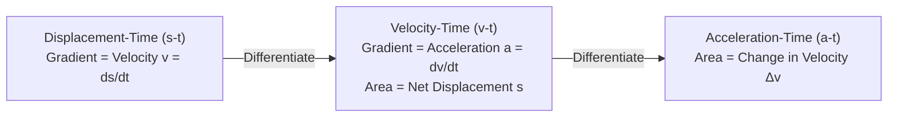
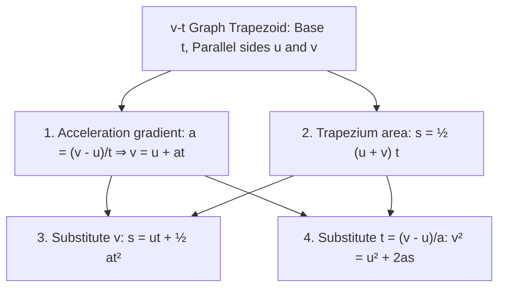
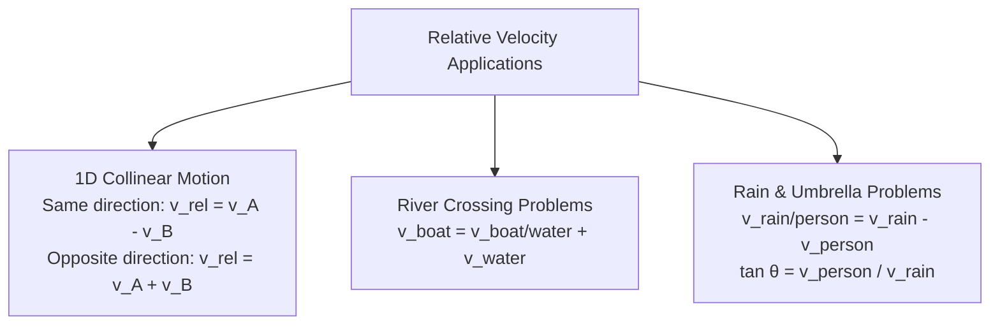
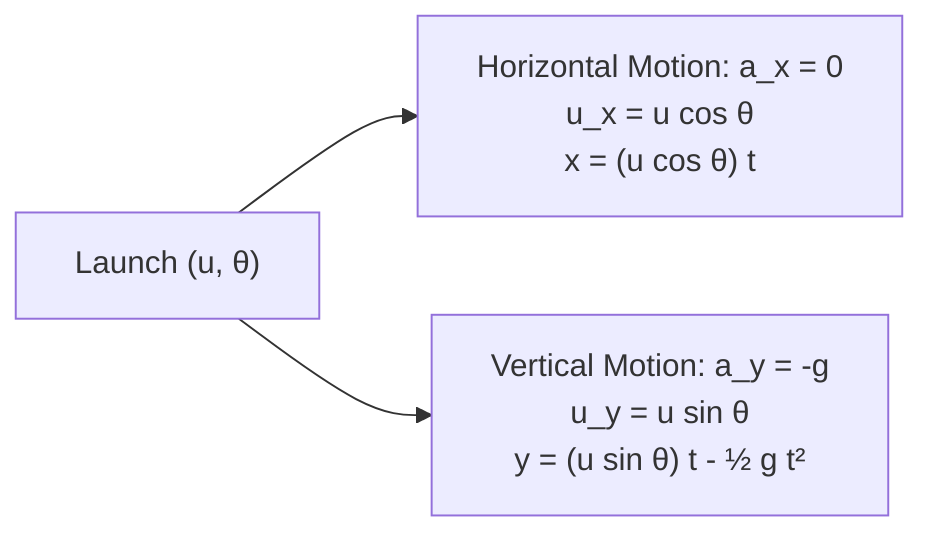
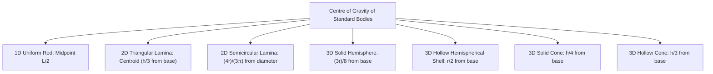
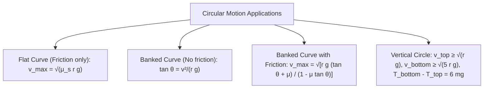
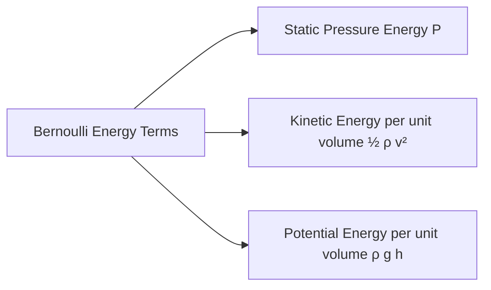

# :LiBook: Lesson 02: Mechanics

> [!ABSTRACT] Syllabus Scope (NIE Teacher's Guide)
> - **2.1 Kinematics in 1D & 2D**: Graphical motion analysis ($s-t, v-t, a-t$), equations of uniformly accelerated motion, vertical motion under gravity, relative motion in frames of reference, and complete projectile dynamics.
> - **2.2 Forces, Moments & Centre of Gravity**: Resultant of coplanar forces, moment of a force, torque of a couple, centre of mass vs. centre of gravity, standard laminas and solids, composite bodies, and sliding vs. toppling.
> - **2.3 Newton's Laws, Momentum & Friction**: Inertial vs. non-inertial frames, $F_{\text{net}} = ma$, action-reaction pairs, connected bodies & free body diagrams, impulse-momentum theorem, and dry friction laws.
> - **2.4 Equilibrium of Rigid Bodies**: Concurrency of three forces, triangle of forces, Lami's theorem, principle of moments, and stable, unstable, and neutral equilibrium.
> - **2.5 Work, Energy, Power & Collisions**: Work-energy theorem, spring systems in series/parallel, conservative fields ($F = -dU/dx$), power and engine mechanics ($P = Fv$), and 1D/2D collision dynamics.
> - **2.6 Circular Motion & Rotational Dynamics**: Centripetal acceleration, road banking with/without friction, vertical circular motion, moment of inertia ($I$), torque ($\tau = I\alpha$), rolling without slipping, and conservation of angular momentum.
> - **2.7 Hydrostatics (Fluid Statics)**: Hydrostatic pressure $P = h\rho g$, U-tube, Hare's apparatus, Pascal's principle, Archimedes' principle, flotation, and hydrometer calibration.
> - **2.8 Fluid Dynamics**: Streamline vs. turbulent flow, equation of continuity ($A_1 v_1 = A_2 v_2$), Bernoulli's equation, Torricelli's law, Venturi meter, and aerodynamic lift.

---
## Deep Dive Subtopic Navigation

Mechanics is the largest and highest-yield unit in the Sri Lankan A/L Physics syllabus (allocated 102 teaching periods). For advanced derivations, experimental error treatments, and high-difficulty problem models, refer to the five dedicated subtopic guides:

- :LiRocket: **1D & 2D Kinematics**: [[Subtopics/Vectors & Equations of Motion|Vectors & Equations of Motion Guide]]
- :LiScale: **Statics & Rigid Bodies**: [[Subtopics/Equilibrium & Centre of Gravity|Equilibrium & Centre of Gravity Guide]]
- :LiZap: **Work, Energy & Momentum**: [[Subtopics/Work, Energy, Power & Collisions|Work, Energy, Power & Collisions Guide]]
- :LiRotateCw: **Rotation & Dynamics**: [[Subtopics/Circular Motion & Rotational Dynamics|Circular Motion & Rotational Dynamics Guide]]
- :LiDroplet: **Fluids & Hydrodynamics**: [[Subtopics/Hydrostatics & Fluid Dynamics|Hydrostatics & Fluid Dynamics Guide]]

---
## 1. Kinematics in One and Two Dimensions (Competency 2.1)

### Linear Motion Graphs ($s-t, v-t, a-t$):

| Graph | Gradient (Slope) | Area Under Curve |
| :--- | :--- | :--- |
| **Displacement–Time ($s-t$)** | Instantaneous Velocity ($v = \frac{ds}{dt}$) | *No physical meaning* |
| **Velocity–Time ($v-t$)** | Instantaneous Acceleration ($a = \frac{dv}{dt}$) | Net Displacement ($s = \int v dt$) |
| **Acceleration–Time ($a-t$)** | Rate of change of acceleration (Jerk) | Change in Velocity ($\Delta v = v - u = \int a dt$) |

> [!TIP] Graph Reading Rules
> - In an $s-t$ graph, a straight line represents constant velocity; a parabolic curve represents constant acceleration; a horizontal line represents a body at rest.
> - In a $v-t$ graph, areas above the time axis represent positive displacement, while areas below represent negative displacement. Total distance traveled is the sum of magnitudes of all areas: $\text{Distance} = \sum |\text{Area}|$.

---

### Derivation of Kinematic Equations for Constant Acceleration:
Consider a particle accelerating uniformly at $a$ from initial velocity $u$ to final velocity $v$ over time $t$, traversing displacement $s$:

1. **Velocity Equation**:
   $$a = \frac{v - u}{t} \implies v = u + at$$
2. **Displacement via Average Velocity**:
   $$s = \left(\frac{u + v}{2}\right) t$$
3. **Displacement as a Function of Time**:
   $$s = \left(\frac{u + (u + at)}{2}\right) t = \left(\frac{2u + at}{2}\right) t \implies s = ut + \frac{1}{2}at^2$$
4. **Velocity as a Function of Displacement**:
   $$s = \left(\frac{u + v}{2}\right) \left(\frac{v - u}{a}\right) = \frac{v^2 - u^2}{2a} \implies v^2 = u^2 + 2as$$
5. **Displacement in the $n^{\text{th}}$ Second**:
   $$s_n = s(n) - s(n-1) = u + \frac{1}{2}a(2n - 1)$$

---

### Vertical Motion Under Gravity:
Choosing upward as positive ($a = -g$):
- **Time to reach maximum height**: $v = 0 \implies 0 = u - gt \implies t_{\text{up}} = \frac{u}{g}$.
- **Maximum height reached**: $0 = u^2 - 2g H_{\text{max}} \implies H_{\text{max}} = \frac{u^2}{2g}$.
- **Total time of flight (returning to launch level)**: $T = 2 t_{\text{up}} = \frac{2u}{g}$.
- **Velocity upon return**: $v = -u$ (magnitude is identical to launch speed).

---

### Relative Motion in One and Two Dimensions:
The velocity of body $A$ relative to reference frame $B$ is defined vectorially as:
$$\vec{v}_{A/B} = \vec{v}_A - \vec{v}_B = \vec{v}_A + (-\vec{v}_B)$$

#### River Crossing Analysis:
Let width of river be $d$, river current velocity be $\vec{v}_w$, and speed of boat relative to water be $v_{b/w}$:
1. **Crossing in Shortest Time**:
   Steer boat perpendicular to the river bank ($\theta = 90^\circ$ relative to bank):
   $$t_{\text{min}} = \frac{d}{v_{b/w}}$$
   Downstream drift distance: $x_{\text{drift}} = v_w \cdot t_{\text{min}} = \frac{v_w d}{v_{b/w}}$.
2. **Crossing along Shortest Path (Directly Across, Zero Drift)**:
   The resultant velocity $\vec{v}_b$ must be directed perpendicular to the banks:
   $$\sin\alpha = \frac{v_w}{v_{b/w}} \quad (\text{steer upstream at angle } \alpha \text{ to perpendicular})$$
   $$v_{\text{resultant}} = \sqrt{v_{b/w}^2 - v_w^2}, \quad t = \frac{d}{\sqrt{v_{b/w}^2 - v_w^2}}$$
   *(This trajectory is physically possible only if boat speed exceeds water speed: $v_{b/w} > v_w$).*

---

### Projectile Motion (2D Motion under Constant Gravity):
A particle launched from origin with speed $u$ at angle $\theta$ above horizontal (ignoring air resistance):

#### Analytical Equations:
1. **Velocity Components at Time $t$**:
   $$v_x = u\cos\theta, \quad v_y = u\sin\theta - gt$$
   $$v = \sqrt{v_x^2 + v_y^2}, \quad \tan\phi = \frac{v_y}{v_x}$$
2. **Time of Flight ($T$)**:
   Setting vertical displacement $s_y = 0$:
   $$0 = (u\sin\theta)T - \frac{1}{2}gT^2 \implies T = \frac{2u\sin\theta}{g}$$
3. **Maximum Height ($H_{\text{max}}$)**:
   Setting $v_y = 0$:
   $$0 = (u\sin\theta)^2 - 2g H_{\text{max}} \implies H_{\text{max}} = \frac{u^2 \sin^2\theta}{2g}$$
4. **Horizontal Range ($R$)**:
   $$R = u_x \cdot T = (u\cos\theta)\left(\frac{2u\sin\theta}{g}\right) = \frac{u^2 (2\sin\theta\cos\theta)}{g} = \frac{u^2 \sin 2\theta}{g}$$
   - **Maximum Range**: $\sin 2\theta = 1 \implies 2\theta = 90^\circ \implies \theta = 45^\circ \implies R_{\text{max}} = \frac{u^2}{g}$.
   - **Complementary Angles Property**: Launch angles $\theta$ and $(90^\circ - \theta)$ yield identical ranges since $\sin(2(90^\circ - \theta)) = \sin 2\theta$.
5. **Equation of Trajectory**:
   Eliminating $t = \frac{x}{u\cos\theta}$:
   $$y = x\tan\theta - \frac{g x^2}{2u^2 \cos^2\theta} = x\tan\theta - \frac{g x^2 (1 + \tan^2\theta)}{2u^2}$$

---
## 2. Resultant of Forces, Moments & Centre of Gravity (Competency 2.2)

### Resultant of Coplanar Forces:
1. **Parallelogram Law of Forces**:
   $$R = \sqrt{P^2 + Q^2 + 2PQ\cos\theta}, \quad \tan\alpha = \frac{Q\sin\theta}{P + Q\cos\theta}$$
2. **Rectangular Resolution Method**:
   $$\Sigma X = \sum F_i \cos\theta_i, \quad \Sigma Y = \sum F_i \sin\theta_i$$
   $$R = \sqrt{(\Sigma X)^2 + (\Sigma Y)^2}, \quad \tan\theta = \frac{\Sigma Y}{\Sigma X}$$

---

### Moment of a Force & Torque of a Couple:
- **Moment of a Force ($\tau$)**:
  $$\tau = F \times d_{\perp}$$
  *(where $d_{\perp}$ is the perpendicular distance from pivot to line of action).*
- **Torque of a Couple**:
  $$\tau_{\text{couple}} = F \times d$$
  *(where $d$ is perpendicular separation between the lines of action of the two equal and opposite forces).*

> [!KEY-CONCEPT] Axis Invariance of a Couple
> The torque of a couple has the **exact same value about every point in the plane**. A couple produces pure rotational acceleration ($\alpha = \tau/I$) without inducing any translational motion ($\Sigma \vec{F} = 0$).

---

### Resultant of Like Parallel Forces:
For forces $F_1$ and $F_2$ acting in the same direction separated by distance $L$:
- Resultant magnitude: $R = F_1 + F_2$.
- The line of action of $R$ divides the line segment internally in the inverse ratio of the forces:
  $$F_1 x_1 = F_2 x_2$$

---

### Centre of Gravity (CG) vs. Centre of Mass (CM):
- **Centre of Mass (CM)**: The mass-weighted average position $\vec{R}_{\text{cm}} = \frac{\sum m_i \vec{r}_i}{\sum m_i}$.
- **Centre of Gravity (CG)**: The point through which the entire weight $\vec{W} = \sum m_i \vec{g}$ acts.
- In a uniform gravitational field ($\vec{g} = \text{constant}$), **CM and CG coincide exactly**.

#### Coordinates of Composite Bodies:
$$\bar{x} = \frac{\sum m_i x_i}{\sum m_i}, \quad \bar{y} = \frac{\sum m_i y_i}{\sum m_i}$$
*(For composite sheets with cavities, subtract the area/mass of the removed portion: $\bar{x} = \frac{A_1 x_1 - A_2 x_2}{A_1 - A_2}$).*

---

### Sliding vs. Toppling of Rigid Bodies:
For a uniform rectangular block of mass $M$, width $b$, and height $h$ resting on a rough surface:
- **Horizontal pulling force $P$ applied at height $y$**:
  - Condition to slide: $P \ge \mu_s M g$.
  - Condition to topple about front edge: $P \cdot y \ge M g \cdot \frac{b}{2} \implies P \ge \frac{M g b}{2y}$.
  - **Slides first** if $\mu_s < \frac{b}{2y}$; **Topples first** if $\mu_s > \frac{b}{2y}$.
- **Block on inclined plane of angle $\theta$**:
  - **Slides first** if $\mu_s < \frac{b}{h}$; **Topples first** if $\mu_s > \frac{b}{h}$.

---
## 3. Newton's Laws of Motion, Momentum & Friction (Competency 2.3)

### Reference Frames & Inertia:
- **Inertia**: Reluctance of a body to alter its velocity; mass $m$ is the measure of translational inertia.
- **Inertial Mass vs. Gravitational Mass**:
  - Inertial mass ($m_i = F/a$) determines resistance to acceleration.
  - Gravitational mass ($m_g = W/g$) determines mutual gravitational attraction.
  - In Newtonian physics, $m_i \equiv m_g$.
- **Non-Inertial (Accelerating) Frames**:
  Newton's laws hold only by adding a **fictitious (pseudo) force**:
  $$\vec{F}_{\text{pseudo}} = -m \vec{a}_{\text{frame}}$$

---

### Newton's Three Laws of Motion:

> [!KEY-CONCEPT] Newton's Laws of Motion
> 1. **First Law**: A body continues in its state of rest or uniform rectilinear motion unless compelled to change by an external net force.
> 2. **Second Law**: Rate of change of linear momentum is proportional to net force and occurs in the direction of the force:
>    $$\vec{F}_{\text{net}} = \frac{d\vec{p}}{dt} = \frac{d(m\vec{v})}{dt} = m\vec{a} \quad (\text{for constant } m)$$
>    - *SI Unit Newton*: Force accelerating $1\text{ kg}$ by $1\text{ m}\;\text{s}^{-2}$ ($1\text{ N} = 1\text{ kg}\cdot\text{m}\cdot\text{s}^{-2}$).
> 3. **Third Law**: When body $A$ exerts a force on body $B$, body $B$ exerts an equal and opposite force on body $A$:
>    $$\vec{F}_{AB} = -\vec{F}_{BA}$$
>    *(Action-reaction pairs act on **different bodies simultaneously**, so they never cancel each other).*

---

### Connected Particles & Free Body Diagrams (FBD):

#### Classical System Models:
1. **Apparent Weight in an Elevator (Mass $m$)**:
   - Accelerating upward at $a$: $N - mg = ma \implies N = m(g + a)$ (heavier).
   - Accelerating downward at $a$: $mg - N = ma \implies N = m(g - a)$ (lighter).
   - Free fall ($a = g$): $N = m(g - g) = 0$ (weightlessness).
2. **Atwood Machine (Two masses $m_1 > m_2$ over frictionless pulley)**:
   $$m_1 g - T = m_1 a, \quad T - m_2 g = m_2 a$$
   $$a = \left(\frac{m_1 - m_2}{m_1 + m_2}\right) g, \quad T = \left(\frac{2m_1 m_2}{m_1 + m_2}\right) g$$

---

### Impulse & Linear Momentum:
- **Linear Momentum**: $\vec{p} = m\vec{v}$ ($[\mathsf{ML}\mathsf{T}^{-1}], \text{kg}\cdot\text{m}\cdot\text{s}^{-1} \text{ or } \text{N}\cdot\text{s}$).
- **Impulse ($\vec{J}$)**:
  $$\vec{J} = \int_{t_1}^{t_2} \vec{F} dt = \vec{F}_{\text{avg}} \Delta t = \Delta \vec{p} = m\vec{v} - m\vec{u}$$
  *(Equal to the area under a Force–Time ($F-t$) graph).*
- **Conservation of Linear Momentum**:
  $$\Sigma \vec{F}_{\text{ext}} = 0 \implies \sum \vec{p}_{\text{initial}} = \sum \vec{p}_{\text{final}}$$

---

### Dry Friction (Coulomb's Laws):
1. **Static Friction ($F_s$)**: Self-adjusting force opposing impending motion:
   $$0 \le F_s \le F_{\text{lim}}$$
2. **Limiting Friction ($F_{\text{lim}}$)**: Maximum static friction at the verge of sliding:
   $$F_{\text{lim}} = \mu_s R$$
3. **Kinetic Friction ($F_k$)**: Opposes established sliding:
   $$F_k = \mu_k R \quad (\mu_k < \mu_s)$$
4. **Angle of Friction ($\lambda$) & Angle of Repose ($\theta$)**:
   $$\tan\lambda = \mu_s, \quad \theta_{\text{repose}} = \lambda \implies \tan\theta_{\text{repose}} = \mu_s$$

---
## 4. Equilibrium of Rigid Bodies (Competency 2.4)

### Static Equilibrium Requirements:
1. **Translational Equilibrium**: $\Sigma \vec{F} = 0 \implies \Sigma F_x = 0, \Sigma F_y = 0$.
2. **Rotational Equilibrium (Principle of Moments)**: $\Sigma \tau = 0$ about any point.

---

### Equilibrium Under Three Non-Parallel Coplanar Forces:
1. **Concurrency**: Their lines of action must intersect at a single point $O$.
2. **Triangle of Forces**: Forces can be represented by sides of a closed triangle taken in order.
3. **Lami's Theorem**:
   $$\frac{P}{\sin\alpha} = \frac{Q}{\sin\beta} = \frac{R}{\sin\gamma}$$

---

### States of Equilibrium:
- **Stable Equilibrium**: Slight displacement raises CG $\implies$ Potential energy is at a **local minimum** $\implies$ Restoring torque returns body.
- **Unstable Equilibrium**: Slight displacement lowers CG $\implies$ Potential energy is at a **local maximum** $\implies$ Overturning torque displaces body further.
- **Neutral Equilibrium**: Displacement keeps CG at the same height $\implies$ Potential energy is **constant** $\implies$ Body remains in new position.

---
## 5. Work, Energy, Power & Collisions (Competency 2.5)

### Mechanical Work & Conservative Fields:
- Work by variable force: $W = \int_{x_1}^{x_2} F(x) dx$ (area under $F-x$ curve).
- Conservative force relation: $F(x) = -\frac{dU}{dx}$.
  - Equilibrium occurs where $\frac{dU}{dx} = 0$.
  - Stable equilibrium where $\frac{d^2 U}{dx^2} > 0$ (PE minimum).
  - Unstable equilibrium where $\frac{d^2 U}{dx^2} < 0$ (PE maximum).

---

### Elastic Potential Energy & Spring Combinations:
- Stretched spring (Hooke's Law $F = kx$):
  $$E_{\text{elastic}} = \frac{1}{2}kx^2 = \frac{1}{2}Fx = \frac{F^2}{2k}$$
- **Springs in Series**: $\frac{1}{k_{\text{eq}}} = \frac{1}{k_1} + \frac{1}{k_2} \implies k_{\text{eq}} = \frac{k_1 k_2}{k_1 + k_2}$.
- **Springs in Parallel**: $k_{\text{eq}} = k_1 + k_2$.

---

### Work-Energy Theorem & Conservation:
- **Work-Energy Theorem**: $W_{\text{net}} = \Delta E_k = \frac{1}{2}mv^2 - \frac{1}{2}mu^2$.
- **Mechanical Energy Conservation**: $E_{\text{total}} = E_k + E_p = \text{constant}$ (when non-conservative work $W_{\text{nc}} = 0$).

---

### Power Mechanics & Vehicle Dynamics:
- Instantaneous power: $P = \vec{F} \cdot \vec{v} = F_{\text{engine}} v \implies F_{\text{engine}} = \frac{P}{v}$.
- Motion of car of mass $M$ with resistive force $F_{\text{res}}$:
  $$M a = \frac{P}{v} - F_{\text{res}} \implies a = \frac{1}{M}\left(\frac{P}{v} - F_{\text{res}}\right)$$
- **Terminal (Maximum) Speed** ($a = 0$):
  $$v_{\text{max}} = \frac{P}{F_{\text{res}}}$$
- On an incline of angle $\theta$: $v_{\text{max}} = \frac{P}{F_{\text{res}} + Mg\sin\theta}$.

---

### Comprehensive Collision Theory:
Coefficient of restitution: $e = \frac{v_2 - v_1}{u_1 - u_2}$.
- **Elastic Collision ($e = 1$)**: Momentum and kinetic energy conserved.
  - If $m_1 = m_2$, velocities are completely exchanged: $v_1 = u_2, v_2 = u_1$.
- **Inelastic Collision ($0 < e < 1$)**: Kinetic energy loss:
  $$\Delta E_k = \frac{1}{2}\left(\frac{m_1 m_2}{m_1 + m_2}\right)(1 - e^2)(u_1 - u_2)^2$$
- **Completely Inelastic Collision ($e = 0$)**: Bodies coalesce: $V = \frac{m_1 u_1 + m_2 u_2}{m_1 + m_2}$.

---
## 6. Uniform Circular Motion & Rotational Dynamics (Competency 2.6)

### Kinematics & Centripetal Dynamics:
- $\omega = \frac{v}{r} = 2\pi f = \frac{2\pi}{T}$.
- **Centripetal Acceleration**: $a_c = \frac{v^2}{r} = \omega^2 r = v\omega$ (directed radially inward).
- **Centripetal Force**: $F_c = \frac{mv^2}{r} = m\omega^2 r$.

---

### Rotational Dynamics:
- Rotational Newton's 2nd Law: $\tau_{\text{net}} = I\alpha$.
- Rotational kinetic energy: $E_{k,\text{rot}} = \frac{1}{2}I\omega^2$.
- Rotational power: $P = \tau\omega$.

#### Moment of Inertia ($I = \sum m_i r_i^2 = \int r^2 dm$):
- **Thin uniform rod (length $L$)**: Center $\frac{1}{12}ML^2$; End $\frac{1}{3}ML^2$.
- **Circular disc (radius $R$)**: Central perpendicular axis $\frac{1}{2}MR^2$; Diameter $\frac{1}{4}MR^2$.
- **Thin circular ring**: Central perpendicular axis $MR^2$.
- **Solid cylinder**: Longitudinal axis $\frac{1}{2}MR^2$.
- **Solid sphere**: Any diameter $\frac{2}{5}MR^2$.
- **Hollow thin spherical shell**: Any diameter $\frac{2}{3}MR^2$.

#### Theorems:
1. **Parallel Axis Theorem**: $I = I_{\text{cm}} + Md^2$.
2. **Perpendicular Axis Theorem (Planar laminas)**: $I_z = I_x + I_y$.

---

### Pure Rolling Without Slipping:
- Condition: $v_{\text{cm}} = R\omega, a_{\text{cm}} = R\alpha$.
- Total Kinetic Energy:
  $$E_{k,\text{total}} = \frac{1}{2}M v_{\text{cm}}^2 + \frac{1}{2}I_{\text{cm}}\omega^2 = \frac{1}{2}M v_{\text{cm}}^2 \left(1 + \frac{k^2}{R^2}\right)$$
- Linear acceleration down an inclined plane ($\theta$):
  $$a_{\text{cm}} = \frac{g\sin\theta}{1 + \frac{k^2}{R^2}}$$

---

### Conservation of Angular Momentum:
When $\Sigma \tau_{\text{ext}} = 0$:
$$L = I\omega = \text{constant} \implies I_1 \omega_1 = I_2 \omega_2$$

---
## 7. Hydrostatics (Fluid Statics) (Competency 2.7)

### Liquid Pressure:
$$P = h\rho g, \quad P_{\text{total}} = P_{\text{atm}} + h\rho g$$

### Liquid Density Comparison:
1. **U-Tube Manometer**:
   $$h_1 \rho_1 = h_2 \rho_2 \implies \frac{\rho_1}{\rho_2} = \frac{h_2}{h_1}$$
2. **Hare's Apparatus (A/L Core Practical)**:
   $$h_1 \rho_1 g = h_2 \rho_2 g \implies h_1 = \left(\frac{\rho_2}{\rho_1}\right) h_2$$
   - Plotting graph of $h_1$ vs. $h_2$ yields gradient $m = \frac{\rho_2}{\rho_1}$, eliminating end zero errors.

---

### Pascal's Principle & Hydraulic Machines:
Pressure applied to an enclosed incompressible fluid transmits undiminished:
$$P = \frac{F_1}{A_1} = \frac{F_2}{A_2} \implies F_2 = F_1 \left(\frac{A_2}{A_1}\right)$$
$$W = F_1 d_1 = F_2 d_2 \implies d_2 = d_1 \left(\frac{A_1}{A_2}\right)$$

---

### Archimedes' Principle & Flotation:
- **Upthrust**: $U = V_{\text{submerged}} \cdot \rho_{\text{fluid}} \cdot g$.
- **Apparent Weight**: $W_{\text{app}} = W - U = W\left(1 - \frac{\rho_{\text{fluid}}}{\rho_{\text{solid}}}\right)$.
- **Principle of Flotation**: For a floating body, Weight = Upthrust:
  $$\frac{V_{\text{submerged}}}{V_{\text{total}}} = \frac{\rho_{\text{solid}}}{\rho_{\text{fluid}}}$$

---

### Hydrometers:
- Submerged stem length in liquid of density $\rho$:
  $$x = \frac{M}{a\rho} - \frac{V_0}{a}$$
- Sensitivity $\left|\frac{dx}{d\rho}\right| = \frac{M}{a\rho^2}$:
  - Greater sensitivity achieved with **large bulb mass $M$** and **narrow stem area $a$**.
  - Graduations are **closer together at the bottom** (high density) and **wider at the top** (low density).

---
## 8. Fluid Dynamics (Competency 2.8)

### Ideal Fluid Properties:
1. Incompressible ($\rho = \text{constant}$).
2. Non-viscous ($\eta = 0$).
3. Steady (stationary) flow.
4. Irrotational flow.

---

### Equation of Continuity (Mass Conservation):
$$A_1 v_1 = A_2 v_2 = Q \quad (\text{Volume Flow Rate in } \text{m}^3\;\text{s}^{-1})$$

---

### Bernoulli's Equation (Mechanical Energy Conservation):
$$P + \frac{1}{2}\rho v^2 + \rho g h = \text{constant}$$

#### Major Applications:
1. **Torricelli's Law of Efflux**: $v = \sqrt{2gh}$.
2. **Venturi Meter**: $Q = A_1 A_2 \sqrt{\frac{2(P_1 - P_2)}{\rho(A_1^2 - A_2^2)}} = A_1 A_2 \sqrt{\frac{2h\rho_m g}{\rho(A_1^2 - A_2^2)}}$.
3. **Aerodynamic Lift on Aerofoil**: Upper camber increases airspeed ($v_{\text{top}} > v_{\text{bottom}}$) $\implies P_{\text{top}} < P_{\text{bottom}} \implies F_{\text{lift}} = (P_{\text{bottom}} - P_{\text{top}})A$.
4. **Pitot Tube**: $v = \sqrt{\frac{2(P_{\text{stag}} - P_0)}{\rho}} = \sqrt{\frac{2h\rho_m g}{\rho}}$.
5. **Siphon**: Maximum operational elevation over reservoir $h_{\text{max}} < \frac{P_{\text{atm}}}{\rho g}$.

---
## 9. Worked Examination Problems

### Example 1: Projectile Trajectory Calculation
**Problem:** A stone is projected with speed $20\text{ m}\;\text{s}^{-1}$ at an angle of $30^\circ$ above the horizontal from the top of a cliff $25\text{ m}$ high. Taking $g = 10\text{ m}\;\text{s}^{-2}$:
1. Find the time taken to hit the ground at the cliff base.
2. Find the horizontal distance from the base of the cliff to the impact point.
3. Find the velocity magnitude and angle at impact.

**Solution:**
1. **Initial Velocity Components**:
   - $u_x = 20\cos(30^\circ) = 20 \times \frac{\sqrt{3}}{2} = 10\sqrt{3} \approx 17.32\text{ m}\;\text{s}^{-1}$
   - $u_y = 20\sin(30^\circ) = 20 \times 0.5 = 10\text{ m}\;\text{s}^{-1}$
2. **Time to Hit Ground ($s_y = -25\text{ m}$)**:
   $$s_y = u_y t - \frac{1}{2}g t^2 \implies -25 = 10t - 5t^2 \implies 5t^2 - 10t - 25 = 0$$
   $$t^2 - 2t - 5 = 0 \implies t = \frac{2 \pm \sqrt{4 - 4(1)(-5)}}{2} = \frac{2 \pm \sqrt{24}}{2} = 1 + \sqrt{6} \approx 3.45\text{ s}$$
3. **Horizontal Range**:
   $$x = u_x \cdot t = (10\sqrt{3}) \times 3.45 \approx 59.75\text{ m}$$
4. **Velocity at Impact**:
   - $v_x = u_x = 10\sqrt{3} \approx 17.32\text{ m}\;\text{s}^{-1}$
   - $v_y = u_y - gt = 10 - 10(3.45) = -24.5\text{ m}\;\text{s}^{-1}$
   - $v = \sqrt{v_x^2 + v_y^2} = \sqrt{(17.32)^2 + (-24.5)^2} = \sqrt{300 + 600.25} \approx 30.0\text{ m}\;\text{s}^{-1}$
   - Angle: $\tan\phi = \frac{|v_y|}{v_x} = \frac{24.5}{17.32} \approx 1.41 \implies \phi \approx 54.7^\circ \text{ below horizontal}$.

---

### Example 2: Rigid Body Ladder Equilibrium
**Problem:** A uniform ladder of mass $M$ and length $L$ rests with its upper end against a smooth vertical wall and lower end on rough horizontal ground with coefficient of static friction $\mu$. If the ladder makes an angle $\theta$ with the horizontal floor, find the minimum coefficient of friction $\mu_{\text{min}}$ required to prevent slipping.

**Solution:**
1. **Forces on Ladder**:
   - Weight $Mg$ acting vertically downward at ladder midpoint ($L/2$).
   - Normal reaction at smooth wall $N_w$ acting horizontally perpendicular to wall.
   - Normal reaction from floor $R_f$ acting vertically upward.
   - Static friction from floor $F_f$ acting horizontally toward the wall.
2. **Equilibrium Equations**:
   - Vertical equilibrium: $\Sigma F_y = 0 \implies R_f = Mg$.
   - Horizontal equilibrium: $\Sigma F_x = 0 \implies F_f = N_w$.
3. **Rotational Equilibrium (Taking moments about bottom contact point)**:
   $$\Sigma \tau = 0 \implies N_w (L\sin\theta) - Mg\left(\frac{L}{2}\cos\theta\right) = 0$$
   $$N_w \sin\theta = \frac{Mg\cos\theta}{2} \implies N_w = \frac{Mg}{2\tan\theta}$$
4. **No-Slip Condition**:
   $$F_f \le \mu R_f \implies N_w \le \mu Mg \implies \frac{Mg}{2\tan\theta} \le \mu Mg$$
   $$\mu_{\text{min}} = \frac{1}{2\tan\theta}$$

---

### Example 3: Pure Rolling of Solid Cylinder on Inclined Plane
**Problem:** A uniform solid cylinder of mass $M$ and radius $R$ rolls down an incline of angle $\theta$ without slipping. Find its linear acceleration down the plane and the minimum friction coefficient $\mu_s$ required to prevent slipping.

**Solution:**
1. **Equations of Motion**:
   - Down the plane: $Mg\sin\theta - F_{\text{friction}} = M a$.
   - Perpendicular to plane: $N = Mg\cos\theta$.
   - Rotational torque about center of mass: $\tau = F_{\text{friction}} R = I \alpha = \left(\frac{1}{2}MR^2\right)\left(\frac{a}{R}\right) = \frac{1}{2}MR a$.
2. **Friction Force**:
   $$F_{\text{friction}} = \frac{1}{2}Ma$$
3. **Linear Acceleration**:
   $$Mg\sin\theta - \frac{1}{2}Ma = Ma \implies \frac{3}{2}Ma = Mg\sin\theta \implies a = \frac{2}{3}g\sin\theta$$
4. **Minimum Friction Coefficient**:
   $$F_{\text{friction}} = \frac{1}{2}M\left(\frac{2}{3}g\sin\theta\right) = \frac{1}{3}Mg\sin\theta \le \mu_s N = \mu_s Mg\cos\theta$$
   $$\mu_s \ge \frac{1}{3}\tan\theta \implies \mu_{s,\text{min}} = \frac{1}{3}\tan\theta$$

---
## :LiRocket: Flashcards (Spaced Repetition)

#flashcards

State the 4 equations of linear motion for uniform acceleration. :: $v = u + at$, $s = ut + \frac{1}{2}at^2$, $v^2 = u^2 + 2as$, $s = \left(\frac{u+v}{2}\right)t$.
<!--SR:!2026-09-29,4,270-->

What are the formulas for Time of Flight $T$ and Horizontal Range $R$ of a projectile launched at speed $u$ and angle $\theta$? :: $T = \frac{2u\sin\theta}{g}$, $R = \frac{u^2\sin 2\theta}{g}$.
<!--SR:!2026-09-29,4,270-->

State Newton's Second Law of Motion in vector form. :: $\mathbf{F}_{\text{net}} = \frac{d\mathbf{p}}{dt} = m\mathbf{a}$.
<!--SR:!2026-09-26,1,230-->

What is Impulse, and how is it related to momentum? :: Impulse $\mathbf{J} = \mathbf{F}\Delta t = \Delta \mathbf{p}$ (change in momentum).
<!--SR:!2026-09-29,4,270-->

What is the relationship between linear velocity $v$ and angular velocity $\omega$? :: $v = r\omega$.
<!--SR:!2026-09-29,4,270-->

What is the rotational analogue of Newton's 2nd Law $F = ma$? :: $\tau = I\alpha$ (where $\tau$ is torque, $I$ is moment of inertia, $\alpha$ is angular acceleration).
<!--SR:!2026-09-26,1,230-->

State Archimedes' Principle. :: When a body is completely or partially immersed in a fluid, it experiences an upward upthrust equal to the weight of the fluid displaced by the body.
<!--SR:!2026-09-29,4,270-->

State the condition for a body to float in a liquid. :: The weight of the floating body must equal the upthrust (weight of the displaced liquid).
<!--SR:!2026-09-28,3,250-->

What physical quantities are represented by the gradient and area of a $v-t$ graph? :: Gradient represents instantaneous acceleration; Area under graph represents net displacement.

Why do complementary launch angles $\theta$ and $(90^\circ - \theta)$ produce the identical horizontal range? :: Because $\sin(2(90^\circ - \theta)) = \sin(180^\circ - 2\theta) = \sin 2\theta$, yielding identical $R = \frac{u^2\sin 2\theta}{g}$.

Why can action and reaction forces never cancel each other out? :: Because they act simultaneously on two different bodies, never on the same body.

What is a couple, and what is unique about its torque? :: A pair of equal, opposite, parallel non-collinear forces; its torque $\tau = F \times d$ is independent of the chosen axis/origin.

Where is the Centre of Gravity of a solid cone of height $h$ located? :: On its axis of symmetry at a distance of $\frac{1}{4}h$ from its base.

Where is the Centre of Gravity of a solid hemisphere of radius $r$ located? :: On its central radius of symmetry at a distance of $\frac{3}{8}r$ from the flat circular base.

State the two conditions for the complete equilibrium of a coplanar rigid body. :: 1. Resultant force is zero ($\Sigma \vec{F} = 0$, translational equilibrium); 2. Resultant torque about any point is zero ($\Sigma \tau = 0$, rotational equilibrium).

State Lami's Theorem for three concurrent forces in equilibrium. :: $\frac{P}{\sin\alpha} = \frac{Q}{\sin\beta} = \frac{R}{\sin\gamma}$ (where each force is divided by the sine of the angle between the other two forces).

Distinguish between stable and unstable equilibrium in terms of Centre of Gravity and Potential Energy. :: In stable equilibrium, a slight displacement raises the CG (PE is at a local minimum); in unstable equilibrium, displacement lowers the CG (PE is at a local maximum).

State the Work-Energy Theorem. :: The net work done by all forces acting on a body equals the change in its kinetic energy: $W_{\text{net}} = \Delta E_k$.

State the formula for the elastic potential energy stored in a stretched spring of stiffness $k$. :: $E_p = \frac{1}{2}kx^2 = \frac{1}{2}Fx$.

What is the difference between an elastic collision and an inelastic collision? :: In an elastic collision, both linear momentum and kinetic energy are conserved; in an inelastic collision, momentum is conserved but kinetic energy is lost.

What is the banking angle formula for a curved road of radius $r$ designed for speed $v$ without friction? :: $\tan\theta = \frac{v^2}{rg}$.

State the minimum velocity required at the top and bottom of a vertical circle for a mass on a string to complete the loop. :: Top: $v_{\text{top}} = \sqrt{rg}$; Bottom: $v_{\text{bottom}} = \sqrt{5rg}$.

State the Parallel Axis Theorem for Moment of Inertia. :: $I = I_{\text{cm}} + Md^2$ (where $I_{\text{cm}}$ is moment of inertia through the centre of mass and $d$ is perpendicular distance between parallel axes).

State the Principle of Conservation of Angular Momentum. :: When the net external torque acting on a system is zero ($\Sigma \tau_{\text{ext}} = 0$), the total angular momentum remains constant: $I_1\omega_1 = I_2\omega_2$.

State Pascal's Principle. :: Pressure applied to an enclosed, incompressible static fluid is transmitted undiminished to all parts of the fluid and container walls.

In Hare's apparatus, what is the mathematical relation between liquid column heights $h_1, h_2$ and densities $\rho_1, \rho_2$? :: $\frac{h_1}{h_2} = \frac{\rho_2}{\rho_1}$ (heights are inversely proportional to densities).

Why are hydrometer stem divisions closer together at the bottom? :: Submerged depth is inversely proportional to density ($x \propto \frac{1}{\rho}$); hence equal increments in density produce decreasing changes in stem height.

State Bernoulli's Equation for an ideal fluid in steady streamline flow. :: $P + \frac{1}{2}\rho v^2 + \rho gh = \text{constant}$.

State Torricelli's Law for the speed of efflux of a liquid from an orifice at depth $h$ below the free surface. :: $v = \sqrt{2gh}$.

What is the equivalent spring constant of two springs $k_1$ and $k_2$ connected in series? :: $k_{\text{eq}} = \frac{k_1 k_2}{k_1 + k_2}$ (or $\frac{1}{k_{\text{eq}}} = \frac{1}{k_1} + \frac{1}{k_2}$).

What is the linear acceleration of a solid sphere of radius $R$ and mass $M$ rolling down an incline of angle $\theta$ without slipping? :: $a = \frac{g\sin\theta}{1 + k^2/R^2} = \frac{g\sin\theta}{1 + 2/5} = \frac{5}{7}g\sin\theta$.

Under what condition will a rectangular block of width $b$ and height $h$ on an incline slide before toppling? :: When $\mu_s < \frac{b}{h}$ (angle of repose $\theta_{\text{slide}} < \theta_{\text{topple}}$).

State the equation of continuity for an incompressible fluid. :: $A_1 v_1 = A_2 v_2 = \text{constant}$ (volume flow rate $Q = Av$ is conserved).
