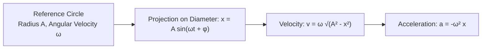
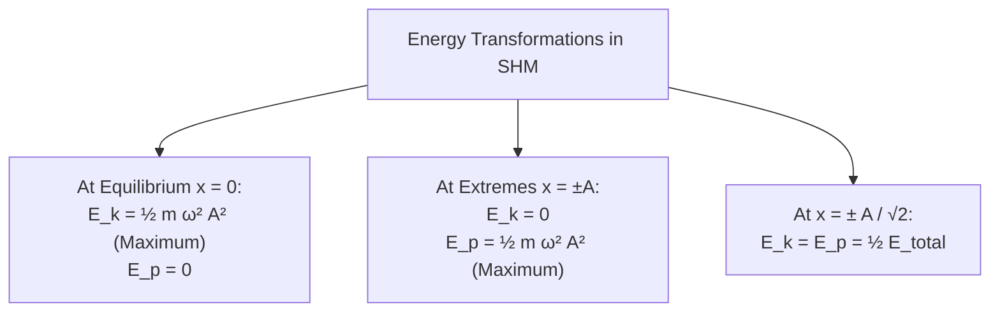
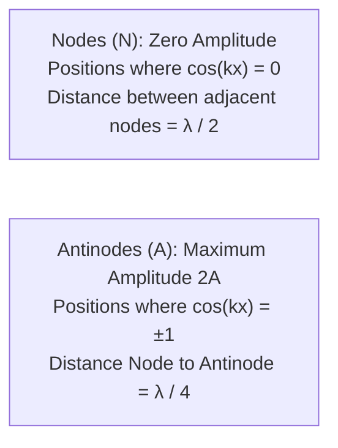
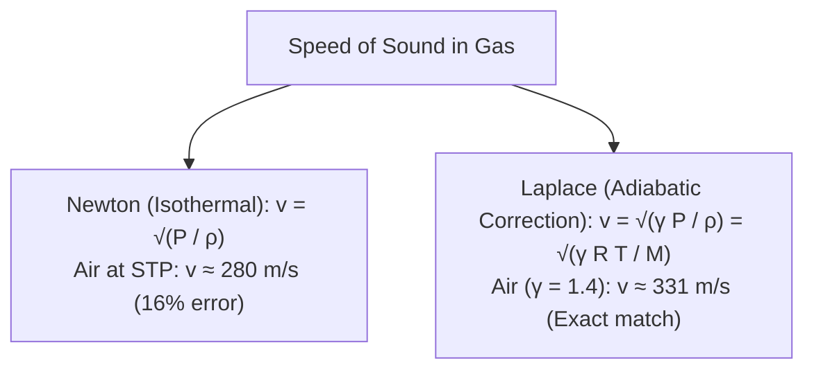
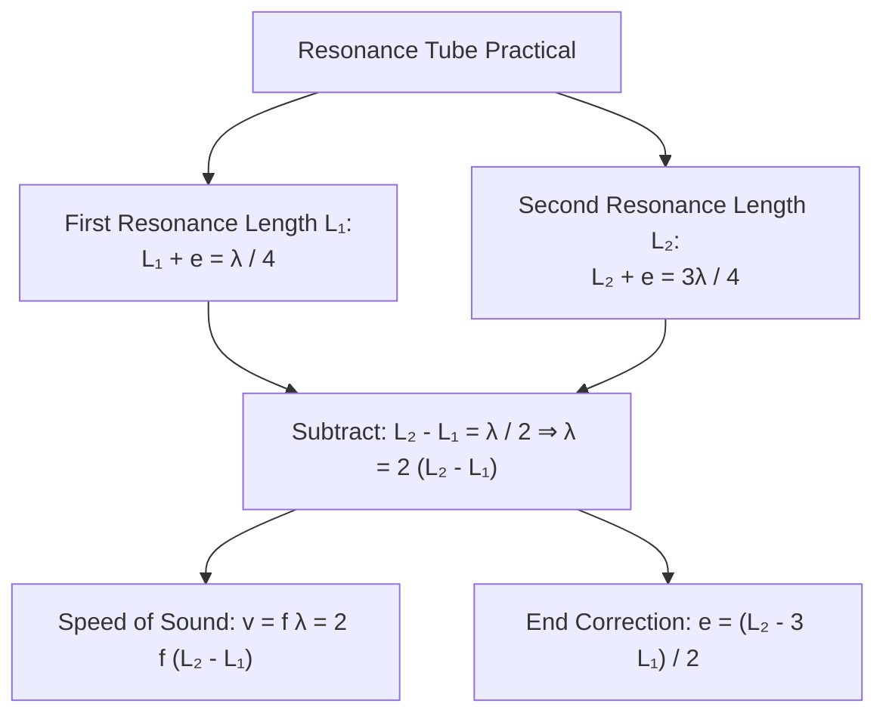
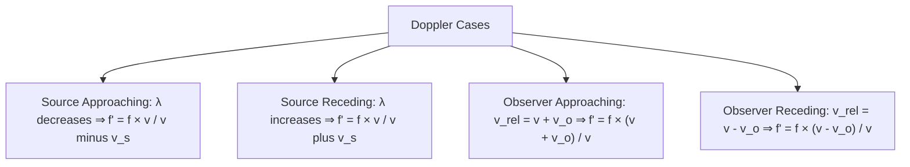
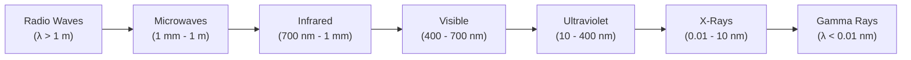

# :LiBook: Lesson 03: Oscillations & Waves

> [!ABSTRACT] Syllabus Scope (NIE Teacher's Guide)
> - **3.1 Simple Harmonic Motion (SHM)**: Acceleration $a = -\omega^2 x$, kinematic equations, energy transformations ($E_k, E_p, E_{\text{total}}$), simple pendulum, mass-spring systems, liquid column oscillations, damping, and mechanical resonance.
> - **3.2 & 3.3 Wave Motion & Wave Properties**: Transverse vs. longitudinal waves, wave equation $y = A\sin(\omega t \mp kx)$, reflection, refraction, principle of superposition, interference, and diffraction.
> - **3.4 Transverse Stationary Waves on Strings**: Node and antinode formation, wave speed $v = \sqrt{T/m}$, harmonic modes ($f_n = \frac{n}{2L}\sqrt{T/m}$), and sonometer experimental laws.
> - **3.5 Sound Waves & Air Columns**: Newton-Laplace sound velocity formula ($v = \sqrt{\gamma P/\rho}$), open and closed organ pipes, end correction ($e \approx 0.6r$), and the resonance tube experiment.
> - **3.6 Doppler Effect**: Relative motion frequency shifts, analytical derivations for moving sources and observers, wind velocity corrections, and applications.
> - **3.7 Acoustics, Intensity & Beats**: Pitch, loudness, quality/timbre, sound intensity level ($\beta = 10\log_{10}(I/I_0)\text{ dB}$), threshold of hearing/pain, and beat phenomenon ($f_{\text{beat}} = |f_1 - f_2|$).
> - **3.8 Electromagnetic Waves**: Transverse nature of coupled $\vec{E}$ and $\vec{B}$ fields, speed of light $c = 1/\sqrt{\mu_0\varepsilon_0}$, and the electromagnetic spectrum.
> - **3.9 Geometrical Optics & Refraction**: Snell's law, real and apparent depth, total internal reflection (TIR), critical angle, optical fibers, and prism minimum deviation ($n = \frac{\sin((A+D_m)/2)}{\sin(A/2)}$).
> - **3.10 Thin Lenses & Vision Correction**: Lens formula ($\frac{1}{v} - \frac{1}{u} = \frac{1}{f}$), linear magnification, lens maker's equation, optical power, and optical defects of the human eye (myopia, hypermetropia, presbyopia).
> - **3.11 Optical Instruments**: Simple microscope, compound microscope ray diagrams and magnification, and astronomical refracting telescope in normal adjustment and near point.

---
## Deep Dive Subtopic Navigation

Unit 3 is a comprehensive unit spanning classical oscillation mechanics, wave physics, acoustics, and optical instruments (allocated 100 teaching periods). For advanced derivations, experimental procedures, and ray diagrams, refer to the three specialized subtopics:

- :LiWaves: **Oscillations & Waves**: [[Subtopics/Simple Harmonic Motion & Waves|Simple Harmonic Motion & Waves Guide]]
- :LiMegaphone: **Acoustics & Sound**: [[Subtopics/Sound Waves, Acoustics & Doppler Effect|Sound Waves, Acoustics & Doppler Effect Guide]]
- :LiGlasses: **Optics & Instruments**: [[Subtopics/Geometrical Optics & Optical Instruments|Geometrical Optics & Optical Instruments Guide]]

---
## 1. Simple Harmonic Motion (Competency 3.1)

### Defining Equation & Kinematics:
**Simple Harmonic Motion (SHM)** is defined as rectilinear periodic motion wherein the acceleration $a$ of a particle is directly proportional to its displacement $x$ from a fixed equilibrium position and is always directed towards that equilibrium position:
$$a = -\omega^2 x$$

#### Kinematic Expressions:
1. **Displacement**:
   $$x(t) = A \sin(\omega t + \phi) \quad \text{or} \quad x(t) = A \cos(\omega t)$$
   *(where $A$ is amplitude, $\omega = 2\pi f = \frac{2\pi}{T}$ is angular frequency, and $\phi$ is initial phase).*
2. **Velocity**:
   $$v(t) = \frac{dx}{dt} = \omega A \cos(\omega t + \phi) = \pm \omega \sqrt{A^2 - x^2}$$
   - At center ($x = 0$): Maximum velocity $v_{\text{max}} = \omega A$.
   - At extremes ($x = \pm A$): Velocity momentarily vanishes ($v = 0$).
3. **Acceleration**:
   $$a(t) = \frac{dv}{dt} = -\omega^2 A \sin(\omega t + \phi) = -\omega^2 x$$
   - At center ($x = 0$): Acceleration is zero ($a = 0$).
   - At extremes ($x = \pm A$): Maximum acceleration $a_{\text{max}} = \omega^2 A$.

#### Phase Relationships:
- **Velocity leads displacement by $\frac{\pi}{2}\text{ rad}$ ($90^\circ$)**.
- **Acceleration leads velocity by $\frac{\pi}{2}\text{ rad}$ ($90^\circ$)**.
- **Acceleration is in antiphase ($\pi\text{ rad} = 180^\circ$) with displacement**.

---

### Energy in Simple Harmonic Motion:
For a particle of mass $m$ oscillating with angular frequency $\omega$ and amplitude $A$:
1. **Kinetic Energy ($E_k$)**:
   $$E_k = \frac{1}{2}m v^2 = \frac{1}{2}m\omega^2(A^2 - x^2)$$
2. **Potential Energy ($E_p$)**:
   $$E_p = \frac{1}{2}k x^2 = \frac{1}{2}m\omega^2 x^2$$
3. **Total Mechanical Energy ($E_{\text{total}}$)**:
   $$E_{\text{total}} = E_k + E_p = \frac{1}{2}m\omega^2 A^2 = \text{constant}$$

> [!KEY-CONCEPT] Energy Frequency Doubling
> While displacement $x(t)$, velocity $v(t)$, and acceleration $a(t)$ oscillate at the fundamental frequency $f$, both **Kinetic Energy and Potential Energy oscillate at twice the frequency ($2f$)**.

---

### Classical Oscillating Systems:

#### 1. The Simple Pendulum:
A small point mass $m$ suspended by a light inextensible string of length $l$:
- Restoring tangential force: $F = -mg \sin\theta$.
- For small oscillations ($\theta \le 10^\circ \approx 0.17\text{ rad}$), $\sin\theta \approx \theta = \frac{x}{l}$:
  $$ma = -mg\left(\frac{x}{l}\right) \implies a = -\left(\frac{g}{l}\right)x$$
  $$\omega = \sqrt{\frac{g}{l}} \implies T = 2\pi\sqrt{\frac{l}{g}}$$

#### 2. Mass-Spring Systems:
Restoring force $F = -kx \implies ma = -kx \implies a = -\left(\frac{k}{m}\right)x$:
$$\omega = \sqrt{\frac{k}{m}} \implies T = 2\pi\sqrt{\frac{m}{k}}$$
- **Series connection**: $\frac{1}{k_{\text{eq}}} = \frac{1}{k_1} + \frac{1}{k_2} \implies T = 2\pi\sqrt{\frac{m(k_1 + k_2)}{k_1 k_2}}$.
- **Parallel connection**: $k_{\text{eq}} = k_1 + k_2 \implies T = 2\pi\sqrt{\frac{m}{k_1 + k_2}}$.

#### 3. Liquid Column in a U-Tube:
Total liquid column of length $L$ and density $\rho$ in a U-tube of uniform cross-section $A$:
- Restoring force of displaced column $2x$: $F = -(2x A\rho)g \implies (AL\rho)a = -2A\rho gx \implies a = -\left(\frac{2g}{L}\right)x$:
  $$T = 2\pi\sqrt{\frac{L}{2g}} = 2\pi\sqrt{\frac{h}{g}} \quad (h = L/2 \text{ is resting height in one limb})$$

---

### Free, Damped & Forced Oscillations (Resonance):
- **Free Oscillations**: System oscillates at its natural frequency $f_0$ with constant total energy and amplitude.
- **Damped Oscillations**: Mechanical energy is gradually dissipated by friction/drag into thermal energy:
  - *Light damping*: Amplitude decays exponentially ($A(t) = A_0 e^{-\gamma t}$).
  - *Critical damping*: Returns to equilibrium in minimum time without oscillating (e.g., vehicle shock absorbers, dead-beat galvanometers).
  - *Overdamping*: Heavy drag prevents oscillation; sluggish return to equilibrium.
- **Forced Oscillations & Resonance**:
  An external periodic driving force $F(t) = F_0 \sin(\omega t)$ drives the system.
  - When driver frequency equals the system's natural frequency ($f_{\text{driver}} = f_0$), **Resonance** occurs.
  - Energy absorption is maximized and amplitude surges to a sharp peak.

---
## 2. Wave Motion & Wave Properties (Competency 3.2 & 3.3)

### Wave Classification:
- **Transverse Waves**: Particle oscillations are **perpendicular** to the direction of wave energy propagation (crests and troughs). Examples: electromagnetic waves, waves on a plucked string, S-waves in seismology.
- **Longitudinal Waves**: Particle oscillations are **parallel** to the direction of wave propagation (compressions and rarefactions). Examples: sound waves in air/liquids, P-waves in seismology.

---

### Kinematics of Traveling Waves:
$$v = f\lambda = \frac{\lambda}{T} = \frac{\omega}{k}$$
*(where $\omega = 2\pi f$ is angular frequency, and $k = \frac{2\pi}{\lambda}$ is the wave number).*

- **Progressive Wave Equation (Traveling in $+x$ direction)**:
  $$y(x,t) = A \sin(\omega t - kx) = A \sin\left[2\pi\left(\frac{t}{T} - \frac{x}{\lambda}\right)\right]$$
- **Phase Difference ($\Delta\phi$)**:
  Between two points separated by distance $\Delta x$:
  $$\Delta\phi = \frac{2\pi}{\lambda}\Delta x$$

---

### Fundamental Properties of All Waves:
1. **Reflection**: Angle of incidence equals angle of reflection ($i = r$).
   - Reflection from a fixed/denser boundary introduces a **phase shift of $\pi\text{ rad}$ ($180^\circ$)**.
   - Reflection from a free/rarer boundary introduces **zero phase change**.
2. **Refraction**: Wave speed changes across different media while **frequency $f$ remains strictly constant**:
   $$\frac{\sin i}{\sin r} = \frac{v_1}{v_2} = \frac{\lambda_1}{\lambda_2}$$
3. **Superposition Principle**: When two or more waves overlap, the resultant displacement at any point is the vector sum of individual displacements:
   $$y = y_1 + y_2 + \dots$$
4. **Interference**: Superposition of two coherent wave trains (constant phase difference):
   - **Constructive Interference (Maxima)**: Path difference $\Delta x = n\lambda$ ($n = 0, 1, 2, \dots$).
   - **Destructive Interference (Minima)**: Path difference $\Delta x = \left(n + \frac{1}{2}\right)\lambda$.
5. **Diffraction**: The bending and spreading of wave energy around edges and apertures, prominent when aperture width $d \approx \lambda$.

---
## 3. Transverse Stationary Waves on Stretched Strings (Competency 3.4)

### Formation of Standing Waves:
Formed by the interference of two identical harmonic waves traveling in opposite directions:
$$y_1 = A\sin(\omega t - kx), \quad y_2 = A\sin(\omega t + kx)$$
$$y = y_1 + y_2 = [2A\cos(kx)] \sin(\omega t)$$

---

### Speed of Transverse Waves on a String:
$$v = \sqrt{\frac{T}{m}}$$
*(where $T$ is string tension in newtons, and $m$ is linear mass density: $m = \frac{\text{mass}}{\text{length}} = \pi r^2 \rho$).*

---

### Vibration Modes of Stretched Strings (Fixed at Both Ends $\implies$ Nodes at Ends):

| Mode | Standing Wave Pattern | Wavelength | Frequency Formula | Harmonic / Overtone |
| :--- | :---: | :---: | :---: | :--- |
| **Fundamental** | 1 loop (2 nodes at ends, 1 antinode in center) | $\lambda_1 = 2L$ | $f_1 = \frac{v}{2L} = \frac{1}{2L}\sqrt{\frac{T}{m}}$ | **$1^{\text{st}}$ Harmonic** |
| **$1^{\text{st}}$ Overtone** | 2 loops (3 nodes, 2 antinodes) | $\lambda_2 = L$ | $f_2 = 2f_1 = \frac{1}{L}\sqrt{\frac{T}{m}}$ | **$2^{\text{nd}}$ Harmonic** |
| **$2^{\text{nd}}$ Overtone** | 3 loops (4 nodes, 3 antinodes) | $\lambda_3 = \frac{2L}{3}$ | $f_3 = 3f_1 = \frac{3}{2L}\sqrt{\frac{T}{m}}$ | **$3^{\text{rd}}$ Harmonic** |
| **$n^{\text{th}}$ Harmonic** | $n$ loops ($n+1$ nodes, $n$ antinodes) | $\lambda_n = \frac{2L}{n}$ | $f_n = n f_1 = \frac{n}{2L}\sqrt{\frac{T}{m}}$ | **All Harmonics Present** |

---

### Sonometer Experimental Laws:
1. **Law of Length**: For constant $T$ and $m$: $f \propto \frac{1}{L} \implies f \cdot L = \text{constant}$.
2. **Law of Tension**: For constant $L$ and $m$: $f \propto \sqrt{T} \implies \frac{f}{\sqrt{T}} = \text{constant}$.
3. **Law of Linear Mass**: For constant $L$ and $T$: $f \propto \frac{1}{\sqrt{m}} \propto \frac{1}{r\sqrt{\rho}}$.

---
## 4. Sound Waves, Air Columns & Resonance Tubes (Competency 3.5)

### Speed of Sound in Air:

#### Environmental Dependencies:
- **Temperature**: $v \propto \sqrt{T}$ (where $T$ is thermodynamic temperature in kelvin).
- **Humidity**: Damp air is less dense than dry air ($\rho_{\text{damp}} < \rho_{\text{dry}}$) $\implies$ speed of sound **increases** with humidity.
- **Pressure**: At constant temperature, $P/\rho = \text{constant} \implies$ changes in atmospheric pressure have **zero effect** on the speed of sound.

---

### Standing Waves in Air Columns:

#### 1. Open Organ Pipe (Both Ends Open):
- Boundary condition: **Antinodes at both ends**.
- Fundamental: $L = \frac{\lambda_1}{2} \implies f_1 = \frac{v}{2L}$.
- Harmonics: $f_n = n f_1 = \frac{nv}{2L}$ ($n = 1, 2, 3, 4, \dots$).
- **All harmonics are present**, producing a rich musical tone.

#### 2. Closed Organ Pipe (One End Closed):
- Boundary condition: **Node at closed end, antinode at open end**.
- Fundamental: $L = \frac{\lambda_1}{4} \implies f_1 = \frac{v}{4L}$.
- Harmonics: $f_n = n f_1 = \frac{nv}{4L}$ ($n = 1, 3, 5, \dots$).
- **Only odd harmonics are present**, producing a characteristic hollow tone.

---

### End Correction ($e$) & The Resonance Tube Experiment:
Antinodes form slightly outside the physical open end of a pipe by an end correction $e \approx 0.6r$ (where $r$ is the tube radius):
- Open pipe effective length: $L_{\text{eff}} = L + 2e$.
- Closed pipe effective length: $L_{\text{eff}} = L + e$.

---
## 5. The Doppler Effect (Competency 3.6)

The **Doppler Effect** is the observed shift in wave frequency due to relative motion between the source, observer, and medium.

### Master Doppler Equation:
$$f' = f \left(\frac{v \pm v_o}{v \mp v_s}\right)$$
*(Mnemonic: Upper signs represent **approach**; lower signs represent **separation**).*

- **Wind Velocity ($w$) Correction**:
  If wind blows from source toward observer with speed $w$, replace $v$ with $(v + w)$:
  $$f' = f \left(\frac{(v + w) \pm v_o}{(v + w) \mp v_s}\right)$$

---
## 6. Acoustics, Sound Intensity & Beats (Competency 3.7)

### Characteristics of Musical Sound:
- **Pitch**: Governed by the fundamental frequency of the acoustic wave.
- **Loudness**: Governed by sound intensity and subjective auditory sensitivity.
- **Quality (Timbre)**: Determined by the number, order, and relative amplitudes of overtones (harmonics).

---

### Intensity & Decibel Scale:
- Acoustic Intensity: $I = \frac{P}{4\pi r^2}$ ($[\mathsf{M}\mathsf{T}^{-3}], \text{W}\;\text{m}^{-2}$).
- **Sound Intensity Level ($\beta$) in Decibels ($\text{dB}$)**:
  $$\beta = 10 \log_{10}\left(\frac{I}{I_0}\right) \quad (\text{Reference Threshold of Hearing } I_0 = 10^{-12}\text{ W}\;\text{m}^{-2})$$
  - Hearing threshold: $\beta = 0\text{ dB}$.
  - Pain threshold: $I = 1\text{ W}\;\text{m}^{-2} \implies \beta = 120\text{ dB}$.
  - Doubling sound intensity: $\Delta\beta = 10\log_{10}(2) \approx +3.01\text{ dB}$.

---

### Beats:
Produced when two sound waves of slightly different frequencies $f_1$ and $f_2$ interfere:
$$f_{\text{beat}} = |f_1 - f_2|$$
- **Tuning Fork Frequency Identification**:
  - Waxing a fork increases mass $\implies$ lowers its frequency.
  - Filing a fork decreases mass $\implies$ raises its frequency.

---
## 7. Electromagnetic Waves (Competency 3.8)

### Nature of EM Waves:
Coupled oscillating electric ($\vec{E}$) and magnetic ($\vec{B}$) fields traveling perpendicular to each other and to the propagation vector $\vec{k}$:
$$c = \frac{1}{\sqrt{\mu_0 \varepsilon_0}} \approx 2.998 \times 10^8\text{ m}\;\text{s}^{-1}$$

---
## 8. Geometrical Optics: Refraction & Prisms (Competency 3.9)

### Snell's Law & Refraction:
$$\frac{\sin i}{\sin r} = \frac{n_2}{n_1} = \frac{v_1}{v_2} = \frac{\lambda_1}{\lambda_2}$$
- **Real & Apparent Depth**:
  $$n = \frac{\text{Real Depth } (d)}{\text{Apparent Depth } (d')} \implies \text{Normal Shift } s = d\left(1 - \frac{1}{n}\right)$$
- **Total Internal Reflection (TIR)**:
  Occurs when light travels from denser to rarer medium and $i > C$:
  $$\sin C = \frac{1}{n}$$

---

### Refraction Through Prisms:
For a triangular glass prism of apex angle $A$:
1. $r_1 + r_2 = A$.
2. Angle of deviation: $D = i_1 + i_2 - A$.
3. **Condition for Minimum Deviation ($D = D_m$)**:
   $i_1 = i_2 = i$ and $r_1 = r_2 = r = A/2$:
   $$n = \frac{\sin\left(\frac{A + D_m}{2}\right)}{\sin\left(\frac{A}{2}\right)}$$
   - For a thin prism ($A \le 10^\circ$): $D = (n - 1)A$.

---
## 9. Thin Lenses & Defects of Vision (Competency 3.10)

### Thin Lens Formulas (Cartesian Sign Convention):
$$\frac{1}{v} - \frac{1}{u} = \frac{1}{f}, \quad m = \frac{v}{u}, \quad P = \frac{1}{f\text{ (m)}} \text{ (Dioptres)}$$
- Converging (convex) lens: $f > 0$.
- Diverging (concave) lens: $f < 0$.
- **Lens Maker's Equation**:
  $$\frac{1}{f} = (n - 1)\left(\frac{1}{R_1} - \frac{1}{R_2}\right)$$

---

### Optical Defects of Human Vision:
- **Myopia (Short-sightedness)**: Image forms in front of the retina; corrected using a **diverging (concave) lens** of focal length $f = -d_{\text{far}}$.
- **Hypermetropia (Long-sightedness)**: Image forms behind the retina; corrected using a **converging (convex) lens**: $\frac{1}{-d_{\text{near}}} - \frac{1}{-25} = \frac{1}{f}$.
- **Presbyopia**: Age-related accommodation loss; corrected by **bifocal lenses**.
- **Astigmatism**: Asymmetrical corneal curvature; corrected by **cylindrical lenses**.

---
## 10. Optical Instruments (Competency 3.11)

### Angular Magnification (Magnifying Power $M$):
$$M = \frac{\beta}{\alpha} = \frac{\text{Visual angle subtended by image at eye}}{\text{Visual angle subtended by object at unaided near point } D (25\text{ cm})}$$

---

### 1. Simple Microscope (Magnifying Glass):
- Image at near point ($D = 25\text{ cm}$): $M = 1 + \frac{D}{f}$.
- Normal adjustment (Image at $\infty$): $M = \frac{D}{f}$.

---

### 2. Compound Microscope:
Objective lens ($f_o$ very small) and Eyepiece lens ($f_e > f_o$, small):
- **Image at Near Point ($D = 25\text{ cm}$)**:
  $$M = m_o \times m_e = \left(\frac{v_o}{u_o}\right)\left(1 + \frac{D}{f_e}\right), \quad L = v_o + u_e$$
- **Normal Adjustment (Image at $\infty$, relaxed eye)**:
  $$M = \left(\frac{v_o}{u_o}\right)\left(\frac{D}{f_e}\right) \approx \left(\frac{L}{f_o}\right)\left(\frac{D}{f_e}\right), \quad L = v_o + f_e$$

---

### 3. Astronomical Refracting Telescope:
Objective lens ($f_o$ very large, large aperture) and Eyepiece ($f_e$ small):
- **Normal Adjustment (Image at $\infty$, relaxed eye)**:
  $$M = \frac{f_o}{f_e}, \quad \text{Tube Length } L = f_o + f_e$$
- **Image at Near Point ($D = 25\text{ cm}$)**:
  $$M = \frac{f_o}{f_e}\left(1 + \frac{f_e}{D}\right), \quad L = f_o + \frac{f_e D}{f_e + D}$$

---
## 11. Worked Examination Problems

### Example 1: Resonance Tube Analysis
**Problem:** In a resonance tube experiment with a tuning fork of frequency $512\text{ Hz}$, the first two resonance lengths are observed at $L_1 = 15.2\text{ cm}$ and $L_2 = 47.6\text{ cm}$.
1. Calculate the speed of sound in the air column.
2. Determine the end correction $e$ of the tube.
3. Calculate the internal diameter of the tube.

**Solution:**
1. **Speed of sound**:
   $$v = 2f(L_2 - L_1) = 2 \times 512 \times (0.476 - 0.152) = 1024 \times 0.324 \approx 331.8\text{ m}\;\text{s}^{-1}$$
2. **End correction**:
   $$e = \frac{L_2 - 3L_1}{2} = \frac{47.6 - 3(15.2)}{2} = \frac{47.6 - 45.6}{2} = \frac{2.0\text{ cm}}{2} = 1.0\text{ cm} = 0.01\text{ m}$$
3. **Internal diameter**:
   Since $e \approx 0.6r \implies r = \frac{e}{0.6} = \frac{1.0\text{ cm}}{0.6} \approx 1.67\text{ cm}$.
   $$\text{Diameter } d = 2r \approx 3.33\text{ cm}$$

---

### Example 2: Doppler Effect for a Moving Locomotive
**Problem:** A train blowing a horn of frequency $400\text{ Hz}$ approaches a vertical cliff at a speed of $20\text{ m}\;\text{s}^{-1}$. Speed of sound in air is $340\text{ m}\;\text{s}^{-1}$.
1. Find the frequency of the sound reflected from the cliff as heard by a stationary observer on the track behind the train.
2. Find the frequency of the echo heard by the train driver.

**Solution:**
1. **Frequency received and reflected by the cliff**:
   Cliff acts as stationary observer ($v_o = 0$) receiving sound from approaching source ($v_s = 20\text{ m}\;\text{s}^{-1}$):
   $$f_{\text{cliff}} = f\left(\frac{v}{v - v_s}\right) = 400\left(\frac{340}{340 - 20}\right) = 400\left(\frac{340}{320}\right) = 425\text{ Hz}$$
   The cliff reflects this sound at $425\text{ Hz}$.
   For the stationary observer behind the train, the cliff is a stationary source, so the reflected frequency heard is:
   $$f'_{\text{obs}} = 425\text{ Hz}$$
2. **Echo heard by the train driver**:
   The driver is an observer moving toward the cliff ($v_o = 20\text{ m}\;\text{s}^{-1}$), listening to the cliff vibrating at $f_{\text{cliff}} = 425\text{ Hz}$:
   $$f_{\text{driver}} = f_{\text{cliff}}\left(\frac{v + v_o}{v}\right) = 425\left(\frac{340 + 20}{340}\right) = 425\left(\frac{360}{340}\right) = 450\text{ Hz}$$

---
## :LiRocket: Flashcards (Spaced Repetition)

#flashcards

State the defining equation of Simple Harmonic Motion. :: $a = -\omega^2 x$ (where $a$ is acceleration, $\omega$ is angular frequency, $x$ is displacement from equilibrium).
<!--SR:!2026-09-26,1,230-->

What is the expression for maximum velocity in SHM? :: $v_{\text{max}} = \omega A$.

What is the period of a Simple Pendulum? :: $T = 2\pi \sqrt{\frac{l}{g}}$.
<!--SR:!2026-09-26,1,230-->

State the fundamental frequency formula for a stretched string of length $L$, tension $T$, and mass per unit length $m$. :: $f = \frac{1}{2L}\sqrt{\frac{T}{m}}$.
<!--SR:!2026-09-26,1,230-->

How is the speed of sound $v$ determined using first and second resonance lengths $L_1, L_2$ in a resonance tube? :: $v = 2f(L_2 - L_1)$.
<!--SR:!2026-09-26,1,230-->

What is the critical angle condition for Total Internal Reflection? :: $\sin C = \frac{n_2}{n_1} = \frac{1}{n}$ (when light travels from denser to rarer medium).
<!--SR:!2026-09-26,1,230-->

State the magnification formula for an Astronomical Telescope in normal adjustment. :: $M = \frac{f_o}{f_e}$ (and tube length $L = f_o + f_e$).
<!--SR:!2026-09-26,1,230-->

What is the phase difference between velocity and displacement in SHM? :: Velocity leads displacement by $\frac{\pi}{2}\text{ rad}$ ($90^\circ$).

At what displacement from the center are kinetic energy and potential energy equal in SHM? :: At $x = \pm \frac{A}{\sqrt{2}}$.

State the time period formula for a mass-spring oscillator. :: $T = 2\pi\sqrt{\frac{m}{k}}$.

What is the condition for mechanical resonance to occur? :: When the driving frequency of an external periodic force matches the natural frequency of the oscillating system ($f = f_0$).

Why is sound propagation in air an adiabatic process rather than an isothermal process? :: Compressions and rarefactions occur so rapidly that negligible heat exchange takes place between adjacent layers because air is a poor thermal conductor.

Why does an increase in air pressure at constant temperature have no effect on the speed of sound? :: By Boyle's law, density increases in direct proportion to pressure ($P/\rho = \text{constant}$); hence $v = \sqrt{\gamma P/\rho}$ remains unchanged.

State the frequencies of the fundamental and first two overtones in a closed organ pipe of length $L$. :: Fundamental: $f_1 = \frac{v}{4L}$; 1st overtone: $f_3 = 3f_1 = \frac{3v}{4L}$; 2nd overtone: $f_5 = 5f_1 = \frac{5v}{4L}$ (odd harmonics only).

State the end correction formula $e$ in terms of first and second resonance lengths in a resonance tube. :: $e = \frac{L_2 - 3L_1}{2} \approx 0.6r$ (where $r$ is tube radius).

State the general Doppler frequency equation. :: $f' = f\left(\frac{v \pm v_o}{v \mp v_s}\right)$ (upper signs for approach, lower signs for separation).

Define Sound Intensity Level $\beta$ in decibels. :: $\beta = 10\log_{10}\left(\frac{I}{I_0}\right)$ (where $I_0 = 10^{-12}\text{ W}\;\text{m}^{-2}$).

What is the beat frequency produced when two waves of frequencies $f_1$ and $f_2$ interfere? :: $f_{\text{beat}} = |f_1 - f_2|$.

State the formula for normal shift $s$ of an object submerged at real depth $d$ in a medium of refractive index $n$. :: $s = d\left(1 - \frac{1}{n}\right)$.

State the prism formula for refractive index $n$ at minimum deviation $D_m$. :: $n = \frac{\sin\left(\frac{A + D_m}{2}\right)}{\sin\left(\frac{A}{2}\right)}$.

State the Lens Maker's Formula. :: $\frac{1}{f} = (n - 1)\left(\frac{1}{R_1} - \frac{1}{R_2}\right)$.

What lens is required to correct Myopia (short-sightedness)? :: A concave (diverging) lens.

What lens is required to correct Hypermetropia (long-sightedness)? :: A convex (converging) lens.

State the angular magnification of a compound microscope in normal adjustment (image at $\infty$). :: $M = \left(\frac{v_o}{u_o}\right)\left(\frac{D}{f_e}\right) \approx \left(\frac{L}{f_o}\right)\left(\frac{D}{f_e}\right)$.

State the angular magnification and tube length of an astronomical telescope in normal adjustment. :: $M = \frac{f_o}{f_e}$ and $L = f_o + f_e$.
