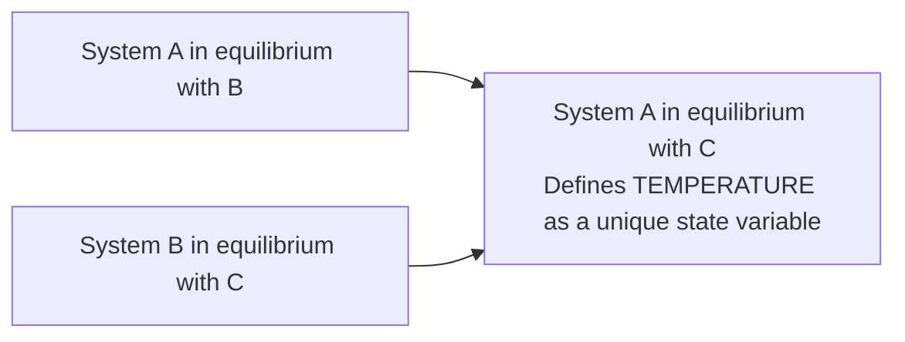
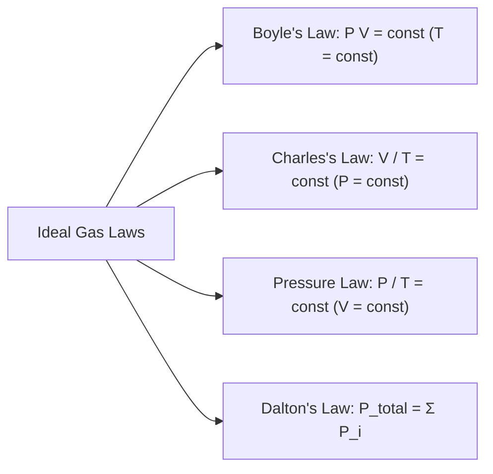
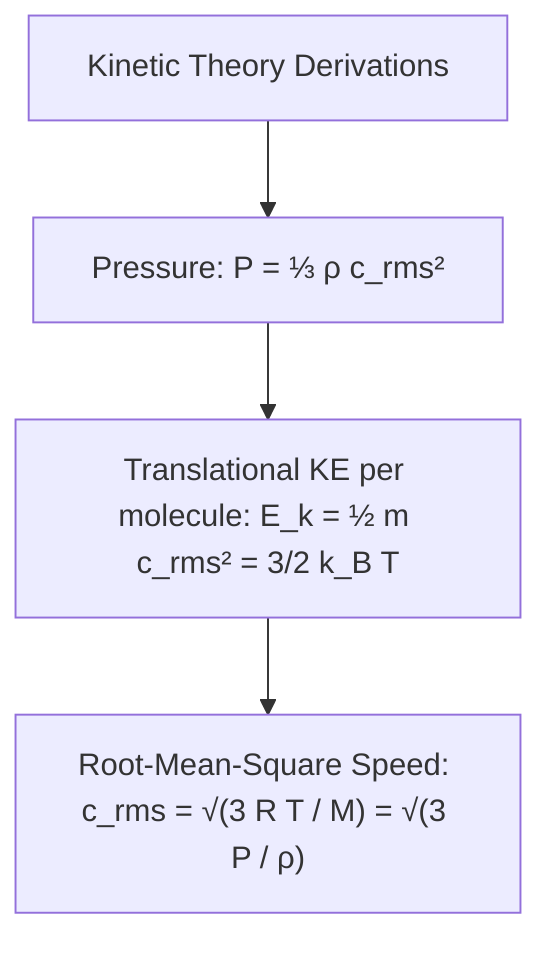
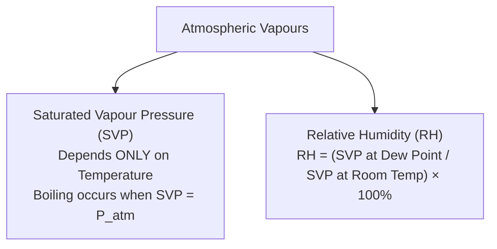
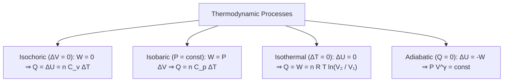

# :LiBook: Lesson 04: Thermal Physics

> [!ABSTRACT] Syllabus Scope (NIE Teacher's Guide)
> - **4.1 Thermometry & Temperature Measurement**: Zeroth Law of Thermodynamics, thermometric properties, Celsius vs. Thermodynamic Kelvin scale, and thermometer comparisons.
> - **4.2 Thermal Expansion of Solids & Liquids**: Linear ($\alpha$), superficial ($\beta$), and cubical ($\gamma$) expansivities, real vs. apparent expansion of liquids, and anomalous expansion of water.
> - **4.3 Gas Laws & Ideal Gas Equation**: Boyle's, Charles's, and Pressure Laws, ideal gas equation $PV = nRT$, and the Quill tube practical for atmospheric pressure.
> - **4.4 Kinetic Theory of Gases**: Derivation of kinetic pressure $P = \frac{1}{3}\rho\overline{c^2}$, molecular kinetic energy ($E_k = \frac{3}{2}k_B T$), and root-mean-square speed ($c_{\text{rms}} = \sqrt{3RT/M}$).
> - **4.5 Heat Capacity & Calorimetry**: Heat capacity ($C$), specific heat capacity ($c$), principle of mixtures, and electrical and cooling methods.
> - **4.6 Phase Transitions & Latent Heat**: Latent heat of fusion ($L_f$) and vaporization ($L_v$), evaporation vs. boiling, regelation, and pressure effects on melting/boiling points.
> - **4.7 Vapours, Saturated Vapour Pressure & Humidity**: Saturated vs. unsaturated vapours, dew point, relative humidity ($\text{RH} = \frac{P_d}{P_R} \times 100\%$), and hygrometry.
> - **4.8 First Law of Thermodynamics & Processes**: Work done in gas expansion ($W = \int P dV$), First Law ($\Delta Q = \Delta U + \Delta W$), isochoric, isobaric, isothermal, and adiabatic processes ($PV^\gamma = \text{const}$), and Mayer's relation ($C_p - C_v = R$).
> - **4.9 Heat Transfer Mechanisms**: Fourier's law of conduction, lagged vs. unlagged rods, Searle's and Lee's methods, convection, Stefan-Boltzmann radiation ($P = \sigma A T^4$), Wien's law ($\lambda_{\text{max}}T = b$), and Newton's law of cooling.

---
## Deep Dive Subtopic Navigation

Thermal Physics spans macroscopic thermodynamics, molecular kinetic theory, and heat transfer (allocated 62 teaching periods). For advanced derivations, experimental error treatments, and full mathematical proofs, refer to the two specialized subtopic guides:

- :LiThermometer: **Gases & Thermodynamics**: [[Subtopics/Ideal Gases & Thermodynamics|Gases & Thermodynamics Guide]]
- :LiFlame: **Calorimetry & Heat Transfer**: [[Subtopics/Calorimetry, Phase Changes & Heat Transfer|Calorimetry & Heat Transfer Guide]]

---
## 1. Temperature & Thermometry (Competency 4.1)

### Thermal Equilibrium & Zeroth Law:
- **Thermal Equilibrium**: Two physical systems in thermal contact are in thermal equilibrium when no net thermal energy flows between them (they are at the same temperature).
- **Zeroth Law of Thermodynamics**: If system $A$ is in thermal equilibrium with system $B$, and system $B$ is in thermal equilibrium with system $C$, then system $A$ is in thermal equilibrium with system $C$.



---

### Thermometric Properties & Scales:
Any physical property $X$ that varies continuously, measurably, and monotonically with temperature can establish an empirical temperature scale:

1. **Two-Fixed-Point Empirical Celsius Scale**:
   Fixed points: Ice point ($0^\circ\text{C}$) and Steam point at $1\text{ atm}$ ($100^\circ\text{C}$):
   $$\theta = \left(\frac{X_\theta - X_0}{X_{100} - X_0}\right) \times 100^\circ\text{C}$$
2. **Thermodynamic (Absolute Kelvin) Scale**:
   Based on the **Triple Point of Water** ($T_{\text{tr}} = 273.16\text{ K} = 0.01^\circ\text{C}$) where ice, liquid water, and water vapour coexist in thermodynamic equilibrium:
   $$T = 273.16 \left(\frac{P}{P_{\text{tr}}}\right) \text{ K} \quad (\text{using Constant Volume Gas Thermometer})$$
   $$T\text{ (K)} = \theta\text{ (}^\circ\text{C)} + 273.15$$

---

### Comparison of Laboratory Thermometers:

| Thermometer Type | Thermometric Substance & Property | Range | Key Advantages & Applications |
| :--- | :--- | :---: | :--- |
| **Mercury-in-Glass** | Length ($L$) of mercury column in capillary | $-39^\circ\text{C}$ to $357^\circ\text{C}$ | High thermal conductivity, does not wet glass, opaque visible meniscus; clinical thermometers have constriction to prevent backflow. |
| **Alcohol-in-Glass** | Length ($L$) of dyed alcohol column | $-115^\circ\text{C}$ to $78^\circ\text{C}$ | High expansivity (6x mercury), suitable for measuring sub-zero polar temperatures. |
| **Constant Volume Gas** | Gas pressure ($P$) at constant volume | $-270^\circ\text{C}$ to $1500^\circ\text{C}$ | **Standard reference thermometer**; directly follows thermodynamic gas laws; bulky and slow response. |
| **Platinum Resistance** | Electrical resistance ($R_\theta = R_0(1+\alpha\theta)$) | $-200^\circ\text{C}$ to $1200^\circ\text{C}$ | Extremely high precision and repeatability; high electrical readout accuracy via Wheatstone bridge. |
| **Thermocouple** | Thermoelectric EMF ($E = a\theta + b\theta^2$) | $-250^\circ\text{C}$ to $1600^\circ\text{C}$ | Very low thermal capacity (rapid response), measures point temperatures, electrical telemetry. |
| **Optical Pyrometer** | Radiant spectral brightness | $> 1000^\circ\text{C}$ | Completely contact-free; measures temperatures of molten metals and stars. |

---
## 2. Thermal Expansion of Solids & Liquids (Competency 4.2)

### Expansivity Coefficients:
1. **Linear Expansivity ($\alpha$)**:
   $$\alpha = \frac{\Delta L}{L_0 \Delta\theta} \implies L_\theta = L_0(1 + \alpha\Delta\theta) \quad ([\Theta^{-1}], \text{K}^{-1} \text{ or } ^\circ\text{C}^{-1})$$
2. **Superficial (Areal) Expansivity ($\beta$)**:
   $$\beta \approx 2\alpha \implies A_\theta = A_0(1 + \beta\Delta\theta)$$
3. **Cubical (Volumetric) Expansivity ($\gamma$)**:
   $$\gamma \approx 3\alpha \implies V_\theta = V_0(1 + \gamma\Delta\theta)$$

---

### Real vs. Apparent Expansion of Liquids:
When a liquid is heated inside a solid container, the container also expands:
$$\gamma_{\text{real}} = \gamma_{\text{apparent}} + \gamma_{\text{vessel}}$$

### Anomalous Expansion of Water:
- As water is heated from $0^\circ\text{C}$ to $4^\circ\text{C}$, it **contracts** instead of expanding ($\gamma$ is negative).
- At **$4^\circ\text{C}$ ($277\text{ K}$)**, water possesses its **maximum density** ($\rho \approx 1000\text{ kg}\;\text{m}^{-3}$).
- Above $4^\circ\text{C}$, water expands normally.
- *Biological Significance*: In freezing weather, surface water cools to $4^\circ\text{C}$, becomes denser, and sinks to the bottom. Once the entire body reaches $4^\circ\text{C}$, further cooling leaves colder, less dense water ($0^\circ\text{C}$) at the top to freeze into ice. The ice sheet floats and insulates the water underneath, allowing aquatic life to survive at $4^\circ\text{C}$.

---
## 3. Gas Laws & Kinetic Theory of Gases (Competencies 4.3 & 4.4)

### The Ideal Gas Equation:
$$P V = n R T = \left(\frac{m}{M}\right) R T = N k_B T$$
*(where $R = 8.314\text{ J}\cdot\text{mol}^{-1}\cdot\text{K}^{-1}$, and $k_B = 1.38 \times 10^{-23}\text{ J}\cdot\text{K}^{-1}$).*



---

### Core Practical: The Quill Tube Experiment
Used to verify Boyle's Law and measure atmospheric pressure $H$ (in $\text{cmHg}$):
A dry air column of length $l$ is trapped in a narrow bore glass tube by a mercury thread of length $h$:
1. **Horizontal Tube**: Trapped air pressure $P_1 = H \implies P_1 l_1 = H \cdot l_1$.
2. **Vertical Tube (Open end UP)**: Trapped air pressure $P_2 = H + h \implies P_2 l_2 = (H + h)l_2$.
3. **Vertical Tube (Open end DOWN)**: Trapped air pressure $P_3 = H - h \implies P_3 l_3 = (H - h)l_3$.
4. **Inclined Tube at angle $\theta$ to horizontal**:
   - Open end facing upward: $P = H + h\sin\theta$.
   - Open end facing downward: $P = H - h\sin\theta$.
By Boyle's Law ($T = \text{const}$):
$$H \cdot l_1 = (H + h)l_2 = (H - h)l_3$$
$$H = \frac{h l_2}{l_1 - l_2} = \frac{h(l_2 + l_3)}{l_3 - l_2}$$

---

### Kinetic Pressure Equation Derivation:
Assumptions: Point-mass molecules, chaotic random motion, perfectly elastic collisions, negligible collision duration, zero intermolecular forces.
$$P = \frac{1}{3}\rho \overline{c^2} = \frac{1}{3}\frac{N m}{V}\overline{c^2}$$



- **Translational Kinetic Energy per Molecule**:
  $$\frac{1}{2}m\overline{c^2} = \frac{3}{2}k_B T$$
- **RMS Speed ($c_{\text{rms}}$)**:
  $$c_{\text{rms}} = \sqrt{\overline{c^2}} = \sqrt{\frac{3 R T}{M}} = \sqrt{\frac{3 k_B T}{m}} = \sqrt{\frac{3 P}{\rho}}$$

---
## 4. Heat Capacity & Calorimetry (Competency 4.5)

### Heat Quantities:
- **Heat Capacity ($C$)**: Thermal energy required to raise the temperature of a body by $1\text{ K}$:
  $$C = \frac{\Delta Q}{\Delta\theta} \quad (\text{J}\cdot\text{K}^{-1})$$
- **Specific Heat Capacity ($c$)**: Thermal energy required to raise the temperature of unit mass ($1\text{ kg}$) by $1\text{ K}$:
  $$\Delta Q = m c \Delta\theta \quad (\text{J}\cdot\text{kg}^{-1}\cdot\text{K}^{-1})$$

---

### Principle of Mixtures:
In an isolated calorimeter:
$$\text{Heat Lost by Hot Bodies} = \text{Heat Gained by Cold Bodies + Calorimeter}$$
$$m_1 c_1 (T_1 - T_f) = m_2 c_2 (T_f - T_2) + m_{\text{cal}} c_{\text{cal}} (T_f - T_2)$$
*(Water Equivalent of Calorimeter: $W_{\text{eq}} = \frac{m_{\text{cal}} c_{\text{cal}}}{c_{\text{water}}}$).*

---
## 5. Phase Changes & Latent Heat (Competency 4.6)

Phase transitions occur at **constant temperature**:
$$\Delta Q = m L$$

```mermaid
graph LR
    Solid["Solid"] -->|Melting (+L_f)| Liquid["Liquid"]
    Liquid -->|Boiling (+L_v)| Gas["Gas / Vapour"]
    Liquid -->|Freezing (-L_f)| Solid
    Gas -->|Condensing (-L_v)| Liquid
```

### Specific Latent Heats:
1. **Specific Latent Heat of Fusion ($L_f$)**: For ice at $0^\circ\text{C}$:
   $$L_f \approx 3.34 \times 10^5\text{ J}\cdot\text{kg}^{-1} = 334\text{ kJ}\cdot\text{kg}^{-1}$$
2. **Specific Latent Heat of Vaporization ($L_v$)**: For water at $100^\circ\text{C}$:
   $$L_v \approx 2.26 \times 10^6\text{ J}\cdot\text{kg}^{-1} = 2260\text{ kJ}\cdot\text{kg}^{-1}$$

### Pressure Effects on Phase Transitions:
- **Regelation**: Water expands upon freezing. Increasing pressure lowers its melting point. When pressure is released, it refreezes (regelation; skating on ice).
- **Boiling Point Elevation**: Increasing external pressure increases the boiling point of liquids (e.g., in a pressure cooker at $\approx 2\text{ atm}$, water boils at $\approx 120^\circ\text{C}$).

---
## 6. Vapours, Saturated Vapour Pressure & Humidity (Competency 4.7)

### Saturated vs. Unsaturated Vapours:
- **Saturated Vapour**: A vapour in dynamic equilibrium with its liquid in a closed container. **Saturated Vapour Pressure (SVP) depends solely on temperature**, completely independent of volume.
- **Unsaturated Vapour**: Not in equilibrium with liquid; approximately follows ideal gas laws ($P V \approx n R T$).



---

### Dew Point & Relative Humidity (RH):
- **Dew Point ($T_d$)**: The temperature at which the unsaturated water vapour present in the air becomes saturated.
- **Relative Humidity (RH)**:
  $$\text{RH} = \frac{\text{Partial Pressure of Water Vapour in Air}}{\text{Saturated Vapour Pressure at Room Temperature}} \times 100\%$$
  $$\text{RH} = \left(\frac{P_d}{P_R}\right) \times 100\% = \left(\frac{\text{SVP at Dew Point}}{\text{SVP at Room Temperature}}\right) \times 100\%$$

---
## 7. First Law of Thermodynamics & Processes (Competency 4.8)

### The First Law:
$$\Delta Q = \Delta U + \Delta W \quad (\text{where } \Delta W = P \Delta V)$$
*(Sign convention: $\Delta Q > 0$ heat enters system; $\Delta W > 0$ work done by system; $\Delta U > 0$ internal energy increases).*



---

### Molar Heat Capacities & Mayer's Relation:
$$C_p - C_v = R, \quad \gamma = \frac{C_p}{C_v}$$
- **Monoatomic gas**: $C_v = \frac{3}{2}R, C_p = \frac{5}{2}R \implies \gamma = \frac{5}{3} \approx 1.67$.
- **Diatomic gas**: $C_v = \frac{5}{2}R, C_p = \frac{7}{2}R \implies \gamma = \frac{7}{5} = 1.40$.

---
## 8. Heat Transfer Mechanisms (Competency 4.9)

### 1. Thermal Conduction (Fourier's Law):
Steady-state rate of heat transfer through a uniform slab:
$$\frac{dQ}{dt} = k A \left(\frac{T_1 - T_2}{d}\right) = -k A \frac{dT}{dx}$$
*(where $k$ is thermal conductivity in $\text{W}\cdot\text{m}^{-1}\cdot\text{K}^{-1}$).*

- **Lagged Uniform Rod**: Zero lateral heat loss $\implies$ uniform heat flux throughout $\implies$ **linear temperature drop** ($\frac{dT}{dx} = \text{constant}$).
- **Unlagged Rod**: Lateral convection and radiation losses $\implies$ temperature gradient **decreases progressively** towards the cool end.
- **Thermal Resistance**: $R_{\text{th}} = \frac{d}{k A}$.

---

### 2. Thermal Radiation Laws:
1. **Stefan-Boltzmann Law**:
   $$P = \sigma A T^4 \quad (\sigma = 5.67 \times 10^{-8}\text{ W}\;\text{m}^{-2}\;\text{K}^{-4})$$
   Net power radiated in surroundings at $T_0$:
   $$P_{\text{net}} = e \sigma A (T^4 - T_0^4)$$
2. **Wien's Displacement Law**:
   $$\lambda_{\text{max}} T = b \quad (b \approx 2.898 \times 10^{-3}\text{ m}\cdot\text{K})$$
3. **Newton's Law of Cooling**:
   For small temperature differences ($\theta - \theta_0 \le 30^\circ\text{C}$):
   $$\frac{d\theta}{dt} = -k(\theta - \theta_0)$$

---
## 9. Worked Examination Problems

### Example 1: Quill Tube Atmospheric Pressure Determination
**Problem:** A quill tube containing a dry air column trapped by a mercury pellet of length $h = 15\text{ cm}$ gives a trapped air column length $l_1 = 24.0\text{ cm}$ when placed horizontally. When held vertically with the open end facing upward, the air column length becomes $l_2 = 20.0\text{ cm}$.
1. Find the atmospheric pressure in $\text{cmHg}$.
2. What will be the length of the air column when the tube is held vertically with the open end facing downward?

**Solution:**
1. **Atmospheric pressure ($H$)**:
   By Boyle's Law ($T = \text{constant}$):
   $$P_1 l_1 = P_2 l_2 \implies H \cdot l_1 = (H + h)l_2$$
   $$H(24.0) = (H + 15)(20.0) \implies 24.0 H = 20.0 H + 300 \implies 4.0 H = 300$$
   $$H = 75.0\text{ cmHg}$$
2. **Inverted (Open end facing downward)**:
   Pressure $P_3 = H - h = 75.0 - 15 = 60.0\text{ cmHg}$.
   $$P_3 l_3 = P_1 l_1 \implies 60.0 \cdot l_3 = 75.0 \cdot 24.0$$
   $$l_3 = \frac{75.0 \times 24.0}{60.0} = 30.0\text{ cm}$$

---

### Example 2: Calorimetry Ice-Water Thermal Equilibrium
**Problem:** A copper calorimeter of mass $100\text{ g}$ contains $200\text{ g}$ of water at $30^\circ\text{C}$. If $50\text{ g}$ of ice at $0^\circ\text{C}$ is added, find the final equilibrium temperature of the mixture. (Specific heat of water $c_w = 4200\text{ J}\cdot\text{kg}^{-1}\cdot\text{K}^{-1}$, copper $c_c = 400\text{ J}\cdot\text{kg}^{-1}\cdot\text{K}^{-1}$, latent heat of fusion of ice $L_f = 3.36 \times 10^5\text{ J}\cdot\text{kg}^{-1}$).

**Solution:**
1. **Heat required to melt all ice at $0^\circ\text{C}$**:
   $$Q_{\text{melt}} = m_{\text{ice}} L_f = 0.05 \times (3.36 \times 10^5) = 16,800\text{ J}$$
2. **Maximum heat released by water and calorimeter cooling to $0^\circ\text{C}$**:
   $$Q_{\text{released}} = (m_w c_w + m_c c_c)(30 - 0) = [(0.2 \times 4200) + (0.1 \times 400)] \times 30$$
   $$Q_{\text{released}} = [840 + 40] \times 30 = 880 \times 30 = 26,400\text{ J}$$
3. Since $Q_{\text{released}} > Q_{\text{melt}}$, all the ice melts completely and the final temperature $\theta_f > 0^\circ\text{C}$:
   $$\text{Heat Lost} = \text{Heat Gained}$$
   $$(m_w c_w + m_c c_c)(30 - \theta_f) = m_{\text{ice}} L_f + m_{\text{ice}} c_w (\theta_f - 0)$$
   $$880(30 - \theta_f) = 16,800 + (0.05 \times 4200)\theta_f$$
   $$26,400 - 880\theta_f = 16,800 + 210\theta_f$$
   $$1090 \theta_f = 9600 \implies \theta_f = \frac{9600}{1090} \approx 8.81^\circ\text{C}$$

---
## :LiRocket: Flashcards (Spaced Repetition)

#flashcards

State the Kinetic Theory pressure equation for an ideal gas. :: $P = \frac{1}{3}\rho \overline{c^2}$.

What is the average kinetic energy of a single ideal gas molecule at temperature $T$? :: $E_k = \frac{3}{2} k_B T$.

State the First Law of Thermodynamics. :: $\Delta Q = \Delta U + \Delta W$ (heat supplied equals change in internal energy plus work done by the system).
<!--SR:!2026-09-26,1,230-->

What is an Adiabatic process, and what is its governing equation? :: A process in which no heat enters or leaves the system ($\Delta Q = 0$); governed by $PV^\gamma = \text{constant}$.
<!--SR:!2026-09-26,1,230-->

State Fourier's Law of Thermal Conduction. :: $\frac{\Delta Q}{\Delta t} = k A \frac{T_1 - T_2}{d}$.
<!--SR:!2026-09-26,1,230-->

State Stefan-Boltzmann Law for a blackbody radiator. :: $P = \sigma A T^4$.
<!--SR:!2026-09-26,1,230-->

State the Zeroth Law of Thermodynamics. :: If bodies A and B are each in thermal equilibrium with a third body C, then A and B are in thermal equilibrium with each other.

How is temperature defined on the thermodynamic Kelvin scale using the triple point of water? :: $T = 273.16 \left(\frac{P}{P_{\text{tr}}}\right)\text{ K}$ (using a constant volume gas thermometer).

What is the relationship between the real and apparent cubical expansivity of a liquid? :: $\gamma_{\text{real}} = \gamma_{\text{apparent}} + \gamma_{\text{vessel}}$.

At what temperature does water reach its maximum density? :: At $4^\circ\text{C}$ ($277\text{ K}$).

State the formula for the RMS speed of an ideal gas in terms of molar mass $M$ and temperature $T$. :: $c_{\text{rms}} = \sqrt{\frac{3RT}{M}}$.

What is the physical condition for a liquid to boil? :: Boiling occurs when the saturated vapour pressure of the liquid equals the external atmospheric pressure.

Define the Dew Point. :: The temperature to which moist air must be cooled at constant pressure to become saturated with water vapour.

State the formula for Relative Humidity (RH) using saturated vapour pressures. :: $\text{RH} = \left(\frac{\text{SVP at Dew Point}}{\text{SVP at Room Temperature}}\right) \times 100\% = \frac{P_d}{P_R} \times 100\%$.

What is an isochoric process and how does the First Law simplify for it? :: A constant volume process ($\Delta V = 0 \implies \Delta W = 0$); hence $\Delta Q = \Delta U = n C_v \Delta T$.

What is an isothermal process and how does the First Law simplify for an ideal gas? :: A constant temperature process ($\Delta T = 0 \implies \Delta U = 0$); hence $\Delta Q = \Delta W = n R T \ln(V_2/V_1)$.

State Mayer's Relation for ideal gases. :: $C_p - C_v = R$.

Why is an adiabatic curve steeper than an isothermal curve on a $P-V$ diagram? :: The adiabatic slope is $\gamma$ times the isothermal slope: $\left(\frac{dP}{dV}\right)_{\text{adia}} = \gamma \left(\frac{dP}{dV}\right)_{\text{iso}}$ (with $\gamma > 1$).

Why does a lagged conducting rod have a linear temperature profile, whereas an unlagged rod does not? :: In a lagged rod, no heat is lost radially so heat flux is constant ($\frac{dT}{dx} = \text{const}$); in an unlagged rod, radial heat loss decreases the temperature gradient along the rod.

State Wien's Displacement Law. :: $\lambda_{\text{max}} T = b \approx 2.898 \times 10^{-3}\text{ m}\cdot\text{K}$.

Under what condition is Newton's Law of Cooling applicable? :: When the temperature excess of a cooling body over its surroundings is small ($\theta - \theta_0 \le 30^\circ\text{C}$).
