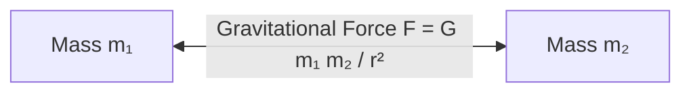
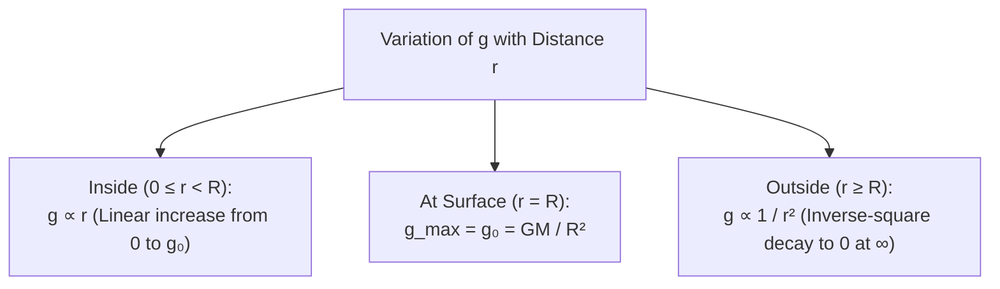
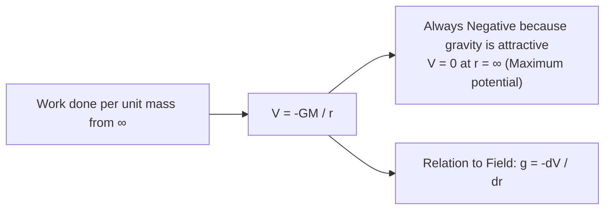
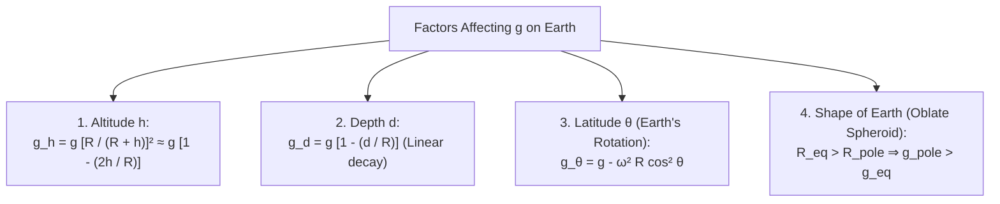
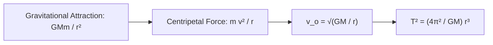
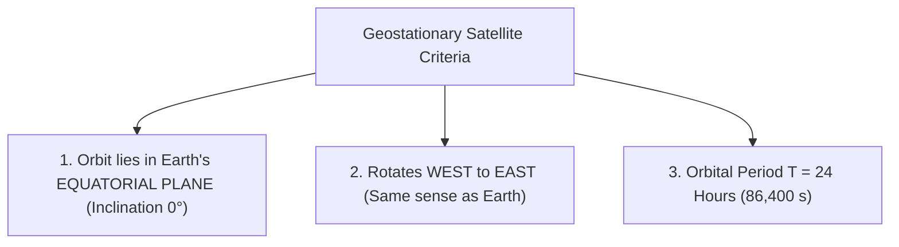

# :LiRocket: Lesson 05: Gravitational Field

> [!ABSTRACT] Syllabus Scope (NIE Teacher's Guide)
> - **5.1 Gravitational Force, Field Intensity & Potential**: Newton's Law of Universal Gravitation ($F = G\frac{Mm}{r^2}$), field intensity ($g$) inside and outside spherical masses, gravitational potential ($V = -\frac{GM}{r}$), potential gradient relation ($g = -\frac{dV}{dr}$), and potential energy ($U = -\frac{GMm}{r}$).
> - **5.2 Earth's Gravity, Satellites & Escape Velocity**: Variations of $g$ with altitude, depth, and latitude, derivation of circular orbital speed ($v_o = \sqrt{GM/r}$), Kepler's Third Law ($T^2 = \frac{4\pi^2}{GM}r^3$), bound state mechanical energy ($E = -E_k = \frac{1}{2}E_p$), geostationary vs. polar satellites, escape velocity ($v_e = \sqrt{2gR} \approx 11.2\text{ km/s}$), and planetary atmosphere retention.

---
## Deep Dive Subtopic Navigation

For mathematical proofs of the shell theorem, spherical mass integrations, neutral point coordinates, and orbital transfer energetics, refer to the specialized subtopic guide:

- :LiOrbit: **Gravitation & Orbits**: [[Subtopics/Gravitational Field & Satellite Dynamics|Gravitational Field & Satellite Dynamics Guide]]

---
## 1. Newton's Law of Gravitation & Force Fields (Competency 5.1)

### The Law of Universal Gravitation:
Every point mass attracts every other point mass in the universe with a force directed along the line joining them, directly proportional to the product of their masses and inversely proportional to the square of their separation:
$$F = G \frac{m_1 m_2}{r^2}$$

- **Universal Gravitational Constant ($G$)**:
  $$G \approx 6.674 \times 10^{-11}\text{ N}\cdot\text{m}^2\cdot\text{kg}^{-2} = 6.674 \times 10^{-11}\text{ m}^3\cdot\text{kg}^{-1}\cdot\text{s}^{-2}$$
  - Dimensions: $[G] = \mathsf{M}^{-1}\mathsf{L}^3\mathsf{T}^{-2}$.
  - Fundamental constant of nature; independent of medium, temperature, and chemical composition.

---

### Concept of a Gravitational Force Field:
A mass alters the properties of the surrounding space, establishing a **gravitational field** that exerts a force on any other mass introduced into that space (**action at a distance**):
- Represented visually by **gravitational field lines**:
  - Point radially inward toward the mass.
  - Direction of field line indicates direction of force on a test mass.
  - Density of lines represents the strength (magnitude) of the field.

---
## 2. Gravitational Field Intensity ($g$) (Competency 5.1 & 5.2)

### Definition:
The gravitational field intensity $\vec{g}$ at any point in a field is the **gravitational force exerted per unit test mass** placed at that point:
$$\vec{g} = \frac{\vec{F}}{m} \quad ([\mathsf{L}\mathsf{T}^{-2}], \text{N}\cdot\text{kg}^{-1} \text{ or } \text{m}\cdot\text{s}^{-2})$$

---

### Field Intensity of Point Mass & Uniform Spherical Mass:
1. **Point Mass $M$ or Outside a Solid Sphere of Radius $R$ ($r \ge R$)**:
   By Newton's shell theorem, a spherically symmetric mass acts gravitationally as if all its mass were concentrated at its geometric center:
   $$g = \frac{GM}{r^2}$$
2. **At Earth's Surface ($r = R$)**:
   $$g_0 = \frac{GM}{R^2} \approx 9.81\text{ m}\;\text{s}^{-2}$$
3. **Inside a Uniform Solid Sphere ($r < R$)**:
   Only the concentric spherical shell of mass within radius $r$ exerts a net gravitational force:
   $$g(r) = \frac{G M_{\text{in}}}{r^2} = \left(\frac{GM}{R^3}\right) r = g_0\left(\frac{r}{R}\right)$$

---

### Superposition & Neutral Points:
Because field intensity is a vector:
$$\vec{g}_{\text{net}} = \sum \vec{g}_i$$
- **Neutral Point**: A location where opposing gravitational forces from two or more celestial bodies balance out to zero ($\vec{g}_{\text{net}} = 0$).
  Between two masses $M_1$ and $M_2$ separated by distance $D$:
  $$\frac{GM_1}{x^2} = \frac{GM_2}{(D - x)^2} \implies x = \frac{D \sqrt{M_1}}{\sqrt{M_1} + \sqrt{M_2}}$$

---
## 3. Gravitational Potential & Potential Energy (Competencies 5.1 & 5.2)

### Gravitational Potential ($V$):
The gravitational potential $V$ at a point is the **work done per unit mass by an external agent** in bringing a test mass from infinity ($\infty$) to that point without accelerating it:
$$V(r) = -\int_\infty^r \vec{g} \cdot d\vec{r} = -\int_\infty^r \frac{GM}{r^2} dr = -\frac{GM}{r} \quad ([\mathsf{L}^2\mathsf{T}^{-2}], \text{J}\cdot\text{kg}^{-1})$$

- **Potential Inside a Solid Sphere ($r \le R$)**:
  $$V(r) = -\frac{GM}{2R^3}(3R^2 - r^2)$$
  - At the center of the sphere ($r = 0$):
    $$V_{\text{center}} = -\frac{3GM}{2R} = 1.5 V_{\text{surface}}$$

---

### Gravitational Potential Energy ($U$):
The potential energy of a mass $m$ placed at distance $r$ from central mass $M$:
$$U = m V = -\frac{GMm}{r}$$

#### Derivation of $U = mgh$ for Small Elevations ($h \ll R$):
Consider lifting a mass $m$ from Earth's surface ($r = R$) to altitude $h$ ($r = R + h$):
$$\Delta U = U(R + h) - U(R) = \left(-\frac{GMm}{R + h}\right) - \left(-\frac{GMm}{R}\right) = GMm\left(\frac{1}{R} - \frac{1}{R + h}\right)$$
$$\Delta U = GMm\left(\frac{h}{R(R + h)}\right)$$
When $h \ll R$, $(R + h) \approx R$:
$$\Delta U \approx \frac{GMm h}{R^2} = m\left(\frac{GM}{R^2}\right)h = mgh$$

---
## 4. Variations in Earth's Acceleration Due to Gravity ($g$) (Competency 5.2)

1. **Altitude ($h$)**:
   $$g_h = \frac{GM}{(R + h)^2} = g_0 \left(1 + \frac{h}{R}\right)^{-2} \approx g_0 \left(1 - \frac{2h}{R}\right) \quad (\text{for } h \ll R)$$
2. **Depth ($d$)**:
   $$g_d = g_0 \left(1 - \frac{d}{R}\right)$$
   *(Note: Near the surface, $g$ decreases **twice as fast with altitude** as it does with depth: $\Delta g_h \approx 2 \Delta g_d$).*
3. **Latitude ($\theta$) due to Earth's Rotation ($\omega = \frac{2\pi}{86400}\text{ rad/s}$)**:
   A body at latitude $\theta$ experiences an outward centrifugal acceleration $\omega^2 r = \omega^2 R\cos\theta$:
   $$g_\theta = g - \omega^2 R \cos^2\theta$$
   - At Equator ($\theta = 0^\circ$): Minimum gravity $g_{\text{equator}} = g - \omega^2 R \approx 9.78\text{ m}\;\text{s}^{-2}$.
   - At Poles ($\theta = 90^\circ$): Maximum gravity $g_{\text{pole}} = g \approx 9.83\text{ m}\;\text{s}^{-2}$.
4. **Oblate Spheroid Shape of Earth**:
   Equatorial radius is $\approx 21\text{ km}$ larger than polar radius ($R_{\text{equator}} \approx 6378\text{ km}, R_{\text{pole}} \approx 6357\text{ km}$), contributing to higher gravity at the poles.

---
## 5. Satellite Motion & Orbital Mechanics (Competency 5.2)

For a satellite of mass $m$ revolving around Earth (mass $M$, radius $R$) in a circular orbit of radius $r = R + h$:

### Orbital Quantities:
1. **Orbital Speed ($v_o$)**:
   $$\frac{m v_o^2}{r} = \frac{GMm}{r^2} \implies v_o = \sqrt{\frac{GM}{r}} = \sqrt{\frac{GM}{R + h}}$$
   - Near Earth's surface ($h \ll R$):
     $$v_o \approx \sqrt{\frac{GM}{R}} = \sqrt{gR} \approx 7.92\text{ km}\;\text{s}^{-1}$$
2. **Time Period & Kepler's Third Law**:
   $$T = \frac{2\pi r}{v_o} = \frac{2\pi r}{\sqrt{GM / r}} = \frac{2\pi r^{3/2}}{\sqrt{GM}}$$
   $$T^2 = \left(\frac{4\pi^2}{GM}\right) r^3 \implies T^2 \propto r^3$$

---

### Mechanical Energy of an Orbiting Satellite:
- **Kinetic Energy**:
  $$E_k = \frac{1}{2}m v_o^2 = \frac{1}{2}m\left(\frac{GM}{r}\right) = +\frac{GMm}{2r}$$
- **Potential Energy**:
  $$E_p = -\frac{GMm}{r}$$
- **Total Mechanical Energy ($E$)**:
  $$E = E_k + E_p = \frac{GMm}{2r} - \frac{GMm}{r} = -\frac{GMm}{2r}$$

> [!KEY-CONCEPT] Satellite Energy Triangle
> $$E = -E_k = \frac{1}{2}E_p$$
> - The total energy is **strictly negative**, confirming that the satellite is in a **gravitationally bound orbit**.
> - **Binding Energy**: The minimum energy that must be supplied to liberate the satellite to infinity:
>   $$\text{Binding Energy} = -E = +\frac{GMm}{2r}$$

---
## 6. Geostationary & Polar Satellites (Competency 5.2)

### Geostationary (Synchronous) Satellites:
A satellite that remains fixed over a specific geographic point on the equator:

#### Altitude Derivation:
$$T^2 = \frac{4\pi^2}{GM} r^3 \implies r = \left(\frac{GM T^2}{4\pi^2}\right)^{1/3}$$
Using $M = 5.98 \times 10^{24}\text{ kg}, T = 86,400\text{ s}, G = 6.674 \times 10^{-11}\text{ N}\cdot\text{m}^2\cdot\text{kg}^{-2}$:
$$r \approx 4.22 \times 10^7\text{ m} \approx 42,200\text{ km}$$
$$\text{Altitude } h = r - R = 42,200\text{ km} - 6,400\text{ km} \approx 35,800\text{ km} \approx 36,000\text{ km}$$
- **Uses**: Satellite television broadcasting, telecommunications, weather monitoring.

### Polar Orbiting Satellites:
- Low Earth Orbit (LEO): Altitude $h \approx 500 - 800\text{ km}$, orbital period $T \approx 90 - 100\text{ minutes}$.
- Passes over North and South poles; as Earth rotates eastward underneath, the satellite scans the entire planet surface every few days.
- **Uses**: High-resolution Earth observation, cartography, military reconnaissance, environmental monitoring.

---
## 7. Escape Velocity ($v_e$) & Planetary Atmospheres (Competency 5.2)

### Derivation of Escape Velocity:
The minimum initial velocity $v_e$ projected from the surface of a celestial body of mass $M$ and radius $R$ so that it completely overcomes the gravitational attraction and reaches infinity with zero residual kinetic energy:
$$E_{\text{surface}} = E_\infty \implies \frac{1}{2}m v_e^2 + \left(-\frac{GMm}{R}\right) = 0$$
$$\frac{1}{2}m v_e^2 = \frac{GMm}{R}$$
$$v_e = \sqrt{\frac{2GM}{R}} = \sqrt{2gR} = \sqrt{2} v_{\text{orbital, surface}}$$

- **Escape Velocity from Earth**:
  $$v_e = \sqrt{2 \times (9.81\text{ m/s}^2) \times (6.4 \times 10^6\text{ m})} \approx 11.2\text{ km}\;\text{s}^{-1}$$

---

### Escape Velocity & Planetary Atmospheres:
A celestial body can retain a gaseous atmosphere only if the **RMS thermal speed ($c_{\text{rms}}$) of the gas molecules is substantially lower than its escape velocity ($c_{\text{rms}} < \frac{1}{6}v_e$)**:
$$c_{\text{rms}} = \sqrt{\frac{3RT}{M_{\text{molar}}}}$$
- **Why the Moon has NO Atmosphere**:
  - $v_{e,\text{moon}} = \sqrt{2 g_m R_m} \approx \sqrt{2 \times 1.6 \times (1.74 \times 10^6)} \approx 2.38\text{ km}\;\text{s}^{-1}$.
  - During the lunar daytime ($T \approx 400\text{ K}$), the thermal speeds of gases like $O_2, N_2, H_2O$ fall in the range $0.6 - 1.8\text{ km/s}$. Since molecular speeds follow a Maxwell-Boltzmann distribution, high-energy tails continuously exceeded $2.4\text{ km/s}$, allowing the gases to bleed into space over cosmological time.

---
## 8. Worked Examination Problems

### Example 1: Neutral Point Between Earth and Moon
**Problem:** Earth has mass $M_e = 81 M_m$ (where $M_m$ is the mass of the Moon). The distance between their centers is $D \approx 3.84 \times 10^5\text{ km}$. Find the distance of the neutral point from Earth's center.

**Solution:**
At the neutral point, gravitational field intensities due to Earth and Moon are equal in magnitude and opposite in direction:
$$\frac{GM_e}{x^2} = \frac{GM_m}{(D - x)^2}$$
$$\frac{81 M_m}{x^2} = \frac{M_m}{(D - x)^2} \implies \frac{9}{x} = \frac{1}{D - x}$$
$$9(D - x) = x \implies 9D - 9x = x \implies 10x = 9D$$
$$x = \frac{9}{10}D = 0.9 \times 3.84 \times 10^5\text{ km} = 3.456 \times 10^5\text{ km from Earth's center}$$

---

### Example 2: Satellite Orbit Transfer & Binding Energy
**Problem:** A satellite of mass $m = 500\text{ kg}$ orbits Earth at an altitude equal to Earth's radius ($h = R = 6.4 \times 10^6\text{ m}$). Taking $g = 10\text{ m}\;\text{s}^{-2}$:
1. Find its orbital speed.
2. Find its total mechanical energy.
3. What is the binding energy required to send it completely into deep space?

**Solution:**
1. **Orbital Speed**:
   Orbital radius $r = R + h = 2R$.
   $$v_o = \sqrt{\frac{GM}{r}} = \sqrt{\frac{GM}{2R}} = \sqrt{\frac{gR^2}{2R}} = \sqrt{\frac{gR}{2}}$$
   $$v_o = \sqrt{\frac{10 \times (6.4 \times 10^6)}{2}} = \sqrt{3.2 \times 10^7} \approx 5657\text{ m}\;\text{s}^{-1} \approx 5.66\text{ km}\;\text{s}^{-1}$$
2. **Total Mechanical Energy**:
   $$E = -\frac{GMm}{2r} = -\frac{gR^2 m}{2(2R)} = -\frac{mgR}{4}$$
   $$E = -\frac{500 \times 10 \times (6.4 \times 10^6)}{4} = -8.0 \times 10^9\text{ J} = -8.0\text{ GJ}$$
3. **Binding Energy**:
   $$\text{Binding Energy} = -E = +8.0\text{ GJ}$$

---
## :LiRocket: Flashcards (Spaced Repetition)

#flashcards

State Newton's Law of Universal Gravitation. :: $F = G \frac{m_1 m_2}{r^2}$.

What is the gravitational potential $V$ at distance $r$ from mass $M$? :: $V = -\frac{GM}{r}$.

State Kepler's Third Law of Planetary Motion. :: The square of the orbital period $T$ of a satellite is directly proportional to the cube of the orbital radius $r$ ($T^2 \propto r^3$).

What is the orbital speed $v_o$ of a satellite orbiting at distance $r$ from Earth's center? :: $v_o = \sqrt{\frac{GM}{r}}$.
<!--SR:!2026-09-26,1,230-->

What is Escape Velocity, and what is its value at Earth's surface? :: The minimum initial velocity required for an object to escape a body's gravitational field permanently; $v_e = \sqrt{2gR} \approx 11.2\text{ km/s}$.
<!--SR:!2026-09-26,1,230-->

Define Gravitational Field Intensity ($g$). :: The gravitational force exerted per unit mass placed at that point in the field ($\vec{g} = \vec{F}/m$).

How does gravitational field intensity $g$ vary with distance $r$ inside a uniform solid sphere of radius $R$? :: It increases linearly from zero at the center to maximum at the surface: $g(r) = \left(\frac{GM}{R^3}\right)r = g_0\left(\frac{r}{R}\right)$.

Why is gravitational potential always negative? :: Gravitational attraction does positive work as a mass approaches from infinity; since potential at infinity is defined as zero, potential anywhere in the field must be negative.

How are gravitational field intensity and gravitational potential related? :: $g = -\frac{dV}{dr}$ (field intensity equals the negative potential gradient).

State the formula for acceleration due to gravity $g_h$ at an altitude $h \ll R$ above Earth's surface. :: $g_h \approx g\left(1 - \frac{2h}{R}\right)$.

State the formula for acceleration due to gravity $g_d$ at depth $d$ below Earth's surface. :: $g_d = g\left(1 - \frac{d}{R}\right)$.

State the relationships between Total Energy $E$, Kinetic Energy $E_k$, and Potential Energy $E_p$ of an orbiting satellite. :: $E = -E_k = \frac{1}{2}E_p = -\frac{GMm}{2r}$.

What are the three essential orbital conditions for a satellite to be Geostationary? :: 1. Orbit lies in the equatorial plane; 2. Rotates West to East; 3. Orbital period is exactly 24 hours ($T = 86,400\text{ s}$, altitude $\approx 35,800\text{ km}$).

What is the relationship between escape velocity $v_e$ and orbital velocity $v_o$ near Earth's surface? :: $v_e = \sqrt{2} v_o$.

Why does the Moon have no atmosphere? :: The Moon's escape velocity is low ($\approx 2.4\text{ km/s}$); molecular thermal speeds of atmospheric gases exceed this escape threshold, allowing gases to leak into space.
