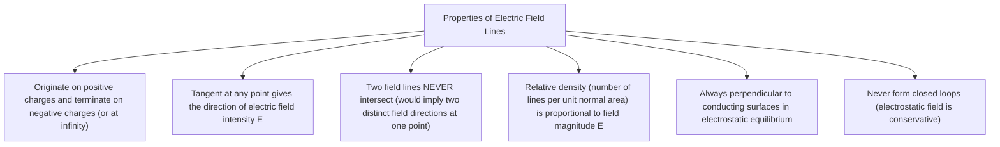
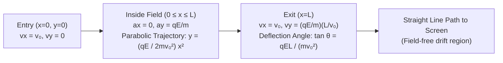
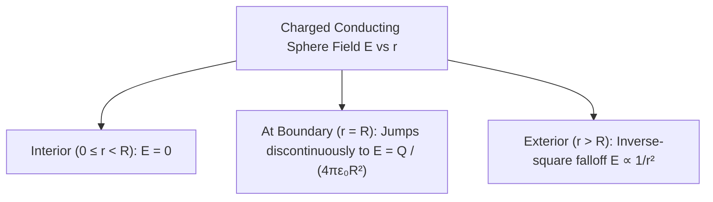
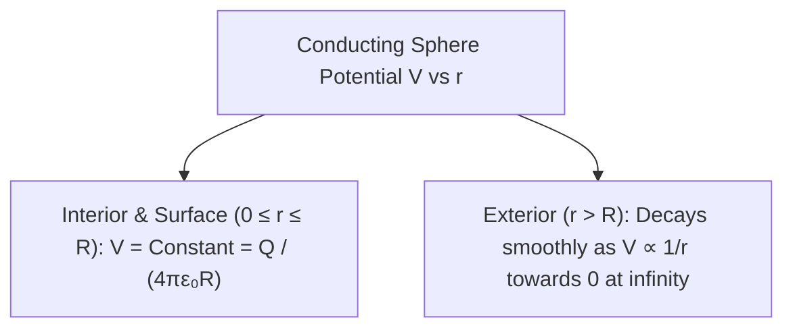
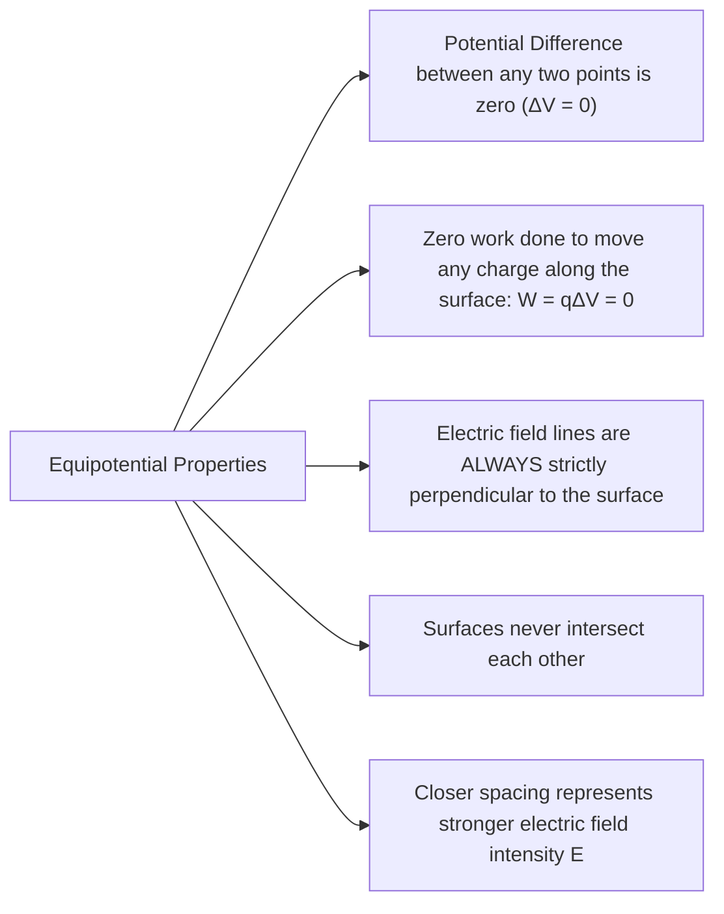
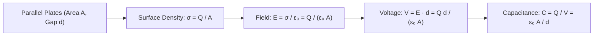
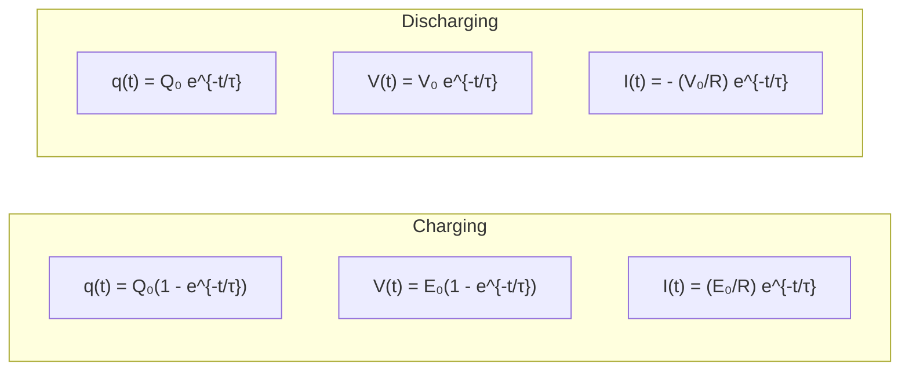

# :LiZap: Lesson 06: Electrostatic Field

> [!ABSTRACT] Syllabus Scope (NIE Teacher's Guide)
> - **6.1 Coulomb's Law & Electric Field Intensity**: Coulomb's law ($F = \frac{1}{4\pi\varepsilon_0\varepsilon_r}\frac{q_1 q_2}{r^2}$), permittivity of free space ($\varepsilon_0 = 8.854 \times 10^{-12}\text{ F}\cdot\text{m}^{-1}$) and media ($\varepsilon_r$), electric field intensity ($\vec{E} = \vec{F}/q_0$), superposition of electric fields, field lines and their properties, kinematics of charged particles in uniform electric fields.
> - **6.2 Flux Model & Gauss's Theorem**: Concept of electric flux ($\Phi_E = \oint \vec{E}\cdot d\vec{A}$), Gauss's law statement ($\Phi = \frac{Q_{\text{enclosed}}}{\varepsilon}$), systematic derivations of field intensity for point charges, charged conducting spheres (interior $E=0$ and exterior), infinite non-conducting plane sheets ($E = \frac{\sigma}{2\varepsilon}$), infinite conducting plates ($E = \frac{\sigma}{\varepsilon}$), and infinite long thin wires ($E = \frac{\lambda}{2\pi\varepsilon r}$), graphical variations of $E$ vs $r$.
> - **6.3 Electric Potential & Potential Energy**: Definition of electric potential ($V = W_{\infty}/q$), potential due to point charges and spherical conductors ($V = \frac{Q}{4\pi\varepsilon R}$ constant inside), potential difference ($\Delta V$), definition of the electron-volt ($1\text{ eV} = 1.602 \times 10^{-19}\text{ J}$), relationship between field intensity and potential gradient ($E = -\frac{dV}{dr}$ and $E = V/d$), electric potential energy of point charges ($U = \frac{1}{4\pi\varepsilon}\frac{q_1 q_2}{r}$), equipotential surfaces and properties.
> - **6.4 Capacitors & Dielectrics**: Capacitance ($C = Q/V$, Farad), capacitance derivations for parallel-plate ($C = \frac{\varepsilon_0\varepsilon_r A}{d}$) and isolated conducting spheres ($C = 4\pi\varepsilon_0 R$), dielectric polarization and slab insertion effects, series and parallel capacitor combinations, derivations of stored electrostatic energy ($U = \frac{1}{2}QV = \frac{1}{2}CV^2 = \frac{Q^2}{2C}$) and energy density ($u_E = \frac{1}{2}\varepsilon_0\varepsilon_r E^2$), charge sharing between capacitors and energy loss formula ($\Delta U = \frac{1}{2}\frac{C_1 C_2}{C_1 + C_2}(V_1 - V_2)^2$), surface charge density on conductors ($\sigma \propto 1/\rho$), action of points and corona discharge, RC circuit charging and discharging transients ($\tau = RC$).

---
## Deep Dive Subtopic Navigation

For mathematical proofs of Gauss's Law derivations, dielectric boundary conditions, and step-by-step RC transient differential equations, refer to the companion subtopic guide:

- :LiCloudLightning: **Electrostatics**: [[Subtopics/Electric Fields & Capacitors|Electric Fields & Capacitors Guide]]

---
## 1. Coulomb's Law & Electric Fields (Competency 6.1)

### Fundamental Nature of Electric Charge:
* **Quantization of Charge:** Electric charge occurs only in discrete integral multiples of the elementary charge $e \approx 1.602 \times 10^{-19}\text{ C}$:
  $$Q = \pm n e \quad (n \in \mathbb{Z}^+)$$
* **Conservation of Charge:** The algebraic sum of all electric charges in an electrically isolated system remains strictly constant.

---

### Coulomb's Law:
The electrostatic force of attraction or repulsion between two stationary point charges is directly proportional to the product of the magnitudes of the charges and inversely proportional to the square of the distance separating them, acting along the line joining the centers:
$$F = \frac{1}{4\pi\varepsilon} \frac{|q_1 q_2|}{r^2}$$

```mermaid
graph LR
    Q1["Point Charge q₁"] <-->|Electrostatic Force F = (1 / 4πε) · (q₁q₂ / r²)| Q2["Point Charge q₂"]
```

- **Permittivity of Free Space ($\varepsilon_0$):**
  $$\varepsilon_0 \approx 8.854 \times 10^{-12}\text{ C}^2\cdot\text{N}^{-1}\cdot\text{m}^{-2} = 8.854 \times 10^{-12}\text{ F}\cdot\text{m}^{-1}$$
  - Coulomb constant in vacuum: $k_e = \frac{1}{4\pi\varepsilon_0} \approx 8.988 \times 10^9\text{ N}\cdot\text{m}^2\cdot\text{C}^{-2}$.
  - Dimensions of $\varepsilon_0$: $[\varepsilon_0] = \mathsf{M}^{-1}\mathsf{L}^{-3}\mathsf{T}^4\mathsf{I}^2$.
- **Relative Permittivity (Dielectric Constant $\varepsilon_r$ or $k$):**
  $$\varepsilon_r = \frac{\varepsilon}{\varepsilon_0} = \frac{F_{\text{vacuum}}}{F_{\text{medium}}}$$
  - For vacuum or dry air, $\varepsilon_r \approx 1.00$.
  - For pure water at $20^\circ\text{C}$, $\varepsilon_r \approx 80$.
  - For any material medium, $\varepsilon_r > 1$, which means the electrostatic force between charges is reduced by a factor of $\varepsilon_r$.

---

### Electric Field Intensity ($\vec{E}$):
The electric field intensity at any point in space is defined as the electrostatic force experienced per unit positive infinitesimal test charge ($q_0$) placed at that point:
$$\vec{E} = \lim_{q_0 \to 0} \frac{\vec{F}}{q_0} \quad \left([\vec{E}] = \mathsf{M}\mathsf{L}\mathsf{T}^{-3}\mathsf{I}^{-1}, \text{ units: }\text{N}\cdot\text{C}^{-1}\text{ or }\text{V}\cdot\text{m}^{-1}\right)$$

* **Point Charge $Q$ at distance $r$:**
  $$E = \frac{1}{4\pi\varepsilon_0 \varepsilon_r} \frac{Q}{r^2}$$
* **Superposition Principle:** The resultant electric field at a point due to a system of discrete charges $q_1, q_2, \dots, q_n$ is the vector sum of individual electric fields:
  $$\vec{E}_{\text{net}} = \sum_{i=1}^n \vec{E}_i = \vec{E}_1 + \vec{E}_2 + \dots + \vec{E}_n$$

---

### Electric Field Lines (Lines of Force):
Imaginary smooth lines or curves drawn in an electric field such that the tangent at any point gives the direction of the electric field intensity vector $\vec{E}$ at that point.



#### Field Line Geometries:
1. **Isolated Positive Charge ($+Q$):** Radially outwards in all three dimensions.
2. **Isolated Negative Charge ($-Q$):** Radially inwards towards the charge.
3. **Electric Dipole ($+Q$ and $-Q$):** Curved lines curving from $+Q$ to $-Q$; dense in the region between charges.
4. **Like Charges ($+Q$ and $+Q$):** Flaring outwards, repelling each other; a **neutral point ($E = 0$)** exists midway where fields cancel.
5. **Uniform Field Between Parallel Charged Plates:** Straight, parallel, and equally spaced lines directed from the positive plate to the negative plate (edge fringing effects occur near plate borders).

---

### Motion of a Charged Particle in a Uniform Electric Field:
Consider an electron or proton of charge $q$ and mass $m$ entering a transverse uniform electric field $\vec{E} = -E\hat{j}$ between parallel horizontal plates of length $L$ with initial horizontal speed $u_x = v_0$:



1. **Horizontal Kinematics ($a_x = 0$):**
   $$x(t) = v_0 t \implies t = \frac{x}{v_0}$$
2. **Vertical Kinematics ($F_y = qE \implies a_y = \frac{qE}{m}$):**
   $$y(t) = \frac{1}{2} a_y t^2 = \frac{1}{2} \left(\frac{qE}{m}\right) \left(\frac{x}{v_0}\right)^2 = \left(\frac{qE}{2m v_0^2}\right) x^2$$
   * **Path Equation:** Parabolic curve ($y \propto x^2$).
3. **Velocity at Exit ($x = L$):**
   $$v_x = v_0, \quad v_y = a_y t_{\text{exit}} = \frac{q E L}{m v_0}$$
   $$\tan\theta = \frac{v_y}{v_x} = \frac{q E L}{m v_0^2}$$
   * The path inside the electric field is identical to projectile motion under gravity.

---

## 2. Electric Flux & Gauss's Law (Competency 6.2)

### Electric Flux ($\Phi_E$):
Electric flux represents the net count of electric field lines penetrating a surface of area $A$:
$$\Phi_E = \int \vec{E} \cdot d\vec{A} = \int E \cos\theta \, dA$$
* For a flat area $A$ in a uniform field $\vec{E}$: $\Phi_E = E A \cos\theta$, where $\theta$ is the angle between $\vec{E}$ and the surface normal unit vector $\hat{n}$.
* **SI Units:** $\text{N}\cdot\text{m}^2\cdot\text{C}^{-1}$ or $\text{V}\cdot\text{m}$.

---

### Statement of Gauss's Law:
The total normal electric flux through any closed imaginary surface (known as a **Gaussian surface**) is equal to the net electric charge enclosed by that surface divided by the permittivity of the medium ($\varepsilon = \varepsilon_0 \varepsilon_r$):
$$\Phi_{\text{net}} = \oint_{\mathcal{S}} \vec{E} \cdot d\vec{A} = \frac{Q_{\text{enclosed}}}{\varepsilon}$$

> [!IMPORTANT] Essential Conditions for Applying Gauss's Law
> Gauss's Law is valid for any closed surface and any arbitrary charge distribution. However, it is practically useful for evaluating $\vec{E}$ analytically only when the charge distribution possesses a high degree of spatial symmetry (spherical, cylindrical, or planar symmetry), enabling $E$ to be factored out of the surface integral.

---

### Systematic Derivations Using Gauss's Law:

#### 1. Electric Field Due to an Isolated Point Charge $Q$:
* **Symmetry:** Spherical symmetry.
* **Gaussian Surface:** A concentric spherical surface of radius $r$ centered at $Q$.
* **Flux Evaluation:**
  $$\oint \vec{E} \cdot d\vec{A} = \oint E \, dA = E \oint dA = E (4\pi r^2)$$
* **Applying Gauss's Law:**
  $$E (4\pi r^2) = \frac{Q}{\varepsilon_0} \implies E = \frac{1}{4\pi\varepsilon_0} \frac{Q}{r^2} \quad \text{(Coulomb's Law proven)}$$

---

#### 2. Charged Conducting Sphere (Radius $R$, Total Charge $Q$):
On a conducting sphere in electrostatic equilibrium, all free excess charge resides entirely on the outermost surface with surface charge density $\sigma = \frac{Q}{4\pi R^2}$.

1. **Inside the Sphere ($r < R$):**
   * A concentric Gaussian sphere of radius $r < R$ encloses no charge ($Q_{\text{enclosed}} = 0$).
   $$\oint \vec{E} \cdot d\vec{A} = E (4\pi r^2) = \frac{0}{\varepsilon_0} \implies E_{\text{inside}} = 0$$
2. **At the Surface ($r = R$):**
   $$E_{\text{surface}} = \frac{1}{4\pi\varepsilon_0} \frac{Q}{R^2} = \frac{\sigma}{\varepsilon_0}$$
3. **Outside the Sphere ($r > R$):**
   * A concentric Gaussian sphere of radius $r > R$ encloses the full charge $Q$.
   $$E_{\text{outside}} = \frac{1}{4\pi\varepsilon_0} \frac{Q}{r^2} = \frac{\sigma R^2}{\varepsilon_0 r^2}$$



---

#### 3. Infinite Non-Conducting Sheet of Charge (Surface Charge Density $\sigma$):
* **Geometry:** Infinite flat planar dielectric sheet carrying uniform surface charge density $\sigma = \frac{Q}{A}$.
* **Gaussian Surface:** A small cylinder ("pillbox") of cross-sectional area $A$ piercing perpendicular to the sheet, with its two circular end faces parallel to the sheet at distance $r$ on opposite sides.
* **Flux Evaluation:**
  * By symmetry, $\vec{E}$ is directed normally outward from both faces.
  * No flux crosses the cylindrical side walls ($\vec{E} \perp d\vec{A} \implies \vec{E}\cdot d\vec{A} = 0$).
  * Flux emerges equally from both circular end caps:
    $$\Phi_{\text{net}} = E A + E A = 2 E A$$
* **Applying Gauss's Law:**
  $$2 E A = \frac{\sigma A}{\varepsilon_0} \implies E = \frac{\sigma}{2\varepsilon_0}$$
  * **Key Result:** The electric field near an infinite sheet of charge is **strictly uniform** and completely **independent of distance** $r$ from the sheet.

---

#### 4. Infinite Charged Conducting Plate:
* In a conductor of finite thickness, free charge distributes itself on both external surfaces.
* Construct a Gaussian pillbox where one end cap of area $A$ lies in air outside the conductor, and the other end cap lies inside the metallic body of the conductor where $E = 0$:
  $$\Phi_{\text{net}} = E A + 0 = E A$$
* Applying Gauss's Law:
  $$E A = \frac{\sigma A}{\varepsilon_0} \implies E = \frac{\sigma}{\varepsilon_0}$$
  * The field immediately outside a conducting surface is **twice** that of a single non-conducting sheet carrying the same surface charge density.

---

#### 5. Infinite Uniform Line Charge / Thin Charged Wire (Linear Density $\lambda$):
* **Geometry:** An infinitely long straight wire carrying uniform linear charge density $\lambda = \frac{Q}{L}$ ($\text{C}\cdot\text{m}^{-1}$).
* **Gaussian Surface:** A coaxial cylinder of radius $r$ and length $L$ surrounding the wire.
* **Flux Evaluation:**
  * Field lines are radially directed outwards perpendicular to the axis of the wire.
  * Flux through circular flat ends = $0$ ($\vec{E} \parallel$ end surfaces).
  * Flux through curved cylindrical surface of area $2\pi r L$:
    $$\Phi_{\text{net}} = E (2\pi r L)$$
* **Applying Gauss's Law:**
  $$E (2\pi r L) = \frac{\lambda L}{\varepsilon_0} \implies E = \frac{\lambda}{2\pi\varepsilon_0 r}$$
  * **Variation:** $E \propto \frac{1}{r}$ (inverse-linear decay, contrasting with inverse-square decay of point charges).

---

### Electrostatic Shielding (Faraday Cage):
* Inside a hollow conductor of any shape, the electric field is strictly **zero ($E = 0$)**, regardless of what charges are present outside the conductor.
* **Mechanism:** External electric fields induce surface charges on the outside of the conductor that generate an internal field exactly equal in magnitude and opposite in direction to the external field, canceling it completely.
* **Applications:** Sensitive electronic instrumentation shielded within metal enclosures, coaxial cables with grounded braided outer shields, cars and aircraft providing lightning safety.

---

## 3. Electric Potential & Potential Energy (Competency 6.3)

### Electric Potential ($V$):
The electric potential at a point in an electric field is defined as the work done by an external agent in bringing a unit positive test charge at constant speed from infinity to that point against the electrostatic forces:
$$V = \frac{W_{\infty \to P}}{q_0} \quad \left([V] = \mathsf{M}\mathsf{L}^2\mathsf{T}^{-3}\mathsf{I}^{-1}, \text{ unit: Volt (V)} = 1\text{ J}\cdot\text{C}^{-1}\right)$$

* Electric potential is a **scalar quantity**. The algebraic sign of the charge must be explicitly included ($+Q \implies V > 0$, $-Q \implies V < 0$).

---

### Potential Due to a Point Charge:
To bring a unit test charge from $\infty$ to distance $r$ from charge $+Q$:
$$V = -\int_\infty^r E \, dr = -\int_\infty^r \frac{Q}{4\pi\varepsilon_0 r^2} dr = \left[\frac{Q}{4\pi\varepsilon_0 r}\right]_\infty^r = \frac{1}{4\pi\varepsilon_0} \frac{Q}{r}$$

For a system of $n$ point charges, by scalar superposition:
$$V_{\text{net}} = \sum_{i=1}^n \frac{1}{4\pi\varepsilon_0} \frac{q_i}{r_i} = \frac{1}{4\pi\varepsilon_0} \left(\frac{q_1}{r_1} + \frac{q_2}{r_2} + \dots + \frac{q_n}{r_n}\right)$$

---

### Potential Due to a Charged Conducting Sphere (Radius $R$, Charge $Q$):
1. **Outside the Sphere ($r \ge R$):**
   $$V = \frac{1}{4\pi\varepsilon_0} \frac{Q}{r}$$
2. **At the Surface ($r = R$):**
   $$V_0 = \frac{1}{4\pi\varepsilon_0} \frac{Q}{R}$$
3. **Inside the Sphere ($r < R$):**
   * Since $E = -\frac{dV}{dr} = 0$ inside a conducting body, the rate of change of potential is zero:
     $$\frac{dV}{dr} = 0 \implies V = \text{constant}$$
   * The potential at any interior point is identical to the surface potential:
     $$V_{\text{inside}} = V_{\text{surface}} = \frac{1}{4\pi\varepsilon_0} \frac{Q}{R}$$



---

### Potential Difference ($\Delta V$) & Work Done:
The potential difference between points $A$ and $B$ is the work done per unit positive charge in displacing it from $A$ to $B$:
$$\Delta V = V_B - V_A = \frac{W_{A \to B}}{q_0}$$
* **Work done on charge $q$:**
  $$W = q (V_B - V_A) = q \Delta V$$
* **The Electron-Volt ($\text{eV}$):** Defined as the kinetic energy acquired or lost by a single electron moving through a potential difference of 1 Volt:
  $$1\text{ eV} = (1.602 \times 10^{-19}\text{ C}) \times (1\text{ V}) = 1.602 \times 10^{-19}\text{ J}$$
  $$1\text{ MeV} = 10^6\text{ eV} = 1.602 \times 10^{-13}\text{ J}$$

---

### Relation Between Electric Field Intensity and Potential:
Consider moving a charge through infinitesimal displacement $d\vec{r}$ in an electric field $\vec{E}$:
$$dW = \vec{F}_{\text{ext}} \cdot d\vec{r} = -q_0 \vec{E} \cdot d\vec{r} \implies dV = \frac{dW}{q_0} = -\vec{E} \cdot d\vec{r}$$
In one dimension:
$$E = -\frac{dV}{dr}$$
* **Significance of Minus Sign:** The electric field vector $\vec{E}$ points in the direction in which electric potential **decreases most steeply**.
* **Uniform Field:** For a uniform electric field between parallel plates separated by distance $d$ across voltage $V$:
  $$E = \frac{V}{d} \quad \left(1\text{ V}\cdot\text{m}^{-1} = 1\text{ N}\cdot\text{C}^{-1}\right)$$

---

### Electrostatic Potential Energy ($U$):
The electrostatic potential energy of a system of charges is the total work done by external forces in assembling the charges from an infinite mutual separation to their final configuration:
* **Two Point Charges ($q_1$ and $q_2$ separated by $r$):**
  $$U = q_2 V_1 = \frac{1}{4\pi\varepsilon_0} \frac{q_1 q_2}{r}$$
  * If $q_1, q_2$ have like signs: $U > 0$ (repulsive system, work must be done on the system to bring them together).
  * If $q_1, q_2$ have opposite signs: $U < 0$ (attractive bound system).
* **System of Three Charges ($q_1, q_2, q_3$):**
  $$U_{\text{total}} = \frac{1}{4\pi\varepsilon_0} \left(\frac{q_1 q_2}{r_{12}} + \frac{q_1 q_3}{r_{13}} + \frac{q_2 q_3}{r_{23}}\right)$$

---

### Equipotential Surfaces:
An equipotential surface is any surface over which the electric potential is identical at every point ($V = \text{constant}$).



#### Shapes of Equipotential Surfaces:
1. **Isolated Point Charge:** Concentric spherical surfaces centered on the charge.
2. **Uniform Electric Field:** Infinite parallel flat planes perpendicular to the field lines.
3. **Conducting Body in Equilibrium:** The entire conducting volume and its external surface form an equipotential region.

---

## 4. Capacitors & Dielectrics (Competency 6.4)

### Definition of Capacitance ($C$):
A capacitor is a device designed to store electric charge and electrostatic potential energy. The capacitance $C$ of a capacitor is defined as the magnitude of charge $Q$ on either conductor per unit potential difference $V$ between the conductors:
$$C = \frac{Q}{V} \quad \left([C] = \mathsf{M}^{-1}\mathsf{L}^{-2}\mathsf{T}^4\mathsf{I}^2, \text{ unit: Farad (F)} = 1\text{ C}\cdot\text{V}^{-1}\right)$$
* Practical units: Microfarad ($1\ \mu\text{F} = 10^{-6}\text{ F}$), Nanofarad ($1\text{ nF} = 10^{-9}\text{ F}$), Picofarad ($1\text{ pF} = 10^{-12}\text{ F}$).

---

### Derivation: Parallel-Plate Capacitor:
Consider two planar parallel conducting plates each of surface area $A$, separated by an insulating gap $d$, carrying equal and opposite charges $+Q$ and $-Q$:



1. **Surface Charge Density:** $\sigma = \frac{Q}{A}$.
2. **Electric Field Between Plates:** By Gauss's Law, the fields from both plates superimpose constructively between the plates:
   $$E = \frac{\sigma}{2\varepsilon_0} + \frac{\sigma}{2\varepsilon_0} = \frac{\sigma}{\varepsilon_0} = \frac{Q}{\varepsilon_0 A}$$
3. **Potential Difference Between Plates:**
   $$V = E d = \frac{Q d}{\varepsilon_0 A}$$
4. **Capacitance Expression:**
   $$C = \frac{Q}{V} = \frac{\varepsilon_0 A}{d}$$
* If a dielectric medium of relative permittivity $\varepsilon_r$ fills the entire space between the plates:
  $$C = \frac{\varepsilon_0 \varepsilon_r A}{d} = \varepsilon_r C_0$$

---

### Capacitance of an Isolated Conducting Sphere:
For an isolated conducting sphere of radius $R$ carrying charge $Q$ in vacuum:
$$V = \frac{Q}{4\pi\varepsilon_0 R} \implies C = \frac{Q}{V} = 4\pi\varepsilon_0 R$$
* *Earth's Capacitance Example:* For Earth ($R \approx 6.4 \times 10^6\text{ m}$):
  $$C_{\text{Earth}} = 4\pi (8.854 \times 10^{-12}) (6.4 \times 10^6) \approx 711\ \mu\text{F}$$

---

### Dielectric Materials & Polarization:
When an insulator (dielectric) is introduced into an electric field:
* Electric dipoles align with the external field, producing **dielectric polarization**.
* An induced surface bound charge ($Q_i$) appears on the dielectric faces, producing an internal induced electric field $\vec{E}_i$ opposing the applied field $\vec{E}_0$.
* The net electric field inside the dielectric is reduced:
  $$E_{\text{net}} = E_0 - E_i = \frac{E_0}{\varepsilon_r}$$

#### Systematic Comparison: Inserting a Dielectric Slab ($\varepsilon_r > 1$):

| Physical Quantity | Symbol | Case 1: Battery Disconnected Before Insertion ($Q = \text{const}$) | Case 2: Battery Remains Connected ($V = \text{const}$) |
| :--- | :---: | :--- | :--- |
| **Charge** | $Q$ | Remains constant ($Q = Q_0$) | Increases: $Q = \varepsilon_r Q_0$ |
| **Capacitance** | $C$ | Increases: $C = \varepsilon_r C_0$ | Increases: $C = \varepsilon_r C_0$ |
| **Potential Difference** | $V$ | Decreases: $V = \frac{V_0}{\varepsilon_r}$ | Remains constant ($V = V_0$) |
| **Electric Field Intensity** | $E$ | Decreases: $E = \frac{E_0}{\varepsilon_r}$ | Remains constant ($E = E_0 = \frac{V_0}{d}$) |
| **Stored Potential Energy** | $U$ | Decreases: $U = \frac{U_0}{\varepsilon_r}$<br>*(Field does positive work pulling dielectric in)* | Increases: $U = \varepsilon_r U_0$<br>*(Battery supplies energy $W_{\text{bat}} = \Delta Q \cdot V$)* |

---

### Combinations of Capacitors:

#### 1. Capacitors in Series:
Capacitors connected end-to-end such that each carries the **identical electric charge $Q$**:


* Total potential difference: $V = V_1 + V_2 + \dots + V_n$.
* Since $V_i = \frac{Q}{C_i}$:
  $$\frac{Q}{C_{\text{eq}}} = \frac{Q}{C_1} + \frac{Q}{C_2} + \dots + \frac{Q}{C_n}$$
  $$\frac{1}{C_{\text{eq}}} = \sum_{i=1}^n \frac{1}{C_i} = \frac{1}{C_1} + \frac{1}{C_2} + \dots + \frac{1}{C_n}$$
* **Special Case for Two Capacitors in Series:**
  $$C_{\text{eq}} = \frac{C_1 C_2}{C_1 + C_2}$$
  * Note: $C_{\text{eq}}$ is always **smaller than the smallest** individual capacitance in the series combination.

---

#### 2. Capacitors in Parallel:
Capacitors connected across the same two common nodes such that each experiences the **identical potential difference $V$**:
* Total charge: $Q_{\text{total}} = Q_1 + Q_2 + \dots + Q_n$.
* Since $Q_i = C_i V$:
  $$C_{\text{eq}} V = C_1 V + C_2 V + \dots + C_n V$$
  $$C_{\text{eq}} = \sum_{i=1}^n C_i = C_1 + C_2 + \dots + C_n$$
* Note: $C_{\text{eq}}$ is always **larger than the largest** individual capacitance in the parallel combination.

---

### Electrostatic Energy Stored in a Charged Capacitor:
When charging a capacitor from charge $0$ to $Q$, transferring an increment $dq$ against instantaneous potential $v = \frac{q}{C}$ requires external work:
$$dW = v \, dq = \frac{q}{C} dq$$
Integrating from $q = 0$ to $q = Q$:
$$W = \int_0^Q \frac{q}{C} dq = \left[\frac{q^2}{2C}\right]_0^Q = \frac{Q^2}{2C}$$
Substituting $Q = CV$:
$$U = \frac{1}{2} Q V = \frac{1}{2} C V^2 = \frac{Q^2}{2C}$$

* **Electrostatic Energy Density ($u_E$):**
  The energy per unit volume of the electric field:
  $$u_E = \frac{U}{\text{Volume}} = \frac{\frac{1}{2} C V^2}{A d} = \frac{\frac{1}{2} \left(\frac{\varepsilon_0 \varepsilon_r A}{d}\right) (E d)^2}{A d} = \frac{1}{2} \varepsilon_0 \varepsilon_r E^2 \quad (\text{J}\cdot\text{m}^{-3})$$

---

### Charge Redistribution & Energy Loss Between Two Connected Capacitors:
Consider capacitor $C_1$ charged to potential $V_1$ connected in parallel to capacitor $C_2$ charged to potential $V_2$:
1. **Conservation of Total Charge:**
   $$Q_{\text{total}} = C_1 V_1 + C_2 V_2$$
2. **Common Equilibrium Potential ($V_c$):**
   $$V_c = \frac{Q_{\text{total}}}{C_1 + C_2} = \frac{C_1 V_1 + C_2 V_2}{C_1 + C_2}$$
3. **Loss of Stored Electrostatic Energy ($\Delta U = U_{\text{initial}} - U_{\text{final}}$):**
   $$U_i = \frac{1}{2} C_1 V_1^2 + \frac{1}{2} C_2 V_2^2$$
   $$U_f = \frac{1}{2} (C_1 + C_2) V_c^2 = \frac{1}{2} \frac{(C_1 V_1 + C_2 V_2)^2}{C_1 + C_2}$$
   $$\Delta U = U_i - U_f = \frac{1}{2} \frac{C_1 C_2}{C_1 + C_2} (V_1 - V_2)^2$$
* **Physical Significance:** Since $(V_1 - V_2)^2 > 0$, $\Delta U$ is **strictly positive** whenever $V_1 \neq V_2$. Electrostatic energy is **always dissipated** during charge equalization as **Joule heat** ($I^2 R$) in the connecting leads and **electromagnetic spark radiation**.

---

### Surface Charge Distribution & Action of Points (Corona Discharge):
* On an isolated charged conductor of arbitrary non-spherical shape:
  1. The entire conductor is an **equipotential body** ($V = \text{constant}$).
  2. The surface charge density $\sigma$ varies inversely with the local radius of curvature $\rho$:
     $$\sigma \propto \frac{1}{\rho}$$
* **Action of Points:** At pointed edges or sharp tips, $\rho \to 0$, causing $\sigma$ to reach exceptionally high values.
  * The local electric field intensity $E = \frac{\sigma}{\varepsilon_0}$ easily exceeds the **dielectric strength of air** ($\approx 3 \times 10^6\text{ V}\cdot\text{m}^{-1}$).
  * High localized electric fields ionize surrounding air molecules into positive ions and free electrons.
  * Ions carrying the same charge polarity as the point are repelled away violently, forming a convective stream of ions known as an **electric wind**.
  * Ions of opposite sign are attracted to the point, partially neutralizing the conductor's charge.
* **Practical Applications:**
  * **Lightning Conductors:** Pointed copper rods installed atop tall buildings provide continuous point discharge to neutralize cloud charges, or safely conduct lightning strikes to earth via low-resistance copper grounding strips.
  * **Electrostatic Precipitators:** High-voltage negative discharge wires ionize air, charging industrial smoke and fly-ash particles which are collected on grounded positive plates.
  * **Van de Graaff Generators:** Sharp metal comb spray points transfer high-voltage charge onto moving insulating belts.

---

### RC Circuits: Charging & Discharging Transients:
For a resistor $R$ connected in series with a capacitor $C$ and DC supply of EMF $E_0$:



* **Capacitive Time Constant ($\tau$):**
  $$\tau = R C \quad (\text{units: } \Omega \cdot \text{F} = \text{seconds})$$
  * **During Charging:**
    * At $t = \tau$: $q = Q_0 (1 - e^{-1}) \approx 0.632 Q_0$ ($63.2\%$ of maximum charge).
    * At $t = 5\tau$: $q \approx 0.993 Q_0$ (considered fully charged).
  * **During Discharging:**
    * At $t = \tau$: $q = Q_0 e^{-1} \approx 0.368 Q_0$ ($36.8\%$ of initial charge remaining).

---

## 5. Comparison: Gravitational Field vs. Electrostatic Field

| Criterion | Gravitational Field | Electrostatic Field |
| :--- | :--- | :--- |
| **Governing Law** | Newton's Law of Gravitation: $F_g = G\frac{m_1 m_2}{r^2}$ | Coulomb's Law: $F_e = \frac{1}{4\pi\varepsilon_0}\frac{q_1 q_2}{r^2}$ |
| **Nature of Force** | **Always attractive** (masses are positive) | **Attractive or repulsive** (two charge polarities) |
| **Fundamental Constant** | $G = 6.674 \times 10^{-11}\text{ N}\cdot\text{m}^2\cdot\text{kg}^{-2}$ | $k_e = \frac{1}{4\pi\varepsilon_0} = 8.988 \times 10^9\text{ N}\cdot\text{m}^2\cdot\text{C}^{-2}$ |
| **Medium Dependence** | **Independent** of intermediate medium | **Strongly dependent** on medium permittivity ($\varepsilon_r$) |
| **Relative Strength** | Extremely weak ($F_e / F_g \approx 10^{36}$ for protons) | Exceptionally strong |
| **Field Intensity** | $g = \frac{F}{m} = \frac{GM}{r^2}$ | $E = \frac{F}{q} = \frac{1}{4\pi\varepsilon_0}\frac{Q}{r^2}$ |
| **Potential Definition** | $V = -\frac{GM}{r}$ (always negative, zero at $\infty$) | $V = \frac{1}{4\pi\varepsilon_0}\frac{Q}{r}$ (positive or negative) |
| **Potential Gradient** | $g = -\frac{dV}{dr}$ | $E = -\frac{dV}{dr}$ |
| **Gauss's Theorem** | $\oint \vec{g}\cdot d\vec{A} = -4\pi G M_{\text{enc}}$ | $\oint \vec{E}\cdot d\vec{A} = \frac{Q_{\text{enc}}}{\varepsilon_0}$ |
| **Conductor Interior** | Mass exists throughout volume | Field inside conductor is strictly zero ($E = 0$) |

---

## 6. High-Yield Exam Applications & Problem Archetypes

### Problem Type 1: Millikan's Oil Drop Experiment
An oil droplet of mass $m$ carrying charge $q$ is held stationary between two horizontal parallel plates separated by distance $d$ across potential difference $V$:
1. **Force Equilibrium:**
   $$F_e = F_g \implies q E = m g \implies q \left(\frac{V}{d}\right) = m g$$
2. **Charge on Drop:**
   $$q = \frac{m g d}{V}$$
3. **If mass is given by density $\rho$ of spherical drop of radius $r$:**
   $$m = \frac{4}{3} \pi r^3 \rho \implies q = \frac{4\pi \rho r^3 g d}{3V}$$

---

### Problem Type 2: Reconnection of Capacitors with Reversed Polarity
Two capacitors $C_1$ and $C_2$ charged respectively to voltages $V_1$ and $V_2$ are connected with opposite plates together (positive of $C_1$ to negative of $C_2$):
1. **Net Conserved Charge:**
   $$Q_{\text{net}} = |C_1 V_1 - C_2 V_2|$$
2. **Common Potential:**
   $$V_c = \frac{|C_1 V_1 - C_2 V_2|}{C_1 + C_2}$$
3. **Energy Dissipated:**
   $$\Delta U = \frac{1}{2} \frac{C_1 C_2}{C_1 + C_2} (V_1 + V_2)^2$$
   *(Note the plus sign inside the square due to reversed polarity)*.

---

## :LiRocket: Flashcards (Spaced Repetition)

#flashcards

State Coulomb's Law of electrostatics. :: $F = \frac{1}{4\pi\varepsilon_0 \varepsilon_r} \frac{q_1 q_2}{r^2}$.

State Gauss's Law for electrostatics. :: The net electric flux through any closed surface equals the total enclosed charge divided by $\varepsilon_0$ ($\Phi = \oint \mathbf{E} \cdot d\mathbf{A} = \frac{Q}{\varepsilon_0}$).

What is the relation between electric field $E$ and electric potential $V$? :: $E = -\frac{dV}{dr}$.
<!--SR:!2026-09-26,1,230-->

State the capacitance formula for a parallel-plate capacitor with dielectric constant $\varepsilon_r$. :: $C = \frac{\varepsilon_0 \varepsilon_r A}{d}$.
<!--SR:!2026-09-26,1,230-->

State the 3 equivalent expressions for energy stored in a capacitor. :: $U = \frac{1}{2} Q V = \frac{1}{2} C V^2 = \frac{Q^2}{2C}$.
<!--SR:!2026-09-26,1,230-->

What is the value and SI units of the permittivity of free space $\varepsilon_0$? :: $\varepsilon_0 \approx 8.854 \times 10^{-12}\text{ F}\cdot\text{m}^{-1}$ (or $\text{C}^2\cdot\text{N}^{-1}\cdot\text{m}^{-2}$).

Define relative permittivity (dielectric constant) $\varepsilon_r$. :: $\varepsilon_r = \frac{\varepsilon}{\varepsilon_0} = \frac{F_{\text{vacuum}}}{F_{\text{medium}}}$; it is the dimensionless factor by which the electrostatic force between two charges is reduced in a medium compared to vacuum.

Define electric field intensity $\vec{E}$ at a point. :: The electrostatic force experienced per unit positive test charge placed at that point: $\vec{E} = \frac{\vec{F}}{q_0}$ (units: $\text{N}\cdot\text{C}^{-1}$ or $\text{V}\cdot\text{m}^{-1}$).

Why can two electric field lines never intersect? :: If they intersected, there would be two tangents and therefore two distinct directions of electric field intensity at the same point, which is physically impossible.

What is the trajectory of a charged particle projected perpendicularly into a uniform electric field? :: A parabolic trajectory, because there is constant velocity along the transverse direction and constant acceleration along the field direction ($y \propto x^2$).

State the electric field intensity $E$ inside a charged hollow or solid spherical conductor. :: $E = 0$ everywhere inside the conductor, because all free charges reside on the outer surface and an internal Gaussian surface encloses zero charge.

What is the electric field intensity $E$ near an infinite non-conducting sheet of surface charge density $\sigma$? :: $E = \frac{\sigma}{2\varepsilon_0}$ (uniform and independent of distance from the sheet).

What is the electric field intensity $E$ immediately outside a charged conducting plate surface? :: $E = \frac{\sigma}{\varepsilon_0}$.

What is the electric field intensity $E$ at distance $r$ from an infinite thin wire of linear charge density $\lambda$? :: $E = \frac{\lambda}{2\pi\varepsilon_0 r}$.

Define electric potential $V$ at a point. :: The work done per unit positive test charge by an external agent in bringing it at constant speed from infinity to that point ($V = W_{\infty}/q_0$, unit: Volt = $\text{J}\cdot\text{C}^{-1}$).

What is the electric potential inside a charged spherical conductor of radius $R$ and total charge $Q$? :: $V = \frac{1}{4\pi\varepsilon_0}\frac{Q}{R}$ (constant and equal to the surface potential throughout the entire interior, since $E = -dV/dr = 0$).

Define the electron-volt ($\text{eV}$) and state its value in Joules. :: The kinetic energy gained or lost by an electron moving across a potential difference of 1 Volt: $1\text{ eV} = 1.602 \times 10^{-19}\text{ J}$.

List three key properties of equipotential surfaces. :: 1. Zero work is done moving a charge along the surface ($W = q\Delta V = 0$). 2. Electric field lines are always perpendicular to the surface. 3. Surfaces never intersect.

Derive the capacitance of an isolated conducting sphere of radius $R$. :: $V = \frac{Q}{4\pi\varepsilon_0 R} \implies C = \frac{Q}{V} = 4\pi\varepsilon_0 R$.

State the equivalent capacitance formulas for $n$ capacitors in series and in parallel. :: Series: $\frac{1}{C_{\text{eq}}} = \sum_{i=1}^n \frac{1}{C_i}$; Parallel: $C_{\text{eq}} = \sum_{i=1}^n C_i$.

State the electrostatic energy density formula for an electric field $E$ in a medium of relative permittivity $\varepsilon_r$. :: $u_E = \frac{1}{2}\varepsilon_0 \varepsilon_r E^2 \quad (\text{J}\cdot\text{m}^{-3})$.

When two capacitors $C_1$ and $C_2$ charged to $V_1$ and $V_2$ are connected in parallel, what is their common potential $V_c$? :: $V_c = \frac{C_1 V_1 + C_2 V_2}{C_1 + C_2}$.

State the formula for the energy dissipated during charge sharing between two connected capacitors. :: $\Delta U = \frac{1}{2}\frac{C_1 C_2}{C_1 + C_2}(V_1 - V_2)^2$ (dissipated as Joule heat in leads and EM radiation).

Why does corona discharge (action of points) occur at sharp conductor tips? :: The surface charge density $\sigma \propto 1/\rho$ is extremely high at points with small radius of curvature $\rho$, causing an intense electric field ($E = \sigma/\varepsilon_0$) exceeding the breakdown strength of air ($\approx 3\times 10^6\text{ V/m}$) that ionizes air and creates an electric wind.

Define the time constant $\tau$ of an RC circuit and its physical meaning during charging. :: $\tau = RC$ (seconds); it is the time required for the capacitor's charge to reach $1 - 1/e \approx 63.2\%$ of its maximum value.
