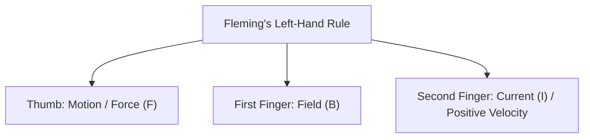
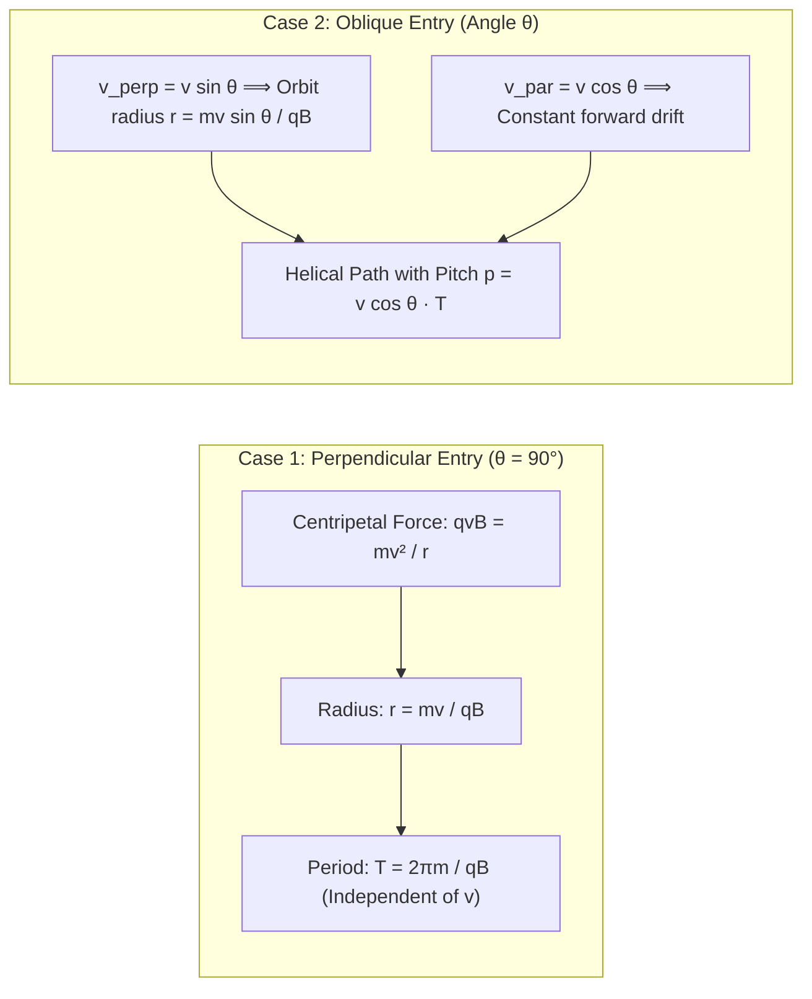
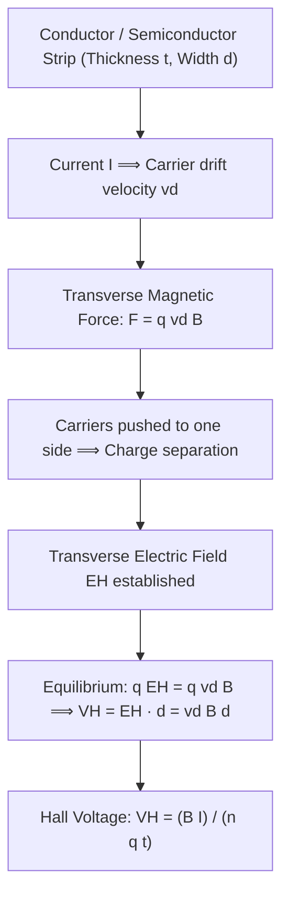
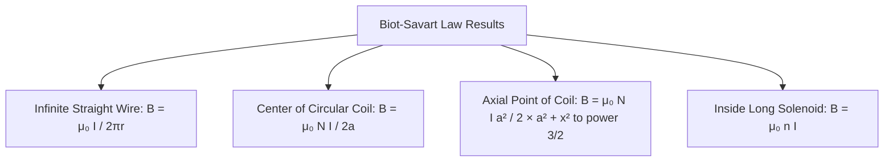
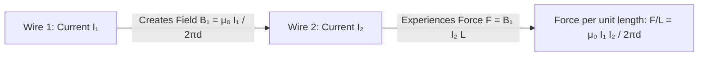
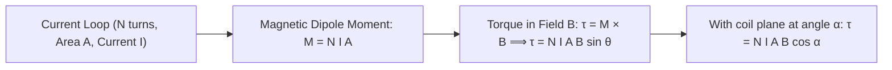

# :LiCompass: Lesson 07: Magnetic Field

> [!ABSTRACT] Syllabus Scope (NIE Teacher's Guide)
> - **7.1 Forces on Conductors & Moving Charges in Magnetic Fields**: Origin of magnetic fields from moving charges, definition of magnetic flux density ($B$), magnetic force on a current-carrying conductor ($F = B I l \sin\theta$), current balance demonstration, Fleming's left-hand rule, magnetic Lorentz force on a moving charge ($\vec{F} = q(\vec{v}\times\vec{B})$), trajectories in magnetic fields (circular motion $r = \frac{mv}{qB}$, period $T = \frac{2\pi m}{qB}$, helical motion), crossed electric and magnetic fields (velocity selector $v = E/B$), Hall Effect mechanism, Hall voltage derivation ($V_H = \frac{BI}{net}$), carrier sign determination, and Hall probe sensors.
> - **7.2 Magnetic Fields of Electric Currents & Biot-Savart Law**: Biot-Savart Law ($dB = \frac{\mu_0}{4\pi}\frac{I dl \sin\theta}{r^2}$), permeability of free space ($\mu_0 = 4\pi \times 10^{-7}\text{ T}\cdot\text{m}\cdot\text{A}^{-1}$), derivations and expressions for magnetic flux density: circular coil ($B = \frac{\mu_0 NI}{2a}$), infinite long straight wire ($B = \frac{\mu_0 I}{2\pi r}$), long solenoid ($B = \mu_0 n I$), and toroid, mutual magnetic force between parallel current-carrying conductors ($\frac{F}{L} = \frac{\mu_0 I_1 I_2}{2\pi d}$), attraction and repulsion criteria, and the base SI definition of the Ampere.
> - **7.3 Rotational Effects, Torque on Current Loops & Magnetic Instruments**: Torque on a current-carrying rectangular coil in a uniform magnetic field ($\tau = N B I A \cos\alpha = N B I A \sin\theta$), magnetic dipole moment ($\vec{M} = N I \vec{A}$), torque in a radial magnetic field ($\tau = N B I A = \text{const}$), structure and operational principle of the moving-coil galvanometer (MCG), equilibrium condition ($NBAI = C\theta$), linear deflection scale ($\theta \propto I$), current sensitivity ($S_i = \frac{NBA}{C}$) and voltage sensitivity ($S_v$), structure and function of a direct current (DC) motor with split-ring commutator.

---
## Deep Dive Subtopic Navigation

For mathematical proofs of particle helical pitch, Hall voltage derivations, Biot-Savart integrations, and moving-coil galvanometer sensitivities, refer to the companion subtopic guide:

- :LiMagnet: **Magnetism**: [[Subtopics/Magnetic Fields & Forces|Magnetic Fields & Forces Guide]]

---
## 1. Forces on Conductors & Moving Charges (Competency 7.1)

### Physical Origin of Magnetic Fields:
Magnetic fields are created exclusively by **moving electric charges** or electric currents. A stationary electric charge produces only an electrostatic field ($\vec{E}$); an electric charge in motion produces **both** an electric field ($\vec{E}$) and a magnetic field ($\vec{B}$).

---

### Magnetic Flux Density ($\vec{B}$):
The strength and direction of a magnetic field at any point is quantified by its magnetic flux density (or magnetic induction) vector $\vec{B}$.
* **Definition from Force on a Conductor:** The magnetic flux density $B$ is defined as the force experienced per unit length of a straight conductor carrying a unit electric current placed perpendicular to the magnetic field:
  $$F = B I l \sin\theta \implies B = \frac{F}{I l} \quad (\text{when } \theta = 90^\circ)$$
* **Vector Form:**
  $$\vec{F} = I (\vec{l} \times \vec{B})$$
* **SI Unit:** **Tesla (T)**:
  $$1\text{ T} = 1\text{ N}\cdot\text{A}^{-1}\cdot\text{m}^{-1} = 1\text{ Wb}\cdot\text{m}^{-2} = 1\text{ kg}\cdot\text{s}^{-2}\cdot\text{A}^{-1}$$
  * Practical sub-unit: $1\text{ Gauss (G)} = 10^{-4}\text{ T}$ (Earth's magnetic field $\approx 0.5\text{ G} = 5 \times 10^{-5}\text{ T}$).
  * Dimensions: $[B] = \mathsf{M}\mathsf{T}^{-2}\mathsf{I}^{-1}$.

---

### Experimental Demonstration: The Current Balance:
A rigid U-shaped conductor suspended from one arm of a sensitive mechanical balance dips into the uniform magnetic field of an electromagnet or permanent magnet assembly:
* Current $I$ is passed through the horizontal segment of length $l$ perpendicular to field $B$.
* Downward magnetic force $F = B I l$ is balanced by adding known weights $mg$ to the opposite pan.
* **Findings:**
  1. $F \propto I$ (at constant $B, l$).
  2. $F \propto l$ (at constant $B, I$).
  3. $F \propto B$ (at constant $I, l$).
  4. Force is zero when the conductor is aligned parallel to the field ($\theta = 0^\circ$).

---

### Fleming's Left-Hand Rule (The Motor Rule):
Used to determine the direction of the magnetic force acting on a current-carrying conductor or moving positive charge:
* Stretch the **Thumb**, **First finger (Forefinger)**, and **Second finger (Middle finger)** of the left hand mutually perpendicular to each other:
  * **First Finger:** Points in the direction of the **Magnetic Field** ($\vec{B}$).
  * **Second Finger:** Points in the direction of the **Conventional Electric Current** ($I$) / velocity of positive charge ($\vec{v}$).
  * **Thumb:** Points in the direction of the resulting **Force (Thrust / Motion)** ($\vec{F}$).

---

### Magnetic Force on a Moving Charge (Lorentz Force):
Consider a wire of cross-sectional area $A$ carrying current $I = n e A v_d$. In length $l$, total number of free conduction charges is $N = n A l$. The force on the wire:
$$F = B I l \sin\theta = B (n q A v_d) l \sin\theta = (n A l) [q v_d B \sin\theta] = N \cdot F_{\text{single}}$$
Hence, the magnetic force experienced by an individual charge $q$ moving with velocity $\vec{v}$ is:
$$\vec{F} = q (\vec{v} \times \vec{B})$$
$$F = |q| v B \sin\theta$$

> [!IMPORTANT] Fundamental Dynamics of Magnetic Forces
> 1. If $v = 0$ (stationary charge), $F = 0$. Magnetic fields exert force **only on moving charges**.
> 2. If $\vec{v} \parallel \vec{B}$ ($\theta = 0^\circ$ or $180^\circ$), $F = 0$. No force acts on a charge moving parallel to field lines.
> 3. If $\vec{v} \perp \vec{B}$ ($\theta = 90^\circ$), force is maximum: $F_{\text{max}} = q v B$.
> 4. **Zero Work Done:** Because $\vec{F}$ is always perpendicular to instantaneous velocity $\vec{v}$:
>    $$d W = \vec{F} \cdot d\vec{r} = (\vec{F} \cdot \vec{v}) dt = 0$$
>    The magnetic force does **strictly zero work**. It cannot alter the speed or kinetic energy of a charged particle; it acts as a pure deflecting force altering only the **direction** of motion.

---

### Trajectories of Charged Particles in a Uniform Magnetic Field:

1. **Perpendicular Entry ($\theta = 90^\circ$): Uniform Circular Motion:**
   * Constant magnetic force acts perpendicular to velocity, providing centripetal acceleration:
     $$q v B = \frac{m v^2}{r} \implies r = \frac{m v}{q B} = \frac{p}{q B} = \frac{\sqrt{2m E_k}}{q B}$$
   * Orbital period ($T$):
     $$T = \frac{2\pi r}{v} = \frac{2\pi m}{q B}$$
   * **Cyclotron Frequency ($f$):**
     $$f = \frac{1}{T} = \frac{q B}{2\pi m}$$
     *(Notice that $T$ and $f$ depend solely on the charge-to-mass ratio $q/m$ and field $B$, completely independent of particle speed $v$ or radius $r$)*.
2. **Oblique Entry ($0^\circ < \theta < 90^\circ$): Helical Motion:**
   * Velocity resolves into two components:
     * $v_\parallel = v \cos\theta$ (parallel to $\vec{B}$, experiences zero force $\implies$ constant forward axial drift).
     * $v_\perp = v \sin\theta$ (perpendicular to $\vec{B}$, experiences centripetal force $\implies$ circular motion of radius $r = \frac{m v \sin\theta}{q B}$).
   * The resultant path is a **helix** along the magnetic field lines.
   * **Pitch of Helix ($p$):** Distance travelled along the field axis in one complete orbital period:
     $$p = v_\parallel T = (v \cos\theta) \left(\frac{2\pi m}{q B}\right) = \frac{2\pi m v \cos\theta}{q B}$$

---

### Crossed Fields: The Velocity Selector:
When uniform electric ($\vec{E}$) and magnetic ($\vec{B}$) fields are applied mutually perpendicular to each other and to the velocity $\vec{v}$ of an incident beam:
* Electric force: $\vec{F}_e = q \vec{E}$.
* Magnetic force: $\vec{F}_m = q (\vec{v} \times \vec{B})$.
* If arranged to oppose each other, particles continue in a straight undeflected line when:
  $$q E = q v B \implies v = \frac{E}{B}$$
* **Application:** Used in mass spectrometers and J.J. Thomson's experiment to isolate particles of an exact velocity prior to determining their specific charge ($e/m$).

---

### The Hall Effect:
When an electric current $I$ flows through a conducting slab of thickness $t$ and width $d$ placed in a transverse magnetic field $B$:

#### Derivation of Hall Voltage ($V_H$):
1. Moving charge carriers experience transverse magnetic force $F_m = q v_d B$, causing them to accumulate on one side face of the strip.
2. The resulting charge separation creates a transverse **Hall electric field** ($E_H$).
3. At steady state, the electrostatic force balances the magnetic force:
   $$q E_H = q v_d B \implies E_H = v_d B$$
4. The potential difference across width $d$ is the **Hall Voltage** ($V_H$):
   $$V_H = E_H d = v_d B d \quad \text{--- (1)}$$
5. The electric current $I$ in terms of drift velocity:
   $$I = n q A v_d = n q (d \cdot t) v_d \implies v_d = \frac{I}{n q d t}$$
6. Substituting $v_d$ into equation (1):
   $$V_H = \left(\frac{I}{n q d t}\right) B d = \frac{B I}{n q t}$$
   $$V_H = \frac{B I}{n e t} \quad (\text{for electronic conduction } q = e)$$

* **Applications of the Hall Effect:**
  1. **Carrier Sign Determination:** If electrons are majority carriers (n-type semiconductor or metal), the Hall voltage polarity is negative; if holes are majority carriers (p-type semiconductor), the polarity is reversed.
  2. **Carrier Concentration Measurement:** Measuring $V_H$, $B$, $I$, and $t$ yields the carrier density $n = \frac{B I}{e t V_H}$.
  3. **Hall Probe Gaussmeters:** Used to measure unknown magnetic field strengths $B \propto V_H$.

---

## 2. Magnetic Fields of Electric Currents & Biot-Savart Law (Competency 7.2)

### Oersted's Discovery & Right-Hand Grip Rule:
An electric current creates a circular magnetic field concentric with the wire.
* **Right-Hand Grip Rule:** Grip the straight conductor with the right hand such that the outstretched thumb points in the direction of conventional current ($I$); the curled fingers give the direction of the magnetic field lines ($\vec{B}$).

---

### The Biot-Savart Law:
The magnetic flux density contribution $d\vec{B}$ at a point $P$ at distance $r$ from an infinitesimal current element $I d\vec{l}$:
$$d\vec{B} = \frac{\mu_0}{4\pi} \frac{I (d\vec{l} \times \hat{r})}{r^2}$$
$$dB = \frac{\mu_0}{4\pi} \frac{I dl \sin\theta}{r^2}$$
where $\theta$ is the angle between current element $d\vec{l}$ and position vector $\vec{r}$, and $\mu_0 = 4\pi \times 10^{-7}\text{ T}\cdot\text{m}\cdot\text{A}^{-1}$ is the **permeability of free space**.

---

### Standard Magnetic Field Configurations:

#### 1. Circular Current Loop:
* **At the Centre of a Flat Circular Coil of $N$ Turns and Radius $a$:**
  $$B = \frac{\mu_0 N I}{2a}$$
* **On the Axis at Distance $x$ from Centre:**
  $$B = \frac{\mu_0 N I a^2}{2 (a^2 + x^2)^{3/2}}$$
  *(For $x = 0$, this reduces directly to $B = \frac{\mu_0 N I}{2a}$)*.

#### 2. Infinitely Long Straight Current-Carrying Conductor:
At perpendicular distance $r$ from the wire:
$$B = \frac{\mu_0 I}{2\pi r}$$

#### 3. Long Tightly-Wound Solenoid ($N$ Turns, Length $L$, $n = N/L$ Turns per Unit Length):
* **Inside along the Central Axis:**
  $$B = \mu_0 n I = \frac{\mu_0 N I}{L}$$
* **At the Extreme Open Ends of a Long Solenoid:**
  $$B_{\text{end}} = \frac{1}{2} \mu_0 n I = \frac{\mu_0 N I}{2L}$$

#### 4. Toroid (Endless Solenoid of Mean Radius $R$):
$$B = \frac{\mu_0 N I}{2\pi R} = \mu_0 n I$$

---

### Mutual Force Between Two Long Parallel Conductors:
Two parallel infinitely long straight conductors separated by distance $d$ carrying steady currents $I_1$ and $I_2$:

1. Current $I_1$ produces magnetic field $B_1$ at the location of Wire 2:
   $$B_1 = \frac{\mu_0 I_1}{2\pi d}$$
2. The magnetic force on length $L$ of Wire 2:
   $$F = B_1 I_2 L = \left(\frac{\mu_0 I_1}{2\pi d}\right) I_2 L$$
3. **Mutual Force Per Unit Length:**
   $$\frac{F}{L} = \frac{\mu_0 I_1 I_2}{2\pi d} \quad \left(\text{N}\cdot\text{m}^{-1}\right)$$
* **Direction Criteria:**
  * **Parallel Currents (Same Direction):** Fields between the wires cancel while outer fields reinforce $\implies$ **ATTRACTION**.
  * **Antiparallel Currents (Opposite Directions):** Fields between the wires reinforce $\implies$ **REPULSION**.

---

### The SI Definition of the Ampere:
The Ampere is that constant electric current which, if maintained in two straight parallel conductors of infinite length and of negligible circular cross-section, placed 1 metre apart in vacuum, produces between these conductors a mutual force equal to $2 \times 10^{-7}$ Newtons per metre of length:
$$\frac{F}{L} = \frac{(4\pi \times 10^{-7})(1)(1)}{2\pi (1)} = 2 \times 10^{-7}\text{ N}\cdot\text{m}^{-1}$$

---

## 3. Torque on Current Loops & Magnetic Instruments (Competency 7.3)

### Magnetic Torque on a Current-Carrying Coil:
Consider a rectangular coil of $N$ turns and dimensions $a \times b$ (area $A = ab$) carrying current $I$ placed in a uniform magnetic field $B$:

* The forces on the two sides of length $b$ are $F = N B I b$ (directed in opposite directions, forming a couple).
* The perpendicular distance between the lines of action of these forces is $a \cos\alpha$, where $\alpha$ is the angle between the plane of the coil and the magnetic field lines.
* **Torque Expression:**
  $$\tau = F \cdot (a \cos\alpha) = (N B I b)(a \cos\alpha) = N B I A \cos\alpha$$
* If $\theta$ is the angle between field $\vec{B}$ and the normal unit vector $\hat{n}$ to the plane of the coil ($\theta = 90^\circ - \alpha$):
  $$\tau = N B I A \sin\theta$$
* **Vector Form:**
  $$\vec{\tau} = \vec{M} \times \vec{B}$$
  where $\vec{M} = N I \vec{A}$ is the **magnetic dipole moment** ($\text{A}\cdot\text{m}^2$).
  * Maximum torque: Coil plane is parallel to field ($\alpha = 0^\circ, \theta = 90^\circ \implies \tau_{\text{max}} = N B I A$).
  * Minimum torque: Coil plane is perpendicular to field ($\alpha = 90^\circ, \theta = 0^\circ \implies \tau = 0$, stable equilibrium).

---

### The Radial Magnetic Field:
In a uniform magnetic field, torque varies with deflection angle ($\tau \propto \cos\alpha$), which would make the galvanometer scale non-linear.
* **Engineering Solution:** A **radial magnetic field** is produced using:
  1. **Concave, cylindrical magnetic pole pieces**.
  2. A **soft-iron cylinder** placed centrally inside the coil.
* **Property:** Magnetic field lines always enter and exit the soft-iron cylinder along normal radii. Consequently, the plane of the coil is **always parallel to the field lines** ($\alpha = 0^\circ \implies \cos\alpha = 1$) at every angular position.
* **Result:** Deflecting torque is independent of deflection angle and depends strictly on current:
  $$\tau_{\text{deflecting}} = N B I A = \text{constant for given } I$$

---

### The Moving-Coil Galvanometer (MCG):
* **Working Principle:** When current $I$ passes through the suspended coil, the deflecting magnetic torque is opposed by the restoring torque of a phosphor-bronze hairspring:
  $$\tau_{\text{deflecting}} = N B I A$$
  $$\tau_{\text{restoring}} = C \theta$$
  where $C$ is the torsional restoring couple per unit twist (torsional spring constant).
* **Equilibrium Condition:**
  $$N B I A = C \theta \implies \theta = \left(\frac{N B A}{C}\right) I$$
  * Because $\frac{NBA}{C} = \text{constant}$, the deflection $\theta$ is **strictly directly proportional to current $I$**, providing a **linear scale**.

#### Sensitivity of a Moving-Coil Galvanometer:
1. **Current Sensitivity ($S_i$):** Deflection produced per unit current:
   $$S_i = \frac{\theta}{I} = \frac{N B A}{C} \quad (\text{rad}\cdot\text{A}^{-1} \text{ or div}\cdot\mu\text{A}^{-1})$$
   * Increased by: increasing turns $N$, magnetic field $B$, area $A$, and decreasing torsional constant $C$.
2. **Voltage Sensitivity ($S_v$):** Deflection produced per unit voltage:
   $$S_v = \frac{\theta}{V} = \frac{\theta}{I R_g} = \frac{N B A}{C R_g}$$
   *(Note: Doubling $N$ doubles coil resistance $R_g$, so voltage sensitivity remains largely unchanged)*.

---

### Direct Current (DC) Motor:
* **Principle:** Converts electrical energy into continuous mechanical rotational energy via magnetic torque on an armature coil.
* **Essential Components:**
  1. **Armature Coil:** Multi-turn copper coil on a soft-iron core.
  2. **Field Magnet:** Produces strong magnetic field.
  3. **Split-Ring Commutator:** Two half-cylindrical copper segments that rotate with the coil. Reverses current direction in the coil every half-rotation ($180^\circ$) as the coil passes through the vertical neutral position, ensuring unidirectional continuous torque.
  4. **Carbon Brushes:** Stationary contacts supplying current to the rotating commutator.

---

## :LiRocket: Flashcards (Spaced Repetition)

#flashcards

What is the magnetic force on a charge $q$ moving with velocity $v$ at angle $\theta$ to magnetic field $B$? :: $F = q v B \sin\theta$.
<!--SR:!2026-09-26,1,230-->

What is the force per unit length between two parallel long straight conductors carrying currents $I_1, I_2$ separated by distance $d$? :: $\frac{F}{L} = \frac{\mu_0 I_1 I_2}{2\pi d}$.
<!--SR:!2026-09-26,1,230-->

State the magnetic field $B$ inside a long solenoid of $n$ turns per unit length carrying current $I$. :: $B = \mu_0 n I$.
<!--SR:!2026-09-26,1,230-->

How is the SI unit of current (Ampere) defined using magnetic force? :: 1 Ampere is the constant current which, if maintained in two straight parallel conductors of infinite length placed 1 meter apart in vacuum, produces a force of $2 \times 10^{-7}\text{ N/m}$ between them.
<!--SR:!2026-09-26,1,230-->

What is the deflecting torque $\tau$ on an $N$-turn coil of area $A$ carrying current $I$ in a radial magnetic field $B$? :: $\tau = N I A B$.

Define magnetic flux density $B$ and state its SI unit and dimensions. :: The force experienced per unit length of a straight conductor carrying unit current placed perpendicular to the field: $B = \frac{F}{Il}$ (Tesla, $\text{T} = \text{N}\cdot\text{A}^{-1}\cdot\text{m}^{-1}$, $[B] = \mathsf{M}\mathsf{T}^{-2}\mathsf{I}^{-1}$).

State Fleming's Left-Hand Rule. :: First finger = Magnetic Field ($B$), Second finger = Conventional Current ($I$), Thumb = Resultant Force / Motion ($F$), held mutually perpendicular.

Why does a static magnetic field do zero work on a moving charged particle? :: Because the magnetic force is always perpendicular to velocity ($\vec{F} \cdot \vec{v} = 0$), so power is zero; it changes only velocity direction, keeping speed and kinetic energy constant.

Derive the orbital radius $r$ of a charged particle moving perpendicular to a uniform magnetic field. :: Magnetic force provides centripetal force: $q v B = \frac{m v^2}{r} \implies r = \frac{m v}{q B}$.

Why is the orbital period $T$ of a charged particle in a magnetic field independent of speed? :: $T = \frac{2\pi r}{v} = \frac{2\pi (mv / qB)}{v} = \frac{2\pi m}{q B}$; speed $v$ cancels out completely.

What is the pitch of a helical path of a particle entering a magnetic field at angle $\theta$? :: $p = v_\parallel T = (v\cos\theta) \left(\frac{2\pi m}{qB}\right) = \frac{2\pi m v\cos\theta}{qB}$.

State the velocity selector condition for undeflected motion through crossed electric and magnetic fields. :: $q E = q v B \implies v = \frac{E}{B}$.

Derive the formula for Hall Voltage $V_H$ in a conductor of thickness $t$. :: Dynamic equilibrium: $q E_H = q v_d B \implies V_H = v_d B d$. Substituting $v_d = \frac{I}{n q d t}$ gives $V_H = \frac{B I}{n q t}$.

What two fundamental properties of charge carriers can be determined using the Hall Effect? :: 1. Sign of majority charge carriers (electrons vs. holes); 2. Charge carrier number density $n = \frac{BI}{etV_H}$.

State the Biot-Savart Law in mathematical form. :: $dB = \frac{\mu_0}{4\pi} \frac{I dl \sin\theta}{r^2}$, where $\mu_0 = 4\pi \times 10^{-7}\text{ T}\cdot\text{m}\cdot\text{A}^{-1}$.

State the magnetic flux density $B$ at the center of a circular coil of $N$ turns and radius $a$. :: $B = \frac{\mu_0 N I}{2a}$.

State the magnetic flux density $B$ at perpendicular distance $r$ from an infinite straight current-carrying wire. :: $B = \frac{\mu_0 I}{2\pi r}$.

State the magnetic flux density at the extreme open end of a long solenoid. :: $B_{\text{end}} = \frac{1}{2}\mu_0 n I$.

Do two parallel conductors carrying currents in opposite directions attract or repel? :: They repel each other with force per unit length $\frac{F}{L} = \frac{\mu_0 I_1 I_2}{2\pi d}$.

State the formula for magnetic torque on a planar current loop of area $A$ with $N$ turns inclined at angle $\alpha$ to a uniform field $B$. :: $\tau = N B I A \cos\alpha$ (or $\tau = N B I A \sin\theta$ where $\theta$ is the angle between area normal and field).

How is a radial magnetic field produced in a moving-coil galvanometer? :: Using concave cylindrical magnet pole pieces and a central soft-iron cylinder.

Why is a radial magnetic field essential in a moving-coil galvanometer? :: It ensures the plane of the coil remains parallel to the field lines ($\alpha = 0^\circ$) at all angles, keeping torque $\tau = NBAI$ constant so deflection is linear ($\theta \propto I$).

State the equilibrium equation of a moving-coil galvanometer and express current sensitivity $S_i$. :: Equilibrium: $N B I A = C \theta \implies \theta = \left(\frac{NBA}{C}\right)I$; Current sensitivity $S_i = \frac{\theta}{I} = \frac{N B A}{C}$.

What is the function of the split-ring commutator in a DC motor? :: It reverses the current direction through the armature coil every half-rotation ($180^\circ$) to maintain a unidirectional rotational torque.
