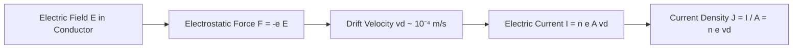
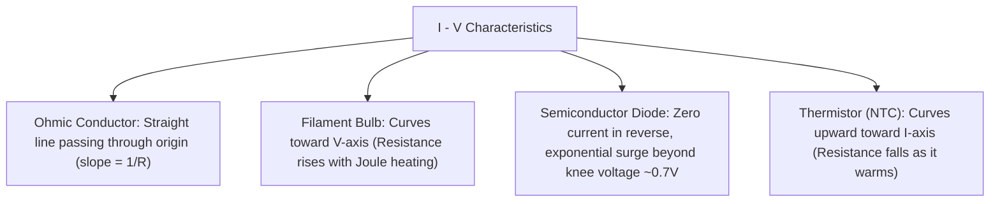
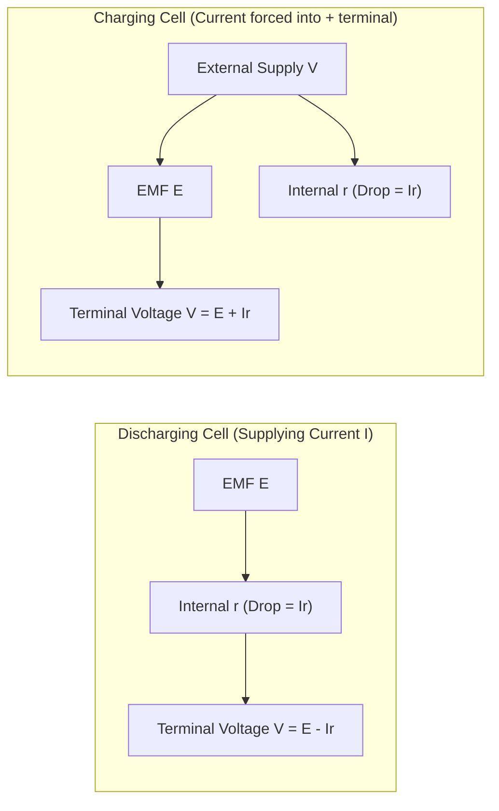
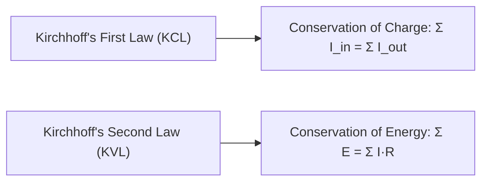
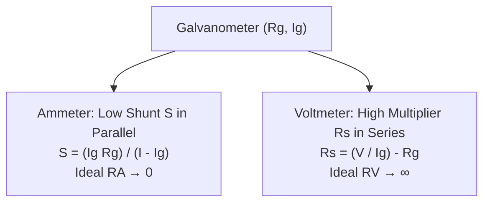
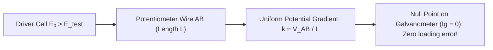
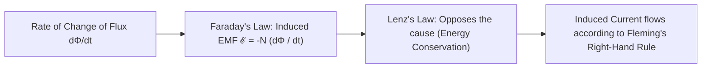
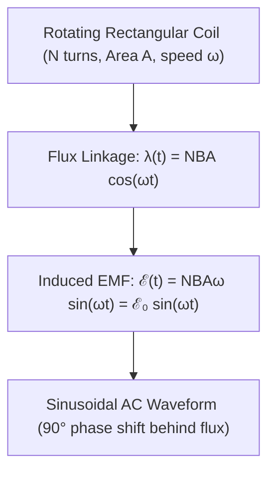
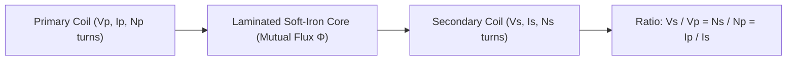

# :LiPlug: Lesson 08: Current Electricity

> [!ABSTRACT] Syllabus Scope (NIE Teacher's Guide)
> - **8.1 Physical Quantities in Current Electricity**: Electric current ($I = \frac{\Delta Q}{\Delta t}$), free electron model in metals, derivation of drift velocity ($I = n e A v_d$), current density ($J = n e v_d = \sigma E$), resistance ($R = \rho \frac{l}{A}$), resistivity ($\rho$) and conductivity ($\sigma$), temperature coefficient of resistance ($\alpha$) and resistance-temperature graphs, superconductors and critical transition temperature ($T_c$), Ohm's law, ohmic vs. non-ohmic conductors ($I-V$ characteristic curves), potential divider circuits, resistor combinations.
> - **8.2 Energy & Power in DC Circuits**: Electrical work and energy dissipation ($W = V Q = V I t$), electric power ($P = V I$), Joule's law of heating in passive resistors ($W = I^2 R t = \frac{V^2}{R}t$, $P = I^2 R = \frac{V^2}{R}$).
> - **8.3 Power Supplies, EMF & Internal Resistance**: Mechanism and definition of electromotive force (EMF, $E$), terminal potential difference ($V = E - I r$ during discharging, $V = E + I r$ during charging), lost volts ($v = I r$), graphical determination of $E$ and $r$ from $V-I$ characteristics, series and parallel cell combinations, Maximum Power Transfer Theorem ($R = r$, $P_{\text{max}} = \frac{E^2}{4r}$).
> - **8.4 Circuit Analysis — Kirchhoff's Rules**: Kirchhoff's First Rule (KCL / Junction Rule, $\sum I = 0$, Conservation of Charge), Kirchhoff's Second Rule (KVL / Loop Rule, $\sum E = \sum I R$, Conservation of Energy), systematic loop analysis and sign conventions.
> - **8.5 Electrical Measuring Instruments**: Moving-coil galvanometer principles, conversion to ammeter (shunt resistor $S = \frac{I_g R_g}{I - I_g}$) and voltmeter (multiplier resistor $R_s = \frac{V}{I_g} - R_g$), ideal meter properties, Wheatstone bridge balance condition ($\frac{P}{Q} = \frac{R}{S}$) and sensitivity criteria, Metre bridge practical and end-error elimination, Potentiometer working principles, potential gradient ($k = V/L$), comparison of EMFs ($\frac{E_1}{E_2} = \frac{l_1}{l_2}$), determination of cell internal resistance ($r = R\frac{l_1 - l_2}{l_2}$), advantages over voltmeters.
> - **8.6 Electromagnetic Induction, AC Circuits & Transformers**: Magnetic flux ($\Phi = B A \cos\theta$) and flux linkage ($N\Phi$), Faraday's law of induction ($\mathcal{E} = -N\frac{d\Phi}{dt}$), Lenz's law and energy conservation, motional EMF of moving rod ($\mathcal{E} = B l v$) and Fleming's right-hand rule, EMF of rotating rod ($\mathcal{E} = \frac{1}{2}B\omega l^2$) and rotating disc, alternating current generator principles ($\mathcal{E} = N B A \omega \sin\omega t$), sinusoidal AC root-mean-square values ($V_{\text{rms}} = \frac{V_0}{\sqrt{2}}$, $I_{\text{rms}} = \frac{I_0}{\sqrt{2}}$), average power in resistive AC circuits ($P = V_{\text{rms}} I_{\text{rms}}$), back-EMF in DC motors ($\mathcal{E}_b$) and starter switch function, transformer principles ($\frac{V_s}{V_p} = \frac{N_s}{N_p} = \frac{I_p}{I_s}$), step-up and step-down transformers, energy losses in transformers (copper, eddy currents, hysteresis, flux leakage), high-voltage grid electric power transmission ($P_{\text{loss}} \propto 1/V^2$).

---
## Deep Dive Subtopic Navigation

For mathematical proofs of bridge balance conditions, end-error calibrations, mesh-current matrices, and potentiometer laboratory setups, refer to the companion subtopic guide:

- :LiPlug: **Electricity**: [[Subtopics/Potentiometer & Kirchhoffs Laws|Potentiometer & Kirchhoff's Laws Guide]]

---
## 1. Physical Quantities, Conduction & Resistance (Competency 8.1)

### Electric Current:
Electric current ($I$) is defined as the rate of net flow of electric charge across any cross-section of a conductor:
$$I = \lim_{\Delta t \to 0} \frac{\Delta Q}{\Delta t} = \frac{dQ}{dt} \quad \left([I] = \mathsf{I}, \text{ unit: Ampere (A)} = 1\text{ C}\cdot\text{s}^{-1}\right)$$

---

### Microscopic Conduction Model & Drift Velocity Derivation:
In a metallic lattice, free conduction electrons move with random thermal velocities ($v_{\text{th}} \approx 10^5\text{ m}\cdot\text{s}^{-1}$) undergoing continuous collisions with vibrating positive metal ions. The average thermal velocity vector is zero ($\langle \vec{v}_{\text{th}} \rangle = 0$).

When an external potential difference $V$ is applied across a conductor of length $l$, a uniform electric field $\vec{E} = \frac{V}{l}$ is established within the metal, exerting an electrostatic force $\vec{F} = -e\vec{E}$ on every free electron. This force imparts a slow, net directed velocity known as the **drift velocity** ($v_d \approx 10^{-4}\text{ m}\cdot\text{s}^{-1}$).

#### Derivation of $I = n e A v_d$:
Consider a cylindrical conductor of uniform cross-sectional area $A$, length $l$, containing $n$ free conduction electrons per unit volume (free electron number density):
1. In time interval $\Delta t$, electrons moving at drift velocity $v_d$ travel through axial distance:
   $$\Delta x = v_d \Delta t$$
2. The volume of conductor swept out by these electrons:
   $$\Delta V = A \cdot \Delta x = A v_d \Delta t$$
3. The total number of free conduction electrons in this volume:
   $$N = n \Delta V = n A v_d \Delta t$$
4. The total electric charge crossing the cross-section in time $\Delta t$:
   $$\Delta Q = N e = (n A v_d \Delta t) e$$
5. Dividing by $\Delta t$ yields the electric current:
   $$I = \frac{\Delta Q}{\Delta t} = n e A v_d$$

* **Current Density ($\vec{J}$):** Electric current flowing per unit normal cross-sectional area:
  $$J = \frac{I}{A} = n e v_d \quad \left(\text{units: }\text{A}\cdot\text{m}^{-2}\right)$$
* **Microscopic Ohm's Law:** Since drift velocity is directly proportional to electric field ($v_d \propto E$), current density is proportional to electric field:
  $$\vec{J} = \sigma \vec{E} = \frac{1}{\rho}\vec{E}$$
  where $\sigma$ is the electrical conductivity and $\rho$ is the electrical resistivity.

---

### Electrical Resistance ($R$), Resistivity ($\rho$) & Conductivity ($\sigma$):
* **Resistance ($R$):** The ratio of the potential difference $V$ across a conductor to the electric current $I$ flowing through it:
  $$R = \frac{V}{I} \quad \left([R] = \mathsf{M}\mathsf{L}^2\mathsf{T}^{-3}\mathsf{I}^{-2}, \text{ unit: Ohm }(\Omega) = 1\text{ V}\cdot\text{A}^{-1}\right)$$
* **Factors Affecting Resistance:**
  $$R = \rho \frac{l}{A}$$
  1. Length ($l$): $R \propto l$.
  2. Cross-sectional Area ($A$): $R \propto \frac{1}{A}$.
  3. Material Nature: Characterized by resistivity $\rho$.
  4. Temperature ($T$).
* **Resistivity ($\rho$):** A property of the material independent of geometry:
  $$\rho = \frac{R A}{l} \quad \left([\rho] = \mathsf{M}\mathsf{L}^3\mathsf{T}^{-3}\mathsf{I}^{-2}, \text{ units: }\Omega\cdot\text{m}\right)$$
* **Conductivity ($\sigma$):** Reciprocal of resistivity:
  $$\sigma = \frac{1}{\rho} \quad \left(\text{units: }\Omega^{-1}\cdot\text{m}^{-1} \text{ or Siemens per meter, }\text{S}\cdot\text{m}^{-1}\right)$$

---

### Variation of Resistance with Temperature:
* **Metallic Conductors:** As temperature rises, lattice ions vibrate with larger amplitudes, increasing the frequency of electron collisions and decreasing the mean free time between collisions. Resistance increases approximately linearly over normal temperatures:
  $$R_\theta = R_0 (1 + \alpha \theta)$$
  $$\alpha = \frac{R_\theta - R_0}{R_0 \theta} \quad \left(\text{units: }^\circ\text{C}^{-1}\text{ or }\text{K}^{-1}\right)$$
  * $\alpha$ is the **temperature coefficient of resistance** (positive for metals, $\alpha > 0$).
* **Semiconductors & Insulators:** As temperature rises, thermal energy ruptures covalent bonds, causing an exponential surge in the density $n$ of charge carriers (electrons and holes). The increase in carrier density vastly overwhelms collision effects, resulting in a **negative temperature coefficient** ($\alpha < 0$):
  $$R \propto e^{E_g / (2 k_B T)}$$
  *(Basis of NTC thermistors used in electronic temperature sensors)*.
* **Superconductors:**
  * Certain metals, alloys, and ceramics lose all measurable electrical resistance completely ($R \to 0$, $\rho \to 0$) below a characteristic temperature known as the **critical transition temperature** ($T_c$).
  * Examples: Mercury ($T_c = 4.2\text{ K}$), Lead ($T_c = 7.2\text{ K}$), Niobium-titanium alloy ($T_c \approx 9.2\text{ K}$), YBCO ceramic ($T_c \approx 93\text{ K}$).
  * **Properties:** Zero electrical resistivity, persistent lossless electrical currents, and the **Meissner Effect** (complete expulsion of external magnetic fields from the superconductor interior, causing magnetic levitation).
  * **Applications:** Powerful electromagnets in MRI scanners, Maglev bullet trains, high-energy particle accelerators (LHC).

---

### Ohm's Law & $I-V$ Characteristics:
**Statement:** The electric current flowing through a metallic conductor between two points is directly proportional to the potential difference across the two points, provided its temperature and other physical conditions remain strictly constant:
$$V \propto I \implies V = I R \quad (\text{where } R = \text{constant})$$

---

### Potential Divider (Voltage Divider):
A pair of resistors $R_1$ and $R_2$ connected in series across an input potential difference $V_{\text{in}}$ to provide a fractional output potential difference $V_{\text{out}}$:
$$I = \frac{V_{\text{in}}}{R_1 + R_2} \implies V_{\text{out}} = I R_2 = V_{\text{in}} \left(\frac{R_2}{R_1 + R_2}\right)$$
* Used in sensory circuits (LDR with fixed resistor, thermistor with fixed resistor) to generate voltage signals corresponding to light or temperature changes.

---

## 2. Electrical Energy & Power in DC Circuits (Competency 8.2)

### Electrical Work & Energy Dissipation:
When an electric charge $Q$ moves through a circuit component across potential difference $V$, the electrostatic work done is:
$$W = V Q$$
For a steady current $I$ flowing for duration $t$ ($Q = I t$):
$$W = V I t \quad (\text{Joules, J})$$

### Electric Power ($P$):
The rate at which electrical energy is transformed or dissipated in an electrical device:
$$P = \frac{W}{t} = V I \quad \left(\text{Watts, W} = \text{J}\cdot\text{s}^{-1}\right)$$
* Practical unit of commercial electrical energy:
  $$1\text{ kilowatt-hour (kWh)} = (10^3\text{ W}) \times (3600\text{ s}) = 3.6 \times 10^6\text{ J} = 3.6\text{ MJ}$$

### Joule's Law of Heating in Passive Resistors:
In a passive resistor of resistance $R$, all electrical energy delivered is irreversibly transformed into thermal energy (Joule heat):
$$W = V I t = I^2 R t = \frac{V^2}{R} t$$
$$P = V I = I^2 R = \frac{V^2}{R}$$

> [!WARNING] Active Devices vs. Passive Resistors
> The equation $P = V I$ applies universally to **any** electrical device (motors, batteries charging, resistors). However, $P = I^2 R$ and $P = V^2 / R$ apply **only to purely passive ohmic resistors** where all electrical energy is dissipated as heat! In an electric motor, $V I = \mathcal{E}_b I + I^2 R$, where $\mathcal{E}_b I$ is useful mechanical power and $I^2 R$ is waste heat.

---

## 3. Power Supplies, EMF & Internal Resistance (Competency 8.3)

### Mechanism & Definition of Electromotive Force (EMF, $E$):
A source of electrical energy (such as a chemical cell, dynamo, or solar cell) contains internal non-electrostatic forces (chemical, magnetic, or photovoltaic) that perform work to move positive charges from the lower potential negative terminal to the higher potential positive terminal against internal electrostatic repulsion.

* **Definition of EMF ($E$):** The total electrical energy supplied by the source per unit charge that passes completely around the circuit:
  $$E = \frac{W_{\text{total}}}{Q} \quad (\text{units: Volt, V} = \text{J}\cdot\text{C}^{-1})$$

---

### Internal Resistance ($r$) & Terminal Potential Difference ($V$):
Every real electrical source offers internal resistance $r$ to the flow of current through its electrolyte or internal windings.

1. **Discharging (Normal operation powering external load $R$):**
   $$I = \frac{E}{R + r} \implies E = I R + I r = V + I r$$
   $$V = E - I r$$
   * $V < E$ because an amount of potential $v = I r$ ("lost volts") is dropped across the cell's own internal resistance.
2. **Charging (Driven by an external higher voltage charger):**
   $$V = E + I r$$
   * $V > E$ because the charger must overcome both the cell's EMF and its internal resistance drop.
3. **Open Circuit ($I = 0$):**
   $$V = E$$
   * An ideal voltmeter connected across an open circuit measures the true EMF $E$.
4. **Short Circuit ($R = 0$):**
   $$I_{\text{sc}} = \frac{E}{r}, \quad V = 0$$

---

### Experimental Determination of $E$ and $r$ (Graphical Method):
Connect a cell in series with a variable resistor (rheostat) $R$, an ammeter $A$, and a switch, with a voltmeter $V$ across the cell terminals:
$$V = -r I + E$$
* Plotting measured terminal voltage $V$ on the vertical axis against circuit current $I$ on the horizontal axis yields a **straight line** with:
  * **Vertical Intercept ($I = 0$):** Intercept $= E$ (EMF of cell).
  * **Gradient / Slope:** $\text{Slope} = -r$ (Negative of internal resistance).
  * **Horizontal Intercept ($V = 0$):** Intercept $= I_{\text{sc}} = \frac{E}{r}$ (Short-circuit current).

---

### Combinations of Cells:

| Configuration | Circuit Diagram / Setup | Effective EMF ($E_{\text{eff}}$) | Effective Internal Resistance ($r_{\text{eff}}$) | Circuit Current through Load $R$ |
| :--- | :--- | :--- | :--- | :--- |
| **Series Aiding** | $n$ cells connected $+ - + - + -$ | $E_{\text{eff}} = \sum_{i=1}^n E_i = n E$ | $r_{\text{eff}} = \sum_{i=1}^n r_i = n r$ | $I = \frac{n E}{R + n r}$ |
| **Series Opposing** | Two cells connected $+ - - +$ | $E_{\text{eff}} = |E_1 - E_2|$ | $r_{\text{eff}} = r_1 + r_2$ | $I = \frac{|E_1 - E_2|}{R + r_1 + r_2}$ |
| **Parallel Identical** | $n$ identical cells connected in parallel | $E_{\text{eff}} = E$ | $r_{\text{eff}} = \frac{r}{n}$ | $I = \frac{E}{R + \frac{r}{n}} = \frac{n E}{n R + r}$ |

---

### Maximum Power Transfer Theorem:
A source of EMF $E$ and internal resistance $r$ delivers maximum power to an external load resistor $R$ when the load resistance is **equal** to the internal resistance of the source:
$$R_{\text{load}} = r_{\text{internal}}$$
* Under this condition, the maximum power delivered to the load is:
  $$P_{\text{max}} = \frac{E^2}{4r}$$
* **Efficiency at Maximum Power:** $\eta = \frac{I^2 R}{I^2 (R + r)} = \frac{r}{2r} = 50\%$.

---

## 4. Kirchhoff's Laws (Competency 8.4)

### Kirchhoff's First Law (KCL — Junction Rule):
The algebraic sum of currents entering any electrical junction is equal to the algebraic sum of currents leaving the junction:
$$\sum I_{\text{in}} = \sum I_{\text{out}} \iff \sum I = 0$$
* **Physical Justification:** Consequence of the **Conservation of Electric Charge**. Charge cannot accumulate at a junction in steady state.

### Kirchhoff's Second Law (KVL — Loop Rule):
In any closed electrical loop, the algebraic sum of electromotive forces (EMFs) is equal to the algebraic sum of the potential differences ($I R$ products) across all components:
$$\sum E = \sum I R$$
* **Physical Justification:** Consequence of the **Conservation of Energy**. The net electrostatic work done on a unit test charge in completing any closed loop in an electrostatic field is zero:
  $$\oint \vec{E}\cdot d\vec{r} = 0$$

---

## 5. Electrical Measuring Instruments (Competency 8.5)

### Moving-Coil Galvanometer (MCG):
* **Principle:** A current-carrying coil placed in a radial magnetic field experiences a deflecting magnetic torque $\tau = N I A B$.
* A hairspring provides a restoring torque $\tau_{\text{restoring}} = C \theta$.
* At equilibrium:
  $$N I A B = C \theta \implies \theta = \left(\frac{N A B}{C}\right) I \implies \theta \propto I$$
* Highly sensitive: Typically full-scale deflection (FSD) occurs for $I_g \sim 10\ \mu\text{A} \text{ to } 10\text{ mA}$ with coil resistance $R_g \sim 10\ \Omega \text{ to } 500\ \Omega$.

---

### Conversion to Ammeter & Voltmeter:

1. **Ammeter Conversion (Measures Current $I > I_g$ in Series):**
   * Connect a small **shunt resistor ($S$)** in parallel with the galvanometer.
   $$(I - I_g) S = I_g R_g \implies S = \frac{I_g R_g}{I - I_g}$$
   * Equivalent ammeter resistance: $R_A = \frac{S R_g}{S + R_g} \approx S$ (ideally $R_A = 0$).
2. **Voltmeter Conversion (Measures Voltage $V > I_g R_g$ in Parallel):**
   * Connect a large **multiplier resistor ($R_s$)** in series with the galvanometer.
   $$V = I_g (R_s + R_g) \implies R_s = \frac{V}{I_g} - R_g$$
   * Equivalent voltmeter resistance: $R_V = R_s + R_g \approx R_s$ (ideally $R_V \to \infty$).

---

### Wheatstone Bridge:
A bridge network of four resistors $P, Q, R, S$ with a galvanometer $G$ between opposite junctions:
* **Balance Condition ($I_g = 0$):**
  $$\frac{P}{Q} = \frac{R}{S}$$
* **Sensitivity Condition:** The bridge has highest sensitivity when all four resistors have approximately equal resistances ($P \approx Q \approx R \approx S$).

---

### Metre Bridge:
A 100 cm uniform resistance wire on a graduated metre rule:
$$R = S \left(\frac{l_1}{100 - l_1}\right)$$
* **End Corrections:** Non-zero resistance at metallic end strips is compensated by swapping resistors $R$ and $S$ between left and right gaps and computing the mean.

---

### The Potentiometer:
A precision instrument using a uniform wire $AB$ of length $L$ carrying constant current from driver cell $E_0$ to measure potential difference without drawing current.

* **Potential Gradient ($k$):**
  $$k = \frac{V_{AB}}{L} = \frac{I R_{AB}}{L} \quad (\text{V}\cdot\text{m}^{-1})$$
  At balance length $l$: $V = k \cdot l$.
* **1. Comparison of EMFs of Two Cells:**
  $$\frac{E_1}{E_2} = \frac{l_1}{l_2}$$
* **2. Determination of Internal Resistance ($r$) of a Cell:**
  * Open-circuit balance length: $E = k l_1$.
  * Closed-circuit balance length across shunt $R$: $V = k l_2$.
  $$r = R \left(\frac{l_1 - l_2}{l_2}\right)$$
* **Superiority over Voltmeter:** Because no current is drawn from the test source at the balance point ($I_g = 0$), the measurement is completely free from errors caused by internal resistance ("lost volts"), making it an ideal infinite-resistance voltmeter.

---

## 6. Electromagnetic Induction, AC & Transformers (Competency 8.6)

### Magnetic Flux ($\Phi$) & Flux Linkage ($\lambda$):
* **Magnetic Flux ($\Phi$):** The total number of magnetic field lines passing perpendicularly through an area $A$:
  $$\Phi = \vec{B} \cdot \vec{A} = B A \cos\theta \quad \left([\Phi] = \mathsf{M}\mathsf{L}^2\mathsf{T}^{-2}\mathsf{I}^{-1}, \text{ unit: Weber (Wb)} = \text{T}\cdot\text{m}^2 = \text{V}\cdot\text{s}\right)$$
* **Magnetic Flux Linkage ($\lambda$):** For a coil of $N$ tightly wound turns:
  $$\lambda = N \Phi = N B A \cos\theta \quad (\text{Weber-turns, Wb})$$

---

### Laws of Electromagnetic Induction:

#### 1. Faraday's Law of Induction:
The magnitude of the induced electromotive force ($\mathcal{E}$) in any closed circuit is directly proportional to the time rate of change of magnetic flux linkage through the circuit:
$$\mathcal{E} \propto \frac{d(N\Phi)}{dt} \implies \mathcal{E} = -N \frac{d\Phi}{dt}$$

#### 2. Lenz's Law:
The direction of any induced current is always such that its own magnetic field opposes the change in magnetic flux that produced it:
* Lenz's law accounts for the **negative sign** in Faraday's law.
* **Conservation of Energy:** Mechanical work must be done against the opposing magnetic Lorentz force to move magnets or conductors, and this mechanical work is transformed into electrical energy.

---

### Motional Electromotive Force:

#### 1. Straight Conductor Moving Through Uniform Field:
A conductor of length $l$ moving at constant speed $v$ perpendicular to a uniform magnetic field $B$:
$$\mathcal{E} = B l v$$
* **Direction:** Given by **Fleming's Right-Hand Rule** (Dynamo Rule):
  * **Thumb:** Motion / Force direction.
  * **First Finger:** Magnetic Field ($\vec{B}$).
  * **Second Finger:** Induced Current ($I$) / Induced EMF direction.

#### 2. Rotating Conducting Rod:
A conducting rod of length $l$ pivoted at one end, rotating at angular velocity $\omega$ in a uniform transverse field $B$:
$$\mathcal{E} = \int_0^l B v(r) \, dr = \int_0^l B (\omega r) \, dr = \frac{1}{2} B \omega l^2$$

#### 3. Rotating Conducting Disc (Faraday Disc Generator):
A solid metallic disc of radius $R$ rotating at angular speed $\omega$ perpendicular to field $B$:
$$\mathcal{E} = \frac{1}{2} B \omega R^2$$

---

### The Alternating Current (AC) Generator:
A rectangular coil of $N$ turns and area $A$ rotating at constant angular frequency $\omega = 2\pi f$ in a uniform magnetic field $B$:
1. Instantaneous magnetic flux linkage:
   $$\lambda(t) = N B A \cos(\omega t)$$
2. Induced electromotive force by Faraday's Law:
   $$\mathcal{E}(t) = -\frac{d\lambda}{dt} = -N B A \frac{d}{dt}[\cos(\omega t)] = N B A \omega \sin(\omega t)$$
   $$\mathcal{E}(t) = \mathcal{E}_0 \sin(\omega t) \quad (\text{where peak EMF } \mathcal{E}_0 = N B A \omega)$$

---

### Alternating Current (AC) Fundamentals:
For sinusoidal voltage $v(t) = V_0 \sin(\omega t)$ and current $i(t) = I_0 \sin(\omega t)$ across a pure resistance $R$:

* **Root Mean Square (RMS) Values:**
  The RMS value of an alternating current is defined as that equivalent steady direct current (DC) which produces the same rate of heat dissipation in a given resistor:
  $$V_{\text{rms}} = \frac{V_0}{\sqrt{2}} \approx 0.707 V_0$$
  $$I_{\text{rms}} = \frac{I_0}{\sqrt{2}} \approx 0.707 I_0$$
  * *Note: Mains voltage in Sri Lanka is $230\text{ V (RMS)}$ at $50\text{ Hz}$, corresponding to peak voltage $V_0 = 230 \times \sqrt{2} \approx 325\text{ V}$.*
* **Average Power in Resistive AC Circuits:**
  $$P_{\text{avg}} = V_{\text{rms}} I_{\text{rms}} = \frac{V_0 I_0}{2} = I_{\text{rms}}^2 R = \frac{V_{\text{rms}}^2}{R}$$

---

### Back-EMF in Direct Current (DC) Motors:
When a DC motor rotates, its armature coil cuts the magnetic field of the stator, acting as an electrical generator and producing an induced **back-EMF** ($\mathcal{E}_b$) that opposes the applied line voltage $V$:
$$\mathcal{E}_b \propto \omega$$
* **Armature Current Equation:**
  $$I = \frac{V - \mathcal{E}_b}{R_a}$$
* **Power Conservation Equation:**
  $$V I = \mathcal{E}_b I + I^2 R_a$$
  * $V I =$ Total electrical power supplied by source.
  * $\mathcal{E}_b I =$ Mechanical power output developed by motor.
  * $I^2 R_a =$ Electrical power lost as Joule heat in armature resistance.
* **Motor Efficiency:** $\eta = \frac{\mathcal{E}_b I}{V I} = \frac{\mathcal{E}_b}{V}$.
* **Necessity of Starter Resistor:** At starting ($\omega = 0$), back-EMF is zero ($\mathcal{E}_b = 0$). Since armature resistance $R_a$ is very small, the initial starting current $I_{\text{start}} = \frac{V}{R_a}$ would be destructively huge, burning out the armature windings. A temporary variable **starter resistance** is connected in series during start-up and gradually cut out as the motor reaches operating speed.

---

### Transformers & Power Transmission:

#### 1. Transformer Principle:
Operates on the principle of **mutual electromagnetic induction** between two insulated coils wound on a common high-permeability laminated soft-iron core.
* **Transformer Voltage Equation:**
  $$\frac{V_s}{V_p} = \frac{N_s}{N_p} = k \quad (\text{Transformation Ratio})$$
  * **Step-Up Transformer:** $N_s > N_p \implies V_s > V_p$ and $I_s < I_p$.
  * **Step-Down Transformer:** $N_s < N_p \implies V_s < V_p$ and $I_s > I_p$.
* **Ideal Transformer ($100\%$ Efficiency, $P_{\text{in}} = P_{\text{out}}$):**
  $$V_p I_p = V_s I_s \implies \frac{I_p}{I_s} = \frac{V_s}{V_p} = \frac{N_s}{N_p}$$

#### 2. Energy Losses in Practical Transformers:
1. **Joule Heating (Copper Loss, $I^2 R$):** Overcome by using thick, low-resistance copper conductors for the high-current winding.
2. **Eddy Current Loss:** Alternating magnetic flux induces circulating eddy currents in the core, causing heat dissipation. Overcome by constructing the core from thin **laminated sheets of silicon steel** insulated from each other by varnish.
3. **Hysteresis Loss:** Energy lost in repeatedly magnetizing and demagnetizing the core material during each AC cycle. Overcome by using a **soft magnetic material** (e.g., silicon steel or permalloy) having a narrow hysteresis loop.
4. **Flux Leakage:** Not all magnetic flux generated by the primary links with the secondary coil. Overcome by winding the secondary coil coaxially over the primary coil on a closed core.

---

#### 3. High-Voltage Grid Electric Power Transmission:
Electrical power generated at power stations must be transmitted across long distances through transmission lines of resistance $R_{\text{line}}$:
1. Power to be transmitted: $P = V I \implies I = \frac{P}{V}$.
2. Joule heating power loss in the transmission lines:
   $$P_{\text{loss}} = I^2 R_{\text{line}} = \left(\frac{P}{V}\right)^2 R_{\text{line}} = \frac{P^2 R_{\text{line}}}{V^2}$$
* **Crucial Engineering Conclusion:** Power loss is **inversely proportional to the square of transmission voltage** ($P_{\text{loss}} \propto \frac{1}{V^2}$). Stepping up the transmission voltage by a factor of 10 reduces transmission power loss by a factor of 100! This is why AC power is stepped up to $132\text{ kV}$ or $220\text{ kV}$ for long-distance grid transmission.

---

## :LiRocket: Flashcards (Spaced Repetition)

#flashcards

State Kirchhoff's First Law (KCL) and Second Law (KVL) and their conservation principles. :: KCL: $\sum I = 0$ at a junction (Conservation of Charge); KVL: $\sum \mathcal{E} = \sum IR$ around a closed loop (Conservation of Energy).

Why is a Potentiometer preferred over a Voltmeter to measure EMF? :: A Potentiometer draws zero current from the source at the balance point, measuring true EMF without internal resistance voltage drop.

What is the formula for internal resistance $r$ using a Potentiometer? :: $r = R \left(\frac{l_1 - l_2}{l_2}\right)$ (where $l_1$ is open-circuit balance length, $l_2$ is closed-circuit balance length across shunt resistance $R$).

State Faraday's Law and Lenz's Law of Electromagnetic Induction. :: Faraday's Law: Induced EMF is proportional to the rate of change of magnetic flux linkage ($\mathcal{E} = -N \frac{d\Phi}{dt}$); Lenz's Law: Induced current flows in a direction opposing the flux change causing it.
<!--SR:!2026-09-26,1,230-->

What is the relationship between peak voltage $V_0$ and RMS voltage $V_{\text{rms}}$ in a sinusoidal AC circuit? :: $V_{\text{rms}} = \frac{V_0}{\sqrt{2}} \approx 0.707 V_0$.
<!--SR:!2026-09-26,1,230-->

Derive the microscopic current equation $I = n e A v_d$. :: In cylinder of area $A$, volume swept by electrons in time $\Delta t$ is $\Delta V = A v_d \Delta t$. Total charge crossing is $\Delta Q = n (A v_d \Delta t) e \implies I = \frac{\Delta Q}{\Delta t} = n e A v_d$.

Define current density $J$ and write the microscopic form of Ohm's Law. :: $J = \frac{I}{A} = n e v_d$ ($\text{A}\cdot\text{m}^{-2}$); Microscopic Ohm's Law: $\vec{J} = \sigma \vec{E} = \frac{1}{\rho}\vec{E}$.

Define temperature coefficient of resistance $\alpha$ and give its units. :: $\alpha = \frac{R_\theta - R_0}{R_0 \theta}$ ($^\circ\text{C}^{-1}$ or $\text{K}^{-1}$); fractional change in resistance per unit temperature rise above reference temperature.

What is a superconductor and what is its transition temperature $T_c$? :: A material that loses all electrical resistance ($R = 0$) below a specific critical temperature $T_c$, exhibiting perfect diamagnetism (Meissner effect).

State Ohm's Law and conditions for its validity. :: The current through a conductor is directly proportional to the potential difference across it, provided temperature and other physical conditions remain constant ($V = IR$).

Define electromotive force (EMF) of an electrical source. :: The total electrical energy supplied by the source per unit electric charge that passes completely around a closed circuit ($E = W/Q$, unit: Volt).

State the relation between terminal potential difference $V$, EMF $E$, and internal resistance $r$ for a discharging cell. :: $V = E - I r$, where $I r$ represents the internal "lost volts".

State the Maximum Power Transfer Theorem for a DC circuit. :: Maximum power is delivered to a load when load resistance equals the internal resistance of the power source ($R = r$), where $P_{\text{max}} = \frac{E^2}{4r}$ with $50\%$ efficiency.

How is a moving-coil galvanometer converted into an ammeter of range $0 \to I$? :: By connecting a low shunt resistance $S = \frac{I_g R_g}{I - I_g}$ in parallel with the galvanometer.

How is a moving-coil galvanometer converted into a voltmeter of range $0 \to V$? :: By connecting a high multiplier resistance $R_s = \frac{V}{I_g} - R_g$ in series with the galvanometer.

State the Wheatstone bridge balance condition and when its sensitivity is maximum. :: $\frac{P}{Q} = \frac{R}{S}$; sensitivity is maximized when all four arm resistances are of approximately equal magnitude ($P \approx Q \approx R \approx S$).

How are end-errors eliminated in a Metre Bridge experiment? :: By interchanging the positions of the standard resistor and unknown resistor in the bridge gaps and calculating the average of the two obtained resistance values.

Define the potential gradient $k$ of a potentiometer. :: The fall in electric potential per unit length along the potentiometer wire carrying constant current: $k = \frac{V}{L} = \frac{I \rho}{A}$ ($\text{V}\cdot\text{m}^{-1}$).

Why must the driver cell EMF $E_0$ exceed the test cell EMF $E$ in a potentiometer? :: If $E_0 \le E$, the total potential drop across the wire will be less than $E$, making it impossible to find a null balance point on the wire.

State the motional EMF induced across a straight rod of length $l$ moving at speed $v$ perpendicular to uniform magnetic field $B$. :: $\mathcal{E} = B l v$, with current direction determined by Fleming's Right-Hand Rule.

What is the EMF induced across a conducting rod of length $l$ rotating at angular speed $\omega$ about one end in a perpendicular magnetic field $B$? :: $\mathcal{E} = \frac{1}{2} B \omega l^2$.

State the peak EMF $\mathcal{E}_0$ generated by an AC generator coil with $N$ turns and area $A$ rotating at speed $\omega$ in field $B$. :: $\mathcal{E}_0 = N B A \omega$.

Explain why a DC motor requires a starter resistor when starting from rest. :: At rest ($\omega = 0$), back-EMF is zero ($\mathcal{E}_b = 0$). Since armature resistance $R_a$ is very low, starting current $I = V/R_a$ would be destructively high and burn out the windings.

State the transformer voltage and current relationship for an ideal transformer. :: $\frac{V_s}{V_p} = \frac{N_s}{N_p} = \frac{I_p}{I_s}$.

How are eddy current losses minimized in transformer cores? :: By using a core made of thin laminated silicon steel sheets insulated from each other by a thin layer of varnish.

Why is electrical power transmitted across long-distance grids at very high voltages? :: Because power loss in transmission lines is $P_{\text{loss}} = \frac{P^2 R_{\text{line}}}{V^2}$; stepping up voltage by factor $n$ reduces power loss by factor $n^2$.
