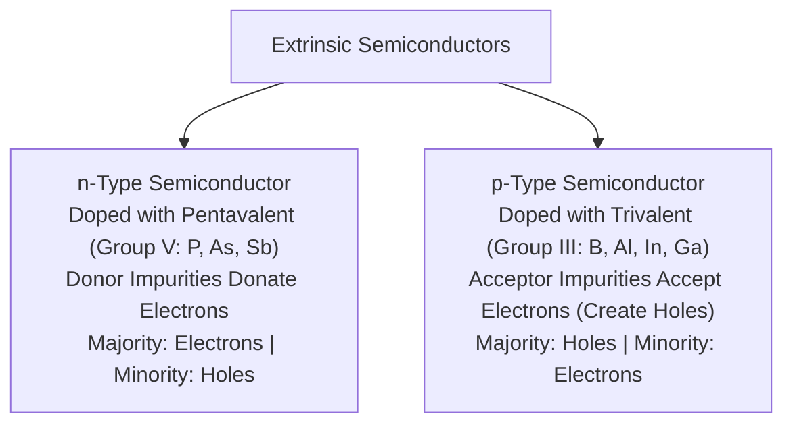
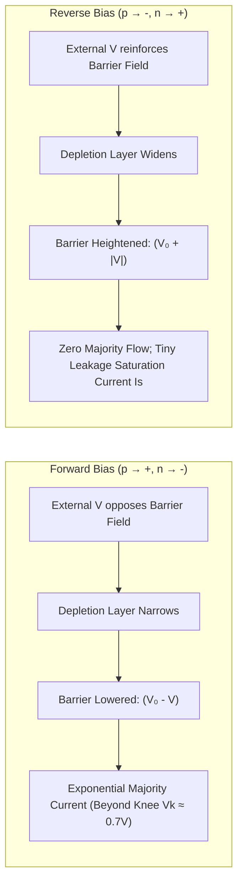
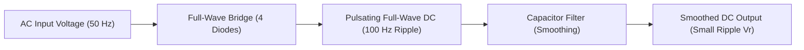
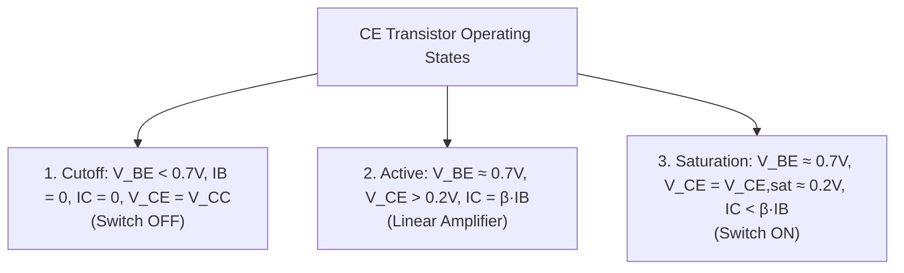
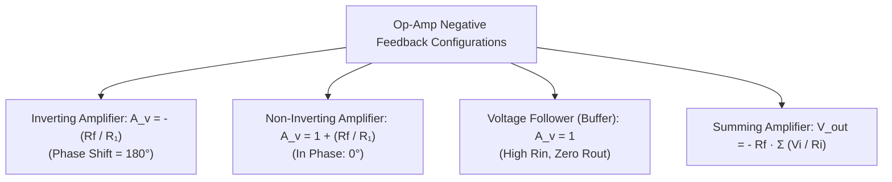
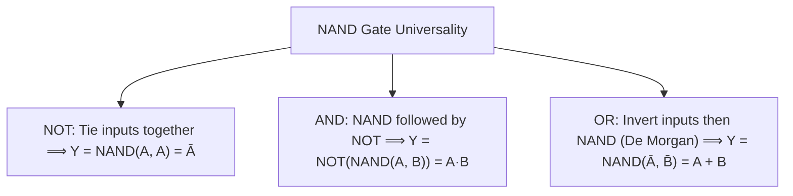
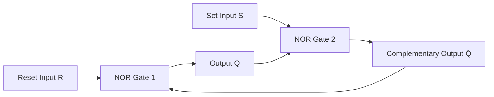

# :LiCpu: Lesson 09: Electronics

> [!ABSTRACT] Syllabus Scope (NIE Teacher's Guide)
> - **9.1 Semiconductor Diodes & Applications**: Intrinsic semiconductors (Si, Ge) and thermal generation of electron-hole pairs, extrinsic semiconductors (doping, donor/acceptor impurities, n-type and p-type, majority and minority charge carriers), formation of p-n junction, depletion layer, and potential barrier ($0.7\text{ V}$ for Si, $0.3\text{ V}$ for Ge), forward and reverse biasing, practical vs. ideal diode $I-V$ characteristic curves, peak inverse voltage (PIV), diode as an electronic switch, half-wave and full-wave bridge rectification, capacitor smoothing and ripple voltage, Zener diode voltage regulation, light emitting diodes (LED), and photodiodes.
> - **9.2 Bipolar Junction Transistors (BJTs) & JFETs**: npn and pnp transistor physical architectures (emitter, base, collector), active mode carrier transport mechanisms, current relations ($I_E = I_B + I_C$), common-base ($\alpha$) and common-emitter ($\beta = h_{FE}$) current gains, Common-Emitter (CE) configuration characteristics (input, output, and transfer), operating regions (cutoff, active, saturation), DC load-line analysis and Q-point biasing, transistor switching action, CE voltage amplifier ($A_v = -\beta \frac{R_C}{r_{\text{in}}}$) with $180^\circ$ phase inversion, structure and action of n-channel Junction Field Effect Transistors (JFET), pinch-off voltage ($V_P$), and voltage-controlled channel conductance.
> - **9.3 Operational Amplifiers (Op-Amps)**: Integrated circuit (IC) classifications (SSI, MSI, LSI, VLSI), pinout architecture of 741 8-pin DIP op-amp, properties of ideal op-amps ($A_{OL} \to \infty, R_{\text{in}} \to \infty, R_{\text{out}} \to 0, BW \to \infty, V_{os} = 0$), open-loop mode and voltage comparator applications, closed-loop mode with negative feedback, Golden Rules I and II (virtual ground and zero terminal current), derivations of closed-loop voltage gain for inverting ($A_v = -\frac{R_f}{R_1}$) and non-inverting ($A_v = 1 + \frac{R_f}{R_1}$) amplifiers, voltage follower buffer ($A_v = 1$), and inverting summing amplifier.
> - **9.4 Digital Electronics, Logic Gates & SR Flip-Flops**: Analogue vs. digital representations, binary number system and decimal conversions (0 to 15), logic voltage levels (0 and 1), primary logic gates (NOT, AND, OR), universal logic gates (NAND, NOR) and synthesis proofs, exclusive gates (XOR, XNOR), truth tables and Boolean algebra, De Morgan's Laws ($\overline{A\cdot B} = \overline{A} + \overline{B}$ and $\overline{A+B} = \overline{A}\cdot\overline{B}$), combinational digital circuit synthesis, sequential logic principles, and cross-coupled NOR/NAND SR flip-flop memory elements.

---
## Deep Dive Subtopic Navigation

For mathematical proofs of op-amp closed-loop configurations, BJT load-line derivations, and JFET transconductance mechanics, refer to the companion subtopic guide:

- :LiCircuitBoard: **Electronics**: [[Subtopics/Transistors & Operational Amplifiers|Transistors & Operational Amplifiers Guide]]

---
## 1. Semiconductor Diodes & Power Rectification (Competency 9.1)

### Intrinsic Semiconductors:
* **Materials:** Pure tetravalent crystalline elements from Group IV of the periodic table, primarily Silicon ($\text{Si}$, bandgap $E_g \approx 1.1\text{ eV}$) and Germanium ($\text{Ge}$, bandgap $E_g \approx 0.7\text{ eV}$).
* **Crystal Structure:** Diamond cubic lattice where each atom shares its 4 valence electrons with 4 neighboring atoms through covalent bonds.
* **Thermal Generation of Charge Carriers:**
  * At absolute zero ($T = 0\text{ K}$), all valence electrons are locked in covalent bonds; the conduction band is completely empty, and the semiconductor acts as a **perfect insulator**.
  * At room temperature ($T \approx 300\text{ K}$), thermal lattice vibrations break a fraction of covalent bonds, liberating free electrons into the conduction band and leaving behind vacant covalent sites in the valence band termed **holes**.
  * Holes behave as effective positive charge carriers ($+e$). Free electrons and holes are always created simultaneously in equal numbers:
    $$n_i = p_i \quad (\text{intrinsic carrier concentration})$$
  * As temperature rises, thermal generation increases exponentially, causing electrical conductivity to surge ($\alpha < 0$, negative temperature coefficient).

---

### Extrinsic Semiconductors & Doping:
Doping is the deliberate addition of minute quantities of specific impurity atoms (roughly 1 impurity atom per $10^6$ host atoms) into an intrinsic crystal to vastly enhance its conductivity.

1. **n-Type Semiconductor (Pentavalent Doping):**
   * Doped with Group V donor elements (Phosphorus $\text{P}$, Arsenic $\text{As}$, Antimony $\text{Sb}$).
   * 4 valence electrons form covalent bonds; the 5th electron is loosely bound ($E_d \approx 0.05\text{ eV}$) and easily enters the conduction band at room temperature.
   * Donating this electron leaves an **immobile positive donor ion** locked in the lattice.
   * **Majority Carriers:** Electrons ($n \approx N_D$).
   * **Minority Carriers:** Holes ($p = n_i^2 / N_D$).
2. **p-Type Semiconductor (Trivalent Doping):**
   * Doped with Group III acceptor elements (Boron $\text{B}$, Aluminium $\text{Al}$, Indium $\text{In}$, Gallium $\text{Ga}$).
   * The 3 valence electrons form bonds with 3 neighbors; the 4th bond lacks an electron, creating a **hole**.
   * A neighboring electron can easily hop into this vacant bond, creating an **immobile negative acceptor ion** locked in the lattice.
   * **Majority Carriers:** Holes ($p \approx N_A$).
   * **Minority Carriers:** Electrons ($n = n_i^2 / N_A$).

> [!NOTE] Electrical Neutrality
> Both n-type and p-type semiconductors are **strictly electrically neutral** as bulk materials, because the total positive nuclear charges exactly equal the total negative electronic charges in the crystal.

---

### Formation of the p-n Junction & Depletion Layer:
When a p-type semiconductor and an n-type semiconductor are joined at an atomic interface:
1. **Diffusion:** The enormous concentration gradient drives majority electrons to diffuse from the n-side to the p-side, and majority holes to diffuse from the p-side to the n-side across the junction.
2. **Recombination & Ion Core Exposure:** Electrons and holes recombine near the interface, annihilating each other as mobile charge carriers.
3. **Depletion Region:** This recombination leaves behind uncompensated, immobile positive donor ions on the n-side and immobile negative acceptor ions on the p-side, forming a narrow region ($\sim 0.5\ \mu\text{m}$) completely devoid of mobile charge carriers.
4. **Barrier Potential ($V_0$):** The immobile space-charge ions create an internal electrostatic field ($\vec{E}_{\text{barrier}}$) directed from the n-side to the p-side. This field opposes further diffusion of majority carriers while driving a small drift of minority carriers in the opposite direction.
   * Equilibrium is established when the diffusion current of majority carriers exactly balances the drift current of minority carriers:
     $$V_0 \approx 0.7\text{ V} \text{ for Silicon}, \quad V_0 \approx 0.3\text{ V} \text{ for Germanium (at } 300\text{ K)}$$

---

### Biasing the p-n Junction Diode:

* **Forward Bias ($V > 0$, positive terminal to p-type, negative to n-type):**
  * The applied field opposes the internal junction barrier, narrowing the depletion layer.
  * When $V \ge V_k$ (knee voltage, $\approx 0.7\text{ V}$ for Si), the barrier is overcome, and majority carriers cross freely, producing an exponentially rising forward current.
* **Reverse Bias ($V < 0$, positive terminal to n-type, negative to p-type):**
  * The applied field aids the internal junction barrier, widening the depletion layer.
  * Majority carrier flow is completely blocked.
  * A minute, constant **reverse saturation current** ($I_s \sim \text{nA}$ for Si, $\sim \mu\text{A}$ for Ge) flows, mediated strictly by thermally generated minority carriers. $I_s$ is virtually independent of reverse voltage but doubles approximately every $10^\circ\text{C}$ rise in temperature.
* **Reverse Breakdown Voltage ($V_{\text{BR}}$ / Peak Inverse Voltage PIV):**
  * At a critical reverse voltage, high electric fields either rupture covalent bonds directly (**Zener breakdown**) or accelerated minority electrons collide violently with lattice atoms producing secondary carrier avalanches (**Avalanche breakdown**), causing current to surge destructively unless limited by external resistance.

---

### Practical vs. Ideal Diode $I-V$ Characteristics:

| Operating State | Ideal Diode | Practical Silicon Diode |
| :--- | :--- | :--- |
| **Forward Bias ($V > 0$)** | Zero resistance ($R_F = 0$), zero voltage drop ($V_D = 0$). Acts as a **closed switch**. | Finite forward resistance ($r_f \approx 10 - 50\ \Omega$), constant voltage drop $V_D \approx 0.7\text{ V}$ once $I > 0$. |
| **Reverse Bias ($V < 0$)** | Infinite resistance ($R_R \to \infty$), zero leakage current ($I_R = 0$). Acts as an **open switch**. | High reverse resistance ($R_R \sim 10^7 - 10^9\ \Omega$), small reverse leakage current ($I_s \sim \text{nA}$). |

---

### Rectification Circuits:

#### 1. Half-Wave Rectifier:
* **Circuit:** A single diode $D$ in series with an AC secondary winding and a load resistor $R_L$.
* **Operation:** Conduction occurs only during the positive half-cycle of input AC when the diode is forward-biased. During the negative half-cycle, the diode is reverse-biased ($I = 0$).
* **Waveforms & Parameters:**
  * Output is a series of pulsating DC half-cycles.
  * Peak load voltage: $V_{\text{peak,out}} = V_{\text{peak,in}} - 0.7\text{ V}$.
  * Ripple frequency: $f_{\text{ripple}} = f_{\text{in}}$ (e.g., $50\text{ Hz}$).
  * Maximum theoretical conversion efficiency: $\eta_{\text{max}} = 40.6\%$.

#### 2. Full-Wave Bridge Rectifier:
* **Circuit:** Four diodes ($D_1, D_2, D_3, D_4$) connected in a closed bridge loop across the AC supply and load resistor $R_L$.
* **Operation:**
  * **Positive Half-Cycle:** Diodes $D_1$ and $D_3$ are forward-biased; current flows through $D_1 \to R_L \to D_3$. Diodes $D_2$ and $D_4$ are reverse-biased.
  * **Negative Half-Cycle:** Diodes $D_2$ and $D_4$ are forward-biased; current flows through $D_2 \to R_L \to D_4$. Diodes $D_1$ and $D_3$ are reverse-biased.
  * **Result:** Current passes through the load resistor $R_L$ in the **identical direction during both half-cycles**.
* **Waveforms & Parameters:**
  * Peak load voltage: $V_{\text{peak,out}} = V_{\text{peak,in}} - 2(0.7\text{ V}) = V_{\text{peak,in}} - 1.4\text{ V}$.
  * Ripple frequency: $f_{\text{ripple}} = 2 f_{\text{in}}$ (e.g., $100\text{ Hz}$ for $50\text{ Hz}$ mains).
  * Maximum theoretical conversion efficiency: $\eta_{\text{max}} = 81.2\%$.

#### 3. Capacitor Filter (Smoothing):
* A high-capacitance electrolytic capacitor $C$ is connected in parallel across the load resistor $R_L$.
* **Action:**
  1. The capacitor charges rapidly to peak voltage $V_p$ while the diodes conduct.
  2. As the diode voltage drops below peak, the diodes turn off (reverse-biased), and the capacitor discharges slowly through $R_L$ with time constant $\tau = C R_L \gg \frac{T}{2}$.
  3. The next voltage peak recharges the capacitor before its voltage can drop significantly.
* **Ripple Voltage ($V_r$):** The peak-to-peak fluctuation in the smoothed output DC voltage:
  $$V_r \approx \frac{I_{\text{load}}}{2 f C} = \frac{V_p}{2 f C R_L}$$
  * Increasing capacitance $C$ or load resistance $R_L$ minimizes ripple voltage, yielding a smoother DC output.

---

### Special Purpose Diodes:

#### 1. Zener Diode:
* **Physics:** A silicon p-n junction with very heavy doping on both sides, creating an ultra-narrow depletion layer ($\sim 10\text{ nm}$).
* **Operating Mode:** Operated under **reverse bias in the breakdown region** ($V_Z$).
* **Voltage Regulator Circuit:**
  * Connected in reverse bias across the load $R_L$ in series with a current-limiting resistor $R_s$:
    $$R_s = \frac{V_{\text{in}} - V_Z}{I_Z + I_L}$$
  * Even if input voltage $V_{\text{in}}$ or load current $I_L$ fluctuates widely, the output voltage across the load remains clamped strictly at the constant Zener breakdown voltage:
    $$V_{\text{out}} = V_Z = \text{constant}$$

#### 2. Light Emitting Diode (LED):
* **Physics:** A forward-biased p-n junction fabricated from direct-bandgap compound semiconductors (e.g., Gallium Arsenide $\text{GaAs}$, Gallium Phosphide $\text{GaP}$).
* **Mechanism:** When forward-biased, injected electrons and holes recombine radiatively at the junction, releasing photon energy equal to the semiconductor bandgap:
  $$E = h f = \frac{h c}{\lambda} \approx E_g$$
* The emitted light color (infrared, red, amber, green, blue) depends directly on $E_g$.

#### 3. Photodiode:
* **Physics:** A p-n junction packaged with a transparent optical window and operated in **reverse bias**.
* **Mechanism:** Incident photons with energy $h f \ge E_g$ absorbed in the depletion layer break covalent bonds, generating electron-hole pairs. The internal electric field sweeps electrons to the n-side and holes to the p-side, producing a photocurrent ($I_{\text{photo}}$) directly proportional to incident optical irradiance (light intensity in Lux):
  $$I_{\text{rev}} = I_s + I_{\text{photo}} \approx I_{\text{photo}} \propto \text{Light Intensity}$$

---

## 2. Bipolar Junction Transistors (BJTs) & JFETs (Competency 9.2)

### BJT Architecture & Action:
A three-terminal semiconductor device consisting of two back-to-back p-n junctions:
* **Emitter (E):** Heavily doped to inject maximum carriers; moderate size.
* **Base (B):** Ultra-thin ($\sim 1\ \mu\text{m}$) and lightly doped to minimize recombination.
* **Collector (C):** Moderately doped and physically largest to dissipate heat.

* **Current Conservation:**
  $$I_E = I_B + I_C$$
* **Current Gain Definitions:**
  * Common-Base: $\alpha = \frac{I_C}{I_E} \approx 0.98 - 0.99$.
  * Common-Emitter: $\beta = h_{FE} = \frac{I_C}{I_B} \approx 50 - 300$.
  $$\beta = \frac{\alpha}{1 - \alpha}, \quad \alpha = \frac{\beta}{1 + \beta}$$

---

### Common-Emitter (CE) Configuration & Operating Regions:

1. **Cutoff Region:** Base-emitter reverse-biased ($V_{BE} < 0.7\text{ V}$). No base current ($I_B = 0$), hence $I_C = 0$ and $V_{CE} = V_{CC}$. Transistor behaves as an **open switch**.
2. **Active Linear Region:** Base-emitter forward-biased ($V_{BE} \approx 0.7\text{ V}$), collector-base reverse-biased ($V_{CE} > 0.2\text{ V}$). Collector current is proportional strictly to base current: $I_C = \beta I_B$, independent of $V_{CE}$. Used for **linear signal amplification**.
3. **Saturation Region:** Both base-emitter and collector-base junctions forward-biased. The collector voltage falls to its minimum saturation level ($V_{CE,\text{sat}} \approx 0.2\text{ V}$). Collector current is limited by external circuit resistance: $I_{C,\text{sat}} \approx \frac{V_{CC}}{R_C}$, with $I_C < \beta I_B$. Transistor behaves as a **closed switch**.

---

### Common-Emitter (CE) Voltage Amplifier:
* **DC Load Line Equation:**
  $$V_{CC} = I_C R_C + V_{CE} \implies V_{CE} = V_{CC} - I_C R_C$$
* **Voltage Gain ($A_v$):**
  When a small sinusoidal AC input voltage $v_{\text{in}}$ is applied to the base:
  $$\Delta I_B = \frac{v_{\text{in}}}{r_{\text{in}}}, \quad \Delta I_C = \beta \Delta I_B = \beta \frac{v_{\text{in}}}{r_{\text{in}}}$$
  $$v_{\text{out}} = -\Delta I_C R_C = -\beta \left(\frac{v_{\text{in}}}{r_{\text{in}}}\right) R_C$$
  $$A_v = \frac{v_{\text{out}}}{v_{\text{in}}} = -\beta \frac{R_C}{r_{\text{in}}}$$
* **$180^\circ$ Phase Inversion:** The negative sign signifies that when the base input voltage swings positive, base current rises, collector current surges, pulling down the collector potential $V_{CE}$. The output voltage is inverted by exactly $180^\circ$ relative to the input signal.

---

### Junction Field Effect Transistor (JFET):
* A **unipolar**, **voltage-controlled** semiconductor device where current conduction occurs through a continuous channel of one polarity (n-channel or p-channel).
* **Operating Principle (n-Channel):**
  * Current of majority electrons flows from Source ($S$) to Drain ($D$) under voltage $V_{DS}$.
  * The Gate ($G$) is reverse-biased relative to the Source ($V_{GS} \le 0$), expanding the p-n depletion layers into the channel and narrowing its conductive cross-section.
  * When $V_{GS}$ reaches the **pinch-off voltage** ($V_P$), the depletion regions meet, pinching the channel closed and reducing $I_D$ to zero.
* **Shockley's Equation:**
  $$I_D = I_{DSS} \left(1 - \frac{V_{GS}}{V_P}\right)^2 \quad (\text{for } V_P \le V_{GS} \le 0)$$
* **Advantage over BJT:** Because the gate is reverse-biased, the JFET has an extremely high input resistance ($R_{\text{in}} > 10^8 - 10^{10}\ \Omega$) and generates negligible thermal noise.

---

## 3. Operational Amplifiers (Op-Amps) (Competency 9.3)

### Integrated Circuit (IC) Architectures:
* **SSI (Small Scale Integration):** $< 10$ logic gates / $< 100$ transistors per chip.
* **MSI (Medium Scale Integration):** $10 - 100$ gates / $100 - 1,000$ transistors.
* **LSI (Large Scale Integration):** $100 - 10,000$ gates / $1,000 - 100,000$ transistors.
* **VLSI (Very Large Scale Integration):** $> 10,000$ gates / $> 100,000$ to billions of transistors (modern microprocessors).

---

### The 741 Op-Amp Pinout & Package Architecture:
A versatile, high-gain DC-coupled differential amplifier in an 8-pin Dual In-Line Package (DIP):
* **Pin 2:** Inverting Input ($V^-$)
* **Pin 3:** Non-Inverting Input ($V^+$)
* **Pin 4:** Negative Power Supply Rail ($-V_{CC}$ or $-V_S$)
* **Pin 6:** Output Terminal ($V_{\text{out}}$)
* **Pin 7:** Positive Power Supply Rail ($+V_{CC}$ or $+V_S$)
* **Pins 1 & 5:** Offset Null (potentiometer trims DC offset error); **Pin 8:** Not Connected (NC).

---

### Ideal Op-Amp Characteristics:
1. **Infinite Open-Loop Voltage Gain:** $A_{OL} \to \infty$ ($\approx 2 \times 10^5$ in 741).
2. **Infinite Input Impedance:** $R_{\text{in}} \to \infty$ ($\approx 2\text{ M}\Omega$ in 741). Draws zero input current.
3. **Zero Output Impedance:** $R_{\text{out}} \to 0$ ($\approx 75\ \Omega$ in 741). Delivers constant voltage regardless of load.
4. **Infinite Bandwidth:** $BW \to \infty$. Amplifies all signal frequencies from DC to infinity equally.
5. **Zero Offset Voltage:** $V_{\text{out}} = 0$ when $V^+ = V^-$.

---

### Open-Loop Mode: The Voltage Comparator:
With no feedback applied, the output voltage is governed by:
$$V_{\text{out}} = A_{OL} (V^+ - V^-)$$
Because $A_{OL} \sim 10^5$, an input difference of just a few microvolts drives the op-amp output into saturation against the supply rails:
* If $V^+ > V^- \implies V_{\text{out}} = +V_{\text{sat}} \approx +V_{CC} - 1.5\text{ V}$.
* If $V^+ < V^- \implies V_{\text{out}} = -V_{\text{sat}} \approx -V_{CC} + 1.5\text{ V}$ (or $0\text{ V}$ with single supply).
* **Application:** Threshold switching circuits (automatic street lights with LDR, temperature alarms with thermistors).

---

### Closed-Loop Mode & The Two Golden Rules:
Negative feedback (connecting a resistor network from output pin 6 to inverting input pin 2) stabilizes the gain and prevents output saturation:
* **Golden Rule I (Virtual Short / Virtual Earth):**
  $$V^+ = V^-$$
  The op-amp drives its output to maintain zero potential difference between its two input terminals.
* **Golden Rule II (Zero Input Current):**
  $$I^+ = I^- = 0$$
  No current can enter either input terminal due to infinite input impedance.

---

### Standard Op-Amp Amplifier Circuits:

#### 1. Inverting Amplifier:
* Input signal $V_{\text{in}}$ applied through $R_1$ to $V^-$; $V^+$ tied to ground ($V^+ = 0$).
* By Golden Rule I, $V^- = 0$ (**Virtual Ground**).
* By Golden Rule II, $I_1 = I_f$:
  $$\frac{V_{\text{in}} - 0}{R_1} = \frac{0 - V_{\text{out}}}{R_f} \implies A_v = \frac{V_{\text{out}}}{V_{\text{in}}} = -\frac{R_f}{R_1}$$

#### 2. Non-Inverting Amplifier:
* Input signal $V_{\text{in}}$ applied directly to $V^+$.
* By Golden Rule I, $V^- = V^+ = V_{\text{in}}$.
* By Golden Rule II, $I_1 = I_f$:
  $$\frac{V_{\text{in}} - 0}{R_1} = \frac{V_{\text{out}} - V_{\text{in}}}{R_f} \implies A_v = \frac{V_{\text{out}}}{V_{\text{in}}} = 1 + \frac{R_f}{R_1}$$

#### 3. Voltage Follower (Unity-Gain Buffer):
* Set $R_f = 0$ (direct feedback) and $R_1 \to \infty$:
  $$A_v = 1 \implies V_{\text{out}} = V_{\text{in}}$$
* Provides ideal impedance buffering: infinite input impedance draws no current from fragile sensor sources, while zero output impedance drives heavy loads without voltage sag.

#### 4. Inverting Summing Amplifier (Adder):
* Connects inputs $V_1, V_2, \dots$ via input resistors $R_1, R_2, \dots$ to virtual ground node $V^-$:
  $$V_{\text{out}} = -R_f \left(\frac{V_1}{R_1} + \frac{V_2}{R_2} + \dots + \frac{V_n}{R_n}\right)$$

---

## 4. Digital Electronics, Logic Gates & SR Flip-Flops (Competency 9.4)

### Analogue vs. Digital Signals:
* **Analogue Signal:** Continuously varying electrical voltage or current that can assume an infinite number of values within a range (e.g., sound waves, temperature sensor outputs).
* **Digital Signal:** Discrete two-state electrical signal that alternates between two clearly defined voltage levels:
  * **Logic HIGH (1):** High voltage level (e.g., $+5\text{ V}$ in TTL logic).
  * **Logic LOW (0):** Low voltage level (e.g., $0\text{ V}$ / ground).
* **Binary Representation:** Group of bits (binary digits 0 or 1). 1 Byte = 8 bits.
  * **Decimal to 4-bit Binary:**
    * $0 = 0000_2$
    * $5 = 0101_2$
    * $9 = 1001_2$
    * $15 = 1111_2$

---

### Primary & Universal Logic Gates:

| Gate Name | Standard Symbol / Boolean Expression | Truth Table ($A, B \to Y$) | Functional Description |
| :--- | :--- | :--- | :--- |
| **NOT Gate** (Inverter) | $Y = \overline{A}$ | $A=0 \to Y=1$ $A=1 \to Y=0$ | Output is the logical complement (opposite) of input. |
| **AND Gate** | $Y = A \cdot B$ | $0,0 \to 0$ $0,1 \to 0$ $1,0 \to 0$ $1,1 \to 1$ | Output is HIGH if and only if **all** inputs are HIGH. |
| **OR Gate** | $Y = A + B$ | $0,0 \to 0$ $0,1 \to 1$ $1,0 \to 1$ $1,1 \to 1$ | Output is HIGH if **at least one** input is HIGH. |
| **NAND Gate** (Universal) | $Y = \overline{A \cdot B}$ | $0,0 \to 1$ $0,1 \to 1$ $1,0 \to 1$ $1,1 \to 0$ | Inverted AND: Output is LOW only when all inputs are HIGH. |
| **NOR Gate** (Universal) | $Y = \overline{A + B}$ | $0,0 \to 1$ $0,1 \to 0$ $1,0 \to 0$ $1,1 \to 0$ | Inverted OR: Output is HIGH only when all inputs are LOW. |
| **XOR Gate** (Exclusive-OR) | $Y = A \oplus B = \overline{A}B + A\overline{B}$ | $0,0 \to 0$ $0,1 \to 1$ $1,0 \to 1$ $1,1 \to 0$ | Output is HIGH when inputs are **different**. |
| **XNOR Gate** (Equivalence) | $Y = \overline{A \oplus B} = AB + \overline{A}\overline{B}$ | $0,0 \to 1$ $0,1 \to 0$ $1,0 \to 0$ $1,1 \to 1$ | Output is HIGH when inputs are **identical**. |

---

### Universal Logic Gate Syntheses:
Both **NAND** and **NOR** gates are universal because any Boolean function can be implemented using exclusively one type of gate:

---

### De Morgan's Laws of Boolean Algebra:
$$\text{Law 1: } \overline{A \cdot B} = \overline{A} + \overline{B}$$
* *The complement of a product (AND) equals the sum (OR) of individual complements.*
$$\text{Law 2: } \overline{A + B} = \overline{A} \cdot \overline{B}$$
* *The complement of a sum (OR) equals the product (AND) of individual complements.*

---

### The SR Flip-Flop (Bistable Multivibrator / 1-Bit Memory):
Unlike combinational circuits whose outputs depend solely on present inputs, sequential circuits possess **memory**—their outputs depend on both present inputs and previous output states.

The fundamental sequential memory element is the **Set-Reset (SR) Flip-Flop**, constructed using two cross-coupled NOR gates:

#### Truth Table for NOR-based SR Flip-Flop:

| $S$ (Set) | $R$ (Reset) | $Q_{n+1}$ (Next State) | $\overline{Q}_{n+1}$ | Operating State / Action |
| :---: | :---: | :---: | :---: | :--- |
| **$0$** | **$0$** | $Q_n$ | $\overline{Q}_n$ | **Memory / Hold State** (Output unchanged; stores previous 1 bit). |
| **$0$** | **$1$** | **$0$** | **$1$** | **RESET State** (Output cleared to 0). |
| **$1$** | **$0$** | **$1$** | **$0$** | **SET State** (Output set to 1). |
| **$1$** | **$1$** | $0$ | $0$ | **Invalid / Forbidden State** ($Q$ and $\overline{Q}$ both 0; disallowed in practice). |

* **Application:** Forms the basic 1-bit static RAM (SRAM) storage cell, switch-debouncing latches, and digital counters.

---

## :LiRocket: Flashcards (Spaced Repetition)

#flashcards

What is the relationship between Emitter ($I_E$), Base ($I_B$), and Collector ($I_C$) currents in a transistor? :: $I_E = I_B + I_C$.
<!--SR:!2026-09-26,1,230-->

What is the DC current gain $\beta$ of a common-emitter transistor? :: $\beta = \frac{I_C}{I_B}$.
<!--SR:!2026-09-26,1,230-->

List 4 ideal characteristics of an Operational Amplifier (Op-Amp). :: 1. Infinite input impedance ($R_{\text{in}} = \infty$), 2. Zero output impedance ($R_{\text{out}} = 0$), 3. Infinite open-loop voltage gain ($A_{OL} = \infty$), 4. Infinite bandwidth.

What is the voltage gain $A_v$ of an Inverting Op-Amp circuit? :: $A_v = -\frac{R_f}{R_{\text{in}}}$.
<!--SR:!2026-09-26,1,230-->

What is the voltage gain $A_v$ of a Non-Inverting Op-Amp circuit? :: $A_v = 1 + \frac{R_f}{R_{\text{in}}}$.

Define an intrinsic semiconductor and describe how thermal charge carriers are formed. :: A pure semiconductor (pure Si or Ge); thermal lattice vibrations rupture covalent bonds, simultaneously generating equal numbers of free conduction electrons and valence-band holes ($n_i = p_i$).

What are majority and minority carriers in an n-type semiconductor? :: Doped with pentavalent donor impurities: majority carriers are electrons; minority carriers are thermally generated holes.

What are majority and minority carriers in a p-type semiconductor? :: Doped with trivalent acceptor impurities: majority carriers are holes; minority carriers are thermally generated electrons.

Explain the origin of the depletion layer and potential barrier in a p-n junction. :: Mobile electrons and holes diffuse across the junction and recombine, exposing uncompensated positive donor ions on the n-side and negative acceptor ions on the p-side; this space-charge layer opposes further diffusion, establishing an equilibrium potential barrier ($0.7\text{ V}$ in Si, $0.3\text{ V}$ in Ge).

Why is the ripple frequency of a full-wave bridge rectifier twice that of a half-wave rectifier? :: A half-wave rectifier conducts once per AC cycle ($f_{\text{ripple}} = f_{\text{in}}$), whereas a full-wave rectifier directs both positive and negative AC half-cycles through the load in the same direction, producing two pulses per cycle ($f_{\text{ripple}} = 2 f_{\text{in}}$).

How does a Zener diode maintain a constant voltage across a load in a regulator circuit? :: When operated under reverse bias in its breakdown region ($V_Z$), the voltage across the Zener diode remains essentially constant despite large variations in reverse current or input supply voltage.

Explain the mechanism of photon emission in a Light Emitting Diode (LED). :: When forward-biased, injected electrons and holes recombine radiatively at the p-n junction, releasing energy as photons: $E = hf = \frac{hc}{\lambda} \approx E_g$.

Describe the terminal conditions for a BJT operating in the cutoff and saturation regions. :: Cutoff (Switch OFF): $V_{BE} < 0.7\text{ V}, I_B = 0 \implies I_C = 0, V_{CE} = V_{CC}$; Saturation (Switch ON): $V_{BE} \approx 0.7\text{ V}, V_{CE} = V_{CE,\text{sat}} \approx 0.2\text{ V}, I_C < \beta I_B$.

Why is there a $180^\circ$ phase inversion in a Common-Emitter transistor voltage amplifier? :: As input voltage swings positive, base current rises, driving collector current higher; this increases the voltage drop across $R_C$ ($I_C R_C$), causing the output collector voltage $V_{CE} = V_{CC} - I_C R_C$ to swing negative.

Define the pinch-off voltage $V_P$ of an n-channel JFET. :: The reverse gate-source voltage $V_{GS}$ at which the depletion layers meet, completely pinching off the conductive channel such that drain current $I_D = 0$.

State Golden Rule I and Golden Rule II for an ideal Op-Amp operating under negative feedback. :: Golden Rule I: $V^+ = V^-$ (Virtual Short / Virtual Earth); Golden Rule II: $I^+ = I^- = 0$ (Zero input terminal current due to infinite input impedance).

Derive the closed-loop voltage gain of an inverting op-amp amplifier. :: Since $V^+ = 0 \implies V^- = 0$ (virtual ground), $I_1 = \frac{V_{\text{in}}}{R_1}$ and $I_f = -\frac{V_{\text{out}}}{R_f}$. Since $I^- = 0 \implies I_1 = I_f$, we obtain $\frac{V_{\text{in}}}{R_1} = -\frac{V_{\text{out}}}{R_f} \implies A_v = -\frac{R_f}{R_1}$.

Derive the closed-loop voltage gain of a non-inverting op-amp amplifier. :: $V^- = V^+ = V_{\text{in}}$. By voltage division, $V^- = V_{\text{out}} \frac{R_1}{R_1 + R_f} \implies V_{\text{in}} = V_{\text{out}} \frac{R_1}{R_1 + R_f} \implies A_v = 1 + \frac{R_f}{R_1}$.

What is a Voltage Follower (Buffer) and why is it useful? :: An op-amp with $V_{\text{out}}$ tied directly to $V^-$ giving $A_v = 1$; its infinite input impedance and zero output impedance prevent signal attenuation (loading effect) when connecting high-impedance sensors to low-impedance stages.

How does an Op-Amp function as an open-loop Voltage Comparator? :: Since $A_{OL}$ is huge ($\sim 10^5$), if $V^+ > V^-$, $V_{\text{out}}$ snaps to $+V_{\text{sat}}$; if $V^+ < V^-$, $V_{\text{out}}$ snaps to $-V_{\text{sat}}$, acting as a sensitive digital threshold detector.

State De Morgan's Two Laws of Boolean Algebra. :: 1. $\overline{A \cdot B} = \overline{A} + \overline{B}$; 2. $\overline{A + B} = \overline{A} \cdot \overline{B}$.

Why are NAND and NOR gates called Universal Logic Gates? :: Because any Boolean logic operation (NOT, AND, OR, XOR, etc.) can be constructed using solely NAND gates or solely NOR gates.

What is the difference between a combinational logic circuit and a sequential logic circuit? :: In combinational circuits, outputs depend solely on current inputs; in sequential circuits, outputs depend on both current inputs and previous output states (they possess memory).

Describe the operation of an SR Flip-Flop in its four input states ($S, R$). :: $S=1, R=0 \implies Q=1$ (SET); $S=0, R=1 \implies Q=0$ (RESET); $S=0, R=0 \implies Q_n$ (MEMORY / HOLD); $S=1, R=1 \implies$ FORBIDDEN / INVALID ($Q=\overline{Q}=0$).
