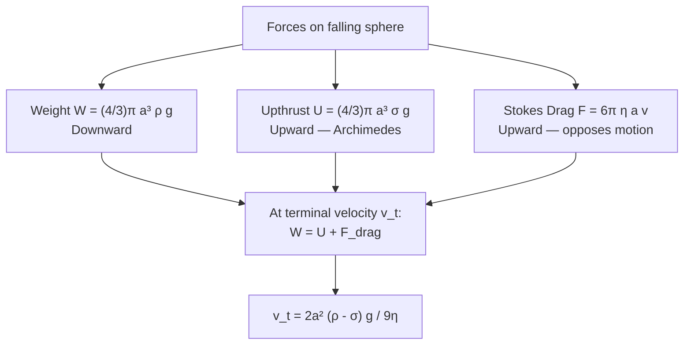
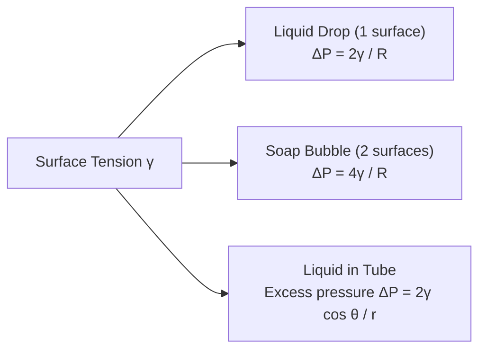

# :LiLayers: Lesson 10: Mechanical Properties of Matter

> [!ABSTRACT] Syllabus Scope (NIE Teacher's Guide — Grade 13, Unit 10)
> - **10.1 Elasticity** (10 periods): Hooke's Law, tensile stress & strain, Young's modulus, stress-strain graph (proportional limit, elastic limit, yield point, breaking stress), energy stored in a stretched wire, ductility vs brittleness.
> - **10.2 Viscosity** (15 periods): Streamline vs turbulent flow, velocity gradient, Newton's Law of viscosity, coefficient of viscosity, Poiseuille's equation, Stokes' Law, terminal velocity derivation (sphere moving up and down).
> - **10.3 Surface Tension** (15 periods): Intermolecular forces, surface energy, surface tension definition, angle of contact, excess pressure in spherical meniscus, capillary rise derivation, Jaeger's method.

> [!NOTE] Subtopic Companion Guide
> For derivations, lab experiments, and worked examples see: [[Subtopics/Elasticity & Viscosity|Elasticity, Viscosity & Surface Tension]]

---

## 1. Elasticity

### 1.1 Hooke's Law & Spring Constant

For a spring or elastic string obeying **Hooke's Law**:

$$F = k x$$

where $F$ is the applied force (N), $x$ is the extension (m), and $k$ is the **spring/force constant** (N m⁻¹).

- Hooke's Law is valid only up to the **proportional limit**.
- The relationship is **linear**: a graph of $F$ vs $x$ is a straight line through the origin with slope $k$.

**Springs in combination:**

| Configuration | Effective constant |
|---|---|
| Series ($n$ identical springs) | $k_{eff} = k/n$ |
| Parallel ($n$ identical springs) | $k_{eff} = nk$ |
| Series (two different) | $\frac{1}{k_{eff}} = \frac{1}{k_1} + \frac{1}{k_2}$ |
| Parallel (two different) | $k_{eff} = k_1 + k_2$ |

---

### 1.2 Stress, Strain & Young's Modulus

For a wire/rod of original length $L$, cross-sectional area $A$, subjected to force $F$ causing extension $\Delta L$:

| Quantity | Definition | Formula | SI Unit |
|---|---|---|---|
| **Tensile Stress** $\sigma$ | Force per unit area | $\sigma = F/A$ | Pa (N m⁻²) |
| **Tensile Strain** $\varepsilon$ | Fractional extension | $\varepsilon = \Delta L / L$ | dimensionless |
| **Young's Modulus** $E$ | Stress / Strain | $E = \sigma / \varepsilon = \frac{FL}{A \Delta L}$ | Pa (N m⁻²) |

> [!TIP] Typical values: Steel $\approx 200$ GPa, Copper $\approx 120$ GPa, Rubber $\approx 0.01$ GPa.

**Rearrangement for extension:**

$$\Delta L = \frac{FL}{AE}$$

---

### 1.3 Stress–Strain Graph

**Key regions:**

| Region | Behaviour |
|---|---|
| O → P | Proportional (Hooke's Law holds) |
| P → E | Elastic but non-linear |
| E → Y | Plastic deformation begins |
| Y → B | Necking; large plastic flow |
| At B | Fracture |

**Ductile vs Brittle:**

| Material | Stress–Strain Shape | Example |
|---|---|---|
| **Ductile** | Large plastic region before fracture | Copper, mild steel |
| **Brittle** | Fractures near elastic limit (little plastic region) | Glass, cast iron |

---

### 1.4 Energy Stored in a Stretched Wire

Work done stretching from 0 to extension $x$:

$$W = \frac{1}{2} F x = \frac{1}{2} k x^2$$

**Strain energy density** (energy per unit volume of material):

$$u = \frac{1}{2} \times \text{Stress} \times \text{Strain} = \frac{\sigma^2}{2E} = \frac{1}{2} E \varepsilon^2$$

**Total strain energy** in wire of volume $V = AL$:

$$U = \frac{1}{2} \cdot \frac{F}{A} \cdot \frac{\Delta L}{L} \cdot AL = \frac{F \Delta L}{2}$$

---

### 1.5 Thermal Stress

A rod **clamped at both ends** cannot expand freely when temperature changes by $\Delta T$. The thermal stress developed:

$$\sigma_{thermal} = E \alpha \Delta T$$

where $\alpha$ is the linear expansivity of the material.

---

### 1.6 Searle's Apparatus (Determination of Young's Modulus)

Two identical wires hang from the same rigid support:
- **Reference wire** compensates for temperature changes.
- **Test wire** carries increasing masses; micrometer measures $\Delta L$.

$$E = \frac{F L}{A \Delta L} = \frac{Mg L}{\pi r^2 \Delta L}$$

Plot $F$ vs $\Delta L$; gradient $= EA/L$, so $E = \text{gradient} \times L / A$.

---

## 2. Viscosity

### 2.1 Streamline vs Turbulent Flow

| Property | Streamline (Laminar) Flow | Turbulent Flow |
|---|---|---|
| Particle paths | Smooth, parallel layers | Chaotic, irregular |
| Velocity | Layers move at different speeds | Random eddies |
| Reynolds number $Re$ | $Re < 2000$ | $Re > 4000$ |
| Equation applicable | Poiseuille's Law | Not Poiseuille's |

---

### 2.2 Newton's Law of Viscosity

For a fluid with layers separated by distance $d$, moving with velocity difference $\Delta v$ (velocity gradient $= \Delta v / d$):

$$F = \eta A \frac{\Delta v}{d}$$

where:
- $F$ = viscous drag force (N)
- $A$ = area of layer (m²)
- $\eta$ = **coefficient of dynamic viscosity** (Pa·s = N s m⁻²)
- $\Delta v / d$ = velocity gradient (s⁻¹)

SI unit of $\eta$: **Pa·s** (Pascal-second). CGS unit: **Poise** (P); 1 Pa·s = 10 P.

**Dimensions of $\eta$:** $[\text{M L}^{-1} \text{T}^{-1}]$

> [!NOTE] Viscosity decreases with temperature for liquids (intermolecular bonds weaken) but increases with temperature for gases (molecular collisions increase).

---

### 2.3 Poiseuille's Equation

Volume flow rate $Q$ through a **cylindrical tube** of radius $r$, length $L$, with pressure difference $\Delta P$ across ends:

$$Q = \frac{\pi r^4 \Delta P}{8 \eta L}$$

**Conditions for validity:**
1. Fluid must be Newtonian (viscosity constant).
2. Flow must be **streamline (laminar)** — not turbulent.
3. Tube must be **long and straight** (fully developed flow).
4. No-slip condition at the wall (velocity = 0 at wall).
5. Incompressible fluid.

The velocity profile across the tube is **parabolic** — maximum at centre, zero at wall:

$$v(r') = \frac{\Delta P}{4 \eta L}(r^2 - r'^2)$$

---

### 2.4 Stokes' Law

For a **small sphere** of radius $a$ moving with velocity $v$ through a fluid of viscosity $\eta$:

$$F_{drag} = 6\pi \eta a v$$

Valid for **slow laminar flow** around the sphere (Stokes' regime, $Re \ll 1$).

---

### 2.5 Terminal Velocity

**Derivation:**

At terminal velocity, net force = 0:

$$\frac{4}{3}\pi a^3 \rho g = \frac{4}{3}\pi a^3 \sigma g + 6\pi \eta a v_t$$

$$6\pi \eta a v_t = \frac{4}{3}\pi a^3 (\rho - \sigma) g$$

$$\boxed{v_t = \frac{2 a^2 (\rho - \sigma) g}{9 \eta}}$$

where $\rho$ = sphere density, $\sigma$ = fluid density, $a$ = sphere radius.

> [!IMPORTANT] If $\rho > \sigma$: sphere falls at $v_t$ downward. If $\rho < \sigma$: sphere rises at $v_t$ upward (e.g. air bubble in liquid — replace $\rho - \sigma$ with $\sigma - \rho$).

**Velocity–time graph:** starts at $v = 0$, increases with decreasing acceleration, asymptotically approaches $v_t$.

---

### 2.6 Lab: Coefficient of Viscosity by Poiseuille's Method

Measure $Q$ (volume collected per time), $r$ (tube radius with micrometer), $L$ (tube length), $\Delta P = h \rho g$ (hydrostatic head):

$$\eta = \frac{\pi r^4 \Delta P}{8 Q L} = \frac{\pi r^4 h \rho g}{8 Q L}$$

---

## 3. Surface Tension

### 3.1 Intermolecular Forces & Surface Energy

Molecules in the **bulk** of a liquid are surrounded symmetrically — net intermolecular force = 0.

Molecules at the **surface** have fewer neighbours above → net inward force → surface is in a state of tension.

**Surface tension** $\gamma$ (also written $T$):

$$\gamma = \frac{F}{l}$$

Force per unit length of a line drawn on the surface. SI unit: **N m⁻¹**.

**Surface energy** $E_s$: energy required to increase surface area by $\Delta A$:

$$E_s = \gamma \Delta A$$

Relationship: surface tension = surface energy per unit area ($\gamma$ = J m⁻²= N m⁻¹ ✓).

---

### 3.2 Angle of Contact

The **angle of contact** $\theta$ is the angle between the **tangent to the liquid surface** and the **solid surface**, measured inside the liquid.

| Liquid–Solid System | $\theta$ | Meniscus | Behaviour |
|---|---|---|---|
| Water–glass | $\theta < 90°$ | Concave | Wets glass; capillary rise |
| Mercury–glass | $\theta > 90°$ | Convex | Does not wet; capillary depression |
| Water–waxed surface | $\approx 90°–180°$ | Convex | Hydrophobic |

---

### 3.3 Excess Pressure Inside Curved Surfaces

For a **spherical surface** of radius $R$:

$$\Delta P = \frac{2\gamma}{R}$$

For a **liquid drop** (one surface): $\Delta P = \dfrac{2\gamma}{R}$

For a **soap bubble** (two surfaces — inner and outer):

$$\Delta P = \frac{4\gamma}{R}$$

---

### 3.4 Capillary Rise

A liquid of surface tension $\gamma$, density $\rho$, angle of contact $\theta$ rises to height $h$ in a tube of radius $r$:

**Force balance:** Upward pull by surface tension = Weight of liquid column

$$2\pi r \gamma \cos\theta = \pi r^2 h \rho g$$

$$\boxed{h = \frac{2\gamma \cos\theta}{r \rho g}}$$

> [!IMPORTANT] For $\theta < 90°$ (e.g. water-glass): $\cos\theta > 0$ → **capillary rise**. For $\theta > 90°$ (e.g. mercury-glass): $\cos\theta < 0$ → **capillary depression** ($h$ is negative).

**Key consequences:**
- Smaller radius $r$ → greater rise $h$ (inverse relationship).
- Higher $\gamma$ → greater rise.
- Higher density $\rho$ → smaller rise.

---

### 3.5 Methods to Measure Surface Tension

| Method | Principle | Formula |
|---|---|---|
| **Capillary rise** | Measure $h$ and $r$ | $\gamma = \frac{r \rho g h}{2 \cos\theta}$ |
| **Microscope slide** | Pull horizontal glass plate off surface | $\gamma = \frac{F}{2l}$ (two edges) |
| **Jaeger's method** | Measure max pressure to blow bubble in liquid | $\gamma = \frac{r \Delta P_{max}}{2}$ |

---

### 3.6 Effects & Applications of Surface Tension

| Phenomenon | Explanation |
|---|---|
| Water insects walking on surface | Weight supported by surface tension |
| Soap bubbles and films | Surface tension minimises area |
| Capillary action in plants | Water rises in xylem vessels ($r$ very small) |
| Detergent reduces surface tension | Lowers $\gamma$ of water → better wetting |
| Mercury in thermometers | Convex meniscus (non-wetting) |
| Rain drops are spherical | Surface tension minimises surface area |

---

## 4. Summary Comparison Table

| Property | Elasticity | Viscosity | Surface Tension |
|---|---|---|---|
| Concerns | Solids under stress | Fluids in flow | Liquid surfaces |
| Key law | Hooke's Law / Young's modulus | Newton's / Poiseuille's / Stokes' | $\gamma = F/l$ |
| Key equation | $E = FL / A\Delta L$ | $F = 6\pi\eta av$; $Q = \pi r^4 \Delta P / 8\eta L$ | $h = 2\gamma\cos\theta / r\rho g$ |
| Increases with temp? | $E$ slightly decreases | Liquid $\eta$ decreases; gas $\eta$ increases | $\gamma$ decreases |
| SI unit | Pa (N m⁻²) | Pa·s | N m⁻¹ |

---

#flashcards

What is Hooke's Law and what is the spring constant $k$? :: $F = kx$; $k$ is force per unit extension (N m⁻¹). Valid only up to the proportional limit.

Define tensile stress and tensile strain. :: Stress $\sigma = F/A$ (N m⁻²); Strain $\varepsilon = \Delta L / L$ (dimensionless). Both apply to a wire under tension.

Write the formula for Young's modulus $E$ in terms of measurable quantities. :: $E = \dfrac{FL}{A\Delta L}$ where $F$ = force, $L$ = original length, $A$ = cross-sectional area, $\Delta L$ = extension.

What are the proportional limit, elastic limit, and yield point on a stress–strain graph? :: Proportional limit: Hooke's Law holds. Elastic limit: last point with no permanent deformation. Yield point: large strain begins for small additional stress.

How does ductile differ from brittle material behaviour? :: Ductile materials have a large plastic deformation region before fracture (e.g. copper). Brittle materials fracture near the elastic limit with little plastic flow (e.g. glass).

Write the expression for strain energy density in a stretched wire. :: $u = \dfrac{1}{2}\sigma\varepsilon = \dfrac{\sigma^2}{2E} = \dfrac{1}{2}E\varepsilon^2$ (J m⁻³).

State Newton's Law of Viscosity and define the coefficient of viscosity $\eta$. :: $F = \eta A \dfrac{\Delta v}{d}$; $\eta$ is the ratio of shear stress to velocity gradient; SI unit Pa·s.

Write Poiseuille's equation and state three conditions for its validity. :: $Q = \dfrac{\pi r^4 \Delta P}{8\eta L}$. Conditions: (1) streamline/laminar flow; (2) Newtonian fluid; (3) incompressible; long straight tube; no-slip at wall.

State Stokes' Law for drag on a sphere. :: $F = 6\pi\eta a v$, where $a$ = sphere radius, $v$ = velocity, $\eta$ = fluid viscosity. Valid for slow laminar flow ($Re \ll 1$).

Derive the terminal velocity of a sphere of radius $a$, density $\rho$ falling in a fluid of density $\sigma$ and viscosity $\eta$. :: At terminal velocity $W = U + F_{drag}$: $\frac{4}{3}\pi a^3(\rho-\sigma)g = 6\pi\eta a v_t$, so $v_t = \dfrac{2a^2(\rho-\sigma)g}{9\eta}$.

Define surface tension $\gamma$ and give its SI unit. :: $\gamma = F/l$ — force per unit length of a line on the surface. SI unit: N m⁻¹ (= J m⁻²).

What is the excess pressure inside (a) a liquid drop and (b) a soap bubble? :: (a) Liquid drop: $\Delta P = 2\gamma/R$. (b) Soap bubble: $\Delta P = 4\gamma/R$ (two surfaces).

Derive the capillary rise formula. :: Surface tension pull upward = $2\pi r \gamma \cos\theta$; weight of liquid = $\pi r^2 h \rho g$. Equating: $h = \dfrac{2\gamma\cos\theta}{r\rho g}$.

Why does mercury show capillary depression while water shows capillary rise? :: Mercury has $\theta > 90°$ with glass so $\cos\theta < 0$ → depression. Water has $\theta < 90°$ so $\cos\theta > 0$ → rise.

What is the relationship between surface tension and surface energy? :: $\gamma = E_s / \Delta A$; surface tension equals surface energy per unit area. Both have equivalent units N m⁻¹ = J m⁻².

How does viscosity of a liquid change with temperature, and why? :: Liquid viscosity decreases with temperature because thermal energy weakens intermolecular bonds, allowing layers to slide more easily.

What does Young's modulus measure, and how is it found experimentally using Searle's apparatus? :: $E$ measures stiffness (resistance to elastic deformation). In Searle's: plot $F$ vs $\Delta L$; gradient = $EA/L$, so $E = \text{grad} \times L/A$. Reference wire eliminates thermal errors.

Write the formula for thermal stress in a clamped rod. :: $\sigma_{thermal} = E\alpha\Delta T$, where $E$ = Young's modulus, $\alpha$ = linear expansivity, $\Delta T$ = temperature change.

What is the velocity profile of fluid flow in a tube under Poiseuille's conditions? :: Parabolic: maximum velocity at the centre, zero at the walls. $v(r') = \dfrac{\Delta P}{4\eta L}(r^2 - r'^2)$.

State two practical applications each of viscosity and surface tension. :: Viscosity: (1) engine oil lubrication; (2) medical IV drip rate control. Surface tension: (1) insects walking on water; (2) capillary action in plants (water transport in xylem).
