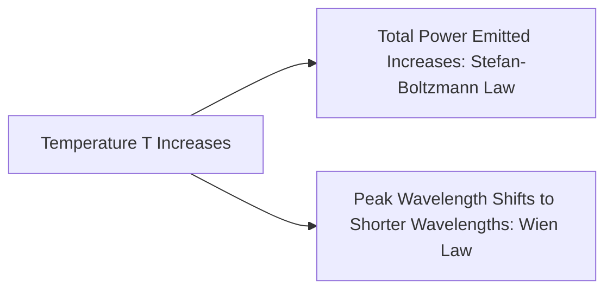
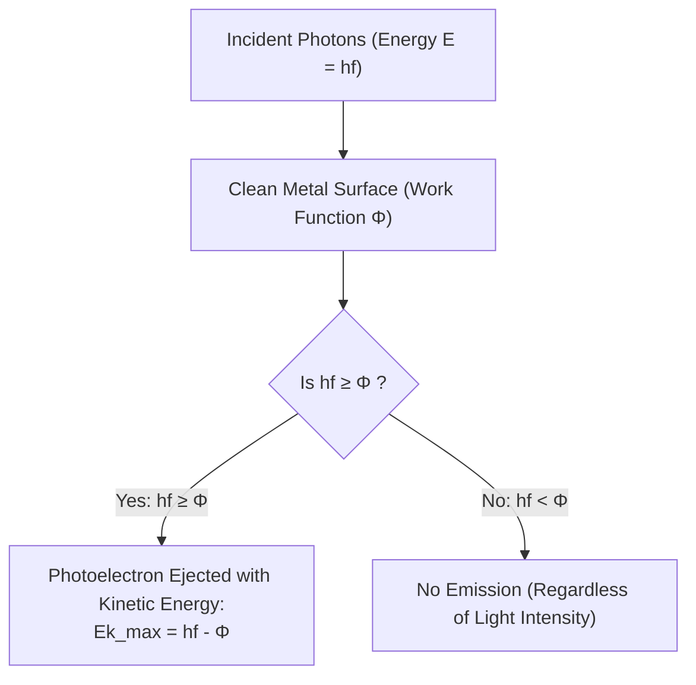
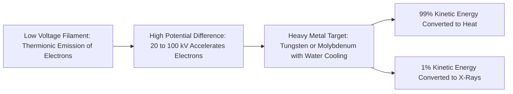
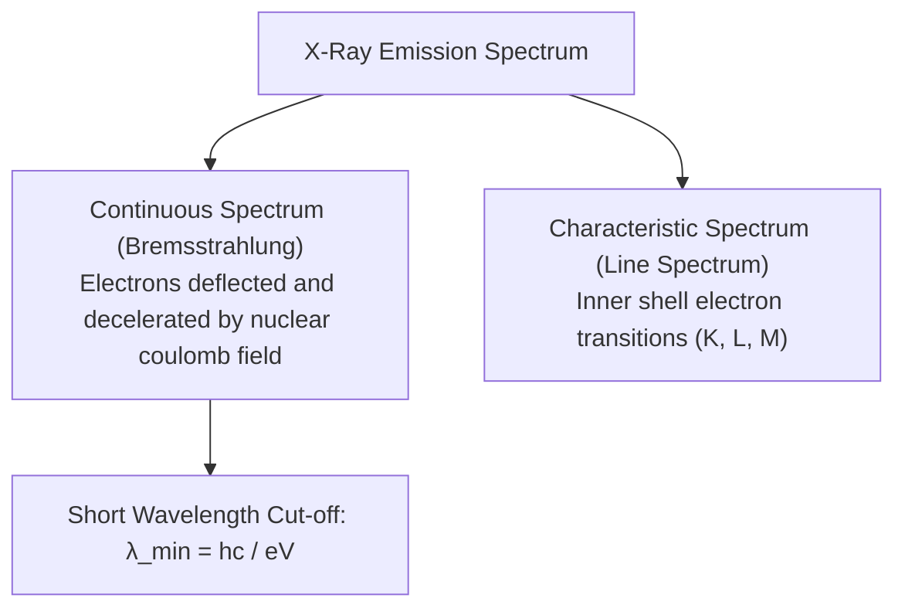
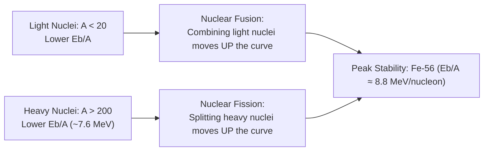
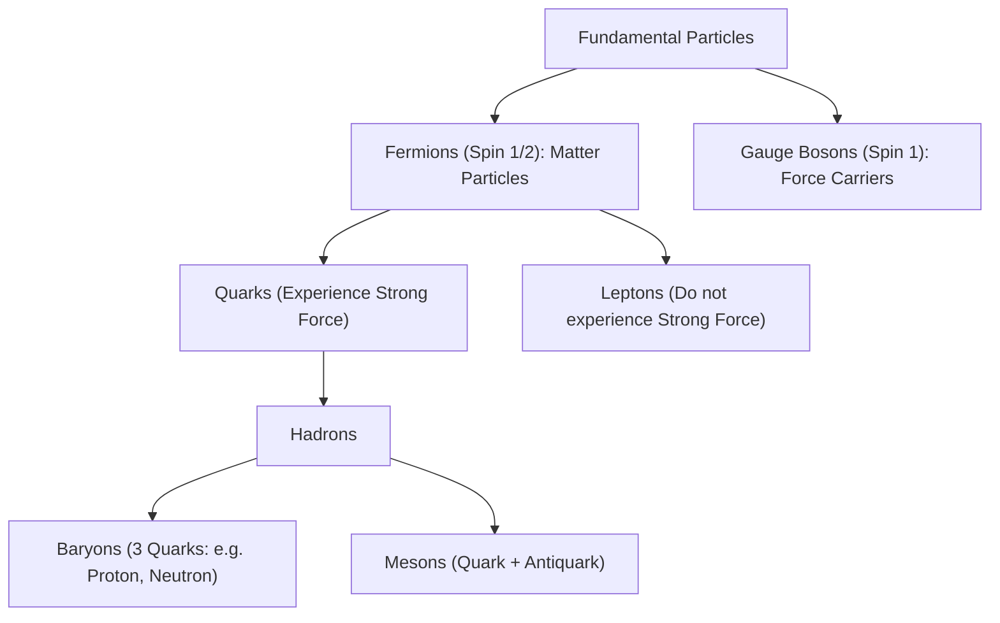

# :LiAtom: Lesson 11: Matter & Radiation (Modern Physics)

> [!ABSTRACT] Syllabus Scope (NIE Teacher's Guide — Grade 13, Unit 11)
> - **11.1 Blackbody Radiation** (6 periods): Thermal radiation, blackbody concept, spectral distribution, Stefan's Law ($E = \sigma T^4$), Wien's displacement law ($\lambda_{\text{max}} T = b$), failure of classical wave theory, Planck's quantum hypothesis ($E = nhf$).
> - **11.2 Photoelectric Effect** (6 periods): Photocell apparatus, threshold frequency ($f_0$), stopping potential ($V_s$), $I\text{–}V$ curves, failure of classical physics, Einstein's photoelectric equation ($hf = \Phi + E_{k,\text{max}}$), particle nature of light.
> - **11.3 Wave-Particle Duality** (2 periods): de Broglie hypothesis ($\lambda = h/p = h/mv$), electron diffraction, principle of the electron microscope.
> - **11.4 X-Rays** (2 periods): Coolidge tube mechanism, continuous X-ray spectrum, Duane-Hunt cutoff ($\lambda_{\text{min}} = hc/eV$), characteristic X-ray peaks, soft vs hard X-rays, applications and precautions.
> - **11.5 Radioactivity** (8 periods): $\alpha$, $\beta^\pm$, and $\gamma$ radiation properties, decay equations, decay law ($N = N_0 e^{-\lambda t}$), half-life ($T_{1/2} = \ln 2 / \lambda$), activity ($A = \lambda N$), carbon-14 dating, radiation dose (Gray, Sievert, RBE factor), biological hazards.
> - **11.6 Nuclear Energy & Binding Energy** (6 periods): Nuclear notation, atomic mass unit ($1\text{ u} = 931.5\text{ MeV}$), mass defect ($\Delta m$), binding energy ($E_b = \Delta m c^2$), binding energy per nucleon curve, nuclear stability, fission and chain reactions, nuclear fusion in stars.
> - **11.7 Fundamental Constituents of Matter** (4 periods): Quarks ($u, d, c, s, t, b$), leptons ($e, \mu, \tau, \nu$), hadrons (baryons and mesons), the four fundamental interactions and exchange bosons.

> [!NOTE] Subtopic Companion Guide
> For detailed mathematical derivations, graphs, experimental techniques, and worked numerical problems, see: [[Subtopics/Photoelectric Effect & Radioactivity|Photoelectric Effect & Radioactivity Guide]]

---

## 1. Blackbody Radiation & Planck's Quantum Theory

### 1.1 Thermal Radiation & The Black Body
* All objects at absolute temperature $T > 0\text{ K}$ emit electromagnetic radiation due to the thermal motion of their charged particles.
* An **ideal black body** is a theoretical surface that absorbs 100% of all incident electromagnetic radiation of all wavelengths, reflecting and transmitting none.
* An ideal black body is also the most efficient emitter of thermal radiation at any given temperature.
* **Practical Realization (Féry's Absorber)**: A double-walled hollow sphere coated internally with lampblack, containing a tiny aperture and a pointed cone opposite the aperture to prevent direct reflection.

### 1.2 Spectral Intensity Distribution
As temperature increases:
1. The total energy emitted per second per unit area increases sharply (area under the $I_\lambda$ vs $\lambda$ curve).
2. The peak of emission shifts toward shorter wavelengths (higher frequencies).

### 1.3 Empirical Laws of Thermal Radiation
* **Stefan-Boltzmann Law**: Total power radiated per unit surface area of a black body:
  $$E = \sigma T^4$$
  where $\sigma = 5.670 \times 10^{-8}\text{ W m}^{-2}\text{ K}^{-4}$ (Stefan-Boltzmann constant).
  * For a real body of emissivity $e$ ($0 < e \le 1$) and surface area $A$ in surroundings at temperature $T_0$:
    $$P_{\text{net}} = e \sigma A (T^4 - T_0^4)$$
* **Wien's Displacement Law**: The wavelength $\lambda_{\text{max}}$ at which the spectral radiance is maximum is inversely proportional to absolute temperature:
  $$\lambda_{\text{max}} T = b$$
  where $b \approx 2.898 \times 10^{-3}\text{ m K}$ (Wien's displacement constant).

### 1.4 Failure of Classical Physics & Planck's Quantum Hypothesis
* **Ultraviolet Catastrophe**: Classical electromagnetism (Rayleigh-Jeans law based on equipartition of energy) predicted that the radiated energy density diverges to infinity as $\lambda \to 0$ (in the ultraviolet region).
* **Max Planck's Quantum Hypothesis (1900)**:
  1. Atomic resonators in the black body walls do not absorb or emit energy continuously.
  2. Energy is exchanged only in discrete packets called **quanta**:
     $$E = nhf \quad (n = 1, 2, 3, \dots)$$
     where $h = 6.626 \times 10^{-34}\text{ J s}$ (Planck's constant) and $f$ is frequency.

---

## 2. Photoelectric Effect

### 2.1 Experimental Setup & Phenomenon
When electromagnetic radiation of sufficiently high frequency strikes a clean metal surface, electrons (**photoelectrons**) are emitted immediately from the surface.

### 2.2 Classical Prediction vs Experimental Observation

| Feature | Classical Wave Theory Prediction | Experimental Quantum Observation |
|---|---|---|
| **Intensity vs Emission** | Any frequency can cause emission if intensity is high enough | No emission below a threshold frequency $f_0$, even at immense intensity |
| **Emission Time Lag** | Energy accumulates over time (delay of minutes/hours) | **Instantaneous emission** (time delay $< 10^{-9}\text{ s}$) |
| **Max Kinetic Energy ($E_{k,\text{max}}$)** | Should increase with light intensity | **Completely independent of intensity**; depends solely on frequency $f$ |
| **Photoelectric Current ($I$)** | Depends on frequency and wave amplitude | **Strictly proportional to light intensity** at fixed frequency $f > f_0$ |

### 2.3 Einstein's Photoelectric Equation (1905)
Albert Einstein extended Planck's hypothesis, proposing that light itself propagates as localized energy packets called **photons**:
$$\text{Energy of one photon} = hf = \frac{hc}{\lambda}$$

When a photon collides with an electron in the metal, it transfers its entire energy to that single electron in a 1-to-1 interaction.
* Part of the energy is used to overcome the electrostatic binding force of the metal lattice: **Work Function ($\Phi$)**.
* The remaining energy becomes the maximum kinetic energy ($E_{k,\text{max}}$) of the emitted electron:

$$\boxed{hf = \Phi + E_{k,\text{max}}}$$

Since $\Phi = h f_0$ where $f_0$ is the **threshold frequency**:
$$hf = hf_0 + E_{k,\text{max}} \implies E_{k,\text{max}} = h(f - f_0)$$

In terms of wavelength:
$$E_{k,\text{max}} = hc \left(\frac{1}{\lambda} - \frac{1}{\lambda_0}\right)$$

### 2.4 Stopping Potential ($V_s$)
If a retarding negative potential is applied to the collector anode, the fastest photoelectrons are just halted when:
$$e V_s = E_{k,\text{max}}$$
where $e = 1.602 \times 10^{-19}\text{ C}$. Substituting into Einstein's equation:
$$e V_s = hf - \Phi \implies \boxed{V_s = \left(\frac{h}{e}\right) f - \left(\frac{\Phi}{e}\right)}$$

* A plot of $V_s$ against frequency $f$ gives:
  * **Slope** $= \frac{h}{e}$ (Universal constant, identical for all metals).
  * **Horizontal axis intercept** $= f_0$ (Threshold frequency).
  * **Vertical axis intercept** $= -\frac{\Phi}{e}$.

---

## 3. Wave-Particle Duality of Matter

### 3.1 The de Broglie Hypothesis (1924)
Louis de Broglie proposed that since electromagnetic radiation exhibits both wave (interference, diffraction) and particle (photoelectric effect, Compton scattering) properties, material particles must also exhibit wave properties.
The **de Broglie wavelength** $\lambda$ associated with a particle of mass $m$ and velocity $v$ (momentum $p = mv$):

$$\boxed{\lambda = \frac{h}{p} = \frac{h}{mv}}$$

### 3.2 de Broglie Wavelength of an Accelerated Charged Particle
For a particle of mass $m$ and charge $q$ accelerated from rest across a potential difference $V$:
$$E_k = qV = \frac{p^2}{2m} \implies p = \sqrt{2mqV}$$

$$\boxed{\lambda = \frac{h}{\sqrt{2mqV}}}$$

For an **electron** ($m_e = 9.109 \times 10^{-31}\text{ kg}$, $q = e = 1.602 \times 10^{-19}\text{ C}$):
$$\lambda_e = \frac{1.227}{\sqrt{V}}\text{ nm} = \frac{12.27}{\sqrt{V}}\text{ \AA}$$

### 3.3 Experimental Confirmation
* **Davisson and Germer Experiment (1927)**: Fired low-energy electrons onto a nickel crystal and observed strong diffraction peaks at specific angles, behaving exactly like X-ray Bragg diffraction.
* **G.P. Thomson**: Demonstrated transmission electron diffraction through thin metal foils.

### 3.4 Applications: The Electron Microscope
* Standard optical microscopes are diffraction-limited by the wavelength of visible light ($\lambda \approx 400\text{–}700\text{ nm}$), with a resolution limit of $\approx 200\text{ nm}$.
* An electron accelerated through $100\text{ kV}$ has a de Broglie wavelength of:
  $$\lambda \approx \frac{1.227}{\sqrt{100,000}} \approx 0.0039\text{ nm}$$
* This permits magnifications $> 1,000,000\times$ and resolving power down to the atomic scale ($< 0.1\text{ nm}$).

---

## 4. X-Rays

### 4.1 Production of X-Rays (The Coolidge Tube)
X-rays are high-frequency, short-wavelength electromagnetic waves ($\lambda \approx 0.01\text{–}10\text{ nm}$) produced when high-energy electrons are rapidly decelerated upon striking a heavy metal target.

**Key Components of the Coolidge Tube**:
1. **Cathode (Filament)**: Heated by low voltage to emit electrons via thermionic emission. Filament current controls the **tube current** and hence the **intensity (quantity)** of X-rays.
2. **High Voltage Supply ($V$)**: Accelerates electrons across vacuum. High voltage determines the **maximum kinetic energy** of electrons and hence the **penetrating power (quality/hardness)** of X-rays.
3. **Anode (Target)**: Heavy metal (Tungsten, $Z = 74$, or Molybdenum, $Z = 42$) with:
   * **High atomic number ($Z$)**: Increases X-ray production efficiency.
   * **High melting point**: Withstands severe thermal load ($\approx 99\%$ of electron kinetic energy becomes heat).
   * **High thermal conductivity & Copper mount/cooling fins/water circulation**: Dissipates heat rapidly.

### 4.2 The X-Ray Spectrum

#### Continuous X-Rays (Bremsstrahlung / Braking Radiation)
* Produced when fast electrons pass near target nuclei and are slowed down by electrostatic attraction.
* When an electron loses all its kinetic energy in a **single catastrophic impact**, a photon with maximum possible energy is emitted:
  $$E_{\text{max}} = hf_{\text{max}} = e V$$
* This defines the **Duane-Hunt minimum cutoff wavelength ($\lambda_{\text{min}}$)**:
  $$\boxed{\lambda_{\text{min}} = \frac{hc}{eV} = \frac{1.24 \times 10^{-6}}{V}\text{ m}}$$
* Note: $\lambda_{\text{min}}$ depends **only** on the accelerating voltage $V$, and is completely independent of the target material.

#### Characteristic X-Rays
* High-energy incident electrons knock out an electron from an inner atomic shell ($K, L$).
* An electron from an outer shell falls into the vacancy, emitting a photon whose energy equals the exact difference between the two energy levels:
  $$\Delta E = E_{\text{initial}} - E_{\text{final}} = hf = \frac{hc}{\lambda}$$
* Transitions:
  * $L \to K$: $K_\alpha$ line
  * $M \to K$: $K_\beta$ line
  * $M \to L$: $L_\alpha$ line
* Characteristic lines depend **only on the target element** (Moseley's Law: $\sqrt{f} \propto (Z - b)$).

### 4.3 Soft vs Hard X-Rays

| Parameter | Soft X-Rays | Hard X-Rays |
|---|---|---|
| **Accelerating Voltage ($V$)** | Low ($< 20\text{ kV}$) | High ($> 50\text{ kV}$) |
| **Wavelength ($\lambda$)** | Longer | Shorter |
| **Photon Energy ($hf$)** | Lower | Higher |
| **Penetration Power** | Low (absorbed by soft tissue) | High (penetrates bone, metals) |
| **Common Uses** | Dermatology, soft tissue diagnostics | Bone radiography, crystallography, industrial flaw detection |

---

## 5. Radioactivity

### 5.1 Natural Radioactivity
Radioactivity is the spontaneous, uncontrolled disintegration of unstable atomic nuclei accompanied by the emission of ionizing particles or high-energy radiation. It is unaffected by external physical conditions (temperature, pressure, magnetic or chemical state).

### 5.2 Comparison of $\alpha$, $\beta$, and $\gamma$ Radiations

| Property | Alpha ($\alpha$) | Beta Minus ($\beta^-$) | Gamma ($\gamma$) |
|---|---|---|---|
| **Nature** | Helium nucleus ($^4_2\text{He}^{2+}$) | Fast electron ($^0_{-1}e$) | High-energy photon (EM wave) |
| **Charge** | $+2e$ | $-e$ (or $+e$ for $\beta^+$) | $0$ (neutral) |
| **Rest Mass** | $4\text{ u} \approx 6.64 \times 10^{-27}\text{ kg}$ | $m_e \approx 9.11 \times 10^{-31}\text{ kg}$ | $0$ |
| **Speed** | $\approx 0.05\text{–}0.1\text{ c}$ | Up to $\approx 0.99\text{ c}$ (continuous spectrum) | Exactly $c = 3 \times 10^8\text{ m s}^{-1}$ |
| **Ionizing Power** | Extremely High ($\approx 10,000$) | Moderate ($\approx 100$) | Low ($\approx 1$) |
| **Penetrating Power** | Very Low (stopped by paper, a few cm of air) | Moderate (stopped by few mm of aluminium) | Very High (requires several cm of lead) |
| **Electric/Magnetic Deflection** | Deflected slightly (due to high mass) | Deflected strongly (opposite to $\alpha$) | Undeflected |

### 5.3 Radioactive Decay Equations
1. **Alpha Decay ($\alpha$)**:
   $$^A_Z X \longrightarrow ^{A-4}_{Z-2} Y + ^4_2\text{He}$$
   *Example*: $^{238}_{92}\text{U} \longrightarrow ^{234}_{90}\text{Th} + ^4_2\text{He}$

2. **Beta Minus Decay ($\beta^-$)**: A neutron transforms into a proton, emitting an electron and an electron antineutrino ($\bar{\nu}_e$):
   $$n \longrightarrow p + e^- + \bar{\nu}_e \implies ^A_Z X \longrightarrow ^A_{Z+1} Y + ^0_{-1}e + \bar{\nu}_e$$
   *Example*: $^{14}_6\text{C} \longrightarrow ^{14}_7\text{N} + ^0_{-1}e + \bar{\nu}_e$

3. **Beta Plus Decay ($\beta^+$, Positron Emission)**: A proton transforms into a neutron, emitting a positron ($e^+$) and an electron neutrino ($\nu_e$):
   $$p \longrightarrow n + e^+ + \nu_e \implies ^A_Z X \longrightarrow ^A_{Z-1} Y + ^0_{+1}e + \nu_e$$
   *Example*: $^{11}_6\text{C} \longrightarrow ^{11}_5\text{B} + ^0_{+1}e + \nu_e$

4. **Gamma Emission ($\gamma$)**: Nucleus in an excited state drops to ground state without changing $A$ or $Z$:
   $$^A_Z X^* \longrightarrow ^A_Z X + \gamma$$

### 5.4 Law of Radioactive Disintegration
The rate of decay ($-\frac{dN}{dt}$) of a radioactive sample at any instant is directly proportional to the number of undecayed radioactive nuclei $N$ present at that instant:
$$-\frac{dN}{dt} = \lambda N$$
where $\lambda$ is the **decay constant** (unit: $\text{s}^{-1}$).

Integrating from $t = 0$ ($N = N_0$) to time $t$:
$$\boxed{N(t) = N_0 e^{-\lambda t}}$$

Similarly, for **Activity** ($A = \lambda N = -\frac{dN}{dt}$):
$$\boxed{A(t) = A_0 e^{-\lambda t}}$$

* **SI Unit of Activity**: **Becquerel (Bq)** ($1\text{ Bq} = 1\text{ disintegration per second}$).
* **Historical Unit**: **Curie (Ci)** ($1\text{ Ci} = 3.7 \times 10^{10}\text{ Bq}$).

### 5.5 Half-Life ($T_{1/2}$) & Mean Life ($\tau$)
* **Half-life ($T_{1/2}$)**: Time required for half of the initial radioactive nuclei to decay:
  $$\frac{N_0}{2} = N_0 e^{-\lambda T_{1/2}} \implies e^{\lambda T_{1/2}} = 2$$
  $$\boxed{T_{1/2} = \frac{\ln 2}{\lambda} \approx \frac{0.693}{\lambda}}$$
* After $n$ half-lives ($t = n T_{1/2}$):
  $$N = N_0 \left(\frac{1}{2}\right)^n, \quad A = A_0 \left(\frac{1}{2}\right)^n$$
* **Mean Life ($\tau$)**: Average lifetime of an unstable nucleus:
  $$\tau = \frac{1}{\lambda} = \frac{T_{1/2}}{\ln 2} \approx 1.443 T_{1/2}$$

### 5.6 Radiocarbon Dating ($^{14}\text{C}$)
* Atmospheric $^{14}\text{C}$ is produced by cosmic ray neutrons reacting with $^{14}\text{N}$:
  $$^1_0 n + ^{14}_7\text{N} \longrightarrow ^{14}_6\text{C} + ^1_1 p$$
* Living organisms maintain a constant ratio of $^{14}\text{C}/^{12}\text{C}$ through respiration/metabolism.
* Upon death, carbon uptake ceases; $^{14}\text{C}$ decays with half-life $T_{1/2} = 5730\text{ years}$.
* Measuring the residual activity ratio determines archaeological age up to $\approx 50,000\text{ years}$.

### 5.7 Radiation Dosimetry & Biological Hazards
* **Absorbed Dose ($D$)**: Energy deposited per unit mass of absorbing tissue:
  $$D = \frac{\Delta E}{\Delta m}$$
  * Unit: **Gray (Gy)** ($1\text{ Gy} = 1\text{ J kg}^{-1}$). Old unit: **rad** ($1\text{ Gy} = 100\text{ rad}$).
* **Relative Biological Effectiveness (RBE) / Quality Factor ($Q$)**:
  * Reflects biological damage severity for identical absorbed energy.
  * For $\beta, \gamma, \text{X-rays}$: $Q = 1$.
  * For thermal neutrons: $Q \approx 3\text{–}5$.
  * For fast neutrons and protons: $Q \approx 10$.
  * For $\alpha$-particles: $Q \approx 20$.
* **Equivalent Dose ($H$)**:
  $$H = D \times Q$$
  * Unit: **Sievert (Sv)** ($1\text{ Sv} = 1\text{ J kg}^{-1}$). Old unit: **rem** ($1\text{ Sv} = 100\text{ rem}$).

---

## 6. Nuclear Energy & Binding Energy

### 6.1 Nuclear Notation & Composition
* A nucleus is represented by:
  $$^A_Z X$$
  where $Z$ is the **atomic number** (number of protons) and $A$ is the **mass number** (number of nucleons: protons + neutrons).
* Number of neutrons: $N = A - Z$.
* **Isotopes**: Same $Z$, different $A$ (e.g. $^{12}_6\text{C}$, $^{14}_6\text{C}$).
* **Isobars**: Same $A$, different $Z$ (e.g. $^{14}_6\text{C}$, $^{14}_7\text{N}$).
* **Isotones**: Same $N = A - Z$ (e.g. $^{14}_6\text{C}$, $^{16}_8\text{O}$).
* **Atomic Mass Unit (u)**: One-twelfth the mass of an unbound neutral $^{12}_6\text{C}$ atom:
  $$1\text{ u} = 1.66054 \times 10^{-27}\text{ kg} \iff 931.5\text{ MeV}$$

### 6.2 Mass Defect ($\Delta m$) & Binding Energy ($E_b$)
The measured mass of any stable nucleus is always strictly less than the combined mass of its constituent free nucleons.
* **Mass Defect**:
  $$\boxed{\Delta m = \left[Z m_p + (A - Z) m_n\right] - M_{\text{nucleus}}}$$
* **Nuclear Binding Energy**: The energy required to completely dismantle a nucleus into its individual constituent nucleons:
  $$\boxed{E_b = \Delta m \cdot c^2}$$
  If $\Delta m$ is in atomic mass units (u):
  $$E_b = \Delta m \times 931.5\text{ MeV}$$

### 6.3 Binding Energy per Nucleon Curve ($E_b/A$)

* **Peak of the Curve**: Nuclei near $A = 56$ (specifically $^{56}_{26}\text{Fe}$ and $^{62}_{28}\text{Ni}$) have the highest binding energy per nucleon ($\approx 8.8\text{ MeV/nucleon}$) and are the most stable in the universe.
* **Nuclear Fission**: Heavy nuclei ($A > 200$, e.g. $^{235}\text{U}$) split into intermediate nuclei with higher $E_b/A$, releasing $\approx 200\text{ MeV}$ per fission event.
* **Nuclear Fusion**: Extremely light nuclei ($^2_1\text{H}$, $^3_1\text{H}$) combine to form heavier, tighter nuclei ($^4_2\text{He}$), moving up the steep initial gradient of the curve and releasing immense energy per unit mass.

### 6.4 Fission vs Fusion Summary

| Parameter | Nuclear Fission | Nuclear Fusion |
|---|---|---|
| **Process** | Splitting of heavy nucleus into two lighter nuclei | Combining of light nuclei into a heavier nucleus |
| **Typical Fuel** | $^{235}\text{U}$, $^{239}\text{Pu}$ | $^2_1\text{H}$ (Deuterium), $^3_1\text{H}$ (Tritium) |
| **Trigger Mechanism** | Thermal neutron bombardment | Extremely high temperature ($> 10^7\text{ K}$) and pressure (thermonuclear) |
| **Energy per Event** | $\approx 200\text{ MeV}$ | $\approx 17.6\text{ MeV}$ |
| **Energy per Unit Mass** | High | **Extremely High** ($\approx 4\times$ higher than fission) |
| **By-products** | Long-lived high-level radioactive waste | Non-radioactive helium ($^4\text{He}$), low-level waste |
| **Terrestrial Application** | Commercial nuclear power reactors | Hydrogen bomb, experimental fusion reactors (ITER) |
| **Natural Occurrence** | Rare (natural Oklo reactor) | Primary energy source in stars including the Sun |

---

## 7. Fundamental Constituents of Matter & Interactions

### 7.1 Standard Model Overview
All observable matter in the universe is constructed from a small set of fundamental, point-like particles with no internal substructure: **Quarks** and **Leptons**, interacting via gauge bosons.

### 7.2 Quarks & Leptons

#### Quarks (Fractional Electric Charges)
Quarks carry color charge and experience all four fundamental interactions:

| Generation | Flavor | Symbol | Charge ($e$) |
|---|---|---|---|
| 1st Generation | Up / Down | $u$ / $d$ | $+2/3$ / $-1/3$ |
| 2nd Generation | Charm / Strange | $c$ / $s$ | $+2/3$ / $-1/3$ |
| 3rd Generation | Top / Bottom | $t$ / $b$ | $+2/3$ / $-1/3$ |

* **Proton Composition**: $uud \implies \left(+\frac{2}{3}\right) + \left(+\frac{2}{3}\right) + \left(-\frac{1}{3}\right) = +1e$
* **Neutron Composition**: $udd \implies \left(+\frac{2}{3}\right) + \left(-\frac{1}{3}\right) + \left(-\frac{1}{3}\right) = 0$

#### Leptons (Do not feel the Strong Force)

| Particle | Symbol | Charge ($e$) | Associated Neutrino |
|---|---|---|---|
| Electron | $e^-$ | $-1$ | Electron neutrino ($\nu_e$) |
| Muon | $\mu^-$ | $-1$ | Muon neutrino ($\nu_\mu$) |
| Tau | $\tau^-$ | $-1$ | Tau neutrino ($\nu_\tau$) |

### 7.3 The Four Fundamental Interactions

| Interaction | Relative Strength | Range | Gauge Boson (Mediator) | Action / Manifestation |
|---|---|---|---|---|
| **Strong Nuclear** | $1$ | Short ($\approx 10^{-15}\text{ m}$) | **Gluon ($g$)** | Binds quarks inside nucleons; binds nucleons in nucleus |
| **Electromagnetic** | $10^{-2}$ | Infinite ($1/r^2$) | **Photon ($\gamma$)** | Atomic structure, chemical bonding, macroscopic forces |
| **Weak Nuclear** | $10^{-7}$ | Extremely Short ($\approx 10^{-18}\text{ m}$) | **$W^+, W^-, Z^0$ bosons** | $\beta$-decay, neutrino interactions, stellar fusion initiation |
| **Gravitational** | $10^{-39}$ | Infinite ($1/r^2$) | **Graviton** (theoretical) | Planetary orbits, large-scale cosmological structure |

---

## 8. Summary Formula Reference Table

| Formula | Description |
|---|---|
| $E = nhf$ | Planck's Quantum Hypothesis |
| $E = \sigma T^4$ | Stefan-Boltzmann Law |
| $\lambda_{\text{max}} T = b$ | Wien's Displacement Law |
| $hf = \Phi + E_{k,\text{max}} = hf_0 + eV_s$ | Einstein's Photoelectric Equation |
| $V_s = \left(\frac{h}{e}\right) f - \left(\frac{\Phi}{e}\right)$ | Stopping Potential vs Frequency Equation |
| $\lambda = \frac{h}{p} = \frac{h}{mv} = \frac{h}{\sqrt{2mqV}}$ | de Broglie Matter Wavelength |
| $\lambda_{\text{min}} = \frac{hc}{eV}$ | Continuous X-Ray Minimum Cutoff Wavelength |
| $N(t) = N_0 e^{-\lambda t}$ | Radioactive Decay Law |
| $A(t) = A_0 e^{-\lambda t} = \lambda N$ | Activity Law |
| $T_{1/2} = \frac{\ln 2}{\lambda} \approx \frac{0.693}{\lambda}$ | Radioactive Half-Life |
| $\Delta m = \left[Z m_p + (A - Z) m_n\right] - M_{\text{nucleus}}$ | Mass Defect |
| $E_b = \Delta m c^2 = \Delta m \times 931.5\text{ MeV}$ | Nuclear Binding Energy |
| $H = D \times Q$ | Equivalent Radiation Dose |

---

## :LiRocket: Flashcards (Spaced Repetition)

#flashcards

State Einstein's Photoelectric Equation. :: $h f = \Phi + E_{k,\text{max}} = h f_0 + e V_s$.

What is the cut-off wavelength $\lambda_{\text{min}}$ of continuous X-rays produced in a tube operating at voltage $V$? :: $\lambda_{\text{min}} = \frac{h c}{e V}$.

State de Broglie's wavelength formula for a particle of mass $m$ moving at velocity $v$. :: $\lambda = \frac{h}{p} = \frac{h}{m v}$.
<!--SR:!2026-09-26,1,230-->

State the Radioactive Decay Law equation. :: $N(t) = N_0 e^{-\lambda t}$ (or Activity $A(t) = A_0 e^{-\lambda t}$).
<!--SR:!2026-09-26,1,230-->

What is the relationship between decay constant $\lambda$ and half-life $T_{1/2}$? :: $T_{1/2} = \frac{\ln 2}{\lambda} \approx \frac{0.693}{\lambda}$.
<!--SR:!2026-09-26,1,230-->

What is mass defect $\Delta m$ and how is binding energy calculated? :: Mass defect is the difference between total mass of individual nucleons and actual mass of nucleus; Binding Energy $E_b = \Delta m \cdot c^2$.

State Stefan-Boltzmann Law and Wien's Displacement Law. :: Stefan-Boltzmann: $E = \sigma T^4$ (total power emitted per unit area of blackbody). Wien: $\lambda_{\text{max}} T = b$ ($b \approx 2.898 \times 10^{-3}\text{ m K}$).

What was the 'ultraviolet catastrophe' and how did Planck resolve it? :: Classical theory predicted infinite radiated power at high frequencies ($\lambda \to 0$). Planck resolved it by proposing energy is exchanged only in discrete quanta $E = hf$.

Define work function $\Phi$ and threshold frequency $f_0$. :: Work function is the minimum energy required to eject an electron from the surface of a metal. Threshold frequency is the minimum photon frequency ($f_0 = \Phi/h$) required for photoelectric emission.

Why is the maximum kinetic energy of photoelectrons independent of light intensity? :: Each photoelectron receives energy from exactly one photon; increasing intensity increases the number of photons per second, not the energy of individual photons.

What do the slope and intercepts of a $V_s$ versus frequency $f$ graph represent? :: Slope equals $h/e$ (universal constant for all metals); horizontal intercept equals threshold frequency $f_0$; vertical intercept equals $-\Phi/e$.

Derive the de Broglie wavelength for a particle of mass $m$ and charge $q$ accelerated through voltage $V$. :: Kinetic energy $E_k = qV = p^2/(2m) \implies p = \sqrt{2mqV}$; therefore $\lambda = h/p = h/\sqrt{2mqV}$.

Explain how continuous X-rays and characteristic X-rays are produced in a Coolidge tube. :: Continuous X-rays: decelerating electrons in nuclear electric fields (Bremsstrahlung). Characteristic X-rays: outer electrons filling vacancies in inner shells ($K, L$).

Why is the cut-off wavelength $\lambda_{\text{min}}$ in X-ray emission independent of the target material? :: $\lambda_{\text{min}} = hc/eV$ depends only on the maximum kinetic energy imparted to electrons by the tube voltage $V$.

Compare alpha, beta, and gamma radiations in terms of ionizing power and penetrating power. :: Ionizing power: $\alpha > \beta > \gamma$ (ratio $\approx 10,000 : 100 : 1$). Penetrating power: $\gamma > \beta > \alpha$ (paper stops $\alpha$; mm of aluminium stops $\beta$; cm of lead stops $\gamma$).

Write the decay equation for $\beta^-$ decay and $\beta^+$ decay. :: $\beta^-$: $n \to p + e^- + \bar{\nu}_e$ ($^A_Z X \to ^A_{Z+1} Y + ^0_{-1}e + \bar{\nu}_e$). $\beta^+$: $p \to n + e^+ + \nu_e$ ($^A_Z X \to ^A_{Z-1} Y + ^0_{+1}e + \nu_e$).

Define the decay constant $\lambda$ and Activity $A$ of a radioactive source. :: Decay constant $\lambda$ is the fractional decay probability per unit time ($-dN/N = \lambda dt$). Activity $A = \lambda N = -dN/dt$ is the number of disintegrations per second (Bq).

What is carbon-14 dating and what is its basis? :: Determining archaeological age of organic matter by measuring the residual $^{14}\text{C}/^{12}\text{C}$ ratio; $^{14}\text{C}$ decays with $T_{1/2} = 5730\text{ years}$ after organism death.

Define absorbed radiation dose and equivalent radiation dose with their SI units. :: Absorbed dose $D = \Delta E/\Delta m$ in Gray (Gy = J kg⁻¹). Equivalent dose $H = D \times Q$ in Sievert (Sv), accounting for biological damage via Quality Factor $Q$.

Explain why binding energy per nucleon $E_b/A$ determines nuclear stability. :: Higher $E_b/A$ means nucleons are more tightly bound; $^{56}\text{Fe}$ has the highest $E_b/A$ ($\approx 8.8\text{ MeV/nucleon}$), making it the most stable nucleus.

Why does nuclear fusion release more energy per unit mass than nuclear fission? :: The steep rise in $E_b/A$ for light nuclei ($A < 20$) yields a much larger mass defect per unit mass compared to the flatter slope at heavy nuclei ($A > 200$).

What is the quark composition of a proton and a neutron? :: Proton = $uud$ (charges $+2/3 + 2/3 - 1/3 = +1$). Neutron = $udd$ (charges $+2/3 - 1/3 - 1/3 = 0$).

What are the four fundamental forces of nature in order of decreasing strength? :: Strong Nuclear ($1$) > Electromagnetic ($10^{-2}$) > Weak Nuclear ($10^{-7}$) > Gravitational ($10^{-39}$).

Distinguish between hadrons, baryons, and leptons. :: Hadrons are composite particles made of quarks that feel the strong force. Baryons are hadrons made of 3 quarks (e.g. proton, neutron). Leptons are elementary particles that do not feel the strong force (e.g. electron, muon, neutrino).

What is the condition for a self-sustaining nuclear chain reaction? :: Multiplication factor $k \ge 1$; at least one neutron from each fission event must trigger a subsequent fission event without being absorbed or leaking out.
