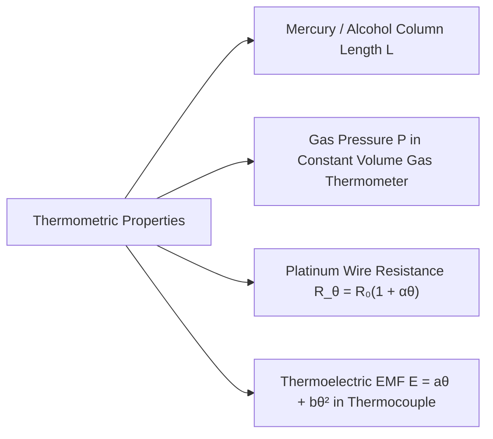
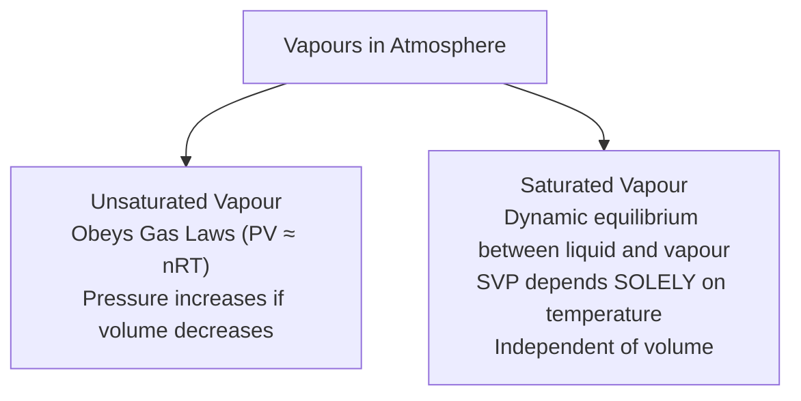
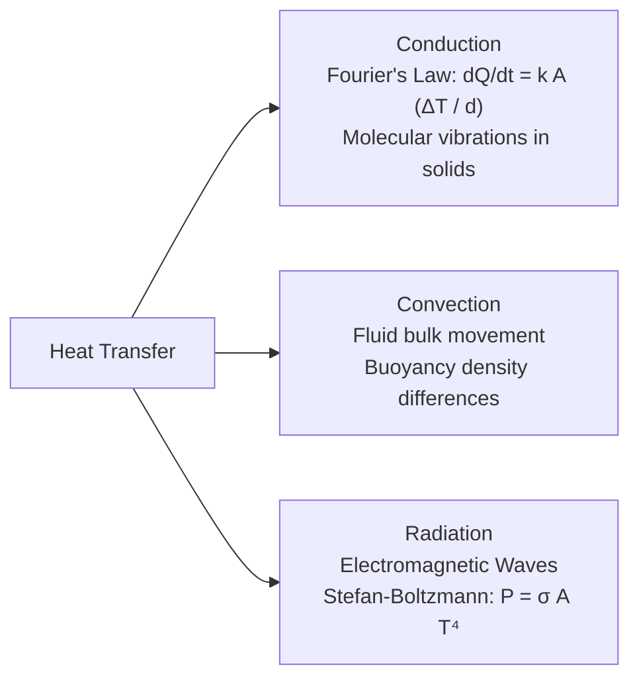

# 🌡️ Subtopic: Calorimetry, Phase Changes & Heat Transfer Guide

> [!ABSTRACT] Core Focus
> Comprehensive analytical guide for Thermometry, Calorimetry, Phase Changes, Atmospheric Humidity, and Heat Transfer mechanisms in Sri Lankan GCE A/L Physics: Thermometric properties, real and apparent liquid expansion, method of mixtures, saturated vapour pressure, relative humidity calculations, Fourier's law of conduction, lagged vs. unlagged rods, Stefan-Boltzmann radiation, and Wien's displacement law.

---

## 1. Thermometry & Temperature Scales

### Thermometric Properties:
A physical property $X$ that varies continuously, measurably, and monotonically with temperature can serve as a basis for a thermometer:
$$\theta = \left(\frac{X_\theta - X_0}{X_{100} - X_0}\right) \times 100^\circ\text{C}$$

### The Thermodynamic (Kelvin) Scale:
Defined with reference to the **Triple Point of Water** ($T_{\text{tr}} = 273.16\text{ K} = 0.01^\circ\text{C}$):
$$T = 273.16 \left(\frac{P}{P_{\text{tr}}}\right)\text{ K}$$
$$T\text{ (K)} = \theta\text{ (}^\circ\text{C)} + 273.15$$

---

## 2. Thermal Expansion of Solids & Liquids

1. **Linear Expansivity ($\alpha$)**: $\alpha = \frac{\Delta L}{L_0 \Delta\theta} \implies L = L_0(1 + \alpha\Delta\theta)$.
2. **Superficial Expansivity ($\beta$)**: $\beta \approx 2\alpha$.
3. **Cubical (Volumetric) Expansivity ($\gamma$)**: $\gamma \approx 3\alpha$.

### Real vs. Apparent Expansion of Liquids:
When a liquid in a container is heated, both liquid and container expand:
$$\gamma_{\text{real}} = \gamma_{\text{apparent}} + \gamma_{\text{vessel}}$$
- **Anomalous Expansion of Water**: Water contracts as it is heated from $0^\circ\text{C}$ to $4^\circ\text{C}$, reaching its **maximum density at $4^\circ\text{C}$**. In cold climates, ice floats on top while water at the bottom remains at $4^\circ\text{C}$, sustaining aquatic life.

---

## 3. Calorimetry & Phase Transitions

### Heat Capacity & Specific Heat Capacity:
$$\Delta Q = m c \Delta\theta$$
*(where $c$ is specific heat capacity in $\text{J}\cdot\text{kg}^{-1}\cdot\text{K}^{-1}$; for water, $c_w \approx 4200\text{ J}\cdot\text{kg}^{-1}\cdot\text{K}^{-1}$).*

### Principle of Mixtures:
In an insulated calorimeter:
$$\sum \text{Heat Lost by Hot Bodies} = \sum \text{Heat Gained by Cold Bodies + Calorimeter}$$

---

### Latent Heat of Phase Changes:
Phase transitions occur at **constant temperature**:
$$\Delta Q = m L$$
- **Specific Latent Heat of Fusion ($L_f$)**: Energy required to melt $1\text{ kg}$ of solid to liquid at its melting point (for ice, $L_f \approx 3.34 \times 10^5\text{ J}\cdot\text{kg}^{-1}$).
- **Specific Latent Heat of Vaporization ($L_v$)**: Energy required to vaporize $1\text{ kg}$ of liquid to gas at its boiling point (for water, $L_v \approx 2.26 \times 10^6\text{ J}\cdot\text{kg}^{-1}$).

---

## 4. Vapours, Saturated Vapour Pressure & Humidity

### Boiling Criterion:
Boiling occurs when the **Saturated Vapour Pressure (SVP) of the liquid equals the external atmospheric pressure**:
$$\text{SVP}(T_{\text{boil}}) = P_{\text{external}}$$
*(In a pressure cooker, $P_{\text{ext}} > 1\text{ atm} \implies$ water boils above $100^\circ\text{C}$, cooking food faster; at high altitudes, $P_{\text{ext}} < 1\text{ atm} \implies$ boiling point drops).*

---

### Relative Humidity (RH) & Dew Point:
- **Dew Point ($T_d$)**: The temperature to which air must be cooled at constant pressure to become saturated with water vapour.
- **Relative Humidity (RH)**:
  $$\text{RH} = \frac{\text{Partial Pressure of Water Vapour in Air}}{\text{Saturated Vapour Pressure at Room Temperature}} \times 100\%$$
  $$\text{RH} = \left(\frac{\text{SVP at Dew Point } (P_d)}{\text{SVP at Room Temperature } (P_R)}\right) \times 100\%$$

---

## 5. Heat Transfer Mechanisms

### A. Thermal Conduction (Fourier's Law):
Steady-state rate of heat flow through a uniform slab of cross-sectional area $A$ and thickness $d$:
$$\frac{dQ}{dt} = k A \left(\frac{T_1 - T_2}{d}\right) = -k A \frac{dT}{dx}$$
*(where $k$ is thermal conductivity in $\text{W}\cdot\text{m}^{-1}\cdot\text{K}^{-1}$, and $\frac{dT}{dx}$ is temperature gradient).*

- **Lagged (Insulated) Uniform Rod**: Zero radial heat loss $\implies$ heat flux is constant throughout $\implies$ **temperature drops linearly** along the rod ($\frac{dT}{dx} = \text{constant}$).
- **Unlagged Uniform Rod**: Heat escapes from sides by convection and radiation $\implies$ heat flux decreases along the rod $\implies$ **temperature gradient becomes progressively less steep** towards the cold end.
- **Thermal Resistance**: $R_{\text{th}} = \frac{d}{k A}$. Slabs in series: $R_{\text{eq}} = R_1 + R_2$.

---

### B. Thermal Radiation Laws:
1. **Stefan-Boltzmann Law**:
   Total radiant power emitted by a black body of surface area $A$ at absolute temperature $T$:
   $$P = \sigma A T^4 \quad (\sigma = 5.67 \times 10^{-8}\text{ W}\;\text{m}^{-2}\;\text{K}^{-4})$$
   - For an object with emissivity $e$ ($0 < e < 1$) in surroundings at temperature $T_0$:
     $$P_{\text{net}} = e \sigma A (T^4 - T_0^4)$$
2. **Wien's Displacement Law**:
   The wavelength $\lambda_{\text{max}}$ corresponding to peak emission intensity is inversely proportional to absolute temperature:
   $$\lambda_{\text{max}} T = b \quad (b = 2.898 \times 10^{-3}\text{ m}\cdot\text{K})$$
3. **Newton's Law of Cooling**:
   For a body cooling in surroundings at temperature $\theta_0$ where temperature excess $(\theta - \theta_0) \le 30^\circ\text{C}$:
   $$\frac{d\theta}{dt} = -k(\theta - \theta_0)$$

---

## :LiRocket: Flashcards (Spaced Repetition)

#flashcards

How is temperature $\theta$ on the Celsius scale defined using a thermometric property $X$? :: $\theta = \left(\frac{X_\theta - X_0}{X_{100} - X_0}\right) \times 100^\circ\text{C}$.

What is the relationship between the real and apparent cubical expansivity of a liquid? :: $\gamma_{\text{real}} = \gamma_{\text{apparent}} + \gamma_{\text{vessel}}$.

At what temperature does water have its maximum density, and why is this significant? :: At $4^\circ\text{C}$; it allows water bodies to freeze from top down while $4^\circ\text{C}$ water remains at the bottom, protecting aquatic organisms.

Define the Specific Latent Heat of a substance. :: The amount of thermal energy required to change the state of $1\text{ kg}$ of a substance without any change in temperature ($\Delta Q = m L$).

What is the physical condition for a liquid to boil? :: Boiling occurs when the saturated vapour pressure (SVP) of the liquid equals the external atmospheric pressure.

Define the Dew Point. :: The temperature to which moist air must be cooled at constant pressure in order to become saturated with water vapour.

State the formula for Relative Humidity (RH) in terms of saturated vapour pressures. :: $\text{RH} = \left(\frac{\text{SVP at Dew Point}}{\text{SVP at Room Temperature}}\right) \times 100\% = \frac{P_d}{P_R} \times 100\%$.

State Fourier's Law of Thermal Conduction. :: $\frac{dQ}{dt} = k A \left(\frac{T_1 - T_2}{d}\right) = -k A \frac{dT}{dx}$.

How does the temperature profile along a lagged uniform conducting rod differ from an unlagged rod? :: In a lagged rod, the temperature drops linearly ($\frac{dT}{dx} = \text{const}$); in an unlagged rod, heat loss from curved surfaces causes the temperature gradient to decrease along the rod.

State the Stefan-Boltzmann Law for a blackbody radiator. :: $P = \sigma A T^4$ (where $\sigma = 5.67 \times 10^{-8}\text{ W}\;\text{m}^{-2}\;\text{K}^{-4}$).

State Wien's Displacement Law. :: $\lambda_{\text{max}} T = b \approx 2.898 \times 10^{-3}\text{ m}\cdot\text{K}$ (peak emission wavelength is inversely proportional to absolute temperature).

Under what condition is Newton's Law of Cooling valid? :: For small temperature differences between the cooling body and its surroundings ($\theta - \theta_0 \le 30^\circ\text{C}$).
