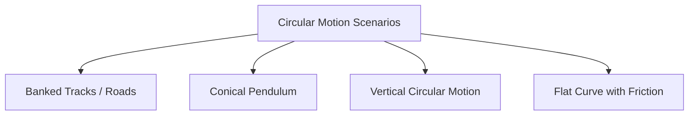

# :LiRotateCw: Subtopic: Circular Motion & Rotational Dynamics Guide

> [!ABSTRACT] Core Focus
> Centripetal force derivations, motion in vertical circles, conical pendulum, banked roads, Moment of Inertia for standard bodies, torque $\tau = I\alpha$, rolling dynamics without slipping, and Conservation of Angular Momentum.

---

## 1. Centripetal Acceleration & Dynamics

When an object of mass $m$ moves in a circular path of radius $r$ at constant speed $v$:
$$\omega = \frac{v}{r} = 2\pi f = \frac{2\pi}{T}$$
Centripetal acceleration (directed radially inward toward center):
$$a_c = \frac{v^2}{r} = \omega^2 r = v\omega$$
Centripetal force (net resultant force inward):
$$F_c = m a_c = \frac{m v^2}{r} = m \omega^2 r$$

---

## 2. Real-World Circular Motion Applications

### A. Level Flat Curve (Friction Only):
Lateral static friction $F_s$ provides required centripetal force:
$$F_s = \frac{mv^2}{r} \le \mu_s N = \mu_s mg \implies v_{\text{max}} = \sqrt{\mu_s r g}$$

### B. Banking of Roads (Without Depending on Friction):
Normal reaction $N$ is tilted at banking angle $\theta$ to the vertical:
- Vertical equilibrium: $N\cos\theta = mg$
- Horizontal centripetal force: $N\sin\theta = \frac{mv^2}{r}$

Dividing the two equations:
$$\tan\theta = \frac{v^2}{rg} \implies v_{\text{design}} = \sqrt{rg\tan\theta}$$

### C. Motion in a Vertical Circle:
For a mass $m$ attached to a light inextensible string of length $r$:
- At the top: $T_{\text{top}} + mg = \frac{mv_{\text{top}}^2}{r}$. For string not to slack ($T \ge 0$): $v_{\text{top}} \ge \sqrt{rg}$.
- By conservation of mechanical energy:
  - Minimum velocity at bottom to complete loop: $v_{\text{bottom}} = \sqrt{5rg}$.
  - Tension difference between bottom and top: $T_{\text{bottom}} - T_{\text{top}} = 6mg$.

---

## 3. Moment of Inertia ($I = \sum m_i r_i^2 = \int r^2 dm$)

The **Moment of Inertia** represents the rotational inertia of a body against angular acceleration.

| Rigid Body Shape | Axis of Rotation | Moment of Inertia ($I$) |
| :--- | :--- | :---: |
| **Thin Uniform Rod (Length $L$)** | Through Center (perpendicular to length) | $I = \frac{1}{12} M L^2$ |
| **Thin Uniform Rod (Length $L$)** | Through End (perpendicular to length) | $I = \frac{1}{3} M L^2$ |
| **Uniform Circular Disc (Radius $R$)** | Perpendicular to disc through center | $I = \frac{1}{2} M R^2$ |
| **Uniform Circular Disc (Radius $R$)** | Diameter in plane of disc | $I = \frac{1}{4} M R^2$ |
| **Thin Circular Ring / Hoop (Radius $R$)** | Perpendicular to plane through center | $I = M R^2$ |
| **Solid Cylinder (Radius $R$)** | Longitudinal central symmetry axis | $I = \frac{1}{2} M R^2$ |
| **Solid Sphere (Radius $R$)** | Through any diameter | $I = \frac{2}{5} M R^2$ |
| **Thin Spherical Shell (Radius $R$)** | Through any diameter | $I = \frac{2}{3} M R^2$ |

### Theorems of Moment of Inertia:
1. **Parallel Axis Theorem**:
   $$I = I_{\text{cm}} + M d^2$$
   *(where $I_{\text{cm}}$ is moment of inertia about parallel axis through center of mass, and $d$ is perpendicular distance between the two axes).*
2. **Perpendicular Axis Theorem (for flat planar laminas only)**:
   $$I_z = I_x + I_y$$

---

## 4. Rotational Dynamics & Newton's Second Law for Rotation

$$\tau_{\text{net}} = I\alpha$$
- Work done by torque: $W = \int \tau d\theta = \tau \theta$
- Instantaneous rotational power: $P = \tau \omega$
- Rotational Kinetic Energy: $E_{k,\text{rot}} = \frac{1}{2} I \omega^2$

### Total Kinetic Energy in Pure Rolling (Without Slipping):
When a body rolls without slipping, $v_{\text{cm}} = r\omega$:
$$E_{k,\text{total}} = E_{k,\text{trans}} + E_{k,\text{rot}} = \frac{1}{2} M v_{\text{cm}}^2 + \frac{1}{2} I_{\text{cm}} \omega^2 = \frac{1}{2} M v_{\text{cm}}^2 \left(1 + \frac{k^2}{r^2}\right)$$
*(where $k$ is the radius of gyration, $I = M k^2$).*

---

## 5. Conservation of Angular Momentum

**Angular Momentum** of a rotating body:
$$L = I \omega = \vec{r} \times \vec{p}$$
When net external torque acting on the system is zero ($\Sigma \tau_{\text{ext}} = 0$):
$$\frac{dL}{dt} = 0 \implies L = I \omega = \text{constant}$$
$$I_1 \omega_1 = I_2 \omega_2$$

### Classical Demonstrations:
- **Spinning Figure Skater / Diver**: Pulling arms inward decreases mass distribution radius $\implies I$ decreases $\implies \omega$ increases sharply.
- **Planetary Motion (Kepler's Second Law)**: Near perihelion ($r$ small), speed increases to maintain constant areal velocity ($L = m r v = \text{constant}$).

---

## :LiRocket: Flashcards (Spaced Repetition)

#flashcards

State the formula for centripetal acceleration in terms of speed $v$, radius $r$, and angular velocity $\omega$. :: $a_c = \frac{v^2}{r} = \omega^2 r = v\omega$ (directed radially inward).

What is the maximum safe speed for a car negotiating an unbanked circular curve of radius $r$ with friction coefficient $\mu_s$? :: $v_{\text{max}} = \sqrt{\mu_s r g}$.

Derive the design banking angle $\theta$ for a curved road of radius $r$ at speed $v$ without depending on friction. :: $N\sin\theta = \frac{mv^2}{r}$ and $N\cos\theta = mg \implies \tan\theta = \frac{v^2}{rg}$.

In vertical circular motion on a light string, what are the minimum speeds at the top and bottom to complete the loop? :: Top: $v_{\text{top}} = \sqrt{rg}$; Bottom: $v_{\text{bottom}} = \sqrt{5rg}$.

What is the difference between string tension at the lowest and highest points of a vertical circle? :: $T_{\text{bottom}} - T_{\text{top}} = 6mg$.

State the Moment of Inertia of a uniform circular disc of mass $M$ and radius $R$ about its central perpendicular axis. :: $I = \frac{1}{2}MR^2$.

State the Moment of Inertia of a solid sphere of mass $M$ and radius $R$ about its diameter. :: $I = \frac{2}{5}MR^2$.

State the Moment of Inertia of a thin spherical shell of mass $M$ and radius $R$ about its diameter. :: $I = \frac{2}{3}MR^2$.

State the Parallel Axis Theorem for Moment of Inertia. :: $I = I_{\text{cm}} + Md^2$ (where $d$ is the perpendicular distance from the center of mass axis).

State the Perpendicular Axis Theorem for a flat planar lamina in the $xy$-plane. :: $I_z = I_x + I_y$.

What is the total kinetic energy of a body of mass $M$, radius $R$, and radius of gyration $k$ rolling without slipping at speed $v_{\text{cm}}$? :: $E_{k,\text{total}} = \frac{1}{2} M v_{\text{cm}}^2 \left(1 + \frac{k^2}{R^2}\right)$.

State the Principle of Conservation of Angular Momentum. :: When the net external torque acting on a rotating system is zero ($\Sigma \tau_{\text{ext}} = 0$), the total angular momentum is conserved: $L = I\omega = \text{constant}$.
