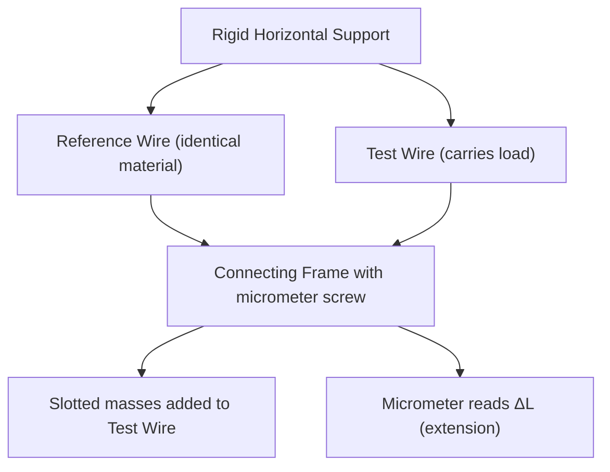
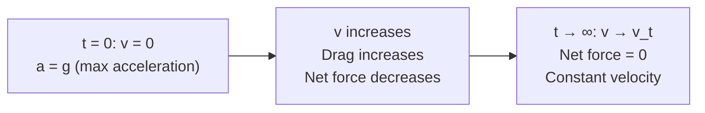

# :LiDroplet: Subtopic: Elasticity, Viscosity & Surface Tension

> [!ABSTRACT] Core Focus (NIE Teacher's Guide — Unit 10)
> Derivations and experiments: Searle's apparatus for Young's modulus; Newton's Law of Viscosity; Poiseuille's equation (dimensions and conditions); Stokes' Law terminal velocity derivation (sphere up and down); excess pressure derivation; capillary rise derivation; Jaeger's method for surface tension.

> [!NOTE] Parent Lesson
> [[../Lesson 10 - Mechanical Properties of Matter|Lesson 10 — Mechanical Properties of Matter]]

---

## 1. Young's Modulus — Full Derivation & Experiment

### 1.1 Searle's Apparatus Setup

**Procedure:**
1. Measure wire length $L$ (metre rule), radius $r$ (micrometer screw gauge — several positions, average).
2. Add known masses $M$; read micrometer for each load → get $\Delta L$.
3. Increase and decrease load to check reversibility (must pass through elastic region only).
4. Plot $F = Mg$ vs $\Delta L$; gradient $= EA/L$.

$$E = \frac{\text{gradient} \times L}{A} = \frac{\text{gradient} \times L}{\pi r^2}$$

**Sources of error and control:**
- Temperature fluctuation → Reference wire in same environment eliminates this.
- Kinks in wire → Apply small initial load before zero reading.
- Zero error on micrometer → Subtract systematic error.

---

### 1.2 Strain Energy Derivation

Work done when force increases from 0 to $F$ stretching wire by $\Delta L$:

$$U = \text{Area under F–x graph} = \frac{1}{2} F \Delta L$$

Substituting $F = \sigma A$ and $\Delta L = \varepsilon L$:

$$U = \frac{1}{2} (\sigma A)(\varepsilon L) = \frac{1}{2}\sigma\varepsilon \cdot (AL)$$

Strain energy **density** (per unit volume $AL$):

$$u = \frac{1}{2}\sigma\varepsilon = \frac{1}{2}E\varepsilon^2 = \frac{\sigma^2}{2E}$$

---

### 1.3 Springs in Series vs Parallel

**Series:** Same force through each spring, extensions add:

$$\frac{1}{k_s} = \frac{1}{k_1} + \frac{1}{k_2}$$

**Parallel:** Same extension, forces add:

$$k_p = k_1 + k_2$$

> [!TIP] Series $\Rightarrow$ softer (lower $k$). Parallel $\Rightarrow$ stiffer (higher $k$).

---

## 2. Viscosity — Derivations & Lab

### 2.1 Coefficient of Viscosity — Definition & Units

For a fluid layer of area $A$, velocity gradient $dv/dy$:

$$\tau = \eta \frac{dv}{dy} \quad \Rightarrow \quad F = \eta A \frac{dv}{dy}$$

**Units:** $[\eta] = \dfrac{\text{N m}^{-2}}{\text{m s}^{-1} \cdot \text{m}^{-1}} = \text{Pa·s} = \text{kg m}^{-1}\text{s}^{-1}$

**Dimensions:** $[\text{M L}^{-1} \text{T}^{-1}]$

---

### 2.2 Poiseuille's Equation — Dimensional Verification

$$Q = \frac{\pi r^4 \Delta P}{8 \eta L}$$

Dimensional check: RHS $= \dfrac{[L^4][ML^{-1}T^{-2}]}{[ML^{-1}T^{-1}][L]} = \dfrac{M L^3 T^{-2}}{M T^{-1}} = L^3 T^{-1}$ ✓ (same as $Q$ = m³ s⁻¹)

**Lab — Capillary flow method:**

| Measured Quantity | Method |
|---|---|
| Tube radius $r$ | Micrometer screw gauge (measure internal diameter) |
| Tube length $L$ | Metre rule |
| Pressure difference $\Delta P = h\rho g$ | Measure water head $h$ above outflow |
| Flow rate $Q$ | Collect outflow in measuring cylinder; $Q = V/t$ |

$$\eta = \frac{\pi r^4 h \rho g}{8 Q L}$$

> [!WARNING] Tube must be horizontal (or correction applied). Flow must remain streamline — keep $h$ small to ensure laminar flow. Reynolds number $Re = \rho v D / \eta < 2000$.

---

### 2.3 Terminal Velocity — Sphere Falling (Full Derivation)

Three forces act on sphere (radius $a$, density $\rho$) in fluid (density $\sigma$, viscosity $\eta$):

| Force | Direction | Expression |
|---|---|---|
| Weight $W$ | Down | $\frac{4}{3}\pi a^3 \rho g$ |
| Upthrust $U$ | Up | $\frac{4}{3}\pi a^3 \sigma g$ |
| Stokes drag $F_d$ | Up (opposing fall) | $6\pi \eta a v$ |

At terminal velocity $v_t$: $W = U + F_d$

$$\frac{4}{3}\pi a^3 \rho g = \frac{4}{3}\pi a^3 \sigma g + 6\pi \eta a v_t$$

$$6\pi \eta a v_t = \frac{4}{3}\pi a^3 (\rho - \sigma) g$$

$$\boxed{v_t = \frac{2a^2(\rho - \sigma)g}{9\eta}}$$

**Sphere moving upward** (e.g. bubble of density $\rho_b < \sigma$): Replace $(\rho - \sigma)$ with $(\sigma - \rho_b)$; terminal velocity is upward at same magnitude formula.

---

### 2.4 Velocity–Time Graph for Falling Sphere

The curve is an exponential approach: $v(t) = v_t(1 - e^{-t/\tau})$ where $\tau = m/b$, $b = 6\pi\eta a$.

---

## 3. Surface Tension — Derivations

### 3.1 Excess Pressure in a Spherical Drop (Derivation)

Consider a liquid drop of radius $R$ and surface tension $\gamma$. Imagine splitting it into two hemispheres.

**Force due to surface tension** around the circumference (one surface):

$$F_{tension} = 2\pi R \gamma$$

**Net pressure force** on the flat cross-section face:

$$F_{pressure} = \Delta P \cdot \pi R^2$$

Equating: $\Delta P \cdot \pi R^2 = 2\pi R \gamma$

$$\boxed{\Delta P = \frac{2\gamma}{R}} \quad \text{(liquid drop — one surface)}$$

For a **soap bubble** (two surfaces — inner film and outer film):

$$\Delta P = \frac{4\gamma}{R}$$

---

### 3.2 Capillary Rise — Full Derivation

Liquid of surface tension $\gamma$, density $\rho$, angle of contact $\theta$ in tube of radius $r$:

**Upward pull** by surface tension along the contact circumference:

$$F_{up} = 2\pi r \gamma \cos\theta$$

(The vertical component of the tension force; $\gamma$ acts at angle $\theta$ to vertical.)

**Weight** of liquid column of height $h$:

$$W = \pi r^2 h \rho g$$

At equilibrium $F_{up} = W$:

$$2\pi r \gamma \cos\theta = \pi r^2 h \rho g$$

$$\boxed{h = \frac{2\gamma\cos\theta}{r\rho g}}$$

**To find $\gamma$ from experiment:** Measure $h$, $r$ (capillary tube radius), and known $\rho$, $\theta$:

$$\gamma = \frac{r h \rho g}{2\cos\theta}$$

---

### 3.3 Jaeger's Method

Air is slowly blown through a nozzle (radius $r$) submerged at depth $d$ in the liquid. As bubble forms, pressure inside rises until it equals the capillary excess pressure:

$$\Delta P_{max} = P_{atm} + \rho g d + \frac{2\gamma}{r} - P_{atm} = \rho g d + \frac{2\gamma}{r}$$

The **manometer reading** at the moment the bubble just detaches gives $\Delta P_{max}$:

$$\gamma = \frac{r(\Delta P_{max} - \rho g d)}{2}$$

---

### 3.4 Surface Tension & Surface Energy Relationship

Extend a rectangular film of width $l$ by $dx$ (two surfaces):

$$dW = F \cdot dx = 2\gamma l \cdot dx$$

Change in surface area $dA = 2l \cdot dx$ (two sides):

$$\gamma = \frac{dW}{dA} = \frac{\text{Energy}}{\text{Area}} \quad [\text{J m}^{-2} = \text{N m}^{-1}] ✓$$

---

### 3.5 Effect of Temperature on Surface Tension

| Temperature | $\gamma$ | Reason |
|---|---|---|
| Increases | Decreases | Thermal agitation weakens cohesive bonds at surface |
| At boiling point | $\gamma \to 0$ | No distinction between surface and bulk |

---

## 4. Quick Reference Formulas

| Formula | Meaning |
|---|---|
| $E = FL / A\Delta L$ | Young's modulus |
| $u = \frac{1}{2}\sigma\varepsilon$ | Strain energy density |
| $F = \eta A \Delta v / d$ | Newton's viscosity law |
| $Q = \pi r^4 \Delta P / 8\eta L$ | Poiseuille's equation |
| $F = 6\pi\eta a v$ | Stokes' drag |
| $v_t = 2a^2(\rho-\sigma)g / 9\eta$ | Terminal velocity |
| $\gamma = F / l$ | Surface tension definition |
| $\Delta P = 2\gamma / R$ | Excess pressure — liquid drop |
| $\Delta P = 4\gamma / R$ | Excess pressure — soap bubble |
| $h = 2\gamma\cos\theta / r\rho g$ | Capillary rise |

---

#flashcards

How is Young's modulus found using Searle's apparatus? :: Plot $F$ vs $\Delta L$; gradient $= EA/L$; then $E = \text{gradient} \times L / \pi r^2$. Reference wire eliminates temperature errors.

Derive the strain energy density of a stretched wire. :: $U = \frac{1}{2}F\Delta L = \frac{1}{2}\sigma A \cdot \varepsilon L$; density $u = U/AL = \frac{1}{2}\sigma\varepsilon = \frac{1}{2}E\varepsilon^2$ (J m⁻³).

What are the conditions for Poiseuille's equation to be valid? :: Streamline (laminar) flow; Newtonian fluid; incompressible; long straight tube; no-slip at the wall; $Re < 2000$.

Verify Poiseuille's equation dimensionally. :: $[Q] = [r^4\Delta P / \eta L] = L^4 \cdot ML^{-1}T^{-2} / (ML^{-1}T^{-1} \cdot L) = L^3T^{-1}$ ✓.

Derive terminal velocity of a sphere falling in a viscous fluid. :: $W = U + F_d$: $\frac{4}{3}\pi a^3(\rho-\sigma)g = 6\pi\eta av_t$ ⇒ $v_t = 2a^2(\rho-\sigma)g / 9\eta$.

What three forces act on a sphere moving through a viscous fluid, and in which directions? :: Weight $W = \frac{4}{3}\pi a^3\rho g$ (down); Upthrust $U = \frac{4}{3}\pi a^3\sigma g$ (up); Stokes drag $F = 6\pi\eta av$ (up, opposing motion).

Derive the excess pressure inside a liquid drop. :: Equilibrium of hemisphere: $\Delta P \cdot \pi R^2 = 2\pi R\gamma$ (tension around rim) ⇒ $\Delta P = 2\gamma/R$.

Why is the excess pressure in a soap bubble $4\gamma/R$ and not $2\gamma/R$? :: A soap bubble has two surfaces (inner and outer), each contributing $2\gamma/R$; total $\Delta P = 4\gamma/R$.

Derive the capillary rise formula $h = 2\gamma\cos\theta / r\rho g$. :: Upward surface tension force $= 2\pi r\gamma\cos\theta$; weight of column $= \pi r^2 h\rho g$; equate ⇒ $h = 2\gamma\cos\theta / r\rho g$.

What is Jaeger's method for surface tension? :: Blow air bubble from nozzle (radius $r$) submerged depth $d$; at detachment $\gamma = r(\Delta P_{max} - \rho g d)/2$ where $\Delta P_{max}$ is manometer reading.

Show that surface tension $\gamma$ equals surface energy per unit area. :: Work done $dW = F\,dx = 2\gamma l\,dx$ on film of width $l$; area increase $dA = 2l\,dx$; so $\gamma = dW/dA$ [J m⁻²] = [N m⁻¹] ✓.

How does surface tension change with temperature, and why? :: $\gamma$ decreases as temperature rises because thermal energy weakens cohesive intermolecular bonds at the surface; $\gamma \to 0$ at the boiling point.

What is the effective spring constant for two springs $k_1$ and $k_2$ in series and in parallel? :: Series: $1/k_s = 1/k_1 + 1/k_2$ (softer). Parallel: $k_p = k_1 + k_2$ (stiffer).

What is the velocity–time relationship for a sphere approaching terminal velocity? :: $v(t) = v_t(1 - e^{-t/\tau})$; exponential approach; starts at $v = 0$, acceleration decreases, asymptotically reaches $v_t$.

Write the capillary flow formula for the coefficient of viscosity using Poiseuille's method. :: $\eta = \pi r^4 h\rho g / 8QL$, where $h$ = pressure head, $Q$ = volume flow rate, $r$ = tube radius, $L$ = tube length.
