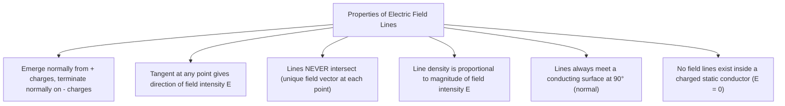
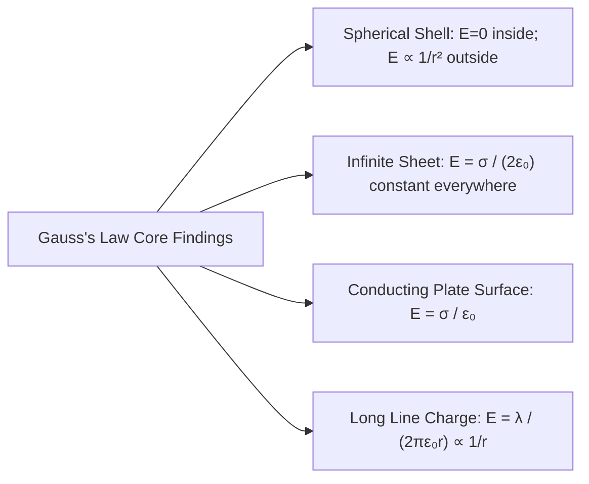

# :LiCloudLightning: Subtopic: Electric Fields & Capacitors Guide

> [!ABSTRACT] Core Focus
> Advanced analytical guide for Electrostatics in Sri Lankan GCE A/L Physics: Coulomb's Law, permittivity of media, electric field intensity ($\vec{E}$), trajectory of charged particles in uniform fields, Gauss's Law and its 4 canonical field derivations, electric potential ($V$) and potential gradient ($E = -dV/dr$), equipotential surfaces, capacitance derivations (parallel-plate and spherical), dielectric behavior, stored electrostatic energy and energy density, charge redistribution between capacitors with energy loss analysis, RC transient time constant, and surface charge density dynamics (action of points/corona discharge).

---

## 1. Coulomb's Law & Electric Field Intensity ($\vec{E}$)

### Coulomb's Law:
The electrostatic force of attraction or repulsion between two stationary point charges $q_1$ and $q_2$ separated by a distance $r$ in a medium of absolute permittivity $\varepsilon$ is:
$$F = \frac{1}{4\pi\varepsilon} \frac{q_1 q_2}{r^2} = \frac{1}{4\pi\varepsilon_0 \varepsilon_r} \frac{q_1 q_2}{r^2}$$

* **Permittivity of Free Space ($\varepsilon_0$):** $\varepsilon_0 \approx 8.854 \times 10^{-12} \text{ C}^2\text{N}^{-1}\text{m}^{-2} \text{ (or }\text{F}\cdot\text{m}^{-1}\text{)}$.
* **Coulomb Constant in Vacuum:** $k = \frac{1}{4\pi\varepsilon_0} \approx 8.988 \times 10^9 \text{ N}\cdot\text{m}^2\cdot\text{C}^{-2}$.
* **Relative Permittivity (Dielectric Constant $\varepsilon_r$ or $k$):**
  $$\varepsilon_r = \frac{\varepsilon}{\varepsilon_0} = \frac{F_{\text{vacuum}}}{F_{\text{medium}}} \quad (\varepsilon_r \ge 1, \text{ for vacuum/air } \varepsilon_r = 1)$$

---

### Electric Field Intensity ($\vec{E}$):
The electrostatic force experienced per unit positive test charge placed at that point:
$$\vec{E} = \lim_{q_0 \to 0} \frac{\vec{F}}{q_0} \quad \left([\mathsf{M}\mathsf{L}\mathsf{T}^{-3}\mathsf{I}^{-1}], \text{ units: }\text{N}\cdot\text{C}^{-1}\text{ or }\text{V}\cdot\text{m}^{-1}\right)$$

For an isolated point charge $Q$ in a medium of permittivity $\varepsilon$:
$$E = \frac{1}{4\pi\varepsilon} \frac{Q}{r^2}$$

---

### Motion of Charged Particle in a Uniform Transverse Electric Field:
Consider a charge $q$ of mass $m$ entering a uniform electric field $\vec{E}$ (directed along $-y$) with horizontal velocity $u_x = v_0$ across plates of length $L$:

1. **Horizontal Motion (No horizontal force, $a_x = 0$):**
   $$x = v_0 t \implies t = \frac{x}{v_0}$$
2. **Vertical Motion ($F_y = qE \implies a_y = \frac{qE}{m}$):**
   $$y = \frac{1}{2} a_y t^2 = \frac{1}{2} \left(\frac{qE}{m}\right) \left(\frac{x}{v_0}\right)^2 = \left(\frac{qE}{2m v_0^2}\right) x^2$$
   * **Trajectory:** Parabolic path ($y \propto x^2$).
   * **Emergent Vertical Velocity:** $v_y = a_y t = \frac{q E L}{m v_0}$.
   * **Deflection Angle ($\theta$):** $\tan\theta = \frac{v_y}{v_x} = \frac{q E L}{m v_0^2}$.

---

## 2. Gauss's Law & Systematic Field Derivations

### Electric Flux ($\Phi_E$):
Electric flux measures the total number of electric field lines passing through a surface area $A$:
$$\Phi_E = \int \vec{E} \cdot d\vec{A} = \int E \cos\theta \, dA \quad (\text{units: }\text{N}\cdot\text{m}^2\cdot\text{C}^{-1}\text{ or }\text{V}\cdot\text{m})$$

### Statement of Gauss's Law:
The total normal electric flux passing through any closed imaginary surface (Gaussian surface) in an electrostatic field equals the net charge enclosed divided by the permittivity of the medium:
$$\Phi_{\text{net}} = \oint \vec{E} \cdot d\vec{A} = \frac{Q_{\text{enclosed}}}{\varepsilon}$$

---

### Standard A/L Derivations Using Gauss's Law:

| Configuration | Gaussian Surface Chosen | Flux Calculation | Enclosed Charge ($Q_{\text{enc}}$) | Resultant Field Intensity ($E$) |
| :--- | :--- | :--- | :--- | :--- |
| **1. Point Charge $Q$** | Concentric sphere of radius $r$ | $E \oint dA = E(4\pi r^2)$ | $Q$ | $E = \frac{1}{4\pi\varepsilon} \frac{Q}{r^2}$ |
| **2. Conducting Sphere (Radius $R$, Charge $Q$)** | Concentric sphere of radius $r$: • Outside ($r \ge R$) • Inside ($r < R$) | • Outside: $E(4\pi r^2)$ • Inside: $E(4\pi r^2)$ | • Outside: $Q$ • Inside: $0$ (charge on outer surface) | • Outside: $E = \frac{1}{4\pi\varepsilon} \frac{Q}{r^2}$ • Inside: $E = 0$ |
| **3. Infinite Non-Conducting Sheet** (Surface charge $\sigma$) | Cylindrical pillbox crossing sheet, 2 end caps of area $A$ | $2 E A$ (flux exits both end caps) | $\sigma A$ | $E = \frac{\sigma}{2\varepsilon}$ (uniform, independent of distance) |
| **4. Infinite Conducting Plate** (Surface charge $\sigma$) | Cylindrical pillbox, one cap outside, one cap inside conductor | $E A$ ($E = 0$ inside conductor) | $\sigma A$ | $E = \frac{\sigma}{\varepsilon}$ (twice non-conducting sheet) |
| **5. Infinite Thin Wire** (Linear charge density $\lambda$) | Coaxial cylinder of radius $r$, length $L$ | $E(2\pi r L)$ (curved surface only) | $\lambda L$ | $E = \frac{\lambda}{2\pi\varepsilon r}$ |

---

## 3. Electric Potential ($V$) & Potential Gradient

### Electric Potential ($V$):
The work done per unit positive test charge by an external agent in bringing it at constant speed from infinity to that point:
$$V = \frac{W_{\infty \to P}}{q_0} \quad \left([\mathsf{M}\mathsf{L}^2\mathsf{T}^{-3}\mathsf{I}^{-1}], \text{ unit: Volt (V)} = \text{J}\cdot\text{C}^{-1}\right)$$

* **Point Charge $Q$ at distance $r$:**
  $$V = \int_\infty^r -E \, dr = -\int_\infty^r \frac{Q}{4\pi\varepsilon r^2} dr = \frac{1}{4\pi\varepsilon} \frac{Q}{r}$$
* **Potential of a Charged Conducting Sphere (Radius $R$, Charge $Q$):**
  * Outside ($r \ge R$): $V = \frac{1}{4\pi\varepsilon} \frac{Q}{r}$
  * At Surface ($r = R$): $V_0 = \frac{1}{4\pi\varepsilon} \frac{Q}{R}$
  * Inside ($r \le R$): Since $E = -\frac{dV}{dr} = 0$, the potential is constant throughout the interior:
    $$V_{\text{inside}} = V_{\text{surface}} = \frac{1}{4\pi\varepsilon} \frac{Q}{R}$$

---

### Potential Gradient & Relationship with Electric Field:
$$E = -\frac{dV}{dr}$$
* The electric field $\vec{E}$ points in the direction of maximum rate of decrease of potential.
* In a **uniform electric field** across plates separated by distance $d$ with potential difference $V$:
  $$E = \frac{V}{d} \quad \left(1\text{ V}\cdot\text{m}^{-1} = 1\text{ N}\cdot\text{C}^{-1}\right)$$

### Equipotential Surfaces:
A locus of points having the same electric potential ($V = \text{constant}$):
1. **Work Done:** Zero work is done in moving a test charge along an equipotential surface ($W = q\Delta V = 0$).
2. **Orthogonality:** Electric field lines are always perpendicular ($\theta = 90^\circ$) to equipotential surfaces at all points ($dW = -q \vec{E}\cdot d\vec{r} = -q E dr \cos\theta = 0 \implies \cos\theta = 0 \implies \theta = 90^\circ$).
3. **Spacing:** Surfaces are closely spaced in regions of strong electric field and widely spaced in weak fields ($dr = -dV/E$).

---

## 4. Capacitance, Dielectrics & Energy Dynamics

### Definition of Capacitance ($C$):
The ratio of the magnitude of electric charge on either conductor to the potential difference between them:
$$C = \frac{Q}{V} \quad \left([\mathsf{M}^{-1}\mathsf{L}^{-2}\mathsf{T}^4\mathsf{I}^2], \text{ unit: Farad (F)} = \text{C}\cdot\text{V}^{-1}\right)$$

### Derivation: Parallel-Plate Capacitor:
Two parallel plates of area $A$, separation $d$, carrying charges $+Q$ and $-Q$:
1. Surface charge density: $\sigma = \frac{Q}{A}$.
2. Uniform electric field between plates: $E = \frac{\sigma}{\varepsilon} = \frac{Q}{\varepsilon_0 \varepsilon_r A}$.
3. Potential difference: $V = E d = \frac{Q d}{\varepsilon_0 \varepsilon_r A}$.
4. Capacitance:
   $$C = \frac{Q}{V} = \frac{\varepsilon_0 \varepsilon_r A}{d}$$

### Capacitance of an Isolated Conducting Sphere (Radius $R$):
$$V = \frac{Q}{4\pi\varepsilon_0 R} \implies C = \frac{Q}{V} = 4\pi\varepsilon_0 R$$

---

### Electrostatic Energy Stored in a Charged Capacitor:
Work done $dW$ to transfer an incremental charge $dq$ against potential $v = q/C$:
$$W = \int_0^Q v \, dq = \int_0^Q \frac{q}{C} dq = \left[\frac{q^2}{2C}\right]_0^Q = \frac{Q^2}{2C}$$
Using $Q = CV$:
$$U = \frac{1}{2} Q V = \frac{1}{2} C V^2 = \frac{Q^2}{2C}$$

* **Electrostatic Energy Density ($u_E$):**
  $$u_E = \frac{U}{\text{Volume}} = \frac{\frac{1}{2} C V^2}{A d} = \frac{\frac{1}{2} \left(\frac{\varepsilon_0 \varepsilon_r A}{d}\right) (E d)^2}{A d} = \frac{1}{2} \varepsilon_0 \varepsilon_r E^2 \quad (\text{J}\cdot\text{m}^{-3})$$

---

### Impact of Dielectric Slab ($\varepsilon_r > 1$):

| Parameter | Battery Disconnected ($Q = \text{const}$) | Battery Remains Connected ($V = \text{const}$) |
| :--- | :--- | :--- |
| **Charge ($Q$)** | Unchanged ($Q_0$) | Increases: $Q = \varepsilon_r Q_0$ |
| **Capacitance ($C$)** | Increases: $C = \varepsilon_r C_0$ | Increases: $C = \varepsilon_r C_0$ |
| **Potential Diff ($V$)** | Decreases: $V = V_0 / \varepsilon_r$ | Unchanged ($V_0$) |
| **Electric Field ($E$)** | Decreases: $E = E_0 / \varepsilon_r$ | Unchanged ($E_0$) |
| **Stored Energy ($U$)** | Decreases: $U = U_0 / \varepsilon_r$ (Work done by field to suck in slab) | Increases: $U = \varepsilon_r U_0$ (Battery supplies energy) |

---

## 5. Charge Redistribution, RC Transients & Point Discharge

### Charge Redistribution & Energy Loss Between Two Capacitors:
When capacitor $C_1$ charged to $V_1$ is connected in parallel with $C_2$ charged to $V_2$:
1. **Total Charge Conservation:** $Q_{\text{total}} = C_1 V_1 + C_2 V_2$.
2. **Common Equilibrium Potential ($V_c$):**
   $$V_c = \frac{Q_{\text{total}}}{C_1 + C_2} = \frac{C_1 V_1 + C_2 V_2}{C_1 + C_2}$$
3. **Loss of Stored Electrostatic Energy ($\Delta U = U_i - U_f$):**
   $$\Delta U = \frac{1}{2} C_1 V_1^2 + \frac{1}{2} C_2 V_2^2 - \frac{1}{2}(C_1 + C_2) V_c^2$$
   $$\Delta U = \frac{1}{2} \frac{C_1 C_2}{C_1 + C_2} (V_1 - V_2)^2 \ge 0$$
   * **Energy Destination:** Lost irreversibly as **Joule heating** ($I^2 R$) in connecting wires and **electromagnetic radiation** during spark formation.

---

### RC Circuit Transients:
For a series circuit of resistor $R$ and capacitor $C$:
* **Charging from EMF $E_0$:**
  $$q(t) = Q_0 \left(1 - e^{-t / \tau}\right), \quad V(t) = E_0 \left(1 - e^{-t / \tau}\right), \quad I(t) = I_0 e^{-t / \tau}$$
* **Discharging through $R$:**
  $$q(t) = Q_0 e^{-t / \tau}, \quad V(t) = V_0 e^{-t / \tau}, \quad I(t) = -I_0 e^{-t / \tau}$$
* **Time Constant ($\tau$):**
  $$\tau = R C \quad (\text{units: } \Omega \cdot \text{F} = \text{seconds})$$
  * During charging, at $t = \tau$, $q = Q_0 (1 - e^{-1}) \approx 0.632 Q_0$ ($63.2\%$ of full charge).
  * During discharging, at $t = \tau$, $q = Q_0 e^{-1} \approx 0.368 Q_0$ ($36.8\%$ of initial charge remaining).

---

### Surface Charge Density & Action of Points (Corona Discharge):
* **Charge Distribution:** On an isolated conductor of arbitrary shape, charge resides entirely on the outer surface, and surface charge density $\sigma = \frac{dQ}{dA}$ is inversely proportional to the local radius of curvature $\rho$:
  $$\sigma \propto \frac{1}{\rho}$$
* **Action of Points:** At sharp points, $\rho \to 0 \implies \sigma \to \infty$. The localized electric field $E = \frac{\sigma}{\varepsilon_0}$ exceeds the dielectric breakdown strength of air ($\approx 3 \times 10^6 \text{ V}\cdot\text{m}^{-1}$).
* **Corona Discharge / Electric Wind:**
  1. High field ionizes adjacent air molecules into positive ions and free electrons.
  2. Ions of the same sign as the point are violently repelled away, producing an **electric wind** (convective ion current).
  3. Ions of opposite sign are attracted to the point, gradually neutralizing its charge.
* **Technological Applications:** Lightning conductors (dissipating induced cloud charges or safely directing strokes to earth), Van de Graaff spray points, electrostatic precipitators, and photocopying machines.

---

## :LiRocket: Flashcards (Spaced Repetition)

#flashcards

What is the relationship between absolute permittivity $\varepsilon$, permittivity of free space $\varepsilon_0$, and relative permittivity $\varepsilon_r$? :: $\varepsilon = \varepsilon_0 \varepsilon_r$, where $\varepsilon_r$ (dielectric constant) is a dimensionless ratio $\ge 1$.

State Gauss's Law in electrostatics. :: The total normal electric flux through any closed Gaussian surface equals the net enclosed charge divided by the medium's permittivity: $\Phi = \oint \vec{E} \cdot d\vec{A} = \frac{Q_{\text{enclosed}}}{\varepsilon}$.

Why is the electric field inside a charged hollow or solid conducting sphere zero ($E = 0$)? :: Because all free charges reside strictly on the outer surface of the conductor, meaning any Gaussian surface inside encloses zero charge ($Q_{\text{enc}} = 0$).

What is the electric field intensity $E$ near an infinite non-conducting sheet carrying uniform surface charge density $\sigma$? :: $E = \frac{\sigma}{2\varepsilon_0}$ (constant and independent of distance from the sheet).

What is the electric field intensity $E$ immediately outside a charged conducting plate surface? :: $E = \frac{\sigma}{\varepsilon_0}$ (twice that of an isolated non-conducting sheet due to charge boundary conditions).

What is the electric field intensity $E$ at distance $r$ from an infinite thin line charge with linear density $\lambda$? :: $E = \frac{\lambda}{2\pi\varepsilon_0 r}$.

What is the electric potential inside a charged conducting sphere of radius $R$ and total charge $Q$? :: $V = \frac{1}{4\pi\varepsilon_0} \frac{Q}{R}$ (constant and identical to the surface potential throughout the entire interior, because $E = -dV/dr = 0$).

Why is no work done in moving a test charge along an equipotential surface? :: Because $W = q \Delta V$, and across an equipotential surface $\Delta V = 0$; furthermore, $\vec{E}$ is everywhere perpendicular to the displacement ($d\vec{r}$), making $\vec{E} \cdot d\vec{r} = 0$.

Derive the capacitance of a parallel-plate capacitor with plate area $A$ and separation $d$ in vacuum. :: $\sigma = Q/A \implies E = \sigma/\varepsilon_0 = Q/(\varepsilon_0 A) \implies V = E d = Q d/(\varepsilon_0 A) \implies C = Q/V = \frac{\varepsilon_0 A}{d}$.

State the electrostatic energy density stored in an electric field $E$ in a medium of relative permittivity $\varepsilon_r$. :: $u_E = \frac{1}{2} \varepsilon_0 \varepsilon_r E^2 \text{ (in }\text{J}\cdot\text{m}^{-3}\text{)}$.

When a dielectric slab ($\varepsilon_r > 1$) is inserted between capacitor plates with the battery disconnected, what happens to $Q, C, V, E$, and $U$? :: Charge $Q$ is constant; $C$ increases by $\varepsilon_r$; $V$ decreases to $V_0/\varepsilon_r$; $E$ decreases to $E_0/\varepsilon_r$; stored energy $U$ decreases to $U_0/\varepsilon_r$.

What is the common potential when two capacitors $C_1$ (charged to $V_1$) and $C_2$ (charged to $V_2$) are connected in parallel? :: $V_c = \frac{C_1 V_1 + C_2 V_2}{C_1 + C_2}$.

State the formula for the energy lost during charge redistribution between two connected capacitors. :: $\Delta U = \frac{1}{2} \frac{C_1 C_2}{C_1 + C_2} (V_1 - V_2)^2$ (dissipated as Joule heat in connecting wires and EM radiation).

Define the time constant $\tau$ of an RC charging circuit. :: $\tau = R C$; it is the time required for the capacitor charge to reach $1 - 1/e \approx 63.2\%$ of its maximum equilibrium value.

Explain the "action of points" (corona discharge) on a pointed conductor. :: Surface charge density $\sigma \propto 1/\rho$ is extremely high at sharp tips, creating an intense electric field ($E = \sigma/\varepsilon_0$) that ionizes surrounding air molecules, causing continuous charge leakage (electric wind).
