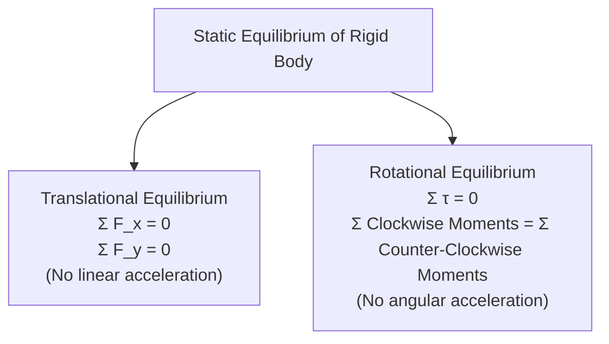
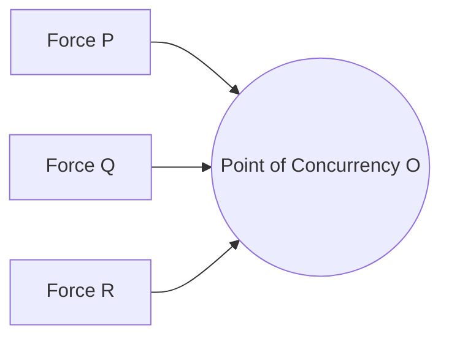
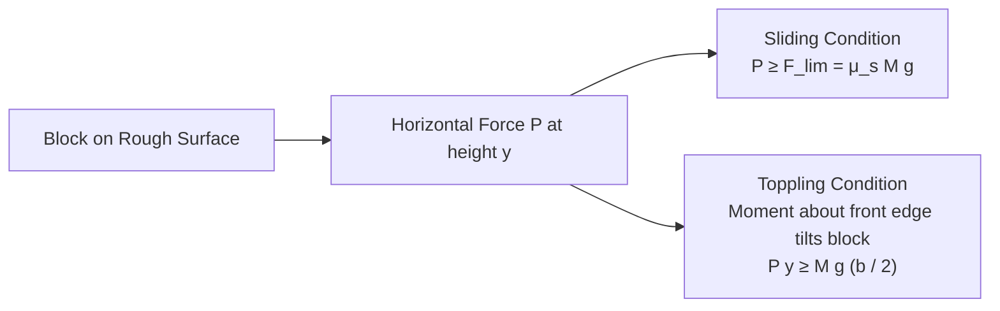

# :LiScale: Subtopic: Equilibrium & Centre of Gravity Guide

> [!ABSTRACT] Core Focus
> Advanced analytical guide for Statics in Sri Lankan GCE A/L Physics: Conditions of equilibrium for coplanar forces, Lami's theorem and triangle of forces, moments and couples, Centre of Gravity of 2D laminas and 3D solids, composite body calculations, sliding vs. toppling analysis, and classical exam problem archetypes.

---

## 1. Complete Conditions of Static Equilibrium

For a rigid body subjected to a system of coplanar forces:

> [!IMPORTANT] Choice of Moment Axis
> While translational equilibrium requires $\Sigma \vec{F} = 0$, the rotational equilibrium condition $\Sigma \tau = 0$ holds about **any arbitrary point or axis** in the plane. In exam calculations, always choose a pivot point through which the greatest number of unknown forces pass to eliminate them from the moment equation.

---

## 2. Three Coplanar Forces in Equilibrium

When a rigid body remains in static equilibrium under exactly three non-parallel coplanar forces:

### 1. The Concurrency Theorem:
The lines of action of the three forces **must intersect at a single common point** (they must be concurrent).
- *Proof*: Take moments about the point of intersection $O$ of any two forces. Since those two forces have zero moment about $O$, the third force must also pass through $O$ for the net torque to equal zero.

### 2. Triangle of Forces Theorem:
If three coplanar forces acting at a point are in equilibrium, they can be represented in magnitude and direction by the three sides of a closed triangle taken in cyclic order.

### 3. Lami's Theorem:
If three coplanar forces $\vec{P}, \vec{Q}, \vec{R}$ acting at a point maintain equilibrium, each force is directly proportional to the sine of the angle between the other two forces:
$$\frac{P}{\sin\alpha} = \frac{Q}{\sin\beta} = \frac{R}{\sin\gamma}$$

*(where $\alpha$ is the angle between $\vec{Q}$ and $\vec{R}$, $\beta$ between $\vec{P}$ and $\vec{R}$, and $\gamma$ between $\vec{P}$ and $\vec{Q}$).*

---

## 3. Couples & Parallel Forces

### Couple:
A pair of forces equal in magnitude ($F$), opposite in direction, having parallel lines of action separated by a perpendicular distance $d$.
- **Resultant force**: $\vec{R} = \vec{F} + (-\vec{F}) = 0$ (no translational acceleration).
- **Torque of a couple**:
  $$\tau = F \times d$$
- **Invariance of Couple Torque**: The torque of a couple has the exact same value about **every point in the plane**.

### Resultant of Parallel Forces:
1. **Like Parallel Forces** ($F_1, F_2$ in same direction):
   $$R = F_1 + F_2$$
   The line of action of $R$ lies between $F_1$ and $F_2$ dividing the line segment internally:
   $$F_1 x_1 = F_2 x_2 \implies \frac{x_1}{x_2} = \frac{F_2}{F_1}$$
2. **Unlike Parallel Forces** ($F_1 > F_2$ in opposite directions):
   $$R = F_1 - F_2$$
   The line of action of $R$ lies outside the forces on the side of the larger force $F_1$:
   $$F_1 x_1 = F_2 x_2$$

---

## 4. Centre of Gravity (CG) Derivations & Standard Shapes

The **Centre of Gravity** is the unique point through which the resultant gravitational force (total weight) of the body acts in all orientations.

### Centre of Gravity Coordinates for Composite Bodies:
$$\bar{x} = \frac{\sum m_i x_i}{\sum m_i} = \frac{\sum W_i x_i}{\sum W_i}, \quad \bar{y} = \frac{\sum m_i y_i}{\sum m_i}$$
*(For uniform sheets, substitute mass with area $A$; for uniform rods/wires, substitute mass with length $L$; for uniform 3D solids, substitute mass with volume $V$).*

- **Composite with a Cavity (Removed Part)**:
  $$\bar{x} = \frac{A_1 x_1 - A_2 x_2}{A_1 - A_2}$$
  *(Treat removed portion as having negative mass/area).*

---

### Standard Centre of Gravity Reference Table:

| Body Geometry | Nature / Material | Position of Centre of Gravity from Reference Base |
| :--- | :--- | :--- |
| **Uniform Thin Rod** | Length $L$ | Midpoint: $\frac{L}{2}$ from either end |
| **Uniform Triangular Lamina** | Height $h$ | On median at $\frac{1}{3}h$ from base (Centroid) |
| **Uniform Circular Wire Arc** | Subtending angle $2\alpha$ at center, radius $r$ | On axis of symmetry at distance $\frac{r\sin\alpha}{\alpha}$ from center |
| **Uniform Semicircular Wire** | Radius $r$ | On radius of symmetry at $\frac{2r}{\pi} \approx 0.637 r$ from center |
| **Uniform Semicircular Lamina** | Radius $r$ | On radius of symmetry at $\frac{4r}{3\pi} \approx 0.424 r$ from diameter base |
| **Uniform Circular Sector Lamina** | Radius $r$, semi-angle $\alpha$ | On axis of symmetry at $\frac{2r\sin\alpha}{3\alpha}$ from center |
| **Solid Hemisphere** | Radius $r$ | On central axis of symmetry at $\frac{3}{8}r$ from flat circular face |
| **Hollow Hemispherical Shell** | Radius $r$ | On central axis of symmetry at $\frac{1}{2}r$ from flat circular rim |
| **Solid Right Circular Cone** | Height $h$ | On central axis at $\frac{1}{4}h$ from flat circular base |
| **Hollow Right Circular Cone (Shell)** | Height $h$ | On central axis at $\frac{1}{3}h$ from flat circular base |
| **Solid Cylinder / Sphere / Rectangular Block** | Uniform density | Geometric center of symmetry |

---

## 5. Sliding vs. Toppling of a Rigid Block

Consider a uniform rectangular block of mass $M$, width $b$, and height $h$ resting on a rough plane:

### Case A: Horizontal Surface with Pulling Force $P$ at Height $y$:
1. **Condition for Sliding**:
   $$P \ge F_{\text{lim}} = \mu_s M g$$
2. **Condition for Toppling (Overturning)**:
   The normal reaction shifts toward the forward corner edge. At the verge of toppling, the normal reaction acts exactly through the front corner:
   $$\text{Taking moments about front corner: } P \cdot y \ge M g \cdot \frac{b}{2} \implies P \ge \frac{M g b}{2y}$$
3. **Threshold Behavior**:
   - The block **slides before toppling** if:
     $$\mu_s M g < \frac{M g b}{2y} \implies \mu_s < \frac{b}{2y}$$
   - The block **topples before sliding** if:
     $$\mu_s > \frac{b}{2y}$$

---

### Case B: Block Resting on an Inclined Plane of Angle $\theta$:
As the angle of inclination $\theta$ is steadily increased:
- **Angle of Repose for Sliding**: $\theta_{\text{slide}} = \lambda \implies \tan\theta_{\text{slide}} = \mu_s$.
- **Angle for Toppling**: Toppling occurs when the vertical line of action of weight $Mg$ through the Centre of Gravity passes outside the lower contact base edge:
  $$\tan\theta_{\text{topple}} = \frac{b/2}{h/2} = \frac{b}{h}$$
- **Decision Rule**:
  - If $\mu_s < \frac{b}{h} \implies$ **Block slides first**.
  - If $\mu_s > \frac{b}{h} \implies$ **Block topples first**.

---

## 6. High-Yield Exam Problem Models

### Model 1: Uniform Ladder Resting Against Wall and Floor
- Ladder length $L$, mass $M$, inclination angle $\theta$ to horizontal floor.
- **Smooth wall, rough floor ($\mu$)**:
  - Vertical: $R_f = Mg$
  - Moments about base: $N_w (L\sin\theta) = Mg(\frac{L}{2}\cos\theta) \implies N_w = \frac{Mg}{2\tan\theta}$
  - Horizontal: $F_f = N_w \le \mu R_f \implies \frac{Mg}{2\tan\theta} \le \mu Mg \implies \tan\theta \ge \frac{1}{2\mu}$.
- **Rough wall ($\mu_w$) and rough floor ($\mu_f$)**:
  - At verge of slipping: $F_f = \mu_f R_f$ and $F_w = \mu_w N_w$.
  - $\Sigma F_x = 0 \implies F_f = N_w \implies \mu_f R_f = N_w$.
  - $\Sigma F_y = 0 \implies R_f + F_w = Mg \implies R_f + \mu_w N_w = Mg$.
  - Substitute into moment equation to solve for critical climbing distance of a person on the ladder.

### Model 2: Hinged Rod Supported by a Light String
- Uniform rod of weight $W$ hinged at wall with light string attached to outer end.
- Identify the three forces acting on the rod:
  1. Weight $W$ (vertically downward at midpoint).
  2. Tension $T$ in string (along string line).
  3. Hinge reaction $\vec{R}$ (direction found by the **concurrency theorem**: line of action of hinge reaction must pass through intersection of weight and tension lines).

---

## :LiRocket: Flashcards (Spaced Repetition)

#flashcards

State the Concurrency Theorem for three coplanar forces in equilibrium. :: If a body is in equilibrium under three non-parallel coplanar forces, their lines of action must intersect at a single common point.

State Lami's Theorem for three concurrent forces in equilibrium. :: $\frac{P}{\sin\alpha} = \frac{Q}{\sin\beta} = \frac{R}{\sin\gamma}$ (where $\alpha, \beta, \gamma$ are the angles opposite forces $P, Q, R$).

Why is the torque of a couple independent of the pivot axis chosen? :: The opposite forces create a moment $F(x + d) - F(x) = Fd$, which depends only on the separation distance $d$ between lines of action.

Where is the Centre of Gravity of a uniform semicircular wire of radius $r$ located? :: On its radius of symmetry at distance $\frac{2r}{\pi} \approx 0.637r$ from the center.

Where is the Centre of Gravity of a uniform semicircular lamina of radius $r$ located? :: On its radius of symmetry at distance $\frac{4r}{3\pi} \approx 0.424r$ from the straight diameter base.

Where is the Centre of Gravity of a solid right circular cone of height $h$ located? :: On its central axis of symmetry at distance $\frac{1}{4}h$ from its base.

Where is the Centre of Gravity of a hollow conical shell of height $h$ located? :: On its central axis of symmetry at distance $\frac{1}{3}h$ from its circular base.

Where is the Centre of Gravity of a solid hemisphere of radius $r$ located? :: On its axis of symmetry at distance $\frac{3}{8}r$ from the flat circular face.

Where is the Centre of Gravity of a hollow hemispherical shell of radius $r$ located? :: On its axis of symmetry at distance $\frac{1}{2}r$ from the flat circular rim.

How is the Centre of Gravity of a composite body containing a cavity calculated? :: By treating the cavity as negative mass/area: $\bar{x} = \frac{A_1 x_1 - A_2 x_2}{A_1 - A_2}$.

What is the condition for a rectangular block of width $b$ and height $h$ resting on an incline to slide before toppling? :: $\mu_s < \frac{b}{h}$ (angle of repose $\theta_{\text{slide}} < \theta_{\text{topple}}$).

When a pulling force $P$ is applied horizontally at height $y$ to a block of width $b$ and mass $M$, what is the condition for toppling? :: $P \ge \frac{M g b}{2y}$ (taking moments about the leading base edge where the normal reaction shifts).
