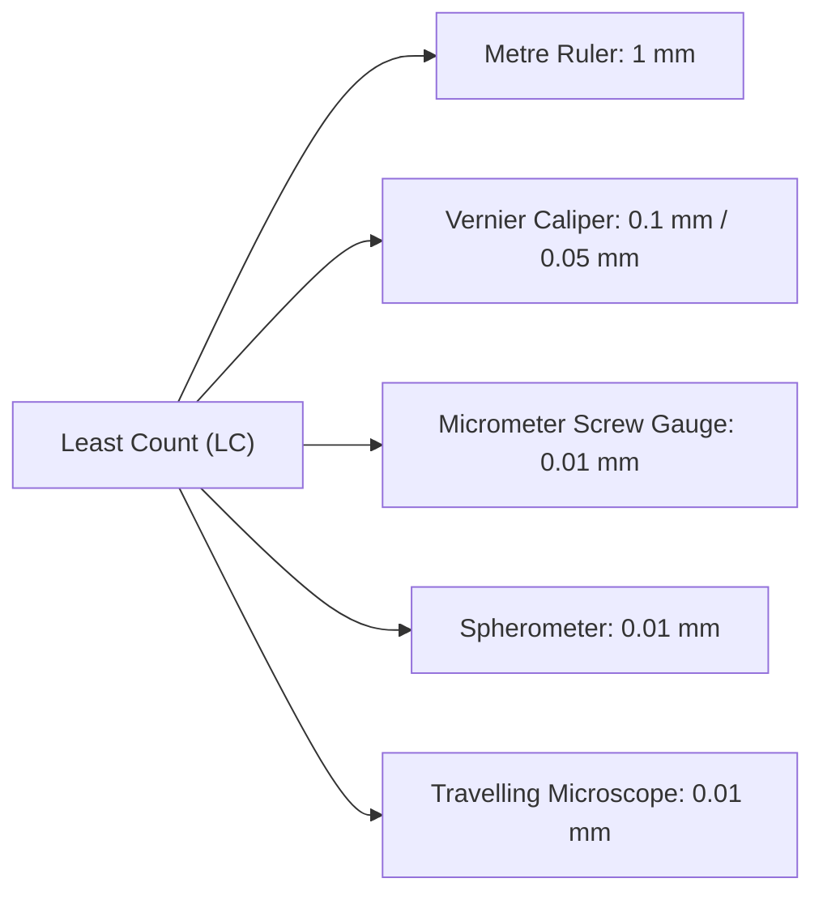

# :LiRuler: Subtopic: Errors & Measuring Instruments Guide

> [!ABSTRACT] Core Focus
> Detailed practical reference for Sri Lankan GCE A/L Physics laboratory work: Systematic vs. random errors, Least Count derivations, positive & negative zero error corrections, backlash errors, error propagation calculus, and procedural steps for Vernier Caliper, Micrometer Screw Gauge, Spherometer, and Travelling Microscope.

---

## 1. Principles of Precision Measurement

### Least Count (LC)
The **Least Count** of an instrument is the smallest physical magnitude that can be directly measured or resolved on its calibrated scale.

---

## 2. Vernier Caliper Laboratory Guide

### Mathematical Principle:
A Vernier scale has $n$ divisions that span the exact length of $(n-1)$ main scale divisions:
$$n \cdot \text{VSD} = (n - 1) \cdot \text{MSD}$$
$$1 \cdot \text{VSD} = \left(\frac{n - 1}{n}\right) \text{MSD}$$

$$\text{Least Count (LC)} = 1\text{ MSD} - 1\text{ VSD} = 1\text{ MSD} - \left(\frac{n-1}{n}\right)\text{MSD} = \frac{1\text{ MSD}}{n}$$

- **Standard Metric Caliper**: $1\text{ MSD} = 1\text{ mm}$, $n = 10 \implies \text{LC} = \frac{1\text{ mm}}{10} = 0.1\text{ mm}$.
- **High-Precision Caliper**: $1\text{ MSD} = 1\text{ mm}$, $n = 20 \implies \text{LC} = \frac{1\text{ mm}}{20} = 0.05\text{ mm}$.
- **Ultra-Fine Caliper**: $1\text{ MSD} = 1\text{ mm}$, $n = 50 \implies \text{LC} = \frac{1\text{ mm}}{50} = 0.02\text{ mm}$.

### Reading Formula:
$$\text{Observed Reading} = \text{MSR} + (\text{Coinciding Vernier Division } k \times \text{LC})$$

### Zero Errors & Step-by-Step Corrections:
1. **Positive Zero Error ($+e$)**:
   - *Condition*: When jaws are closed without specimen, Vernier zero lies to the **right** of the main scale zero mark.
   - *Identification*: Find the $k^{\text{th}}$ vernier division that aligns perfectly with a main scale line.
   - *Error Magnitude*: $+e = + (k \times \text{LC})$.
   - *Correction*: $\text{Corrected Reading} = \text{Observed Reading} - e$.
2. **Negative Zero Error ($-e$)**:
   - *Condition*: When jaws are closed, Vernier zero lies to the **left** of the main scale zero mark.
   - *Identification*: Find the coinciding vernier division $k$ (counting from 0 to $n$).
   - *Error Magnitude*: $-e = - (n - k) \times \text{LC}$.
   - *Correction*: $\text{Corrected Reading} = \text{Observed Reading} - (-e) = \text{Observed Reading} + e$.

### Core A/L Laboratory Practicals:
- **Hollow Cylinder Density**:
  - External diameter ($D$): Measured across perpendicular diameters at top, middle, and bottom using external jaws.
  - Internal diameter ($d$): Measured across orthogonal orientations using internal jaws.
  - Depth / Height ($h$): Measured using sliding depth probe resting vertically against inner base.
  - Volume: $V = \frac{\pi}{4}(D^2 - d^2)h$.

---

## 3. Micrometer Screw Gauge Laboratory Guide

### Mathematical Principle:
Operates on the screw-and-nut pitch principle:
$$\text{Pitch} = \frac{\text{Linear distance advanced on sleeve}}{\text{Number of complete rotations of thimble}}$$
$$\text{Least Count (LC)} = \frac{\text{Pitch}}{\text{Total number of circular / head scale divisions (HSD)}}$$

$$\text{Observed Reading} = \text{Linear Main Scale Reading} + (\text{Coinciding Circular Division } p \times \text{LC})$$

### Zero Errors:
When spindle and anvil touch via the ratchet:
- **Positive Zero Error**: Circular scale zero is **below** the sleeve index line $\implies +e = +(p \times \text{LC})$.
- **Negative Zero Error**: Circular scale zero is **above** the sleeve index line $\implies -e = -(N - p) \times \text{LC}$ (where $N = 50$ or $100$).

### Key Procedural Precautions:
- **Use the Ratchet Knob**: Always rotate the screw using the ratchet knob until it slips with clicks. This prevents specimen deformation and guarantees uniform contact pressure.
- **Backlash Error**: Mechanical play due to screw thread clearance. Eliminate by always rotating the spindle in the **same forward direction** when reaching the specimen surface.

---

## 4. Spherometer Laboratory Guide

### Radius of Curvature Formula:
A spherometer measures the sagitta height $h$ of a spherical surface supported on an equilateral triangle of side $a$:
$$R = \frac{a^2}{6h} + \frac{h}{2}$$

### Practical Procedure:
1. **Determine Plane Zero ($h_0$)**: Place spherometer on an optically flat glass plate. Rotate central screw downward until all four points touch simultaneously (verified using paper-strip friction test). Record scale reading $h_0$.
2. **Determine Surface Reading ($h_1$)**: Place on curved lens/mirror surface. Rotate central screw until contact is achieved. Record reading $h_1$.
3. **Calculate Sagitta ($h$)**: $h = |h_1 - h_0|$.
4. **Leg Separation ($a$)**: Press the spherometer legs onto plain paper to produce 3 indentations. Measure distances $a_1, a_2, a_3$ with a millimeter ruler:
   $$a = \frac{a_1 + a_2 + a_3}{3}$$

---

## 5. Travelling Microscope Laboratory Guide

### Setup & Handling:
- Consists of a compound microscope sliding on horizontal and vertical tracks fitted with millimeter scales and Vernier scales ($\text{LC} = 0.01\text{ mm}$).
- **Key Advantage**: Measures internal dimensions or fragile specimens contact-free.
- **Operation**:
  - Focus eyepiece onto crosswires.
  - Focus objective onto specimen boundary without parallax.
  - Move crosswire unidirectionally from one edge to the opposite edge to measure diameter $d = |x_2 - x_1|$, avoiding screw backlash.

---

## 6. Error Propagation Formula Summary

| Operation | Equation | Maximum Absolute Error ($\Delta Z$) | Maximum Fractional Error ($\frac{\Delta Z}{Z}$) |
| :--- | :--- | :--- | :--- |
| **Sum** | $Z = A + B$ | $\Delta Z = \Delta A + \Delta B$ | $\frac{\Delta Z}{Z} = \frac{\Delta A + \Delta B}{A + B}$ |
| **Difference** | $Z = A - B$ | $\Delta Z = \Delta A + \Delta B$ | $\frac{\Delta Z}{Z} = \frac{\Delta A + \Delta B}{A - B}$ |
| **Product** | $Z = A \cdot B$ | $\Delta Z = B \Delta A + A \Delta B$ | $\frac{\Delta Z}{Z} = \frac{\Delta A}{A} + \frac{\Delta B}{B}$ |
| **Quotient** | $Z = \frac{A}{B}$ | $\Delta Z = Z \left(\frac{\Delta A}{A} + \frac{\Delta B}{B}\right)$ | $\frac{\Delta Z}{Z} = \frac{\Delta A}{A} + \frac{\Delta B}{B}$ |
| **General Power** | $Z = \frac{A^p B^q}{C^r}$ | $\Delta Z = Z \left(p \frac{\Delta A}{A} + q \frac{\Delta B}{B} + r \frac{\Delta C}{C}\right)$ | $\frac{\Delta Z}{Z} = p \frac{\Delta A}{A} + q \frac{\Delta B}{B} + r \frac{\Delta C}{C}$ |

> [!TIP] Minimizing Experimental Uncertainty
> In any calculation $Z = A^p B^q / C^r$, the quantity with the **highest exponent** contributes the greatest relative uncertainty. In experimental design, the instrument with the highest sensitivity (lowest least count) must always be allocated to measuring that parameter.

---

## :LiRocket: Flashcards (Spaced Repetition)

#flashcards

How is the Least Count of a Vernier Caliper derived from scale divisions? :: $\text{LC} = 1\text{ MSD} - 1\text{ VSD} = \frac{1\text{ MSD}}{n}$ (where $n$ is total vernier divisions spanning $n-1$ MSD).

What is the Least Count of a Vernier caliper where 20 vernier divisions equal 19 main scale millimeter divisions? :: $\text{LC} = \frac{1\text{ mm}}{20} = 0.05\text{ mm}$.

How is a positive zero error identified and corrected on a Vernier caliper? :: Vernier zero lies to the right of main scale zero; error is $+k \times \text{LC}$; corrected reading is $\text{Observed} - \text{Zero Error}$.

How is a negative zero error calculated on a Vernier caliper with $n$ divisions and coinciding division $k$? :: $\text{Zero Error} = -(n - k) \times \text{LC}$.

How is pitch defined for a micrometer screw gauge? :: The linear distance moved by the spindle on the main scale per one complete revolution of the thimble.

What is the formula for the Least Count of a micrometer screw gauge? :: $\text{LC} = \frac{\text{Pitch}}{\text{Total Head Scale Divisions (HSD)}}$.

Why must a micrometer screw gauge be tightened using the ratchet instead of the thimble? :: The ratchet mechanism slips when proper pressure is reached, ensuring uniform contact pressure and preventing deformation of the object or damage to the screw threads.

What is backlash error in screw-based instruments and how is it prevented? :: Play/looseness between screw threads and nut due to wear; avoided by always rotating the screw in the same forward direction when taking a measurement.

In the spherometer formula $R = \frac{a^2}{6h} + \frac{h}{2}$, what do symbols $a$ and $h$ represent? :: $a$ is the average distance between the three outer fixed legs; $h$ is the vertical displacement (sagitta) of the central screw relative to a flat plane.

How is the zero reading $h_0$ of a spherometer verified on a flat glass plate? :: The central screw is adjusted until all four points touch simultaneously, verified when a thin paper strip placed under any leg offers resistance or the instrument just begins to rock.

What is the primary advantage of using a travelling microscope over mechanical calipers? :: It allows contact-free, non-destructive measurement of fragile, internal, or liquid surfaces (such as capillary tube bore and liquid menisci).

In the calculation $Z = \frac{A^2 B}{C^3}$, which variable's measurement contributes the largest percentage error? :: Variable $C$, because its percentage uncertainty is multiplied by its exponent $3$ ($\% \Delta Z = 2\% \Delta A + \% \Delta B + 3\% \Delta C$).
