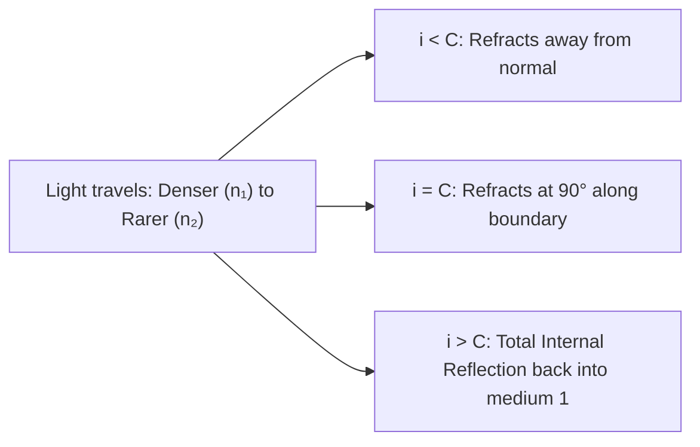
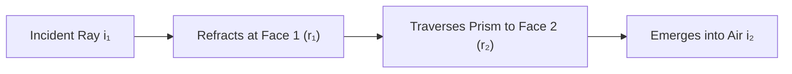

# :LiGlasses: Subtopic: Geometrical Optics & Optical Instruments Guide

> [!ABSTRACT] Core Focus
> Comprehensive analytical reference for Geometrical Optics in Sri Lankan GCE A/L Physics: Laws of refraction, Snell's law, Total Internal Reflection, prism minimum deviation derivation, thin lens formulas and lens maker's equation, human eye defects and corrections, and ray diagrams, magnification derivations, and tube lengths for compound microscopes and astronomical telescopes.

---

## 1. Refraction, Snell's Law & Total Internal Reflection

### Laws of Refraction:
1. The incident ray, the refracted ray, and the normal to the interface at the point of incidence all lie in the **same plane**.
2. **Snell's Law**: For light passing from medium 1 into medium 2:
   $$\frac{\sin i}{\sin r} = {_1n_2} = \frac{n_2}{n_1} = \frac{v_1}{v_2} = \frac{\lambda_1}{\lambda_2}$$
   *(where frequency $f$ remains strictly constant across all media).*

### Real & Apparent Depth:
Looking normally from a rarer medium into a denser medium of refractive index $n$ and true depth $d$:
$$n = \frac{\text{Real Depth } (d)}{\text{Apparent Depth } (d')} \implies d' = \frac{d}{n}$$
$$\text{Normal Shift } s = d - d' = d\left(1 - \frac{1}{n}\right)$$

---

### Total Internal Reflection (TIR):
Occurs when:
1. Light travels from an optically **denser medium to a rarer medium** ($n_1 > n_2$).
2. The angle of incidence exceeds the **Critical Angle ($C$)**.

$$\frac{\sin C}{\sin 90^\circ} = \frac{n_2}{n_1} \implies \sin C = \frac{n_2}{n_1} = \frac{1}{n}$$
*(For glass-to-air, $n \approx 1.5 \implies C \approx 41.8^\circ$; for water-to-air, $n \approx 1.33 \implies C \approx 48.6^\circ$).*

- **Applications**:
  - Optical fibers: Core of high refractive index ($n_1$) surrounded by cladding of lower refractive index ($n_2 < n_1$).
  - Totally reflecting right-angled isosceles prisms ($45^\circ - 90^\circ - 45^\circ$) in periscopes and binoculars (deviation by $90^\circ$ or $180^\circ$).

---

## 2. Refraction Through Prisms & Minimum Deviation

Consider a triangular glass prism of apex angle $A$ and refractive index $n$:

### Geometric Relations:
1. **Refracting Angle of Prism**:
   $$r_1 + r_2 = A$$
2. **Total Angle of Deviation ($D$)**:
   $$D = (i_1 - r_1) + (i_2 - r_2) = (i_1 + i_2) - (r_1 + r_2) \implies D = i_1 + i_2 - A$$

---

### Condition for Minimum Deviation ($D = D_m$):
The deviation graph ($D$ vs. $i_1$) exhibits a distinct minimum where the ray passes **symmetrically through the prism**:
$$i_1 = i_2 = i, \quad r_1 = r_2 = r$$
From $r_1 + r_2 = A \implies 2r = A \implies r = \frac{A}{2}$.
From $D_m = 2i - A \implies 2i = A + D_m \implies i = \frac{A + D_m}{2}$.

Applying Snell's Law at the first interface:
$$n = \frac{\sin i}{\sin r} = \frac{\sin\left(\frac{A + D_m}{2}\right)}{\sin\left(\frac{A}{2}\right)}$$

> [!NOTE] Small Angle (Thin) Prism Approximation
> For a thin prism ($A \le 10^\circ$), using small-angle approximations $\sin\theta \approx \theta$:
> $$n \approx \frac{\frac{A + D}{2}}{\frac{A}{2}} = \frac{A + D}{A} = 1 + \frac{D}{A} \implies D = (n - 1)A$$

---

## 3. Thin Lenses, Lens Maker's Equation & Eye Defects

### Lens Formulas (Cartesian Sign Convention):
- Distances measured in the direction of incident light are positive; opposite are negative.
- Focal length $f$ is **positive for converging (convex)** lenses and **negative for diverging (concave)** lenses.

$$\frac{1}{v} - \frac{1}{u} = \frac{1}{f}$$
$$\text{Linear Magnification } m = \frac{h_i}{h_o} = \frac{v}{u}$$
$$\text{Power of a Lens } P = \frac{1}{f\text{ (in metres)}} \quad (\text{Units: Dioptres, }\text{D})$$

### The Lens Maker's Formula:
$$\frac{1}{f} = (n - 1)\left(\frac{1}{R_1} - \frac{1}{R_2}\right)$$
*(where $R_1$ is the radius of curvature of the first refracting surface and $R_2$ is of the second).*

---

### Defects of Human Vision & Optical Correction:

| Vision Defect | Anatomical Cause | Image Location | Corrective Lens Required | Focal Length Calculation |
| :--- | :--- | :--- | :--- | :--- |
| **Myopia (Short-sightedness)** | Eyeball too elongated or lens too curved; far point is at finite distance $d < \infty$. | Forms **in front of retina** for distant objects. | **Concave (Diverging) Lens** | Forms virtual image of $\infty$ at far point: $f = -d$. |
| **Hypermetropia (Long-sightedness)** | Eyeball too short or lens too flat; near point recedes beyond $25\text{ cm}$ ($d_N > 25\text{ cm}$). | Forms **behind retina** for near objects. | **Convex (Converging) Lens** | Forms virtual image of object at $25\text{ cm}$ at near point $d_N$: $\frac{1}{-d_N} - \frac{1}{-25} = \frac{1}{f}$. |
| **Presbyopia** | Loss of ciliary muscle elasticity due to aging. | Receded near point and reduced accommodation. | **Bifocal Lenses** | Upper segment concave for distant vision; lower segment convex for reading. |
| **Astigmatism** | Non-spherical cornea curvature in perpendicular planes. | Focuses horizontal and vertical rays at different depths. | **Cylindrical Lenses** | Lens with different curvatures in perpendicular meridians. |

---

## 4. Optical Instruments: Microscopes & Telescopes

### Visual Angle & Angular Magnification (Magnifying Power $M$):
$$M = \frac{\beta}{\alpha} = \frac{\text{Angle subtended at eye by image through instrument}}{\text{Angle subtended at unaided eye by object placed at near point } D (25\text{ cm})}$$

---

### A. Simple Microscope (Magnifying Glass):
A single converging lens of short focal length $f$:
1. **Normal Adjustment (Image formed at infinity $\infty$, relaxed eye)**:
   $$M = \frac{D}{f}$$
2. **Maximum Magnification (Image formed at near point $D = 25\text{ cm}$)**:
   $$M = 1 + \frac{D}{f}$$

---

### B. The Compound Microscope:
Consists of two convex lenses:
1. **Objective Lens**: Very short focal length $f_o$ and small aperture; object placed just beyond focal point ($u_o > f_o$) to produce a real, inverted, highly magnified intermediate image.
2. **Eyepiece Lens**: Short focal length $f_e$ (with $f_e > f_o$) and larger aperture; positioned so intermediate image falls within its focal length, acting as a simple magnifier.

#### Magnification Formulas:
- **Image at Near Point ($D = 25\text{ cm}$)**:
  $$M = m_{\text{objective}} \times m_{\text{eyepiece}} = \left(\frac{v_o}{u_o}\right)\left(1 + \frac{D}{f_e}\right)$$
  $$\text{Separation between lenses (Tube Length) } L = v_o + u_e$$
- **Normal Adjustment (Final image at $\infty$, relaxed eye)**:
  $$M = \left(\frac{v_o}{u_o}\right)\left(\frac{D}{f_e}\right) \approx \left(\frac{L}{f_o}\right)\left(\frac{D}{f_e}\right)$$
  $$\text{Tube Length } L = v_o + f_e$$

---

### C. The Astronomical Refracting Telescope:
Used to observe distant celestial objects ($u_o \approx \infty$):
1. **Objective Lens**: Large focal length $f_o$ and large aperture (to collect maximum light flux from dim stars); forms a real, inverted intermediate image at its focal plane.
2. **Eyepiece Lens**: Short focal length $f_e$ and smaller aperture; magnifies the intermediate image.

#### Magnification Formulas:
- **Normal Adjustment (Final image at infinity $\infty$, relaxed eye)**:
  $$M = \frac{f_o}{f_e}$$
  $$\text{Length of Telescope Tube } L = f_o + f_e$$
- **Final Image at Near Point ($D = 25\text{ cm}$)**:
  $$M = \frac{f_o}{f_e}\left(1 + \frac{f_e}{D}\right)$$
  $$\text{Tube Length } L = f_o + u_e = f_o + \frac{f_e D}{f_e + D}$$

---

## :LiRocket: Flashcards (Spaced Repetition)

#flashcards

State Snell's Law of Refraction. :: $\frac{\sin i}{\sin r} = \frac{n_2}{n_1} = \frac{v_1}{v_2} = \frac{\lambda_1}{\lambda_2}$ (where light travels from medium 1 into medium 2).

What happens to the frequency, speed, and wavelength of light when it passes from air into glass? :: Frequency remains constant; Speed decreases ($v = c/n$); Wavelength decreases proportionally ($\lambda = \lambda_0/n$).

State the two conditions necessary for Total Internal Reflection to occur. :: 1. Light must travel from an optically denser medium into a rarer medium; 2. Angle of incidence must exceed the critical angle ($i > C$).

What is the relationship between refractive index $n$ and critical angle $C$ for a medium bounded by air? :: $\sin C = \frac{1}{n}$.

In a triangular prism of angle $A$, what is the relation between inner refraction angles $r_1, r_2$? :: $r_1 + r_2 = A$.

What is the prism minimum deviation formula for refractive index $n$? :: $n = \frac{\sin\left(\frac{A + D_m}{2}\right)}{\sin\left(\frac{A}{2}\right)}$.

State the angle of deviation $D$ produced by a thin prism of angle $A$ and refractive index $n$. :: $D = (n - 1)A$.

State the Lens Maker's Formula. :: $\frac{1}{f} = (n - 1)\left(\frac{1}{R_1} - \frac{1}{R_2}\right)$.

What type of lens is used to correct Myopia (short-sightedness) and where was the uncorrected image forming? :: A concave (diverging) lens; uncorrected image was forming in front of the retina.

What type of lens is used to correct Hypermetropia (long-sightedness) and where was the uncorrected image forming? :: A convex (converging) lens; uncorrected image was forming behind the retina.

What are the design characteristics of the objective and eyepiece lenses in a compound microscope? :: Objective has very short focal length $f_o$ and small aperture; Eyepiece has short focal length $f_e$ (with $f_e > f_o$) and larger aperture.

State the magnifying power $M$ and tube length $L$ of an astronomical telescope in normal adjustment. :: $M = \frac{f_o}{f_e}$ and tube length $L = f_o + f_e$.
