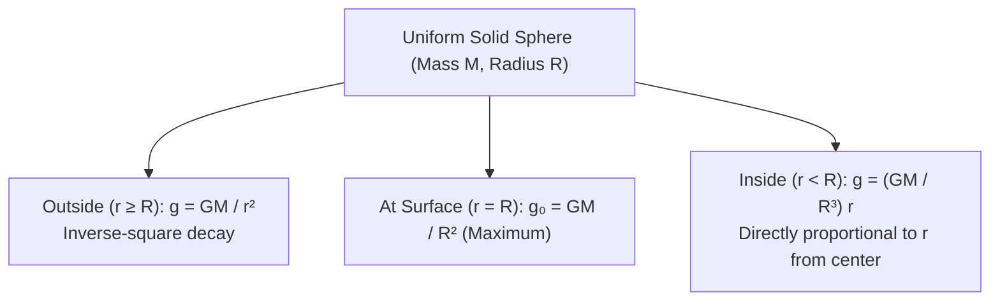
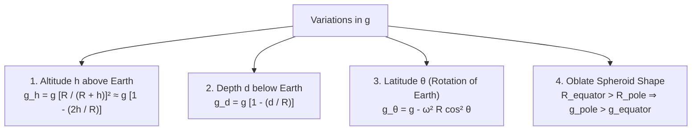
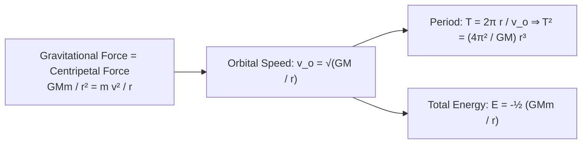

# 🪐 Subtopic: Gravitational Field & Satellite Dynamics Guide

> [!ABSTRACT] Core Focus
> Advanced analytical guide for Gravitational Fields in Sri Lankan GCE A/L Physics: Newton's law of universal gravitation, gravitational field intensity ($g$) and potential ($V$) inside and outside spherical masses, neutral points, altitude, depth, and latitude variations of $g$, circular orbital mechanics, Kepler's Third Law, bound state mechanical energy ($E = -E_k = \frac{1}{2}E_p$), geostationary orbit parameters, and escape velocity derivations.

---

## 1. Gravitational Field Intensity & Potential Derivations

### Newton's Law of Universal Gravitation:
Every particle in the universe attracts every other particle with a force proportional to the product of their masses and inversely proportional to the square of the distance between them:
$$F = G \frac{M m}{r^2} \quad (G = 6.674 \times 10^{-11}\text{ N}\cdot\text{m}^2\cdot\text{kg}^{-2})$$

---

### Gravitational Field Intensity ($g$):
Defined as the gravitational force exerted per unit test mass placed at that point:
$$\vec{g} = \frac{\vec{F}}{m} \quad ([\mathsf{L}\mathsf{T}^{-2}], \text{N}\cdot\text{kg}^{-1} \text{ or } \text{m}\cdot\text{s}^{-2})$$

#### Field Inside a Uniform Solid Sphere ($r < R$):
By Gauss's gravitational law / shell theorem, only the mass enclosed within radius $r$ exerts a net gravitational force:
$$M_{\text{enclosed}} = \frac{4}{3}\pi r^3 \rho = \frac{4}{3}\pi r^3 \left(\frac{M}{\frac{4}{3}\pi R^3}\right) = M\left(\frac{r^3}{R^3}\right)$$
$$g(r) = \frac{G M_{\text{enclosed}}}{r^2} = \frac{G M (r^3 / R^3)}{r^2} = \left(\frac{GM}{R^3}\right) r = g_0\left(\frac{r}{R}\right)$$
*(At the center $r = 0$, $g = 0$; increases linearly to $g_0$ at the surface).*

---

### Gravitational Potential ($V$):
Defined as the work done per unit mass by an external agent in bringing a test mass from infinity to the given point:
$$V(r) = -\int_\infty^r g dr = -\int_\infty^r \frac{GM}{r^2} dr = \left[\frac{GM}{r}\right]_\infty^r = -\frac{GM}{r}$$
*(Potential is strictly negative because gravitational force is attractive; $V = 0$ at $r = \infty$).*

- **Potential Gradient Relation**:
  $$g = -\frac{dV}{dr}$$
- **Potential Energy ($U$)**:
  $$U = m V = -\frac{GMm}{r}$$
- **Inside a Solid Sphere ($r \le R$)**:
  $$V(r) = -\frac{GM}{2R^3}(3R^2 - r^2)$$
  *(At the center $r = 0$: $V_{\text{center}} = -\frac{3GM}{2R} = 1.5 V_{\text{surface}}$).*

---

### Neutral Points (Zero Field):
Between two masses $M_1$ and $M_2$ separated by distance $D$:
$$\frac{GM_1}{x^2} = \frac{GM_2}{(D - x)^2} \implies \frac{\sqrt{M_1}}{x} = \frac{\sqrt{M_2}}{D - x} \implies x = \frac{D \sqrt{M_1}}{\sqrt{M_1} + \sqrt{M_2}}$$

---

## 2. Variations in Earth's Acceleration Due to Gravity

1. **Altitude ($h$)**:
   $$g_h = \frac{GM}{(R + h)^2} = g\left(1 + \frac{h}{R}\right)^{-2} \approx g\left(1 - \frac{2h}{R}\right) \quad (\text{for } h \ll R)$$
2. **Depth ($d$)**:
   $$g_d = g\left(1 - \frac{d}{R}\right)$$
   *(Note: The rate of decrease of $g$ with altitude is **twice** as fast as with depth: $\Delta g_h \approx 2 \Delta g_d$).*
3. **Latitude ($\theta$)**:
   Due to Earth's daily rotation with angular speed $\omega = \frac{2\pi}{86400}\text{ rad/s}$:
   $$g_\theta = g - \omega^2 R \cos^2\theta$$
   - At Equator ($\theta = 0^\circ$): $g_{\text{eq}} = g - \omega^2 R \approx 9.78\text{ m}\;\text{s}^{-2}$.
   - At Poles ($\theta = 90^\circ$): $g_{\text{pole}} = g \approx 9.83\text{ m}\;\text{s}^{-2}$.

---

## 3. Satellite Orbits & Kepler's Laws

For a satellite of mass $m$ orbiting a central mass $M$ in a stable circular orbit of radius $r$:

### Orbital Mechanics Formulas:
1. **Orbital Speed ($v_o$)**:
   $$\frac{m v_o^2}{r} = \frac{GMm}{r^2} \implies v_o = \sqrt{\frac{GM}{r}} = \sqrt{\frac{GM}{R + h}}$$
   *(Speed is inversely proportional to $\sqrt{r}$; closer satellites orbit faster).*
2. **Orbital Period & Kepler's Third Law**:
   $$T = \frac{2\pi r}{v_o} = \frac{2\pi r}{\sqrt{GM / r}} \implies T^2 = \left(\frac{4\pi^2}{GM}\right) r^3$$
3. **Satellite Mechanical Energy**:
   - Kinetic Energy: $E_k = \frac{1}{2}m v_o^2 = \frac{GMm}{2r}$.
   - Potential Energy: $E_p = -\frac{GMm}{r}$.
   - **Total Mechanical Energy**:
     $$E = E_k + E_p = \frac{GMm}{2r} - \frac{GMm}{r} = -\frac{GMm}{2r}$$
   - Energy Relations:
     $$E = -E_k = \frac{1}{2}E_p$$
   - **Binding Energy**: Energy required to launch satellite into deep space $= -E = +\frac{GMm}{2r}$.

---

## 4. Geostationary vs. Polar Satellites

| Parameter | Geostationary (Synchronous) Satellite | Polar Orbiting Satellite |
| :--- | :--- | :--- |
| **Orbital Plane** | Equatorial Plane ($\text{inclination } 0^\circ$) | Passes over North and South Poles ($\text{inclination } 90^\circ$) |
| **Sense of Rotation** | West to East (same as Earth) | North to South |
| **Orbital Period ($T$)** | Exactly $24\text{ hours}$ ($86,400\text{ s}$) | $\approx 90 - 100\text{ minutes}$ |
| **Orbital Radius ($r$)** | $r \approx 42,200\text{ km}$ ($h \approx 35,800\text{ km}$) | $r \approx 7,000\text{ km}$ ($h \approx 500 - 800\text{ km}$) |
| **Relative Motion** | **Stationary** relative to ground observer | Sweeps over entire Earth as planet rotates beneath |
| **Primary Uses** | Global telecommunication, TV broadcasting, synoptic weather | High-resolution Earth imaging, meteorology, military surveillance |

---

## 5. Escape Velocity ($v_e$)

The minimum projection speed required from the surface of a body to escape its gravitational pull to infinity:
$$E_{\text{surface}} = \frac{1}{2}m v_e^2 - \frac{GMm}{R} = E_\infty = 0$$
$$v_e = \sqrt{\frac{2GM}{R}} = \sqrt{2gR} = \sqrt{2} v_{\text{orbital, surface}}$$

- **Earth Escape Velocity**:
  $$v_e = \sqrt{2 \times (9.8\text{ m/s}^2) \times (6.4 \times 10^6\text{ m})} \approx 11.2\text{ km}\;\text{s}^{-1}$$
- **Planetary Atmosphere Retention**:
  - For Moon: $g_{\text{moon}} \approx 1.6\text{ m/s}^2, R_{\text{moon}} \approx 1.74 \times 10^6\text{ m} \implies v_{e,\text{moon}} \approx 2.38\text{ km/s}$.
  - At daytime temperatures ($T \approx 400\text{ K}$), RMS speeds of gas molecules ($O_2, N_2, H_2O$) are comparable to or exceed $v_{e,\text{moon}}$, causing gases to escape into space. Hence, **the Moon cannot retain an atmosphere**.

---

## :LiRocket: Flashcards (Spaced Repetition)

#flashcards

State Newton's Law of Universal Gravitation. :: $F = G \frac{m_1 m_2}{r^2}$ (where $G = 6.674 \times 10^{-11}\text{ N}\cdot\text{m}^2\cdot\text{kg}^{-2}$).

Define Gravitational Field Intensity ($g$). :: The gravitational force exerted per unit mass placed at that point in the field ($\vec{g} = \vec{F}/m$).

How does gravitational field intensity $g$ vary with distance $r$ inside a uniform solid sphere of radius $R$? :: It increases linearly from zero at the center to maximum at the surface: $g(r) = \left(\frac{GM}{R^3}\right)r = g_0\left(\frac{r}{R}\right)$.

Define Gravitational Potential ($V$) at a point. :: The work done per unit mass by an external force in bringing a test mass from infinity to that point without acceleration ($V = -\frac{GM}{r}$).

Why is gravitational potential always negative? :: Gravitational attraction does positive work as a mass approaches from infinity; since potential at infinity is defined as zero, potential anywhere in the field must be negative.

How are gravitational field intensity and gravitational potential related? :: $g = -\frac{dV}{dr}$ (field intensity equals the negative potential gradient).

State the formula for acceleration due to gravity $g_h$ at an altitude $h \ll R$ above Earth's surface. :: $g_h \approx g\left(1 - \frac{2h}{R}\right)$.

State the formula for acceleration due to gravity $g_d$ at depth $d$ below Earth's surface. :: $g_d = g\left(1 - \frac{d}{R}\right)$.

State Kepler's Third Law of Planetary Motion. :: The square of the orbital period $T$ of a satellite is directly proportional to the cube of its orbital radius $r$ ($T^2 = \frac{4\pi^2}{GM}r^3$).

State the relationships between Total Energy $E$, Kinetic Energy $E_k$, and Potential Energy $E_p$ of an orbiting satellite. :: $E = -E_k = \frac{1}{2}E_p = -\frac{GMm}{2r}$.

What are the three essential orbital conditions for a satellite to be Geostationary? :: 1. Orbit lies in the equatorial plane; 2. Rotates West to East; 3. Orbital period is exactly 24 hours ($T = 86,400\text{ s}$, altitude $\approx 35,800\text{ km}$).

State the formula for Escape Velocity $v_e$ from the surface of Earth. :: $v_e = \sqrt{\frac{2GM}{R}} = \sqrt{2gR} \approx 11.2\text{ km}\;\text{s}^{-1}$.
