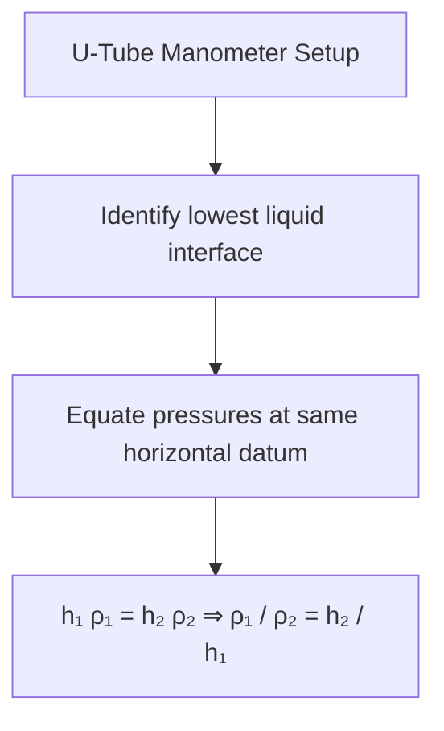
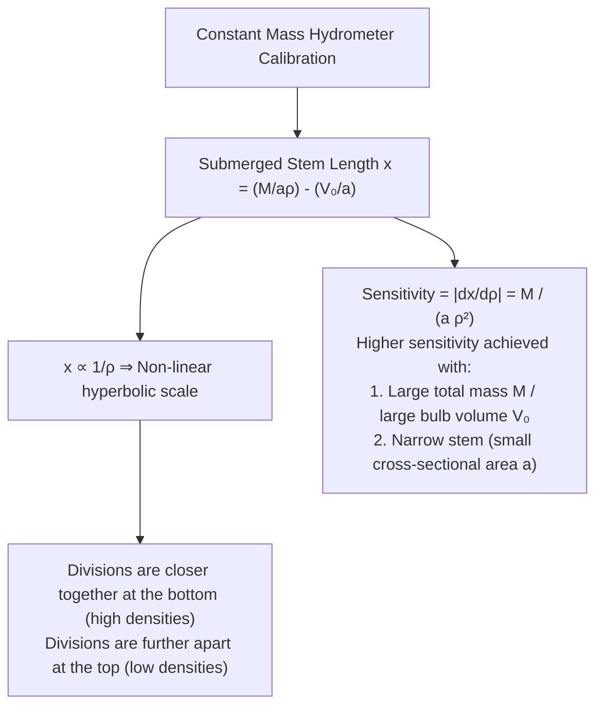

# :LiDroplet: Subtopic: Hydrostatics & Fluid Dynamics Guide

> [!ABSTRACT] Core Focus
> Advanced analytical guide for Fluid Mechanics in Sri Lankan GCE A/L Physics: Hydrostatic pressure at depth, thrust on planar surfaces, Hare's apparatus and U-tube experimental methodology, hydraulic machines, Archimedes' principle and flotation, hydrometer sensitivity and non-linear calibration derivations, streamline flow, equation of continuity, Bernoulli's equation, and real-world hydrodynamic applications.

---

## 1. Hydrostatic Pressure & Thrust

### Fundamental Laws of Fluid Pressure:
1. Liquid pressure at depth $h$ in a static homogeneous fluid of density $\rho$:
   $$P_{\text{gauge}} = h\rho g$$
   $$P_{\text{total}} = P_{\text{atm}} + h\rho g$$
2. **Key Physical Characteristics**:
   - Pressure at any point in a fluid acts **equally in all directions**.
   - Pressure is strictly **perpendicular** to any submerged or bounding surface.
   - All points at the same horizontal level in a continuous, connected static fluid of the same density have the **identical pressure**.
   - **Hydrostatic Paradox**: Pressure depends only on depth $h$, density $\rho$, and $g$, completely independent of the shape, volume, or total weight of liquid in the container.

---

## 2. Experimental Measurement of Liquid Densities

### A. The U-Tube Manometer:
For two immiscible liquids in static equilibrium:
- Locate the horizontal interface dividing the two liquids.
- Equate pressures at that horizontal reference level:
  $$P_{\text{atm}} + h_1 \rho_1 g = P_{\text{atm}} + h_2 \rho_2 g \implies h_1 \rho_1 = h_2 \rho_2 \implies \frac{\rho_1}{\rho_2} = \frac{h_2}{h_1}$$

---

### B. Hare's Apparatus (A/L Core Practical):
Used to compare densities of two miscible or immiscible liquids using atmospheric suction:
- Two vertical glass limbs dip into two separate beakers containing liquids of densities $\rho_1$ and $\rho_2$.
- Suction via rubber tubing lowers pressure inside the inverted tube to $P_0 < P_{\text{atm}}$.
- At the open liquid surfaces in the beakers:
  $$P_{\text{atm}} = P_0 + h_1 \rho_1 g = P_0 + h_2 \rho_2 g$$
  $$h_1 \rho_1 g = h_2 \rho_2 g \implies \frac{h_1}{h_2} = \frac{\rho_2}{\rho_1}$$

#### Why Use the Graphical Method ($h_1$ vs. $h_2$)?
If readings are measured from the beaker rim or if meniscus zero error exists ($c_1, c_2$):
$$h_1 = \left(\frac{\rho_2}{\rho_1}\right) h_2 + c$$
Plotting $h_1$ on the vertical axis against $h_2$ on the horizontal axis yields a straight line:
$$\text{Gradient } m = \frac{\rho_2}{\rho_1} \implies \rho_1 = \frac{\rho_2}{m}$$
- **Advantages**: Eliminates end errors and meniscus reading errors, averages out random errors across multiple suction heights.

---

## 3. Archimedes' Principle, Flotation & Hydrometers

### Upthrust ($U$) & Apparent Weight:
$$\text{Upthrust } U = \text{Weight of displaced fluid} = V_{\text{submerged}} \cdot \rho_{\text{fluid}} \cdot g$$
For an object of true weight $W = V \rho_{\text{solid}} g$ completely immersed in liquid of density $\rho_l$:
$$\text{Apparent Weight } W_{\text{app}} = W - U = V \rho_s g - V \rho_l g = W\left(1 - \frac{\rho_l}{\rho_s}\right) = W\left(1 - \frac{1}{\rho_r}\right)$$

---

### Principle of Flotation:
When a body floats in equilibrium in a liquid:
$$\text{Weight of floating body} = \text{Upthrust}$$
$$V_{\text{total}} \cdot \rho_{\text{solid}} \cdot g = V_{\text{submerged}} \cdot \rho_{\text{liquid}} \cdot g$$
$$\frac{V_{\text{submerged}}}{V_{\text{total}}} = \frac{\rho_{\text{solid}}}{\rho_{\text{liquid}}}$$

- **Fraction of volume submerged**: $f_{\text{sub}} = \frac{\rho_s}{\rho_l}$.
- **Fraction of volume exposed**: $f_{\text{exp}} = 1 - \frac{\rho_s}{\rho_l} = \frac{\rho_l - \rho_s}{\rho_l}$.

---

### Hydrometers (Detailed Analytical Theory):

#### 1. Constant Mass Hydrometer:
Consists of a hollow glass body, a bulb weighted with lead shots/mercury, and a uniform narrow cylindrical stem of cross-sectional area $a$.
- Let total mass of hydrometer be $M$ and total volume of lower bulb up to the lowest stem mark be $V_0$.
- When floating in liquid of density $\rho$, let length of stem submerged below the surface be $x$:
  $$M = (V_0 + a x) \rho$$
  $$a x = \frac{M}{\rho} - V_0 \implies x = \frac{M}{a \rho} - \frac{V_0}{a}$$

#### Why are Stem Divisions Unequally Spaced?
Differentiating $x$ with respect to $\rho$:
$$\left|\frac{dx}{d\rho}\right| = \frac{M}{a \rho^2}$$
Because $\left|\frac{dx}{d\rho}\right|$ decreases as $\rho$ increases:
- For equal increments $\Delta\rho$, the change in stem height $\Delta x$ becomes progressively smaller for denser liquids.
- Hence, the graduation marks are **spaced wider at the top** (low densities) and **closer together at the bottom** (high densities).

---

## 4. Fluid Dynamics: Continuity & Bernoulli's Principle

### Assumptions of an Ideal Fluid:
1. **Incompressible**: Constant density ($\rho = \text{constant}$).
2. **Non-viscous**: Zero internal fluid friction (viscosity $\eta = 0$).
3. **Steady (Stationary) Flow**: Velocity vector at any coordinate $(x,y,z)$ is invariant with time ($\frac{\partial\vec{v}}{\partial t} = 0$).
4. **Irrotational Flow**: Zero angular vorticity ($\nabla \times \vec{v} = 0$).

---

### The Equation of Continuity:
Expresses the **Conservation of Mass** in steady streamline flow:
$$\frac{dm}{dt} = \rho_1 A_1 v_1 = \rho_2 A_2 v_2$$
For an incompressible fluid ($\rho_1 = \rho_2 = \rho$):
$$A_1 v_1 = A_2 v_2 = Q \quad (\text{Volume Flow Rate in } \text{m}^3\;\text{s}^{-1})$$
*(Velocity is inversely proportional to cross-sectional area: narrow constriction $\implies$ high velocity).*

---

### Bernoulli's Equation (Derivation via Work-Energy Principle):
Consider fluid element flowing through a pipe from section 1 (area $A_1$, height $h_1$, pressure $P_1$, speed $v_1$) to section 2 (area $A_2$, height $h_2$, pressure $P_2$, speed $v_2$):
1. **Work done on fluid element**:
   $$W_{\text{net}} = W_1 - W_2 = (P_1 A_1)(v_1 \Delta t) - (P_2 A_2)(v_2 \Delta t) = (P_1 - P_2)\Delta V$$
2. **Change in Kinetic Energy**:
   $$\Delta E_k = \frac{1}{2}(\Delta m) v_2^2 - \frac{1}{2}(\Delta m) v_1^2 = \frac{1}{2}\rho \Delta V (v_2^2 - v_1^2)$$
3. **Change in Gravitational Potential Energy**:
   $$\Delta E_p = (\Delta m) g h_2 - (\Delta m) g h_1 = \rho \Delta V g (h_2 - h_1)$$
4. **Equating Work Done to Mechanical Energy Change ($W_{\text{net}} = \Delta E_k + \Delta E_p$)**:
   $$(P_1 - P_2)\Delta V = \frac{1}{2}\rho \Delta V (v_2^2 - v_1^2) + \rho \Delta V g (h_2 - h_1)$$
   $$P_1 + \frac{1}{2}\rho v_1^2 + \rho g h_1 = P_2 + \frac{1}{2}\rho v_2^2 + \rho g h_2$$

$$P + \frac{1}{2}\rho v^2 + \rho g h = \text{constant}$$

---

### Technical Applications of Bernoulli's Theorem:

#### 1. The Venturi Meter:
Measures volume flow rate $Q$ in a pipeline:
- Main pipe area $A_1$, throat constriction area $A_2$ ($A_1 > A_2 \implies v_2 > v_1$).
- Applying Bernoulli's equation horizontally ($h_1 = h_2$):
  $$P_1 - P_2 = \frac{1}{2}\rho(v_2^2 - v_1^2)$$
- From continuity $v_1 = \frac{Q}{A_1}, v_2 = \frac{Q}{A_2}$:
  $$P_1 - P_2 = h \rho_m g = \frac{1}{2}\rho Q^2 \left(\frac{1}{A_2^2} - \frac{1}{A_1^2}\right)$$
  $$Q = A_1 A_2 \sqrt{\frac{2(P_1 - P_2)}{\rho(A_1^2 - A_2^2)}} = A_1 A_2 \sqrt{\frac{2 h \rho_m g}{\rho(A_1^2 - A_2^2)}}$$

#### 2. Torricelli's Law of Efflux:
Discharge speed $v$ from small orifice at depth $h$ below open liquid surface:
$$v = \sqrt{2gh}$$
- If orifice cross-sectional area is $a_0$, volume discharge rate is $Q = a_0 v = a_0 \sqrt{2gh}$.
- Time to completely empty a cylindrical tank of area $A$ from height $H$ to 0:
  $$-A \frac{dh}{dt} = a_0 \sqrt{2gh} \implies t_{\text{empty}} = \frac{A}{a_0}\sqrt{\frac{2H}{g}}$$

#### 3. Pitot Tube:
Measures local flow velocity of a fluid (or airspeed of an aircraft):
- Fluid enters stagnation tube and comes to rest ($v_2 = 0$ at stagnation point).
- $P_1 + \frac{1}{2}\rho v^2 = P_{\text{stagnation}} \implies v = \sqrt{\frac{2(P_{\text{stag}} - P_1)}{\rho}} = \sqrt{\frac{2 h \rho_m g}{\rho}}$.

#### 4. The Siphon:
Draws liquid over an elevation out of a reservoir into a lower container:
- Atmospheric pressure pushes liquid up the short limb.
- **Maximum operating height**: Pressure at highest point of siphon bend cannot drop below vapor pressure of liquid ($\approx 0$):
  $$P_{\text{crest}} = P_{\text{atm}} - h_{\text{max}} \rho g > 0 \implies h_{\text{max}} < \frac{P_{\text{atm}}}{\rho g}$$
  *(For water, $h_{\text{max}} \approx \frac{10^5}{1000 \times 10} = 10\text{ m}$).*
