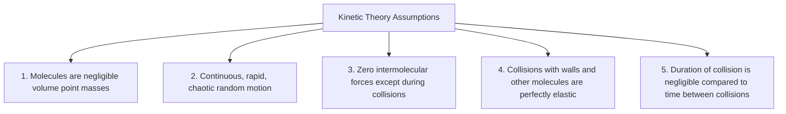
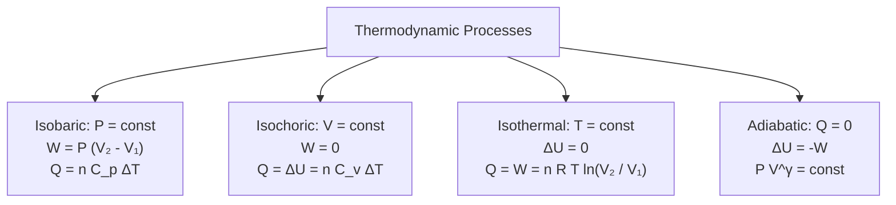

# :LiThermometer: Subtopic: Ideal Gases & Thermodynamics Guide

> [!ABSTRACT] Core Focus
> Advanced analytical guide for Gas Laws, Kinetic Theory, and Thermodynamics in Sri Lankan GCE A/L Physics: Kinetic pressure derivation ($P = \frac{1}{3}\rho\overline{c^2}$), Maxwellian RMS speed, First Law of Thermodynamics, $P-V$ indicator diagrams for isothermal, isobaric, isochoric, and adiabatic processes, Mayer's relation ($C_p - C_v = R$), and adiabatic expansions ($PV^\gamma = \text{const}$).

---

## 1. Gas Laws & Equation of State

### Empirical Gas Laws:
1. **Boyle's Law** ($T = \text{constant}$):
   $$P V = \text{constant} \implies P_1 V_1 = P_2 V_2$$
   - $P$ vs. $V$ graph: Rectangular hyperbola.
   - $P$ vs. $1/V$ graph: Straight line through origin.
   - $PV$ vs. $P$ graph: Horizontal line.
2. **Charles's Law** ($P = \text{constant}$):
   $$\frac{V}{T} = \text{constant} \implies \frac{V_1}{T_1} = \frac{V_2}{T_2}$$
   - Extrapolating $V \rightarrow 0$ intercepts the temperature axis at absolute zero ($-273.15^\circ\text{C} = 0\text{ K}$).
3. **Pressure (Gay-Lussac's) Law** ($V = \text{constant}$):
   $$\frac{P}{T} = \text{constant} \implies \frac{P_1}{T_1} = \frac{P_2}{T_2}$$

### The Ideal Gas Equation:
$$P V = n R T = \left(\frac{m}{M}\right) R T = N k_B T$$
- Universal Gas Constant: $R \approx 8.314\text{ J}\;\text{mol}^{-1}\;\text{K}^{-1}$.
- Boltzmann Constant: $k_B = \frac{R}{N_A} \approx 1.38 \times 10^{-23}\text{ J}\;\text{K}^{-1}$.
- Gas Density: $\rho = \frac{m}{V} = \frac{P M}{R T}$.

---

## 2. Kinetic Theory of Gases & Pressure Derivation

### Mathematical Derivation of $P = \frac{1}{3}\rho \overline{c^2}$:
Consider an ideal gas consisting of $N$ identical molecules, each of mass $m$, enclosed in a cubical box of side $L$ (volume $V = L^3$):

1. **Single Molecule Collision with Face Normal to $x$-axis**:
   - Initial velocity vector: $\vec{u} = (u_x, u_y, u_z)$.
   - After elastic rebound from right wall: $\vec{u}' = (-u_x, u_y, u_z)$.
   - Change in momentum:
     $$\Delta p_x = (-m u_x) - (m u_x) = -2 m u_x$$
   - Momentum delivered to wall per collision: $+2 m u_x$.
2. **Collision Frequency**:
   - The molecule travels a distance of $2L$ along the $x$-axis between successive impacts on the same wall:
     $$\Delta t = \frac{2L}{u_x}$$
3. **Average Force Exerted by One Molecule on the Wall**:
   $$F_1 = \frac{\Delta p}{\Delta t} = \frac{2 m u_x}{2L / u_x} = \frac{m u_x^2}{L}$$
4. **Total Force from All $N$ Molecules**:
   $$F_{\text{total}} = \sum_{i=1}^N \frac{m u_{xi}^2}{L} = \frac{m}{L} \sum_{i=1}^N u_{xi}^2 = \frac{N m}{L} \overline{u_x^2}$$
5. **Total Pressure on Wall Area ($A = L^2$)**:
   $$P = \frac{F_{\text{total}}}{L^2} = \frac{N m}{L^3} \overline{u_x^2} = \frac{N m}{V} \overline{u_x^2}$$
6. **Isotropy of Molecular Motion**:
   Because velocity is distributed randomly in all directions:
   $$\overline{c^2} = \overline{u_x^2} + \overline{u_y^2} + \overline{u_z^2} = 3 \overline{u_x^2} \implies \overline{u_x^2} = \frac{1}{3}\overline{c^2}$$
7. **Final Pressure Equation**:
   $$P = \frac{1}{3}\frac{N m}{V}\overline{c^2} = \frac{1}{3}\rho \overline{c^2}$$

---

### Kinetic Temperature & RMS Speed:
Equating kinetic pressure equation to ideal gas equation:
$$P V = \frac{1}{3} N m \overline{c^2} = N k_B T$$
- **Mean Translational Kinetic Energy per Molecule**:
  $$E_k = \frac{1}{2}m\overline{c^2} = \frac{3}{2}k_B T$$
  *(Absolute temperature $T$ is a direct measure of the average translational kinetic energy of gas molecules).*
- **Root-Mean-Square (RMS) Speed ($c_{\text{rms}}$)**:
  $$c_{\text{rms}} = \sqrt{\overline{c^2}} = \sqrt{\frac{3 k_B T}{m}} = \sqrt{\frac{3 R T}{M}} = \sqrt{\frac{3 P}{\rho}}$$

---

## 3. First Law of Thermodynamics & $P-V$ Indicator Diagrams

### The First Law:
$$\Delta Q = \Delta U + \Delta W$$
*(where $\Delta Q$ is heat added to system, $\Delta U$ is change in internal energy, and $\Delta W = P\Delta V$ is work done by the system).*

### Detailed Process Equations:

| Thermodynamic Process | Constant Variable | Work Done ($\Delta W$) | Change in Internal Energy ($\Delta U$) | Heat Added ($\Delta Q$) |
| :--- | :---: | :---: | :---: | :---: |
| **Isochoric (Isovolumetric)** | $V = \text{const}$ ($\Delta V = 0$) | $0$ | $n C_v \Delta T$ | $\Delta Q = \Delta U = n C_v \Delta T$ |
| **Isobaric** | $P = \text{const}$ | $P(V_2 - V_1) = n R \Delta T$ | $n C_v \Delta T$ | $\Delta Q = n C_p \Delta T$ |
| **Isothermal** | $T = \text{const}$ ($\Delta T = 0$) | $n R T \ln\left(\frac{V_2}{V_1}\right)$ | $0$ | $\Delta Q = \Delta W = n R T \ln\left(\frac{V_2}{V_1}\right)$ |
| **Adiabatic** | $Q = 0$ ($\Delta Q = 0$) | $-\Delta U = \frac{P_1 V_1 - P_2 V_2}{\gamma - 1}$ | $n C_v \Delta T$ | $0$ |

---

### Mayer's Relation & Adiabatic Index:
1. **Mayer's Relation**:
   $$C_p - C_v = R$$
2. **Adiabatic Index ($\gamma$)**:
   $$\gamma = \frac{C_p}{C_v} > 1$$
   - **Monoatomic Gas** (He, Ar, Ne — 3 translational degrees of freedom):
     $$C_v = \frac{3}{2}R, \quad C_p = \frac{5}{2}R \implies \gamma = \frac{5}{3} \approx 1.67$$
   - **Diatomic Gas** ($O_2, N_2, H_2$ — 3 translational + 2 rotational degrees):
     $$C_v = \frac{5}{2}R, \quad C_p = \frac{7}{2}R \implies \gamma = \frac{7}{5} = 1.40$$

---

### Slope of Adiabatic vs. Isothermal Curves on $P-V$ Diagram:
- For an isothermal process: $P V = \text{const} \implies P dV + V dP = 0 \implies \left(\frac{dP}{dV}\right)_{\text{iso}} = -\frac{P}{V}$.
- For an adiabatic process: $P V^\gamma = \text{const} \implies V^\gamma dP + \gamma P V^{\gamma-1} dV = 0 \implies \left(\frac{dP}{dV}\right)_{\text{adia}} = -\gamma \frac{P}{V}$.
$$\left(\frac{dP}{dV}\right)_{\text{adiabatic}} = \gamma \left(\frac{dP}{dV}\right)_{\text{isothermal}}$$
*(An adiabatic curve is **$\gamma$ times steeper** than an isothermal curve on a $P-V$ plane).*

---

## :LiRocket: Flashcards (Spaced Repetition)

#flashcards

State the three empirical gas laws and their constant parameters. :: Boyle's Law ($P V = \text{const}$ at constant $T$); Charles's Law ($\frac{V}{T} = \text{const}$ at constant $P$); Pressure Law ($\frac{P}{T} = \text{const}$ at constant $V$).

State the kinetic theory pressure equation for an ideal gas. :: $P = \frac{1}{3}\rho \overline{c^2} = \frac{1}{3}\frac{Nm}{V}\overline{c^2}$.

What is the relationship between absolute temperature $T$ and the average translational kinetic energy of an ideal gas molecule? :: $E_k = \frac{1}{2}m\overline{c^2} = \frac{3}{2}k_B T$.

State the formula for the root-mean-square (RMS) speed of gas molecules. :: $c_{\text{rms}} = \sqrt{\frac{3RT}{M}} = \sqrt{\frac{3k_B T}{m}} = \sqrt{\frac{3P}{\rho}}$.

State the First Law of Thermodynamics and define each term. :: $\Delta Q = \Delta U + \Delta W$ ($\Delta Q$ is heat added, $\Delta U$ is change in internal energy, $\Delta W = P\Delta V$ is work done by system).

What is an isochoric process and how does the First Law simplify for it? :: A constant volume process ($\Delta V = 0$); since $\Delta W = 0$, $\Delta Q = \Delta U = n C_v \Delta T$.

What is an isothermal process and how does the First Law simplify for it? :: A constant temperature process ($\Delta T = 0$); since $\Delta U = 0$ for an ideal gas, $\Delta Q = \Delta W = nRT\ln(V_2/V_1)$.

What is an adiabatic process, and what is its governing $P-V$ equation? :: A process with zero heat exchange ($\Delta Q = 0$); governed by $P V^\gamma = \text{constant}$ (where $\Delta U = -\Delta W$).

Why is an adiabatic curve steeper than an isothermal curve on a $P-V$ diagram? :: Because the adiabatic slope is $\gamma$ times the isothermal slope: $\left(\frac{dP}{dV}\right)_{\text{adia}} = \gamma \left(\frac{dP}{dV}\right)_{\text{iso}}$ (with $\gamma > 1$).

State Mayer's Relation connecting molar heat capacities $C_p$ and $C_v$. :: $C_p - C_v = R$.

What are the values of $C_v, C_p$, and $\gamma$ for a monoatomic ideal gas? :: $C_v = \frac{3}{2}R, C_p = \frac{5}{2}R \implies \gamma = \frac{5}{3} \approx 1.67$.

What are the values of $C_v, C_p$, and $\gamma$ for a diatomic ideal gas at room temperature? :: $C_v = \frac{5}{2}R, C_p = \frac{7}{2}R \implies \gamma = \frac{7}{5} = 1.40$.
