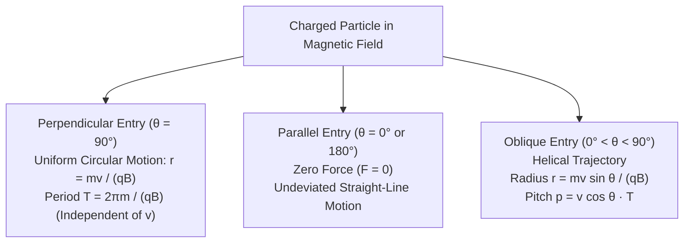
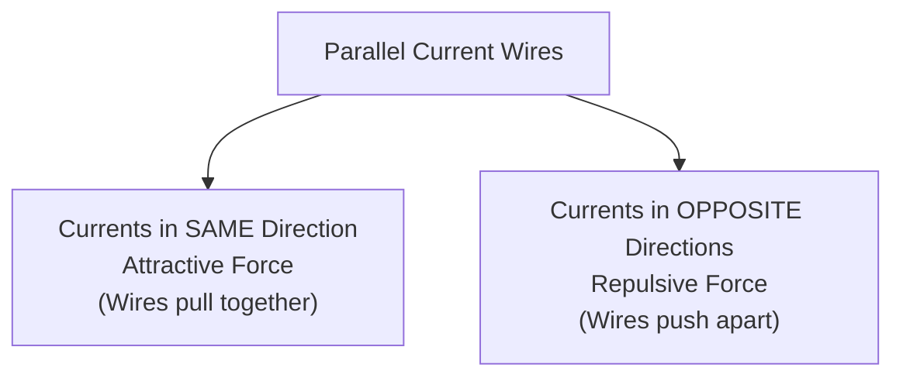

# :LiMagnet: Subtopic: Magnetic Fields & Forces Guide

> [!ABSTRACT] Core Focus
> Advanced analytical guide for Magnetism in Sri Lankan GCE A/L Physics: magnetic Lorentz force on moving charges ($\vec{F} = q(\vec{v} \times \vec{B})$), circular and helical orbital mechanics, velocity selector ($v = E/B$), Hall Effect derivation ($V_H = \frac{BI}{net}$), Biot-Savart Law applications (circular coils, straight conductors, solenoids), mutual force between parallel current-carrying wires ($\frac{F}{L} = \frac{\mu_0 I_1 I_2}{2\pi d}$), base definition of the Ampere, torque on current loops in uniform and radial magnetic fields, and moving-coil galvanometer mechanics.

---

## 1. Magnetic Lorentz Force & Particle Trajectories

### Magnetic Force on a Moving Charge:
When a point charge $q$ moves with velocity $\vec{v}$ through a magnetic field $\vec{B}$, it experiences a magnetic deflecting force:
$$\vec{F} = q (\vec{v} \times \vec{B})$$
$$F = |q| v B \sin\theta$$
where $\theta$ is the angle between the velocity vector $\vec{v}$ and magnetic field vector $\vec{B}$.

> [!IMPORTANT] Work Done by Magnetic Force is Strictly Zero
> Because $\vec{F}_{\text{mag}}$ is always perpendicular to velocity $\vec{v}$ ($\vec{F} \cdot \vec{v} = 0$), the power delivered and work done by the magnetic force on a moving charge is identically zero:
> $$P = \vec{F} \cdot \vec{v} = 0 \implies \Delta E_k = 0$$
> A static magnetic field can **never alter the speed or kinetic energy** of a charged particle; it can **only alter its direction of motion**.

---

### Derivation: Circular Motion & Cyclotron Frequency:
When a particle of mass $m$ and charge $q$ enters perpendicularly ($\theta = 90^\circ$) into a uniform magnetic field $B$:
1. The magnetic force acts as the necessary centripetal force:
   $$q v B = \frac{m v^2}{r} \implies r = \frac{m v}{q B}$$
2. The orbital period ($T$) of the revolution:
   $$T = \frac{2\pi r}{v} = \frac{2\pi \left(\frac{m v}{q B}\right)}{v} = \frac{2\pi m}{q B}$$
3. **Cyclotron Frequency ($f$):**
   $$f = \frac{1}{T} = \frac{q B}{2\pi m}$$
   * **Crucial Finding:** The period and frequency are completely **independent of the particle's speed $v$ and orbital radius $r$** (principle of the cyclotron particle accelerator).

---

### Crossed Fields: The Velocity Selector:
In a region with mutually perpendicular electric ($\vec{E}$) and magnetic ($\vec{B}$) fields:
* Electrostatic force: $F_e = q E$.
* Magnetic force: $F_m = q v B$.
* When configured to oppose each other, particles traverse undeflected in a straight line if:
  $$q E = q v B \implies v = \frac{E}{B}$$
* Particles with speed $v = E/B$ emerge through the exit slit regardless of their mass or charge sign.

---

## 2. The Hall Effect

When a current $I$ flows through a conducting or semiconducting slab of thickness $t$ and width $d$ placed in a transverse magnetic field $B$:

### Derivation of Hall Voltage ($V_H$):
1. Magnetic force deflects charge carriers toward one edge of the slab.
2. The accumulation of charges on opposite edges creates a transverse electric field $\vec{E}_H$ (the **Hall field**) that exerts an opposing electrostatic force $F_e = q E_H$.
3. At steady-state dynamic equilibrium:
   $$q E_H = q v_d B \implies E_H = v_d B$$
4. The resulting transverse potential difference (the **Hall Voltage** $V_H$) across width $d$:
   $$V_H = E_H d = v_d B d \quad \text{--- (1)}$$
5. Relating drift velocity $v_d$ to electric current $I$:
   $$I = n q A v_d = n q (d \cdot t) v_d \implies v_d = \frac{I}{n q d t}$$
6. Substituting into equation (1):
   $$V_H = \left(\frac{I}{n q d t}\right) B d = \frac{B I}{n q t}$$
   $$V_H = \frac{B I}{n e t} \quad (\text{for electron carriers } q = e)$$

* **Hall Coefficient ($R_H$):**
  $$R_H = \frac{1}{n q} \implies V_H = \frac{R_H B I}{t}$$
* **Experimental Significance:**
  1. **Carrier Sign:** The polarity of $V_H$ immediately identifies whether majority carriers are electrons (negative $V_H$, as in metals and n-type semiconductors) or holes (positive $V_H$, as in p-type semiconductors).
  2. **Carrier Density ($n$):** Measures the free carrier density $n = \frac{B I}{e t V_H}$.
  3. **Magnetic Field Measurement:** Used in solid-state Hall probes (Gaussmeters) to measure magnetic flux density $B$ accurately.

---

## 3. Biot-Savart Law & Standard Magnetic Field Derivations

### Statement of the Biot-Savart Law:
The magnetic flux density $d\vec{B}$ at a point $P$ due to an infinitesimal current element $I d\vec{l}$ at distance $r$ is:
$$d\vec{B} = \frac{\mu_0}{4\pi} \frac{I (d\vec{l} \times \hat{r})}{r^2}$$
$$dB = \frac{\mu_0}{4\pi} \frac{I dl \sin\theta}{r^2}$$
where $\mu_0 = 4\pi \times 10^{-7}\text{ T}\cdot\text{m}\cdot\text{A}^{-1}$ is the permeability of free space.

---

### 1. Magnetic Field at the Centre of a Circular Coil:
For a flat circular coil of radius $a$ carrying current $I$:
* Every element $dl$ is perpendicular to radius vector $r$ ($\theta = 90^\circ \implies \sin 90^\circ = 1$):
  $$dB = \frac{\mu_0}{4\pi} \frac{I dl}{a^2}$$
* Integrating around the complete circumference $\oint dl = 2\pi a$:
  $$B = \frac{\mu_0 I}{4\pi a^2} \oint dl = \frac{\mu_0 I}{4\pi a^2} (2\pi a) = \frac{\mu_0 I}{2a}$$
* For a coil of $N$ tightly wound turns:
  $$B = \frac{\mu_0 N I}{2a}$$

---

### 2. Standard Magnetic Field Summary:

| Current Geometry | Magnetic Flux Density Formula ($B$) | Field Line Pattern |
| :--- | :--- | :--- |
| **Infinitely Long Straight Wire** | $B = \frac{\mu_0 I}{2\pi r}$ | Concentric circles centered on the wire (Right-Hand Grip Rule) |
| **Center of Circular Coil ($N$ turns)** | $B = \frac{\mu_0 N I}{2a}$ | Straight perpendicular axis through center |
| **Interior of Long Solenoid ($n$ turns/m)** | $B = \mu_0 n I = \frac{\mu_0 N I}{L}$ | Uniform, parallel, axial field lines inside |
| **End of Long Solenoid** | $B_{\text{end}} = \frac{1}{2} \mu_0 n I$ | Fanning outward into surrounding space |
| **Toroid (Mean Radius $R$)** | $B = \frac{\mu_0 N I}{2\pi R} = \mu_0 n I$ | Concentric circular loops trapped entirely within core |

---

## 4. Force Between Parallel Conductors & Definition of Ampere

Two infinitely long, straight parallel wires separated by distance $d$ carrying currents $I_1$ and $I_2$:
1. Wire 1 creates a magnetic field at the position of Wire 2:
   $$B_1 = \frac{\mu_0 I_1}{2\pi d}$$
2. Wire 2 carrying current $I_2$ in this field experiences a force on length $L$:
   $$F = B_1 I_2 L = \left(\frac{\mu_0 I_1}{2\pi d}\right) I_2 L$$
3. Force per unit length ($\frac{F}{L}$):
   $$\frac{F}{L} = \frac{\mu_0 I_1 I_2}{2\pi d} \quad \left(\text{N}\cdot\text{m}^{-1}\right)$$

### The SI Definition of the Ampere:
The Ampere is that constant electric current which, if maintained in two straight parallel conductors of infinite length and negligible circular cross-section, placed 1 metre apart in vacuum, produces between these conductors a mutual force equal to $2 \times 10^{-7}$ Newtons per metre of length:
$$\frac{F}{L} = \frac{(4\pi \times 10^{-7})(1)(1)}{2\pi (1)} = 2 \times 10^{-7}\text{ N}\cdot\text{m}^{-1}$$

---

## 5. Torque on Current Loops & Moving Coil Galvanometer

### Torque on a Rectangular Coil in a Uniform Magnetic Field:
A coil of $N$ turns, dimensions $a \times b$ (area $A = ab$), carrying current $I$ placed in uniform field $B$:
* Forces on opposite sides of length $b$ are equal and opposite ($F = N B I b$), forming a couple separated by perpendicular distance $a \cos\alpha$ (where $\alpha$ is the angle between the coil plane and field lines):
  $$\tau = F \cdot (a \cos\alpha) = (N B I b)(a \cos\alpha) = N B I A \cos\alpha$$
* If $\theta$ is the angle between field $\vec{B}$ and the normal $\hat{n}$ to the coil plane ($\theta = 90^\circ - \alpha$):
  $$\tau = N B I A \sin\theta$$
* In vector form: $\vec{\tau} = \vec{M} \times \vec{B}$, where magnetic dipole moment $\vec{M} = N I \vec{A}$.

---

### Moving-Coil Galvanometer (MCG) Mechanics:
* **The Radial Magnetic Field:** Created using cylindrical soft-iron core and concave magnetic pole pieces.
  * Field lines always enter and leave the cylindrical core radially.
  * The plane of the coil is **always parallel to the magnetic field lines** ($\alpha = 0^\circ \implies \cos\alpha = 1$) regardless of deflection angle $\theta$.
  * Deflecting torque is constant for a given current:
    $$\tau_{\text{deflecting}} = N B I A$$
* **Restoring Torque:** Provided by hairsprings of torsional spring constant $C$:
  $$\tau_{\text{restoring}} = C \theta$$
* **Equilibrium Condition:**
  $$N B I A = C \theta \implies \theta = \left(\frac{N B A}{C}\right) I$$
  * Since $\frac{NBA}{C} = \text{constant}$, the deflection $\theta$ is **strictly linear with current $I$**, producing an equally spaced, uniform scale.
* **Current Sensitivity ($S_i$):**
  $$S_i = \frac{\theta}{I} = \frac{N B A}{C} \quad (\text{rad}\cdot\text{A}^{-1} \text{ or div}\cdot\mu\text{A}^{-1})$$

---

## :LiRocket: Flashcards (Spaced Repetition)

#flashcards

State the formula for the magnetic Lorentz force on a moving charged particle. :: $\vec{F} = q (\vec{v} \times \vec{B}) \implies F = q v B \sin\theta$.

Why does a static magnetic field do no work on a moving charged particle? :: Because the magnetic force is always perpendicular to velocity ($\vec{F} \cdot \vec{v} = 0$), so power $P = \vec{F} \cdot \vec{v} = 0$; it alters direction but never speed or kinetic energy.

Derive the radius of curvature $r$ of a charged particle moving perpendicular to a uniform magnetic field. :: The magnetic force provides centripetal acceleration: $q v B = \frac{m v^2}{r} \implies r = \frac{m v}{q B}$.

Why is the orbital period $T$ of a charged particle in a magnetic field independent of its speed? :: $T = \frac{2\pi r}{v} = \frac{2\pi (mv / qB)}{v} = \frac{2\pi m}{q B}$; speed $v$ cancels out completely.

What is the velocity selector condition for crossed electric and magnetic fields? :: $q E = q v B \implies v = \frac{E}{B}$.

Derive the formula for Hall Voltage $V_H$ in a conductor of thickness $t$. :: Dynamic equilibrium occurs when $q E_H = q v_d B \implies V_H = v_d B d$. Substituting $v_d = \frac{I}{n q d t}$ yields $V_H = \frac{B I}{n q t}$.

How does the Hall Effect determine the sign of majority charge carriers? :: The transverse direction of the Hall voltage polarity depends on whether deflected carriers are negative electrons or positive holes.

State the Biot-Savart Law in mathematical form. :: $d\vec{B} = \frac{\mu_0}{4\pi} \frac{I (d\vec{l} \times \hat{r})}{r^2} \implies dB = \frac{\mu_0}{4\pi} \frac{I dl \sin\theta}{r^2}$.

State the magnetic flux density $B$ at the center of a circular coil of $N$ turns and radius $a$. :: $B = \frac{\mu_0 N I}{2 a}$.

State the formula for magnetic flux density $B$ at perpendicular distance $r$ from an infinite straight current wire. :: $B = \frac{\mu_0 I}{2\pi r}$.

State the magnetic flux density $B$ inside a long solenoid of $n$ turns per unit length. :: $B = \mu_0 n I = \frac{\mu_0 N I}{L}$.

Do two parallel conductors carrying currents in the same direction attract or repel each other? :: They attract each other with mutual force per unit length $\frac{F}{L} = \frac{\mu_0 I_1 I_2}{2\pi d}$.

State the SI definition of the Ampere based on mutual magnetic force. :: The constant current which, if maintained in two straight parallel conductors of infinite length placed 1 metre apart in vacuum, produces a force of $2 \times 10^{-7}\text{ N}\cdot\text{m}^{-1}$ between them.

Why is a radial magnetic field used in a moving-coil galvanometer? :: It ensures the plane of the coil is always parallel to the magnetic field ($\alpha = 0^\circ$), keeping deflecting torque $\tau = N B I A$ constant so that deflection $\theta \propto I$ produces a linear scale.

Define the current sensitivity $S_i$ of a moving-coil galvanometer. :: $S_i = \frac{\theta}{I} = \frac{N B A}{C}$; deflection per unit current, maximized by increasing $N, B, A$ and decreasing torsional constant $C$.
