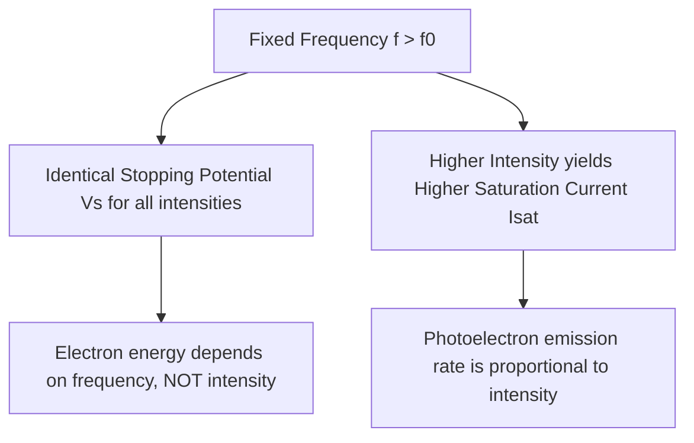
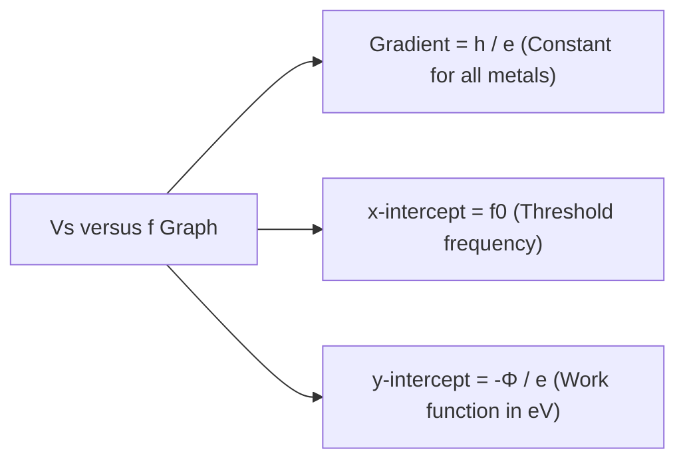

# :LiRadiation: Subtopic: Photoelectric Effect & Radioactivity Guide

> [!ABSTRACT] Core Focus (NIE Teacher's Guide — Unit 11)
> Experimental setups, mathematical derivations, graphical interpretations, and numerical problem-solving techniques for Einstein's photoelectric effect, de Broglie matter waves, X-ray spectra, radioactive decay kinetics, radiocarbon dating, and nuclear binding energy calculations.

> [!NOTE] Parent Lesson
> [[../Lesson 11 - Matter & Radiation (Modern Physics)|Lesson 11 — Matter & Radiation (Modern Physics)]]

---

## 1. Photoelectric Effect: Experimental Setup & Graphs

### 1.1 The Photocell Circuit

* **Accelerating Potential ($V > 0$)**: Anode is positive with respect to cathode. Photoelectrons are attracted to the anode. Above a certain voltage, all emitted electrons reach the anode, reaching the **saturation current ($I_{\text{sat}}$)**.
* **Retarding Potential ($V < 0$)**: Anode is negative. Electrons are repelled. As retarding voltage increases, fewer electrons have enough kinetic energy to reach the anode.
* **Stopping Potential ($V_s$)**: The exact negative potential at which current falls to zero:
  $$e V_s = E_{k,\text{max}} = \frac{1}{2} m v_{\text{max}}^2$$

---

### 1.2 Graphical Analysis of Photoelectric Effect

#### Graph 1: Current ($I$) vs Potential Difference ($V$) at Different Intensities (Constant Frequency $f$)

* Both curves intersect the negative voltage axis at the **exact same stopping potential ($V_s$)**.
* Doubling the intensity doubles the saturation current, because intensity $\propto$ number of photons arriving per second.

#### Graph 2: Current ($I$) vs Potential Difference ($V$) at Different Frequencies (Constant Intensity)
* At higher frequency $f_2 > f_1$:
  * Stopping potential becomes more negative ($|V_{s2}| > |V_{s1}|$).
  * Maximum kinetic energy increases linearly with frequency.

#### Graph 3: Stopping Potential ($V_s$) vs Frequency ($f$)

From Einstein's photoelectric equation:
$$hf = \Phi + e V_s \implies \boxed{V_s = \left(\frac{h}{e}\right) f - \left(\frac{\Phi}{e}\right)}$$

Comparing with straight-line equation $y = mx + c$:
* **Slope ($m$)**: $\frac{h}{e}$ (Universal constant $\approx 4.14 \times 10^{-15}\text{ V s}$, identical for all metals).
* **Horizontal intercept ($x$-intercept)**: $f_0 = \frac{\Phi}{h}$ (Threshold frequency of the metal).
* **Vertical intercept ($y$-intercept)**: $-\frac{\Phi}{e}$ (Negative of work function in electron-volts).

---

### 1.3 Worked Example: Photoelectric Analysis
**Problem**: When ultraviolet light of wavelength $\lambda = 250\text{ nm}$ illuminates a potassium surface, the stopping potential is $2.74\text{ V}$.
*(Constants: $h = 6.63 \times 10^{-34}\text{ J s}$, $c = 3.00 \times 10^8\text{ m s}^{-1}$, $e = 1.60 \times 10^{-19}\text{ C}$)*

1. **Photon energy**:
   $$E_{\text{photon}} = \frac{hc}{\lambda} = \frac{(6.63 \times 10^{-34})(3.00 \times 10^8)}{250 \times 10^{-9}} = 7.956 \times 10^{-19}\text{ J} = \frac{7.956 \times 10^{-19}}{1.60 \times 10^{-19}}\text{ eV} = 4.97\text{ eV}$$
2. **Maximum kinetic energy**:
   $$E_{k,\text{max}} = e V_s = 2.74\text{ eV} = 4.38 \times 10^{-19}\text{ J}$$
3. **Work function**:
   $$\Phi = E_{\text{photon}} - E_{k,\text{max}} = 4.97\text{ eV} - 2.74\text{ eV} = 2.23\text{ eV} = 3.57 \times 10^{-19}\text{ J}$$
4. **Threshold frequency**:
   $$f_0 = \frac{\Phi}{h} = \frac{3.57 \times 10^{-19}\text{ J}}{6.63 \times 10^{-34}\text{ J s}} = 5.38 \times 10^{14}\text{ Hz}$$

---

## 2. de Broglie Matter Wavelengths

### 2.1 Derivation for Accelerated Charges
A particle of mass $m$ and charge $q$ accelerated from rest through potential difference $V$:
$$E_k = qV = \frac{p^2}{2m} \implies p = \sqrt{2mqV}$$

The de Broglie wavelength:
$$\boxed{\lambda = \frac{h}{p} = \frac{h}{\sqrt{2mqV}}}$$

For an electron ($m = 9.11 \times 10^{-31}\text{ kg}$, $q = 1.60 \times 10^{-19}\text{ C}$):
$$\lambda_e = \frac{6.63 \times 10^{-34}}{\sqrt{2(9.11 \times 10^{-31})(1.60 \times 10^{-19})V}} = \frac{1.227 \times 10^{-9}}{\sqrt{V}}\text{ m} = \frac{1.227}{\sqrt{V}}\text{ nm}$$

| Accelerating Voltage $V$ | de Broglie Wavelength $\lambda_e$ | Comparison |
|---|---|---|
| $100\text{ V}$ | $0.123\text{ nm}$ | Atomic crystal lattice spacing ($d \approx 0.1\text{ nm}$) |
| $10\text{ kV}$ | $0.0123\text{ nm}$ | Soft X-ray range |
| $100\text{ kV}$ (TEM) | $0.0039\text{ nm}$ | Ultra-high resolution ($< 0.1\text{ nm}$) |

---

## 3. X-Ray Spectra & Duane-Hunt Cutoff

### 3.1 Minimum Cutoff Wavelength Derivation
Electrons hitting the Coolidge tube target lose kinetic energy via Bremsstrahlung. The maximum photon energy corresponds to complete conversion of electron kinetic energy in a single deceleration event:
$$(E_k)_{\text{max}} = e V = h f_{\text{max}} = \frac{hc}{\lambda_{\text{min}}}$$

$$\boxed{\lambda_{\text{min}} = \frac{hc}{eV}}$$

* If accelerating voltage $V$ is doubled, $\lambda_{\text{min}}$ is halved.
* Changing the target metal changes the characteristic line positions, but **leaves $\lambda_{\text{min}}$ completely unchanged**.

---

## 4. Radioactive Decay Kinetics & Derivations

### 4.1 Derivation of the Radioactive Decay Law
Let $N(t)$ be the number of undecayed radioactive nuclei at time $t$.
By definition of radioactivity:
$$-\frac{dN}{dt} \propto N \implies \frac{dN}{dt} = -\lambda N$$
where $\lambda$ is the **decay constant** (unit: $\text{s}^{-1}$).

Separating variables:
$$\frac{dN}{N} = -\lambda dt$$

Integrating both sides from $t = 0$ ($N = N_0$) to time $t$:
$$\int_{N_0}^{N} \frac{dN}{N} = -\lambda \int_{0}^{t} dt$$
$$\ln\left(\frac{N}{N_0}\right) = -\lambda t$$
$$\boxed{N(t) = N_0 e^{-\lambda t}}$$

Since Activity $A(t) = \lambda N(t)$:
$$\boxed{A(t) = A_0 e^{-\lambda t}}$$

---

### 4.2 Derivation of Half-Life ($T_{1/2}$)
At $t = T_{1/2}$, the number of remaining undecayed nuclei is $N = \frac{N_0}{2}$:
$$\frac{N_0}{2} = N_0 e^{-\lambda T_{1/2}}$$
$$\frac{1}{2} = e^{-\lambda T_{1/2}} \implies e^{\lambda T_{1/2}} = 2$$

Taking natural logarithms on both sides:
$$\lambda T_{1/2} = \ln 2 \approx 0.69315$$

$$\boxed{T_{1/2} = \frac{\ln 2}{\lambda} \approx \frac{0.693}{\lambda}}$$

**Number of Half-Lives ($n$) Shortcut**:
If time elapsed is $t$, then $n = \frac{t}{T_{1/2}}$:
$$\boxed{N = N_0 \left(\frac{1}{2}\right)^n, \quad A = A_0 \left(\frac{1}{2}\right)^n, \quad m = m_0 \left(\frac{1}{2}\right)^n}$$

---

### 4.3 Carbon-14 Dating Mathematics
For dead biological material:
$$A(t) = A_0 e^{-\lambda t} \implies \ln\left(\frac{A_0}{A}\right) = \lambda t = \left(\frac{\ln 2}{T_{1/2}}\right) t$$

$$\boxed{t = \frac{T_{1/2}}{\ln 2} \ln\left(\frac{A_0}{A(t)}\right)}$$

Where:
* $T_{1/2} = 5730\text{ years}$
* $A_0$ = Activity of fresh living tissue ($\approx 15.3\text{ disintegrations per minute per gram of carbon}$)
* $A(t)$ = Measured activity of the ancient specimen

---

## 5. Nuclear Binding Energy Calculations

### 5.1 Mass Defect and Energy Conversion
Given a nucleus $^A_Z X$:
1. Total mass of individual free protons: $Z \times m_p$
2. Total mass of individual free neutrons: $(A - Z) \times m_n$
3. Measured mass of the nucleus: $M_{\text{nucleus}}$

$$\Delta m = \left[Z m_p + (A - Z)m_n\right] - M_{\text{nucleus}}$$

**Using Atomic Masses**:
If given atomic masses $M_{\text{atom}}(^A_Z X)$ and $m(^1_1\text{H})$, electron masses cancel out automatically:
$$\Delta m = \left[Z \cdot m(^1_1\text{H}) + (A - Z)m_n\right] - M_{\text{atom}}(^A_Z X)$$

**Energy calculation**:
$$\boxed{E_b = \Delta m \text{ (in u)} \times 931.5\text{ MeV}}$$
$$\boxed{\text{Binding Energy per Nucleon} = \frac{E_b}{A}}$$

---

### 5.2 Nuclear Reaction Energy ($Q$-Value)
For a general nuclear reaction:
$$A + B \longrightarrow C + D$$

$$Q = \left[(m_A + m_B) - (m_C + m_D)\right] \times 931.5\text{ MeV}$$

* If $Q > 0$: **Exoergic** (energy released as kinetic energy of products).
* If $Q < 0$: **Endoergic** (threshold kinetic energy must be supplied by incident particle).

---

## 6. Formula Quick Reference

| Formula | Description |
|---|---|
| $hf = \Phi + e V_s$ | Photoelectric equation |
| $V_s = \left(\frac{h}{e}\right) f - \left(\frac{\Phi}{e}\right)$ | $V_s$ vs $f$ linear equation |
| $\lambda = \frac{h}{mv} = \frac{h}{\sqrt{2mqV}}$ | de Broglie matter wavelength |
| $\lambda_{\text{min}} = \frac{hc}{eV}$ | Cutoff wavelength of X-rays |
| $N(t) = N_0 e^{-\lambda t}$ | Radioactive decay law |
| $T_{1/2} = \frac{\ln 2}{\lambda} \approx \frac{0.693}{\lambda}$ | Half-life equation |
| $N = N_0 (1/2)^n$ | Nuclei remaining after $n$ half-lives |
| $A = \lambda N$ | Activity in Becquerels (Bq) |
| $t = \frac{T_{1/2}}{\ln 2} \ln(A_0 / A)$ | Carbon-14 dating equation |
| $E_b = \Delta m \times 931.5\text{ MeV}$ | Nuclear binding energy |
| $H = D \times Q$ | Equivalent dose (Sv = Gy $\times$ Q) |

---

#flashcards

How is stopping potential $V_s$ related to the maximum kinetic energy of photoelectrons? :: $e V_s = E_{k,\text{max}} = \frac{1}{2}m v_{\text{max}}^2$, where $e$ is elementary charge.

State the equation of the straight line for stopping potential $V_s$ versus frequency $f$. :: $V_s = \left(\frac{h}{e}\right)f - \left(\frac{\Phi}{e}\right)$, where slope $= h/e$ and $x$-intercept $= f_0$.

Derive the half-life formula $T_{1/2} = \frac{\ln 2}{\lambda}$ from the decay law. :: Set $N = N_0/2$ at $t = T_{1/2}$ in $N = N_0 e^{-\lambda t}$ $\implies e^{\lambda T_{1/2}} = 2 \implies \lambda T_{1/2} = \ln 2 \implies T_{1/2} = \frac{\ln 2}{\lambda} \approx \frac{0.693}{\lambda}$.

How does increasing light intensity affect the stopping potential and saturation current? :: Stopping potential remains unchanged (depends only on frequency); saturation current increases proportionally with intensity.

Derive the minimum cutoff wavelength $\lambda_{\text{min}}$ of X-rays in terms of tube voltage $V$. :: Maximum photon energy equals maximum electron kinetic energy: $hf_{\text{max}} = hc/\lambda_{\text{min}} = eV \implies \lambda_{\text{min}} = hc/eV$.

What is the de Broglie wavelength of an electron accelerated through potential $V$? :: $\lambda_e = \frac{h}{\sqrt{2m_e e V}} = \frac{1.227}{\sqrt{V}}\text{ nm}$.

State the difference between Becquerel (Bq) and Curie (Ci). :: $1\text{ Bq} = 1\text{ disintegration per second}$. $1\text{ Ci} = 3.7 \times 10^{10}\text{ Bq}$ (the activity of 1 gram of Radium-226).

What is the relationship between the number of nuclei remaining after $n$ half-lives? :: $N = N_0 \left(\frac{1}{2}\right)^n$, where $n = t / T_{1/2}$.

How is the age of an ancient organic artifact calculated using Carbon-14 dating? :: $t = \frac{T_{1/2}}{\ln 2} \ln\left(\frac{A_0}{A}\right)$, where $T_{1/2} = 5730\text{ years}$, $A_0$ is initial/live activity, and $A$ is current activity.

Define mass defect $\Delta m$ of a nucleus $^A_Z X$. :: $\Delta m = [Z m_p + (A - Z)m_n] - M_{\text{nucleus}}$, the difference between the sum of individual nucleon masses and actual nuclear mass.

How is binding energy $E_b$ converted from mass defect in atomic mass units (u)? :: $E_b = \Delta m\text{ (in u)} \times 931.5\text{ MeV}$.

What is the $Q$-value of a nuclear reaction and how does its sign indicate energy change? :: $Q = (\sum m_{\text{initial}} - \sum m_{\text{final}}) c^2$. If $Q > 0$, the reaction is exoergic (releases energy); if $Q < 0$, it is endoergic (requires energy).

Why is the resolution of an electron microscope orders of magnitude higher than an optical microscope? :: The de Broglie wavelength of high-speed electrons ($\approx 0.004\text{ nm}$) is thousands of times shorter than visible light ($\approx 400\text{–}700\text{ nm}$), vastly reducing diffraction limits.

What is the physical meaning of the decay constant $\lambda$? :: The fractional probability of decay per unit time for a single radioactive nucleus: $\lambda = -\frac{1}{N}\frac{dN}{dt}$.

How is equivalent radiation dose in Sieverts (Sv) calculated from absorbed dose in Grays (Gy)? :: $H = D \times Q$, where $D$ is absorbed dose (Gy) and $Q$ is the quality factor / relative biological effectiveness (RBE).
