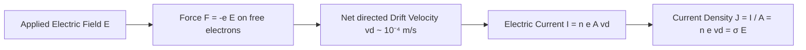
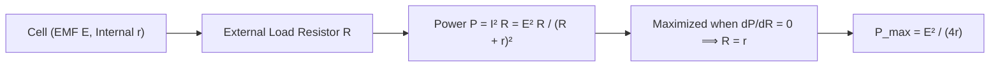
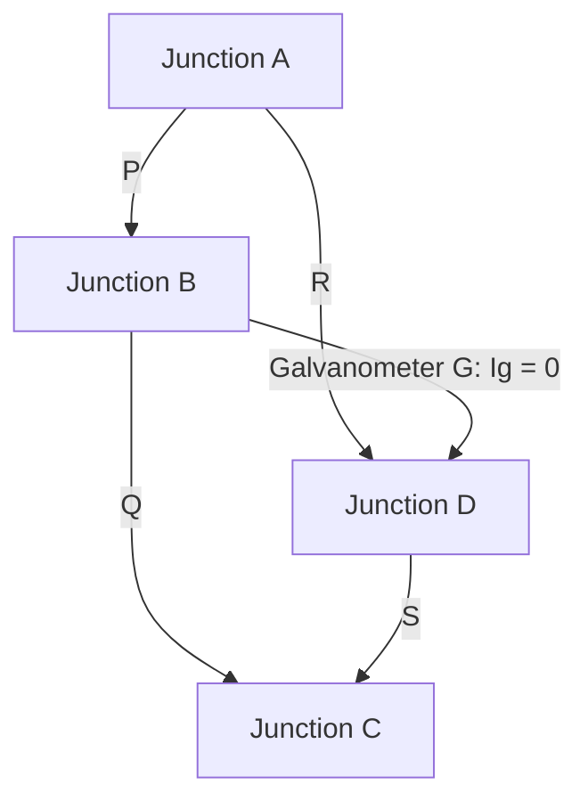
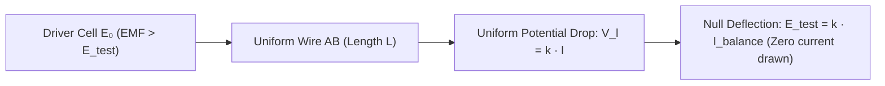
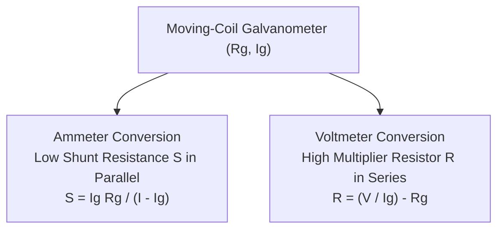

# :LiPlug: Subtopic: Potentiometer & Kirchhoff's Laws Guide

> [!ABSTRACT] Core Focus
> Advanced analytical guide for Direct Current Circuit Analysis and Precision Electrical Measurements in Sri Lankan GCE A/L Physics: microscopic drift velocity derivations ($I = n e A v_d$), temperature coefficient of resistance ($\alpha$), Maximum Power Transfer Theorem derivation, Kirchhoff's Laws (KCL & KVL) sign conventions and mesh matrix techniques, Wheatstone Bridge balance proof, Metre Bridge operation and end-error elimination, Potentiometer working principles, comparison of EMFs, determination of cell internal resistance ($r = R\frac{l_1 - l_2}{l_2}$), and conversion of moving-coil galvanometers into precision ammeters and voltmeters.

---

## 1. Microscopic Conduction Model & Drift Velocity

### Conduction Mechanism in Metals:
In a metallic conductor, valence electrons detach from parent atoms to form an electron gas that moves randomly at high thermal speeds ($v_{\text{th}} \sim 10^5\text{ m}\cdot\text{s}^{-1}$). When an external electric field $\vec{E}$ is applied, an electrostatic force $\vec{F} = -e\vec{E}$ accelerates the electrons in the direction opposite to $\vec{E}$, superimposing a net steady **drift velocity** ($v_d \sim 10^{-4}\text{ m}\cdot\text{s}^{-1}$).

### Derivation: Relation Between Current ($I$) and Drift Velocity ($v_d$):
Consider a cylindrical conductor of uniform cross-sectional area $A$ with free electron density $n$ (electrons per unit volume):
1. In time interval $\Delta t$, the electrons drift through distance:
   $$\Delta x = v_d \Delta t$$
2. The volume of conductor swept out:
   $$\Delta V = A \Delta x = A v_d \Delta t$$
3. The total number of free electrons in this volume:
   $$N = n \Delta V = n A v_d \Delta t$$
4. The total charge $\Delta Q$ passing through the cross-section:
   $$\Delta Q = N e = n e A v_d \Delta t$$
5. Electric current ($I = \frac{\Delta Q}{\Delta t}$):
   $$I = n e A v_d$$

* **Current Density ($J$):**
  $$J = \frac{I}{A} = n e v_d \quad \left(\text{units: }\text{A}\cdot\text{m}^{-2}\right)$$
* **Microscopic Ohm's Law:** Since $v_d \propto E$, we have $\vec{J} = \sigma \vec{E} = \frac{1}{\rho}\vec{E}$.

---

## 2. Temperature Coefficient of Resistance & Maximum Power Transfer

### Temperature Coefficient of Resistance ($\alpha$):
For metallic conductors, increasing temperature increases the amplitude of lattice ion vibrations, causing more frequent electron collisions and increasing resistance:
$$R_\theta = R_0 (1 + \alpha \theta)$$
$$\alpha = \frac{R_\theta - R_0}{R_0 \theta} \quad \left(\text{units: }^\circ\text{C}^{-1}\text{ or }\text{K}^{-1}\right)$$
* **Conductors (Metals):** $\alpha > 0$ (Resistance increases linearly with temperature).
* **Semiconductors & Electrolytes:** $\alpha < 0$ (Resistance decreases exponentially with temperature as covalent bonds break, generating more charge carriers).

---

### Derivation: Maximum Power Transfer Theorem:
Consider a cell of constant electromotive force $E$ and internal resistance $r$ delivering electric power to an external variable load resistor $R$:

1. **Circuit Current:**
   $$I = \frac{E}{R + r}$$
2. **Power Dissipated in Load ($P$):**
   $$P = I^2 R = \frac{E^2 R}{(R + r)^2}$$
3. **Condition for Maximum Power:** Differentiate $P$ with respect to $R$ and equate to zero:
   $$\frac{dP}{dR} = E^2 \left[ \frac{(R + r)^2 (1) - R \cdot 2(R + r)}{(R + r)^4} \right] = 0$$
   $$(R + r) - 2R = 0 \implies R = r$$
4. **Maximum Power Output ($P_{\text{max}}$):**
   $$P_{\text{max}} = \frac{E^2 (r)}{(r + r)^2} = \frac{E^2 r}{4r^2} = \frac{E^2}{4r}$$
5. **Circuit Efficiency at Maximum Power:**
   $$\eta = \frac{P_{\text{load}}}{P_{\text{total}}} = \frac{I^2 R}{I^2 (R + r)} = \frac{r}{2r} = 50\%$$

---

## 3. Kirchhoff's Laws & Systematic Circuit Analysis

### Kirchhoff's First Law (KCL — Junction Rule):
The algebraic sum of currents meeting at any electrical junction is zero:
$$\sum I_{\text{junction}} = 0 \iff \sum I_{\text{in}} = \sum I_{\text{out}}$$
* **Physical Basis:** Fundamental law of **Conservation of Electric Charge**. Charge cannot accumulate or disappear at a junction in steady state.

### Kirchhoff's Second Law (KVL — Loop Rule):
In any closed electrical loop, the algebraic sum of the electromotive forces (EMFs) is equal to the algebraic sum of the potential drops ($I R$ products):
$$\sum E = \sum I R$$
* **Physical Basis:** Fundamental law of **Conservation of Energy**. The net electrostatic work done on a unit charge traversing a complete closed path in a static electric field is zero ($\oint \vec{E}\cdot d\vec{r} = 0$).

---

### Sign Conventions for Applying KVL:
1. **Traversing a Resistor:**
   * Moving **in the direction of assumed current**: Potential **drops** $\implies -IR$ (or on RHS $+IR$).
   * Moving **opposite to assumed current**: Potential **rises** $\implies +IR$ (or on RHS $-IR$).
2. **Traversing a Source of EMF:**
   * Moving from **negative to positive** terminal: Potential **rises** $\implies +E$.
   * Moving from **positive to negative** terminal: Potential **drops** $\implies -E$.

---

## 4. The Wheatstone Bridge & Metre Bridge

### Wheatstone Bridge Balance Condition:
Four resistors $P, Q, R, S$ arranged in a bridge network with a galvanometer $G$ connected between junctions $B$ and $D$:

When the bridge is **balanced**, the galvanometer indicates zero current ($I_g = 0$), meaning points $B$ and $D$ are at identical potentials ($V_B = V_D$):
1. Since $I_g = 0$, current through $P$ equals current through $Q$ ($I_1$), and current through $R$ equals current through $S$ ($I_2$).
2. Across branch $AB$ and $AD$:
   $$V_A - V_B = V_A - V_D \implies I_1 P = I_2 R \quad \text{--- (1)}$$
3. Across branch $BC$ and $DC$:
   $$V_B - V_C = V_D - V_C \implies I_1 Q = I_2 S \quad \text{--- (2)}$$
4. Dividing equation (1) by equation (2):
   $$\frac{P}{Q} = \frac{R}{S}$$

* **Bridge Sensitivity:** The Wheatstone bridge achieves maximum measurement sensitivity when all four arm resistances are of the **same order of magnitude** ($P \approx Q \approx R \approx S$).

---

### Metre Bridge (Practical Apparatus):
A practical realization of the Wheatstone bridge utilizing a uniform resistance wire $AB$ of length $100\text{ cm}$:
$$\frac{R}{S} = \frac{P}{Q} = \frac{\rho \frac{l_1}{A}}{\rho \frac{100 - l_1}{A}} = \frac{l_1}{100 - l_1}$$
$$R = S \left(\frac{l_1}{100 - l_1}\right)$$

* **End Errors & Corrections:**
  * Resistances of copper strip end-connectors introduce small zero errors ($e_1$ at end $A$, $e_2$ at end $B$).
  * The actual ratio becomes $\frac{R}{S} = \frac{l_1 + e_1}{100 - l_1 + e_2}$.
  * **Remediation:** Interchange resistors $R$ and $S$ in the gaps and obtain a new balance point $l_2$. The mean value of $R$ cancels out end-errors.

---

## 5. The Potentiometer: Working Principles & Applications

### Fundamental Working Principle:
A potentiometer consists of a long, uniform resistance wire $AB$ (typically 1 to 10 meters) carrying a constant current supplied by an external driver cell $E_0$:

* **Potential Gradient ($k$):** The potential drop per unit length of the potentiometer wire:
  $$k = \frac{V_{AB}}{L} = \frac{I R_{AB}}{L} = \frac{I \rho}{A} \quad \left(\text{units: }\text{V}\cdot\text{m}^{-1}\right)$$
  For any segment of length $l$:
  $$V(l) = k \cdot l \quad (V \propto l)$$

> [!IMPORTANT] Essential Working Conditions for a Potentiometer
> 1. The EMF of the primary driver cell ($E_0$) **MUST be strictly greater** than the EMF of any secondary cell ($E$) being tested ($E_0 > E$); otherwise, no balance point can ever be obtained on the wire.
> 2. The positive terminals of the driver cell and the test cells **MUST all be connected to the identical common zero-point terminal ($A$)**.
> 3. The current through the potentiometer wire must remain **constant** throughout the experiment (wire should have a low temperature coefficient of resistance, such as constantan or manganin).

---

### Comparison of EMFs of Two Cells:
1. Connect cell $E_1$ into the galvanometer circuit; find balance length $l_1$:
   $$E_1 = k l_1$$
2. Connect cell $E_2$ into the circuit; find balance length $l_2$:
   $$E_2 = k l_2$$
3. Taking the ratio:
   $$\frac{E_1}{E_2} = \frac{l_1}{l_2}$$
   *(Note: The potential gradient $k$ cancels out completely, eliminating calibration errors)*.

---

### Determination of Internal Resistance ($r$) of a Cell:
1. **Step 1 (Open Circuit):** With key $K_1$ open, the cell delivers no current. The balance length $l_1$ directly balances the open-circuit EMF:
   $$E = k l_1 \quad \text{--- (1)}$$
2. **Step 2 (Closed Circuit):** Key $K_1$ is closed across external standard resistor $R$. Current $I = \frac{E}{R + r}$ flows through the local circuit, reducing the terminal potential difference to $V = I R = \frac{E R}{R + r}$. The new balance length $l_2$ is found:
   $$V = k l_2 \quad \text{--- (2)}$$
3. **Step 3 (Mathematical Deduction):**
   $$\frac{E}{V} = \frac{l_1}{l_2}$$
   $$\frac{E}{\frac{E R}{R + r}} = \frac{R + r}{R} = 1 + \frac{r}{R} = \frac{l_1}{l_2}$$
   $$\frac{r}{R} = \frac{l_1}{l_2} - 1 = \frac{l_1 - l_2}{l_2}$$
   $$r = R \left(\frac{l_1 - l_2}{l_2}\right)$$

---

## 6. Galvanometer Conversions: Ammeter & Voltmeter

A moving-coil galvanometer has internal coil resistance $R_g$ and gives full-scale deflection (FSD) for current $I_g$.

### 1. Conversion to Ammeter (Range $0 \to I$, where $I > I_g$):
Connect a **small shunt resistance $S$ in parallel** with the galvanometer:
* Potential across $S$ equals potential across $R_g$:
  $$(I - I_g) S = I_g R_g$$
  $$S = \frac{I_g R_g}{I - I_g}$$
* Total resistance of the ammeter:
  $$R_A = \frac{S R_g}{S + R_g} \approx S \quad (\text{ideally } R_A \to 0)$$

### 2. Conversion to Voltmeter (Range $0 \to V$):
Connect a **large multiplier resistance $R_s$ in series** with the galvanometer:
* Total potential drop across series combination:
  $$V = I_g (R_s + R_g)$$
  $$R_s = \frac{V}{I_g} - R_g$$
* Total resistance of the voltmeter:
  $$R_V = R_s + R_g \quad (\text{ideally } R_V \to \infty)$$

---

## :LiRocket: Flashcards (Spaced Repetition)

#flashcards

Derive the microscopic relationship between electric current $I$ and drift velocity $v_d$. :: In cylinder of area $A$, charge passing in $\Delta t$ is $\Delta Q = n(A v_d \Delta t)e \implies I = \frac{\Delta Q}{\Delta t} = n e A v_d$.

Define current density $J$ and state its relation to electric field $E$. :: $J = \frac{I}{A} = n e v_d$; microscopic Ohm's Law states $\vec{J} = \sigma \vec{E} = \frac{1}{\rho}\vec{E}$.

How does resistance vary with temperature in metallic conductors versus semiconductors? :: In metals, resistance increases linearly with temperature ($\alpha > 0$); in semiconductors, resistance decreases exponentially with temperature ($\alpha < 0$) due to thermal release of charge carriers.

State the Maximum Power Transfer Theorem and the condition for maximum power delivery. :: Maximum power is transferred from a source of internal resistance $r$ to a load $R$ when $R = r$; the maximum power transferred is $P_{\text{max}} = \frac{E^2}{4r}$.

What is the electrical efficiency of a circuit operating at maximum power transfer? :: $\eta = 50\%$ (half of the total electrical energy generated by the source is dissipated as heat within its own internal resistance).

State Kirchhoff's First Law (KCL) and its underlying conservation principle. :: The algebraic sum of currents meeting at any junction is zero ($\sum I = 0$); it is based on the **Conservation of Electric Charge**.

State Kirchhoff's Second Law (KVL) and its underlying conservation principle. :: In any closed loop, the algebraic sum of EMFs equals the algebraic sum of $IR$ potential drops ($\sum E = \sum IR$); it is based on the **Conservation of Energy**.

Derive the balance condition for a Wheatstone bridge ($\frac{P}{Q} = \frac{R}{S}$). :: At balance, $I_g = 0 \implies V_B = V_D$. Then $I_1 P = I_2 R$ and $I_1 Q = I_2 S$. Dividing gives $\frac{P}{Q} = \frac{R}{S}$.

Under what condition does a Wheatstone bridge have maximum measurement sensitivity? :: When all four arm resistors are of the same order of magnitude ($P \approx Q \approx R \approx S$).

Explain how end-errors in a Metre Bridge are eliminated. :: By swapping the positions of the known standard resistance $S$ and unknown resistance $R$ in the gaps and taking the average of the two calculated values.

Define the potential gradient $k$ of a potentiometer wire. :: The potential drop per unit length along the wire carrying constant current: $k = \frac{V}{L} = \frac{I \rho}{A} \quad (\text{V}\cdot\text{m}^{-1})$.

Why is a potentiometer described as an ideal voltmeter? :: Because at the null balance point, it draws zero current from the test circuit, measuring the true EMF without introducing an internal resistance voltage drop ($Ir$).

Why must the driver cell EMF $E_0$ in a potentiometer circuit always be greater than the test cell EMF $E$? :: If $E_0 < E$, the potential drop across the entire length of the wire will be less than $E$, so the galvanometer will never reach a null balance point anywhere on the wire.

How is the internal resistance $r$ of a cell calculated using a potentiometer? :: $r = R \left(\frac{l_1 - l_2}{l_2}\right)$, where $l_1$ is the open-circuit balance length and $l_2$ is the balance length when shunted with external resistance $R$.

How is a galvanometer converted into an ammeter of range $0 \to I$? :: By connecting a low shunt resistance $S = \frac{I_g R_g}{I - I_g}$ in parallel with the galvanometer.

How is a galvanometer converted into a voltmeter of range $0 \to V$? :: By connecting a high multiplier resistance $R_s = \frac{V}{I_g} - R_g$ in series with the galvanometer.
