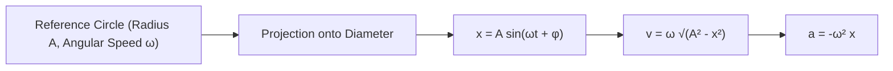
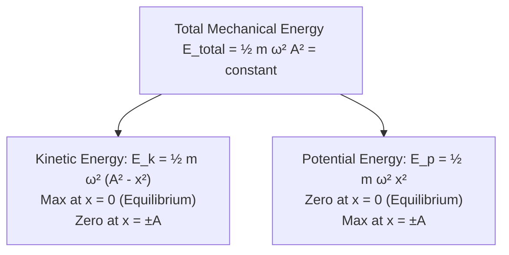
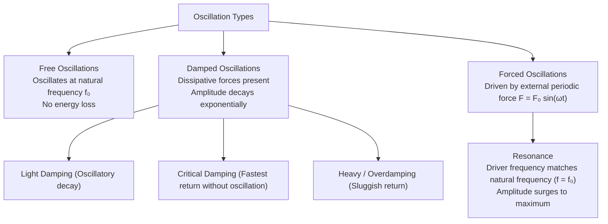

# :LiWaves: Subtopic: Simple Harmonic Motion & Waves Guide

> [!ABSTRACT] Core Focus
> Detailed analytical and experimental guide for Simple Harmonic Motion (SHM) and Wave Mechanics in Sri Lankan GCE A/L Physics: Phasor representation, energy distribution in SHM, simple pendulum and mass-spring derivations, damped and forced resonance, transverse waves on stretched strings, sonometer laws, and wave superposition.

---

## 1. Kinematics & Phasor Representation of SHM

### Defining Equation of SHM:
Simple Harmonic Motion occurs when the acceleration of an oscillating body is directly proportional to its displacement from a fixed equilibrium position and is always directed towards that equilibrium position:
$$a = -\omega^2 x$$

### Complete Kinematic Formulas:
1. **Displacement**:
   $$x(t) = A \sin(\omega t + \phi) \quad \text{or} \quad x(t) = A \cos(\omega t)$$
2. **Velocity**:
   $$v(t) = \frac{dx}{dt} = \omega A \cos(\omega t + \phi) = \pm \omega \sqrt{A^2 - x^2}$$
   - *Maximum Velocity*: $v_{\text{max}} = \omega A$ (at equilibrium position $x = 0$).
   - *Zero Velocity*: $v = 0$ (at extremes $x = \pm A$).
3. **Acceleration**:
   $$a(t) = \frac{dv}{dt} = -\omega^2 A \sin(\omega t + \phi) = -\omega^2 x$$
   - *Maximum Acceleration*: $a_{\text{max}} = \omega^2 A$ (at extremes $x = \pm A$).
   - *Zero Acceleration*: $a = 0$ (at equilibrium $x = 0$).

### Phase Relationships:
- **Velocity leads Displacement** by $\frac{\pi}{2}\text{ rad}$ ($90^\circ$).
- **Acceleration leads Velocity** by $\frac{\pi}{2}\text{ rad}$ ($90^\circ$).
- **Acceleration is in Antiphase ($\pi\text{ rad} = 180^\circ$) with Displacement**.

---

## 2. Energy in Simple Harmonic Motion

For an oscillating particle of mass $m$ and angular frequency $\omega$:

### Mathematical Expressions:
$$E_k = \frac{1}{2}m v^2 = \frac{1}{2}m\omega^2(A^2 - x^2)$$
$$E_p = \frac{1}{2}k x^2 = \frac{1}{2}m\omega^2 x^2$$
$$E_{\text{total}} = E_k + E_p = \frac{1}{2}m\omega^2 A^2 = \text{constant}$$

> [!NOTE] Frequency of Energy Oscillations
> While the displacement, velocity, and acceleration oscillate at frequency $f = \frac{\omega}{2\pi}$, the **Kinetic Energy and Potential Energy oscillate at double the frequency ($2f$)**. During one complete cycle of motion, kinetic energy reaches its maximum twice.

---

## 3. Systems Executing Simple Harmonic Motion

### A. The Simple Pendulum:
A small heavy bob of mass $m$ suspended by a light inextensible string of length $l$:
- Restoring force along the arc:
  $$F = -mg \sin\theta$$
- For small angular displacements ($\theta \le 10^\circ \approx 0.17\text{ rad}$), $\sin\theta \approx \theta = \frac{x}{l}$:
  $$F \approx -mg\left(\frac{x}{l}\right) \implies ma = -\left(\frac{mg}{l}\right)x \implies a = -\left(\frac{g}{l}\right)x$$
- Comparing with $a = -\omega^2 x$:
  $$\omega^2 = \frac{g}{l} \implies \omega = \sqrt{\frac{g}{l}}$$
  $$T = \frac{2\pi}{\omega} = 2\pi\sqrt{\frac{l}{g}}$$

#### Practical Determination of $g$:
Plotting $T^2$ against string length $l$:
$$T^2 = \left(\frac{4\pi^2}{g}\right) l$$
The graph is a straight line through the origin with gradient $m = \frac{4\pi^2}{g} \implies g = \frac{4\pi^2}{m}$.

---

### B. Mass-Spring Systems:
- Restoring force: $F = -kx \implies ma = -kx \implies a = -\left(\frac{k}{m}\right)x$.
- Angular frequency & Time period:
  $$\omega = \sqrt{\frac{k}{m}} \implies T = 2\pi\sqrt{\frac{m}{k}}$$
- **Springs in Series**: $k_{\text{eq}} = \frac{k_1 k_2}{k_1 + k_2} \implies T = 2\pi\sqrt{\frac{m(k_1 + k_2)}{k_1 k_2}}$.
- **Springs in Parallel**: $k_{\text{eq}} = k_1 + k_2 \implies T = 2\pi\sqrt{\frac{m}{k_1 + k_2}}$.

---

### C. Liquid Column in a U-Tube:
A uniform U-tube of cross-sectional area $A$ containing a liquid column of total length $L$ and density $\rho$:
- When displaced by distance $x$, the restoring force due to the excess liquid head of $2x$:
  $$F = -(2x A \rho)g = -2A\rho g x$$
  $$M a = -2A\rho g x \implies (A L \rho) a = -2A\rho g x \implies a = -\left(\frac{2g}{L}\right)x$$
  $$T = 2\pi\sqrt{\frac{L}{2g}} = 2\pi\sqrt{\frac{h}{g}} \quad (\text{where } h = L/2 \text{ is equilibrium column height})$$

---

## 4. Damped Oscillations, Forced Vibrations & Resonance

### Types of Damping:
1. **Light Damping**: System oscillates with gradually decreasing amplitude ($A = A_0 e^{-\gamma t}$).
2. **Critical Damping**: Returns to equilibrium in the shortest possible time without oscillating (used in vehicle shock absorbers and galvanometer dead-beat mechanisms).
3. **Overdamping**: High viscous resistance returns the system to equilibrium very slowly without oscillating.

### Resonance:
Occurs when an oscillating system is driven by an external periodic force whose frequency matches the system's natural frequency ($f_{\text{driver}} = f_0$).
- **Consequence**: Energy transfer from driver to system is maximally efficient; amplitude of oscillation reaches a sharp maximum.
- **Damping Effect on Resonance Curve**:
  - Low damping produces a **sharp, tall resonance peak**.
  - High damping produces a **broad, flat resonance peak** with resonant frequency slightly lower than $f_0$.

---

## 5. Transverse Stationary Waves on Stretched Strings

### Wave Speed on a String:
$$v = \sqrt{\frac{T}{m}}$$
*(where $T$ is tension in newtons, and $m$ is linear mass density: $m = \frac{\text{mass}}{\text{length}} = \pi r^2 \rho$).*

### Resonant Modes (Both Ends Fixed $\implies$ Nodes at Ends):
Adjacent nodes are separated by $\frac{\lambda}{2}$; node to antinode distance is $\frac{\lambda}{4}$.

| Harmonic Mode | Wavelength ($\lambda$) | Frequency ($f$) | Wave Pattern |
| :--- | :---: | :---: | :--- |
| **Fundamental (1st Harmonic)** | $\lambda_1 = 2L$ | $f_1 = \frac{v}{2L} = \frac{1}{2L}\sqrt{\frac{T}{m}}$ | 1 loop (2 nodes at ends, 1 antinode in center) |
| **2nd Harmonic (1st Overtone)** | $\lambda_2 = L$ | $f_2 = 2f_1 = \frac{1}{L}\sqrt{\frac{T}{m}}$ | 2 loops (3 nodes, 2 antinodes) |
| **3rd Harmonic (2nd Overtone)** | $\lambda_3 = \frac{2L}{3}$ | $f_3 = 3f_1 = \frac{3}{2L}\sqrt{\frac{T}{m}}$ | 3 loops (4 nodes, 3 antinodes) |
| **$n^{\text{th}}$ Harmonic** | $\lambda_n = \frac{2L}{n}$ | $f_n = n f_1 = \frac{n}{2L}\sqrt{\frac{T}{m}}$ | $n$ loops ($n+1$ nodes, $n$ antinodes) |

---

### Sonometer Laws of Stretched Strings:
1. **Law of Length**: For constant $T$ and $m$, $f \propto \frac{1}{L} \implies f \cdot L = \text{constant}$.
2. **Law of Tension**: For constant $L$ and $m$, $f \propto \sqrt{T} \implies \frac{f}{\sqrt{T}} = \text{constant}$.
3. **Law of Mass**: For constant $L$ and $T$, $f \propto \frac{1}{\sqrt{m}} \propto \frac{1}{r\sqrt{\rho}}$.

---

## :LiRocket: Flashcards (Spaced Repetition)

#flashcards

State the defining equation of Simple Harmonic Motion. :: $a = -\omega^2 x$ (acceleration is directly proportional to displacement and directed towards the center).

What is the relationship between velocity $v$, displacement $x$, amplitude $A$, and angular frequency $\omega$ in SHM? :: $v = \pm \omega \sqrt{A^2 - x^2}$.

What are the phase differences between displacement, velocity, and acceleration in SHM? :: Velocity leads displacement by $\frac{\pi}{2}$; Acceleration leads velocity by $\frac{\pi}{2}$; Acceleration and displacement are in antiphase ($\pi$).

State the expressions for kinetic energy, potential energy, and total mechanical energy in SHM. :: $E_k = \frac{1}{2}m\omega^2(A^2 - x^2)$, $E_p = \frac{1}{2}m\omega^2 x^2$, $E_{\text{total}} = \frac{1}{2}m\omega^2 A^2 = \text{constant}$.

If an oscillator has frequency $f$, at what frequency do its kinetic and potential energies oscillate? :: At frequency $2f$ (twice the oscillation frequency).

State the formula for the time period of a simple pendulum of length $l$. :: $T = 2\pi\sqrt{\frac{l}{g}}$ (valid for small angular amplitudes $\theta \le 10^\circ$).

What is the time period of a mass-spring system of mass $m$ and spring constant $k$? :: $T = 2\pi\sqrt{\frac{m}{k}}$.

What is critical damping and state one practical application? :: Damping where the displaced body returns to equilibrium in the minimum time without oscillating; used in car shock absorbers and galvanometers.

Under what condition does mechanical resonance occur? :: When the driving frequency of an external periodic force equals the natural frequency of the oscillating system ($f = f_0$).

State the formula for the speed of transverse waves along a stretched string of tension $T$ and linear density $m$. :: $v = \sqrt{\frac{T}{m}}$.

State the fundamental frequency formula for a stretched string of length $L$ fixed at both ends. :: $f_1 = \frac{1}{2L}\sqrt{\frac{T}{m}}$.

State the three Sonometer laws for a vibrating stretched string. :: 1. Law of Length: $f \propto \frac{1}{L}$; 2. Law of Tension: $f \propto \sqrt{T}$; 3. Law of Mass: $f \propto \frac{1}{\sqrt{m}}$.
