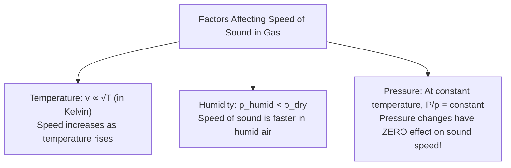
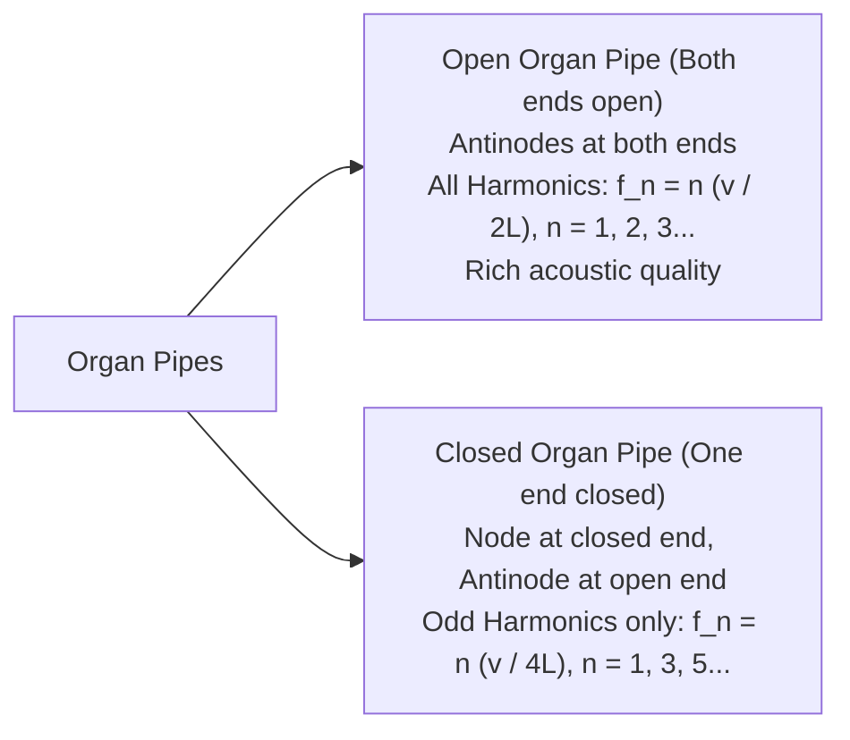
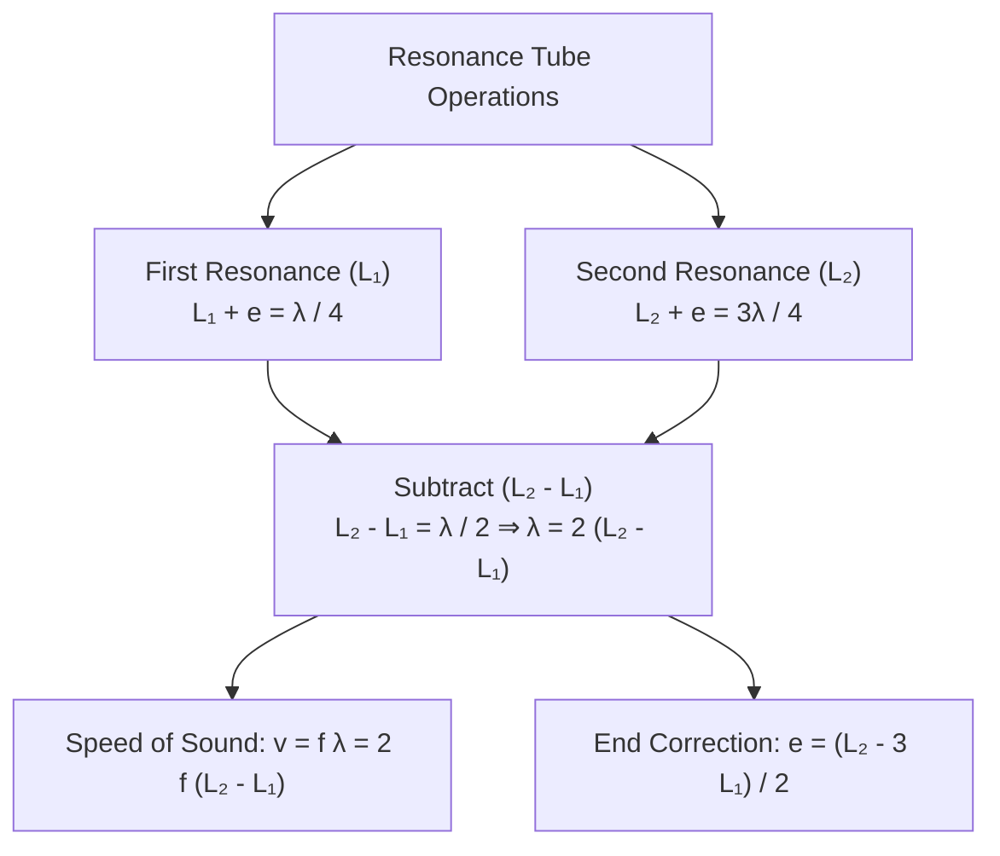
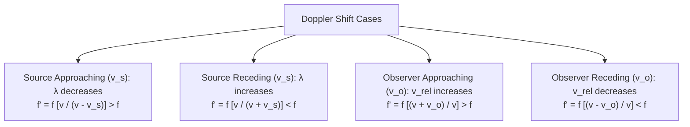

# :LiAudioWaveform: Subtopic: Sound Waves, Acoustics & Doppler Effect Guide

> [!ABSTRACT] Core Focus
> Advanced analytical guide for Sound and Acoustics in Sri Lankan GCE A/L Physics: Speed of sound (Newton-Laplace formula), open and closed organ pipes, end correction derivations, resonance tube practical methodology, sound intensity in decibels ($\text{dB}$), beat phenomenon, and comprehensive Doppler effect derivations across moving media and observers.

---

## 1. Speed of Sound in Gaseous Media

### Newton's Formula & Laplace's Correction:
1. **Newton's Isothermal Assumption**:
   Assumed that compressions and rarefactions occur isothermally (constant temperature) because heat could be rapidly conducted:
   $$v = \sqrt{\frac{B_{\text{isothermal}}}{\rho}} = \sqrt{\frac{P}{\rho}}$$
   For standard air ($P = 1.013 \times 10^5\text{ Pa}, \rho = 1.293\text{ kg}\;\text{m}^{-3}$):
   $$v \approx \sqrt{\frac{1.013 \times 10^5}{1.293}} \approx 280\text{ m}\;\text{s}^{-1} \quad (\approx 16\% \text{ below experimental value of } 331\text{ m}\;\text{s}^{-1})$$
2. **Laplace's Adiabatic Correction**:
   Realized sound compressions and rarefactions occur so rapidly and air is such a poor thermal conductor that no heat exchange takes place (**adiabatic process**):
   $$B_{\text{adiabatic}} = \gamma P \quad \left(\gamma = \frac{C_p}{C_v} \approx 1.40 \text{ for diatomic air}\right)$$
   $$v = \sqrt{\frac{\gamma P}{\rho}} = \sqrt{\frac{\gamma R T}{M}}$$
   For standard air at $0^\circ\text{C}$ ($273\text{ K}$):
   $$v = \sqrt{\frac{1.40 \times 1.013 \times 10^5}{1.293}} \approx 331.3\text{ m}\;\text{s}^{-1} \quad (\text{matches experiment exactly!})$$

---

## 2. Standing Waves in Air Columns & Organ Pipes

### Analytical Comparison:

| Characteristic | Open Pipe (Both ends open) | Closed Pipe (One end closed) |
| :--- | :--- | :--- |
| **Boundary Conditions** | Antinodes at both ends | Node at closed end, Antinode at open end |
| **Fundamental Mode ($n=1$)** | $L = \frac{\lambda_1}{2} \implies f_1 = \frac{v}{2L}$ | $L = \frac{\lambda_1}{4} \implies f_1' = \frac{v}{4L} = \frac{f_1}{2}$ |
| **Allowed Harmonics** | **All harmonics present**: $f_1, 2f_1, 3f_1, 4f_1 \dots$ | **Only odd harmonics present**: $f_1', 3f_1', 5f_1' \dots$ |
| **Acoustic Quality (Timbre)** | Rich and pleasant (full harmonic spectrum) | Hollow and mellow (missing even harmonics) |
| **End Correction ($e$)** | Both ends: $L_{\text{eff}} = L + 2e$ | Open end only: $L_{\text{eff}} = L + e$ |

---

## 3. Core Laboratory Practical: The Resonance Tube

Used to determine the speed of sound in air using a tuning fork of known frequency $f$:
- An antinode forms at a small distance $e \approx 0.6r$ outside the open tube mouth (where $r$ is tube radius).

### Derivation:
1. First resonance length $L_1$:
   $$L_1 + e = \frac{\lambda}{4}$$
2. Second resonance length $L_2$:
   $$L_2 + e = \frac{3\lambda}{4}$$
3. Eliminating end correction $e$:
   $$(L_2 + e) - (L_1 + e) = \frac{3\lambda}{4} - \frac{\lambda}{4} \implies L_2 - L_1 = \frac{\lambda}{2} \implies \lambda = 2(L_2 - L_1)$$
4. Speed of sound:
   $$v = f \lambda = 2f(L_2 - L_1)$$
5. Evaluating End Correction ($e$):
   $$e = \frac{L_2 - 3L_1}{2}$$

---

## 4. Sound Intensity, Decibel Scale & Beats

### Sound Intensity ($I$):
The acoustic energy flowing per unit time perpendicularly through a unit surface area:
$$I = \frac{P}{4\pi r^2} \quad ([\mathsf{M}\mathsf{T}^{-3}], \text{W}\;\text{m}^{-2})$$
*(Follows the inverse-square law: $I \propto \frac{1}{r^2}$).*

### Sound Intensity Level ($\beta$ in Decibels, $\text{dB}$):
Due to the logarithmic response of the human ear (Weber-Fechner Law):
$$\beta = 10 \log_{10}\left(\frac{I}{I_0}\right)$$
*(where $I_0 = 10^{-12}\text{ W}\;\text{m}^{-2}$ is the standard threshold of hearing at $1000\text{ Hz}$).*

- **Threshold of Hearing**: $I = 10^{-12}\text{ W}\;\text{m}^{-2} \implies \beta = 10\log_{10}(1) = 0\text{ dB}$.
- **Threshold of Pain**: $I = 1.0\text{ W}\;\text{m}^{-2} \implies \beta = 10\log_{10}(10^{12}) = 120\text{ dB}$.
- **Doubling of Intensity**: $\Delta\beta = 10\log_{10}(2) \approx +3.01\text{ dB}$.
- **10-fold increase in Intensity**: $\Delta\beta = 10\log_{10}(10) = +10\text{ dB}$.

---

### The Phenomenon of Beats:
Periodic modulation in sound loudness produced by the superposition of two sound waves of slightly different frequencies $f_1$ and $f_2$:
- Let $y_1 = A\sin(2\pi f_1 t)$ and $y_2 = A\sin(2\pi f_2 t)$.
- Resultant displacement:
  $$y = y_1 + y_2 = \left[2A \cos\left(2\pi \frac{f_1 - f_2}{2} t\right)\right] \sin\left(2\pi \frac{f_1 + f_2}{2} t\right)$$
- **Beat Frequency ($f_{\text{beat}}$)**:
  $$f_{\text{beat}} = |f_1 - f_2|$$

#### Practical Application: Identifying Unknown Tuning Fork Frequency ($f_x$):
Given standard fork $f_0$ producing $b$ beats per second $\implies f_x = f_0 \pm b$.
- **Waxing the unknown fork**: Wax increases fork mass $\implies f_x$ decreases.
  - If beat frequency *decreases*, then $f_x > f_0 \implies f_x = f_0 + b$.
  - If beat frequency *increases*, then $f_x < f_0 \implies f_x = f_0 - b$.
- **Filing the unknown fork**: Filing decreases fork mass $\implies f_x$ increases.

---

## 5. Comprehensive Doppler Effect Analysis

The **Doppler Effect** is the apparent shift in frequency observed when there is relative motion between the wave source, the observer, or the propagating medium.

### Master Doppler Equation:
$$f' = f \left(\frac{v \pm v_o}{v \mp v_s}\right)$$
*(Rule: Upper signs correspond to **approaching motion**; lower signs correspond to **receding motion**).*

### Analytical Derivations:

#### 1. Source Moving Towards Stationary Observer ($v_s$, Observer at rest $v_o = 0$):
In time period $T$, source moves forward distance $v_s T = \frac{v_s}{f}$. The waves are compressed in front of the source:
$$\lambda' = \lambda - v_s T = \frac{v}{f} - \frac{v_s}{f} = \frac{v - v_s}{f}$$
Apparent frequency:
$$f' = \frac{v}{\lambda'} = f\left(\frac{v}{v - v_s}\right)$$

#### 2. Source Moving Away from Stationary Observer:
Wavelength expands behind the source:
$$\lambda' = \lambda + v_s T = \frac{v + v_s}{f} \implies f' = f\left(\frac{v}{v + v_s}\right)$$

#### 3. Observer Moving Towards Stationary Source ($v_o$, Source at rest $v_s = 0$):
Wavelength in medium is unchanged ($\lambda = v/f$). Relative velocity of sound approaching observer increases to $(v + v_o)$:
$$f' = \frac{v + v_o}{\lambda} = \frac{v + v_o}{v / f} = f\left(\frac{v + v_o}{v}\right)$$

#### 4. Observer Moving Away from Stationary Source:
Relative speed of sound is $(v - v_o)$:
$$f' = f\left(\frac{v - v_o}{v}\right)$$

---

### Wind Velocity Correction:
If wind blows with speed $w$ in the direction from source to observer:
- Speed of sound becomes $(v + w)$:
  $$f' = f\left(\frac{(v + w) \pm v_o}{(v + w) \mp v_s}\right)$$
- If wind blows opposite to sound propagation, replace $v$ with $(v - w)$.

---

## :LiRocket: Flashcards (Spaced Repetition)

#flashcards

State Laplace's formula for the speed of sound in a gas. :: $v = \sqrt{\frac{\gamma P}{\rho}} = \sqrt{\frac{\gamma R T}{M}}$ (where $\gamma = C_p/C_v$).

Why was Newton's isothermal formula for the speed of sound in air incorrect? :: Newton assumed isothermal conditions, but sound compressions and rarefactions occur adiabatically because pressure changes are rapid and air is a poor thermal conductor.

Why does an increase in atmospheric pressure at constant temperature have no effect on the speed of sound in air? :: By Boyle's Law, when pressure increases, density increases in the identical proportion ($\frac{P}{\rho} = \text{constant}$); hence $v = \sqrt{\frac{\gamma P}{\rho}}$ remains unchanged.

State the frequencies of the fundamental and first two overtones of an open organ pipe of length $L$. :: Fundamental: $f_1 = \frac{v}{2L}$; First overtone (2nd harmonic): $f_2 = 2f_1 = \frac{v}{L}$; Second overtone (3rd harmonic): $f_3 = 3f_1 = \frac{3v}{2L}$.

Why does a closed organ pipe produce only odd harmonics? :: The closed end is a displacement node while the open end is an antinode, restricting allowed standing wavelengths to $L = (2n-1)\frac{\lambda}{4}$, which yields frequencies $f_n = (2n-1)\frac{v}{4L}$.

How is the speed of sound $v$ calculated from the first and second resonance lengths $L_1, L_2$ in a resonance tube? :: $v = 2f(L_2 - L_1)$ (which completely eliminates the end correction $e$).

State the end correction formula $e$ in terms of first and second resonance lengths in a resonance tube. :: $e = \frac{L_2 - 3L_1}{2} \approx 0.6r$ (where $r$ is tube radius).

Define Sound Intensity Level $\beta$ in decibels ($\text{dB}$). :: $\beta = 10 \log_{10}\left(\frac{I}{I_0}\right)$ (where $I_0 = 10^{-12}\text{ W}\;\text{m}^{-2}$ is the threshold of hearing).

What change in sound intensity level occurs when the acoustic intensity is doubled? :: An increase of approximately $+3.01\text{ dB}$ ($\Delta\beta = 10\log_{10}(2)$).

What is the beat frequency produced when two tuning forks of frequencies $f_1$ and $f_2$ sound simultaneously? :: $f_{\text{beat}} = |f_1 - f_2|$.

State the Doppler formula for apparent frequency when a sound source moves toward a stationary observer at speed $v_s$. :: $f' = f\left(\frac{v}{v - v_s}\right)$ (wavelength is compressed, perceived pitch rises).

State the Doppler formula for apparent frequency when an observer moves toward a stationary sound source at speed $v_o$. :: $f' = f\left(\frac{v + v_o}{v}\right)$ (relative speed of sound increases, pitch rises).
