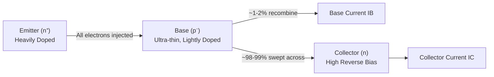
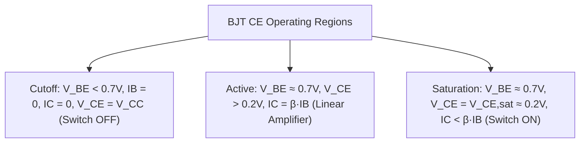
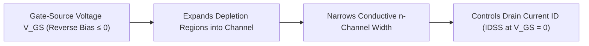
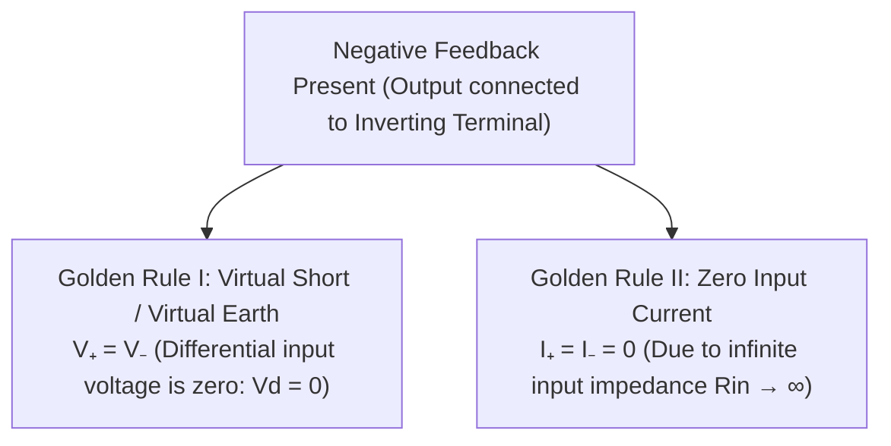
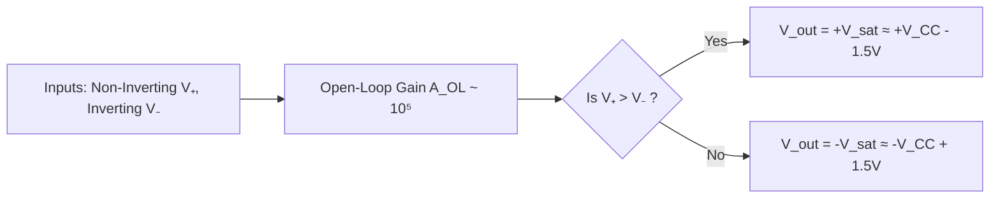

# :LiCircuitBoard: Subtopic: Transistors & Operational Amplifiers Guide

> [!ABSTRACT] Core Focus
> Advanced analytical guide for Active Electronic Devices in Sri Lankan GCE A/L Physics: BJT structure and internal charge carrier mechanics, Common-Emitter (CE) input/output/transfer characteristics, operating modes (cutoff, active, saturation), DC load-line analysis and Q-point stability, transistor switching and CE voltage amplification, n-channel JFET operation, Op-Amp architecture and Golden Rules, rigorous mathematical derivations for inverting and non-inverting amplifier gains, summing amplifier, voltage follower buffer, and open-loop voltage comparator applications.

---

## 1. Bipolar Junction Transistor (BJT) Internal Operation & CE Modes

### Physical Architecture of an npn BJT:
A BJT is a three-layer semiconductor sandwich with two p-n junctions:
1. **Emitter (E):** Heavily doped ($n^+$) to inject a high concentration of majority charge carriers (electrons). Moderate physical size.
2. **Base (B):** Extremely thin ($\sim 1\ \mu\text{m}$) and very lightly doped ($p^-$) to minimize electron-hole recombination within the base.
3. **Collector (C):** Moderately doped ($n$), physically the largest region to facilitate dissipation of Joule heat generated by collected electrons.

---

### Internal Action in Active Mode (Base-Emitter Forward-Biased, Collector-Base Reverse-Biased):
1. The forward-biased base-emitter junction ($V_{BE} \approx 0.7\text{ V}$ for Si) lowers the barrier, injecting electrons from emitter into base ($I_E$).
2. Because the base is ultra-thin and lightly doped, only about $1\%\text{ to }2\%$ of these electrons recombine with holes in the base, constituting the small **base current** ($I_B$).
3. The remaining $98\%\text{ to }99\%$ of electrons diffuse across the base, enter the strong depletion field of the reverse-biased collector-base junction, and are swept into the collector, constituting the **collector current** ($I_C$).

* **Fundamental Current Relationship (Kirchhoff's Current Law):**
  $$I_E = I_B + I_C$$
* **Current Gain Parameters:**
  * Common-Base Current Gain: $\alpha = \frac{I_C}{I_E} \approx 0.98 - 0.99$.
  * Common-Emitter DC Current Gain: $\beta = h_{FE} = \frac{I_C}{I_B} \approx 50 - 300$.
  $$\beta = \frac{\alpha}{1 - \alpha}, \quad \alpha = \frac{\beta}{1 + \beta}$$

---

### Common Emitter (CE) Characteristics & Operating Regions:

1. **Input Characteristic ($I_B$ vs. $V_{BE}$ at constant $V_{CE}$):**
   * Mirrors a forward-biased diode.
   * Negligible base current until threshold knee voltage $V_k \approx 0.7\text{ V}$ is reached, after which $I_B$ rises rapidly.
   * Dynamic input resistance: $r_{\text{in}} = \left(\frac{\Delta V_{BE}}{\Delta I_B}\right)_{V_{CE}}$.
2. **Output Characteristics ($I_C$ vs. $V_{CE}$ for stepped values of $I_B$):**
   * **Cutoff Region ($I_B = 0$):** Both junctions reverse-biased. $I_C \approx 0$, $V_{CE} = V_{CC}$. The transistor acts as an **open switch**.
   * **Active Linear Region:** Base-emitter forward-biased ($V_{BE} \approx 0.7\text{ V}$), collector-base reverse-biased ($V_{CE} \ge 1\text{ V}$). Curves are nearly horizontal: $I_C = \beta I_B$, independent of $V_{CE}$. Used for **linear signal amplification**.
   * **Saturation Region ($V_{CE} < V_{CE,\text{sat}} \approx 0.2\text{ V}$):** Both junctions become forward-biased. $I_C$ drops sharply and is limited strictly by the external collector circuit ($I_{C,\text{sat}} \approx V_{CC}/R_C$), with $I_C < \beta I_B$. The transistor acts as a **closed switch**.

---

### DC Load Line & Q-Point Analysis:
In a CE amplifier circuit with collector resistor $R_C$ and supply voltage $V_{CC}$:
$$V_{CC} = I_C R_C + V_{CE} \implies V_{CE} = -R_C I_C + V_{CC}$$
* **Load Line Endpoints:**
  * Cutoff point on horizontal axis ($I_C = 0$): $V_{CE} = V_{CC}$.
  * Saturation point on vertical axis ($V_{CE} = 0$): $I_C = \frac{V_{CC}}{R_C}$.
* **Operating Point (Q-Point):** The intersection of the DC load line with the specific $I_B$ characteristic curve establishes the quiescent DC operating point $(V_{CEQ}, I_{CQ})$. For maximum symmetrical undistorted AC output swing, the Q-point is centered midway:
  $$V_{CEQ} = \frac{V_{CC}}{2}, \quad I_{CQ} = \frac{V_{CC}}{2 R_C}$$

---

### The Transistor as an Electronic Switch:
To switch a load (e.g., LED, relay, motor) connected in the collector circuit:
* **OFF State (Cutoff):** Input voltage $V_{\text{in}} < 0.7\text{ V} \implies I_B = 0 \implies I_C = 0$. Load receives no voltage; $V_{CE} = V_{CC}$.
* **ON State (Saturation):** Input voltage $V_{\text{in}}$ is high. Base current is driven to satisfy:
  $$I_B \ge \frac{I_{C,\text{sat}}}{\beta} = \frac{V_{CC} - V_{CE,\text{sat}}}{\beta R_C}$$
  $V_{CE} = V_{CE,\text{sat}} \approx 0.2\text{ V} \approx 0$, so virtually the entire supply voltage $V_{CC}$ drops across the load.

---

## 2. Junction Field Effect Transistor (JFET)

The JFET is a **unipolar, voltage-controlled** device whose conduction is mediated entirely by majority carriers through a semiconductor channel.

* **Operating Principle (n-Channel JFET):**
  * Electrons flow from Source (S) to Drain (D) through an n-channel bordered by p-type gate regions.
  * A reverse bias voltage $V_{GS} \le 0$ applied between gate and source widens the p-n depletion regions, narrowing the conductive channel and modulating drain current $I_D$.
* **Key Parameters:**
  * **Pinch-Off Voltage ($V_P$):** The negative gate-source voltage at which the channel is completely pinched closed ($I_D = 0$ when $V_{GS} = V_P$).
  * **Saturation Drain Current ($I_{DSS}$):** The maximum drain current flowing when $V_{GS} = 0$ and $V_{DS} \ge |V_P|$.
* **Shockley's Transconductance Equation:**
  $$I_D = I_{DSS} \left(1 - \frac{V_{GS}}{V_P}\right)^2 \quad (\text{for } V_P \le V_{GS} \le 0)$$
* **Major Advantage over BJT:** Because the gate junction is permanently reverse-biased, the input impedance of a JFET is exceptionally high ($R_{\text{in}} > 10^8 - 10^{10}\ \Omega$), drawing negligible input current.

---

## 3. Operational Amplifiers: Architecture & Golden Rules

### Ideal Op-Amp Characteristics:

| Property | Symbol | Ideal Value | Practical 741 IC Value |
| :--- | :---: | :---: | :---: |
| **Open-Loop Voltage Gain** | $A_{OL}$ | $\infty$ | $\approx 2 \times 10^5$ ($106\text{ dB}$) |
| **Input Impedance** | $R_{\text{in}}$ | $\infty$ | $\approx 2\text{ M}\Omega$ (BJT) / $> 10^{12}\ \Omega$ (FET) |
| **Output Impedance** | $R_{\text{out}}$ | $0$ | $\approx 75\ \Omega$ |
| **Bandwidth** | $BW$ | $\infty$ | $\approx 1\text{ MHz}$ (Unity Gain Bandwidth) |
| **Common Mode Rejection Ratio** | $\text{CMRR}$ | $\infty$ | $\approx 90\text{ dB}$ |
| **Input Offset Voltage** | $V_{os}$ | $0$ | $\approx 1 - 5\text{ mV}$ |

---

### The Two Golden Rules for Linear Op-Amp Analysis:

> [!IMPORTANT] Scope of the Golden Rules
> The Golden Rules apply **strictly when the op-amp operates in its linear region under negative feedback**. If negative feedback is absent (open loop or positive feedback), or if the output is driven into saturation ($\pm V_{\text{sat}}$), Golden Rule I ($V^+ = V^-$) **ceases to hold**!

---

## 4. Mathematical Gain Derivations

### Derivation 1: Inverting Amplifier
* Non-inverting terminal ($V^+$) is tied to ground: $V^+ = 0$.
* By Golden Rule I, the inverting terminal is at **virtual ground**:
  $$V^- = V^+ = 0$$
* Input signal $V_{\text{in}}$ connects to $V^-$ via input resistor $R_1$.
* Feedback resistor $R_f$ connects output $V_{\text{out}}$ back to $V^-$.
* By Golden Rule II ($I^- = 0$), all current arriving through $R_1$ must pass through $R_f$:
  $$I_1 = I_f$$
  $$\frac{V_{\text{in}} - V^-}{R_1} = \frac{V^- - V_{\text{out}}}{R_f}$$
  $$\frac{V_{\text{in}} - 0}{R_1} = \frac{0 - V_{\text{out}}}{R_f}$$
  $$\frac{V_{\text{in}}}{R_1} = -\frac{V_{\text{out}}}{R_f}$$
  $$A_v = \frac{V_{\text{out}}}{V_{\text{in}}} = -\frac{R_f}{R_1}$$

* **Significance:** Closed-loop gain depends **solely on external resistor ratio** $\frac{R_f}{R_1}$ (highly stable). The negative sign denotes a $180^\circ$ phase inversion.
* **Input Impedance:** $R_{\text{in,circuit}} = R_1$.

---

### Derivation 2: Non-Inverting Amplifier
* Input signal $V_{\text{in}}$ is connected directly to the non-inverting terminal: $V^+ = V_{\text{in}}$.
* By Golden Rule I:
  $$V^- = V^+ = V_{\text{in}}$$
* Resistors $R_1$ (connected to ground) and $R_f$ (connected to output) form a voltage divider feedback network at terminal $V^-$:
  $$I_1 = \frac{V^- - 0}{R_1} = \frac{V_{\text{in}}}{R_1}$$
  $$I_f = \frac{V_{\text{out}} - V^-}{R_f} = \frac{V_{\text{out}} - V_{\text{in}}}{R_f}$$
* By Golden Rule II ($I^- = 0$):
  $$I_1 = I_f \implies \frac{V_{\text{in}}}{R_1} = \frac{V_{\text{out}} - V_{\text{in}}}{R_f}$$
  $$\frac{V_{\text{out}}}{R_f} = \frac{V_{\text{in}}}{R_1} + \frac{V_{\text{in}}}{R_f} = V_{\text{in}} \left(\frac{1}{R_1} + \frac{1}{R_f}\right)$$
  $$V_{\text{out}} = V_{\text{in}} \left(\frac{R_f}{R_1} + 1\right)$$
  $$A_v = \frac{V_{\text{out}}}{V_{\text{in}}} = 1 + \frac{R_f}{R_1}$$

* **Significance:** Closed-loop gain is strictly $\ge 1$, always positive (output is in phase with input, $0^\circ$ phase shift). Input impedance is extremely high ($\approx R_{\text{in,opamp}} \to \infty$).

---

### Derivation 3: Voltage Follower (Unity-Gain Buffer)
Setting $R_f = 0$ (direct short from output to $V^-$) and $R_1 \to \infty$ (open circuit to ground):
$$A_v = 1 + \frac{0}{\infty} = 1 \implies V_{\text{out}} = V_{\text{in}}$$
* **Application:** Ideal impedance buffer for coupling high-impedance signal sources to low-impedance loads without signal attenuation (loading effect).

---

### Derivation 4: Summing Amplifier (Inverting Adder)
Connecting multiple input voltages $V_1, V_2, V_3$ through respective resistors $R_1, R_2, R_3$ to the inverting node ($V^- = 0$):
$$I_{\text{total}} = I_1 + I_2 + I_3 = \frac{V_1}{R_1} + \frac{V_2}{R_2} + \frac{V_3}{R_3}$$
Since $I_{\text{total}} = I_f = -\frac{V_{\text{out}}}{R_f}$:
$$V_{\text{out}} = -R_f \left(\frac{V_1}{R_1} + \frac{V_2}{R_2} + \frac{V_3}{R_3}\right)$$
* If $R_1 = R_2 = R_3 = R$:
  $$V_{\text{out}} = -\frac{R_f}{R} (V_1 + V_2 + V_3)$$

---

## 5. The Op-Amp as a Voltage Comparator

In open-loop mode (no feedback), the op-amp acts as an ultra-sensitive analog voltage comparator:

* **Behavior:**
  * When $V^+ > V^-$: $V_{\text{out}} = +V_{\text{sat}} \approx +V_{CC} - 1.5\text{ V}$.
  * When $V^+ < V^-$: $V_{\text{out}} = -V_{\text{sat}} \approx -V_{CC} + 1.5\text{ V}$ (or $0\text{ V}$ in single-supply operation).
* **Threshold Detection Application:** Connecting a fixed reference voltage $V_{\text{ref}}$ (via a potential divider or Zener diode) to $V^-$ and a sensor voltage (LDR / thermistor divider) to $V^+$. When ambient conditions cross the reference threshold, the output snaps between rail voltages, directly driving switching transistors or digital logic gates.

---

## :LiRocket: Flashcards (Spaced Repetition)

#flashcards

Explain why the base of an npn transistor is made extremely thin and lightly doped. :: To minimize electron-hole recombination in the base region so that over $98\%$ of electrons injected from the emitter can reach the collector.

State the fundamental relation between the emitter, base, and collector currents in any BJT. :: $I_E = I_B + I_C$.

Define the common-emitter DC current gain $\beta$ and relate it to the common-base current gain $\alpha$. :: $\beta = \frac{I_C}{I_B}$; $\beta = \frac{\alpha}{1 - \alpha}$ and $\alpha = \frac{\beta}{1 + \beta}$.

What are the terminal conditions for a BJT operating in the saturation region? :: Both base-emitter and collector-base junctions are forward-biased; $V_{BE} \approx 0.7\text{ V}$ and $V_{CE} = V_{CE,\text{sat}} \approx 0.2\text{ V}$, with $I_C < \beta I_B$.

Write the DC load line equation for a Common Emitter amplifier with supply voltage $V_{CC}$ and collector resistor $R_C$. :: $V_{CE} = V_{CC} - I_C R_C$, with endpoints $(V_{CC}, 0)$ and $(0, V_{CC}/R_C)$.

What is the condition on base current $I_B$ to drive a BJT into hard saturation as a closed switch? :: $I_B \ge \frac{I_{C,\text{sat}}}{\beta} = \frac{V_{CC} - V_{CE,\text{sat}}}{\beta R_C}$.

Why is a JFET referred to as a unipolar device? :: Because current conduction occurs through a single semiconductor channel entirely via majority carriers (electrons in n-channel, holes in p-channel).

Define the pinch-off voltage $V_P$ of an n-channel JFET. :: The negative gate-source voltage ($V_{GS}$) at which the reverse-biased depletion regions touch and completely pinch off the channel ($I_D = 0$).

State Golden Rule I for an ideal Op-Amp operating under negative feedback. :: $V^+ = V^-$ (Virtual Short / Virtual Earth): the differential input voltage is zero because infinite open-loop gain drives the terminals to equal potentials.

State Golden Rule II for an ideal Op-Amp. :: $I^+ = I^- = 0$: no current flows into either input terminal because the input impedance is infinite ($R_{\text{in}} \to \infty$).

Derive the voltage gain formula for an Inverting Op-Amp amplifier. :: Since $V^+ = 0 \implies V^- = 0$, $I_{\text{in}} = \frac{V_{\text{in}}}{R_1}$ and $I_f = -\frac{V_{\text{out}}}{R_f}$. Equating currents gives $\frac{V_{\text{in}}}{R_1} = -\frac{V_{\text{out}}}{R_f} \implies A_v = -\frac{R_f}{R_1}$.

Derive the voltage gain formula for a Non-Inverting Op-Amp amplifier. :: $V^- = V^+ = V_{\text{in}}$. By voltage division, $V^- = V_{\text{out}} \frac{R_1}{R_1 + R_f} \implies V_{\text{in}} = V_{\text{out}} \frac{R_1}{R_1 + R_f} \implies A_v = 1 + \frac{R_f}{R_1}$.

What is a Voltage Follower (Buffer) and what is its main circuit application? :: An op-amp with $V_{\text{out}}$ tied directly to $V^-$ ($A_v = 1$, $V_{\text{out}} = V_{\text{in}}$); provides infinite input impedance and zero output impedance to prevent circuit loading.

State the output voltage formula for a 3-input Inverting Summing Amplifier with input resistors $R_1, R_2, R_3$ and feedback resistor $R_f$. :: $V_{\text{out}} = -R_f \left(\frac{V_1}{R_1} + \frac{V_2}{R_2} + \frac{V_3}{R_3}\right)$.

Describe the operation of an Op-Amp as a Voltage Comparator. :: In open-loop mode, if $V^+ > V^-$, the output saturates to $+V_{\text{sat}}$; if $V^+ < V^-$, the output saturates to $-V_{\text{sat}}$.
