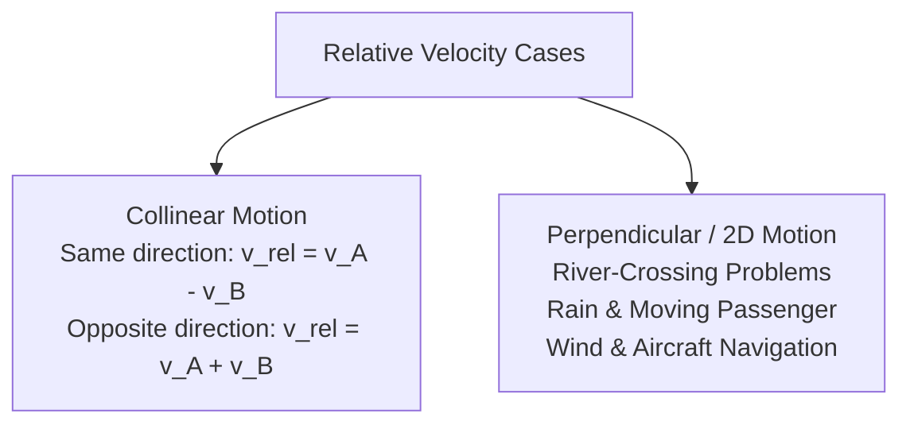
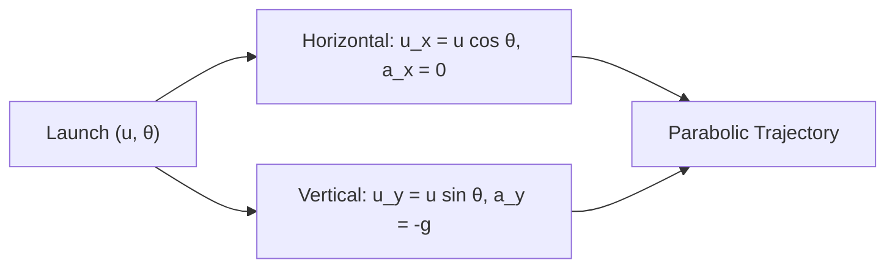

# :LiRocket: Subtopic: Vectors & Equations of Motion Guide

> [!ABSTRACT] Core Focus
> Detailed practical and analytical guide for Kinematics in 1D and 2D: Vector resolution, Relative Velocity across frames of reference, Graphical motion analysis ($s-t, v-t, a-t$), and full derivations of Projectile Motion equations.

---

## 1. Vector Resolution & Operations

For any coplanar vector $\vec{A}$ inclined at angle $\theta$ to the horizontal axis:
$$A_x = A \cos\theta, \quad A_y = A \sin\theta$$
$$|\vec{A}| = \sqrt{A_x^2 + A_y^2}, \quad \tan\theta = \frac{A_y}{A_x}$$

### Resultant of Multiple Coplanar Vectors:
$$\Sigma X = \sum A_i \cos\theta_i, \quad \Sigma Y = \sum A_i \sin\theta_i$$
$$R = \sqrt{(\Sigma X)^2 + (\Sigma Y)^2}, \quad \tan\alpha = \frac{\Sigma Y}{\Sigma X}$$

---

## 2. Relative Velocity

The velocity of object $A$ relative to reference object $B$ is the vector difference:
$$\vec{v}_{A/B} = \vec{v}_A - \vec{v}_B = \vec{v}_A + (-\vec{v}_B)$$

### Classic Relative Velocity Problems:
1. **River Crossing**:
   - Let velocity of water be $\vec{v}_w$ and velocity of boat in still water be $\vec{v}_{b/w}$.
   - True velocity of boat: $\vec{v}_b = \vec{v}_{b/w} + \vec{v}_w$.
   - **Crossing in Shortest Time**: Steer perpendicular to bank ($\theta = 90^\circ$). $t_{\text{min}} = \frac{d}{v_{b/w}}$ (boat drifts downstream).
   - **Crossing along Shortest Path (Directly Across)**: Resultant velocity must be perpendicular to bank. Steer upstream at angle $\sin\alpha = \frac{v_w}{v_{b/w}}$ ($v_b = \sqrt{v_{b/w}^2 - v_w^2}$). (Possible only if $v_{b/w} > v_w$).
2. **Rain & Walking Person**:
   - Rain falls vertically with velocity $\vec{v}_r$; person moves horizontally with velocity $\vec{v}_p$.
   - Apparent velocity of rain relative to person: $\vec{v}_{r/p} = \vec{v}_r - \vec{v}_p$.
   - Angle to hold umbrella with vertical: $\tan\theta = \frac{v_p}{v_r}$.

---

## 3. Graphical Motion Analysis ($s-t, v-t, a-t$)

| Graph | Slope / Gradient Represents | Area Under Curve Represents |
| :--- | :--- | :--- |
| **Displacement–Time ($s-t$)** | Instantaneous Velocity ($v = \frac{ds}{dt}$) | *No direct physical meaning* |
| **Velocity–Time ($v-t$)** | Instantaneous Acceleration ($a = \frac{dv}{dt}$) | Net Displacement ($s = \int v dt$) |
| **Acceleration–Time ($a-t$)** | Jerk ($\frac{da}{dt}$) | Change in Velocity ($\Delta v = \int a dt$) |

---

## 4. Projectile Motion Full Derivations

Consider a particle projected from ground level with initial speed $u$ at an angle $\theta$ to the horizontal in a uniform gravitational field $g$ (neglecting air resistance):
- Horizontal component: $u_x = u\cos\theta, \quad a_x = 0$ (constant velocity)
- Vertical component: $u_y = u\sin\theta, \quad a_y = -g$ (constant downward acceleration)

### 1. Velocity at Any Time $t$:
$$v_x = u_x = u\cos\theta$$
$$v_y = u_y - gt = u\sin\theta - gt$$
$$v = \sqrt{v_x^2 + v_y^2}, \quad \tan\phi = \frac{v_y}{v_x}$$

### 2. Time of Flight ($T$):
At landing on horizontal plane, vertical displacement $s_y = 0$:
$$s_y = u_y T - \frac{1}{2}g T^2 = 0 \implies (u\sin\theta)T - \frac{1}{2}gT^2 = 0$$
Since $T \ne 0$:
$$T = \frac{2u\sin\theta}{g}$$
*(Time to reach peak height: $t_{\text{peak}} = \frac{u\sin\theta}{g} = \frac{T}{2}$).*

### 3. Maximum Vertical Height ($H_{\text{max}}$):
At maximum height, vertical velocity momentarily vanishes ($v_y = 0$):
$$v_y^2 = u_y^2 - 2g H_{\text{max}} \implies 0 = (u\sin\theta)^2 - 2g H_{\text{max}}$$
$$H_{\text{max}} = \frac{u^2 \sin^2\theta}{2g}$$

### 4. Horizontal Range ($R$):
$$R = u_x \cdot T = (u\cos\theta)\left(\frac{2u\sin\theta}{g}\right) = \frac{u^2 (2\sin\theta\cos\theta)}{g}$$
$$R = \frac{u^2 \sin 2\theta}{g}$$

> [!NOTE] Key Projectile Properties
> - **Maximum Range ($R_{\text{max}}$)**: Occurs when $\sin 2\theta = 1 \implies 2\theta = 90^\circ \implies \theta = 45^\circ$, where $R_{\text{max}} = \frac{u^2}{g}$.
> - **Complementary Launch Angles**: For angles $\theta$ and $(90^\circ - \theta)$, ranges are identical since $\sin(2(90^\circ - \theta)) = \sin(180^\circ - 2\theta) = \sin 2\theta$.
> - **Trajectory Equation**:
>   Substituting $t = \frac{x}{u\cos\theta}$ into $y = (u\sin\theta)t - \frac{1}{2}gt^2$:
>   $$y = x\tan\theta - \frac{g x^2}{2u^2 \cos^2\theta} = x\tan\theta - \frac{g x^2 (1 + \tan^2\theta)}{2u^2}$$
>   This represents an inverted parabola.

---

## :LiRocket: Flashcards (Spaced Repetition)

#flashcards

How is the relative velocity of body $A$ with respect to body $B$ defined? :: $\vec{v}_{A/B} = \vec{v}_A - \vec{v}_B = \vec{v}_A + (-\vec{v}_B)$.

In river crossing, what is the heading angle required to cross in the shortest possible time? :: Steer perpendicular to the river banks ($\theta = 90^\circ$ relative to bank); $t_{\text{min}} = \frac{d}{v_{b/w}}$.

Under what physical condition can a boat cross a flowing river directly opposite with zero drift? :: The boat speed in still water must be strictly greater than the river speed ($v_{b/w} > v_w$); heading angle is $\sin\alpha = \frac{v_w}{v_{b/w}}$ upstream.

If rain is falling vertically at speed $v_r$ and a person walks horizontally at speed $v_p$, at what angle with the vertical must the umbrella be held? :: $\tan\theta = \frac{v_p}{v_r}$ inclined forward in the direction of motion.

What does the area under an Acceleration-Time ($a-t$) graph represent? :: The net change in velocity ($\Delta v = v - u = \int a dt$).

State the derivation for the Time of Flight $T$ of a projectile launched at speed $u$ and angle $\theta$. :: Vertical displacement $s_y = 0 \implies (u\sin\theta)T - \frac{1}{2}gT^2 = 0 \implies T = \frac{2u\sin\theta}{g}$.

State the derivation for the Maximum Vertical Height $H_{\text{max}}$ of a projectile. :: Vertical velocity $v_y = 0 \implies (u\sin\theta)^2 - 2g H_{\text{max}} = 0 \implies H_{\text{max}} = \frac{u^2\sin^2\theta}{2g}$.

State the derivation for the Horizontal Range $R$ of a projectile. :: $R = u_x \cdot T = (u\cos\theta)\left(\frac{2u\sin\theta}{g}\right) = \frac{u^2 \sin 2\theta}{g}$.

Why do launch angles $\theta$ and $90^\circ - \theta$ produce identical ranges? :: $\sin(2(90^\circ - \theta)) = \sin(180^\circ - 2\theta) = \sin 2\theta$, so range $R = \frac{u^2\sin 2\theta}{g}$ is identical.

State the Cartesian equation of the trajectory of a projectile launched from the origin. :: $y = x\tan\theta - \frac{g x^2}{2u^2 \cos^2\theta} = x\tan\theta - \frac{g x^2 (1 + \tan^2\theta)}{2u^2}$.
