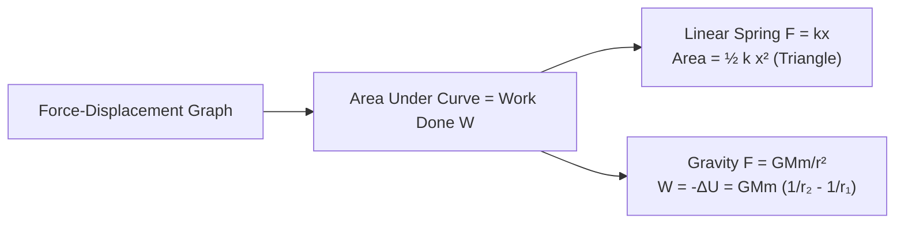
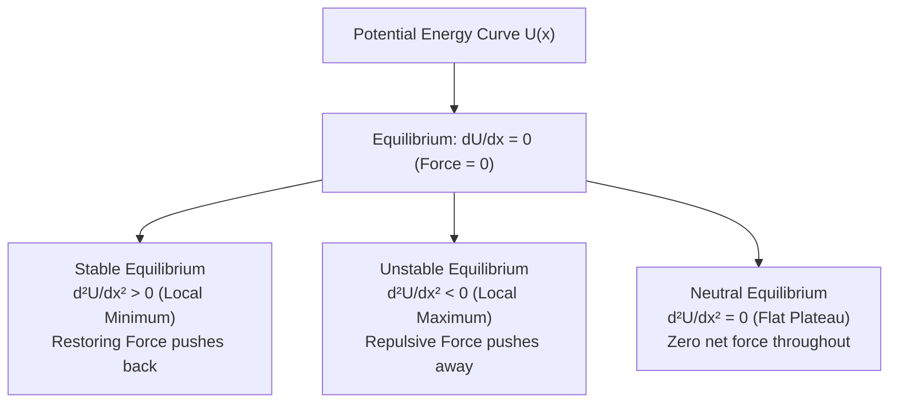
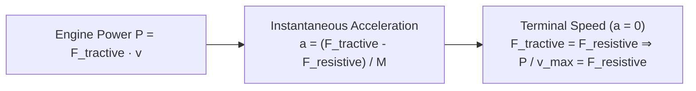

# :LiZap: Subtopic: Work, Energy, Power & Collisions Guide

> [!ABSTRACT] Core Focus
> Advanced analytical guide for Work, Energy, Power, and Collision Dynamics in Sri Lankan GCE A/L Physics: Work by variable forces, spring combinations, conservative potential fields, engine tractive power and terminal velocity, 1D/2D elastic and inelastic collisions, coefficient of restitution, and kinetic energy loss derivations.

---

## 1. Work Done by Variable Forces & Springs

### General Definition:
Work done by a force $\vec{F}$ displacing a body along a path from $\vec{r}_1$ to $\vec{r}_2$:
$$W = \int_{\vec{r}_1}^{\vec{r}_2} \vec{F} \cdot d\vec{r} = \int_{x_1}^{x_2} F_x dx$$
*(Represented physically by the **area under the Force-Displacement graph**).*

---

### Elastic Potential Energy of Ideal Springs (Hooke's Law):
For a spring with force constant (stiffness) $k$:
$$F = kx$$
$$E_{\text{elastic}} = \int_0^x kx dx = \frac{1}{2}kx^2 = \frac{1}{2}Fx = \frac{F^2}{2k}$$

### Combinations of Springs:

| Configuration | Setup Description | Equivalent Spring Constant ($k_{\text{eq}}$) | Extension / Force Characteristics |
| :--- | :--- | :---: | :--- |
| **Series Combination** | End-to-end connection | $\frac{1}{k_{\text{eq}}} = \frac{1}{k_1} + \frac{1}{k_2} \implies k_{\text{eq}} = \frac{k_1 k_2}{k_1 + k_2}$ | Same tension force $F$ in both springs; total extension $x = x_1 + x_2$. |
| **Parallel Combination** | Side-by-side connection | $k_{\text{eq}} = k_1 + k_2$ | Same extension $x$ for both springs; total restoring force $F = F_1 + F_2$. |

---

## 2. Conservative Fields, Potential Energy & Equilibrium

A force field $\vec{F}$ is **conservative** if the work done in moving a particle between two points is independent of the path taken.
$$F(x) = -\frac{dU}{dx}$$

---

## 3. Power Mechanics & Vehicle Dynamics

The instantaneous power delivered by an engine generating a tractive force $F_{\text{engine}}$ at speed $v$:
$$P = \vec{F}_{\text{engine}} \cdot \vec{v} = F_{\text{engine}} \cdot v \implies F_{\text{engine}} = \frac{P}{v}$$

### Motion Scenarios:
1. **Level Road with Resistance $F_{\text{res}}$**:
   $$F_{\text{net}} = F_{\text{engine}} - F_{\text{res}} = M a \implies \frac{P}{v} - F_{\text{res}} = M a$$
   - Instantaneous acceleration: $a = \frac{1}{M}\left(\frac{P}{v} - F_{\text{res}}\right)$.
   - Maximum (terminal) velocity ($a = 0$):
     $$v_{\text{max}} = \frac{P}{F_{\text{res}}}$$
2. **Ascending an Incline of Angle $\theta$**:
   $$\frac{P}{v} - (F_{\text{res}} + M g \sin\theta) = M a$$
   - Maximum climbing speed ($a = 0$):
     $$v_{\text{max, up}} = \frac{P}{F_{\text{res}} + M g \sin\theta}$$
3. **Descending an Incline of Angle $\theta$**:
   $$\frac{P}{v} + M g \sin\theta - F_{\text{res}} = M a$$

---

## 4. Comprehensive Collision Theory

In any closed, isolated system ($\Sigma \vec{F}_{\text{ext}} = 0$):
$$\sum \vec{p}_{\text{initial}} = \sum \vec{p}_{\text{final}} \implies m_1 u_1 + m_2 u_2 = m_1 v_1 + m_2 v_2$$

### Coefficient of Restitution ($e$):
Newton's Experimental Law of Impact:
$$e = \frac{\text{Speed of Separation}}{\text{Speed of Approach}} = \frac{v_2 - v_1}{u_1 - u_2}$$
- $e = 1$: **Perfect Collision (Elastic)** (Kinetic energy conserved).
- $0 < e < 1$: **Inelastic Collision** (Kinetic energy lost).
- $e = 0$: **Completely Inelastic Collision** (Bodies coalesce and move with common velocity $v$).

---

### Derivation of Post-Collision Velocities in 1D:
Solving $m_1 u_1 + m_2 u_2 = m_1 v_1 + m_2 v_2$ and $v_2 - v_1 = e(u_1 - u_2)$ simultaneously:
$$v_1 = \left(\frac{m_1 - e m_2}{m_1 + m_2}\right) u_1 + \left(\frac{(1 + e)m_2}{m_1 + m_2}\right) u_2$$
$$v_2 = \left(\frac{(1 + e)m_1}{m_1 + m_2}\right) u_1 + \left(\frac{m_2 - e m_1}{m_1 + m_2}\right) u_2$$

#### Special Cases for Perfectly Elastic Collisions ($e = 1$):
1. **Identical Masses ($m_1 = m_2$)**:
   $$v_1 = u_2, \quad v_2 = u_1$$
   *(The bodies **exchange their velocities completely**).*
2. **Massive Target at Rest ($m_2 \gg m_1, u_2 = 0$)**:
   $$v_1 \approx -u_1, \quad v_2 \approx 0$$
   *(Light projectile rebounds with same speed; massive target remains essentially stationary).*
3. **Massive Projectile hitting Stationary Light Target ($m_1 \gg m_2, u_2 = 0$)**:
   $$v_1 \approx u_1, \quad v_2 \approx 2 u_1$$
   *(Massive projectile continues unaffected; light target is propelled forward at double speed).*

---

### Kinetic Energy Loss in Inelastic Collisions ($\Delta E_k$):
$$\Delta E_k = E_{k,\text{initial}} - E_{k,\text{final}} = \frac{1}{2}\left(\frac{m_1 m_2}{m_1 + m_2}\right)(1 - e^2)(u_1 - u_2)^2$$
*(Notice that when $e = 1$, $\Delta E_k = 0$, confirming energy conservation in elastic collisions; maximum loss occurs when $e = 0$).*

---

### 2D Oblique Collisions:
When two smooth spherical bodies collide obliquely:
- Forces act strictly along the common normal line at the point of contact.
- **Along Common Tangent**: No force acts $\implies$ tangential velocity components are **conserved individually**:
  $$v_{1t} = u_{1t}, \quad v_{2t} = u_{2t}$$
- **Along Common Normal**: Linear momentum and Newton's experimental law of restitution apply:
  $$m_1 u_{1n} + m_2 u_{2n} = m_1 v_{1n} + m_2 v_{2n}$$
  $$v_{2n} - v_{1n} = e(u_{1n} - u_{2n})$$

---

### The Ballistic Pendulum:
A bullet of mass $m$ fired horizontally with speed $v_0$ into a suspended wooden block of mass $M$:
1. **Inelastic Collision Phase**:
   $$m v_0 = (m + M) V \implies V = \left(\frac{m}{m + M}\right) v_0$$
2. **Swing Phase (Energy Conservation)**:
   $$\frac{1}{2}(m + M)V^2 = (m + M)gh \implies V = \sqrt{2gh}$$
3. **Muzzle Velocity of Bullet**:
   $$v_0 = \left(\frac{m + M}{m}\right) \sqrt{2gh}$$

---

## :LiRocket: Flashcards (Spaced Repetition)

#flashcards

How is conservative force related to potential energy function $U(x)$? :: $F(x) = -\frac{dU}{dx}$.

How are stable and unstable equilibrium distinguished mathematically on a potential energy curve $U(x)$? :: Both have $\frac{dU}{dx} = 0$; Stable has $\frac{d^2U}{dx^2} > 0$ (local minimum); Unstable has $\frac{d^2U}{dx^2} < 0$ (local maximum).

What is the equivalent spring constant of two springs $k_1$ and $k_2$ in series? :: $\frac{1}{k_{\text{eq}}} = \frac{1}{k_1} + \frac{1}{k_2} \implies k_{\text{eq}} = \frac{k_1 k_2}{k_1 + k_2}$.

What is the equivalent spring constant of two springs $k_1$ and $k_2$ in parallel? :: $k_{\text{eq}} = k_1 + k_2$.

What is the formula for tractive force $F_{\text{engine}}$ developed by an engine of power $P$ at instantaneous speed $v$? :: $F_{\text{engine}} = \frac{P}{v}$.

What is the maximum steady speed of a vehicle of engine power $P$ against constant resistance $F_{\text{res}}$ on a level road? :: $v_{\text{max}} = \frac{P}{F_{\text{res}}}$.

What is the maximum steady speed of a vehicle of mass $M$ climbing an incline of angle $\theta$ with resistance $F_{\text{res}}$? :: $v_{\text{max}} = \frac{P}{F_{\text{res}} + M g \sin\theta}$.

Define the Coefficient of Restitution $e$ between two colliding bodies. :: $e = \frac{\text{Relative speed of separation}}{\text{Relative speed of approach}} = \frac{v_2 - v_1}{u_1 - u_2}$.

What happens to velocities when two identical masses ($m_1 = m_2$) collide head-on perfectly elastically ($e = 1$)? :: The two bodies completely exchange their velocities ($v_1 = u_2, v_2 = u_1$).

State the formula for kinetic energy loss $\Delta E_k$ in an inelastic head-on collision. :: $\Delta E_k = \frac{1}{2}\left(\frac{m_1 m_2}{m_1 + m_2}\right)(1 - e^2)(u_1 - u_2)^2$.

In an oblique collision between two smooth spheres, what happens to velocity components along the common tangent? :: They remain completely unchanged because no force acts along the common tangent ($v_{1t} = u_{1t}$ and $v_{2t} = u_{2t}$).

In a ballistic pendulum, what is the formula for bullet muzzle speed $v_0$ in terms of bullet mass $m$, block mass $M$, and swing height $h$? :: $v_0 = \left(\frac{m + M}{m}\right)\sqrt{2gh}$.
