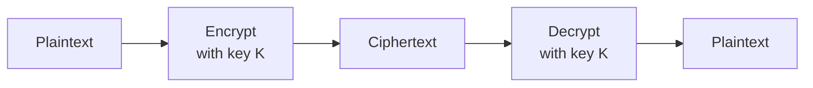
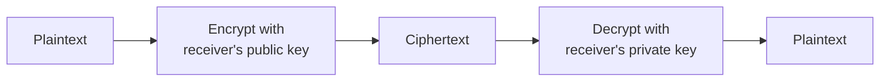
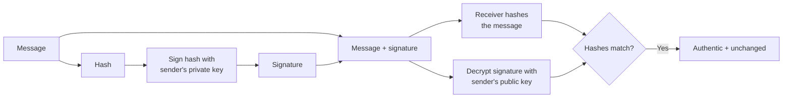

# :LiBook: Lesson 05: Operating Systems

> [!ABSTRACT] Syllabus Scope (NIE Teacher's Guide 5.1-5.4)
> - 5.1 OS need, evolution, functions, classification
> - 5.2 File/directory management, allocation, defrag, formatting
> - 5.3 Process management, interrupts, states, PCB, context switch, schedulers
> - 5.4 Memory management (MMU, paging, virtual memory) + I/O (drivers, spooling)
> - Security tie-in: encryption, hashing & digital signatures (OS application; core 6.11)

---

## 1. Role, Evolution & Key Functions of an Operating System

An **Operating System (OS)** is system software that provides a virtual machine (hides hardware), manages resources (tracks/grants permissions), and executes applications. Interface between hardware and user/applications.

### Evolution

1. **No OS (1940s-50s)**: serial processing, single user, direct hardware via lights/switches. Idle during I/O.
2. **Simple Batch**: jobs on magnetic tape, run one-by-one, output to tape then print. No direct hardware access, uniprogramming, high response time.
3. **Multiprogrammed Batch (3rd gen)**: memory partitioned for multiple programs; when one waits for I/O, CPU switches. Keeps CPU ~100% busy. Core of modern OS.
4. **Time-Sharing**: minimise response time, context switching, illusion of concurrent execution, quick response.

### Core OS Functions:
1. **Providing interfaces / abstractions**: directories, files, data to user.
2. **Process Management**: creating, scheduling, terminating processes; CPU allocation (traffic controller).
3. **Resource Management**: memory, I/O devices, storage.
4. **Security & Protection**: authentication, permissions, encryption, resource protection.
5. **Device / IO Management**: via Device Drivers, spooling.

## 2. Types of Operating Systems

NIE classifies by **users** and **tasks**:

- **By users**: Single-user (one at a time) vs Multi-user (many at same/different time).
- **By tasks**: Single-task (one program) vs Multi-task (many programs).
- **Single user – single task**: one user, one task (e.g. MS-DOS).
- **Single user – multi task**: one user, many programs (e.g. Windows, Linux desktop).
- **Multi user – multi task**: many users concurrently (e.g. Unix server).
- **Multi-threading**: thread = subprocess; parallel sub-process execution for performance.
- **Real-Time OS (RTOS)**: precise, predictable response; costly downtime / safety (medical, missile).
- **Time-Sharing**: CPU time shared among users/apps; quick response, less idle. Distinct from multiprogramming (which maximises CPU use, not interactivity).

> [!INFO] Multiprogramming vs Time-Sharing
> Multiprogramming keeps many programs in memory to avoid CPU idle. Time-sharing rapidly switches to give interactive response. multiprogramming needs scheduling; time-sharing needs context switching.

---
## 3. Process Management & CPU Scheduling

A **Process** is a program in execution. A program may have many processes. Needs: PID, code, data, context (PC, priority, I/O state).

- **Types**: I/O-bound (much I/O) vs CPU-bound (much computation).
- **Creation reasons**: new batch job, user starts program, OS service, running program spawns another.
- **OS tasks at creation**: assign PID, allocate PCB, allocate memory/I/O, set state to Ready, queue it.
- **Termination reasons**: normal exit, time-limit exceeded, resource unavailable, execution/memory error, OS/parent request, parent terminated. OS reclaims resources.
- **Program vs Process**: program = static code on disk; process = dynamic execution with PCB, state, resources.

### Interrupts & Handling

**Interrupt** = event altering execution sequence (timer expiry, OS call, I/O completion). Asynchronous, unpredictable. Example: disk signals completion.

Handling: CPU is slower than I/O wait, so OS saves current process state (in PCB), runs another process. On I/O done, device interrupts, OS restores original process.

> [!INFO] Deep Dive Note
> For PCB fields, 5-state + 7-state diagrams, long/medium/short schedulers, and FCFS/SJF/RR worked examples, read: [[Subtopics/OS Process & Memory Management|OS Process & Memory Management Guide]].
> For what the PC, SP and status flags actually hold, and how a context switch saves them, read: [[Subtopics/CPU Architecture & the Instruction Cycle|CPU Architecture, Registers, ALU & the Instruction Cycle]].

### States & Transitions

Syllabus expects **seven-state model** (suspended states for swapping):

`New` -> `Ready` <-> `Running` -> `Terminated`, plus `Running` -> `Waiting/Blocked` -> `Ready`, plus `Suspended Ready / Suspended Blocked` for swapped-out processes.

Simplified 5-state: `New` $\rightarrow$ `Ready` $\rightleftarrows$ `Running` $\rightarrow$ `Terminated` (or `Running` $\rightarrow$ `Waiting` $\rightarrow$ `Ready`).

- **PCB (Process Control Block)**: per-process data — PID, state, program counter, CPU registers, memory info (page/segment tables, limits), I/O status (devices, open files), priority/pointer/accounting.
- **Context Switch**: save/restore registers + PCB to resume later. Pure overhead, affects performance. Enables multitasking.
- **Metrics**: Turnaround = completion-arrival; Waiting = turnaround-burst (time in ready queue); Response = first CPU-arrival; Throughput = processes / time.

### Process Schedulers (syllabus focus):

| Scheduler | Other name | Job |
|---|---|---|
| **Long-term** | Job scheduler | Admits programs to system, controls degree of multiprogramming, mixes CPU/I/O-bound. Slowest. |
| **Medium-term** | Swapping scheduler | Swaps processes main memory <-> secondary storage. Medium speed. |
| **Short-term** | CPU scheduler / dispatcher | Picks next Ready process for CPU. Fastest. |

### CPU Scheduling Algorithms (common examples):
- **FCFS (First-Come, First-Served)**: Non-preemptive; arrival order (convoy effect).
- **SJF (Shortest Job First)**: Preemptive or not; smallest burst first (optimal avg wait).
- **Round Robin (RR)**: Preemptive; fixed **Time Quantum** cyclically.
- Preemptive = OS can interrupt (RR); Non-preemptive = runs till block/exit (FCFS).

---
## 4. Memory Management & Virtual Memory

OS tracks every location, decides who gets how much/when, allocates/deallocates.

- **MMU (Memory Management Unit)**: hardware mapping virtual -> physical. Base + offset: e.g. base `10000` + user `100` = `10100`. User never sees real addresses.
- **Physical Memory**: actual RAM frames.
- **Frame**: fixed-size block of physical RAM (e.g. one 4KB slot). **Page**: same-size block of a process's logical memory mapped to a frame.
- **Paging**: logical = pages, physical = fixed frames (512B-8KB). Non-contiguous, page table translates. Internal fragmentation only.
- **Mapping**: OS maps logical to physical at allocation; MMU does runtime translation.
- **Segmentation**: variable logical segments (functions/arrays). External fragmentation.
- **Virtual Memory**: run programs larger than RAM. Pages/frames equal size, load on demand (**Demand Paging**), swap to disk. Goals: larger apps, partial load, higher multiprogramming degree, portability, sharing (read-only code).

### Fragmentation Quick Reference
| Type | Cause | Where It Happens | Solution |
|------|-------|------------------|----------|
| **Internal** | Fixed-size allocation units (blocks/frames/pages) larger than requested memory | **Paging**, Fixed Partitioning | Use smaller page/frame size (trade-off: larger page table) |
| **External** | Variable-size allocations leave scattered small free holes | **Segmentation**, Dynamic Partitioning, Contiguous Allocation | **Compaction** (relocate processes), or use **Paging** / Segmented Paging |

> [!TIP] Remember
> - **Internal** = *Inside* the allocated block (wasted space *within* a frame/page)
> - **External** = *Outside* / *between* allocated blocks (free memory fragmented into unusable holes)

### I/O Device Management
- **Device Driver**: software interface to hardware; depends on both hardware + OS. OS installs appropriate driver per peripheral.
- **Spooling (Simultaneous Peripheral Operations On-Line)**: buffer (memory/disk) holding I/O jobs for slow devices. OS spools, maintains buffer, allows parallel compute + I/O (read tape + write disk + print). Advantage: disk as large buffer, overlap I/O with CPU.

---
## 5. File System & User Interfaces

### Files & Directories

- **File**: named collection of related bytes. Logical view (user: records/pixels/bytes) vs Physical view (OS: possibly non-contiguous blocks).
- **Attributes**: name, type, owner, location, organization (sequential/indexed/random), permissions, dates (created/modified/accessed), size.
- **Types by extension**: executable `.exe`, text `.txt/.docx`, image `.bmp/.png/.jpeg`, video `.vob/.flv`, audio `.wav/.mp3`, compressed `.zip/.rar`.
- **File structure**: format OS understands (text = lines, object = machine blocks).
- **Hierarchy**: directories organise files logically.
- **File systems**: FAT (MS-DOS, File Allocation Table + root at fixed location, 2 copies) vs NTFS (recovery, Unicode, large disks, permissions/encryption). Unix uses indexed allocation.

### File Security

- Passwords + access privileges (read/write/delete per user).
- **Authentication** (OS duty): username/password, user attribute (fingerprint/retina/signature via input device).
- **Encryption** (see §6) protects file contents at rest; permissions control who can open the file.

### Storage Allocation (how OS gives disk blocks)

- **Contiguous**: adjacent blocks. Simple, easy access, but size must be known, hard to extend, external fragmentation.
- **Linked**: each block links to next (FAT example). No external fragmentation, grows easily, but many seeks.
- **Indexed**: index table of pointers created at file creation (UNIX example). No external fragmentation, ends at null pointer.

### Defrag & Formatting

- **Fragmentation**: scattered fragments -> unusable small free areas.
- **Defragmentation**: rearrange to combine free space.
- **Secondary storage**: non-volatile for source/exe/data/temp.
- **Disk formatting**: prepare device (low-level medium prep + partitioning to make visible + high-level new file system). High-level delete only removes links — data recoverable until overwritten.
- How the *media* retrieves a record: [[Subtopics/Sequential Direct & Random Access|Sequential vs Direct vs Random Access]].

### Interfaces
- **CLI (Command Line Interface)**: Text-based; low overhead, scripting (Linux shell, MS-DOS).
- **GUI (Graphical User Interface)**: WIMP (Windows, Icons, Menus, Pointer); user-friendly, higher demand.

---

## 6. Encryption & OS Security

> [!NOTE] Syllabus placement
> The NIE Teacher's Guide examines **encryption and digital signatures** under **Competency 6.11** (Lesson 06). This section covers the **OS security angle** — file/disk encryption and password hashing — plus the core 6.11 encryption concepts you need for exam questions.

### 6.1 Why encryption?

**Encryption** converts **plaintext** into **ciphertext** using an algorithm and a **key**, so that only someone with the correct key can recover the plaintext. **Cryptography** is the science of securing information; **cryptanalysis** is the attempt to break it.

| Security goal | Meaning | How it is achieved |
|---|---|---|
| **Confidentiality** | Only the intended recipient can read the data | **Encryption** |
| **Authentication** | Prove who sent a message / who is logging in | **Digital signature**, certificate, password |
| **Integrity** | Detect whether data was changed | **Hash** / digital signature |
| **Non-repudiation** | The sender cannot later deny sending or signing | **Digital signature** |

> [!IMPORTANT] Internet default
> The Internet does **not** provide confidentiality or authentication by itself. Encryption and digital signatures are added to provide them (TG 6.11).

### 6.2 Basic model

`Plaintext` → **encryption algorithm + key** → `ciphertext` → **decryption algorithm + key** → `plaintext`

- **Cipher** = the encryption algorithm.
- **Key** = the value that controls the transformation; in symmetric encryption it must be kept secret, while asymmetric encryption uses a public/private pair.
- **Symmetric** = same key both ways; **asymmetric** = a public/private key pair.

### 6.3 Symmetric key encryption

**Same key** is used to encrypt and decrypt. Also called **secret-key encryption**.

| Aspect | Detail |
|---|---|
| **Speed** | Fast; suitable for large files, disk encryption and network traffic |
| **Key distribution** | Sender and receiver must share the key **before** communication, over a secure channel |
| **Scalability** | For $n$ users, up to $n(n-1)/2$ keys are needed |
| **Examples** | **AES** (128/192/256-bit), 3DES (Triple DES), Blowfish; **DES** (Data Encryption Standard, 56-bit) is obsolete |
| **OS uses** | Full-disk encryption (BitLocker, LUKS, FileVault), file/folder encryption, encrypted backups |

> [!WARNING] Key-distribution problem
> Symmetric encryption is fast, but the shared key must reach both parties securely. Real systems therefore often use **asymmetric** cryptography to establish a symmetric **session key** (hybrid encryption).

### 6.4 Asymmetric key encryption

Each user has a **key pair**:

- **Public key** — can be shared openly.
- **Private key** — must be kept secret; never shared.

The two keys are mathematically related: what one key encrypts, the other decrypts (and what one signs, the other verifies).

| Purpose | Sender uses | Receiver/verifier uses |
|---|---|---|
| **Confidentiality** (encrypt a message) | Receiver's **public key** | Receiver's **private key** |
| **Authentication / digital signature** (sign a message) | Sender's **private key** | Sender's **public key** |

- **Slow** compared with symmetric encryption → used for small data, digital signatures and **key exchange**, not bulk data.
- Examples: **RSA**, **ECC** (Elliptic Curve Cryptography); **Diffie–Hellman** is used for key exchange, not for encrypting messages.
- Public keys must be **authenticated** (usually by a **digital certificate**) to prevent a **man-in-the-middle** replacing them.

> [!CAUTION] The classic trap
> **Public key encrypts, private key decrypts** — true for **confidentiality**.
> For a **digital signature**, it is the opposite: the sender signs with their **private key**, and anyone verifies with the sender's **public key**.

### 6.5 Hybrid encryption & TLS

Real systems combine both:

1. **Asymmetric** cryptography authenticates the server and establishes a shared **session key**.
2. **Symmetric** encryption protects the actual data with that session key.

This is how **HTTPS/TLS**, **SSH** and **VPNs** work. A **digital certificate** binds a public key to an identity and is signed by a **Certificate Authority (CA)**; the OS/browser trusts the CA.

> [!NOTE] HTTPS is not "only asymmetric"
> The TLS handshake uses asymmetric cryptography; the bulk of the traffic is protected with fast symmetric encryption.

### 6.6 Hashing vs encryption

| | **Encryption** | **Hashing** |
|---|---|---|
| Purpose | **Confidentiality** — hide data | **Integrity** / password storage / signatures |
| Reversible? | **Yes**, with the correct key | **No** — one-way |
| Output | Ciphertext (length depends on algorithm/padding) | Fixed-length **digest** |
| Key | Required | Normally no key (salt is added for passwords) |
| Examples | AES, RSA | SHA-256, SHA-3; MD5/SHA-1 are broken for security |
| Use in OS | Disk/file encryption, TLS | Password hashes, file integrity, digital signatures |

**Password storage:** the OS never stores plaintext passwords. It stores a **salted hash** (e.g. bcrypt, Argon2, PBKDF2). A **salt** is a random value stored with each password hash, so two users with the same password get different hashes and **rainbow tables** fail.

> [!WARNING] Hash ≠ encryption
> A hash **cannot be decrypted**. To check a password, the OS hashes the entered password (with the stored salt) and compares the hashes.

> [!NOTE] Encoding is not encryption
> **Base64** and similar encodings are reversible **without a key**; they are for data representation, not security.

### 6.7 Digital signatures

A **digital signature** proves **who signed** a message and that the message was **not changed**.

**Signing (sender):**

1. Hash the message.
2. Encrypt/sign the hash with the sender's **private key** → signature.
3. Send the message + signature (often with the sender's certificate).

**Verifying (receiver):**

1. Hash the received message.
2. Decrypt the signature with the sender's **public key**.
3. Compare the two hashes. If they match, the message is authentic and unchanged.

**Provides:** authentication, integrity, non-repudiation.
**Does not provide:** confidentiality — encrypt the message separately if secrecy is needed.

> [!CAUTION] Digital signature ≠ scanned signature
> It is a cryptographic value, not a picture of a handwritten signature.

### 6.8 How the OS uses encryption

| OS feature | What it protects | How it is unlocked | Examples |
|---|---|---|---|
| **File/folder encryption** | Individual files/directories at rest | User key/password | EFS (Encrypting File System, Windows), fscrypt (Linux), encrypted folders |
| **Full-disk encryption** | Entire volume, including OS and swap | Password, TPM (Trusted Platform Module), recovery key | BitLocker (Windows), LUKS (Linux), FileVault (macOS) |
| **Removable-media encryption** | USB/external drives | Password/key | BitLocker To Go, VeraCrypt |
| **Password storage** | Login credentials | One-way hash comparison | `/etc/shadow` (Linux), SAM (Security Account Manager, Windows) |
| **Secure boot / TPM** | Boot integrity and key storage | Firmware/TPM measurements | UEFI Secure Boot, BitLocker + TPM |
| **Network encryption** | Data in transit | TLS/SSH/VPN session keys | HTTPS, SSH, VPN |

> [!IMPORTANT] Permissions vs encryption
> **Permissions/ACLs** (Access Control Lists) stop other normal users from opening a file; they do **not** protect the data if the disk is removed or the OS is bypassed.
> **Encryption** protects data at rest if the media is stolen and the key is unavailable; it does **not** stop malware running as the logged-in user.
> Use **both** — they solve different problems.

**Key management:** back up recovery keys. A **lost key means lost data**; a **stolen key defeats encryption**. Encryption is only as strong as the key and password protecting it.

### 6.9 Limitations & exam traps

| Wrong idea | Correct idea |
|---|---|
| "Encryption replaces passwords/permissions." | Encryption is one layer; authentication, permissions, antivirus and backups are still needed. |
| "Encrypt with the sender's private key for confidentiality." | Encrypt with the **receiver's public key**; only the receiver's private key decrypts. |
| "Sign with the receiver's public key." | Sign with the **sender's private key**; verify with the sender's public key. |
| "A hash can be decrypted." | Hashing is **one-way**; it is not encryption. |
| "A digital signature provides confidentiality." | It provides authentication, integrity and non-repudiation; encrypt separately for secrecy. |
| "HTTPS uses only asymmetric encryption." | TLS uses **asymmetric** for the handshake/key exchange and **symmetric** for bulk data. |
| "Base64 is encryption." | Encoding has **no key** and is not security. |
| "The Internet is secure by default." | It provides neither confidentiality nor authentication by default. |
| "A longer key is always enough." | Key **management** and password strength matter; a stolen key defeats encryption. |
| "Full-disk encryption protects data while the PC is unlocked." | It protects data **at rest**; an unlocked session or malware running as the user can read it. |

---
## :LiRocket: Flashcards (Spaced Repetition)

#flashcards

What is an Operating System? :: System software that acts as an interface between computer hardware and the user/applications, managing hardware resources and execution.

What are the 4 stages of OS evolution? :: No OS (serial), Simple Batch (tape), Multiprogrammed Batch (multi-program memory), Time-Sharing (context switch, interactive).
<!--SR:!2026-09-29,4,270-->

What are the NIE main functions of an OS? :: Providing interfaces/abstractions, process management, resource management, security and protection.

Classify OS by NIE users/tasks. :: Single-single, single-multi, multi-multi, plus multi-threading, real-time, time-sharing.

What is multiprogramming vs time-sharing? :: Multiprogramming maximises CPU use by many in-memory programs; time-sharing minimises response via rapid switching.
<!--SR:!2026-09-28,3,250-->

What is a file (logical vs physical view)? :: Named bytes; logical = user records/pixels, physical = OS possibly non-contiguous blocks.
<!--SR:!2026-09-29,4,270-->

List 4 file attributes. :: Name, type/extension, owner, location, organization, permissions, dates, size.

What is FAT vs NTFS? :: FAT = MS-DOS table at fixed location, 2 copies; NTFS = recovery, Unicode, large disks, permissions/encryption.
<!--SR:!2026-09-29,4,270-->

What are the 3 disk allocation methods with examples? :: Contiguous (adjacent, external frag), Linked (FAT, links, many seeks), Indexed (UNIX, index table).
<!--SR:!2026-09-28,3,250-->

What is defragmentation? :: Rearranging scattered fragments to eliminate unusable small free areas.
<!--SR:!2026-09-28,3,250-->

What are the 3 parts of disk formatting? :: Low-level prep, partitioning (visible to OS), high-level new file system.

What is a Process vs Program? :: Program is static code; process is program in execution with PID/PCB/state.

Name I/O-bound vs CPU-bound processes. :: I/O-bound needs much I/O; CPU-bound needs much computation.
<!--SR:!2026-09-29,4,270-->

What is an interrupt and handling? :: Async event altering execution (I/O done); OS saves state to PCB, runs another, restores on interrupt.

What is a Process Control Block (PCB)? :: A data structure in the OS containing all information about a specific process (PID, state, CPU registers, memory pointers).
<!--SR:!2026-09-28,3,250-->

Name the 5 states in the standard Process State Model. :: 1. New, 2. Ready, 3. Running, 4. Waiting (Blocked), 5. Terminated.

What extra states does the 7-state model add? :: Suspended Ready and Suspended Blocked for swapped-out processes.
<!--SR:!2026-09-28,3,250-->

Compare long, short, medium-term schedulers. :: Long (job, admit, slowest), short (CPU/dispatcher, fastest), medium (swapping, middle).

What is the difference between Preemptive and Non-Preemptive CPU scheduling? :: Preemptive scheduling allows the OS to forcibly interrupt a running process (e.g., Round Robin); Non-Preemptive scheduling lets a process run until it voluntarily yields or terminates (e.g., FCFS).
<!--SR:!2026-09-29,4,270-->

Define turnaround, waiting, response, throughput. :: Turnaround completion-arrival; waiting in ready queue; response first CPU-arrival; throughput procs/time.
<!--SR:!2026-09-29,4,270-->

What is a context switch? :: Saving/restoring CPU registers + PCB to share CPU; pure overhead.

What is Paging in memory management? :: A memory management scheme that divides logical memory into fixed-size Pages and physical memory into fixed-size Frames.
<!--SR:!2026-09-26,1,230-->

What is the MMU base-register example? :: Base 10000 + user 100 = physical 10100; user never sees real address.
<!--SR:!2026-09-26,1,230-->

What is Virtual Memory? :: A technique that allows a computer to execute processes larger than physical RAM by storing portions of data on secondary storage and loading pages on demand.
<!--SR:!2026-09-29,4,270-->

What is Page Fault? :: An interrupt raised when a program accesses a page that is not currently loaded into physical RAM.
<!--SR:!2026-09-26,1,230-->

What is spooling and a device driver? :: Spooling = simultaneous peripheral buffer for slow I/O overlap; driver = software interface depending on hardware+OS.

Define encryption. :: Converting plaintext into ciphertext with an algorithm and key so that only authorised parties can recover the plaintext.

Symmetric vs asymmetric encryption? :: Symmetric uses the same key for encryption and decryption; asymmetric uses a public/private key pair.

Which key encrypts a message for confidentiality? :: The receiver's public key; only the receiver's private key can decrypt it.

Which key signs a digital signature, and which verifies it? :: The sender signs with their private key; anyone verifies with the sender's public key.

Why is asymmetric encryption not used for bulk data? :: It is much slower than symmetric encryption; it is used for key exchange, small data and digital signatures.

What is hybrid encryption (e.g. TLS)? :: Asymmetric cryptography authenticates/establishes a shared session key, then symmetric encryption protects the bulk data.

Difference between hashing and encryption? :: Encryption is reversible with a key and provides confidentiality; hashing is one-way and provides integrity/password verification.

What is a salt? :: A random value stored with a password hash so identical passwords produce different hashes and rainbow tables fail.

How is a digital signature created? :: Hash the message, sign/encrypt the hash with the sender's private key, then send the message plus signature.

What does a digital signature provide? :: Authentication, integrity and non-repudiation — not confidentiality.

What is a digital certificate? :: A CA-signed document binding a public key to an identity, used to trust public keys and prevent impersonation.

Give two OS examples of encryption at rest. :: Full-disk encryption (BitLocker/LUKS/FileVault) and file/folder encryption (EFS/fscrypt).

Permissions vs encryption? :: Permissions control who can open a file while the OS is running; encryption protects data at rest if the disk is stolen or the OS is bypassed.

Does the Internet provide confidentiality and authentication by default? :: No — encryption and digital signatures must add them.

Why is key management critical? :: A lost key means lost data; a stolen key defeats encryption.

Is Base64 encryption? :: No — it is reversible encoding without a key and provides no confidentiality.

What is non-repudiation? :: The sender cannot later deny having signed or sent the message; provided by a digital signature.

What is the key-distribution problem? :: Symmetric encryption requires both parties to share the same secret key securely before communicating.
<!--SR:!2026-09-26,1,230-->
