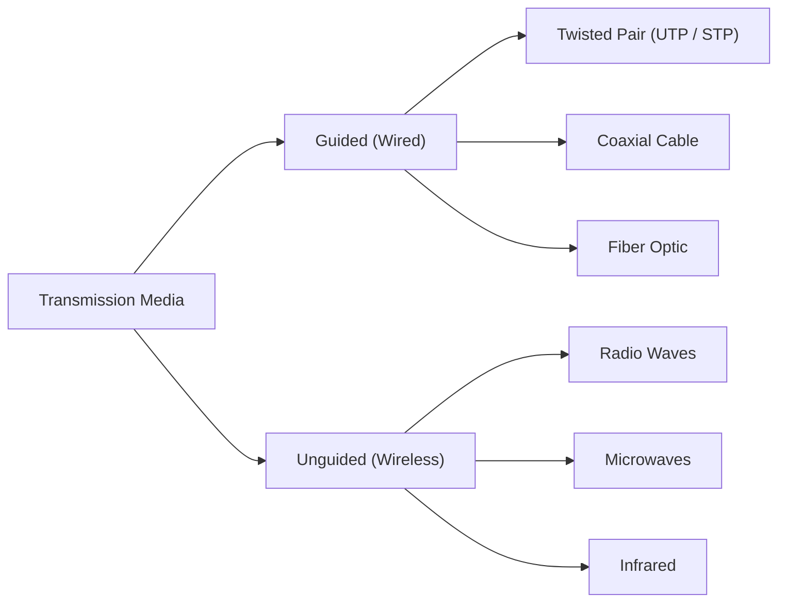
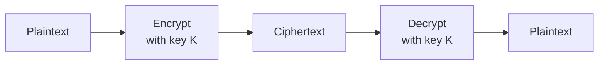
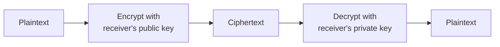
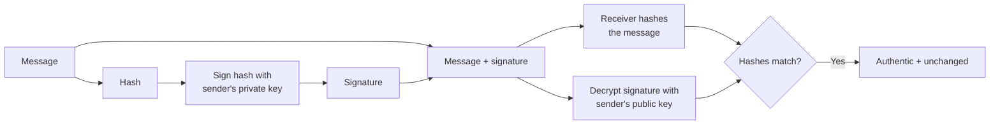

# :LiGlobe: Lesson 06: Data Communication & Computer Networking

> [!ABSTRACT] Scope
> A comprehensive guide to understanding how computers talk to each other. We will cover the physical properties of signals, the media they travel on, how we ensure they arrive intact, the devices that direct them, and the logical models (OSI & TCP/IP) that govern the entire process.
>
> **6.11 focus:** encryption, digital signatures, threats and protection for networked systems.

---

## 1. Fundamentals of Data Communication

Data communication is the exchange of data between two or more devices via some form of transmission medium. A complete communication system has five components:
1. **Message**: The data/information to be communicated.
2. **Sender**: The device sending the data.
3. **Receiver**: The device receiving the data.
4. **Transmission Medium**: The physical path (cable or wireless) the data travels on.
5. **Protocol**: A set of rules governing the communication (e.g., how to handle errors).

### 1.1 Data Flow Modes
- **Simplex**: One-way communication only (e.g., Radio broadcast, Keyboard to PC).
- **Half-Duplex**: Two-way, but **not simultaneously** (e.g., Walkie-Talkies).
- **Full-Duplex**: Two-way, **simultaneous** communication (e.g., Telephone calls).

### 1.2 Waves vs. Signals
- **Wave**: A physical phenomenon that carries energy (e.g., light, sound).
- **Signal**: An electronic voltage or current that carries **data/information**. A wave becomes a signal when it is used to carry information.

#### Properties of Waves/Signals:
- **Amplitude**: The height of the wave. Determines the strength/intensity.
- **Frequency ($f$)**: Number of cycles per second. Measured in Hertz (Hz).
- **Period ($T$)**: Time taken for one cycle. ($T = 1/f$).
- **Wavelength ($\lambda$)**: Distance between two consecutive identical points on the wave.
- **Phase**: The position of the wave at a specific point in time (often measured in degrees from 0 to 360).

---

## 2. Signal Transmission and Impairments

When a signal travels through a medium, it loses energy or gets distorted.

### 2.1 Transmission Impairments
1. **Attenuation**: The gradual loss of signal strength over a distance. (Solution: Use amplifiers for analog, or repeaters for digital signals).
2. **Distortion**: The signal changes its shape or form. Happens because different frequency components travel at different speeds.
3. **Noise**: Unwanted electrical/electromagnetic energy added to the signal (e.g., Thermal noise, Crosstalk, Impulse noise).

### 2.2 Latency, Bandwidth, and Throughput
- **Bandwidth**: The theoretical maximum capacity of a channel (how much data it *could* handle).
- **Throughput**: The actual, realized data rate (how much data successfully arrives). Always $\le$ Bandwidth.
- **Latency (Delay)**: The total time it takes for a message to travel from sender to receiver. It consists of:
  1. **Propagation Delay**: Time taken to travel the physical distance.
  2. **Transmission Delay**: Time taken to push all bits into the wire (Depends on file size and bandwidth).
  3. **Processing Delay**: Time taken by routers/switches to inspect the packet.
  4. **Queuing Delay**: Time the packet spends waiting in a router's buffer due to traffic.

---

## 3. Digital Encoding & Modulation

Computers understand binary (0s and 1s), but physical media carry waves.

### 3.1 Digital Encoding (Digital Data to Digital Signal)
Converting bits into electrical pulses.
- **NRZ (Non-Return to Zero)**: High voltage for 1, low voltage for 0. Fails to maintain synchronization if there's a long sequence of 0s or 1s.
- **Manchester Encoding**: Uses **transitions** to represent data. E.g., High-to-Low means 0, Low-to-High means 1. Because there is a transition in the middle of *every* bit, the receiver can easily synchronize its clock.

### 3.2 Modulation (Digital Data to Analog Signal)
Used when we need to send digital data over analog mediums (like telephone lines or radio waves). We use a high-frequency **Carrier Wave** and modify one of its properties:
- **ASK (Amplitude Shift Keying)**: Change the amplitude to represent 0 and 1.
- **FSK (Frequency Shift Keying)**: Change the frequency.
- **PSK (Phase Shift Keying)**: Change the phase (shift the wave).

### 3.3 Multiplexing
Sending multiple signals over a **single** communication link simultaneously.
- **TDM (Time Division Multiplexing)**: Devices take turns. Each gets a "time slot".
- **FDM (Frequency Division Multiplexing)**: The total bandwidth is divided into separate frequency bands (like radio stations).
- **WDM (Wavelength Division Multiplexing)**: Used in Fiber Optics. Different signals use different colors of light.

---

## 4. Transmission Media

1. **Twisted Pair**: Wires are twisted to cancel out Electromagnetic Interference (EMI). Can be Unshielded (UTP) or Shielded (STP). Uses RJ-45 connectors.
2. **Coaxial Cable**: Has a central copper core, dielectric insulator, metallic shield, and outer jacket. Highly resistant to noise.
3. **Fiber Optic**: Uses light (Total Internal Reflection) to transmit data. Immune to EMI, very high bandwidth, but expensive and fragile.

---

## 5. Network Topologies

How devices are arranged and connected.
- **Point-to-Point**: Direct link between two devices.
- **Bus**: All devices connect to a single central cable (backbone). Easy to install, but if the backbone fails, the network fails. Uses CSMA/CD to handle collisions.
- **Star**: All devices connect to a central device (Hub/Switch). If a cable breaks, only that PC is affected. If the Switch fails, the network fails.
- **Ring**: Devices connect in a closed loop. Data travels in one direction. A single break brings down the network.
- **Mesh**: Every device connects to every other device. High reliability and redundancy, but very expensive and complex to wire.
- **Tree**: A combination of Bus and Star.

---

## 6. Network Devices & Media Access Control (MAC)

When multiple devices share a medium, they need rules to avoid talking over each other (**Collisions**).
- **CSMA/CD (Carrier Sense Multiple Access with Collision Detection)**: Used in wired Ethernet. Devices "listen" to the wire. If clear, they transmit. If two transmit at once, a collision occurs, they detect it, stop, wait a random time, and retry.
- **CSMA/CA (Collision Avoidance)**: Used in Wi-Fi.

### Devices
- **Repeater**: (Layer 1) Amplifies a weak signal to extend its range.
- **Hub**: (Layer 1) Connects multiple devices. It is a "dumb" device—when it receives data on one port, it broadcasts it to **all** other ports. Creates high traffic and collisions.
- **Switch**: (Layer 2) Intelligent. It learns the **MAC Addresses** of connected devices. When data arrives, it forwards it *only* to the specific destination port.
- **Router**: (Layer 3) Connects different networks together (e.g., your LAN to the Internet). Routes packets based on **IP Addresses**.
- **Modem**: Modulates digital data into analog signals (for phone lines) and demodulates them back.
- **Firewall**: Filters incoming and outgoing traffic based on security rules to protect the network.

---

## 7. The OSI & TCP/IP Reference Models

To make networking standard, the ISO created the 7-Layer OSI model. The Internet actually uses the simpler 4-Layer TCP/IP model.

| OSI Layer (1 to 7) | TCP/IP Layer | Function | Protocol/Device | Data Unit |
| :--- | :--- | :--- | :--- | :--- |
| **7. Application** | Application | Interfaces with user apps (browsers, email) | HTTP, FTP, DNS | Data |
| **6. Presentation** | Application | Data formatting, encryption (see §8), compression | SSL/TLS, JPEG | Data |
| **5. Session** | Application | Establishes and maintains connections | RPC, NetBIOS | Data |
| **4. Transport** | Transport | End-to-end reliable delivery, Error recovery | TCP, UDP, Port #'s | Segment |
| **3. Network** | Internet | Routing across different networks, logical addressing | IP, Routers | Packet |
| **2. Data Link** | Network Access | Physical addressing, node-to-node delivery | MAC, Ethernet, Switch | Frame |
| **1. Physical** | Network Access | Transmitting raw bits over physical media | Cables, Hubs | Bits |

### Encapsulation & Decapsulation
- As data moves **down** the sender's OSI layers, each layer adds its own header (like putting a letter in an envelope, and then putting that envelope in a box). This is **Encapsulation**.
- As data moves **up** the receiver's layers, headers are stripped off. This is **Decapsulation**.

> [!INFO] IPv4 & Subnetting
> For a detailed breakdown of IP Classes, CIDR, and how to calculate subnets, see the [[Subtopics/IP Addressing & Subnetting|IP Addressing & Subnetting Guide]].

---

## 8. Network Security: Encryption & Digital Signatures (6.11)

> [!NOTE] Syllabus focus
> 6.11 asks you to explain **why confidentiality and authentication matter**, how **public/private keys** encrypt and sign messages, and how to protect networked systems from threats. Hashing, certificates, TLS details and at-rest examples below are supporting concepts that show how real systems apply encryption.

### 8.1 Security goals

**Encryption** converts **plaintext** into **ciphertext** using an algorithm and a **key**, so that only someone with the correct key can recover the plaintext. **Cryptography** is the science of securing information; **cryptanalysis** is the attempt to break it.

| Security goal | Meaning | How it is achieved |
|---|---|---|
| **Confidentiality** | Only the intended recipient can read the data | **Encryption** |
| **Authentication** | Prove who sent a message / who is connecting | **Digital signature**, certificate-based authentication, password |
| **Integrity** | Detect whether data was changed | **Hash** / digital signature |
| **Non-repudiation** | The sender cannot later deny sending or signing | **Digital signature** |

> [!IMPORTANT] Internet default
> The Internet does **not** provide confidentiality or authentication by itself. Encryption and digital signatures are added to provide them (TG 6.11).

### 8.2 Basic model

`Plaintext` → **encryption algorithm + key** → `ciphertext` → **decryption algorithm + key** → `plaintext`

- **Cipher** = the encryption algorithm.
- **Key** = the value that controls the transformation; in symmetric encryption it must be kept secret, while asymmetric encryption uses a public/private pair.
- **Symmetric** = same key both ways; **asymmetric** = a public/private key pair.

### 8.3 Symmetric key encryption

**Same key** is used to encrypt and decrypt. Also called **secret-key encryption**.

| Aspect | Detail |
|---|---|
| **Speed** | Fast; suitable for large files and high-speed network traffic |
| **Key distribution** | Sender and receiver must share the key **before** communication, over a secure channel |
| **Scalability** | If every pair needs a different key, up to $n(n-1)/2$ keys are needed |
| **Examples** | **AES** (128/192/256-bit), 3DES (Triple DES), Blowfish; **DES** (Data Encryption Standard, 56-bit) is obsolete |
| **Network uses** | TLS session data, VPN tunnels, Wi-Fi protection (WPA2/WPA3, AES-based), bulk file transfer |

> [!WARNING] Key-distribution problem
> Symmetric encryption is fast, but the shared key must reach both parties securely. Real systems therefore often use **asymmetric** cryptography to establish a symmetric **session key** (hybrid encryption).

### 8.4 Asymmetric key encryption

Each user has a **key pair**:

- **Public key** — can be shared openly.
- **Private key** — must be kept secret; never shared.

The two keys are mathematically related: what one key encrypts, the other decrypts (and what one signs, the other verifies).

| Purpose | Sender uses | Receiver/verifier uses |
|---|---|---|
| **Confidentiality** (encrypt a message) | Receiver's **public key** | Receiver's **private key** |
| **Authentication / digital signature** (sign a message) | Sender's **private key** | Sender's **public key** |

- **Slow** compared with symmetric encryption → used for small data, digital signatures and **key exchange**, not bulk data.
- Examples: **RSA**, **ECC** (Elliptic Curve Cryptography); **Diffie–Hellman** is used for key exchange, not for encrypting messages.
- Public keys must be **authenticated** (usually by a **digital certificate**) to prevent a **man-in-the-middle** replacing them.

> [!CAUTION] The classic trap
> **Public key encrypts, private key decrypts** — true for **confidentiality**.
> For a **digital signature**, it is the opposite: the sender signs with their **private key**, and anyone verifies with the sender's **public key**.

### 8.5 Hybrid encryption & TLS

Real systems combine both:

1. **Asymmetric** cryptography authenticates the server and establishes a shared **session key**.
2. **Symmetric** encryption protects the actual data with that session key.

This is how **HTTPS/TLS**, **SSH** and **VPNs** work. In **HTTPS/TLS**, a **digital certificate** binds a public key to an identity and is signed by a **Certificate Authority (CA)**; the OS/browser trusts the CA.

> [!NOTE] HTTPS is not "only asymmetric"
> The TLS handshake uses asymmetric cryptography; the bulk of the traffic is protected with fast symmetric encryption.

### 8.6 Hashing vs encryption

| | **Encryption** | **Hashing** |
|---|---|---|
| Purpose | **Confidentiality** — hide data | **Integrity** / password storage / signatures |
| Reversible? | **Yes**, with the correct key | **No** — one-way |
| Output | Ciphertext (length depends on algorithm/padding) | Fixed-length **digest** |
| Key | Required | Normally no secret key (a salt is added for passwords) |
| Examples | AES, RSA | SHA-256, SHA-3; MD5/SHA-1 are broken for security |
| Network use | TLS/VPN traffic, encrypted messages | Password hashes, file integrity, digital signatures |

**Password storage:** a secure system does not store plaintext passwords. It stores a **salted hash** (e.g. bcrypt, Argon2, PBKDF2). A **salt** is a random value stored with each password hash, so two users with the same password get different hashes and **rainbow tables** fail.

> [!WARNING] Hash ≠ encryption
> A hash **cannot be decrypted**. To check a password, the system hashes the entered password (with the stored salt) and compares the hashes.

> [!NOTE] Encoding is not encryption
> **Base64** and similar encodings are reversible **without a key**; they are for data representation, not security.

### 8.7 Digital signatures

A **digital signature** proves **who signed** a message and that the message was **not changed**.

**Signing (sender):**

1. Hash the message.
2. Encrypt/sign the hash with the sender's **private key** → signature.
3. Send the message + signature (often with the sender's certificate).

**Verifying (receiver):**

1. Hash the received message.
2. Decrypt the signature with the sender's **public key**.
3. Compare the two hashes. If they match, the message is authentic and unchanged.

**Provides:** authentication, integrity, non-repudiation.
**Does not provide:** confidentiality — encrypt the message separately if secrecy is needed.

> [!CAUTION] Digital signature ≠ scanned signature
> It is a cryptographic value, not a picture of a handwritten signature.

### 8.8 Encryption in transit vs at rest

| Context | Examples | What it protects |
|---|---|---|
| **In transit** | HTTPS/TLS, SSH, VPN, Wi-Fi WPA2/WPA3 | Data moving across a network |
| **At rest (disk)** | BitLocker/LUKS/FileVault, EFS/fscrypt | Data stored on a disk or device |
| **Removable media** | BitLocker To Go, VeraCrypt | USB/external drives |
| **Credentials** | Salted password hashes | Passwords (one-way, not encryption) |

> [!NOTE] OS vs network
> **At-rest** encryption is usually an OS feature (full-disk or file/folder encryption). **In-transit** encryption is provided by network protocols such as TLS, SSH and VPNs.

> [!IMPORTANT] Encryption vs access control
> Access control (permissions/ACLs) decides who may open a file while the OS is running. Encryption protects data at rest if the disk is stolen or the OS is bypassed. Use both.

### 8.9 Threats & protection (6.11)

| Threat | Description |
|---|---|
| **Virus** | Malicious code that often attaches to a file/program and runs when the file is executed, usually without the user's knowledge. |
| **Trojan** | A malicious program disguised as legitimate software; the user is tricked into installing/running it. |
| **Malware** | Umbrella term for malicious software, including viruses and Trojans. |
| **Phishing** | A fraudulent email/website pretending to be trustworthy to steal passwords, card numbers or other sensitive data. |

| Protection | Role |
|---|---|
| **Firewall** | Filters incoming/outgoing traffic using rules and blocks unauthorised access. |
| **Antivirus / anti-malware** | Detects, blocks or quarantines malicious software; keep definitions updated. |
| **Education / awareness** | Recognise phishing, use strong unique passwords, avoid unsafe links/downloads. |
| **Updates / patching** | Fix known vulnerabilities in the OS and applications. |
| **Encryption** | Protects confidentiality if data is intercepted. |

> [!IMPORTANT] Encryption is one layer
> Encryption does not stop malware, phishing or unauthorised access by itself. Use it together with firewalls, antivirus, updates and user awareness.

### 8.10 Key management & exam traps

**Key management:** public keys need trust (certificates); private keys must be protected. A **lost key means lost data**; a **stolen key** allows decryption or impersonation. Back up recovery keys and revoke compromised certificates.

| Wrong idea | Correct idea |
|---|---|
| "Encryption replaces passwords/firewalls." | Encryption is one layer; authentication, firewalls, antivirus and updates are still needed. |
| "Encrypt with the sender's private key for confidentiality." | Encrypt with the **receiver's public key**; only the receiver's private key decrypts. |
| "Sign with the receiver's public key." | Sign with the **sender's private key**; verify with the sender's public key. |
| "A hash can be decrypted." | Hashing is **one-way**; it is not encryption. |
| "A digital signature provides confidentiality." | It provides authentication, integrity and non-repudiation; encrypt separately for secrecy. |
| "A digital signature encrypts the whole message." | It signs a **hash**; the message remains readable unless separately encrypted. |
| "HTTPS uses only asymmetric encryption." | TLS uses **asymmetric** for the handshake/key exchange and **symmetric** for bulk data. |
| "Base64 is encryption." | Encoding has **no key** and is not security. |
| "The Internet is secure by default." | It provides neither confidentiality nor authentication by default. |
| "A longer key is always enough." | Key **management** and password strength matter; a stolen key defeats encryption. |
| "Symmetric encryption uses a public/private pair." | Symmetric uses **one shared key**; asymmetric uses a key pair. |
| "A digital certificate is the same as a digital signature." | A certificate binds an identity to a public key; a signature proves origin and integrity. |
| "The private key can be shared with the receiver." | The private key is **never shared**; only the public key is distributed. |
| "Encryption at rest protects data while the computer is unlocked." | It protects data **at rest**; an unlocked session or malware running as the user can read it. |

---

## :LiRocket: Flashcards (Spaced Repetition)

#flashcards

What is the difference between Bandwidth and Throughput? :: Bandwidth is the theoretical maximum capacity of a channel, while throughput is the actual, realized data transfer rate (which is always less than or equal to bandwidth due to overhead and latency).
<!--SR:!2026-10-30,3,250-->

What is the purpose of Manchester Encoding? :: It ensures there is a voltage transition in the middle of every bit, allowing the receiver to easily synchronize its clock with the sender and prevent timing errors.
<!--SR:!2026-10-28,1,210-->

Why is Fiber Optic cable immune to Electromagnetic Interference (EMI)? :: Because it transmits data using light pulses through glass/plastic instead of electrical signals through copper.
<!--SR:!2026-11-10,14,290-->

In a Star Topology, what happens if the central switch fails? :: The entire network goes down, as all devices rely on the central switch to communicate.
<!--SR:!2026-11-08,12,270-->

What is the difference between a Hub and a Switch? :: A hub broadcasts incoming data to all connected ports (causing collisions), whereas a switch inspects the MAC address and forwards the data only to the specific destination port.
<!--SR:!2026-10-30,3,250-->

What is the main function of the Network Layer (Layer 3) in the OSI model? :: Routing packets across different networks using logical IP addresses.
<!--SR:!2026-11-11,15,290-->

What is Encapsulation in networking? :: The process of adding protocol headers (and sometimes trailers) to data as it moves down the OSI layers from the Application layer to the Physical layer.
<!--SR:!2026-10-29,2,230-->

What does CSMA/CD stand for and where is it used? :: Carrier Sense Multiple Access with Collision Detection. It is used in wired Ethernet networks to manage medium access and handle collisions.

What is the difference between TCP and UDP? :: TCP is reliable, connection-oriented, and guarantees ordered delivery. UDP is fast, connectionless, and does not guarantee delivery (used for live streaming).
<!--SR:!2026-11-07,11,270-->

Define encryption. :: Converting plaintext into ciphertext with an algorithm and key so that only authorised parties can recover the plaintext.

Symmetric vs asymmetric encryption? :: Symmetric uses the same key for encryption and decryption; asymmetric uses a public/private key pair.

Which key encrypts a message for confidentiality? :: The receiver's public key; only the receiver's private key can decrypt it.

Which key signs a digital signature, and which verifies it? :: The sender signs with their private key; anyone verifies with the sender's public key.

Why is asymmetric encryption not used for bulk data? :: It is much slower than symmetric encryption; it is used for key exchange, small data and digital signatures.

What is hybrid encryption (e.g. TLS)? :: Asymmetric cryptography authenticates/establishes a shared session key, then symmetric encryption protects the bulk data.

Difference between hashing and encryption? :: Encryption is reversible with a key and provides confidentiality; hashing is one-way and provides integrity/password verification.

What is a salt? :: A random value stored with a password hash so identical passwords produce different hashes and rainbow tables fail.

How is a digital signature created? :: Hash the message, sign/encrypt the hash with the sender's private key, then send the message plus signature.

What does a digital signature provide? :: Authentication, integrity and non-repudiation — not confidentiality.

What is a digital certificate? :: A CA-signed document binding a public key to an identity, used to trust public keys and prevent impersonation.

Does the Internet provide confidentiality and authentication by default? :: No — encryption and digital signatures must add them.

Why is key management critical? :: A lost key means lost data; a stolen key allows decryption or impersonation.

Is Base64 encryption? :: No — it is reversible encoding without a key and provides no confidentiality.

What is non-repudiation? :: The sender cannot later deny having signed or sent the message; provided by a digital signature.

What is the key-distribution problem? :: Symmetric encryption requires both parties to share the same secret key securely before communicating.

Give two examples of encryption at rest. :: Full-disk encryption (BitLocker/LUKS/FileVault) and file/folder encryption (EFS/fscrypt).

Encryption vs access control? :: Access control decides who may use a resource; encryption protects data if it is intercepted or the storage is stolen. Use both.

Virus vs Trojan vs malware? :: A virus often attaches to files and spreads when executed; a Trojan disguises itself as legitimate software; malware is the umbrella term for malicious software.

What is phishing? :: A fraudulent message or website pretending to be trustworthy in order to steal passwords, card numbers or other sensitive data.

Firewall vs antivirus? :: A firewall filters network traffic using rules; antivirus detects, blocks or quarantines malicious software.