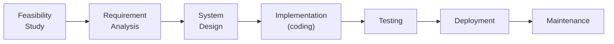
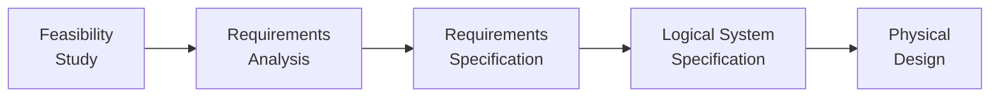
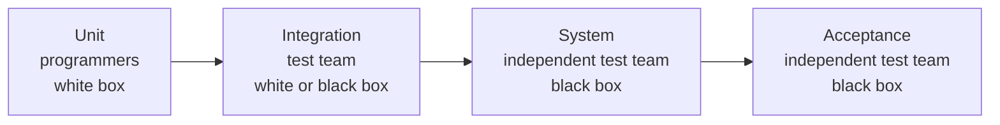

# :LiBook: Lesson 07: System Analysis & Design

> [!ABSTRACT] Syllabus Scope (NIE Teacher's Guide 7.1-7.10)
> - 7.1 Systems concept + characteristics + classification
> - 7.2 Manmade information systems (OAS-TPS-MIS-DSS-ESS-GIS-KMS-CMS-ERPS-Expert-Smart)
> - 7.3 SDLC models (Waterfall/Spiral/Agile/Prototyping/RAD) + Structured/OO
> - 7.4 SSADM intro + stages covered
> - 7.5 Preliminary investigation + feasibility (Technical/Economic/Operational/Organizational)
> - 7.6 Analysis: requirements + BAM/DFD/EPD/LDS + BSO
> - 7.7 Logical + physical design (UI, tables, data dictionary)
> - 7.8 Build + test (white/black, unit/integration/system/acceptance)
> - 7.9 Deployment (parallel/direct/pilot/phase) + aftercare
> - 7.10 Off-the-shelf packages (gap analysis, mapping, reengineering)

---

## 1. Systems Concept (7.1)

A **System** is an *orderly grouping of interrelated and interdependent components linked together according to a plan to achieve a specific objective*. It accepts **inputs**, **processes** them, and produces **outputs** within a **boundary**.

### 1.1 Elements of a system

| Element | Meaning |
|---|---|
| **Input** | Data, material or energy entering the system |
| **Process** | Transformation of input into output |
| **Output** | Result delivered to the environment |
| **Feedback** | Output information returned to control the input/process |
| **Control** | Compares feedback with the objective and adjusts the system |
| **Boundary** | Separates the system from its environment |
| **Environment** | Everything outside the boundary that interacts with the system |
| **Subsystems** | Components that are themselves systems (hierarchy) |

### 1.2 Characteristics

- **Purpose / objective** — every system exists to achieve a goal.
- **Boundary and environment** — defines what is inside and outside.
- **Inputs, processing, outputs** — the basic transformation loop.
- **Feedback and control** — keeps the system on target (cybernetics).
- **Hierarchy** — systems contain subsystems and are part of larger systems.
- **Interdependence** — a change in one component affects others.
- **Wholeness / synergy** — the whole is more than the sum of the parts.

### 1.3 Classification (with examples)

| Basis                            | Types                                                                          | Examples                                                |
| -------------------------------- | ------------------------------------------------------------------------------ | ------------------------------------------------------- |
| **Interaction with environment** | **Open** — interacts across the boundary, receives inputs and delivers outputs | Human respiratory system; an information system         |
|                                  | **Closed** — isolated from environmental influences                            | Human blood circulation system; a sealed lab experiment |
| **Origin**                       | **Natural** — made by nature                                                   | Human blood circulation system                          |
|                                  | **Manmade** — made by humans                                                   | Transportation system of a country                      |
| **Nature of components**         | **Living** — open, self-organising living things                               | Human respiratory system                                |
|                                  | **Non-living / physical** — made of non-living things                          | Solar system                                            |

> [!NOTE] NIE wording
> Living systems are **open, self-organising** systems that interact with their environment. Open/closed, natural/manmade and living/non-living are **three independent classifications** — a single system can be described by all three at once.

---

## 2. Manmade Information Systems (7.2)

Compare systems by **objective** (why it exists) and **functionality** (what it does).

| System                                  | Objective                                                                    | Main users               | Functionality / example                                                                                                 |
| --------------------------------------- | ---------------------------------------------------------------------------- | ------------------------ | ----------------------------------------------------------------------------------------------------------------------- |
| **OAS** — Office Automation System      | Increase office productivity                                                 | Clerical / all staff     | Word processing, email, work scheduling                                                                                 |
| **TPS** — Transaction Processing System | Perform and record daily routine transactions                                | Operational level        | POS billing, ATM, payroll, order entry                                                                                  |
| **MIS** — Management Information System | Provide routine **summary and exception reports** for planning and control   | Management level         | Sales summaries, stock reports from TPS data                                                                            |
| **DSS** — Decision Support System       | Support **semi-structured and unstructured** decisions                       | Management level         | Combines data with analytical models; what-if analysis                                                                  |
| **ESS** — Executive Support System      | Support **unstructured strategic** decisions                                 | Senior / strategic level | Dashboards, advanced graphics, communications                                                                           |
| **GIS** — Geographic Information System | Map, model, query and analyse data **by location**                           | Planners, analysts       | Digital maps, route and site analysis                                                                                   |
| **KMS** — Knowledge Management System   | Identify, create, represent and distribute **insight and experience**        | Knowledge workers        | Knowledge bases, expertise directories                                                                                  |
| **CMS** — Content Management System     | Create and modify **digital content** collaboratively                        | Web/content teams        | Web publishing, version control, indexing, search; separates content from presentation                                  |
| **ERP** — Enterprise Resource Planning  | Integrate **back-office** functions across the organisation                  | Whole organisation       | Product planning, development, manufacturing, sales and marketing; back-office functions in technology, services and HR |
| **Expert System** *(NIE reading extra)* | Replicate **human expert decision-making** using AI rules                    | Specialists              | Knowledge engineer encodes expert rules; medical diagnosis                                                              |
| **Smart System**                        | Make **predictive/adaptive** decisions by sensing, actuating and controlling | Automated environments   | Autonomous closed-loop control, energy efficiency, IoT                                                                  |

> [!TIP] TPS → MIS → DSS → ESS ladder
> **TPS** records what happened; **MIS** summarises it for managers; **DSS** adds models for "what if"; **ESS** presents strategic dashboards for executives. Each level serves a higher management level and uses more summarised, less detailed data.

---

## 3. SDLC Models + SSADM (7.3-7.4)

### 3.1 SDLC stages (Waterfall)

> [!NOTE] Order matters
> Feasibility comes **before** requirement analysis: the project must be approved before detailed requirements work is funded. Deployment is a separate stage from testing, and maintenance is **after** full operation — not the same as testing.

### 3.2 Development models

| Model | Approach | Best when | Main weakness |
|---|---|---|---|
| **Waterfall** | Strictly sequential; each stage's output feeds the next | Requirements are **clear and stable** | Inflexible; changes are expensive |
| **Spiral** | Iterative **+** sequential; each loop = objectives → risk analysis → development → planning | **Medium/high risk**, complex requirements, changes expected | Complex and costly; needs risk expertise |
| **Agile** | Time slices (**sprints**); deliver working features each release | Requirements are fixed **or** changing; fast feedback needed | Weak documentation; needs user involvement |
| **Prototyping** | Build a **partial** working version for user feedback | Requirements **unclear** | Users may mistake prototype for final product |
| **RAD** | Functional modules developed **in parallel** as prototypes, then integrated | Need **rapid delivery** with reusable components | Needs skilled team and stable module interfaces |

**Spiral phases (each iteration):** 1) determine objectives/alternatives/constraints → 2) **risk analysis** → 3) develop and validate the product → 4) plan the next iteration.

### 3.3 Development methodologies

| Methodology | View of the system | Main models |
|---|---|---|
| **Structured** | Process- and data-driven; follows well-defined steps/guidelines | DFD, ER/LDS, SSADM |
| **Object-Oriented** | Collection of **objects** that work interactively | UML class/use-case/sequence diagrams |

### 3.4 SSADM

**SSADM = Structured Systems Analysis and Design Methodology**, introduced in the **early 1980s** and adopted as a UK government standard by **CCTA**. It covers the SDLC **from feasibility study to physical design**, with the greatest focus on **analysis and design** (not coding, testing or deployment).

| SSADM stage | What happens |
|---|---|
| **Feasibility Study** | Analyse the business area; decide whether development is feasible |
| **Requirements Analysis** | Identify requirements; model the **current** business environment (processes and data) |
| **Requirements Specification** | Define detailed **functional and non-functional** requirements; introduce new processes for required processing and storage |
| **Logical System Specification** | Specify the system **logically**, ignoring technical constraints |
| **Physical Design** | Transform the logical design into a **physical** design under technical constraints |

> [!WARNING] Exam trap
> SSADM **does not** cover coding/testing/deployment. It stops at physical design. Also, its stage names are **not** the same as Waterfall's — do not merge "Requirements Analysis" and "Requirements Specification".

---

## 4. Preliminary Investigation + Feasibility (7.5)

Preliminary investigation is the **first stage of the SDLC**. It has **two phases**:

1. **Problem definition** — a preliminary survey to identify the **scope** of the system and the problems in the current system.
2. **Feasibility study** — evaluate whether the proposed system is **practical and beneficial** from both developers' and users' viewpoints.

### 4.1 Preliminary investigation tasks

1. **Identify problems** in the current system.
2. **Prioritize** information-system needs.
3. **Study the feasibility** of the proposed solution (the TG's second phase).

### 4.2 Feasibility types (NIE = 4)

| Type | Key question | Typical evidence |
|---|---|---|
| **Technical** | Does the technology exist, and do we have the skills/experience to build it? | Hardware/software availability, expertise, difficulty |
| **Economic** | Do the benefits justify the investment? | **Cost–benefit analysis** |
| **Operational** | Will users accept, support and actually use the system? | User willingness, resistance, training needs |
| **Organizational** | To what extent does the proposed system support the objectives of the organisation's strategy? | Strategic fit; the system is treated as a subset of the whole organisation |

> [!WARNING] TELOS vs TG
> Industry uses **TELOS** (+Legal +Schedule). NIE 7.5 lists only the **4** above. Write the 4 on paper; mention Legal/Schedule only if asked as extra.

### 4.3 Outcome

The feasibility study produces a **formal report** describing the **nature and scope** of the proposed solution. The project is then **approved or rejected**; if rejected, no further work is carried out.

---

## 5. Analysis: Requirements + Tools + BSO (7.6)

### 5.1 Requirement analysis

**Purpose:** study user needs to define the **problem domain and system boundaries**, discover how the system must interact with that domain, and **detect/resolve conflicts** between requirements.

| Type | Definition | Example |
|---|---|---|
| **Functional** | *What* activities the system must carry out — requested behaviour | "Calculate the monthly bill", "Issue a receipt" |
| **Non-functional** | *How well / within what limits* the requirement must be satisfied | Response time, security, usability, availability |

**IEEE wording:** essential requirements use **"shall"**; desirable ("nice to have") requirements use **"should"**. Requirements must be unambiguous, verifiable and traceable.

### 5.2 Analytical tools

| Tool | Purpose | Key content |
|---|---|---|
| **BAM** — Business Activity Model | Start-off technique to understand what is going on in the system under investigation | Shows business **activities** that actors in the environment do, and their **associations** |
| **DFM** — Data Flow Modelling | Model **data processing**; partition the system into subsystems | A **set of DFDs** + associated textual descriptions |
| **LDM** — Logical Data Modelling | Model the **data** processed by the processes found in DFM | **LDS** diagram + textual descriptions |
| **EPD** — Elementary Process Description | Describe each lowest-level process in enough detail for program specification | Plain text or **pseudocode** |
| **BSO** — Business System Options | Describe **what the system will do** as alternative options | See §5.6 |

### 5.3 DFM: components of a DFD

| Component | Represents | Properties / rules |
|---|---|---|
| **External entity** | People, organisations or other systems **outside** the system under investigation; source or recipient of data | Name must be a **generic type**, not an instance |
| **Data flow** | Data moving to, from or within the system; links the other components | One-way or two-way; **solid arrows**, but **dashed arrows between two external components**; avoid intersections |
| **Process** | A business activity carried out in the system | Three properties: **ID, Name, Location**; a process needing no further decomposition is an **elementary process** |
| **Data store** | Data held **within** the system | Three properties: **ID, Type, Name**; types: **M** manual, **D** computerised, **T** temporary, **T(M)** manual temporary |

> [!IMPORTANT] Context diagram ≠ all data stores
> A **context diagram** shows the whole system as **one process** plus its **external entities**. It does **not** show data stores or internal processes. (2020 MCQ 25 tested exactly this.)

### 5.4 DFD levels

| Diagram | Purpose | Rule |
|---|---|---|
| **Context diagram** | Highest abstraction; the entire system as a single process | Shows only external entities and system boundary flows |
| **Document flow diagram** | **Bridge** between the context diagram and Level 1; shows how documents (papers, conversations, data passed among computers) move through the system | The TG treats it as a bridge — not one of the numbered decomposition levels |
| **Level 1 DFD** | Higher-level overview of data processing | Shows major processes + data stores + flows; **consistent with the context** |
| **Lower-level DFDs** | Successive detail, top-down | Must be **consistent with the higher-level DFD** |
| **Elementary process** | Lowest process; needs no further decomposition | Described by an **EPD** |

**Physical vs logical DFM:** *physical* DFDs show how data **is actually** processed and stored in the **current** system; *logical* DFDs show how it **should** be processed and stored in the **proposed** system.

### 5.5 LDM / LDS

- **Entity** — a collection of logically associated, uniquely identifiable objects/concepts. **Not** the same as an *external entity* in DFM. Its property is an **attribute**; names must reflect the **type**, not an instance.
- **Relationship** — how entities relate: **physical** (physical links in the data structure) vs **logical** (business associations/rules).
- **Degree / cardinality** — number of occurrences of each entity in the relationship: **1:1, 1:M, M:N**.
- **Optionality** — whether the relationship must exist for **all** occurrences of the participating entities.
- **Entity matrix** — checks every possible **pair** of entities once to identify relationships; does **not** fully describe them.

### 5.6 BSO (Business System Options)

A BSO describes **what the system will do**. Each option must satisfy the **minimum system requirements** and contains:

1. Functional description
2. High-level technical description
3. Major benefits to the business
4. Approximate cost estimate
5. Development time scale
6. Impact on the organisation and other existing systems

> [!INFO] Deep Dive Note
> For DFD components and notation conventions, a worked context diagram, EPD writing, LDS, and the data dictionary, read: [[Subtopics/System Analysis DFD & ER Modeling|DFD & ER Modeling Guide]].

---

## 6. Design: Logical + Physical (7.7)

### 6.1 Logical DFM of the proposed system

Starting from the **elementary processes**, transform the current (physical) model into the logical model:

1. **Remove the process Location** — location is a physical constraint, not a logical function.
2. **Transform the process location into an external entity** — the person who actually performed that process in the physical DFM now supplies its inputs to the corresponding logical process.
3. **Remove purely human activities** and replace them with external entities.
4. **Add new processes** required by new functionality of the proposed system.
5. **Regroup the hierarchy** by functionality, rebuilding the levels upwards to the context diagram.
6. **Write the EPD** for each elementary process in **pseudocode**.

### 6.2 LDS for the proposed system

- Add **new entities** needed by new functionality.
- Provide the **logical data stores (entities)** used by the logical DFD.
- **Remove temporary data stores** that merely hold data temporarily.

### 6.3 User interface design

Design **input screens**, **outputs/reports** and **navigation** between screens, based on the logical processes and user roles.

### 6.4 Physical database design

Map the **logical schema** to a **relational schema**:

| Logical schema | Relational schema |
|---|---|
| Entity | **Table** |
| Attribute | **Field** |
| Instance of an entity | **Record** of a table |
| Unique attribute | **Primary key** |

Then:

1. **Normalise** all relations to **3NF**.
2. Write a **Table Specification** and a **Record Specification** for each relation.
3. Build the **data dictionary**.
4. Construct the database.

**Table specification:** table name, field names, data types, sizes, key/constraints.
**Record specification:** the record layout — field order and lengths.
**Data dictionary:** an integral part of the database holding **metadata** (data about data) — the actual database descriptions used by the DBMS.

---

## 7. Build + Test (7.8)

- **Program development** (coding) and **database development**.

### 7.1 Test cases

A **test case** is a set of actions executed to verify a particular feature or functionality. It is documented by the **Quality Assurance team** during development. In practice, a documented test case also records:

- the **input** data / steps,
- the **expected output**, and
- any **preconditions**.

### 7.2 Testing techniques

| | **White box testing** | **Black box testing** |
|---|---|---|
| Basis | **Internal implementation** / program code | **Requirements specification**; inputs and outputs |
| View | Sees the code and logic | Treats the software as a black box |
| Stage | **Early** stages | Later, functional stages |
| Typical scope | Relatively **small program units** | Whole functions/system behaviour |
| Test case derivation | Analysis of the code to exercise statements, branches and paths | From the requirements specification and expected I/O |
| Coverage goal | Exercise all internal components (statement, branch, path coverage) | Verify every specified function |

### 7.3 Testing levels (and who performs them)

| Level | Scope | Performed by | Technique |
|---|---|---|---|
| **Unit testing** | A single program unit (function/class/module) | **Programmers** | White box |
| **Integration testing** | Combined units / interfaces between them | Integration testers or test team | White box **or** black box |
| **System testing** | Whole system against requirements | Test team **independent** of the programmers | Black box |
| **Acceptance testing** | Whether the system is acceptable to users | Test team **independent** of the programmers and/or users who developed the system | Black box |

> [!NOTE] Alpha vs Beta (extra)
> **Alpha** = acceptance testing at the **developer's site** by internal staff. **Beta** = acceptance testing by **real users** at their own site. Neither is named in the NIE (which assigns acceptance testing to an independent test team), but both are standard industry terms.

---

## 8. Deployment + Aftercare (7.9)

**Software deployment** = all activities that make a software system available for use.

| Method | How it works | Advantages | Disadvantages |
|---|---|---|---|
| **Parallel** | Old and new systems run **simultaneously** until implementation is judged satisfactory | Most **foolproof**; easy fallback; users learn gradually | Most **time-consuming and expensive**; duplicate data entry and data-quality issues |
| **Direct** | Old system is **removed** and all users move to the new system **at once** | **Fastest** and **least expensive**; no mixed-system issues | **Riskiest**; no fallback; users must learn immediately; problems can be severe |
| **Pilot** | New system goes to a **small group** first, then rolls out | Valuable feedback; testers can train others; tests viability | Feedback may not represent the whole organisation; slower rollout |
| **Phased** | Incremental — by **location/business unit** or by **module** | Fewer simultaneous problems; lessons guide later phases; gradual adjustment | Confusing to run mixed systems; possible data-quality issues |

**After implementation:**

- Hardware/software **installation**
- **Data migration** from the old system
- **User training**
- **Review and support**
- **Maintenance**

**Maintenance** = changes to hardware, software and documentation after the system is in full operation, to keep it effective. It covers:

| Type | Purpose |
|---|---|
| **Corrective** | Fix errors/bugs discovered in operation |
| **Adaptive** | Respond to new requirements or a changed environment |
| **Perfective** | Improve performance, efficiency or maintainability |
| **Preventive** *(extra)* | Reduce the risk of future failures |

---

## 9. Off-the-Shelf Packages (7.10)

**COTS = Commercial Off-The-Shelf** packaged software, designed for a broad market rather than one organisation.

### 9.1 COTS vs custom-built

| | **COTS package** | **Custom-built system** |
|---|---|---|
| Fit | General; gaps must be bridged | Exact fit to requirements |
| Cost/time | Lower investment, faster implementation | Large initial investment, long development |
| Flexibility | Highly configurable through parameters, but the core design is fixed by the vendor | Fully modifiable as the business changes |
| Features | Many built-in features, some never used | Only the needed functions |
| Learning | Long learning curve; complex | Familiar workflow; easier to use |
| Competitive advantage | Competitors can buy the **same** package | Can do what competitors cannot |
| Integration | Limited to the vendor's interfaces; may be hard to integrate | Can be designed to integrate with existing/future systems |

### 9.2 Costs to compare

- **Investment cost** — licence/purchase + implementation.
- **Operational cost** — training, support, infrastructure.
- **Maintenance cost** — updates, upgrades, customisation.

### 9.3 Implementation process

1. **Identify package capabilities and workflows** — what the package can do.
2. **Business process gap analysis** — compare the business processes supported by the existing systems with those supported by the COTS package, and decide whether the organisation can accept the gap.
3. **Business process mapping** — teams of subject-matter experts draw step-by-step diagrams documenting how the business is currently carried out; then map those activities onto the package's workflow.
4. **Decide per gap**:
   - **Ignore** it (remove the requirement and live with the tool), or
   - **Reengineer** the business process to fit the package, or
   - **Extend/customise** the package (fully specify the new requirements).

> [!IMPORTANT] Business process
> A **business process** is a set of **activities, responsibilities, resources and data flows** that interact to accomplish a business function. Gap analysis compares *this* against the package — not against a vague "system requirement".
>
> **Business process modelling** analyses and optimises a business process by removing inefficiencies and bottlenecks.

> [!NOTE] Reengineering vs customisation
> **Business process reengineering** redesigns the **business process** (the NIE's "modify the business process" gap option); **customisation** changes the **package** (the NIE's "extend the solution" option).

---

## :LiRocket: Flashcards (Spaced Repetition)

#flashcards

Define a system. :: An orderly grouping of interrelated and interdependent components linked by a plan to achieve a specific objective, accepting inputs and producing outputs within a boundary.
<!--SR:!2026-11-01,4,270-->

Name 3 classifications of systems with examples. :: Open/closed, natural/manmade, living/physical; e.g. open IS vs closed lab experiment.
<!--SR:!2026-11-01,4,270-->

What is the difference between an open and a closed system? :: An open system interacts with its environment across its boundary (respiratory system, information system); a closed system is isolated from environmental influences (blood circulation).
<!--SR:!2026-11-01,4,270-->

What are the elements of a system? :: Input, process, output, feedback, control, boundary, environment and subsystems.

What is the difference between TPS, MIS, and DSS? :: TPS records transactions; MIS reports from TPS for managers; DSS models/what-if for decisions.

Which information system serves strategic-level executives with dashboards? :: ESS (Executive Support System).
<!--SR:!2026-11-01,4,270-->

Which system maps, models and queries data by location? :: GIS (Geographic Information System).

Which system separates content from presentation and supports collaborative digital content? :: CMS (Content Management System).
<!--SR:!2026-11-01,4,270-->

What is an expert system, and who builds its knowledge base? :: An AI system that reproduces expert decision-making; a knowledge engineer encodes the expert's rules.

What makes a system a "smart system"? :: It senses, actuates and controls in a predictive/adaptive way, often with autonomous closed-loop control and networking.

List the SDLC stages in the Waterfall model. :: Feasibility study -> Requirement analysis -> System design -> Implementation -> Testing -> Deployment -> Maintenance.
<!--SR:!2026-11-01,4,270-->

What is the main characteristic of the Spiral SDLC model? :: High emphasis on risk analysis and iterative development cycles.

Name the four phases of each Spiral iteration. :: Determine objectives/alternatives/constraints -> risk analysis -> develop and validate -> plan the next iteration.
<!--SR:!2026-11-01,4,270-->

When to use Prototyping vs Spiral? :: Prototyping when requirements unclear; Spiral for large high-risk projects.
<!--SR:!2026-11-01,4,270-->

What does SSADM cover? :: Structured analysis + logical/physical design stages (not coding/testing).
<!--SR:!2026-11-01,4,270-->

List the five SSADM stages. :: Feasibility study -> Requirements analysis -> Requirements specification -> Logical system specification -> Physical design.
<!--SR:!2026-11-01,4,270-->

What are the two phases of preliminary investigation? :: Problem definition (preliminary survey and scope) and the feasibility study.
<!--SR:!2026-11-01,4,270-->

What are the 3 preliminary investigation tasks? :: Identify current problems, prioritize information-system needs, and study feasibility.
<!--SR:!2026-10-31,3,250-->

What are the 4 NIE feasibility types? :: Technical, Economic, Operational, Organizational (Legal/Schedule are TELOS extras, not TG 7.5).
<!--SR:!2026-11-01,4,270-->

What does economic feasibility use to justify the investment? :: Cost–benefit analysis.
<!--SR:!2026-11-01,4,270-->

What is the output of a feasibility study? :: A formal report on the nature and scope of the proposed solution, leading to project approval or rejection.

Distinguish functional vs non-functional requirements. :: Functional = what it does; non-functional = how well (speed/security/usability).

What do "shall" and "should" mean in IEEE requirements? :: "Shall" = essential/mandatory; "should" = desirable/nice to have.

What is a Business Activity Model (BAM)? :: A start-off model showing the business activities performed by actors in the system environment and their associations.
<!--SR:!2026-11-01,4,270-->

What tools draw in 7.6? :: BAM, context/Level 1 DFD, document flow, EPD, LDS; then propose/select BSO.

What are the four components of a DFD? :: External entities, data flows, processes and data stores.
<!--SR:!2026-11-01,4,270-->

What are the three properties of a DFD process, and of a data store? :: Process: ID, name, location. Data store: ID, type, name.
<!--SR:!2026-10-31,3,250-->

What are the four data store types in SSADM? :: Manual (M), Computerised (D), Temporary (T), Manual Temporary T(M).
<!--SR:!2026-10-31,3,250-->

How are data flows between two external entities drawn? :: As dashed arrows; normal flows are solid arrows.

What must every DFD process have? :: At least one input AND one output flow (else black hole/miracle).
<!--SR:!2026-11-01,4,270-->

What is the role of the document flow diagram? :: It is the bridge between the context diagram and the Level 1 DFD, showing how documents/data pass through the system.
<!--SR:!2026-11-01,4,270-->

What is the difference between a physical and a logical DFD? :: Physical shows how data is actually processed/stored in the current system; logical shows how it should be processed/stored in the proposed system.
<!--SR:!2026-10-31,3,250-->

What is an EPD and data dictionary? :: EPD = pseudocode for each elementary process; dictionary = metadata catalogue of tables/fields.

What are the components of an LDS? :: Entities, attributes, relationships (physical/logical), degree/cardinality (1:1, 1:M, M:N) and optionality.

What is an entity matrix? :: A matrix that checks every pair of entities once to identify relationships; it does not fully describe them.

What must each Business System Option contain? :: Functional description, high-level technical description, business benefits, approximate cost, development timescale, and organisational impact.

How is a physical DFD converted to a logical DFD? :: Remove process locations, transform each process location into an external entity, remove purely human activities, add new processes, regroup by function, and write EPDs.

Map the logical schema to the relational schema. :: Entity -> table; attribute -> field; instance -> record; unique attribute -> primary key.

What does the data dictionary contain? :: Metadata — the actual database descriptions used by the DBMS.
<!--SR:!2026-11-01,4,270-->

What is a test case? :: A set of actions executed to verify a feature, documented by QA; in practice it records inputs/steps, expected output and preconditions.

White box vs black box? :: White tests internal code paths; black tests inputs/outputs without code.
<!--SR:!2026-11-01,4,270-->

Where do black-box test cases come from? :: From the requirements specification and intended functionality.

Name 4 tests in order. :: Unit -> integration -> system -> acceptance. (Alpha/beta are industry variants of acceptance testing, not TG terms.)

Who performs unit, integration, system and acceptance testing? :: Unit = programmers (white box); integration = integration testers/test team (white or black box); system = independent test team (black box); acceptance = test team independent of the programmers/users (black box).
<!--SR:!2026-11-01,4,270-->

What is alpha vs beta testing? :: Alpha is acceptance testing at the developer's site by internal staff; beta is by real users at their own site.

What is Direct Changeover deployment, and what is its major risk? :: Stopping the old system completely and immediately switching to the new system; high risk if the new system fails as there is no backup.

What is Parallel Running deployment? :: Operating the old system and new system simultaneously for a period until the new system is proven reliable.

Pilot vs phased deployment? :: Pilot = one site first then expand; phased = module-by-module or unit-by-unit rollout.

What are the four maintenance types? :: Corrective (fix errors), adaptive (new requirements/environment), perfective (improve performance), preventive (reduce future failure risk).

What is gap analysis for off-the-shelf? :: Compare business process needs vs package features to find misfits, then reengineer process or customize package.

What three choices exist for each COTS gap? :: Ignore/remove the requirement, reengineer the business process, or extend/customise the package.
<!--SR:!2026-11-01,4,270-->

What is business process mapping? :: Subject-matter experts draw step-by-step diagrams of how the business is currently carried out, so those activities can be mapped onto the package workflow.

Business process reengineering vs customisation? :: Reengineering changes the business process (to suit the package); customisation changes the package (to suit the business).
<!--SR:!2026-10-31,3,250-->

What costs must be compared for a COTS package? :: Investment, operational and maintenance costs.

Why can COTS packages reduce competitive advantage? :: Competitors can buy and use the same package, so it does not differentiate the business.
<!--SR:!2026-11-01,4,270-->
