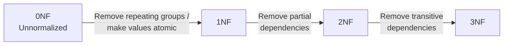

# :LiBook: Lesson 08: Database Management Systems

> [!ABSTRACT] Syllabus Scope (NIE Teacher's Guide, Competency 8)
> - **8.1** Data vs information; structured vs unstructured data; database definition; database models (flat file, hierarchical, network, relational, object-relational) and their comparison
> - **8.2** ER diagrams: entities, attributes, entity identifiers, relationships, cardinality; introduction to EER
> - **8.3** Logical schema: relational schema, relation instances, candidate/primary/alternate/foreign keys, domain
> - **8.4** Transforming ER diagrams into a logical schema (entity, attribute and relationship transformation)
> - **8.5** Relational model components + constraints (NOT NULL, UNIQUE, PRIMARY KEY, FOREIGN KEY, CHECK)
> - **8.6** DBMS and SQL: DDL, DML, SELECT queries and INNER JOIN
> - **8.7** Normalization: redundancy, anomalies, functional dependencies, 0NF–3NF

> [!INFO] Deep-Dive & Related Notes
> - **ER modelling:** [[Subtopics/System Analysis DFD & ER Modeling|DFD & ER Modeling Guide]]
> - **Normalization:** [[Subtopics/Database Normalization (1NF, 2NF, 3NF)|Database Normalization Guide]]
> - **SQL:** [[Subtopics/SQL Query Language Guide|SQL Query Language Guide]]
> - **Advanced EER:** [[Subtopics/Extended & Enhanced ER (EER) Modeling|Extended & Enhanced ER (EER) Modeling]]
> - **Data & information:** [[Lesson 01 - Basic Concepts of ICT|Lesson 01 §1–2]]
> - **System analysis & physical DB design:** [[Lesson 07 - System Analysis & Design|Lesson 07 §5.5, §6.4]]
> - **PHP/MySQL integration:** [[Lesson 10 - Web Development (HTML, CSS, PHP)|Lesson 10 §10.7]]
> - **Databases in marketing & ERP:** [[Lesson 12 - E-Commerce & Business Applications|Lesson 12 §9.3, §11]]

---

## 1. Data, Information & Databases (8.1)

### 1.1 Data vs Information

**Data** are raw, unprocessed facts; **information** is data that has been processed, organized and interpreted so that it has meaning and can support decisions. The same item can be data in one context and information in another.

> [!INFO] Related Note
> For the full comparison, the characteristics of valuable information and the data life cycle, see [[Lesson 01 - Basic Concepts of ICT|Lesson 01 §1–3]].

### 1.2 Structured vs Unstructured Data

| Aspect | **Structured Data** | **Unstructured Data** |
|---|---|---|
| **Definition** | Organized according to a predefined format, schema or model | Has no predefined format or organization |
| **Storage** | Tables, rows and columns | Free-form text, files, media |
| **Examples** | Databases, spreadsheets, standardized forms | Text documents, emails, images, videos, social media posts |
| **Characteristics** | Organized, tabular, easy to query, fixed format | Chaotic, varied, complex, flexible, exploratory |
| **Processing** | Easy to search and analyze with SQL | Harder to search; needs text mining, NLP or metadata |

> [!INFO] Semi-structured data
> **JSON** and **XML** are often called **semi-structured**: they have tags/keys that describe the data, but no rigid table schema. They sit between structured and unstructured data.

### 1.3 Database, DBMS and Database System

- **Database**: an organized collection of structured data, stored electronically or manually, so that it can be easily accessed, managed and updated.
- **DBMS (Database Management System)**: software that provides an interface between the database and its users/application programs. It lets users define, create, update, query and control a database.
- **Database system**: the complete environment made up of the **database**, **DBMS**, **application programs**, **users**, **hardware** and **metadata**.

> [!IMPORTANT] Data dictionary
> A **data dictionary** is an integral part of a database. It stores **metadata** — data about data — such as table names, field names, data types, sizes, keys and constraints. The DBMS uses it to understand and manage the database.

### 1.4 File-Based Systems vs DBMS

| File-Based System Drawbacks | DBMS Advantages |
|---|---|
| **Data redundancy and inconsistency** — same data is stored in several files | Centralized control reduces unnecessary duplication and inconsistency |
| **Data isolation** — data is scattered across files and hard to combine | Shared multi-user access with a query language such as SQL |
| **Integrity problems** — no centralized rules to validate data | Enforces entity, referential and domain integrity through constraints |
| **Atomicity and concurrency problems** — partial updates and simultaneous access cause errors | ACID transactions, locking and recovery protect concurrent access |
| **Security problems** — file-level access is difficult to control | User accounts, privileges and views restrict access |
| **Program-data dependence** — file structure is written into programs | Data independence: changes to storage do not usually break applications |
| **Difficult backup and recovery** | Built-in backup, restore and crash-recovery facilities |

---

## 2. Database Models (8.1)

A **database model** defines how data is structured, how records are related, and how data can be accessed.

| Model | Data structure | Relationships | Main strength | Main limitation | Typical use |
|---|---|---|---|---|---|
| **Flat File** | Single table/file; rows and delimited fields | None; no real relationships | Very simple; easy to read/write | Redundancy, no integrity rules, poor for large data | CSV, TXT, Excel, JSON, log files |
| **Hierarchical** | Tree with one root and parent–child links | One-to-many only; one parent per child | Fast navigation for strict hierarchies | Rigid; poor for many-to-many; hard to change | Organizational charts, file systems |
| **Network** | Graph of records linked by pointers | Many-to-many; a child may have several parents | Handles complex relationships; fast direct access | Complex design; no universal standard | Telecommunications, CAD |
| **Relational** | Tables (relations) of rows and columns | PK–FK relationships; 1:1, 1:N, M:N via junction tables | High integrity, flexible, SQL, normalization | Complex queries may need joins; less suitable for very complex data types | Business applications, general-purpose databases |
| **Object-Relational** | Relational tables + objects, classes, inheritance and methods | Supports complex objects and relationships | Handles multimedia, spatial and complex data | More complex design, management and querying | Complex applications, OOP environments |

### 2.1 Comparison of Models

| Feature | **Flat File** | **Hierarchical** | **Network** | **Relational** | **Object-Relational** |
|---|---|---|---|---|---|
| **Data integrity** | Low | Moderate | Moderate | High | High |
| **Flexibility** | Low | Low | Moderate | High | High |
| **Ease of querying** | Difficult, manual | Difficult; predefined paths | Complex; pointer traversal | Easy with SQL | Complex; extended SQL or OOP methods |
| **Performance** | High for simple data | High for hierarchical queries | High for complex relationships | Moderate to high | Moderate; added complexity |
| **Complex data** | Limited | Limited to hierarchy | Supports complex relationships | Simple to moderately complex | Supports complex data types |

> [!TIP] Exam angle
> If a question asks for the **most suitable model** for ordinary business data with many relationships and SQL queries, the answer is usually the **relational model**. If it asks about a strict tree such as an organizational chart, think **hierarchical**. If it asks about complex objects/multimedia, think **object-relational**.

---

## 3. Relational Database Fundamentals (8.3, 8.5)

### 3.1 Core Terminology

| Term | Meaning |
|---|---|
| **Relation** | A two-dimensional table made up of rows and columns |
| **Tuple** | A single row of a relation; one record |
| **Attribute** | A single column of a relation; one field/property |
| **Domain** | The set of allowed values for an attribute (data type, range or predefined list) |
| **Degree** | Number of attributes (columns) in a relation |
| **Cardinality** | Number of tuples (rows) in a relation at a given time |
| **Relation schema** | The structure/definition of a relation: relation name + attributes + domains |
| **Relation instance** | The actual set of tuples stored in a relation at a particular moment |
| **Relational schema** | The blueprint of the whole database: tables, columns, keys and relationships |
| **Logical schema** | A DBMS-independent design derived from the ER model, showing entities, attributes and relationships |
| **NULL** | A missing, unknown or not-applicable value — not zero and not an empty string |

> [!NOTE] Schema vs instance
> A **schema** is the design and changes rarely. An **instance** is the data currently stored and changes frequently.
>
> Example schema: `Student(StudentID INT PRIMARY KEY, Name VARCHAR(50), Age INT)`
> Example instance: the actual rows `(101, 'Kamal', 18)`, `(102, 'Nimal', 19)` at this moment.

### 3.2 Keys

| Key | Definition | Example |
|---|---|---|
| **Super key** | Any set of attributes that uniquely identifies each tuple; may contain extra attributes | `{StudentID, Name}` or `{StudentID}` |
| **Candidate key** | A **minimal** super key — no attribute can be removed and still uniquely identify a tuple | `StudentID`, `NIC` |
| **Primary key (PK)** | The candidate key chosen to uniquely identify each tuple; must be **UNIQUE** and **NOT NULL** | `StudentID` |
| **Alternate key** | A candidate key that was **not** chosen as the primary key | `NIC` |
| **Composite key** | A primary key made of two or more attributes | `(StudentID, CourseID)` in `Enrollment` |
| **Foreign key (FK)** | An attribute (or set) in one table that references the primary key (or a unique key) of another table | `Enrollment.StudentID → Student.StudentID` |
| **Unique key** | A key that enforces uniqueness but may allow NULL values | `Email` in `Users` |
| **Prime attribute** | An attribute that is part of **any candidate key** (including the chosen primary key) | `StudentID`, `CourseID` in `Enrollment` |
| **Non-prime attribute** | An attribute that is not part of any candidate key | `Grade` in `Enrollment` |

> [!IMPORTANT] Primary key vs foreign key
> - The **primary key** uniquely identifies a row **inside its own table**. It cannot be NULL.
> - The **foreign key** creates a link to another table and enforces **referential integrity**. A foreign key may be NULL unless it is also declared `NOT NULL`.
> - A foreign key value must either match an existing primary/unique-key value in the parent table or be NULL. Otherwise the DBMS rejects the change.

> [!NOTE] Referential integrity actions
> When a parent row is deleted or its key is updated, the DBMS can:
> - **RESTRICT / NO ACTION** — reject the operation if child rows exist.
> - **CASCADE** — delete or update the matching child rows automatically.
> - **SET NULL** — set the child foreign key to NULL.
> - **SET DEFAULT** — set the child foreign key to its default value.

> [!TIP] Super key vs candidate key
> Every candidate key is a super key, but not every super key is a candidate key. A candidate key must be **minimal**; a super key may contain unnecessary attributes. Example: `{StudentID}` is a candidate key; `{StudentID, Name}` is a super key but not a candidate key.

### 3.3 Constraints

| Constraint | Rule | Example |
|---|---|---|
| **NOT NULL** | The column must have a value; NULL is not allowed | `Name VARCHAR(50) NOT NULL` |
| **UNIQUE** | No two rows may have the same value in the column; NULL is usually allowed | `Email VARCHAR(100) UNIQUE` |
| **PRIMARY KEY** | Uniquely identifies each row; implies **NOT NULL + UNIQUE**; only one per table | `StudentID INT PRIMARY KEY` |
| **FOREIGN KEY** | Values must match a primary/unique key in the referenced table, or be NULL | `FOREIGN KEY (ClassID) REFERENCES Class(ClassID)` |
| **CHECK** | Every row must satisfy a condition | `CHECK (Marks >= 0 AND Marks <= 100)` |
| **DEFAULT** | Supplies a value when none is given | `Status VARCHAR(10) DEFAULT 'Active'` |
| **AUTO_INCREMENT / IDENTITY** | Automatically generates a sequential integer | `ID INT AUTO_INCREMENT PRIMARY KEY` |

> [!WARNING] Common exam traps
> - `PRIMARY KEY` already includes `NOT NULL` and `UNIQUE`; writing all three is redundant.
> - `UNIQUE` does **not** mean `NOT NULL`. A unique column can usually contain multiple NULLs.
> - A table can have only **one primary key**, but it can have several `UNIQUE` constraints.
> - A **foreign key** can reference a **primary key** or a **unique key**, not just any column.
> - A `CHECK` constraint is tested on insert and update; it is not a substitute for a foreign key.

---

## 4. ER Modeling (8.2)

### 4.1 Entities and Entity Identifiers

- **Entity**: a distinct real-world object, person, place, event or concept about which data is stored. Examples: `Student`, `Course`, `Order`, `Employee`.
- **Entity type**: the general category or definition (e.g., `Student`).
- **Entity instance**: one particular occurrence (e.g., the student with ID `101`).
- **Entity set**: the collection of all instances of an entity type.
- **Entity identifier (key attribute)**: an attribute (or set) that uniquely identifies each entity instance. It is shown with a **solid underline** in an ER diagram.
- In a Chen ER diagram, an entity is drawn as a **rectangle**, and an attribute as an **oval**.

> [!NOTE] Finding entities
> Look for the **nouns** in the system description: `Student`, `Course`, `Order`, `Payment`. Each noun that needs stored data and has a unique identifier is a likely entity. Avoid treating an attribute (e.g., `Name`) or an action (e.g., `Register`) as an entity unless it has its own identity and data.

> [!INFO] Deep Dive Note
> For ER symbols, cardinality and a step-by-step ERD walkthrough, see [[Subtopics/System Analysis DFD & ER Modeling|DFD & ER Modeling Guide]]. For the surrounding system-analysis context, see [[Lesson 07 - System Analysis & Design|Lesson 07 §5.5]].

**ER diagram notation (Chen model)**

| ER construct | Symbol |
|---|---|
| **Entity** | Rectangle |
| **Weak entity** | Double rectangle |
| **Attribute** | Oval |
| **Key attribute** | Underlined oval |
| **Multivalued attribute** | Double oval |
| **Derived attribute** | Dashed oval |
| **Partial key** | Dashed underline |
| **Relationship** | Diamond |
| **Identifying relationship of a weak entity** | Double diamond |
| **Total participation** | Double line |
| **Partial participation** | Single line |
| **Composite attribute** | Oval connected to smaller ovals |
| **Cardinality** | `1`, `N`, `M` written on the connecting lines |

> [!NOTE] ER diagram vs relational schema
> An ER diagram is a **conceptual** model: it shows entities, attributes and relationships, but **not foreign keys**. Foreign keys appear only after the ER diagram is mapped to a relational schema.

### 4.2 Types of Attributes

| Attribute type | Meaning | ER notation | Relational mapping |
|---|---|---|---|
| **Simple / atomic** | Cannot be divided further | Single oval | One column |
| **Composite** | Can be divided into sub-attributes | Oval with smaller connected ovals | Separate column for each component |
| **Single-valued** | Holds one value per entity instance | Single oval | One column |
| **Multivalued** | Holds multiple values for one entity instance | **Double oval** | New table with FK + attribute |
| **Stored** | Physically stored in the database | Single oval | One column |
| **Derived** | Calculated from other attributes | **Dashed oval** | Usually not stored; computed when needed |
| **Key** | Uniquely identifies an entity instance | **Underlined** oval | Primary key |
| **Non-key** | Does not uniquely identify the entity | Plain oval | Ordinary column |
| **Partial key** | Uniquely identifies a weak entity only within its owner | **Dashed underline** | Part of the composite primary key |
| **Descriptive** | Belongs to a relationship, not an entity | Attached to the relationship diamond | Column in the relationship/junction table |

**Examples**
- Simple: `Age`, `StudentID`
- Composite: `Name = (FirstName, MiddleName, LastName)`, `Address = (Street, City, PostalCode)`
- Single-valued: `DateOfBirth`
- Multivalued: `PhoneNo`, `Email`, `Qualification`
- Stored: `DateOfBirth`
- Derived: `Age` (derived from `DateOfBirth`)
- Key: `StudentID`
- Descriptive: `Grade` on the `Enrolls` relationship between `Student` and `Course`; `Date` on `Marriage`

> [!IMPORTANT] Multivalued attributes violate 1NF if stored in one column
> Never store a multivalued attribute as a comma-separated list such as `'Maths, ICT'`. It violates **First Normal Form**. Map it to a **separate table** with a foreign key back to the owner entity.

### 4.3 Relationships

- **Relationship**: an association between two or more entity instances. It is drawn as a **diamond** and named with a verb (e.g., `Enrolls`, `Works_In`, `Manages`).
- **Relationship set**: the collection of all relationship instances of the same type.
- **Descriptive attribute**: an attribute of the relationship itself (e.g., `Grade` on `Enrolls`, `Hours` on `Works_On`).

#### Degree of a Relationship

**Degree** = number of entity types participating in the relationship.

| Degree | Meaning | Example |
|---|---|---|
| **Unary** | One entity type relates to itself (recursive) | `Employee` supervises `Employee` |
| **Binary** | Two entity types participate | `Student` enrolls in `Course` |
| **Ternary** | Three entity types participate | `Supplier` supplies `Product` to `Store` |
| **N-ary** | Four or more entity types participate | A complex multi-party relationship |

#### Cardinality of a Relationship

**Cardinality** = how many instances of one entity can be associated with instances of another entity.

| Cardinality | Meaning | Example |
|---|---|---|
| **One-to-One (1:1)** | One instance of A relates to at most one instance of B, and vice versa | One `Person` has one `Passport` |
| **One-to-Many (1:N)** | One instance of A relates to many instances of B; each B relates to at most one A | One `Department` has many `Employees` |
| **Many-to-Many (M:N)** | Many instances of A relate to many instances of B | Many `Students` enroll in many `Courses` |

> [!NOTE] Degree vs cardinality
> **Degree** counts the **number of entity types** participating (unary, binary, ternary). **Cardinality** counts **how many instances** participate (1:1, 1:N, M:N). Some textbooks use “degree/cardinality” loosely for the 1:1/1:N/M:N ratio, but in ER modelling questions keep the two ideas separate.

#### Participation Constraints

| Constraint | Notation | Meaning | Example |
|---|---|---|---|
| **Total participation** | **Double line** from entity to relationship | **Every** instance of the entity **must** participate | Every `Dependent` must belong to an `Employee` |
| **Partial participation** | **Single line** from entity to relationship | An instance **may or may not** participate | An `Employee` may have zero `Dependents` |

### 4.4 Strong vs Weak Entities

| Aspect | **Strong Entity** | **Weak Entity** |
|---|---|---|
| **Key** | Has its own **primary key** | Has only a **partial key** + owner's PK → **composite PK** |
| **Dependence** | Exists independently | **Existence-dependent** on an owner entity |
| **ER notation** | Single rectangle; single diamond for relationships | **Double rectangle**, **double diamond** identifying relationship, partial key with **dashed underline** |
| **Participation** | May be total or partial | Always **total** in its identifying relationship |
| **Deletion** | Deleted independently | Often deleted automatically when the owner is deleted (cascading delete) |
| **Example** | `Student` (`StudentID`) | `Dependent` of `Employee` (`EmpID` + `Dep_Name` = PK) |

> [!TIP] Key distinction
> **Strong/weak** is about **identity** (own PK vs borrowed PK). **Total/partial participation** is about **whether participation is mandatory**. A weak entity always has total participation in its identifying relationship, but a strong entity can also have total participation (e.g., every `Order` must have a `Customer`).

### 4.5 Introduction to EER (Extended ER)

The NIE Teacher's Guide 8.2 requires an **introduction to EER diagrams**. EER extends basic ER with:

| EER concept | Meaning |
|---|---|
| **Specialization** | Defining subclasses from a superclass based on distinguishing properties (top-down) |
| **Generalization** | Combining common properties of several entity types into a general superclass (bottom-up) |
| **Inheritance** | A subclass inherits the attributes and relationships of its superclass |
| **Disjoint (`d`)** | A superclass instance can belong to **at most one** subclass |
| **Overlapping (`o`)** | A superclass instance can belong to **more than one** subclass |
| **Total (`t`)** | Every superclass instance must belong to at least one subclass |
| **Partial (`p`)** | A superclass instance may belong to no subclass |
| **Aggregation** | Treats a relationship as a higher-level entity so it can participate in another relationship |
| **Composition** | Strong ownership; the part cannot exist without the whole |

> [!INFO] Scope note
> TG 8.2 asks for an **introduction** to EER, so you should be able to define specialization, generalization and inheritance. The advanced EER details (disjoint/overlapping, aggregation, composition) are covered in [[Subtopics/Extended & Enhanced ER (EER) Modeling|Extended & Enhanced ER (EER) Modeling]] as an extension.

---

## 5. Mapping ER Diagrams to Relational Schema (8.4)

### 5.1 Basic Transformation Rules

| ER construct | Relational construct |
|---|---|
| **Entity** | Table |
| **Attribute** | Column |
| **Entity instance** | Row (record) |
| **Key attribute** | Primary key |
| **Relationship** | Foreign key or separate junction table |
| **Multivalued attribute** | Separate table |
| **Composite attribute** | Separate columns for each component |

The general transformation is:

> **System → Database; Entity → Table; Attribute → Column; Relationship → Key.**

### 5.2 Attribute Transformation

1. **Simple, single-valued, stored, non-key attributes** → ordinary columns.
2. **Key attributes** → primary key (underlined in the schema).
3. **Composite attributes** → each component becomes its own column. Do **not** create one column for the whole composite attribute.
   - `Name(FirstName, MiddleName, LastName)` → `FirstName`, `MiddleName`, `LastName`.
4. **Derived attributes** → usually **not stored**; compute them when needed.
   - `Age` is derived from `DateOfBirth`, so `Age` is not stored.
5. **Multivalued attributes** → create a **new table** containing:
   - the **foreign key** referencing the owner entity,
   - the multivalued attribute itself.
   - The new table's primary key is usually **(owner PK + multivalued attribute)**.
   - Example: `Student(StudentID, Name)` with `PhoneNo` → `StudentPhone(StudentID, PhoneNo)` with PK `(StudentID, PhoneNo)`.

> [!WARNING] Do not store multivalued attributes as lists
> `PhoneNo = '0711234567, 0777654321'` in one column violates 1NF. It causes redundancy, makes queries difficult and prevents indexing. Always use a separate table.

### 5.3 Relationship Transformation

| Relationship type | Mapping rule | Example result |
|---|---|---|
| **Binary 1:1** | Put the PK of one table into the other as an FK; add a `UNIQUE` constraint to enforce 1:1. Prefer the side with **total participation** to reduce NULLs. A separate relationship table is also possible. | `Person(PersonID, Name, PassportID UNIQUE)` and `Passport(PassportID, ...)` |
| **Binary 1:N** | Put the PK of the **“one”** side into the **“many”** side as an FK. Do **not** put the FK on the “one” side. | `Department(DeptID, Name)` and `Employee(EmpID, Name, DeptID FK)` |
| **Binary M:N** | Create a **junction/associative table** containing the PKs of both tables as FKs. The composite of both FKs is usually the PK. Relationship attributes go in this table. | `Student(StudentID, ...)`, `Course(CourseID, ...)`, `Enrollment(StudentID, CourseID, Grade)` with PK `(StudentID, CourseID)` |
| **Unary 1:1 or 1:N** | Add a **self-referencing FK** in the same table. For 1:N, the FK stores the parent/manager ID and may be NULL for top-level rows. For 1:1, add a `UNIQUE` constraint on the self-referencing FK. | `Employee(EmpID, Name, ManagerID FK → Employee.EmpID)` |
| **Unary M:N** | Create a separate junction table with **two FKs**, both referencing the same table's PK. | `Employee(EmpID, Name)` and `Manages(ManagerID, EmployeeID)` |
| **Ternary** | Create a new table containing the PKs of all participating entities as FKs. The composite of the FKs is usually the PK. Descriptive attributes go in this table. | `Delivery(SupplierID, ProductID, StoreID, DeliveryDate)` |

> [!IMPORTANT] 1:N — which side gets the foreign key?
> The foreign key always goes on the **“many”** side. In `Department 1:N Employee`, each employee belongs to one department, so `Employee` gets `DeptID`. Putting `EmpID` in `Department` would require repeating departments or storing a list of employees, which violates 1NF.

> [!IMPORTANT] M:N — why a junction table?
> A many-to-many relationship cannot be represented by a single foreign key in either table. A junction table stores one row per pairing, such as one row per student–course enrollment. This avoids repeating student or course data and allows relationship attributes such as `Grade`.

### 5.4 Relationship Attribute Placement

| Relationship type | Where descriptive attributes go |
|---|---|
| **1:1** | Either entity table, or a separate relationship table |
| **1:N** | The **“many”** side table (or a separate relationship table) |
| **M:N** | The **junction table** |
| **Unary 1:1 or 1:N** | Added as a column in the same table |
| **Unary M:N** | The separate junction table |
| **Ternary** | The separate linking table containing all three FKs |

### 5.5 Mapping Weak Entities

For a weak entity:

1. Create a table for the weak entity.
2. Include the **owner's primary key** as a **foreign key**.
3. Include the weak entity's **partial key**.
4. The primary key of the new table is the combination of the **owner PK + partial key**.
5. Add `ON DELETE CASCADE` if the weak entity cannot exist without its owner.

Example: `Employee(EmpID, Name)` and `Dependent(EmpID, DepName, Relationship)` with PK `(EmpID, DepName)` and FK `EmpID → Employee.EmpID`.

### 5.6 Worked Mapping Example

**ER description**
- A `Department` has many `Employees`; each `Employee` works in one `Department`.
- An `Employee` can work on many `Projects`, and a `Project` can have many `Employees`. Each assignment records `Hours`.

**Entities and relationships**
- `Department(DeptID, DeptName)`
- `Employee(EmpID, EmpName, Salary)`
- `Project(ProjID, ProjName)`
- `Department 1:N Employee`
- `Employee M:N Project` with descriptive attribute `Hours`

**Relational schema**
- `Department(DeptID, DeptName)` — PK `DeptID`
- `Employee(EmpID, EmpName, Salary, DeptID)` — PK `EmpID`; FK `DeptID → Department.DeptID`
- `Project(ProjID, ProjName)` — PK `ProjID`
- `Assignment(EmpID, ProjID, Hours)` — PK `(EmpID, ProjID)`; FKs `EmpID → Employee.EmpID` and `ProjID → Project.ProjID`

> [!TIP] Mapping checklist
> 1. Every entity becomes a table.
> 2. Every table gets a primary key.
> 3. 1:N → FK on the many side.
> 4. M:N → junction table with a composite PK.
> 5. Multivalued attributes → separate table.
> 6. Composite attributes → separate columns.
> 7. Derived attributes → not stored.
> 8. Relationship attributes → correct table.
> 9. Every FK is linked to a PK/unique key.
> 10. Normalize the resulting schema to 3NF.

> [!INFO] From logical schema to physical design
> For **table specifications**, **record specifications** and the **data dictionary**, see [[Lesson 07 - System Analysis & Design|Lesson 07 §6.4]].

---

## 6. Normalization (8.7)

### 6.1 Why Normalize?

**Normalization** is the process of organizing a database into tables and columns to:

- reduce **data redundancy** (unnecessary duplication),
- prevent **insert, update and delete anomalies**,
- improve **data integrity** and consistency,
- make the database easier to maintain and extend,
- make queries more structured and efficient.

> [!NOTE] Normalization is a design process
> Normalization does not change the meaning of the data. It changes **how the data is grouped into tables** so that each fact is stored in one place.

> [!INFO] Deep Dive Note
> For the detailed 0NF–3NF conditions, conversion methods, a full UNF → 3NF worked example and additional flashcards, see [[Subtopics/Database Normalization (1NF, 2NF, 3NF)|Database Normalization Guide]].

### 6.2 Redundancy and Anomalies

**Redundancy** occurs when the same piece of data is stored in multiple places.

- **Row-level duplication**: identical rows are repeated.
- **Column-level duplication**: the same attribute value is repeated across different rows (e.g., `Cname` and `FacID` repeated for every student taking the same course).

**Anomalies** are problems that occur because of redundancy in a poorly designed table.

| Anomaly | What happens | Example |
|---|---|---|
| **Insert anomaly** | You cannot insert a new fact without also inserting unrelated data | A new course cannot be added until at least one student enrolls in it |
| **Update anomaly** | The same fact is stored in several rows; updating one row but not all causes inconsistency | Changing a faculty name requires updating every course row for that faculty |
| **Delete anomaly** | Deleting one fact accidentally removes other unrelated facts | Deleting the last student in a course also deletes the course details |

**Example table with redundancy**

| SID | SName | CID | CName | FacID | FacName |
|---|---|---|---|---|---|
| 101 | Akon | C1 | S.Eng | 1 | Engineering |
| 102 | Bkon | C2 | CS | 3 | Computing |
| 103 | Ckon | C1 | S.Eng | 1 | Engineering |
| 104 | Dkon | C1 | S.Eng | 1 | Engineering |

Here `CName`, `FacID` and `FacName` repeat for every student in the same course. Changing `Engineering` to `Technology` would require updating several rows — and missing one row creates an **update anomaly**.

### 6.3 Functional Dependencies (FD)

A **functional dependency** `X → Y` means: for each value of `X`, there is exactly **one** corresponding value of `Y`. Knowing `X` lets you determine `Y`.

Example: `StudentID → StudentName` — each student ID determines exactly one student name.

| Type | Definition | Violates | Fix |
|---|---|---|---|
| **Full functional dependency** | A non-prime attribute depends on the **entire** primary key (single or composite) | — (required) | Keep as is |
| **Partial dependency** | A non-prime attribute depends on only **part** of a composite primary key | **2NF** | Split into a new table |
| **Transitive dependency** | A non-prime attribute depends on another **non-prime** attribute (`X → Y` and `Y → Z`, so `X → Z`) | **3NF** | Move `Y` and `Z` to a new table |

> [!NOTE] Prime vs non-prime attributes
> A **prime attribute** is part of any candidate key. A **non-prime attribute** is not part of any candidate key. Partial and transitive dependencies are defined in terms of **non-prime** attributes.

**Examples**

- Full dependency: `NIC → Name, Address, Phone` when `NIC` is the primary key.
- Partial dependency: in `ST(StudentID, TeacherID, StudentName, SDOB, TeacherName, TeacherGender)` with PK `(StudentID, TeacherID)`:
  - `StudentID → StudentName, SDOB`
  - `TeacherID → TeacherName, TeacherGender`
- Transitive dependency: in `Vehicle(VehicleCode, VehicleName, CountryCode, Country)`:
  - `VehicleCode → CountryCode`
  - `CountryCode → Country`
  - Therefore `VehicleCode → Country` is transitive.

### 6.4 Levels of Normalization

| Form | Rule | What it removes |
|---|---|---|
| **0NF / UNF** | No normalization rules applied; data may contain repeating groups, multivalued fields or nested data | — |
| **1NF** | All values are **atomic**; no repeating groups; each row is unique; each column has a consistent data type; a primary key is defined | Multivalued/repeating groups |
| **2NF** | Must be in **1NF** and have **no partial dependency**; every non-key attribute must depend on the **whole** primary key | Partial dependencies |
| **3NF** | Must be in **2NF** and have **no transitive dependency**; non-key attributes must depend only on candidate keys | Transitive dependencies |

> [!NOTE] Denormalization
> **Denormalization** intentionally reintroduces some redundancy (for example, duplicating a column to avoid expensive joins) to improve read performance. It speeds up some queries but increases storage, update cost and the risk of anomalies. Normalize first; denormalize only with a measured performance reason.

---

## 7. DBMS & SQL (8.6)

### 7.1 What is a DBMS?

A **Database Management System (DBMS)** is software that provides an interface for interacting with a database. It allows users and applications to **define, create, store, retrieve, update, delete and control** data efficiently.

**Main functions of a DBMS**

| Function | Meaning |
|---|---|
| **Data definition** | Create and modify database structures (tables, columns, constraints) using DDL |
| **Data manipulation** | Insert, update, delete and query data using DML/DQL |
| **Data storage and retrieval** | Manage how data is physically stored and accessed |
| **Security and access control** | Authenticate users and grant/revoke privileges |
| **Integrity enforcement** | Apply PK, FK, UNIQUE, CHECK and NOT NULL constraints |
| **Concurrency control** | Allow multiple users to access data without conflicts |
| **Backup and recovery** | Restore the database after a failure |
| **Metadata management** | Maintain the data dictionary |
| **Transaction management** | Ensure ACID properties: Atomicity, Consistency, Isolation, Durability |

### 7.2 Types of DBMS

| Type | Description | Examples |
|---|---|---|
| **Relational DBMS (RDBMS)** | Stores data in tables with rows and columns; uses SQL | MySQL, MariaDB, PostgreSQL, Oracle |
| **NoSQL DBMS** | Designed for unstructured or semi-structured data; flexible schema | MongoDB, Cassandra |
| **In-Memory DBMS** | Stores data in main memory for high-speed, real-time processing | Redis, Memcached |
| **Cloud-Based DBMS** | Managed, scalable database hosted in the cloud | Firebase, Amazon RDS, Google Cloud Firestore |
| **Hybrid DBMS** | Combines SQL and NoSQL features | Couchbase, Cosmos DB |
| **Object-Oriented DBMS** | Supports object-oriented programming concepts | ObjectDB, db4o |

### 7.3 Components of a Database System

- **Database** — the stored data.
- **DBMS** — the software that manages the data.
- **Application programs** — software that interacts with the database (e.g., a school management system).
- **Users** — database administrators, application developers and end users.
- **Hardware** — storage devices, servers and network infrastructure.
- **Metadata / data dictionary** — descriptions of the database structure.

### 7.4 SQL Classification

**SQL (Structured Query Language)** is the standard language for defining, manipulating and querying relational databases.

| Category | Meaning | Commands |
|---|---|---|
| **DDL** — Data Definition Language | Defines or changes database/table structure | `CREATE`, `ALTER`, `DROP`, `TRUNCATE` |
| **DML** — Data Manipulation Language | Manipulates records inside tables | `INSERT`, `UPDATE`, `DELETE` |
| **DQL** — Data Query Language | Retrieves data from tables | `SELECT` |
| **DCL** — Data Control Language | Controls access privileges | `GRANT`, `REVOKE` |
| **TCL** — Transaction Control Language | Manages transactions | `COMMIT`, `ROLLBACK`, `SAVEPOINT` |

> [!NOTE] `SELECT` classification
> Many school notes group `SELECT` under DML because it works with data. Strictly, it is **DQL**. In an exam, state the category your syllabus uses, but do not call `SELECT` a DDL command.

> [!INFO] Deep Dive Note
> The full SQL detail — data types, constraints, DDL/DML commands, `SELECT`, sorting/grouping, aggregates and joins — lives in [[Subtopics/SQL Query Language Guide|SQL Query Language Guide]]. For using SQL from PHP, see [[Lesson 10 - Web Development (HTML, CSS, PHP)|Lesson 10 §10.7]].

### 7.5 SQL Essentials

| Task | Core statement |
|---|---|
| **Create** | `CREATE TABLE Student (StudentID INT PRIMARY KEY, Name VARCHAR(50) NOT NULL, ClassID INT, FOREIGN KEY (ClassID) REFERENCES Class(ClassID));` |
| **Change** | `ALTER TABLE Student ADD Email VARCHAR(100);` |
| **Insert** | `INSERT INTO Student (StudentID, Name, ClassID) VALUES (101, 'Kamal', 12);` |
| **Update / delete** | `UPDATE Student SET Marks = 90 WHERE StudentID = 101;` / `DELETE FROM Student WHERE StudentID = 101;` |
| **Remove** | `DROP TABLE Student;` removes the table; `TRUNCATE TABLE Student;` removes only the rows. |
| **Query** | `SELECT Name, Marks FROM Student WHERE Marks >= 75 ORDER BY Marks DESC;` |
| **Join** | `SELECT s.Name, c.ClassName FROM Student s INNER JOIN Class c ON s.ClassID = c.ClassID;` |

> [!IMPORTANT] `WHERE` vs `HAVING`
> `WHERE` filters **rows before grouping**; `HAVING` filters **groups after `GROUP BY`**. Aggregate functions go in `HAVING`, not `WHERE`.

---

## :LiRocket: Flashcards (Spaced Repetition)

#flashcards

What is the difference between Cardinality and Degree in relational database terminology? :: Cardinality is the total number of tuples (rows); Degree is the total number of attributes (columns) in a relation.
<!--SR:!2026-10-31,3,250-->

What is a Foreign Key, and what rule does it enforce? :: An attribute in a table that references the Primary Key of another table; it enforces Referential Integrity.
<!--SR:!2026-10-30,3,250-->

State the rule for 1st Normal Form (1NF). :: All attributes must contain atomic (indivisible) values, and a Primary Key must be defined.
<!--SR:!2026-11-24,60,310-->

State the rule for 2nd Normal Form (2NF). :: The table must be in 1NF, and all partial functional dependencies must be eliminated (every non-key attribute must fully depend on the primary key).
<!--SR:!2026-11-10,14,290-->

State the rule for 3rd Normal Form (3NF). :: The table must be in 2NF, and all transitive functional dependencies must be eliminated (no non-key attribute should depend on another non-key attribute).

What is the difference between DDL and DML in SQL? :: DDL defines/modifies database structures (e.g., `CREATE`, `ALTER`, `DROP`, `TRUNCATE`); DML changes records inside tables (e.g., `INSERT`, `UPDATE`, `DELETE`). `SELECT` retrieves data and is often treated as DQL.
<!--SR:!2026-12-26,60,310-->

What is a database? :: An organized collection of structured data that can be easily accessed, managed and updated.

What is a DBMS? :: Software that provides an interface between a database and its users/applications, allowing data to be defined, stored, retrieved, updated and controlled.

What is the difference between a database and a DBMS? :: A database is the organized collection of data; a DBMS is the software that manages and controls access to that data.

What are the five main database models in the syllabus? :: Flat file, hierarchical, network, relational and object-relational.

Which database model stores data in tables with primary and foreign keys and uses SQL? :: The relational model.

What is the main limitation of the hierarchical model? :: It only supports one-to-many relationships because each child record can have only one parent.

What is the main advantage of the network model over the hierarchical model? :: It supports many-to-many relationships because a record can have multiple parents.

What is a domain in a relational database? :: The set of allowed values for an attribute, defined by its data type, range or a predefined list.

What is the difference between a relation schema and a relation instance? :: A relation schema is the structure/definition of a table; a relation instance is the actual set of rows stored at a particular time.

What is a super key? :: Any set of attributes that uniquely identifies each tuple in a relation; it may contain extra attributes.

What is a candidate key? :: A minimal super key — a set of attributes that uniquely identifies each tuple and from which no attribute can be removed without losing uniqueness.

What is an alternate key? :: A candidate key that is not chosen as the primary key.

What is a composite key? :: A primary key made of two or more attributes that together uniquely identify a record.

What is the difference between a primary key and a unique key? :: A primary key uniquely identifies each row and cannot be NULL; a unique key also enforces uniqueness but usually allows NULL values.

What is referential integrity? :: The rule that a foreign key value must match an existing primary/unique key value in the referenced table, or be NULL.

What is an entity in ER modelling? :: A distinct real-world object, person, place, event or concept about which data is stored.

What is an entity identifier? :: An attribute or set of attributes that uniquely identifies each entity instance; it becomes the primary key in the relational schema.

What is a composite attribute? :: An attribute that can be divided into smaller sub-attributes, such as `Name` into first, middle and last names.

What is a multivalued attribute, and how is it mapped? :: An attribute that can hold multiple values for one entity; it is mapped to a separate table with a foreign key back to the owner entity.

What is a derived attribute? :: An attribute calculated from other stored attributes, such as `Age` from `DateOfBirth`; it is usually not stored.

What is the degree of a relationship? :: The number of entity types participating in the relationship: unary, binary, ternary or n-ary.

What is the cardinality of a relationship? :: The number of instances of one entity that can be associated with instances of another: one-to-one, one-to-many or many-to-many.

What is total participation? :: Every instance of the entity must participate in the relationship; shown with a double line.

What is a weak entity? :: An entity that cannot exist independently of an owner entity; it has a partial key and a composite primary key made of the owner's PK plus its partial key.

How is a one-to-many relationship mapped to tables? :: Put the primary key of the “one” side into the “many” side table as a foreign key.

How is a many-to-many relationship mapped to tables? :: Create a junction table containing the primary keys of both entities as foreign keys; the composite of these keys is usually the primary key.

How is a multivalued attribute mapped to tables? :: Create a separate table with a foreign key to the owner entity and a column for the value; the primary key is usually the owner PK plus the value.

What is a functional dependency `X → Y`? :: For each value of `X`, there is exactly one corresponding value of `Y`.

What is a partial dependency? :: A non-key attribute depends on only part of a composite primary key.

What is a transitive dependency? :: A non-key attribute depends on another non-key attribute (`X → Y` and `Y → Z`, so `X → Z`).

What is 0NF? :: An unnormalized relation that may contain repeating groups, multivalued fields or nested data, with no normalization rules applied.

What does 1NF require? :: Atomic values, no repeating groups, unique rows, single-valued columns, consistent data types and a primary key.

What does 2NF require? :: The table must be in 1NF and have no partial dependencies; every non-key attribute must depend on the entire primary key.

What does 3NF require? :: The table must be in 2NF and have no transitive dependencies; non-key attributes must depend only on candidate keys.

What is an insert anomaly? :: A problem where a new fact cannot be inserted without also inserting unrelated data, caused by a poorly structured table.

What is an update anomaly? :: A problem where the same fact is stored in multiple rows, so updating one row but not all causes inconsistency.

What is a delete anomaly? :: A problem where deleting one fact accidentally removes other unrelated facts that should have been kept.

What is the difference between `DELETE`, `TRUNCATE` and `DROP`? :: `DELETE` removes selected/all rows as DML; `TRUNCATE` removes all rows but keeps the table structure; `DROP` removes the table structure and data completely.

What is the difference between `WHERE` and `HAVING`? :: `WHERE` filters rows before grouping; `HAVING` filters groups after `GROUP BY`.

What does `INNER JOIN` return? :: Only rows with matching values in both joined tables.
