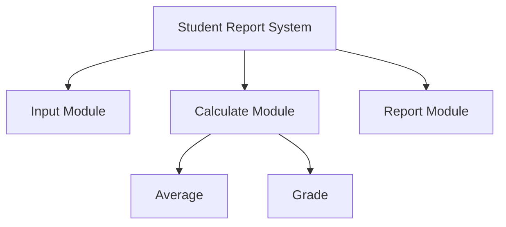
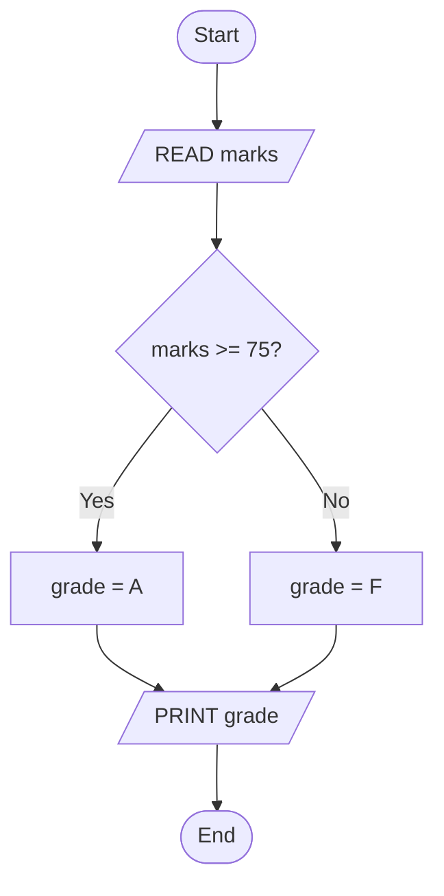

# :LiBook: Lesson 09: Programming & Algorithms

> [!ABSTRACT] Syllabus Scope (NIE Teacher's Guide 9.1-9.13)
> - 9.1-9.3 Problem solving, top-down design/structure charts, algorithms (flowchart/pseudocode/trace)
> - 9.4-9.6 Paradigms, translators, IDE
> - 9.7-9.9 Python basics, control structures, subprograms
> - 9.10-9.13 Data structures, files, databases, search/sort

---
## 1. Problem Solving & Flowcharts

### 9.1 Problem-solving process
1. **Understanding the problem**
2. **Defining problem + boundaries**
3. **Planning solution**
4. **Implementation**: write the code, test it, and debug until it solves the problem.

### 9.2 Top-down design
- **Modularization**: split a large problem into smaller, independent modules. Each module performs one task; modules can be reused and tested separately.
- **Top-down design**: start with the main task, then break it into sub-tasks.
- **Stepwise refinement**: repeat the breakdown until each step is simple enough to code.
- **Structure charts**: show the hierarchy of modules (who calls whom). Boxes = modules; lines/arrows = control or data flow; decision and repetition symbols may also appear. They show organization, not execution order like a flowchart.

| Structure chart type | What it shows | Typical use |
| :--- | :--- | :--- |
| **Transaction** | Control goes to one of several modules based on user choice | Menu-driven systems |
| **Transform** | Sequential data-processing steps | Input → process → output systems |
| **Hybrid** | Combination of transaction and transform | Complex systems |



> [!NOTE] Supporting detail
> Transaction, transform and hybrid structure charts are explained in the NIE lesson-09 reading. The TG requires structure charts in general.

An **Algorithm** is a finite sequence of step-by-step instructions to solve a given problem.

### 9.3 Algorithm representation
- **Flowcharts**: graphical with standard symbols.
- **Pseudocode**: plain-text steps (e.g. `IF marks>=75 THEN grade="A"`).
- **Hand traces / dry runs**: manually track variables in a table to verify logic.

### Standard Flowchart Symbols:
- **Oval / Capsule**: Start / End (Terminal).
- **Parallelogram**: Input / Output.
- **Rectangle**: Process (Calculation, assignment).
- **Diamond**: Decision (Conditional branching `Yes/No`).
- **Arrow / Flowline**: flow direction.
- **Circle**: Connector (on-page; off-page uses labelled connector).
- **Predefined process**: subroutine call (rectangle with double sides, useful for functions).

```text
Pseudocode example:
READ marks
IF marks >= 75 THEN grade = "A"
ELSE grade = "F"
PRINT grade
```

**Hand trace** for `marks = 70`:

| Step | marks | grade | Output |
| :--- | :---: | :---: | :---: |
| Input | 70 | — | — |
| `marks >= 75`? | 70 | — | No |
| `grade = "F"` | 70 | F | — |
| `PRINT grade` | 70 | F | F |

A hand trace records each variable after each step, so you can check the logic without running the program.

**Flowchart for the same logic:**



---
## 2. Program Translators & IDE

### 9.4 Paradigms & Evolution
- **Generations**: 1GL machine, 2GL assembly, 3GL procedural (C), 4GL query/report (SQL), 5GL AI/constraint.
- **Imperative**: *how* via commands/state (C, Python, Java).
- **Declarative**: *what* without how (SQL `SELECT * FROM Users WHERE age>30`, Prolog). HTML is markup, not a programming paradigm.
- **Object-Oriented**: objects = data + methods; class = blueprint, object = instance. Encapsulation, inheritance, polymorphism, abstraction (Java, C++, Python).

### 9.5 Translation
Computers only run `0/1`, so high-level code must be translated.
- **Source program**: human-readable (`.py`, `.c`).
- **Object program**: machine-readable (`.o`, `.obj`), linked then executed.
- **Compiler**: translates the whole source into object code before execution; reports errors after checking the whole program; faster run (e.g., C, C++).
- **Interpreter**: line-by-line translate + run. Stops at first error; slower (e.g., Python, PHP).
- **Hybrid**: compile to intermediate code, then interpret it (classic example: Java bytecode). Python also compiles to bytecode before interpretation, but it is usually classified as interpreted.
- **Linker**: joins object files + libraries into executable.
- Loader (Extension): loads executable into memory.

### 9.6 IDE
**Integrated Development Environment**: editor + compiler/interpreter + debugger in one.
- Features: syntax highlight, autocomplete, open/save files, compile/execute, debugging (breakpoints, step, watch).
- Examples: IDLE, VS Code + Python extension, PyCharm, Thonny.
- Practice: open/save `.py`, run, use debugger to fix logic errors.

---
## 3. Python Syntax & Control Structures

> [!INFO] Deep Dive Note
> For Python data types, List/Tuple/Dict operations, function definitions, and file handling code examples, read: [[Subtopics/Python Control & Data Structures|Python Control & Data Structures Guide]].

### 9.7 Python basics
```python
# Structure: imports, constants, functions, main logic
# Comments: use #; triple-quoted strings are string literals (often docstrings), not true comments
PI = 3.14  # constant by convention (UPPER); Python has no true constant
name = input("Name: ")  # keyboard input (always string)
age = int(input("Age: "))  # casting: int(), float(), str()
print("Hi", name, "age", age)  # output to screen
```

**Typical program skeleton:**
```python
import math                         # 1. imports
PI = 3.14                           # 2. constants
def area(r):                        # 3. functions
    return PI * r * r
radius = float(input("Radius: "))   # 4. main logic
print(f"Area: {area(radius):.2f}")
```
- Variables: dynamically typed, no declaration. `5 + 2.0` gives `7.0`; `6/2` gives `3.0` (always float).
- Primitive types: `int, float, bool, str`.
- Operators: arithmetic `+ - * / // % **` (`**` right-to-left, `2**3**2=512`), relational `== != > < >= <=`, logical `and or not`, bitwise `& | ^ ~ << >>`, membership `in/not in`, identity `is/is not`, assignment `= += -= *=`.
- Precedence (main levels, high → low): `()` > `**` > unary `+x -x ~x` > `* / // %` > `+ -` > `<< >>` > `&` > `^` > `|` > comparisons (`== != > < >= <=`, `in`, `not in`, `is`, `is not`) > `not` > `and` > `or` > conditional expression > assignment statements. `**` is right-to-left; assignment is right-to-left; most other binary operators are left-to-right.
- Output formatting (format-spec mini-language): `f"{value:spec}"` where spec = `[[fill]align][width][,][.precision][type]`:
```python
pi = 3.14159
print(f"{pi:.2f}")      # 3.14 — .2f = 2 decimals
print(f"{85:05d}")      # 00085 — width 5, zero-pad int
print(f"{255:x}")       # ff — hex, X = upper, o = oct, b = binary
print(f"{0.85:.0%}")    # 85% — percent
print(f"{1234567:,}")   # 1,234,567 — thousands separator
print(f"{'Hi':>10}|")   # right-align width 10 (< left, ^ center, = sign-aware)
```
Older forms `"%05d" % n` and `"{}".format(n)` do the same; f-strings are preferred. C++ view: like `printf("%.2f", x)` / `setw` + `setprecision`, but inline in the string.

### 9.8 Control Structures:
1. **Sequence**: Step-by-step execution.
2. **Selection**:
```python
if marks >= 75:
    grade = "A"
elif marks >= 65:
    grade = "B"
else:
    grade = "F"
```
3. **Repetition / Iteration / Looping**:
```python
# For-each loop
for i in range(1, 6):
    print(i)

# While loop
count = 0
while count < 5:
    print(count)
    count += 1
```
- Nested structures allowed (if inside loop, loop inside if).
```python
# Nested: selection inside repetition
for n in range(1, 6):
    if n % 2 == 0:
        print(n, "even")
```

### 9.9 Subprograms / Functions
- **Built-in** (`print, len, input`) vs **User-defined** (`def`).
```python
def greet(name="Guest"):  # default value
    """Return greeting."""  # docstring
    return f"Hello, {name}!"

print(greet())
print(greet("Alice"))
```
- Structure: `def name(params): body + return`.
- Parameter passing (arguments -> parameters), return values, defaults.
- Scope: **local** (inside func) vs **global** (outside); lifetime = duration variable lives. Use `global x` to modify global inside func. `nonlocal x` (Extension) modifies the nearest *enclosing* — not global — binding in nested funcs:
```python
x = 1
def outer():
    x = 10
    def inner():
        nonlocal x  # refers to outer's x, not global
        x = 20
    inner()
    return x  # 20; global x still 1
```

---
## 4. Data, Files, Databases

### 9.10 Data structures (syllabus: strings, lists, tuples, dicts)
- **String**: immutable sequence. `s="hello"; s[0], s[1:3], len(s)`.
- **List**: mutable, ordered, duplicates, `[]`. `append/insert/pop/slicing`.
- **Tuple**: immutable, ordered, `()`. Can be slightly faster and more memory-efficient; if all elements are hashable, it can be used as a dictionary key.
- **Dictionary**: key-value, keys unique and hashable, `{"id":101}`. `d["name"], d["grade"]="A", d.items()`.
- Set (`{1,2,3}`, no duplicates) is Extension — not in 9.10.

### 9.11 File handling
```python
# open modes: "w" write, "r" read, "a" append
with open("results.txt", "w") as f:
    f.write("Kamal,85\n")
with open("results.txt", "r") as f:
    for line in f:
        print(line.strip())
with open("results.txt", "a") as f:
    f.write("Nimal,92\n")  # append without erasing existing data
# basic ops: open, close, read, write, append
```
- Always `close()` unless using `with` (auto-close).

### 9.12 Databases in Python
Embed SQL to connect/retrieve/add/modify/delete (e.g. `sqlite3`):
```python
import sqlite3
conn = sqlite3.connect("school.db")
cur = conn.cursor()
cur.execute("CREATE TABLE IF NOT EXISTS Student(id INTEGER PRIMARY KEY, name TEXT)")
cur.execute("INSERT INTO Student VALUES (?, ?)", (101, "Kamal"))
cur.execute("INSERT INTO Student VALUES (?, ?)", (102, "Nimal"))

cur.execute("UPDATE Student SET name = ? WHERE id = ?", ("Kamal Perera", 101))
print("Updated rows:", cur.rowcount)
cur.execute("DELETE FROM Student WHERE id = ?", (102,))
print("Deleted rows:", cur.rowcount)
conn.commit()

cur.execute("SELECT * FROM Student")
rows = cur.fetchall()
for row in rows:
    print(row)
cur.close()
conn.close()
```
- `?` placeholders pass values as data, not SQL, which prevents SQL injection.
- `commit()` is needed after INSERT, UPDATE or DELETE; SELECT does not change data, so it does not need commit.
- `fetchone()` gets one row; `fetchall()` gets all remaining rows; `rowcount` reports how many rows the last statement changed.

---
## 5. Searching & Sorting Algorithms (9.13)

Syllabus requires **Sequential search + Bubble sort** only. Binary search is Extension.

### A. Linear / Sequential Search:
Checks each element sequentially from index 0 to $N-1$.
- Time Complexity: $O(N)$
```python
def linear_search(arr, target):
    for i in range(len(arr)):
        if arr[i] == target:
            return i
    return -1
```

### B. Binary Search (Extension — not in 9.13):
Requires **sorted array**. Compares target with middle element and halves search space repeatedly.
- Time Complexity: $O(\log N)$
- C++ version (with code + lower_bound): [[04 - Computer Science/01 - C++ Foundations & Algorithmic Paradigms/Lesson 04 - Sorting, Searching & Binary Search|Lesson 04 - Sorting, Searching & Binary Search]].

### C. Bubble Sort:
Repeatedly steps through list, compares adjacent elements, and swaps them if in wrong order.
- After pass `i`, the largest `i` elements are in their final positions; at most `n - 1` passes are needed.
- Time Complexity: $O(N^2)$

```python
# Bubble Sort implementation in Python
def bubble_sort(arr):
    n = len(arr)
    for i in range(n - 1):
        for j in range(0, n - i - 1):
            if arr[j] > arr[j + 1]:
                arr[j], arr[j + 1] = arr[j + 1], arr[j]
    return arr
```

---

## 6. C++ Brain Notes: What Python Hides (not for exam, for sanity)

> [!WARNING] Exam vs Truth
> Some simplified notes say "Python passes by reference". The precise term is **pass-by-object-reference** (also called call-by-sharing): the function receives a reference to the same object, but rebinding the parameter does not change the caller's variable.

- **Variables are names, not boxes.** `int x = 5;` in C++ reserves 4 bytes. `x = 5` in Python binds name `x` to a `PyObject`. `y = x` binds a second name to the *same* object. Check with `id(x) == id(y)`, not values.
- **Assignment never copies mutables.** `b = a` on a list shares it (`b.append(1)` hits `a` too). C++ `vector<int> b = a;` copies. To copy: `b = a[:]`, `list(a)`, `copy.copy(a)`, `copy.deepcopy(a)` for nested.
- **Args: copy of reference.** Function gets a *copy of the reference*, not the variable itself:
```python
def f(n, lst):
    n = 99        # rebind local only — caller unchanged (looks like pass-by-value)
    lst.append(99) # mutate shared object — caller sees it (looks like pass-by-reference)
    lst = []       # rebind local only — caller unchanged
```
C++ equivalents: neither `f(int x)` (copy) nor `f(int& x)` (true alias). There is no way to rebind the caller's name from inside.
- **`==` vs `is`.** `==` compares values (like overloaded `==`), `is` compares identity (`&a == &b`). Never use `is` for numbers/strings: small-int cache `[-5,256]` and interning make `256 is 256` true but `257 is 257` unpredictable.
- **int never overflows.** Python `int` is arbitrary-precision (like `boost::multiprecision::cpp_int`), not `int32`. No UB, just slower. `float` *is* still IEEE754 double like C++ `double`.
- **`range` is lazy, slice is a copy.** `range(1,6)` generates on the fly (not `vector<int>`). `a[0:2]` allocates a new list (not `string_view` / reference).

---

## :LiRocket: Flashcards (Spaced Repetition)

#flashcards

What are the 4 steps of problem solving (9.1)? :: Understand problem, define boundaries, plan solution, implement.
<!--SR:!2026-11-12,16,290-->

What is modularization + stepwise refinement? :: Split into modules, refine top-down from main task to detailed steps; show with structure charts.
<!--SR:!2026-11-01,4,270-->

What is a structure chart? :: It shows the module hierarchy: boxes are modules, lines/arrows show control or data flow; it is not an execution-order flowchart.
<!--SR:!2026-10-31,3,250-->

Name 3 ways to represent algorithms. :: Flowcharts, pseudocode, hand traces.
<!--SR:!2026-11-07,11,270-->

What is a hand trace? :: Manually recording each variable's value step by step in a trace table to verify an algorithm's logic.
<!--SR:!2026-11-01,4,270-->

What is the difference between a Compiler and an Interpreter? :: A Compiler translates the entire source code into machine code at once prior to execution; an Interpreter translates and executes source code line-by-line at runtime.
<!--SR:!2026-11-10,14,290-->

What is source vs object code? :: Source is human-readable .py/.c; object is machine-readable .o/.obj linked then run.
<!--SR:!2026-11-10,14,290-->

What is hybrid translation + linker? :: Compile to intermediate then interpret (Java bytecode); linker joins objects + libraries to exe. Python also uses bytecode but is usually called interpreted.
<!--SR:!2026-11-06,10,270-->

Which flowchart symbol is used for Decision making? :: Diamond.
<!--SR:!2026-11-12,16,290-->

What are the 3 fundamental control structures in programming? :: 1. Sequence, 2. Selection, 3. Iteration.
<!--SR:!2026-11-11,15,290-->

Compare imperative vs declarative vs OOP. :: Imperative how (C/Python), declarative what (SQL/Prolog), OOP objects/classes with encapsulation/inheritance.
<!--SR:!2026-11-10,14,290-->

What are IDE basic features? :: Open/save, compile/execute, debugging (breakpoints/step).
<!--SR:!2026-11-11,15,290-->

What does input() return and how to get int? :: Always string; use int(input()) / float() / str() casting.
<!--SR:!2026-11-10,14,290-->

What is the typical structure of a Python program? :: Imports, constants, function definitions, then the main logic.

What is operator precedence in Python? :: Main order: () > ** > unary (+x -x ~x) > * / // % > + - > << >> > & > ^ > | > comparisons/in/not in/is/is not > not > and > or > conditional > assignment; ** right-to-left.

What is local vs global scope? :: Local inside func, global outside; lifetime is duration variable exists.
<!--SR:!2026-11-06,10,270-->

What is the difference between a Python List and a Tuple? :: A List is mutable (can be modified) and defined using square brackets `[]`; a Tuple is immutable (cannot be modified) and defined using parentheses `()`.
<!--SR:!2026-11-11,15,290-->

What are basic file operations/modes? :: Open, close, read, write, append; modes w/r/a, use with for auto-close.
<!--SR:!2026-11-04,8,250-->

How to manage DB data in Python? :: Connect (sqlite3), create a cursor, execute SELECT/INSERT/UPDATE/DELETE, commit changes, fetch results and close.
<!--SR:!2026-11-01,4,270-->

How do you update or delete a row in SQLite from Python? :: Run UPDATE or DELETE with `?` placeholders, then `commit()`; `rowcount` reports the affected rows.

What is sequential search complexity? :: O(N), check 0 to N-1.

What is the precondition for executing a Binary Search algorithm on an array? :: The array must be sorted in ascending or descending order.

What is the worst-case Time Complexity of Bubble Sort? :: $O(N^2)$.
<!--SR:!2026-11-11,15,290-->

What is Python argument passing (C++ view)? :: Pass-by-object-reference: function gets copy of reference; rebinding param does not affect caller, mutating shared object does.

When to use `is` vs `==` in Python? :: `==` for values, `is` for identity; never use `is` for numbers/strings due to caching.
